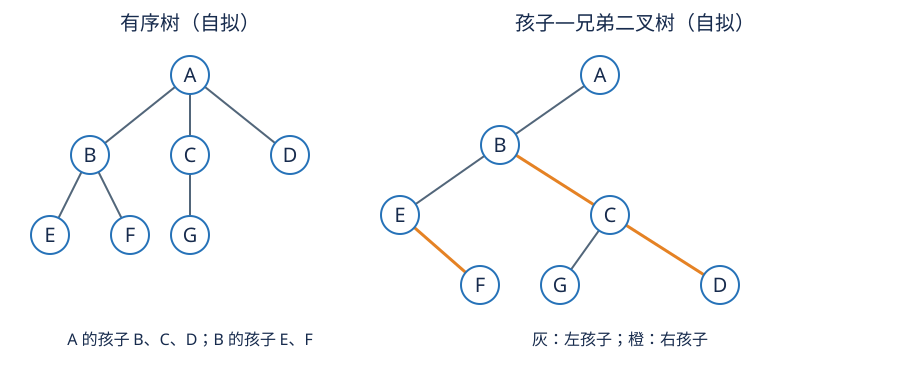
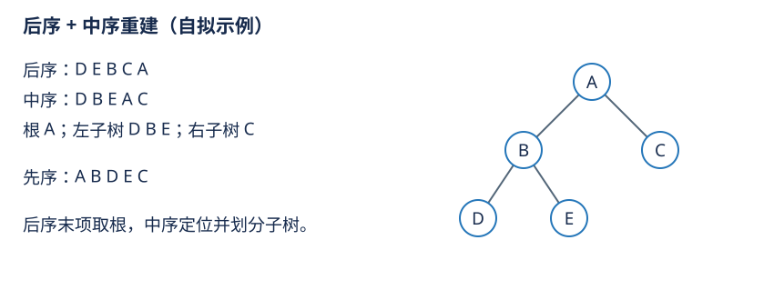
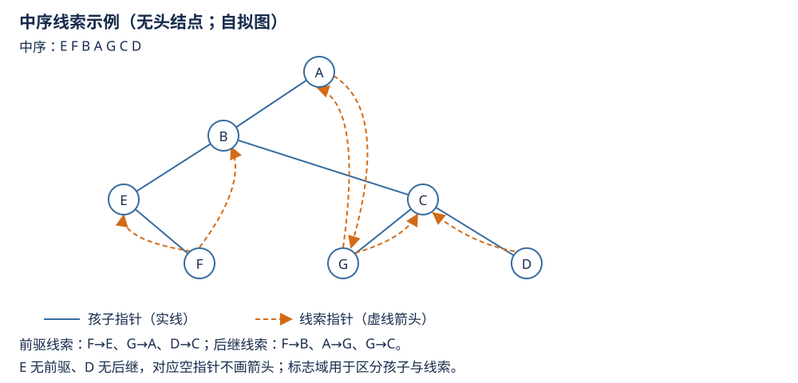

# 数据结构 · 11 月 2 日 · 树与森林的转换、遍历与线索二叉树 · 详细版讲义

> **来源说明**：本讲义依据 **11 月 2 日**那一次课的课堂录音转写整理，并与严蔚敏《数据结构（C语言版）》第 6 章对照校订而成，属**讲授稿性质的整理稿**。全篇以**第一人称**写成——写作者就是讲授者本人，课堂上的追问、点评都以「我」的口吻呈现。
>
> - **转写来源**：两份连续的 ASR 导出文字——`讲解树与二叉树相关学习要点_导出原文.txt`（约 0.35 万字）与`20261102_112526_导出原文.txt`（约 0.42 万字）。**前一份讲森林右子树结点数的练习时中断**，后一份**开头就接着给出并解释了那道题的答案（$M-N$）**，所以两份是同一次课的前后两段，**合成一份讲义**。
> - **这一节的主线**：复习"纵深用栈、横向用队列" → 为什么要把树和森林转成二叉树（两个理由）→ **指针利用率**这笔账（$m$ 叉树的 $(n-1)/(mn)$）→ **有序树转二叉树**（加线、抹线、调整）→ 转换后的两个特点 → **逆转换**（二叉树还原成树）→ **森林与二叉树互转** → 森林里第 $k$ 棵树的结点数 $M-N$ → **树的遍历**（先根／后根／层次）与**森林的遍历**（先序／中序）→ **由遍历序列重建二叉树** → **线索二叉树**的引入与 tag。
> - **这一节的边界**：课末讲到线索二叉树的引入，并**留了一个问题给大家回去想——"能不能用递归实现线索化"**，转写到这里结束。所以**线索化的完整算法、线索树上找前驱后继的具体代码**都不在本讲义内，属于下一节。
> - **教材对照范围**：**6.4.1 树的存储结构**（孩子—兄弟表示法）、**6.4.2 森林与二叉树的转换**、**6.4.3 树和森林的遍历**、**6.3.2 线索二叉树**。教材的顺序是"先二叉树（含线索）→ 后树和森林"；本课按"先转换、再遍历、最后引线索"讲，附录 A 标出了这个次序差异。
> - **一处必须交代的还原缺陷**：课上用来演示转换的那棵**有序树**、以及用来演示"由序列重建"的那两串**先序／中序字母**，在转写里都有多处辨认不清（`GBQ`、`ACD`、`AGP drr` 之类）。**这些图和字母序列我无法唯一还原**，所以正文的演算**全部另画了能核验的小例子**，并把课件原图列进「待核实内容」。
> - **一处必须点名的转写讹误**：讲"某些语言不给递归"时把语言名识别成了「化学语言」，讲"森林后根"时又说成「通序／工序」——**这些都是 ASR 错识**，正文按上下文还原并标注原话，**不臆造术语**。
> - **编号说明**：我沿用的章节号比严蔚敏教材**大 1**——我的「第 7 章 树和二叉树」＝教材**第 6 章**。标注教材出处时一律用教材真实章节号。
> - **时间说明**：本节课为**文字模式**（无音视频轨、无关键帧），各节时间戳是按**字数折算的伪时间**（约 200 字／分钟），非音频真实时间，只作讲义内部单调递增的定位坐标；全课伪时间长约 42 分钟。
> - **示意图说明**：正文里的示意图**全部是独立的 SVG 矢量图片**，存放在 `数据结构/插图/`（`w1102_01` ～ `w1102_03`），正文用 `` 直接嵌入。SVG **不依赖插件、不需要联网**，在阅读视图、导出 PDF、任何 Markdown 查看器里都能显示，放大不糊。
> - **关联阅读**：[[数据结构 第九周第二节 二叉树的遍历 详细版讲义]]（上一节：三种次序、由序列反推、逆转链）、[[数据结构 第九周第一节 树与二叉树 详细版讲义]]（树的存储结构、孩子—兄弟表示法）、[[数据结构 第六周第一节 队列 详细版讲义]]（层次遍历要用队列）。

## 开场导读

这一节把"树和森林"这条线收口。

前面讲了三种东西：**树、森林、二叉树**。它们是三个模型，**但可以互相转换**——而且转换完之后，**树和森林的几乎所有问题都能借二叉树的算法来解决**。这一节就是讲"**怎么转、转完有什么性质、转完怎么遍历**"，最后引出一个新话题：**线索二叉树**。

我开场先接上一节的话头，把"**纵深用栈、横向用队列**"这条对照讲透：

> 非线性结构它是**二维**的，它实际上**有两个维度**。一个维度是**纵深**，另外一个维度是什么？是**广**。我们说一个人**知识渊博**——"渊"谈的是**深度**，"博"谈的是**横向的广大**。

> 那我们往往在谈**纵**这个方向的时候，**还需要借助于栈**。为什么？因为比如说中序遍历，你**拿到根节点不能访问**，你要**先遍历左子树**，而你去遍历左子树，**指针往下走，就会拿到一棵新的二叉树**——拿到一个新的二叉树，你**要处理它，就涉及到递归调用**，所以我们**用栈来处理**。

> 那**层次遍历**呢，就处理**横向**这个"广大"。因为层次遍历它有一个**从左到右**的次序问题——我们说计算机当中**凡是涉及到排队**，**先左后右**这不就是一个排队次序吗？**凡是涉及到排队的这种操作，我们要借助队列来实现。**

**这段对照的价值在于**：它把"**栈**"和"**队列**"从两个孤立的数据结构，变成了"**两种处理方向各自的工具**"。**纵深 → 回退 → 栈；横向 → 排队 → 队列。** 记住这一句，后面所有遍历的实现都顺。

然后我讲了**为什么要转**，两个理由：**二叉树本身好用**（规模、孩子、双亲都容易把握），**以及存储上划算**——这里有一笔账，我课上算了三遍（$m=2$ 是 50%、$m=3$ 是 33%），**账算完，结论就出来了：二叉树最经济**。

转换的规矩，我给的是"**三步六字真言**"：**加线、抹线、调整**。加线是"**亲兄弟之间连虚线**"（表兄弟不连），抹线是"**只留老大，其余逐出师门**"，调整是"**拎起葡萄串抖一抖**"。逆转换也是这三步，只是**考察对象变成"是双亲左孩子的那些结点"**，加线要"**沿右链当右派当到底**"。

遍历这一段最要紧的是一张对应表：**树的先根 ↔ 二叉树的先序**，**树的后根 ↔ 二叉树的中序**。这张表是考试的高频点，我在课上说了"**这个原因你们自己回去想一下**"——本讲义第九节把它补全了。

最后落到**线索二叉树**。我先把它"是什么、不是什么"说清楚：**它不是新模型，是遍历结果的应用和再利用**——因为"**树给定、规则给定，遍历序列就唯一**"，所以**这棵树里其实"藏"着一个线性序列**。线索化就是**把这个藏着的序列，用那些空指针显式地存下来**。课末留的问题是：**线索化本身能不能用递归写？**

## 总览知识地图

这一节三大块，一条主线：

- **为什么要转**：二叉树好用 ＋ 指针利用率高（$m=2$ 时约 50%，$m$ 越大越低）。
- **怎么转**（三对）：
  - **树 → 二叉树**：加线（亲兄弟连虚线）→ 抹线（只留老大）→ 调整（抖葡萄）。
  - **二叉树 → 树**：考察"是双亲左孩子"的结点 → 沿右链补线 → 抹掉所有右孩子边 → 调整。
  - **森林 ↔ 二叉树**：逐棵转换后，**后一棵作为前一棵根结点的右子树**（因为单棵树转出来的根**一定没有右孩子**）。
- **转完怎么用**：
  - **遍历对应**：树的先根 ↔ 先序；树的后根 ↔ 中序；森林的先序／中序同理。
  - **反推**：先序＋中序（或后序＋中序）且值互异 → 唯一还原；先序＋后序不行。
  - **线索化**：把空指针填成**前驱／后继**，用 **tag** 区分"孩子"还是"线索"。

## 正文

### 一、复习：纵深用栈，横向用队列 `00:00-00:03`

这一节接着上一节讲。上一节最后停在"遍历要不要用栈"，这一节先把"**为什么是栈**、**什么时候是队列**"讲清楚。

> 非线性结构它是**二维**的，它实际上**有两个维度**。我们说从**系统观**的角度认识事物，**都有两面性**——谈事物有**正反两面**，谈人有**好坏**。那二叉树怎么样？**也有两个维度**：一个维度是**纵深**，另外一个维度是**广**。

> 我们说一个人**知识渊博**——"**渊**"谈的是啥？**深度**；"**博**"谈的是啥？**这种横向的广大**。

**这两个维度对应两种工具**：

| 维度 | 走法 | 需要什么 | 用什么 |
|---|---|---|---|
| **纵深** | 一条路走到黑，走不通再退 | **回退**，要记住来路 | **栈** |
| **横向** | 一层一层铺开 | **排队**，先来的先处理 | **队列** |

**为什么纵深要用栈？我课上讲得很具体**：

> 因为比如说我们的**中序遍历**，你**拿到根节点不能访问**，你要**先遍历左子树**；而你去遍历左子树，**指针往下走，就会拿到一棵新的二叉树**。拿到一个新的二叉树，你**要处理它，就涉及到递归调用**，所以我们**用栈来处理**。

> 这个纵深的方向，它是**不断地往纵深走**，**每一次都会拿到一棵新的二叉树**，我们**要对它处理然后再回来**——所以用到栈。

**注意"再回来"这三个字**：**往下走不难，难在回来**。这就是上一节讲的"来路要有地方存"。

**为什么横向要用队列？**

> 我们的**层次遍历**，就处理这个**横向**的、**广博**的。因为层次遍历它有一个**从左到右**，我们说**一个处理一个**，是个**次序问题**——计算机当中**凡是涉及到排队，凡是涉及到"先左后右"，这不有一个排队次序吗**？**凡是涉及到排队的这种操作，我们要借助队列来实现。**

**"先来先服务"** 就是队列的全部内容：层次遍历里，**先被发现的结点先被处理**，而"发现"的顺序正是"从左到右、从上到下"。

**还要交代一句"谁提供工具"**：

> 我们说栈的话，在**所有的计算机语言**当中，**除了操作系统给我们提供**，**大部分的语言也提供了对栈的支持**（就是编译系统）。**当然只有少数的、不提供栈的这种自我调用**——那这种情况下我们就需要**非递归化**。

> 那**队列**呢？**也是一样**，操作系统给你提供了，**但是大部分的编译器并没有给你提供队列的这种管理方式**——也就是说，**队列需要用户自己管起来**。

**这句话要说准**：**"编译器不提供队列"指的是没有内建的队列类型**，不是说不能实现。**C 没有标准容器队列，你可以自己用数组或链表实现**；**C++ 的 STL 里有 `queue`**，其它语言的库也多半有——**但那都是"库"，要你显式调用入队、出队**。**"要自己管"的意思是"要自己调用、自己维护"**，不是"要从零发明"。

**本节要点**

- **纵深 → 回退 → 栈**；**横向 → 排队 → 队列**。"渊"是深度，"博"是广度——一个词把两种遍历分开了。
- **下走不难，回来难**：递归每深入一层就拿到一棵新子树，**回来时要知道从哪儿来**，所以要栈。
- **层次遍历是排队问题**："先发现的先处理"正是队列。
- **栈多数语言有内建或运行时支持**（递归就是靠它）；**队列一般要自己调用库或自己实现**——"自己管"是"自己维护"，不是"从零发明"。

### 二、为什么要把树和森林转成二叉树 `00:03-00:07`

进入正题前，先回答"**凭什么要转**"。我给了**两个理由**。

#### 2.1 理由一：二叉树本身好用

> 第一个理由就是：**二叉树有很多优点**，我们前面刚讲过，**好多优点树和森林是没有的**——比如**树的规模**呀，比如它的**子树、孩子节点、父近（双亲）节点可以容易捕获**呀，等等之类。

**具体说**：

- **二叉树的规模有公式**（$n_0=n_2+1$、第 $i$ 层至多 $2^{i-1}$ 个、深度 $k$ 至多 $2^k-1$ 个），**树和森林没有这么整齐的公式**；
- **二叉树的孩子数固定为 2**，**结构体一种就够**；树的孩子数不定，**存储上要么定长浪费、要么变长难管**；
- **二叉树的遍历只有三种**（先／中／后），**规则统一**；树的孩子数不定，**"第几个孩子"要靠约定**。

**所以**：**树和森林不好把握，就先转成二叉树，处理完再还原回去**——

> 我们往往在考察研究树和森林的时候，**先把它转换成二叉树**，然后**处理完，处理完了之后再怎么样，大不了再还原回去**呗。**再倒腾回去嘛**。

**"倒腾回去"** 这四个字很实在：**转换不是目的，是手段**。

#### 2.2 理由二：存储上划算——这笔账要算三遍

第二个理由是**存储**。这里有一段很长的账，我课上**让学生算了三遍**（二叉树、三叉树、四叉树）。

**先把模型说清**：如果每个结点都**固定给 $m$ 个指针**（都指向孩子），那么这棵树**就相当于一棵"$m$ 叉树"**。这个 $m$ 应该取多少？

> 这个 $m$ 的指针应该取到啥？**取到最大**——这个 $m$ 应该取成什么呢？**树的度**。就是**孩子个数最多的那个结点**的那个数。

**$m$ 取"树的度"**，这是**定长孩子表示法**的标准做法（上一节讲过）。

**然后算利用率。** 设树有 $n$ 个结点，每个结点 $m$ 个指针：

$$
\text{指针总数}=mn,\qquad \text{非空指针}=n-1 .
$$

**为什么非空指针是 $n-1$？** 我课上的说法很形象：

> 我们说**非空的指针**，这**每一个孩子节点都有一个"路边"（边）**，就联系着对应的一个**非空的指针**。**除了这个根**——咱们说**女娲造人**，除了这个根，**它不是孩子节点**——**其他的 $n-1$ 个结点都是孩子节点**，它都有一个**有效的指针**指向它。

> **你随便画一个二叉树，你画一画也能看出来非空指针有多少个。** 这么简单——**上节课刚讲了**。

**"女娲造人"** 这个比方是上一节留下的：**根没有"父亲"**（女娲追根溯源不知道她父亲是谁），**其余每个结点都有且只有一个父亲**，所以**每个非根结点恰好对应一条边、一个非空指针**。

于是**利用率**：

$$
\eta_m=\frac{n-1}{mn}.
$$

**代三个数**：

| $m$ | 非空指针 | 指针总数 | 利用率 $\eta$ | 课上原话 |
|---|---|---|---|---|
| $2$（二叉树） | $n-1$ | $2n$ | $\dfrac{n-1}{2n}\approx 50\%$ | "**约等于 50%**" |
| $3$（三叉树） | $n-1$ | $3n$ | $\dfrac{n-1}{3n}\approx 33\%$ | "**33%**" |
| $4$（四叉树） | $n-1$ | $4n$ | $\dfrac{n-1}{4n}\approx 25\%$ | "**利用率越来越低**" |

**注意"约等于"三个字**：$m=2$ 时**只有当 $n\to\infty$ 才趋近 $50\%$**，**$n$ 小的时候到不了**（$n=2$ 时是 $1/4=25\%$）。**它不是"恰好 50%"。**

**顺带把"空指针"也算出来**，因为后面线索化要用：

$$
\text{空指针}=mn-(n-1)=(m-1)n+1 .
$$

**$m=2$ 时**：空指针 $=n+1$ ✓（上一节反复用的结论）。

**结论**：

> 所以从存储的角度来讲，**$m=2$ 最经济实惠**，**指针的利用率最高**。

**这就是第二个理由**：**转成二叉树，不只是"好用"，还"省"**。

**但这句话要加限定**（我课上没展开，但必须说）：

- 这是**只看"指针域占比"**的算法，**不代表二叉树在所有操作上都最优**；
- **$m$ 取"树的度"** 是**定长**方案；如果改用**变长**或**孩子链表**，账就不一样了（上一节讲过）；
- **指针利用率高 ≠ 空间利用率高**：指针只占结点的一部分，还有 `data` 域。

**本节要点**

- **两个理由**：**二叉树好用**（规模有公式、孩子数固定、遍历规则统一）＋**存储划算**（指针利用率最高）。
- **非空指针 $=n-1$**：除根以外每个结点都是某人的孩子，**"女娲造人"只造了根**。
- **利用率 $\eta=(n-1)/(mn)$**：$m=2$ 时趋近 $50\%$、$m=3$ 趋近 $33\%$、$m=4$ 趋近 $25\%$；**是"趋近"，不是"恰好"**。
- **空指针 $=(m-1)n+1$**；$m=2$ 时是 $n+1$（线索化要用）。
- **限定**：这只算了指针域，**不等于二叉树在所有操作上最优**；换变长或孩子链表，账要重算。

### 三、有序树转二叉树：加线、抹线、调整 `00:07-00:12`

转换之前先立一条**前提**，这条前提不说清，后面全乱：

> 我们怎么样？**当（然）是有序树**——然后根据它的**基本原理，是根据树的孩子兄弟表示法**来做的。

**"有序树"** 三个字是**必须的**：孩子—兄弟表示法里，**"第一个孩子"和"下一个兄弟"都带次序**；一棵**无序树**（孩子的先后无所谓）**没法唯一地转成一棵二叉树**——你得先给它**约定一个次序**。

**转换规则一句话**：

> **二叉树的左孩子指向原树的第一个孩子，右孩子指向原树的下一个兄弟。**

**"孩子"和"兄弟"是同一组结点的两种解释**，**不是添新结点**。

#### 3.1 三步：加线、抹线、调整

> 实际上操作来说就怎么样？**就三步，然后六字真言**——**六字真言，每一步两个字**：第一个步骤**加线**，第二个步骤**抹线**，第三个步骤是**调整**。

**第一步：加线。**

> 在**所有的兄弟节点之间添加一条虚线**。那有同学会说**为啥是虚的呀**？**跟原来的连线区别开嘛**。

**加线的边界**（这是最容易错的地方）：

> 那注意这里面 **$E$ 和 $F$ 加不加线**？**$E$ 和 $F$ 之间加不加线？不加**。为啥？我们**再三强调要亲兄弟**，**咱不研究那个什么表兄弟、堂兄弟**，对不对？**亲兄弟就都得是一个爹**，同一个爹你才加——**亲兄弟之间加一根虚连线**。

**"亲兄弟"= 同一个双亲**。$E$、$F$ 若是**不同双亲**的孩子（比如一个是 $B$ 的孩子、一个是 $C$ 的孩子），**它们不连**。三个兄弟 $B,C,D$ 要加的是 **$B$—$C$、$C$—$D$ 两条相邻的**，**不是两两都连**（否则会连出三角形，那就不是"兄弟链"了）。

**第二步：抹线。**

> **文绉绉的话来说就是**：**除了保留父亲节点和第一个孩子节点之间的连线，其他的父节点和孩子节点之间的连线全都抹掉**。

> 本来你看这个 $A$ 他有**三个孩子**，如果我们按照**从左到右**、**老大老二老三**，就是说这个父母怎么样？**把老大留下来，老二老三 $C$ 和 $D$ 全都不要了**，那就把这个线**抹掉**。

> **大白话就是**：**除了把第一个孩子留下来，老大留下来，其他孩子都不要了——其他孩子都逐出师门。**

> 就好像比如说一个**武术门派**，面临**仇家上门来寻仇**咋办？**师傅慌了**，说「**大师兄留下，其他的都先逐出师门**」——等把这个危机过了你们再回来。所以**老大留下，其他的都不要了**。

**注意"逐出师门"只是"抹掉连线"，不是"删掉结点"**：$C$、$D$ 还在树上，只是**不再直接挂在 $A$ 下面**——它们会通过**兄弟链**（右指针）挂到 $B$ 后面去。**这一点想岔了，整张图就画错。**

**第三步：调整。**

> 有的书上面叫**旋转**——就是说把这棵树**整个顺时针旋转 45°**。那么说这个**旋转不太好**，为什么呢？因为**对于某些节点你来旋转，就比如这根线旋转 45° 变成啥了？变成 $E$ 和 $B$ 就平行了**，**这样子看起来很不好看**。

> 所以我们把这个叫做**调整**，换了个词儿。为什么叫调整呢？**你把这棵树想象成躺在盘子上的一串葡萄**，然后**拎着这个根节点 $A$，拿着它提起来抖一下**——**抖一下，这些节点就会掉下来，按层次分布**。**原有的连线向左倾斜，新加的连线向右倾斜**，就这么简单。

**"抖葡萄"** 这个动作把三件事一次说清了：

1. **按层次分布**——抖完自然是一层一层的；
2. **原有连线（父子边）向左倾斜** → 成为**左孩子边**；
3. **新加连线（兄弟边）向右倾斜** → 成为**右孩子边**。

> 然后这个**新加的连线怎么样？我把虚线变成实线**。

**为什么不用"旋转 45°"这个说法？** 因为**整棵树统一转 45°，会让本该竖直的边变斜、本该斜的边变平**——**"抖"是逐点重新布局，"旋转"是整体刚性变换**，两者结果不一样。**用"抖"能画对，用"旋转"容易画歪。**

#### 3.2 照着做一遍

下面这张图就是一棵**自拟的**有序树和它对应的二叉树：



> **图注（有序树 → 二叉树）**：左图是**有序树**：$A$ 的孩子依次是 $B,C,D$；$B$ 的孩子依次是 $E,F$；$C$ 的唯一孩子是 $G$。右图是转换得到的二叉树，**灰色边是左孩子（指向原树的第一个孩子）、橙色边是右孩子（指向原树的下一个兄弟）**。对应关系：$A.\text{left}=B$、$B.\text{right}=C$、$C.\text{right}=D$（三个兄弟排成一条右链）；$B.\text{left}=E$、$E.\text{right}=F$（$B$ 的两个孩子）；$C.\text{left}=G$（$C$ 只有一个孩子，**它是左孩子，不是右孩子**）。**注意 $D$ 在二叉树里是 $C$ 的右孩子，但它在原树里是 $A$ 的第三个孩子**——**右指针表达的是"兄弟"，不是"父子"**。

**这张图上最容易看错的一处**：$D$ 在二叉树里挂在 $C$ 的右下，**看起来像 $C$ 的孩子**——**其实它是 $A$ 的孩子、$C$ 的弟弟**。**"右链 = 兄弟链"这条要刻进去。**

**本节要点**

- **前提：有序树**——无序树要先约定孩子次序，否则转换不唯一。
- **规则**：**左孩子 = 原树的第一个孩子**；**右孩子 = 原树的下一个兄弟**；**不添结点**。
- **加线只连"亲兄弟"且只连相邻的**（$B$—$C$、$C$—$D$，不连 $B$—$D$；表兄弟不连）。
- **抹线只抹"非老大"的父子边**——**是抹线，不是删结点**，$C,D$ 改走兄弟链。
- **调整是"抖葡萄"不是"转 45°"**：节点按层次落位，**原边（父子）左倾、新边（兄弟）右倾**，虚线改实线。
- **右链 = 兄弟链**：二叉树里"右下"的那个，**在原树里往往是"弟弟"而不是"孩子"**。

### 四、转换得到的二叉树有哪两个特点 `00:12-00:14`

转完不是就完了，**得知道转出来的东西长什么样**。我课上总结了**两个特点**。

**特点一：单棵树转出来的二叉树，根一定没有右孩子。**

> 第一个特点就是：**所转换得来的这棵二叉树，根节点一定没有右孩子**。

**为什么？** 因为**右指针表示"下一个兄弟"**，而**单棵树的根没有兄弟**（它上面没有双亲，自然谈不上兄弟）。**所以根的右指针一定是空的。**

**这个特点马上要用**：森林转二叉树就是靠它——**每棵树的根右指针空着，正好拿来挂下一棵树**。

**特点二：原来的兄弟，变成了"第一个孩子的右链"。**

> 第二个特点就是：**原来是兄弟节点的这些个节点，会变成第一个孩子的……右子孙**——沿着他的**右孩子的右子孙**排布下来。**就原来是兄弟节点，现在变成沿着他的右孩子的右链不断排下来的。**

**说准确一点**：$A$ 的孩子 $B,C,D$ 三个兄弟，转完之后是 **$B$ 右接 $C$、$C$ 右接 $D$**——**$C$ 和 $D$ 是 $B$ 的"右子孙"，不是 $B$ 的孩子**（它们的父子关系已经抹掉了，是兄弟关系）。**所以"兄弟变孩子"这个说法不准确**，准确的是"**兄弟排成右链，挂在大哥的右边**"。

我课上用了一个文化类比，挺有意思：

> 这个实际上我们中国**东方古典哲学**也有啊——我们经常说**长兄为父**。父母不在，**长兄为父**，看到没有？**老大扮演着父亲的角色**；那么**师傅不在，大师兄说了算**——**大师兄管着底下的师弟们**。

**"长兄为父"** 恰好对应图上的形状：**大哥在左（是"父亲"的位置），弟弟们在右（排成"孩子"的链）**——**形似父子，实为兄弟**。

**本节要点**

- **特点一**：**单棵树转出来的二叉树，根没有右孩子**（根没有兄弟）——**森林转换正是靠这个空位挂下一棵**。
- **特点二**：**原来的兄弟排成一条右链，挂在大哥的右边**——**"兄弟变孩子"的说法不准确**，它们仍是兄弟，只是**用右指针串起来**。
- **"长兄为父"** 只是形似：**大哥在左、弟弟在右链**，看着像父子，实际是兄弟。

### 五、二叉树还原成树 `00:14-00:18`

> 那**还得还原回来**，对不对？……**还原的规则第一个也是六字真言，三个步骤**：首先**加线**、然后**抹线**、最后**调整**。

**还原的第一步，难点在"考察谁"**：

> 这个加线的话呢，它**是有特定的对象**。哪些对象加线呢？**它必须是父亲节点的左孩子**——我们**考察的对象只针对那些是父节点的左孩子**；**如果某一个节点它是父节点的右孩子，我们根本不予理会**。

**为什么只看左孩子？** 因为**左指针才代表"孩子"**（第一个孩子），**右指针代表的是"兄弟"**。所以**只有"左孩子"才是某个父亲的真正孩子**，**右孩子是"兄弟链"上的结点**。

**加线的规则**：

> 沿着这个节点 $X$ 的**右孩子的右链**，以及**沿着右链一直搜索到的所有的右孩子**，把**这些个右孩子都和 $X$ 的双亲进行连线**。

> 也就是说**当右派当到底，不能拐弯**——**不能中途拐弯，当右派当到底**。

**"当右派当到底"** 是个很形象的说法：**沿着 `right` 一直走，走到 `right` 为空为止，中途不许进左子树**。走到的每一个结点，**都和 $X$ 的双亲连一条线**——因为**它们原本就是那个双亲的孩子（兄弟）**，现在要把"兄弟关系"还原成"父子关系"。

**第二步抹线**：

> **减线倒是简单**：直接把**所有的右孩子**、**父节点和右孩子之间的连线全都不要了**。

**第三步调整**：还是"抖葡萄"，节点按层次落位，**这次是还原成"树"，不是二叉树**。

#### 5.1 一个必须当心的画法

这里我课上专门点了名，因为**很多人栽在这一步**：

> 有很多同学**顺手一画就错了**。为啥呢？因为**这个 $D$**（举例）**是 $C$ 的左孩子**，转换得到的树怎么样？**他把这个 $D$ 也画到 $C$ 的左边**——**合适吗？不合适。**

> 我们**再三强调**：**树谈次序，一个巴掌拍不响**。**如果树只有一个孩子，分不分左右？不分，老大老二不分。** 所以**画在它的中间**——**这个 $C$ 它只有唯一的一个孩子，你把它画到中间，别顺手画到左边或右边，那我要扣分的。**

**这条规则和上一节是同一个道理**：

- **二叉树**里，一个孩子**必须分左右**（左孩子、右孩子是**两个不同的位置**）；
- **树**里，一个孩子**没有左右之分**（"第几个孩子"要两个以上才谈得上）——**画在正下方**。

**所以还原完，凡是"只有一个孩子"的结点，孩子要画在中间**，不能因为它在二叉树里是"左孩子"就画到左边。**这是"二叉树 ↔ 树"两个模型的分界线**，画错就说明**没分清模型**。

#### 5.2 照着做一遍（以第三节那棵为例）

用第三节的二叉树还原（$A$ 的左孩子 $B$、$B$ 右接 $C$、$C$ 右接 $D$；$B$ 左孩子 $E$、$E$ 右接 $F$；$C$ 左孩子 $G$）：

1. **找考察对象**：是"双亲左孩子"的有 $B$（$A$ 的左孩子）、$E$（$B$ 的左孩子）、$G$（$C$ 的左孩子）——**$C$、$D$、$F$ 都是右孩子，不考察**；
2. **加线**：
   - $B$ 的右链是 $C$、$D$ → **$A$ 连 $C$、$A$ 连 $D$**；
   - $E$ 的右链是 $F$ → **$B$ 连 $F$**；
   - $G$ 没有右孩子 → **不用加**；
3. **抹线**：抹掉所有右孩子边（$B$—$C$、$C$—$D$、$E$—$F$）；
4. **调整**：$A$ 的孩子是 $B,C,D$（三个，画成一排）；$B$ 的孩子是 $E,F$；$C$ 的孩子只有一个 $G$——**$G$ 画在 $C$ 的正下方**；$D$ 没有孩子。

**得到的就是第三节那棵有序树**——**转过去再转回来，必须回到原样**。**这就是检验你有没有真会的方法。**

**本节要点**

- **还原也是三步：加线、抹线、调整**。
- **加线只考察"双亲的左孩子"**——**右孩子一律不管**（左代表"孩子"、右代表"兄弟"）。
- **沿右链"当右派当到底"**（只走 `right`，走到空为止），**链上每个结点都与其双亲连线**。
- **抹线**：把所有"父—右孩子"的边抹掉。
- **调整后要按"树"的画法**：**只有一个孩子的结点，孩子画在正中间**——**不能因为它在二叉树里在左边就画左边**。
- **转过去再转回来必须回到原样**，这是最好的自检。

### 六、森林转二叉树 `00:18-00:20`

森林的定义先摆出来：

> 啥叫森林啊？**$m$ 棵不相交的树的集合**。

**转换两步**：

> **把森林的每一棵树转换成二叉树**，转换得来的二叉树，然后**做第二个步骤——二叉树依次连接**。

> 怎么连接呢？**后一棵作为前一棵二叉树的根结点的右子树**。

**为什么能这么连？** 因为**上一节的特点一**：

> 你之所以可以这么做，就是因为**一棵树转换成二叉树，这个二叉树的右子树是空的**，所以能这么做。

**逐棵转、然后串起来**——$T_1$ 的根右指针空着，挂 $T_2$ 的根；$T_2$ 的根右指针空着，挂 $T_3$ 的根……**最后得到的是一棵二叉树**。

#### 6.1 一个"看着像二叉树，其实还得转"的坑

课上专门考了大家一下，这个点很好：

> 那现在问你：**第三个需不需要转换**？

> 因为**它是树**，要注意——**抓基本概念**：森林是啥？**$m$ 棵树的集合**。**这个玩意儿看起来像棵二叉树，它真的是一棵二叉树吗？它不是的，它是个树。**

> **就那玩意儿看起来像个人，真的是个人吗？**

**要点**：**"长得像二叉树"不等于"是二叉树"**。一棵一般树，即使画出来每个结点都不超过两个孩子，**它的孩子关系仍然是"树"的关系**（不区分左右），**必须走一遍转换**，才能得到"二叉树"的左右关系。

> 所以**要转换的**——**$H$ 和 $I$ 之间加线，然后断开**——转换得来的二叉树，**它的根节点的右孩子为空**，看到没有？**是不一样的**。

**"要转换"的理由**：转换之后**这棵树的根右孩子一定为空**（特点一），**正好接下一棵**；**不转换就直接拼，根的右孩子可能已经有东西**，拼不上。

#### 6.2 森林转二叉树的形式化说法

教材 6.4.2 的递归说法更干净，可以直接记：

> **森林的第一棵树的根，是二叉树的根**；**该树根的孩子森林**编码为二叉树的**左子树**，**其余各棵树组成的森林**编码为二叉树的**右子树**。

**这句话把"逐棵转换再串起来"一步到位了**：

- **第一棵树的根** → 二叉树的根；
- **第一棵树根的所有孩子**（它们本身构成一个森林）→ 左子树；
- **森林里剩下的树** → 右子树。

**递归下去**，就是整棵二叉树。

**本节要点**

- **森林转二叉树**：**逐棵转成二叉树 → 后一棵作为前一棵根结点的右子树**。
- **能这么连的前提**：**单棵树转出来的二叉树，根没有右孩子**（特点一）。
- **"长得像二叉树"≠"是二叉树"**：一般树**必须转**，否则拼不上（根的右孩子可能非空）。
- **形式化说法**：第一棵树的根 = 二叉树的根；**它的孩子森林 = 左子树**；**其余树 = 右子树**。

### 七、二叉树还原成森林 `00:20-00:22`

反过来的过程：

> 反过来首先**抹线**——**抹线我们只针对谁？只针对根节点的右孩子**。**沿着根节点往右走**，把 $A_1$ 抹掉、$A_2$ 抹掉，**得到 3 棵二叉树**，然后**再还原为树**。

**三步**：

1. **沿整棵二叉树根的右链断开**——**只断根的右链**，得到若干棵"根没有右孩子"的二叉树；
2. **每棵按第五节的方法还原成树**；
3. 得到森林。

**这里有个关键提醒**：

> **不要在第一步断掉其他位置的所有右边**——那些右边**还可能编码某棵树内部的兄弟关系**。

**这是最容易错的地方**：如果你把**所有**右指针边都断掉，**每棵树内部的兄弟链也被打断了**，还原出来的就是一堆"每个结点都单独成树"的东西。**只断根的右链**，因为**只有根的那条右链是"树与树之间"的连接**。

**还有一个数量关系**（考试常考）：

> **根右链上的结点数（包括根）恰好等于还原后森林的树数。**

**为什么？** 因为**每条"根右链"上的一个结点，就代表一棵树的根**。所以**数一数根右链有几个结点，就是几棵树**。

**本节要点**

- **只断"整棵树根的右链"**，得到若干"根无右孩子"的二叉树，再逐棵还原。
- **不能把所有右指针边都断**——**树内部的兄弟链也是右指针**，断了就还原不出来。
- **根的右链结点数（含根）＝森林的树数**。

### 八、森林里"第 $k$ 棵树"有多少结点：$M-N$ `00:22-00:24`

这是课上一道很实在的题，两份转写正好在这里接上——**前一份讲到这儿中断，后一份开头就给了答案**。

**题目**：一个森林转换成二叉树后，**二叉树共 $M$ 个结点**，**根的右子树有 $N$ 个结点**，问**森林里第一棵树有多少个结点**？

**答案**：

$$
\boxed{\;\text{第一棵树的结点数}=M-N\;}
$$

**为什么？** 因为**根的右子树，编码的是"除第一棵树以外的所有树"**（第六节的形式化说法：其余树 = 右子树）。所以：

- **右子树那 $N$ 个结点** = 第 $2,3,\dots,k$ 棵树的全部结点；
- **剩下的 $M-N$ 个** = **根 ＋ 第一棵树的其他结点** = **第一棵树的全部结点**。

**课上还专门纠了一个错**：

> 应该是选 A 啊——**包括根在内，所有的第一棵子树包括根，这些都是第一棵子树的节点数**，所以**总共是 $M$ 个**；然后**根的右子树是 $N$**，所以是 **$M-N$**。

**注意**：**不要再减 1**！**根本来就属于第一棵树**，它已经在 $M-N$ 里面了。**很多人会写成 $M-N-1$，那就错了。**

**再看一个同类的题**：**森林依次有 3 棵树，结点数 $m_1,m_2,m_3$**，转换后**二叉树根的右子树有多少结点**？

**答**：$m_2+m_3$（第 2、3 棵树）。

**一般化**：**森林有 $k$ 棵树，第 $i$ 棵 $m_i$ 个结点**，则转换后**根的右子树有 $\sum_{i=2}^{k}m_i$ 个结点**，**第一棵是 $M-\sum_{i=2}^{k}m_i$**。

**本节要点**

- **根的右子树 = 除第一棵树以外的所有树**；所以**第一棵树的结点数 $=M-N$**。
- **不要再减 1**——**根属于第一棵树**。
- **一般化**：森林 $k$ 棵、第 $i$ 棵 $m_i$，则**根的右子树 $=\sum_{i\ge2}m_i$**。
- **根的右链结点数 = 树的棵数**（与本题是同一件事的两个说法）。

### 九、树的遍历：先根、后根、层次 `00:24-00:26`

树和森林的遍历，**规则比二叉树多**（因为孩子个数不定），但**常用的就三条**。

#### 9.1 树的先根遍历

> **先根遍历**：先访问第一棵树的**根节点**，然后再**先根次序下依次遍历第一棵树的每个子树**；遍历完了之后，**这第一棵树遍历完了**，再**先根次序下依次遍历其他的树**。

**规则一句话**：**先访问根，再按孩子次序，依次先根遍历每棵子树。**

**注意"按孩子次序"**——这是**有序树**才有的；**无序树**得先约定次序。

#### 9.2 树的后根遍历

> **后根遍历**呢，我们叫**后根**——要注意 **408 它叫"通序"**（转写如此，**应为"后序"或"中序"的口误**，实际通行叫法是**后根**）。

> 为啥叫后根？**实际上就来源于**：我们把树转换成二叉树之后，**那个树的后根对应二叉树的"中序"**，所以它叫……

> 那么我们叫**后根更形象化**，为什么呢？因为**首先后根次序下依次遍历每一棵子树**，**最后再访问根节点**。

**规则一句话**：**按孩子次序，依次后根遍历每棵子树，最后访问根。**

**"后根更形象化"** 这句话是**命名之争**的关键：**"后根"说的是"根在最后"，一看就懂**；而"中序""通序"这类叫法**是从二叉树那边搬过来的**，容易让人以为"根在中间"。**所以我用"后根"。**

#### 9.3 树的层次遍历

> **层次遍历**：按层**从上到下**，同层**从左到右**访问。

用**队列**实现：根入队；出队一个、访问它、把它的孩子**按次序**入队；循环到队空。

**"按次序"** 又一次出现——**层次遍历在树上也要求有序**。

#### 9.4 用第三节那棵树验一遍

那棵有序树：$A$ 的孩子 $B,C,D$；$B$ 的孩子 $E,F$；$C$ 的孩子 $G$。

| 遍历 | 序列 |
|---|---|
| **先根** | $A\;B\;E\;F\;C\;G\;D$ |
| **后根** | $E\;F\;B\;G\;C\;D\;A$ |
| **层次** | $A\;B\;C\;D\;E\;F\;G$ |

**逐条验**：

- **先根**：$A$ → $B$ 子树（$B,E,F$）→ $C$ 子树（$C,G$）→ $D$。得 $A,B,E,F,C,G,D$ ✓
- **后根**：$B$ 子树后根 = $E,F,B$；$C$ 子树后根 = $G,C$；$D$；最后 $A$。得 $E,F,B,G,C,D,A$ ✓
- **层次**：第 1 层 $A$；第 2 层 $B,C,D$；第 3 层 $E,F,G$。得 $A,B,C,D,E,F,G$ ✓

**三条序列都算过，可以对着第三节那张图核。**

**本节要点**

- **先根**：**访问根 → 按孩子次序依次先根遍历各子树**；那棵树是 $A\,B\,E\,F\,C\,G\,D$。
- **后根**：**按孩子次序依次后根遍历各子树 → 最后访问根**；那棵树是 $E\,F\,B\,G\,C\,D\,A$。
- **层次**：按层从上到下、同层从左到右，用**队列**；那棵树是 $A\,B\,C\,D\,E\,F\,G$。
- **树只有"先根／后根／层次"三种常用遍历**，**没有"中根"**（一个结点可以有 $m$ 个孩子，"中间"没有定义）。

### 十、森林的遍历：先序与"后根／中序" `00:26-00:28`

森林是"$m$ 棵互不相交的树"，所以**遍历森林 = 依次遍历每棵树**，只是**叫法不同**。

#### 10.1 森林的先序遍历

> 森林的先序：**依次对每棵树做先根遍历**。

**那棵树若换成三棵树组成的森林**，先序就是：第一棵的先根，接着第二棵的先根，接着第三棵的先根。

#### 10.2 森林的"后根"与"中序"——同一件事的两个名字

> 森林的**后根**：**依次对每棵树做后根遍历**。**教材叫"森林的中序遍历"**。

**这两个名字指的是同一个序列**：

> 课堂把后一种形象地称为"**森林后根**"；**教材使用"森林中序"**。**二者这里描述的是同一个序列。**

**为什么教材叫"中序"？** 因为**森林转换成二叉树之后，森林的这个序列正好等于二叉树的中序**（下一节讲）。**所以从二叉树那边看，它是"中序"；从树这边看，它是"后根"。**

**注意别混**：

- **森林的中序 ≠ 每棵树的二叉树后序**；
- **森林的中序 = 每棵树的后根**（逐棵后根，串起来）。

**这个区别很容易说错**，我课上专门强调过，本讲义把它单列成一条。

#### 10.3 森林的层次遍历

**森林谈层次遍历，先要约定"跨树怎么排"**：

- **约定一**：把**所有树的根按次序同时入队**，然后做广度优先——得到的是"按层、跨树"的序列；
- **约定二**：**逐棵树**做层次遍历，再串起来——得到的是"一棵一棵"的序列。

**两种约定的结果不同**，课上没有给出足以判定的一般实现，**所以不能想当然**。**考试若出，题目一定给约定。**

**本节要点**

- **森林先序 = 逐棵树先根**；**森林后根 = 逐棵树后根**。
- **"森林中序"与"森林后根"是同一个序列的两个名字**——教材叫中序（因为它对应二叉树的中序），课上叫后根（因为它"根在最后"）。
- **森林的中序 ≠ 每棵树的二叉树后序**，别混。
- **森林的层次遍历要先约定"跨树次序"**，两种约定结果不同。

### 十一、为什么"树的后根"对应"二叉树的中序" `00:28-00:30`

这是本节**最该讲透**的一条，因为课上只说了"你们回去想一下"。这里补全。

先摆对应表：

| 原结构及遍历 | 转换所得二叉树的遍历 |
|---|---|
| **单棵树的先根** | **先序** |
| **单棵树的后根** | **中序** |
| **有序森林的先序**（逐树先根） | **先序** |
| **有序森林的中序**（逐树后根） | **中序** |

**为什么？** 因为转换规则是"**左=第一个孩子，右=下一个兄弟**"。把这个规则代进二叉树的三种次序里看：

**先序（根 → 左 → 右）**：

1. 访问根（**就是原树的根**）；
2. 进左子树 = **原树的第一个孩子**，在那里继续"根→左→右"，**等于先根遍历这个孩子为根的子树**；
3. 再进右子树 = **下一个兄弟**，**继续处理同一个双亲的其他孩子**。

**合起来**：**先访问根，再依次先根遍历所有孩子子树**——**这就是树的先根遍历** ✓

**中序（左 → 根 → 右）**：

1. 先进左子树 = **第一个孩子**，在那里继续"左→根→右"，**等于后根遍历这个孩子为根的子树**（注意：**这里已经是"后根"了**，因为根的访问被排到了左子树之后）；
2. 回来**访问根**（**原树的根**）；
3. 再进右子树 = **下一个兄弟**，**继续处理其他孩子**。

**合起来**：**先依次后根遍历所有孩子子树，最后访问根**——**这就是树的后根遍历** ✓

**关键在那句"左子树里继续中序，等于后根"**：因为**中序把"访问根"放在左子树之后**，而对树来说，"这个子树处理完再回来访问父"正是后根的定义。

**后序（左 → 右 → 根）为什么不对应？** 因为后序在右子树（兄弟）之后才访问根——**它会先跑到"弟弟"那边去，再回来访问"哥哥"**，**顺序全乱了**。所以**树的后根只对应二叉树的中序，不对应后序**。

**用第三节的例子验**：树的后根是 $E,F,B,G,C,D,A$；那棵二叉树的中序——按第 3.2 节算过——**正是 $E,F,B,G,C,D,A$** ✓ **完全对上。**

**本节要点**

- **树的先根 ↔ 二叉树先序**：**根先访问，左孩子（第一个孩子）接着，右指针（兄弟）把同层串起来**。
- **树的后根 ↔ 二叉树中序**：**中序把"访问根"放在左子树之后**，而"子树处理完再访问父"正是后根。
- **树的先根／后根都不对应后序**：后序会先跑到"弟弟"那边，顺序乱。
- **森林的同理**：森林先序 ↔ 二叉树先序，森林中序（后根）↔ 二叉树中序。

### 十二、由遍历序列重建二叉树 `00:30-00:37`

课上把"**给序列、反推树**"当成"逆向工程"来讲，并且**落成了代码**。

#### 12.1 手工推：先序 + 中序

> 首先对于**先根遍历**来说，**最先出现的访问的一定是整棵二叉树的根**。那这样子的话，**对应到中序里面我们就去找——这个根在哪儿呢**？

三步：

1. **先序第一个是根**；
2. **在中序里找到这个根**，**根左边是左子树、右边是右子树**；
3. **按左右子树的结点个数，切分先序**，然后**递归**。

**为什么第 3 步要"按个数切"？** 因为**先序的布局是"根｜左子树的先序｜右子树的先序"**，**左子树有几个结点，就先切几个给它**。

**课上还给了"后序 + 中序"的版本**（第二份转写里的重点）：

- **后序的最后一个**是根；
- **在中序里找到它**，切开左右；
- **后序的布局是"左子树的后序｜右子树的后序｜根"**，按个数切。

**切分表**（设中序里根的下标是 `j`，当前段长度 `n`）：

| 子问题 | 后序起点 | 中序起点 | 长度 |
|---|---|---|---|
| **左子树** | `post` | `in` | `j` |
| **右子树** | `post + j` | `in + j + 1` | `n - j - 1` |

**为什么右子树后序从 `post+j` 起？** 左子树占掉后序的前 `j` 个，所以右子树从 `post+j` 开始。
**为什么右子树中序从 `in+j+1` 起？** 中序是"左｜根｜右"，跳过 `j` 个左子树结点和 1 个根。

#### 12.2 一个能核验的小例子

课上那两串字母辨认不清（`GBQ`、`ACD` 之类），**这里换一组能核验的**：



> **图注（后序 + 中序 → 二叉树）**：给定**后序** `D E B C A`、**中序** `D B E A C`。**后序最后一个 `A` 是根**；在**中序**里 `A` 左边 `D B E`、右边 `C`。所以**左子树 3 个结点、右子树 1 个**。**后序的前 3 个 `D E B` 归左子树、第 4 个 `C` 归右子树**。左子树的后序 `D E B` 最后一个 `B` 是它的根；中序 `D B E` 里 `B` 左边 `D`、右边 `E`。于是得到：**$A$ 左 $B$ 右 $C$；$B$ 左 $D$ 右 $E$**。**验算**：按这棵树走——先序 $A,B,D,E,C$、中序 $D,B,E,A,C$、后序 $D,E,B,C,A$，**三条全对上**。

**"三条全对上"是自检的标准动作**：算完树，**把三条序列都走一遍**，和题目给的对照——**对不上就是推错了**。

#### 12.3 写成代码

课上的写法是**递归**，抓手是"**基本项 + 传什么参数**"：

> 你**抓到它的基本项**，然后**抓到它的要传的参数**就可以了。**凡是涉及到数组，那你这两个数组（后序、中序）肯定要传过去嘛**——**传数组首地址，然后处理的元素个数是 $n$**。

**只打印先序（不建树）**：

```c
/* 前提：n >= 0；两段序列合法、结点值互异且来自同一棵树。 */
void print_preorder(const char *post, const char *in, size_t n)
{
    if (n == 0) return;                  /* 基本项：空子树 */
    char root = post[n - 1];             /* 后序末项是根 */
    size_t j = 0;
    while (j < n && in[j] != root) ++j;  /* 在中序里找根 */
    if (j == n) return;                  /* 防非法输入越界，不是完整校验 */
    printf("%c ", root);                          /* 先输出根 = 先序 */
    print_preorder(post, in, j);                  /* 左子树 */
    print_preorder(post + j, in + j + 1, n - j - 1);  /* 右子树 */
}
```

**复杂度**：每层都在中序段里线性找根，**最坏 $O(n^2)$**；递归栈 $O(n)$。**如果先把"值 → 中序下标"建成映射**（值互异时可行），查找变 $O(1)$，**总时间降到 $O(n)$**，代价是多一块 $O(n)$ 空间。

**真要建树**（课上的第二种要求）：

> 建代码几乎一样，**只不过把这个 `void` 替换一下**——**我要返回一棵二叉树**。

**步骤**：`n==0` 返回 `NULL`；找到根、**申请结点**；**递归建左子树**接到 `T->left`；**递归建右子树**接到 `T->right`；**返回 `T`**。

```c
static Node *build(const char *post, const char *in, size_t n, int *ok)
{
    if (n == 0 || !*ok) return NULL;
    size_t j = 0;
    while (j < n && in[j] != post[n - 1]) ++j;
    if (j == n) { *ok = 0; return NULL; }      /* 找不到根：输入非法 */
    Node *t = malloc(sizeof *t);
    if (!t) { *ok = 0; return NULL; }          /* 分配失败 */
    t->value = post[n - 1];
    t->left  = build(post,     in,         j,           ok);
    t->right = build(post + j, in + j + 1, n - j - 1,   ok);
    if (!*ok) { destroy(t); return NULL; }     /* 失败要回收已建的部分 */
    return t;
}
```

> **课上原话的意思**：「**我像个勤劳的小蜜蜂把这棵二叉树建起来**，建完了之后，**用一级指针的方式把这棵二叉树返回去，返回给主函数**；然后**再根据先序遍历的算法调用一次**，就得到先序序列了。」

**"用一级指针返回"** 就是**函数返回根指针**；**如果要在函数里修改调用者的指针**，才需要"二级指针"（`BiTree *T`）或**返回根指针再赋值**。

**本节要点**

- **先序＋中序**：**先序首项是根**；中序切开左右；**按结点个数切先序**；递归。
- **后序＋中序**：**后序末项是根**；切法同上；**左子树 `(post,in,j)`、右子树 `(post+j,in+j+1,n-j-1)`**。
- **前提**：**结点值互异**、**两条序列来自同一棵树**；否则"找根"可能不唯一或推不出。
- **自检**：算完把三条序列都走一遍，**全对上才算推对**。
- **代码**：递归的抓手是"**基本项（$n=0$）＋ 传什么参数（两段首地址＋长度）**"；**建树要申请结点、接左右、返回根，并处理失败回收**。

### 十三、线索二叉树：把空指针用起来 `00:37-00:42`

课末转到新话题。我先把它"**是什么、不是什么**"说清：

> **线索树它不是一个新的模型**，它是什么呢？它实际上是**二叉树遍历结果的应用和再利用问题**。

#### 13.1 为什么会有这个东西

> 我们二叉树**给定**，然后**规则给定**——我们规则有多少种？**有 10 种**（这里指课上列举的那些）——**那不管你是用什么样的存储方式来存，你最终得到的这个遍历序列，只要规则给定，它的遍历序列一定是唯一的**。

> 所以呢，我们可不可以这么说：**我们的二叉树，基于这个规则，这个非线性结构里面，蕴含了一个线性序列**——**它隐藏了一个线性序列**。

**"隐藏了一个线性序列"** 这句话是线索化的全部动机：

> 那么这个隐藏的线性序列呀，**它在多个场合都有应用**——因为**如果我们拿到这个线性序列，我们就可以探索它的直接前驱、直接后继**等等之类的。

**问题来了**：**序列是"藏"在树里的，你要用它，就得先遍历一遍**。**能不能不遍历就拿到前驱后继？**

**能**——因为**树里有大量空指针**。上一节算过：$n$ 个结点的二叉树，**空指针有 $n+1$ 个**。**这些空指针闲着也是闲着**，不如**拿来存"前驱／后继"**。

#### 13.2 规则：空指针填空，实指针不动

- **左孩子指针为空** → 让它指向该遍历次序下的**直接前驱**；
- **右孩子指针为空** → 让它指向该遍历次序下的**直接后继**；
- 这样填出来的指针叫**线索**，带线索的二叉树叫**线索二叉树**，建立线索的过程叫**线索化**。

**关键约束**：**只有空指针才能填**。**有孩子的指针不能动**——否则孩子就丢了。

**所以必须能区分"这一格是孩子还是线索"** → **加标志位**：

| 标志 | 取值 | 含义 |
|---|---|---|
| `LTag` | `0` | `lchild` 指向**左孩子** |
| `LTag` | `1` | `lchild` 指向**前驱线索** |
| `RTag` | `0` | `rchild` 指向**右孩子** |
| `RTag` | `1` | `rchild` 指向**后继线索** |

**注意 `tag` 的含义**：**它区分的是"孩子"和"前驱／后继线索"，不是"孩子"和"双亲"**。这一点和上一节的**逆转链**完全不是一回事（那里是"孩子 vs 双亲"，而且只在遍历过程中临时存在）。

**空间代价要说清**：**标志位本身也占空间**。所以"**变废为宝**"**不是零成本**——它是**用两个比特（或两个字节）换"不遍历也能找前驱后继"**。**划不划算，看你多需要这个能力。**

#### 13.3 一个具体的线索化例子



> **图注（中序线索二叉树）**：这棵二叉树的中序序列是 $E,F,B,A,G,C,D$。**实线是按孩子走的边，虚线是线索**。**$F$ 是叶子**——它的左、右指针都空着，于是**左指针指向前驱 $E$、右指针指向后继 $B$**。**$G$ 是叶子**——左指针指向前驱 $A$、右指针指向后继 $C$。**$D$ 是最后一个结点**，右指针空、没有后继，**线索留空**。**$E$ 是第一个结点**，左指针空、没有前驱，**线索留空**（无头结点的方案）。**$C$ 有左孩子 $G$**，所以**它的左指针照旧指孩子，不能改成线索**——要找 $C$ 的前驱，得**进左子树一路向右**（$G$ 的右线索正好指回 $C$）。

**这个例子里有个很重要的观察**：**不是每个结点都能"直接"拿到前驱后继**。**$C$ 的前驱是 $A$，但 $C$ 的左指针指着孩子 $G$**，**没法直接存**——所以**线索二叉树只解决"空指针能覆盖到的那部分"关系**，**其余的仍要靠"孩子边 + 线索"联合导航**。

**那 $n+1$ 个空指针，够不够存 $n-1$ 个前驱 + $n-1$ 个后继？** **显然不够**（要 $2n-2$ 个位置，只有 $n+1$ 个）。**所以线索化本身就是"能存多少存多少"**，**剩下的靠算法走**。**这一点很多教材不强调，但它是理解线索树局限的关键。**

#### 13.4 课末留的那个问题

> 那线索化本身怎么做？**能不能用递归实现线索化？** 这个问题**留给大家回去想**。

**给个提示**：线索化**本质上就是一次遍历**——**遍历到某个结点时，顺手把它的空指针填成"上一个访问的结点"和"下一个要访问的结点"**。所以**用你熟悉的那三种递归遍历当骨架，加两个全局（或引用）变量记"前驱"和"当前"，就能写出递归的线索化**。**下一节给完整算法。**

**本节要点**

- **线索二叉树不是新模型**，是**遍历序列的"显式化"**——因为**树给定、规则给定，序列就唯一**，所以**树里藏着一个线性序列**。
- **规则**：**空左指针指前驱、空右指针指后继**；**有孩子的指针不能动**。
- **必须加 `LTag`／`RTag` 区分"孩子"和"线索"**；**tag 不是"指双亲"的标记**（那是逆转链）。
- **空间不是零成本**：**标志位占空间**；而且 **$n+1$ 个空位存不下 $2n-2$ 个前驱后继关系**，**只能覆盖一部分**，其余靠"孩子边＋线索"联合导航。
- **课末问题**：**线索化能不能用递归写？** —— 能，**骨架就是三种遍历，加两个变量记前驱当前**。

## 结课：把这一节课串起来

这一节的主线是一条：**把树和森林"翻译"成二叉树，用完再翻译回去**。

**第一段：为什么翻译。** 两个理由——**二叉树好用**（规模有公式、孩子数固定、遍历规则统一），**存储上划算**（**指针利用率 $\eta=(n-1)/(mn)$**，$m=2$ 趋近 50%、$m=3$ 趋近 33%、$m=4$ 趋近 25%，**$m$ 越大越低**）。**非空指针恒为 $n-1$**，因为**除根之外每个结点都是别人的孩子**——"女娲造人只造了根"。

**第二段：怎么翻译。** **三步六字真言：加线、抹线、调整。**

- **树 → 二叉树**：**亲兄弟连虚线**（表兄弟不连、只连相邻的）→ **只留老大、其余抹掉父子边**（是抹线不是删点）→ **拎葡萄抖一抖**（原边左倾、新边右倾）。
- **转出来两个特点**：**单棵树的根没有右孩子**；**兄弟排成右链挂在大哥右边**——"长兄为父"只是形似。
- **二叉树 → 树**：**只考察"双亲的左孩子"** → **沿右链"当右派当到底"补线** → **抹掉所有右孩子边** → **调整**。**画的时候，只有一个孩子的结点要画在正中间**（树不分左右）——**这条最容易扣分**。
- **森林 ↔ 二叉树**：**逐棵转换，后一棵接前一棵根的右子树**（靠"根无右孩子"这个特点）；反过来**只断根的右链**，**不能把所有右边都断**（树内部的兄弟链也是右边）。

**第三段：翻译完怎么用。** **森林里第一棵树的结点数 $=M-N$**（根的右子树是"其余所有树"，**不要再减 1**）。**遍历对应**这张表要背下来：

$$
\text{树的先根}\leftrightarrow\text{二叉树先序},\qquad
\text{树的后根}\leftrightarrow\text{二叉树中序}
$$

**为什么后根对中序？** 因为**中序把"访问根"放在左子树之后**，而"子树处理完再回来访问父"正是后根的定义。**树的先根／后根都不对应后序**——后序会先跑到"弟弟"那边，顺序就乱了。

**第四段：反过来推。** **先序＋中序**、**后序＋中序**（**值互异**、序列相容）能唯一还原；**后序＋中序的切分**是"左子树 `(post,in,j)`、右子树 `(post+j,in+j+1,n-j-1)`"。**代码的抓手是"基本项＋传什么参数"**：数组首地址 ＋ 长度。**建树还要申请结点、接左右、返回根、失败回收**——"勤劳的小蜜蜂"那一步。

**第五段：线索二叉树。** 它不是新模型，是**遍历序列的显式化**——**树给定、规则给定，序列就唯一**，所以**树里藏着一个线性序列**。**空左指针指前驱、空右指针指后继**，**`tag` 区分"孩子／线索"**。**但要注意两点**：**标志位有成本**；**$n+1$ 个空位存不下 $2n-2$ 个关系，只能覆盖一部分**，其余靠"孩子边＋线索"联合导航。**课末那个问题——线索化能不能递归写——答案是能，下一节给算法。**

**一条留给你们的判断**：这一节从头到尾在做一件事——**换模型**。**树不好存、不好算，就换成二叉树；二叉树不好找前驱后继，就把空指针填成线索。** 但**每次换都要付代价**：树转二叉树要**先约定孩子次序**；线索化要**多两个标志位**、而且**只能覆盖一部分关系**。**没有免费的转换**——**想清楚"换完之后你多得了什么、又丢了什么"，比记住三步口诀重要得多。**

## 待核实内容

以下 4 条是我整理这份讲义时**无法从转写或现有电子版教材确证**的，列出供核对：

1. **课上演示转换的那棵有序树、以及"由序列重建"的那两串字母**。转写里出现 `GBQ`、`ACD`、`AGP drr` 等无法辨认的片段，**图形与序列都无法唯一还原**；正文全部改用**自拟且逐一验算过**的例子（第三节那棵有序树、第十二节那组 `D E B C A`／`D B E A C`）。**请以课件原图为准。**
2. **"408 它叫通序"这句**（第九节）。转写如此，**"通序"不是通行术语**，疑为"后序"或"中序"的口误；正文按"后根"表述并标注原话。
3. **"讲语言不支持递归"时那个语言名**（第一节相关处）。转写是「化学语言」，**ASR 错识，无法确定**；正文只说"有的语言或实现不给递归"，**未断言具体语言**。
4. **森林层次遍历的"跨树次序"**（第十节）。课上只说"要用队列"，**没有给出跨树如何入队的确定规则**；正文列出两种常见约定并说明"结果不同"，**未判定哪一种为课堂标准**。

另外有一处**转写本身不完整**：**第二份转写在"线索化能不能用递归"之后即结束**，所以**线索化的完整算法、线索树上找前驱后继的代码**都不在本节，属下一节内容。

## 附录 A：课堂内容与教材对照表

教材指严蔚敏《数据结构（C语言版）》。**注意：我的章节号比教材大 1**——我的「第 7 章」＝教材**第 6 章**。

| 本讲义节次 | 内容 | 教材出处 | 口径差异／说明 |
|---|---|---|---|
| 一 | 纵深用栈、横向用队列 | 教材**无专门论述** | **课堂的方法论总结**；教材在 6.3.1、6.4.3 分散提到栈与队列 |
| 二 | 为什么要转（两个理由） | **6.4.2** 开头 | 教材讲"树和森林可转换为二叉树"，本课补了**指针利用率的账**（$m=2,3,4$）——**教材无此题** |
| 二 | 非空指针 $n-1$、空指针 $(m-1)n+1$ | **6.4.1**（孩子—兄弟）、6.3.2（空指针 $n+1$） | 一致；本课把它推广到 $m$ 叉并算利用率 |
| 三 | **有序树 → 二叉树**（加线／抹线／调整） | **6.4.2** | 教材给"加线、抹线、旋转"；本课**改用"调整（抖葡萄）"**，并说明"旋转 45°"为何不好用 |
| 三 | **必须是有序树** | **6.4.2** | 一致（教材的转换以"树的孩子有序"为前提） |
| 四 | 转换后的两个特点 | 教材**未单列** | **课堂总结**：根无右孩子、兄弟成右链——本课补了"长兄为父"的类比 |
| 五 | **二叉树 → 树** | **6.4.2** | 一致；本课补了"只考察双亲左孩子""当右派当到底"的说法 |
| 五 | **只有一个孩子的结点要画在中间** | 教材**未明说** | **本课的画图规矩**，源于"树不分左右"（上节） |
| 六 | **森林 → 二叉树** | **6.4.2** | 一致；"长得像二叉树≠是二叉树"是本课的提醒 |
| 七 | **二叉树 → 森林**（只断根右链） | **6.4.2** | 一致；本课强调"不能把所有右边都断" |
| 八 | **$M-N$ 与根右链＝树数** | 教材**无此题** | **课堂练习**；两份转写正好在此接上 |
| 九 | 树的先根／后根／层次 | **6.4.3** | 一致；"408 叫通序"为转写讹误，本课按"后根" |
| 十 | 森林的先序与"后根／中序" | **6.4.3** | 教材用"森林的中序"；本课说明**它与"森林后根"是同一序列** |
| 十一 | **为什么后根↔中序** | 教材**只给结论** | **本课补的推导**（左=第一个孩子、右=下一个兄弟） |
| 十二 | 由序列重建二叉树 | 教材**未系统展开**（散见习题） | 本课重点；切分与代码为课堂内容 |
| 十三 | **线索二叉树**的引入、tag | **6.3.2** | 一致；本课补了"**空位不够覆盖全部前驱后继**"这一层 |
| 十三 | 课末问题"线索化能否递归" | **6.3.2 算法 6.5／6.6** | **课上未讲**，留作思考；下一节展开 |

**一个次序差异要说清**：**教材是"先二叉树（含线索）→ 后树和森林"**（6.2、6.3 在前，6.4 在后）；**本课是"先树和森林的转换与遍历 → 最后引线索"**。**这不是谁对谁错**——**本课把线索放在最后，是因为它要用到"遍历序列唯一"这个结论**，而遍历序列是前面刚讲完的。**只是讲法不同，结论一致。**

## 附录 B：核心公式清单

### B.1 指针利用率

$$
\text{非空指针}=n-1,\qquad
\text{空指针}=mn-(n-1)=(m-1)n+1,\qquad
\eta_m=\frac{n-1}{mn}.
$$

| $m$ | 空指针 | $\eta_m$ | $n\to\infty$ |
|---|---|---|---|
| 2 | $n+1$ | $(n-1)/(2n)$ | $1/2$ |
| 3 | $2n+1$ | $(n-1)/(3n)$ | $1/3$ |
| 4 | $3n+1$ | $(n-1)/(4n)$ | $1/4$ |

**注意**：$\eta_m$ 是**趋近** $1/m$，**不是恒等于**；$n$ 小时差得远。

### B.2 转换后的结构关系

$$
\begin{aligned}
&\text{单棵树}\to\text{二叉树}：&&\text{根的右孩子}=\varnothing;\\
&\text{森林}\to\text{二叉树}：&&T_1.\text{root}.\text{right}=T_2.\text{root},\ \dots;\\
&\text{森林第一棵树结点数}：&&M-N\ (\text{不再减 }1).
\end{aligned}
$$

### B.3 遍历对应

| 原结构 | 二叉树的遍历 |
|---|---|
| 树的**先根** | **先序** |
| 树的**后根** | **中序** |
| 森林的**先序**（逐树先根） | **先序** |
| 森林的**中序／后根**（逐树后根） | **中序** |

### B.4 序列切分（后序 + 中序）

$$
\text{后序}=\underbrace{\text{左}}_{j}\mid\underbrace{\text{右}}_{n-j-1}\mid\underbrace{\text{根}}_{1}
$$

左子树 `(post, in, j)`；右子树 `(post+j, in+j+1, n-j-1)`；根 `post[n-1]`。

### B.5 线索的标志

| 标志 | 值 | 指针指向 |
|---|---|---|
| `LTag` | 0 | 左**孩子** |
| `LTag` | 1 | **前驱**线索 |
| `RTag` | 0 | 右**孩子** |
| `RTag` | 1 | **后继**线索 |

## 附录 C：符号与术语速查

### C.1 符号

| 符号 | 含义 | 备注 |
|---|---|---|
| $n$ | 结点数 | 单棵树 |
| $m$ | 每个结点的指针数（"$m$ 叉"） | **取树的度**（定长方案） |
| $\eta_m$ | 指针利用率 $(n-1)/(mn)$ | **趋近** $1/m$ |
| $M$ | 森林转换后二叉树的结点总数 | 第八节 |
| $N$ | 该二叉树根的右子树结点数 | **$M-N$ = 第一棵树结点数** |
| $j$ | 根在中序段中的局部下标 | 切分用 |

### C.2 术语

| 术语 | 含义 | 易错点 |
|---|---|---|
| **孩子—兄弟表示法** | 左=第一个孩子、右=下一个兄弟 | 转换的**原理**所在 |
| **加线／抹线／调整** | 转换三步 | **抹线是抹边，不是删点** |
| **亲兄弟** | **同一双亲**的孩子 | **表兄弟不连**；只连相邻的 |
| **当右派当到底** | 沿 `right` 一路走，不进左子树 | 逆转换的加线规则 |
| **有序树** | 孩子有先后次序的树 | **转换的前提**；无序树要先约定 |
| **森林** | $m$ 棵**互不相交**的树的集合 | 数树的棵数看**根右链结点数** |
| **树的先根／后根** | 根先访问／根后访问 | 树**没有"中根"** |
| **森林中序** | ＝**森林后根**（逐树后根） | **≠ 每棵树的二叉树后序** |
| **线索** | 空指针填成**前驱／后继** | **tag 不是"指双亲"** |
| **线索化** | 建立线索的过程 | 本质是一次遍历 |

### C.3 本课最容易混的四组

| 容易混的 | 正确说法 |
|---|---|
| "兄弟变成孩子了" | **兄弟排成右链，仍由右指针表达"兄弟"关系**，只是形似父子 |
| "森林中序 = 二叉树后序" | **森林中序 = 树的后根 = 二叉树中序** |
| "第一棵树结点数 = $M-N-1$" | **$M-N$**——根属于第一棵树，**不要再减 1** |
| "线索的 tag 表示指双亲" | **tag 区分"孩子／前驱后继线索"**；那是逆转链的标记，不是线索树 |
