# 数据结构 · 第一章 绪论 · 课堂讲义

> **来源说明**：本讲义基于两次课的课堂录音转写整理，并对照严蔚敏、吴伟民《数据结构（C 语言版）》第一章（绪论）进行校订与补充。它是学习笔记性质的整理稿，**不是老师的官方逐字稿**：以课堂讲授的顺序和口语化讲解为主体，凡属教材补充的内容均以「📖 教材对照」标出，与课堂内容区分。录音中个别语句模糊处已标注"（录音此处不清楚）"。
>
> **课程范围**：第一次课约 29 分钟有效录音（算法与程序、计算机层次结构、算法描述形式、算法设计准则）；第二次课约 46 分钟有效录音（存储结构、三要素、算法效率评价、时空权衡、算法概念与五特性）。第一次课录音尾部约 16 分钟为静音，无内容。

---

## 总览：本章知识地图

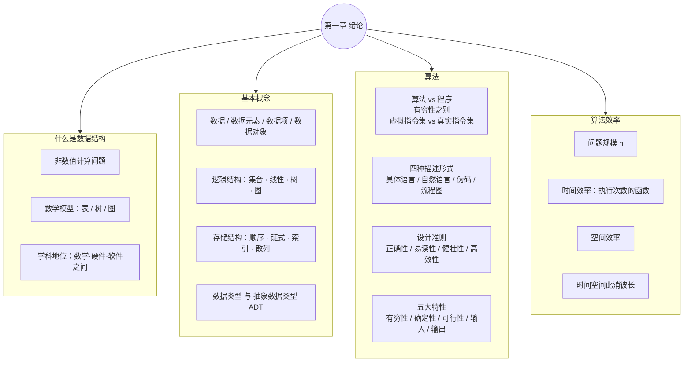

---

# 第一部分　第一次课

## 1. 算法与程序：一对"经常被混用"的词

### 1.1 概念辨析

老师开场先接上一节课的收尾：做事情有"过程"的一面也有"结果"的一面——平时坐哪儿无所谓，但今天要进行文明宿舍评比、要把锦旗挂到门上，那就不一样了。用这个生活例子引出本节正题：**算法和程序这两个词经常连在一起说，概念非常相似，但必须分清**。

课堂给出的说法是：

- **算法**：解决一个问题的**方法的有限集合**，强调"设计思路"，是抽象层面的东西；
- **程序**：算法在**某种计算机程序设计语言当中的具体实现**。

老师的类比非常直白：算法好比大楼的**设计图纸**，程序就是这张图纸在现实环境中的实现——图纸上的零件（螺丝）被真正造出来、装上去，就是"程序"。

> 📖 教材对照（1.4.1）：算法（algorithm）是**对特定问题求解步骤的一种描述**，它是指令的有限序列，其中每一条指令表示一个或多个操作。程序则对应算法在具体程序设计语言上的实现。教材还指出：**算法的设计取决于选定的逻辑结构，算法的实现依赖于采用的存储结构**——这句在后文评价算法时还会反复出现。

### 1.2 算法与程序的两大差别

**差别一：有穷性。** 算法必须在有限步内完成；程序**可以无限循环**。

语言课上老师都会强调"编程序千万别编出死循环"，因为死循环会把程序卡死、强行退出还可能丢文件。老师指出：这个告诫**对算法成立，但对某些程序恰恰不成立**——

- **食堂充值机**：一通电，界面就停在"1 查询余额 2 充值"这样的菜单上，一直等着你按键。它就是一个死循环（类似 `while(1)`），而且**必须**是死循环；
- **ATM 取款机**：各大银行的机器同样是菜单程序，**必须设计成无限循环**。

也就是说：菜单类服务程序天然是无限循环的，这与"算法要有穷"并不矛盾——因为它们是程序，不是算法。

**差别二：指令集。** 一句话概括：**算法执行在虚拟指令集上，程序运行在真实（具体）的指令集上**。

这与下面 1.3 的"计算机层次结构"直接相关：算法描述时默认面对一台抽象的机器；而程序一经实现，就落到了某一台具体机器（具体指令集、具体语言运行环境）上。

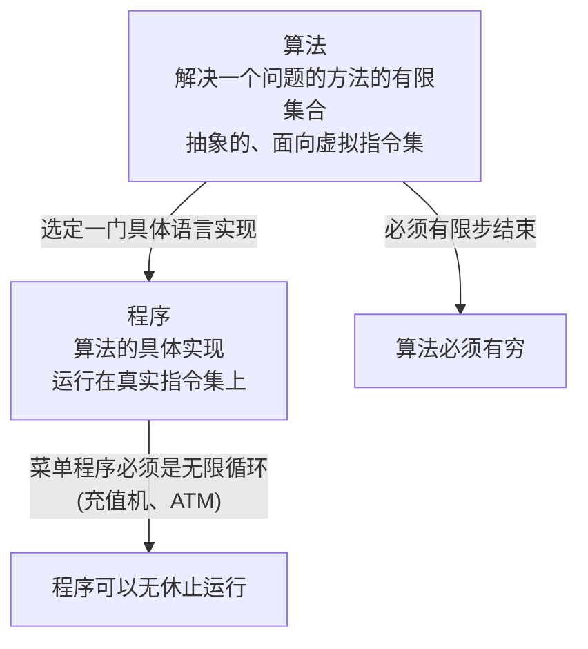

### 1.3 思维方式：拿着问题选语言

老师反复强调的一个专业观念：计算机专业的学生要**"拿着问题选语言"**，千万不要反过来"拿一门语言包打天下"。不同语言擅长的事情不一样，一门语言"啥都想干"是不现实的。

课堂小故事：老师有个师弟在单位帮人做软件，对方单位用的是 VFP【？，转写不清，疑似 Visual FoxPro】，师弟没学过，建议人家改成自己熟悉的语言——"对不起，不可能"。到了实际单位，人家用什么技术栈你就得用什么，不可能让一个单位迁就你换语言。

## 2. 从用户角度看：计算机是一个层次结构

### 2.1 硬件组成提问

老师先提问互动：**计算机从硬件组成来看有几大部分？**（学生答：5 大部分）——即经典的冯·诺依曼结构五大部件：**运算器、控制器、存储器、输入设备、输出设备**（录音中只清楚听到"运算器"，其余部分回答较模糊）。

### 2.2 层次结构逐层展开

从**用户**的角度看，计算机实际上是一个**层次结构**（老师连说几遍"层次结构"，属于重点强调）。由内向外：

1. **硬件 / 裸机**：什么软件都没配的状态，好比"人还没穿衣服"；
2. **BIOS（基本输入输出系统）**：开机时电源灯闪一下、屏幕上晃过一些字，就是 BIOS 在工作。它在**检查硬件**——硬盘在不在、内存（内存【？转写"内部"】）在不在、CPU 在不在、各部件在不在该在的位置上，并扫描硬件参数。BIOS 有**两大功能**：① 硬件自检；② **引导操作系统**进入正常工作状态；
3. **操作系统**：老的如 **DOS**，叫"**磁盘操作系统**"。老师特别纠正一个误区：**别以为 Windows 很新就不是磁盘操作系统了**——Windows 11/13【？课堂现场讨论版本号】本质上**仍然是磁盘操作系统**。验证方法很朴素：操作系统装在磁盘上，把 C 盘格式化，Windows 就没法运行了——所以它本质还是磁盘操作系统；
4. **编译系统（编译器）**：各种高级语言都有自己的编译器。关键理解：**机器根本不认识高级语言**，我们点"运行"看似程序直接跑起来，实际上是底层的**编译器**把高级语言程序翻译成机器能懂的指令——"说白话，底层是一系列机器指令"；
5. **应用软件**：如 Office、浏览器（IE）等各种应用。

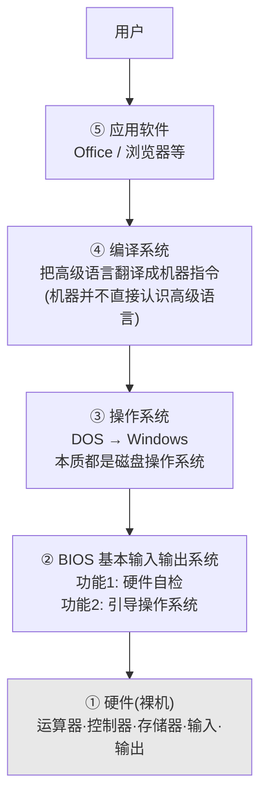

这个层次图正是"算法运行在虚拟指令集、程序运行在真实指令集"这句话的背景：**程序**落在第④层的某个具体语言环境里，**算法**则停留在抽象层面。

## 3. 算法的四种描述形式

过渡的设问很自然：算法强调**设计思维**，思维在大脑里构思——"那我脑子里的这个玩意儿，我怎么给你？"可以嘴巴说出来、手比划着画出来、拿张纸写下来。迄今算法有**四种**描述方法：

### 3.1 第一种：具体的程序设计语言

直接用 C、Java、C++【？录音列举不清】等把算法实现出来。

**缺点**（老师的类比）：让你"设计一栋大楼"，你却直接动工把楼盖出来——没有设计过程。如果是摩天大楼，不画图纸直接盖，自己都搞不来、结果也无法放心。

**课堂跑题插话（学术规范，值得记住）**：写到毕业论文时，**论文正文里绝对不能出现具体的实现代码**——期刊上也没有直接贴代码的先例，"这是犯忌讳的"。实在要贴，只能放**附录**；正文绝对不允许。

### 3.2 第二种：自然语言

用中文，或法文、德文、俄文等任何自然语言描述算法。**两个致命缺陷**：

1. **做不到无二义性**："说话是一门艺术"——领导开会说一句话，底下两个人理解可能根本不一样。而算法五大特性中第二个就是**确定性**，不能有歧义，自然语言做不到；
2. **冗长啰嗦**：表达不紧凑、不简洁。

### 3.3 第三种：伪码语言（类 PL 语言）

PL = Program Language（程序设计语言），所以常叫"**伪码语言**"——**它长得很像某种程序设计语言，但实际上哪个都不是**，"就是长得伪（像）嘛"。类比：建筑设计有专门的图纸画法，电路设计有专门的电路图画法——**各领域都有自己专门的表达方式**，算法设计也一样。

老师预告：后面会用"不超过 5 分钟"快速讲伪码的书写规定（对应教材 1.3 节的类 C 语言规范，见 📖 教材对照）。

### 3.4 第四种：流程图

- **优点**：详细、直观易懂；
- **缺点**：必须把算法实现的**每一个细节、一步一步具体怎么做**全部搞清楚，才能画出来——太详细了。

课堂上的"怪异现象"：老师要求"先把算法设计出来，再把流程图画出来"，结果学生总是**先把程序全部写出来，再倒过去补画流程图**。原因正是上面的缺点：画流程图的前提是对每一步都极其清楚。

**画家类比**：画流程图像画家画像——细节要不断调整，眼睛画大点、线条画粗点，画错就得擦掉重画；流程图也一样，**算法某个细节一改动，整幅图都要扔掉重画**。（引申闲聊：没有计算机的年代，设计人员搞设计图纸，草稿扔一地，原因就在修改成本太高。）

**期刊惯例**：计算机专业期刊上描述算法**主要用后两种**——伪码语言或流程图；有的期刊会辅以类 C 风格的语句（"输入什么什么"）和数学符号（集合、属于关系等）。

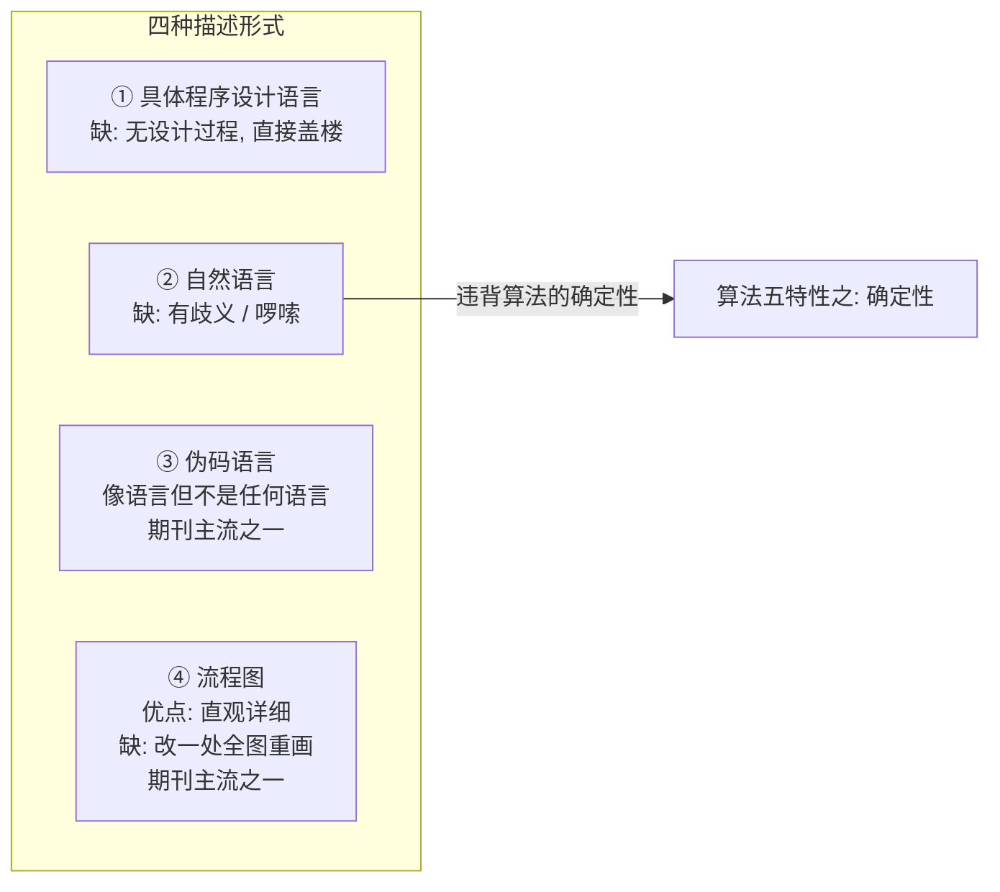

## 4. 算法设计应遵循的准则

"我要设计一个好的算法，它必须满足四点"：**正确性、易读性、健壮性、高效性**。

### 4.1 正确性

有同学会问："不正确还能叫算法吗？"老师说：语法层面好办——编译通过只能说明**语法**正确，**还有语义呢**？就像"桌子吃米饭"这种句子，语法上成立、语义不通。

课堂定义很朴素：**正确性 = 满足用户的具体问题的需求**。设计出来的算法能正确解决用户的问题，说白了就是**满足用户需求**；不满足需求，一切免谈。类比写作文：不能离题万里、文体怪异。

> 📖 教材对照（1.4.2）：教材把"正确"分为 4 个层次：a. 不含语法错误；b. 对**几组**输入数据能得到满足规格说明的结果；c. 对**精心选择的典型、苛刻而刁难性**的几组输入数据能得到正确结果；d. 对**一切合法输入**都能得到正确结果。逐一验证 d 层次不现实，一般以 **c 层次**作为衡量程序合格的标准。

### 4.2 易读性（课堂重点）

老师把易读性放在第二位，甚至放在健壮性、高效性前面。理由：**算法首先是为了和人交流、供人阅读的**，其次才是机器执行。

- **装修设计师类比**：设计师拿方案和用户对着图纸交流——用户连哪个是门、哪个是窗都看不懂，还怎么交流？而且算法的用户大多不是计算机专业的人，用具体语言写，难道还要人家先学一遍这门语言？
- **工人类比**：你的图再高明，拿给车间工人看，工人看不懂要加工个什么，那还有什么用？
- **第三方测评**：大型系统交付使用前要有第三方测评机构评估设计方案，人家看不懂，怎么评估？

由此老师给出一个非常鲜明的立场（有人甚至专门主张）：**为了易读性，宁愿牺牲一些效率**。有的人有"奇思妙想"，解法能解决问题、甚至更高效，但别人看不懂——我们**宁愿采用低效一点但易读的算法，也不采用那种看起来特别怪、谁也看不懂的算法**。

佐证这个立场的是行业现实：计算机行业人员流动最频繁（跳槽常见）——你写的看不懂的东西，人员一换就没人能接手了。（此处录音随后的内容到有效录音结束，录音在讨论中戛然而止，剩余时间无语音。）

### 4.3 健壮性与高效性（本课略讲，教材补充）

> 📖 教材对照（1.4.2）：
> - **健壮性（robustness）**：当输入数据非法时，算法能适当地做出反应或进行处理，而不会产生莫名其妙的输出。处理出错的方法应是**返回一个表示错误或错误性质的值**（以便在更高抽象层次上处理），而不是打印错误信息后中止程序。例：求凸多边形面积的算法，输入的坐标集合表示凹多边形时应报告出错，而不是继续算下去。
> - **效率与低存储量需求**：效率指算法执行时间，同一问题执行时间短的效率高；存储量需求指执行过程中所需的最大存储空间。两者都与**问题规模**有关（求 100 个人与 1000 个人的平均分，时间空间显然不同）——这正是第二次课展开的主题。

### 第一次课小结思维导图

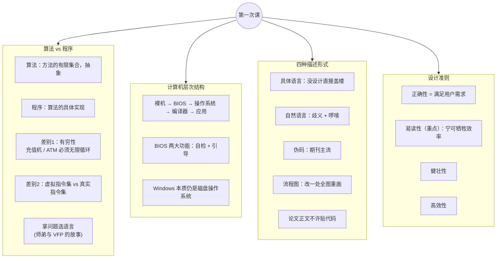

---

# 第二部分　第二次课

> 第二次课的录音从上节课链式结构的画法讲起，中间完成"数据结构三要素"的收尾与"数据结构的选择和评价"，最后系统讲解算法的概念与五大特性。顺序上是"评价在前、定义在后"——老师先让大家体会"为什么要评价算法"，再回头把"算法是什么"讲透。

## 5. 指针与结点：一个常见错误（链式存储结构回顾）

### 5.1 指针本身也是变量

承接上次课的链表图（带头结点 H 的链表）：H 看起来是表头结点，"这个玩意就是指针"。两个要点：

- **指针（指针变量）本身也有自己的存储空间**——指针变量也是变量，凡是变量，内存就要给它分配空间。它对用户是"透明"的（用户看不见、不关心），"谁知道？操作系统知道"；
- 初学者常碰到**空指针错误**就慌了——因为它本身也是一个内存单元、一个操作单元，这里先埋个伏笔，**后面课程会讲**它到底是怎么回事。

### 5.2 画结点的正误对比（老师重点强调）

画链表时"很多东西顺手就画错了"：

- **错误画法**：箭头从**整个结点**（整个方框）出发拉向下个结点——这等于宣告"前一个结点整个都是指针"，一看就知道你对指针概念掌握得不深刻；
- **正确画法**：**从结点的指针域出发**。结点只有**后半部分（指针域）**专门用来存放下一个结点的地址。

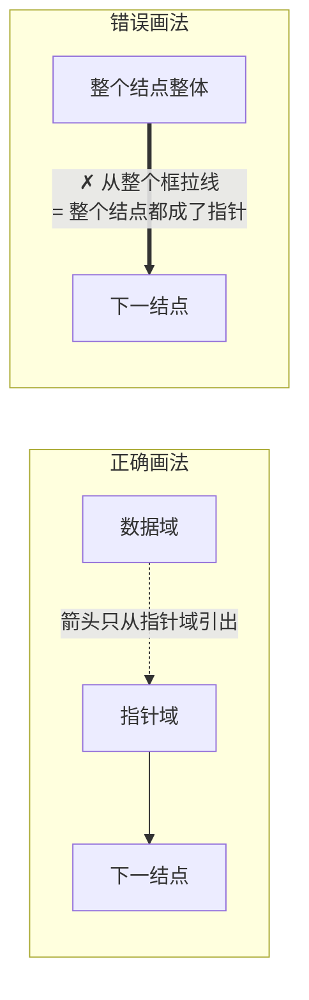

### 5.3 链式 vs 索引 vs 散列：三种存储结构的关系

- **链式结构的空间利用率达不到 100%**：每个结点都要额外付出一块指针域的空间开销；
- **索引结构**：可以认为是**前两种（顺序 + 链式）的结合体**——数据部分用顺序结构存放，前面有一个"目录"，用指针指向数据区。类比就是**一本书**：前面是目录，后面是正文；
- **链式与索引的本质区别**（老师自问自答，重点）：
  - 链式结构：**每一个数据元素**的存储空间各自划分成两半（数据域 + 指针域）；
  - 索引结构：**整个存储空间**整体划分成两块（目录区 + 数据区）；
- **散列（哈希）结构**：思想是"就算个函数"——元素有关键码 k，通过函数 f(k) 算出一个数，**直接对应存储单元**（可以认为是数组下标），下标有了，地址就有了。

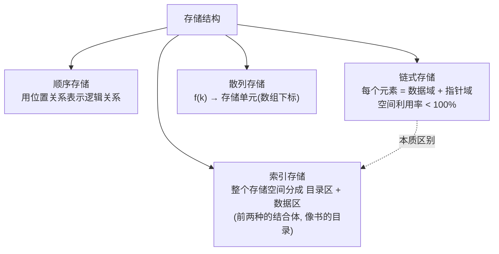

> 📖 教材对照（1.2）：顺序映像**借助元素在存储器中的相对位置**表示逻辑关系；非顺序映像**借助指示元素存储地址的指针**表示逻辑关系。教材图 1.6 用复数 z1=3.0−2.3i 分别演示了顺序存储（地址相邻的两个字长位串）与链式存储（用值为 "0415" 的指针指向虚部的存储地址）。

## 6. 数据结构研究内容的收尾：三要素

老师回顾："拿到一个问题要研究什么？"三个层面：

1. **数据以及数据之间的逻辑关系**（逻辑结构）；
2. **有哪些运算**——运算定义在**逻辑层面**上：比如图书管理员要管图书，脑子里先想清楚涉及哪些操作——**增删改查**。但注意：这些操作此时只是**概念性的、抽象的**（"买了一本新书，要把它放进去"）；
3. **实现时要考察存储结构**：类比"打比赛要安排在场地【？】上"——运算的逻辑定义最终要落到具体存储结构上实现，图书就得真放到书架上。

**算法的具体实现依赖数据在存储空间中怎么存**（重点，第二次课最生动的类比之一）：一本放**一楼**的书和放**五楼**的书，"放进去"这个运算的具体实现（路线）完全不一样——放一楼走一百步、拐个弯就到了；放五楼要走两百步，再爬几十级台阶，再拐弯。**实现步骤跟存储结构有关系**。

最后递进：算法实现之后**还要评价实现的好坏**——由此进入下一节。

## 7. 数据结构与算法的评价

### 7.1 "是骡子是马拉出来遛遛"为什么不行

引入：两个数据结构/算法解决同一个问题，哪个好？"是骡子是马，拉出来遛遛"——**实际跑一遍比一比**：

- A 设计的系统运行 **1.5 小时**，B 的运行 **1.6 小时**，"谁好？"（直觉：A 好——因为评价直觉是按**资源消耗**，人最宝贵的资源是时间，"一寸光阴一寸金"，生命有限，给你编个程序跑一百年还等得到吗？）

但老师立刻用反例拆掉这个直觉：

- **反例 1（机器不同）**：A 跑在 586 机器上，B 跑在 8086 机器上——CPU 性能"差老大了"，还能比吗？不能；
- **反例 2（规模不同）**：A 算 **200 个人**的工资，B 算**一万个人**的工资——B 的规模大得多，此时还能说 A 好吗？不能。

结论（老师强调）：**"具体的数值往往难以说明问题。"**

> 📖 教材对照（1.4.3）：这正对应教材讲的**事后统计方法**的两个缺陷——①必须先运行程序；②统计结果**依赖计算机硬件、软件等环境因素**，容易掩盖算法本身的优劣。因此采用**事前分析估算**的方法：撇开软硬件因素，认为特定算法"运行工作量"的大小只依赖于**问题的规模 n**。

### 7.2 出路：以问题规模 n 为参数的执行次数函数

思路：不管在什么机器上跑——**算法给出来，里面必然有语句；花的时间就花在执行语句上；每条语句执行多少次是客观确定的**。不同 CPU 只影响每条语句执行的快慢。把"语句执行次数"从"具体机器时间"中剥离出来，机器差异就消除了。

做法：对每个算法，构造一个以**问题规模 N** 为参数的函数——N 个人的工资问题要执行多少次语句。问题规模通过**参数**来刻画（工资问题的 N 就是人数）。

**比较因此变得公平公正**：因为**在数学中，函数就可以比较大小了**。

> 📖 教材对照（1.4.3）：教材的标准表述是——从算法中选取一种**基本操作**（对于所研究问题是基本运算的原操作），以**该基本操作重复执行的次数**作为算法的时间量度：`T(n) = O(f(n))`，称**渐近时间复杂度**。"O" 的形式定义：存在常数 M>0，使 |T(n)| ≤ M|f(n)| 对足够大的 n 成立。
> 例：N×N 矩阵相乘，"乘法"是基本操作，执行次数 n³，故 T(n)=O(n³)；三段小程序 `{++x;s=0;}`、单层循环、双层循环的频度分别为 1、n、n²，时间复杂度分别为 **O(1) 常量阶、O(n) 线性阶、O(n²) 平方阶**；还可能有对数阶 O(log n)、指数阶 O(2ⁿ)。
> **频度取增长率**：难以精确计算次数时只需求阶，如 `for(i=2;i<=n;++i) for(j=2;j<=i-1;++j)` 中 ++x 的频度为 (n−1)(n−2)/2，增长最快的项是 n²，故为 O(n²)。

时间复杂度的增长趋势（为什么要选多项式阶而拒绝指数阶）：

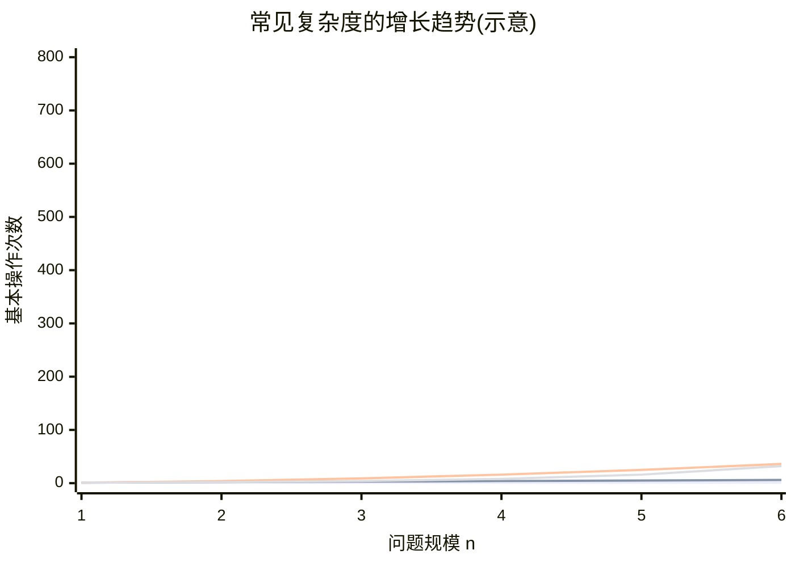

> 📖 教材对照（1.4.3，输入相关与最好/最坏情况）：起泡排序中"交换相邻整数"为基本操作——初始序列**正序**时执行 0 次（最好情况），**逆序**时执行 n(n−1)/2 次（最坏情况）。平均时间复杂度需对所有输入的期望计算（起泡排序平均为 O(n²)），但输入概率往往难以确定，因此**更常用最坏情况下的时间复杂度**作为执行时间的上界；本书以后各章未特别指明时，均指最坏情况。
> 事前估算与事后统计可以结合：10×10 矩阵相乘实测 12ms，由 T(n)=O(n³) 可估算 31×31 矩阵相乘约为 (31/10)³×12ms ≈ 358ms。

### 7.3 第二个指标：空间效率

"时间很重要，但人类的资源【？疑为'计算机的资源'】还在于空间。"空间需求同样是**以问题规模 n 为参数的函数**——算一算算法需要耗费多少存储空间。老师强调（重复两遍）：**这两个是主要指标：①时间效率 ②空间效率**。

> 📖 教材对照（1.4.4）：`S(n) = O(f(n))` 称**空间复杂度**。一个程序除存储自身指令、常数、变量和输入数据外，还需工作单元和辅助空间；若输入数据所占空间只取决于问题本身，则只需分析**额外空间**；若额外空间相对于输入数据量是常数，称算法**原地工作**（第 10 章部分排序算法即属此类）。空间量若依赖特定输入，除特别指明外按**最坏情况**分析。

**盖楼类比（引入空间话题）**："我地方就这么点大"——给你一块地，想住得舒服怎么办？不能盖平房，就**盖高楼大厦**，往上叠好多层，空间就大了。（内存有限时想办法"纵向"利用空间，为后面的时空权衡埋伏笔。）

### 7.4 评价是非常复杂的事

老师转折：光这两个指标"都做得很难调"【？疑为很难权衡】——**算法或数据结构的评价是非常复杂的，不是那么简单的一件事**，涉及的因素太多太多。课堂展开的几个例证：

1. **方案实现的难易程度（电视剧例子）**：某电视剧讲航空设计——国内专家出一套设计方案，留学归来的杨博士【？】也出一套，最终采用了杨博士的方案，二十年后回头看仍是最好的。但问题是：那个年代中国的经济、技术条件达不到——**"技术达不到，你也白搭"**。好的设计若无实现条件，落地无从谈起；
2. **产品不能超前太多（苹果第一代）**：计算机行当里，设计领先别人五年、十年，"那你是鼻祖"（像苹果第一代的理念领先）。但**产品是具体的实现**，人的接受有一个时间过程——领先太多，用户无法想象、无法接受；
3. **实现代价（猫窝 vs 摩天大楼）**：给猫建个窝，设计很简单；设计摩天大楼则前期要收集**气象资料**（风大不大）、**地质资料**（有没有沉降、遇不遇地震），光前期考察就要三个月。猫窝根本不需要考虑台风地震。结论（强调两遍）：**针对不同的问题，要考虑的因素不一样，要算"设计的代价"这笔账**；
4. **买菜 vs 导弹**：买个菜、鸡蛋，几毛几块钱，简单数学就能算——"那是不是数学？是"；但要**设计一个导弹**，就得按照实际的数据规模和精度要求来。评价要看针对什么具体问题。

老师收束（重点）：**"所以我们主要就考虑这两个因素"**——时间和空间。而且"就这两个因素还很难兼顾"。

### 7.5 时间与空间：此消彼长的矛盾（课堂核心强调）

反复强调的结论（重复两遍以上）：**时间和空间的衡量标准往往是相反的、相抵触的——"我时间快，往往就要拿空间来交换；转过来也是一样"。这个矛盾很难调和。**

**木工房类比（最核心的课堂例子，建议记住）**：

- 空间小：给你巴掌大的一块地方只放工具，**原材料都放在老远的另一个房子**里——干活时就得来来回回跑着取料，"时间都花在路上了"；
- 空间大：材料都堆在手边、给我个大房间——取料省时间，干活就快。

这正是**"用空间换时间"**的形象写照（数据结构里典型的做法：多开一个辅助数组/索引表，换取更少的比较次数）。

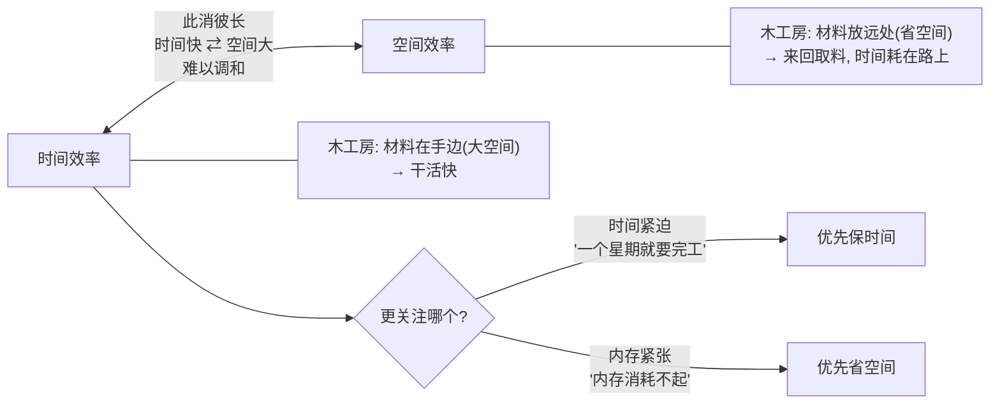

**权衡依据**：看具体应用需求——"我规定你一个星期就要完工"，那就优先保时间；反过来时间无所谓但**内存紧张、消耗不起**，就优先省空间。**根据具体应用领域和资源约束来定**。

### 7.6 课堂案例：大四学长的面试（把准则落到实战）

老师讲了一个找工作的故事（穿插于评价话题中，用来呼应正确性/健壮性/效率）：

1. **题目**：外资企业研发岗面试，考官要求用 C 写个函数计算某个值【？录音不清，疑为阶乘/乘方类】，要求"尽可能展示 C 语言老到的技巧，同时展示程序设计能力"；
2. **第一版**：学长立马写出来——两三个循环、几行代码，搞定基本功能；
3. **考官提示**："传进来的 N 有可能是**负数**。"——用户可不见得那么听话！学长把各种情况补上，老师点评：**从完备性上讲就更完备了**——这就是第一次课讲的**健壮性**的实战版本：写程序不能假设用户输入总是"听话"的；
4. **程序设计技巧**：又把两个循环**合并成一个**——用一个标志（正负号判断）一跳就搞定，代码更精炼；
5. **考官盯住效率**：核心计算在循环里，**若输入 N=10000，循环体就要执行一万次**——引出下面"算法设计能力"的话题：有没有执行次数远少于 1 万次的解法？（后续约 110 秒录音模糊【？】，推测考官给出了基于数学性质的巧妙解法，"用数学，而不是堆循环"。）

### 7.7 算法设计能力与语言无关（呼应第一次课）

- 算法设计能力"就是你的**思路、思维方式**"；普通解法"只是用循环"，好的解法用的是数学思路之外的东西——**解决问题的思路不一样，设计理念就不一样，效率差别也不一样**；
- 有同学说"老师我喜欢编程，但是怎么就做不好设计呢"——**会写代码 ≠ 会设计算法**；
- **中文/诗歌类比**（第一次课也用过，此处再次出现）：教大家设计算法，有点类似于**写文章**——在座都会说中文，但有几个人能写出好的诗歌、好的散文？**会一门语言 ≠ 会用语言创作**。结论：**设计跟语言无关，主要是思路和思维**；
- 专业素养提醒：计算机专业学生**眼界要宽**，"张口就是微软、英特尔，除了这两家别的都没了"是不行的。

**SQL 面试小故事（延伸案例）**：老师面试过一个在职考研的学生，自称 "I'm a senior"，做技术支撑，日常**导数据**效率很低（一个多小时搞不定，用 SQL Server 也要半天导一个【？录音不清】）。由此延伸：**SQL（Structured Query Language）= 结构化查询语言**，是**数据库的语言**，后面学数据库课程会学到；数据库领域的发展中，IBM、Oracle【？】等厂商的产品贡献很大；微软的 **SQL Server** 也是同一种 SQL 语言的产品。**关键结论：同样的语言，底层实现的思路不一样，快慢的差别"大了去了"**——这正是算法/实现思路的价值；所以人不能只着眼于微机（PC）层面，微软的市场份额主要在微机上【？】。

### 第二次课前半小结思维导图

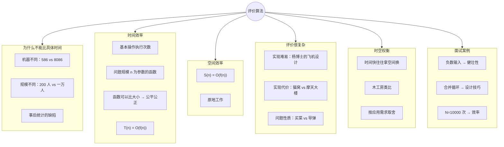

## 8. 算法的概念（第二次课后半，系统讲解）

### 8.1 数据结构课程的"最终产品"是算法

老师先做一个定位：机械设计有**图纸**、建筑设计有**设计图**——"设计图纸就是建筑设计里的最终产品"。对应过来，**算法（程序/设计）就是我们这门课的最终产品**。既然是产品，就要研究产品的好坏——一旦做出来，谁好谁坏？（上一节讲的就是怎么评。）

更深入的研究属于后续课程：**《算法设计与分析》**这门课会专门讲；再往深了还有**可计算性、计算复杂性**，"那就更难了"——属于理论计算机科学层面，本课不展开。

### 8.2 什么"问题"：一般问题，不是科学问题

朴素定义：算法是**把人怎么做事情的步骤搬给计算机**。那什么又是"问题"？

重要辨析（老师强调）：这里说的**不是科学问题**。定义：

- **科学问题**：迄今为止，人类**还没有很好地解决、甚至没有找到解决方案**的问题。它的特点是**创新**——别人都没解决，你解决了（"只有博士生才会面临科学问题"）；
- 本课研究的是**一般问题**：普世性的、**大家已经有解决方案**的问题——人怎么解决已经知道了，只不过现在要**搬到计算机里**去做。

所以这里的"问题"对应一个**任务**：计算机需要完成的一个任务。

### 8.3 问题 = 输入 → 输出；图灵机与计算的本质

让计算机做任务，就是：**给计算机一组输入，它给你一组输出**。老师类比说这类似**图灵机**。

**"计算的本质是啥？"——计算的本质是数据的符号化。** 口头描述图灵机（画图式讲解）：

- 有输入；一条**无限延长的纸带**，纸带上写有各种符号，每一时刻读到不同的符号；
- 读写头往前移动；
- 最终在某个时刻、某个状态**停下来**——这就是图灵机。

强调：图灵机的本质就是**运算的符号化**，是一个**符号集**；由此得出：**算法实际上就是一连串符号的一个集合**。

**做菜类比（算法不限定做法）**：问题给出来时**不包含"必须怎样解决"的限制**——好比给你一份原材料，让你做"酸汤面"【？菜名转写不清】：具体你怎么做我不管，我只给原材料，你给我做出这道菜（成品）来。

**只有问题明确定义并完全理解，才能研究出解决方案**。类比：盖大楼之前，工程师先在图纸上规划先做啥后做啥，才能定出施工方案。结论（重复强调）：**算法就是对整个问题的具体化的方法，就是解决方案**——"说白了就是这一步干啥、下一步干啥，每一步都要考虑到。"

### 8.4 算法的定义与五大特性

老师指出：**算法至今没有一个统一的定义**——这个词基本得不能再基本，但**内涵是统一的，有五个**。正式定义（老师读了两遍）：

> **算法是解决某个问题的指令的有限集合。**

每个算法都必须符合五个特性：**有穷性、确定性、可行性、输入、输出**。

#### 8.4.1 前置概念：指令与命令

定义里"又出来一个词——**指令**。啥是指令？"（点名提问学生后老师给出通俗版）：

- **指令**：计算机的一个动作。"一个指令就是计算机的一个动作"；
- **命令**：**一系列指令的集合**。例：一条"两个数相加"的加法命令，在底层拆开来是很多指令——**取指令**这个动作、**分析（译码）指令**这个动作、把操作数送到运算器里等等；
- 关联课程：后面学**计算机组成原理**就都知道了。

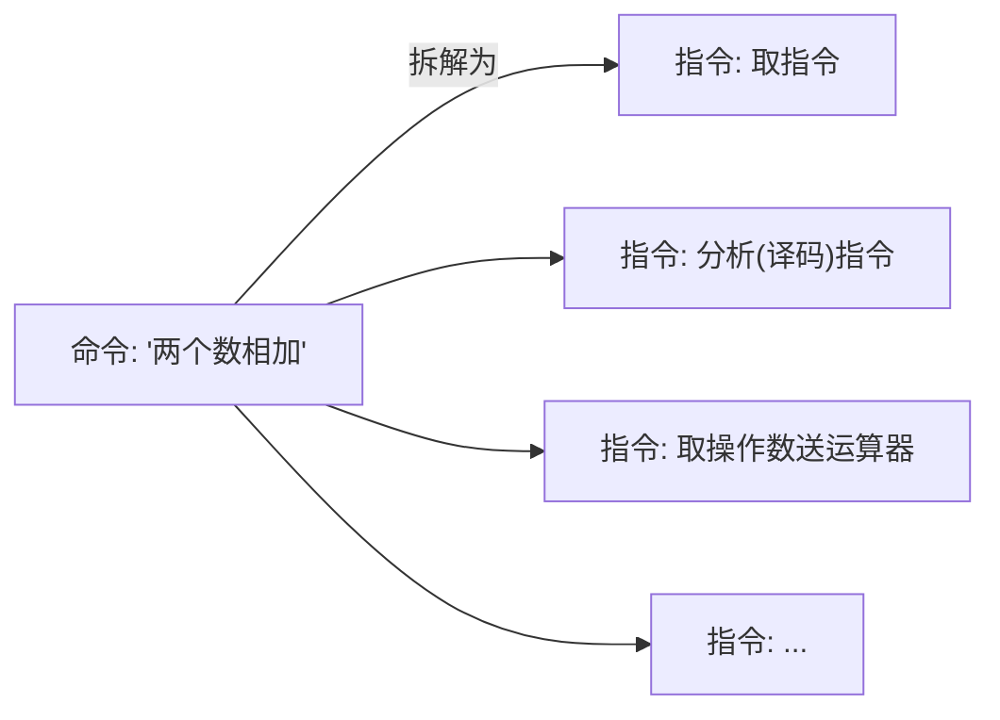

#### 8.4.2 特性一：有穷性

算法必须在**有限步**之后结束，不能无限循环。课堂设问："**操作系统是不是算法？**"（学生答不上）老师给出明确结论：**不是**——不满足有穷性。思想实验：假设机器永远不断电、硬件不会磨损，操作系统就会无限循环、无休止运行下去，所以它不是算法（它是程序——呼应第一次课"程序可以无限循环"）。

#### 8.4.3 特性二：确定性

算法每一步都必须**确切定义**，说白了就是**不能有二义性**。两个课堂例子：

1. **签合同**：金额不用阿拉伯数字，要用**大写**（壹贰叁肆伍）——阿拉伯数字容易被改（1 改成 7、改成 9，金额就变了），大写汉字笔画多、不易篡改；
2. **生产队买客车**：早年一个生产队签合同买大客车【？】，合同里没写清颜色，送来的是白车，生产队说"我要红色"，打官司——结果（卖方）赢【？】：因为合同里只写了"车"，红车白车都是车。合同表述有歧义，就要吃这个亏；**算法里的语句同样不能有二义性**。

#### 8.4.4 特性三：可行性

算法的每一条指令都应该是**可以实现、可以执行的**（能在有限时间内完成）。由此展开指令集的讨论：

- 不同机器（8086 与 586）的差别在哪？——**指令集不一样**。机器一造出来，指令集就固定了，不同型号机器的指令集可能不同；
- 关联课程：以后学**组成原理**【转写"主持人"】、**编译原理**【转写"编语原理"】就会明白——编译原理要针对特定指令集（如 386 的机器）来讲，因为**不同指令集的指令格式不一样**。

#### 8.4.5 特性四、五：输入与输出

- **输入**：**0 个或多个**。"可以有 0 个输入，这个要注意"——类比：人做事可以"不要报酬"，每年 3 月 5 号是**学雷锋日**，做好事不留名，"所以可以不要输入"；
- **输出**：**必须至少有一个**。为什么？给你一堆材料做酸菜面【？菜名不清】，哪怕做糊了，**至少要有一个结果、一个产出**——不能忙活了半天什么都没有，别人不知道你干没干活、满不满足要求。
- **固定资产类比**（校园闲谈式例子）：学校最近在搞**资产清点**，统计每位老师名下的资产；实验室打扫卫生把设备弄坏了，但那是**国有资产/固定资产**，报废报销也必须**见到实物**——"哪怕是坏的，我也得看到这个东西"，不能说坏了就凭空没了。固定资产报废尚且要见实物，**算法更不能没有输出——输出是算法结果的体现**。

### 8.5 收束：算法与"过程"，计算的本质

- 算法是"解决某个问题的指令的集合"，体现在**过程**上——这一步干啥、下一步干啥；算法是**在时间上逐步展开**的。例子：图灵机，或**机械臂**【？】抓东西——张手指、抓取、放下、下一步……由一个个细微动作组成，每个动作都占时间；
- **"程序"的词义纠偏**（强调）：看到"程序"千万别以为只是计算机里的程序。**"过程"指事物进行所经过的程序（次序）**——现实生活中"程序"用得非常频繁：开会有开会的程序、体育比赛开幕式有开幕式的程序、国王登基有登基的程序——都只是一个**次序**；
- **从计算本质看算法**：整个算法反映的是**数据状态的变化序列**。图灵机在某时刻有一个数据状态；**计算的本质就是符号变换**——这一时刻纸带上是一个符号序列，下一时刻是另一个符号序列，不同的组合。

结尾：从信息处理的要求和目的性看，**过程分为两个**：一个叫**一般过程**，另一个叫"数数过程"【？疑为"数学过程"或"数值过程"】——这两个过程怎么理解？"我们先休息一下。"（随后为课间闲聊，与课程内容无关。）

### 8.6 第二次课后半小结思维导图

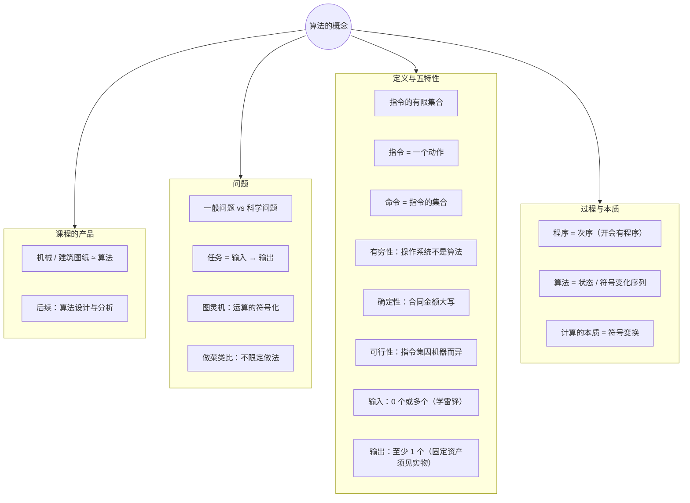

---

# 附录：两次课的整体脉络与教材对照

## A. 两次课讲授顺序与教材章节对照

| 课堂内容 | 对应教材 | 备注 |
|---|---|---|
| 算法 vs 程序（有穷性、指令集） | 1.4.1（算法概念延伸） | 课堂重点，教材未单独展开 |
| 计算机层次结构（裸机→BIOS→OS→编译器→应用） | （课外延伸） | 服务于"虚拟指令集 vs 真实指令集" |
| 算法四种描述形式 | 1.3（类 C 语言作为描述工具） | 伪码书写规范详见教材 1.3(1)–(11) |
| 算法设计准则（正确性/易读性/健壮性/高效性） | 1.4.2 | 教材给出正确性 4 层次标准 |
| 存储结构：顺序/链式/索引/散列、指针画法 | 1.2（逻辑结构与存储结构） | 第二次课开头 |
| 三要素收尾（逻辑结构/运算/存储结构） | 1.2 末尾 | "一楼 vs 五楼"类比 |
| 时间效率：n 的函数、T(n)=O(f(n)) | 1.4.3 | 课堂强调"函数可比大小" |
| 空间效率 S(n)=O(f(n))、原地工作 | 1.4.4 | |
| 评价的复杂性、时空权衡 | 1.4.2(4) 延伸 | 课堂例证丰富 |
| 算法定义与五特性、指令/命令 | 1.4.1 | 五特性即教材 (1)–(5) |
| 抽象数据类型 ADT、类 C 语言、三元组 Triplet | 1.2 末尾、1.3 | **录音中未详细展开**，需自学 |

> ⚠️ **覆盖提醒**：教材 1.2 节的"数据对象/数据项/数据结构形式定义 (D,S)"、"四类基本结构"、**抽象数据类型（ADT）三元组 (D,S,P) 及其定义格式**、1.3 节的**类 C 语言规范与 Triplet 实现（例 1-7）**，课堂录音中仅零星带过（如伪码、自然语言缺陷对应"确定性"）。这些是考试与后续章节的基础，务必对照教材自学：
> - 数据结构的形式定义：`Data_Structure = (D, S)`，D 是数据元素的有限集，S 是 D 上关系的有限集；
> - ADT 三元组：`(D, S, P)`——数据对象、关系集、基本操作集；定义格式含"数据对象/数据关系/基本操作"三部分，基本操作用"初始条件 + 操作结果"描述；
> - ADT 按值特性分：**原子类型、固定聚合类型、可变聚合类型**（后两种统称结构类型）；
> - 类 C 语言要点：`Status` 函数返回状态码（OK/ERROR/INFEASIBLE/OVERFLOW）、**引用参数以 & 打头**（除输入外还返回结果）、存储结构用 typedef 描述。

## B. 概念易混点清单（复习用）

1. **算法 ≠ 程序**：有穷性之别 + 虚拟/真实指令集之别；菜单程序是"必须无限循环"的程序；
2. **链式 vs 索引**：前者**每个元素内部**分数据域+指针域，后者**整个存储空间**分目录区+数据区；
3. **正确性的四个层次**：语法正确 → 几组数据 → 苛刻数据 → 一切合法输入（实际以第三层为合格线）；
4. **时间复杂度比较的前提**：必须是**同一问题规模 n 的函数**，且撇开机器/语言/编译器因素——"具体的数值难以说明问题"；
5. **最坏情况复杂度是默认口径**（除特别指明外）；
6. **指令 = 一个动作；命令 = 指令的集合**；算法 = 指令的有限集合（必须有穷）；
7. **操作系统不是算法**（无有穷性），但它是程序；
8. **科学问题（未解决）vs 一般问题（已有解法，搬给计算机）**——本课程处理的是后者。

## C. 课堂金句摘录

- "拿着问题选语言，千万不要拿一门语言包打天下。"
- "算法是抽象的——先有设计图纸，才有大楼。"
- "为了易读性，宁愿牺牲一些效率。"
- "是骡子是马拉出来遛遛？——具体的数值往往难以说明问题。"
- "函数构造出来，比较就是公平公正的——数学中函数就可以比较大小。"
- "时间快，往往就要拿空间来交换；转过来也是一样。"（木工房类比）
- "会中文的人很多，能写好诗歌散文的有几个？——设计与语言无关，靠思路。"
- "固定资产报废还得见实物，算法怎么能没有输出？"
- "开会有开会的程序，登基有登基的程序——'程序'本来就是个次序。"

---

*整理时间：2026-09-09。转写引擎：faster-whisper-large-v3（GPU）。如发现讲义与录音/教材不符之处，以课堂录音和教材为准。*
