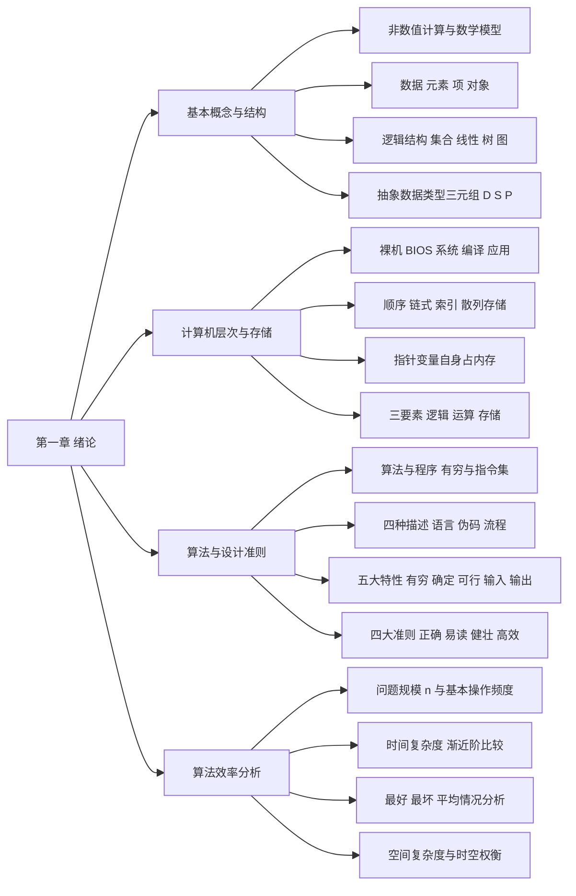

# 数据结构 · 第一章 绪论 · 课堂讲义

> **来源说明**：本讲义依据两次课的课堂录音整理，并对照严蔚敏、吴伟民《数据结构（C 语言版）》第一章（绪论）进行校订与补充，属讲授稿性质的整理稿。全篇以**第一人称**写成，保留课堂讲授顺序与口语化讲解风格；凡属教材补充或延伸说明的内容，均以「📖 教材对照」标出，与课堂现场讲授加以区分。
>
> **课程范围**：第一次课有效录音约 29 分钟（算法与程序、计算机层次结构、算法描述形式、算法设计准则）；第二次课有效录音约 46 分钟（链式与常见存储结构、数据结构三要素、算法效率评价与时空权衡、算法概念与五大特性）。第一次课录音末尾约 16 分钟为静音，无内容。

---

## 开场导读

这一章是《数据结构》的绪论，我们用两次课把整门课的坐标系搭起来：这门课研究什么对象、用什么工具描述算法、又用什么标准衡量一个算法和存储结构的好坏。

第一次课我先从"算法"和"程序"这对常被混用的词切入：算法是抽象层面的求解步骤，面向虚拟指令集，必须在有限步内终止；程序是算法在具体语言和真实指令集上的实现，像充值机、ATM 菜单程序就需要持续循环等待服务。为了讲清"虚拟指令集"与"真实指令集"，我带大家从用户视角把计算机由内到外理了一遍（裸机、BIOS、操作系统、编译系统、应用软件），接着对比了算法的四种描述形式，最后落到算法设计的四条准则，并专门强调：**易读性往往排在技巧性的前面**，算法首先是写给人看的。

第二次课我从上一节留下的链表画法讲起，指出初学者常把指针箭头从整个结点框外侧拉出，其实箭头必须从**指针域**出发，并对比了顺序、链式、索引、散列四种存储结构，用"逻辑结构—运算—存储结构"收尾数据结构三要素。随后进入本章最核心的评价问题：为什么不能只看实测运行秒数，而要构造以问题规模 $n$ 为参数的渐近时间复杂度 $T(n) = O(f(n))$ 与空间复杂度 $S(n) = O(f(n))$，并在对比常见复杂度阶的同时体会时间与空间此消彼长的权衡。课程后半段，我们回到算法本身，给出其严格定义与五大特性（有穷性、确定性、可行性、输入、输出），再从图灵机视角收束"计算的本质是符号变换"。

学完本章，建议大家重点盯住三处最容易丢分的知识点：
1. **算法与程序的边界**：算法必须有穷且严格定义应为指令的**有限序列**；操作系统和菜单服务程序是有意设计成长期循环的"程序"，不是算法；
2. **链式与索引存储的本质区分**：链式是**每个数据元素内部**划分数据域和指针域，索引是**整个存储空间**划分目录区与数据区；画链表指针时箭头只能从指针域引出；
3. **时间复杂度阶的比较与最好/最坏/平均口径**：熟练掌握常见渐近阶的大小顺序，理解当 $n$ 增大时指数阶 $O(2^n)$ 会迅速超越多项式阶 $O(n^k)$，并分清不同基本操作口径下的最好、最坏与平均复杂度。

---

## 总览知识地图



---

# 第一部分　第一次课

## 1. 算法与程序：一对"经常被混用"的词

### 1.1 概念辨析

一开场我先接上上一节课的收尾：做事情有"过程"的一面也有"结果"的一面——平时坐哪儿无所谓，但今天要进行文明宿舍评比、要把锦旗挂到门上，那情况就不一样了。我用这个生活例子引出本节正题：**算法和程序这两个词经常连在一起说，概念很相似，但你们必须分清**。

课堂上我先给出通俗说法：
- **算法**：解决一个问题的方法的有限集合（按教材严谨表述，应为**指令的有限序列**，因为步骤之间有严格先后次序），强调"设计思路"，是抽象层面的东西；
- **程序**：算法在**某种计算机程序设计语言中的具体实现**。

我打个直白的比方：算法好比大楼的**设计图纸**，程序就是这张图纸在现实环境中的实现——图纸上的零件和螺丝被真正造出来、装上去，落到实际材料上，才成为"程序"。

> 📖 教材对照（1.4.1）：算法（algorithm）是**对特定问题求解步骤的一种描述**，它是**指令的有限序列**，其中每一条指令表示一个或多个操作。程序则对应算法在具体程序设计语言上的实现。教材还指出：**算法的设计取决于选定的逻辑结构，算法的实现依赖于采用的存储结构**——这句话在后面评价算法时还会反复出现。

### 1.2 算法与程序的两大差别

**差别一：有穷性。** 算法必须在有限步内完成；而某些程序**可以长期甚至无限循环运行**。

以前大家上程序设计语言课时，有的教材都会反复叮嘱"写程序千万别写出死循环"，因为死循环会把程序卡住、强行退出还可能丢文件。但我要提醒你们：这个告诫**对算法成立，对一部分程序却并不成立**——

- **食堂充值机**：一通电，界面就停在"1 查询余额 2 充值"这样的菜单上，一直等着你按键。它就是一个循环（类似 `while(1)`），而且需要持续循环；
- **ATM 取款机**：各大银行的柜员机同样是菜单服务程序，只要不停机维护，就会一直处于等待服务的循环状态。

也就是说：菜单类服务程序天生就是长期循环运行的，这与"算法必须有穷"并不矛盾——因为它们属于程序，而不是算法。

**差别二：指令集。** 一句话概括：**算法面向虚拟（抽象）指令集，程序运行在真实（具体）的指令集上**。

这与下面第 2 节的"计算机层次结构"直接相关：描述算法时我们默认面对一台抽象机器；而程序一旦写出来，就必须落到某一台具体机器（具体的指令集和具体的语言运行环境）上执行。

下表把算法与程序的核心区别集中整理出来：

| 对比维度 | 算法（Algorithm） | 程序（Program） |
|---|---|---|
| **本质定位** | 解决特定问题步骤的抽象描述（设计图纸） | 算法在某种程序设计语言中的具体实现（建成的大楼） |
| **指令集基础** | 面向抽象的**虚拟指令集** | 运行在**真实（具体）的指令集**与语言环境上 |
| **有穷性要求** | 必须在**有限步**内结束 | **可以无限循环**（如充值机、ATM 菜单等服务程序） |
| **严谨表述** | 指令的**有限序列**（各步有明确先后次序） | 符合特定语言语法与运行机制的可执行指令集合 |

### 1.3 思维方式：拿着问题选语言

我反复向你们强调一个专业观念：计算机专业的学生要**"拿着问题选语言"**，不要反过来"拿一门语言包打天下"。不同语言擅长的领域不一样，指望一门语言把所有事情都包下来是不现实的。

我有个师弟当年在单位帮人做软件，对方单位使用的是 Visual FoxPro（简称 VFP，早年常用的桌面数据库开发工具）。我师弟没学过这门工具，就建议对方改成自己熟悉的语言——结果对方直接回绝："不可能。"到了实际单位里，人家原本用什么技术栈你就得跟着去学去用，不可能让整个单位迁就你一个人换语言。

### 本节要点

1. 算法强调抽象的求解思路与步骤次序，严格定义为**指令的有限序列**；程序是算法在具体程序设计语言中的实现。
2. 算法与程序在**有穷性**上有本质区别：算法必须有限步结束，而菜单服务类程序可以设计为长期循环。
3. 算法与程序在**指令集**上有层次之别：算法面向虚拟指令集，程序落于真实指令集。
4. 工程实践中应树立"拿着问题选语言"的思维，避免局限于单一编程语言。

---

## 2. 从用户角度看：计算机是一个层次结构

### 2.1 硬件组成提问

我先问大家一个问题：**计算机从硬件组成来看有几大部分？** 有同学回答：5 大部分——这就是经典的冯·诺依曼体系结构五大部件：**运算器、控制器、存储器、输入设备、输出设备**。

### 2.2 层次结构逐层展开

从**用户**的角度看，计算机实际上是一个**层次结构**（这个词我连着强调了几遍，大家要记牢）。由内向外一共五层：

1. **硬件 / 裸机**：什么软件都没有配置的状态，好比"人还没穿衣服"；
2. **BIOS（基本输入输出系统）**：开机时电源灯闪一下、屏幕上晃过一些提示信息，就是 BIOS 在工作。它在**检查硬件**——硬盘在不在、内存在不在、CPU 在不在、各部件有没有接好，并扫描硬件参数。BIOS 有**两大功能**：① 硬件加电自检；② **引导操作系统**进入正常工作状态；
3. **操作系统**：早年的系统如 **MS-DOS**，叫"**磁盘操作系统**"（Disk Operating System）。这里我特别帮大家纠正一个常见误区：不要以为换成了图形界面的现代操作系统（如 Windows 10、Windows 11）就和磁盘没有关系了。虽然现代 Windows 采用的是更复杂的现代内核架构，已不再是早年的 MS-DOS，但它本质上依然安装在磁盘上、依赖磁盘引导和文件系统——验证方法很朴素：把装系统的 C 盘格式化，Windows 就无法启动了；
4. **编译系统（编译器）**：各种高级语言都有对应的编译器。关键要理解：**机器并不直接认识高级语言**，我们在开发环境里点"运行"看似程序直接跑起来，实际上是底层的**编译器**先把高级语言程序翻译成机器能识别的指令——说白了，底层执行的全是一系列机器指令；
5. **应用软件**：如 Office 办公软件、浏览器等面向用户的各类应用程序。

把上面五个层次对应到"虚拟指令集 vs 真实指令集"，就能看得很清楚：

| 层级（由内向外） | 名称 | 核心功能与课堂要点 | 与算法 / 程序的关系 |
|---|---|---|---|
| **① 最内层** | **硬件（裸机）** | 运算器、控制器、存储器、输入设备、输出设备 | 真实物理机器，直接执行二进制机器指令 |
| **② 第二层** | **BIOS** | 两大功能：① 硬件自检；② 引导操作系统 | 衔接裸机硬件与操作系统启动 |
| **③ 第三层** | **操作系统** | 管理硬件资源与文件系统，如早期 DOS 及现代 Windows | 依赖磁盘安装与引导，为上层提供运行支撑 |
| **④ 第四层** | **编译系统** | 将高级语言翻译为底层机器指令（机器不直接认识高级语言） | **程序**落在此层的具体语言与真实指令集环境中 |
| **⑤ 最外层** | **应用软件** | Office、浏览器等面向用户的最终软件 | 而**算法**则停留在抽象层面，面对虚拟指令集 |

这张层次表正是"算法面向虚拟指令集、程序运行在真实指令集"这句话的背景：**程序**落在第 ④ 层的某个具体语言环境里，经过翻译落到硬件执行；**算法**则停留在抽象的设计层面。

### 本节要点

1. 冯·诺依曼计算机硬件由**运算器、控制器、存储器、输入设备、输出设备**五大部件组成。
2. 从用户视角看，计算机是一个由内向外的五层结构：**裸机 → BIOS → 操作系统 → 编译系统 → 应用软件**。
3. **BIOS** 承担硬件自检与引导操作系统两大任务；现代桌面操作系统虽不再是早期 DOS，但仍依托磁盘引导和存储运行。
4. 机器不直接认识高级语言，需经编译器翻译为机器指令；算法位于抽象层，程序位于具体的语言实现层。

---

## 3. 算法的四种描述形式

到这里很自然要问一个问题：算法强调**设计思维**，思维在脑子里构思好了，"我脑子里的这个方案，怎么表达出来给别人看？"可以嘴巴讲出来、用手比划画出来、拿笔在纸上写下来。迄今为止，算法主要有**四种**描述形式：

### 3.1 第一种：具体的程序设计语言

直接用 C、C++、Java 等具体语言把算法写出来运行。

**缺点**（我给大家打个比方）：别人让你"设计一栋大楼"，你图纸也不画，直接找施工队动工把楼盖起来——完全跳过设计过程。盖个平房或许还行，要是盖摩天大楼，不画图纸直接开干，自己都理不清结构，工程质量也无从保证。

**课堂延伸提醒（学术规范）**：以后大家写毕业论文时要记住，**论文正文里通常不应大段粘贴具体的工程实现代码**——专业期刊上一般也不直接在正文贴完整源码。正文重在交代算法思想与设计逻辑，通常用伪代码或流程图表达；实在需要附完整代码的，一般放到**附录**中。

### 3.2 第二种：自然语言

用中文，或者英文、法文、德文等日常自然语言来描述算法。它有**两个主要缺陷**：

1. **做不到无二义性**："说话是一门艺术"——比如开会时上面说了一句话，底下两个人听完后的理解可能完全不同。而算法五大特性中第二个就是**确定性**，每一条指令都不能有歧义，自然语言很难做到这一点；
2. **冗长啰嗦**：文字表达往往不够紧凑、不够简洁。

### 3.3 第三种：伪码语言（类 PL 语言）

这里的 PL 指 **Programming Language（程序设计语言）**，所以常叫"**伪码语言**"——**它长得很像某种程序设计语言，但实际上哪一门具体语言都不是**，"就是长得像"。类比一下：建筑设计有专门的建筑图纸画法，电路设计有专门的电路图符号——**各学科都有自己专门的工程表达方式**，算法设计也一样。

这里先跟大家预告一下：后面的课程里我们会快速介绍伪码的书写习惯（对应教材 1.3 节的类 C 语言规范，见下面「📖 教材对照」）。

### 3.4 第四种：流程图

- **优点**：步骤详细、逻辑走向直观易懂；
- **缺点**：必须把算法实现的**每一个细节、一步一步具体怎么做**都想清楚，才能动手画出来——有时显得过于繁琐。

平时教学里经常出现一个有意思的现象：我要求大家"先把算法设计出来，再把流程图画出来"，可不少同学总是**先把程序全部写出来，再倒过去补画流程图**。原因就在于上面的缺点：画流程图的前提是对每一步细节都十分清楚。

**画家类比**：画流程图像画家给人画像——细节要反复推敲，眼睛画大点还是线条画粗点，画偏了就得擦掉重来；流程图也一样，**算法的某个分支细节一改动，整幅图往往就要推翻重画**。（早年没有计算机辅助制图时，设计人员画图纸，草稿废纸能扔一地，道理就在修改成本太高。）

**期刊惯例**：计算机专业期刊上描述算法**主要使用后两种**——伪码语言或流程图；有些期刊会辅以类 C 风格的伪代码语句和数学符号（如集合符号、属于关系等）。

四种描述形式对比如下：

| 描述形式 | 核心特点 | 主要优点 | 主要缺点与限制 | 学术规范与教材对应 |
|---|---|---|---|---|
| **① 具体程序设计语言** | 直接使用 C、Java 等代码实现 | 可直接编译运行验证 | 跳过抽象设计过程（好比不画图纸直接盖楼） | 毕业论文与期刊正文不宜大段贴完整源码 |
| **② 自然语言** | 使用中文、英文等日常语言 | 无需专门语法门槛 | 容易产生歧义（违背算法**确定性**），且冗长啰嗦 | 仅适合辅助文字说明 |
| **③ 伪码语言（类 PL）** | 像某种语言但非任何具体语言 | 兼顾结构清晰与抽象概括，易改写 | 不可直接上机编译执行 | **期刊主流之一**；对应教材 1.3 节类 C 语言 |
| **④ 流程图** | 用标准图形符号与流向线表示 | 细节直观、流程走向清晰 | 修改成本高，改动一处常需重画全图 | **期刊主流之一** |

> 📖 教材对照（1.3 类 C 语言预定义约定）：严蔚敏教材全书采用介于伪码和 C 语言之间的**类 C 语言**描述算法，其核心状态码与返回类型约定如下（后文代码均按此规范采用 `c` 语法书写）：
>
> ```c
> // 函数结果状态代码定义（严蔚敏教材 1.3 节）
> #define TRUE        1    // 逻辑真
> #define FALSE       0    // 逻辑假
> #define OK          1    // 操作成功
> #define ERROR       0    // 操作失败（一般错误）
> #define INFEASIBLE -1    // 不可行操作
> #define OVERFLOW   -2    // 存储空间溢出
>
> // Status 是函数返回类型，其值为上述状态代码之一
> typedef int Status;
> ```

### 本节要点

1. 算法共有四种描述形式：**具体程序设计语言、自然语言、伪码语言、流程图**。
2. 具体语言跳过抽象设计，自然语言易产生二义性且啰嗦，这两类都不适合作为规范的算法设计表达。
3. 伪码语言（如教材的类 C 语言）和流程图是专业文献中最常用的算法描述方式。
4. 流程图虽然直观，但局部修改容易引起全图重绘，因此需要先把核心逻辑理顺再成图。

---

## 4. 算法设计应遵循的准则

"我要设计一个好的算法，它应当满足四个要求"：**正确性、易读性、健壮性、高效性**。

### 4.1 正确性

你们中可能会有同学问："不正确还能叫算法吗？"我告诉大家：语法层面比较好检查——编译通过只能说明**语法**正确，**还有语义呢**？就像"桌子吃米饭"这句话，主谓宾结构在语法上完全成立，但语义上是讲不通的。

课堂上我给正确性一个朴素定义：**正确性 = 满足用户的具体问题需求**。设计出来的算法能够正确解决用户的问题，说白了就是**满足用户需求**；如果不满足需求，设计得再花哨也达不到目的。就像写作文，首先不能跑题。

> 📖 教材对照（1.4.2）：教材把"正确"分为 4 个层次：
> - **a 层次**：程序不含语法错误；
> - **b 层次**：对于**几组**输入数据能够得出满足规格说明要求的结果；
> - **c 层次**：对于**精心选择的典型、苛刻而带有刁难性**的几组输入数据能够得出满足规格说明要求的结果；
> - **d 层次**：对于**一切合法输入数据**都能产生满足规格说明要求的结果。
>
> 显然，全部合法输入数量极大，逐一验证 d 层次在现实中难以做到，通常以 **c 层次**作为衡量程序是否合格的标准。

### 4.2 易读性（课堂重点）

我把易读性排在第二位，甚至放在健壮性和高效性之前。原因很简单：**算法首先是为了和人交流、供人阅读的**，其次才是交给机器执行。

- **装修设计师类比**：设计师拿着方案图和业主面对面沟通——如果图画得连业主都看不出哪扇是门、哪扇是窗，还怎么继续沟通？而且很多软件系统的最终用户并不是计算机专业出身，难道还要让用户先去学一遍你的编程语言？
- **车间工人类比**：你的图纸构思再精巧，拿给车间工人看，工人看不懂要加工什么零件，那图纸还有什么用？
- **第三方测评**：大型系统在交付使用前都要经过第三方测评机构评估设计方案，连评委都读不懂，怎么评估？

由此我给出一个明确的观点：**为了保证易读性，有时宁愿牺牲一点效率**。有的人喜欢追求"奇思妙想"，写出的技巧解法确实能解决问题、甚至跑得更快，但别人花半天也看不懂——在工程实践里，我们**宁愿采用略微朴素但清晰易读的算法，也不轻易采用晦涩难懂、只有作者自己能看懂的写法**。

行业现实也能印证这一点：计算机行业人员流动很频繁——你写的晦涩代码一旦无人接手，人员一变动，后续维护成本就会急剧上升。（第一次课的有效讲授到此结束。）

### 4.3 健壮性与高效性（本课略讲，教材对照补充）

> 📖 教材对照（1.4.2）：
> - **健壮性（robustness）**：当输入数据非法时，算法能适当地做出反应或进行处理，而不会产生不可预期的错误输出。处理出错的方法应是**返回一个表示错误或错误性质的值**（以便在更高抽象层次上统一处理），而不是直接打印错误信息后强行中止程序。例如：求凸多边形面积的算法（拆分为若干三角形面积之和），当输入的坐标序列实际构成一个凹多边形时，应当报告输入出错，而不是继续算下去。
> - **效率与低存储量需求**：效率指算法执行时间，同一问题执行时间短的算法效率高；存储量需求指算法执行过程中所需要的最大存储空间。两者都与**问题规模**有关（例如求 $100$ 个人的平均分与求 $1000$ 个人的平均分，所需时间和空间显然不同）——这正是第二次课重点展开的内容。

### 本节要点（含第一次课小结）

1. **算法与程序区分**：算法是抽象的、面向虚拟指令集、必须有限步终止；程序是具体语言在真实指令集上的实现，服务型程序（如充值机、ATM）可长期循环。同时树立"拿着问题选语言"的专业意识。
2. **计算机层次结构**：由内向外为硬件（裸机）→ BIOS（硬件自检与引导）→ 操作系统（仍依托磁盘引导与文件系统）→ 编译系统（把高级语言译为机器指令）→ 应用软件。
3. **四种描述形式**：具体语言（缺抽象设计过程，论文正文不宜大段贴源码）、自然语言（易歧义且啰嗦）、伪码语言（期刊常用）、流程图（直观但改一处常需重绘）。
4. **四项设计准则**：正确性（满足用户需求，教材分四层次、以第 c 层次为合格线）、易读性（供人阅读交流，有时宁可牺牲部分效率保可读）、健壮性（妥善处理非法输入）、高效性与低存储量需求。

---

# 第二部分　第二次课

> 第二次课从上节课遗留的链式存储结构画法讲起，接着完成"数据结构三要素"的收尾与"数据结构及算法评价"，最后系统讲解算法的概念与五大特性。整体顺序是"先体会为什么要评价算法，再回头讲透算法的定义与特性"。

## 5. 指针与结点：一个常见错误（链式存储结构回顾）

### 5.1 指针本身也是变量

承接上节课画过的链表图（带头结点指针 $H$ 的链表）：$H$ 看起来指在表头位置，"这个变量就是指针"。关于它有两个容易被忽略的要点：

- **指针（指针变量）本身也有自己的存储空间**——指针变量也是变量，只要是变量，内存就必须给它分配一块空间。这块空间的位置对上层使用而言通常是"透明"的（编程时往往只关心它指向谁，不需要手动操心它自己被操作系统放在哪个物理字节里）；
- 初学者遇到**空指针错误**时容易手足无措——其实它本质上也是一个内存单元，后面讲到链表和栈的操作时，我们会把它到底怎么出错讲透。

### 5.2 画结点的正误对比（课堂重点强调）

很多同学在草稿纸上画链表时顺手就画错了，这里我专门做一次正误对比：

| 画法类别 | 图形画法描述 | 语义含义与评判 |
|---|---|---|
| **正确画法** | 结点方框内部划分为**数据域**与**指针域**两部分，指向下一结点的**箭头仅从指针域（后半部分）引出** | **正确**：明确只有指针域专门存放下一结点的存储地址 |
| **错误画法** | **箭头从整个结点方框外侧引出**，直接拉向下一个结点 | **错误**：这等于在图上宣告"前一个结点整体都是指针"，说明对数据域与指针域的划分不清晰 |

### 5.3 链式、索引与散列：存储结构辨析

- **链式结构的存储密度小于 $1$（空间利用率达不到 $100\%$）**：每个结点除了存数据元素本身，还要额外付出一块指针域的存储开销（存储密度 $=$ 数据元素本身所占存储量 $/$ 该结构所占总存储量）；
- **索引结构**：可以认为是**顺序存储与链式存储的结合体**——数据部分往往分块或按一定方式存放在数据区，前面配一张"目录（索引表）"，用指针或地址指向对应的数据区。类比就是**一本书**：前面是目录，后面是正文；
- **链式与索引的本质区别**（这是重点，你们对比一下）：
  - 链式结构：**每一个数据元素**各自的存储单元都划分为两半（数据域 + 指针域）；
  - 索引结构：**整个存储空间**整体划分为两块（目录区 + 数据区）；
- **散列（哈希）结构**：核心思想是"算一个函数"——每个元素有关键码 $k$，通过散列函数 $f(k)$ 计算出一个数值，**直接对应存储单元地址**（比如作为数组下标），下标有了，地址就定位好了。（需要补充说明：不同的关键码经过 $f(k)$ 计算后有可能得到同一个地址，这就是"散列冲突"，第 9 章查找里会专门讲冲突处理方法。）

四种基本存储结构整理如下：

| 存储结构 | 核心组织方式 | 空间与寻址特点 | 关键辨析与注意点 |
|---|---|---|---|
| **顺序存储** | 借助元素在存储器中的**相对位置**表示逻辑关系 | 存储密度可接近 $1$，支持按首地址与下标随机存取 | 插入删除可能需要成片移动元素 |
| **链式存储** | **每个元素内部**含数据域与指针域，靠指针串联 | 存储密度 $< 1$（指针域占额外空间），空间可不连续 | 画图时箭头只能从指针域引出 |
| **索引存储** | **整个存储空间**分为目录区（索引表）与数据区 | 兼顾快速检索与分块组织 | 与链式的本质区别在于按"全局区域"而非"单个结点"划分 |
| **散列存储** | 通过函数 $f(k)$ 由关键码 $k$ 直接映射存储地址 | 查找理想情况下接近常数时间 | 不同关键码可能映射到同一地址，需处理冲突 |

> 📖 教材对照（1.2 基本概念和术语）：
> 1. **四级数据概念**：**数据（Data）**是能输入计算机并被程序处理的符号总称；**数据元素（Data Element）**是数据的基本单位，在程序中通常作为整体处理；**数据项（Data Item）**是数据的不可分割的最小单位（一个数据元素可由若干数据项组成）；**数据对象（Data Object）**是性质相同的数据元素的集合，是数据的一个子集。
> 2. **四类基本逻辑结构**：
>    - **集合**：元素之间除"同属于一个集合"外别无其他关系；
>    - **线性结构**：元素之间存在**一对一**的关系；
>    - **树形结构**：元素之间存在**一对多**的关系；
>    - **图状结构（或网状结构）**：元素之间存在**多对多**的关系。
> 3. **数据结构的形式定义**：二元组 $\text{Data\_Structure} = (D, S)$，其中 $D$ 是数据元素的有限集，$S$ 是 $D$ 上关系的有限集。
> 4. **两种基本映像**：教材在 1.2 节重点给出顺序映像（顺序存储）与非顺序映像（链式存储），并用图 1.6 以复数 $z_1 = 3.0 - 2.3i$ 为例演示：顺序存储用地址相邻的字长位串存放实部与虚部，链式存储则用指针域中的地址值（如 `"0415"`）指向虚部的存储位置。

### 本节要点

1. 指针变量本身在内存中也占有独立存储单元，其物理分配通常由系统自动管理。
2. 绘制链表结点图时，数据域与指针域必须分开，指向后继的箭头**只能从指针域引出**。
3. 链式存储因附加指针域，存储密度小于 $1$；链式与索引的本质区别在于划分粒度（单结点内部分域 vs 整体空间分目录区和数据区）。
4. 按教材 1.2 节，逻辑结构分为集合、线性、树形、图状四类，形式定义为 $(D, S)$。

---

## 6. 数据结构研究内容的收尾：三要素与抽象数据类型

### 6.1 数据结构三要素

我先带大家回顾一下："拿到一个实际问题，研究数据结构要抓哪三个方面？"

1. **数据的逻辑结构**：数据元素以及数据元素之间的逻辑关系；
2. **数据的运算**：运算是定义在**逻辑层面**上的。比如图书管理员要管理图书馆，脑子里先想清楚日常有哪些操作——增加、删除、修改、查找（增删改查）。但注意：这些操作在这个阶段只是**概念性的、抽象的**（例如"买了一本新书，要把它放进馆藏"）；
3. **数据的存储结构（物理结构）**：逻辑定义最终要落到具体存储场地里实现——就像打比赛必须安排到具体场地，图书最终要摆到具体书架上。

**算法的具体实现依赖数据在存储空间中怎么存**（这是第二次课很关键的一个直观认识）：同样是"把新书放进去"这个运算，一本要放到**一楼**书架，另一本要放到**五楼**书架，具体走过去的路线（实现步骤）完全不一样——放一楼可能走一百步、拐个弯就到了；放五楼要走两百步、再爬几十级台阶、再拐弯。所以记住：**运算的定义取决于逻辑结构，运算的具体实现依赖于所采用的存储结构**。

### 6.2 抽象数据类型（ADT）与类 C 描述要点（教材对照）

> 📖 教材对照（1.2 末尾、1.3）：
> 1. **数据类型与抽象数据类型（ADT）**：数据类型是一个值的集合和定义在这个值集上的一组操作的总称；**抽象数据类型**是指一个数学模型以及定义在该模型上的一组操作，其定义仅取决于逻辑特性，而与计算机内部如何表示和实现无关。
> 2. **ADT 的三元组表示**：$\text{ADT} = (D, S, P)$，其中 $D$ 是数据对象，$S$ 是 $D$ 上的关系集，$P$ 是对 $D$ 的基本操作集。按"值"的特性，ADT 可细分为**原子类型**（值不可分解）、**固定聚合类型**（成分数目确定，如复数由两个实数构成）和**可变聚合类型**（成分数目不确定，如长度可变的有序整数序列），后两者统称**结构类型**。
> 3. **ADT 的标准定义格式与引用参数**：基本操作定义由**初始条件**和**操作结果**组成；参数表中，**赋值参数**仅提供输入值，**引用参数以 `&` 打头**（除提供输入外还可带回修改结果）。
> 4. **三元组 `Triplet` 动态顺序实现示例（教材例 1-7，类 C 描述转为标准 C 注释风格）**：
>
> ```c
> // 采用动态分配的顺序存储结构表示三元组
> typedef int ElemType;
> typedef ElemType *Triplet;
>
> // 构造三元组 T，依次赋初值 v1, v2, v3（若用 C++ 引用可写为 Triplet &T）
> Status InitTriplet(Triplet *T, ElemType v1, ElemType v2, ElemType v3) {
>     *T = (ElemType *)malloc(3 * sizeof(ElemType)); // 动态申请 3 个元素的连续空间
>     if (!(*T)) exit(OVERFLOW);                     // 存储分配失败时按溢出处理
>     (*T)[0] = v1;                                  // 存入第 1 个元素
>     (*T)[1] = v2;                                  // 存入第 2 个元素
>     (*T)[2] = v3;                                  // 存入第 3 个元素
>     return OK;
> }
>
> // 读取三元组 T 的第 i（1 <= i <= 3）个元素，通过 e 返回
> Status Get(Triplet T, int i, ElemType *e) {
>     if (i < 1 || i > 3) return ERROR;              // 下标合法性检查（健壮性体现）
>     *e = T[i - 1];                                 // 位序从 1 开始，数组下标从 0 开始
>     return OK;
> }
> ```

### 本节要点

1. 数据结构的三大要素为**逻辑结构、存储结构、数据的运算**。
2. 运算的定义面向逻辑结构，而运算的具体实现步骤依赖于所选定的存储结构（如"一楼放书 vs 五楼放书"）。
3. 抽象数据类型用三元组 $(D, S, P)$ 描述，将数学特性与底层物理实现分离，实现信息隐蔽与模块复用。

---

## 7. 数据结构与算法的评价

算法实现之后，紧接着就要评价实现的好坏——由此进入本章最核心的分析部分。

### 7.1 "拉出来跑一遍"为什么不行

假设有两个算法 A 和 B 解决同一个问题，怎么判断谁好？最直觉的想法是"拉出来比一比"——实际在电脑上跑一遍测时间：

- A 设计的系统运行 **$1.5$ 小时**，B 运行 **$1.6$ 小时**，直觉上谁好？很多人会选 A——因为大家衡量代价首先想到时间，"一寸光阴一寸金"，如果给你编个程序要跑一百年，根本等不起。

但紧接着我就用两个反例推翻了这个直觉：

- **反例 1（机器不同）**：A 跑在性能较新的奔腾（586）机器上，B 跑在老旧的 8086 机器上——两台 CPU 的执行速度差得很大，直接比秒数公平吗？不公平；
- **反例 2（规模不同）**：A 算的是 **$200$ 个人**的工资，B 算的是 **$10000$ 个人**的工资——B 处理的问题规模大了 $50$ 倍，此时凭 $1.5 < 1.6$ 就能说 A 更好吗？显然不能。

所以我要强调：**"具体的实测数值往往难以说明问题。"**

> 📖 教材对照（1.4.3）：这正对应教材指出的**事后统计方法**的两大缺陷：① 必须先编好并运行程序；② 统计结果**高度依赖计算机硬件、软件环境及输入规模**，容易掩盖算法本身的优劣。因此算法分析通常采用**事前分析估算**方法：撇开机器、语言和编译器因素，认为特定算法"运行工作量"的大小只依赖于**问题的规模 $n$**。

### 7.2 出路：以问题规模 $n$ 为参数的时间复杂度

解决思路其实很清楚：不管程序将来放在什么机器上跑——**算法本身包含确定的语句；执行耗时就花在这些语句上；对于给定规模 $n$，每条语句执行多少次是由算法逻辑客观决定的**。不同 CPU 只影响单条指令执行快慢（相当于乘了一个与机器相关的常数比例因子）。只要把"语句执行次数"从"具体机器时间"中剥离出来，硬件差异的影响就消除了。

具体做法是：针对每个算法，构造一个以**问题规模 $n$** 为自变量的函数——例如计算 $n$ 个人的工资总共要执行多少次基本操作。问题规模通过参数 $n$ 来刻画。

**这样比较就变得公平公正**：因为**在数学中，函数之间就可以比较增长大小了**。

> 📖 教材对照（1.4.3）：教材的标准表述是——从算法中选取一种对于所研究问题属于基本运算的原操作作为**基本操作**，以**该基本操作重复执行的次数**（即语句频度之和）作为算法的时间量度。若基本操作执行次数是问题规模 $n$ 的函数 $f(n)$，则算法的时间量度记作：
>
> $$T(n) = O(f(n))$$
>
> 称为算法的**渐近时间复杂度**（简称时间复杂度）。大 $O$ 符号的形式化数学定义为：**存在正常数 $M > 0$ 和正整数 $n_0$，使得对一切 $n \ge n_0$，都有 $0 \le T(n) \le M \cdot f(n)$**（更一般地写作 $|T(n)| \le M|f(n)|$）。它刻画的是当 $n$ 充分大时，$T(n)$ 的上界增长率与 $f(n)$ 同阶。

#### 常见时间复杂度推导示例（教材 1.4.3 核心程序段）

下面用标准 `c` 代码给出五类最常见时间复杂度的推导过程（求阶时遵循"只保留最高次项、去掉常数系数"的原则）：

```c
// 示例 1：常量阶 O(1) —— 无循环，语句频度为常数 1
{
    ++x;    // 频度 1
    s = 0;  // 频度 1
}

// 示例 2：对数阶 O(log_2 n) —— 控制变量按倍数增长
// 设循环体执行 k 次后结束，则 2^k > n，即 k ≈ log_2(n)，故 T(n) = O(log_2 n)
for (int i = 1; i <= n; i *= 2) {
    ++x;    // 频度为 floor(log_2 n) + 1
}

// 示例 3：线性阶 O(n) —— 单层循环
for (int i = 1; i <= n; ++i) {
    ++x;    // 频度 n
    s += x; // 频度 n
}

// 示例 4：平方阶 O(n^2) —— 三角依赖型双层循环（高频考点）
// 当 n >= 2 时，++x 执行次数 = sum_{i=2}^{n} (i - 2) = 0 + 1 + ... + (n - 2)
//                             = (n - 1)(n - 2) / 2 = 0.5*n^2 - 1.5*n + 1
// 当 n = 1 时，外层循环不执行，频度为 0，公式 (1-1)(1-2)/2 = 0 同样成立
// 最高次项为 0.5*n^2，去掉常数系数 0.5，故 T(n) = O(n^2)
for (int i = 2; i <= n; ++i) {
    for (int j = 2; j <= i - 1; ++j) {
        ++x;
        a[i][j] = x;
    }
}

// 示例 5：立方阶 O(n^3) —— 两个 n×n 矩阵相乘
// 基本操作为最深层循环中的乘法运算 a[i][k] * b[k][j]，共执行 n * n * n = n^3 次
for (int i = 1; i <= n; ++i) {
    for (int j = 1; j <= n; ++j) {
        c[i][j] = 0;
        for (int k = 1; k <= n; ++k) {
            c[i][j] += a[i][k] * b[k][j]; // 频度 n^3，故 T(n) = O(n^3)
        }
    }
}
```

#### 常见时间复杂度增长趋势与阶的比较

原课堂笔记中的示意折线曾将 $2^n$ 误写为 $2^{n-1}$，导致小规模下出现 $2^n < n^2$ 的错误印象。下面给出严格正确的数值对照表，让大家直观看出为什么工程上**尽量选用多项式阶 $O(n^k)$，而尽量避开指数阶 $O(2^n)$ 与阶乘阶 $O(n!)$**：

| 复杂度阶 | $n = 1$ | $n = 2$ | $n = 3$ | $n = 4$ | $n = 5$ | $n = 6$ | $n = 10$ | $n = 20$ | 典型名称 |
|---|---|---|---|---|---|---|---|---|---|
| $O(1)$ | $1$ | $1$ | $1$ | $1$ | $1$ | $1$ | $1$ | $1$ | 常量阶 |
| $O(\log_2 n)$ | $0$ | $1$ | $\approx 1.58$ | $2$ | $\approx 2.32$ | $\approx 2.58$ | $\approx 3.32$ | $\approx 4.32$ | 对数阶 |
| $O(n)$ | $1$ | $2$ | $3$ | $4$ | $5$ | $6$ | $10$ | $20$ | 线性阶 |
| $O(n \log_2 n)$ | $0$ | $2$ | $\approx 4.75$ | $8$ | $\approx 11.61$ | $\approx 15.51$ | $\approx 33.22$ | $\approx 86.44$ | 线性对数阶 |
| $O(n^2)$ | $1$ | $4$ | $9$ | $16$ | $25$ | $36$ | $100$ | $400$ | 平方阶 |
| $O(n^3)$ | $1$ | $8$ | $27$ | $64$ | $125$ | $216$ | $1000$ | $8000$ | 立方阶 |
| $O(2^n)$ | $2$ | $4$ | $8$ | $16$ | $32$ | $64$ | $1024$ | $1048576$ | 指数阶 |
| $O(n!)$ | $1$ | $2$ | $6$ | $24$ | $120$ | $720$ | $3628800$ | $\approx 2.43 \times 10^{18}$ | 阶乘阶 |

从表中可以清晰看到：$n = 4$ 时 $n^2$ 与 $2^n$ 同为 $16$；自 $n \ge 5$ 起，$2^n$ 严格超过 $n^2$；到 $n = 10$ 时 $2^{10} = 1024$ 已经超过 $10^3 = 1000$；到 $n = 20$ 时 $2^{20}$ 已超过一百万。渐近时间复杂度的**常见阶大小顺序**（由优到劣）为：

$$O(1) < O(\log_2 n) < O(n) < O(n \log_2 n) < O(n^2) < O(n^3) < O(2^n) < O(n!) < O(n^n)$$

#### 最好、最坏与平均情况时间复杂度（教材对照）

> 📖 教材对照（1.4.3）：有时基本操作重复执行的次数还依赖于**输入数据集的初始状态**。以教材中的起泡排序为例：
>
> ```c
> #define TRUE  1
> #define FALSE 0
>
> // 起泡排序：将数组 a[0..n-1] 重新排列为自小至大有序序列
> void bubble_sort(int a[], int n) {
>     int i, j, change, tmp;
>     for (i = n - 1, change = TRUE; i >= 1 && change; --i) {
>         change = FALSE;                      // 标记本趟是否发生交换
>         for (j = 0; j < i; ++j) {
>             if (a[j] > a[j + 1]) {           // 相邻两元素逆序则交换
>                 tmp = a[j];
>                 a[j] = a[j + 1];
>                 a[j + 1] = tmp;
>                 change = TRUE;               // 本趟发生过交换，需继续下一趟
>             }
>         }
>     }
> }
> ```
>
> - **以"交换相邻两个整数"为基本操作**（教材口径）：当初始序列自小到大正序时，交换次数为 **$0$**（最好情况）；当初始序列自大到小逆序时，交换次数为 **$\frac{n(n - 1)}{2}$**（最坏情况，$T(n) = O(n^2)$）；若假设 $n!$ 种初始排列等概率出现，平均时间复杂度亦为 $T_{\text{avg}}(n) = O(n^2)$。
> - **若以"元素比较"为基本操作**：因代码中设有提前终止标志 `change`，正序（最好情况）只需跑第 $1$ 趟共 $n - 1$ 次比较，即 $O(n)$；逆序（最坏情况）需比较 $\frac{n(n - 1)}{2}$ 次，仍为 $O(n^2)$；平均情况同样为 $O(n^2)$。
> - **默认分析口径**：由于实际应用中各种输入数据的分布概率往往难以确定，**最坏情况下的时间复杂度**最可行也最常用——它给出了算法执行时间的严格上界。除非特别指明，本书以后各章讨论的时间复杂度均指**最坏情况**。
> - **事前估算与事后统计结合**：实测两个 $10 \times 10$ 矩阵相乘用时 $12\text{ ms}$，结合 $T(n) = O(n^3)$，可估算两个 $31 \times 31$ 矩阵相乘大致耗时为 $(31 / 10)^3 \times 12\text{ ms} = 29.791 \times 12\text{ ms} \approx 358\text{ ms}$。

### 7.3 第二个指标：空间效率

时间固然宝贵，但计算机的另一项有限资源是**存储空间**。空间需求同样是以**问题规模 $n$ 为参数的函数**——用来衡量算法在运行过程中需要占用多少存储空间。我着重强调两遍：**评价算法最核心的两个指标就是：① 时间效率；② 空间效率**。

> 📖 教材对照（1.4.4）：算法所需存储空间的量度称为**空间复杂度**，记作：
>
> $$S(n) = O(f(n))$$
>
> 一个上机执行的程序除了存放自身指令、常数、变量和输入数据外，还需要对数据进行操作的工作单元以及辅助存储空间。如果输入数据所占空间只取决于问题本身、与算法无关，则只需分析除输入和程序之外的**额外（辅助）空间**；如果额外空间相对于输入数据量 $n$ 是常数，即 $S(n) = O(1)$，则称该算法**原地工作**（例如第 10 章的部分内部排序算法）。若空间消耗依赖于特定输入，除特别指明外同样按**最坏情况**分析。

**盖楼类比**："土地就这么点大"——给你一块有限的地皮，想让更多人住得宽敞怎么办？平房铺不开，就**往上盖高楼**。内存空间受限时的优化思维也类似，后面讲"时空权衡"时还会用到这个思路。

### 7.4 评价是很复杂的事

话锋一转，我想提醒你们：别说同时把时间和空间两个指标都调到最好，**算法和数据结构的评价本身就是一件很复杂的事**，现实工程中牵涉的因素非常多。课上我举了四个例子帮大家建立工程视野：

1. **方案实现的工艺与技术条件（航空设计电视剧例子）**：有部电视剧讲飞机设计——国内专家拿出一套方案，一位留学归来的博士也拿出一套方案，评审采纳了后者的方案，二十年后回头看依然是领先的。但问题在于，当时国内的经济与工业技术条件还达不到——**"技术达不到，设计再超前也落不了地"**；
2. **产品不能超前用户太多（早期创新产品例子）**：在计算机行业里，理念领先同行五年、十年固然值得敬佩（就像某些早期个人电脑或移动设备的先驱设计），但**产品是要交给普通用户使用的具体实现**，人的接受度需要时间培育——步子迈得太超前，市场一时消化不了；
3. **设计的代价要分场景核算（猫窝 vs 摩天大楼）**：给猫搭一个窝，用不着复杂计算；可要设计一栋摩天大楼，动工前光收集**气象资料**（风荷载多大）、**地质资料**（地基有没有沉降、抗震烈度多少）就要花好几个月。猫窝并不需要算台风地震。结论我强调两遍：**针对不同的问题，要考虑的因素不一样，必须算清楚"设计的代价"这笔账**；
4. **问题精度与规模差异（买菜 vs 设计导弹）**：平时买菜买鸡蛋，几毛几块钱用简单算术就算清楚了——"那是不是数学？也是数学"；但要**设计一颗导弹**，就必须严格按照实际的数据规模与精度要求去建模计算。评价标准要看具体服务于什么任务。

最后我收束一下重点：**正因为现实影响因素太庞杂，我们在理论分析阶段才先抓住最主要的两项指标——时间和空间**。而哪怕只看这两项，很多时候也难以两全。

### 7.5 时间与空间：此消彼长的矛盾（课堂核心强调）

下面这个结论我在课堂上反复强调了两遍以上：**时间效率和空间效率往往是一对矛盾，彼此此消彼长——"想让时间跑得快，往往就要拿空间来换；反过来想省空间，时间开销往往又上去了"**。

**木工房类比（核心课堂案例，建议记住）**：
- **空间小（省空间）**：只给你巴掌大一块地方摆工具，**原材料全堆在很远的另一间仓库里**——干活时每取一次料都得来回跑腿，"大量时间全耗在路上了"；
- **空间大（用空间换时间）**：给你一间宽敞的工作室，木料都码在手边——伸手就能拿，干活自然快得多。

这就是数据结构里经典的**"用空间换时间"**（比如多开一个辅助数组或索引表，以减少重复扫描和比较次数）。当然实际工程该如何权衡，要看应用场景的硬约束：
- **时间紧迫场景**（如明确规定一周内必须算完出结果）：优先保时间，适当增加辅助空间；
- **内存紧张场景**（如嵌入式设备或内存受限环境）：优先省空间，接受相对长一点的执行时间。

### 7.6 课堂案例：一位大四同学的面试

为了把"正确性、健壮性、效率"串起来，我给你们讲一个往届大四同学找工作时的真实面试案例：

1. **题目**：某外资企业研发岗位面试，考官要求用 C 语言写一个函数完成某个数值计算任务，并强调"尽量体现你的 C 语言功底和程序设计能力"；
2. **第一版代码**：这位同学很快写出来了——用两三个循环、几行代码实现了基本功能；
3. **考官追问边界**：考官提示了一句："传进来的参数 $N$ 有可能是**负数**哦。"——实际用户可不会总是按你预设的"正数"听话输入！这位同学连忙把负数、边界分支补充完整。我点评一下：**这样修改后，程序在完备性上就更严密了**——这就是前面讲的**健壮性**在实战中的体现：写程序不能假设输入永远合法；
4. **结构化精炼技巧**：接着这位同学又把原本并列的两个循环**合并成了一个**，通过一个正负号标志跳转就把逻辑统一起来，代码精炼了不少；
5. **考官进一步追问效率**：核心计算依然压在循环里，**如果输入 $N = 10000$，循环体就要跑一万次**——考官紧接着问：能不能设计出循环次数远少于一万次的算法？（后续约 110 秒课堂录音在此处模糊不清，大体指向借助数学性质减少重复迭代次数，具体推导详见待核实内容。）

### 7.7 算法设计能力与语言无关

通过这个案例我想告诉大家几条很实在的道理：

- 算法设计能力本质上是你的**思路和思维方式**；普通做法只想到"套循环硬算"，高明做法往往靠数学抽象或结构洞察——**解决问题的思路不同，设计理念就不同，效率差距也会拉得很开**；
- 曾有同学问我："我挺喜欢编程的，可为什么一到自己做设计就卡壳呢？"——因为**会写代码不等于会设计算法**；
- **中文与诗歌类比**（这个比方我前后讲过多次）：教大家设计算法，有点像教**写文章**——在座各位都会说中文、写汉字，但有几个人能写出好诗、好散文？**掌握一门语言的工具语法，不代表就能用它做出好作品**。结论很明确：**算法设计主要看思路和抽象能力，和具体用哪门语言关系不大**；
- 专业视野提醒：计算机专业的学生**眼界要放宽**，不能张口闭口只知道少数几家桌面芯片或软件巨头，忽视了更广阔的系统与行业生态。

**SQL 面试小故事（延伸案例）**：我以前面试过一位在职考研的同学，他自称在公司里做了很久技术支持，但日常做**数据导出**效率很低（用 SQL Server 导一批数据动辄要一个多小时甚至半天）。借这个事顺便提一句：**SQL（Structured Query Language）即结构化查询语言**，是关系型**数据库的标准语言**，以后学《数据库系统》课程会专门讲；数据库领域的发展中，IBM、Oracle 等厂商贡献很大，微软的 **SQL Server** 也使用 SQL 语言。**关键结论在于：同样使用 SQL 这门语言，底层执行计划、索引和算法思路不同，快慢的差别会很大**——这同样印证了算法与数据结构设计的价值，看技术问题不能只停留在桌面微机层面。

### 本节要点（含第二次课前半小结）

1. **为何不直接比实测耗时**：受机器性能（如 586 与 8086）和问题规模（如 200 人与 10000 人）干扰，事后统计难以反映算法本身优劣；事前分析需剥离环境，抽象为问题规模 $n$ 的函数。
2. **时间复杂度 $T(n) = O(f(n))$**：抓基本操作频度最高次项；熟记阶的排序 $O(1) < O(\log_2 n) < O(n) < O(n\log_2 n) < O(n^2) < O(n^3) < O(2^n) < O(n!) < O(n^n)$；复杂输入下通常以**最坏情况**作为默认上界。
3. **空间复杂度 $S(n) = O(f(n))$ 与时空权衡**：辅助空间为常数阶称为原地工作；时间与空间常此消彼长（木工房类比），需根据业务对耗时与内存的约束取舍。
4. **评价的复杂性与思维本质**：现实评价需考虑技术条件、市场阶段、问题规模与代价（飞机设计、猫窝 vs 摩天大楼、买菜 vs 导弹）；面试案例与 SQL 案例共同说明**会写代码不等于会设计算法**，设计核心在于思路而非语言本身。

---

## 8. 算法的概念（第二次课后半，系统讲解）

### 8.1 数据结构课程的"最终产品"是算法

我先给这门课的产出定个位：机械设计交出的是**机械图纸**、建筑设计交出的是**建筑设计图**——"设计图纸就是建筑设计里的最终产品"。对应到我们这里，**算法（以及承载它的程序与设计方案）就是《数据结构》这门课的最终产品**。既然是产品，就一定要研究它的好坏——第 7 节讲的正是怎么评价这个产品。

如果想继续往深处研究算法设计技巧，后续还有专门的课程《算法设计与分析》；再往理论深处走，还有**可计算性理论、计算复杂性理论**（比如哪些问题原则上可解、哪些问题难解），那些属于理论计算机科学范畴，本门课不做展开。

### 8.2 什么"问题"：一般问题，不是科学问题

从朴素意义上说，算法就是**把人做事情的步骤搬给计算机去执行**。那这里说的"问题"指什么呢？

我重点强调一个区分：这里说的**不是科学问题**。
- **科学问题**：指迄今为止人类**还没有解决、甚至还没有找到明确解决途径**的难题，它的核心特征是**原始创新**——别人都解不出来，你突破了（往往是前沿科研或博士阶段攻关的问题）；
- 本课处理的绝大多数是**一般问题**：指那些**大家已经知道怎么解决**的常规问题——人脑已经掌握了求解方法，现在只是要**规范地搬到计算机上自动完成**。

所以在这里，一个"问题"其实就对应计算机需要完成的一项明确**任务**。

### 8.3 问题 = 输入与输出；图灵机与计算的本质

让计算机完成任务，形式上就是：**给计算机一组输入，它经过加工后返还一组输出**。我用**图灵机**来给大家类比这个过程。

**"计算的本质是什么？"——计算的本质是数据的符号化与符号变换。** 我们回想一下图灵机的抽象模型：
- 一条可**无限延伸的纸带**，纸带划分为格子，格子里写有符号，初始时上面放着输入符号序列；
- 一个可沿纸带左右移动的**读写头**，在每一时刻读取当前格子的符号，根据内部状态与规则决定改写什么符号、向哪边移动；
- 经过若干步转移之后，最终在某个停机状态**停下来**——此时纸带上的结果就是输出。

图灵机揭示了一个深刻本质：运算可以符号化为一个**符号集合上的变换过程**；相应地，在抽象意义上，算法就是一连串有序符号所描述的变换规则。

**做菜类比（问题描述不限定唯一做法）**：给出一个问题时，问题描述本身通常**不强行限定你必须用哪一种内部技巧去实现**——好比我给你一份面粉和配菜，让你做一碗面出来：具体你是手擀还是机压、先放盐还是后放汤，用户只关心你拿着原材料把合格的成品端出来。

**只有先把问题定义清楚并完全理解，才能动手设计解法**。盖大楼前，工程师必须在图纸上规划清楚先挖基坑还是先搭架子，才能定施工方案。因此我再次强调：**算法就是针对具体问题的完整求解步骤与方案**——说白了就是"这一步干什么、下一步干什么"，每一步都要考虑周全。

### 8.4 算法的定义与五大特性

先说明一点：**学术界对"算法"至今仍有多种侧重点不同的文字表述**，因为它是一个极其基础的概念，但**它的核心内涵是公认统一的，包含五个特性**。课堂上我给出一个便于记忆的陈述（请大家记住这句话，并注意教材中的严谨措辞）：

> **算法是解决某个特定问题的指令的有限序列**（课堂口语常简称为"指令的有限集合"，严格上强调各指令之间的先后次序）。

每个算法都必须满足以下五个特性：**有穷性、确定性、可行性、输入、输出**。

#### 8.4.1 前置概念：指令与命令

定义里提到了**指令**。"什么是指令？"我点名请一位同学回答后，再给出一个通俗区分：

- **指令**：计算机执行的一个基本动作；
- **命令**：**一系列指令的组合**。例如平时在高级语言或汇编里看到的一条"两个数相加"操作，拆解到机器底层实际上是一串微操作指令依次配合完成：
  1. **取指令**：从内存中把该条指令读入控制器；
  2. **分析（译码）指令**：识别这是加法操作以及操作数来源；
  3. **取操作数送运算器**：把两个加数从寄存器或内存送入 ALU；
  4. **执行运算并写回**：完成相加并将结果写回指定位置。
- 这部分硬件执行过程，后面大家学《计算机组成原理》时会详细展开。

#### 8.4.2 特性一：有穷性

算法必须在**有穷步**之后结束，且每一步都在有穷时间内完成，不能无限循环。课堂上我曾追问大家："**操作系统是不是算法？**"——给出明确结论：**不是**，因为它不满足有穷性。做个思想实验：假设硬件不损坏、电源一直不断，操作系统就会一直循环调度等待请求，永不主动终止，因此它是**程序**，而不是算法（这也呼应了第一次课"程序可以长期循环"的结论）。

#### 8.4.3 特性二：确定性

算法的每一步都必须有**确切定义**，不能产生二义性，且相同输入应当产生唯一确定的一条执行路径与相同输出。我举两个生活例子：

1. **签经济合同**：金额不用阿拉伯数字写，而要用**汉字大写**（壹、贰、叁、肆、伍）——因为阿拉伯数字容易被涂改（把 `1` 添一笔变成 `7` 或 `9`，含义就变了），大写汉字笔画复杂、不易篡改，减少歧义；
2. **早年买车合同纠纷**：某单位早年签合同买客车，合同里只写了车型价格却没写明车身颜色，结果厂家送来白色车，买方要求红色、为此打起官司，最终卖方胜诉——因为合同文本本身没排除白色车，条文出现了二义性。写算法里的语句同样不能留下这种歧义空间。

#### 8.4.4 特性三：可行性

算法中描述的每一步操作，都应当是**能够借助已经实现的基本运算执行有限次来完成的**。这里可以联系到指令集差异：
- 像老式的 8086 和后来的 586 机器，为什么不完全兼容或性能差别很大？核心差异之一就是**指令集**不同。芯片一造出来，硬件支持的指令集就固定下来了；
- 以后学习《计算机组成原理》和《编译原理》时就会体会到：编译器的后端代码生成往往要针对特定目标指令集（如 x86 系列的不同代际）来设计，因为不同指令集的指令格式与支持的操作不同。

#### 8.4.5 特性四、五：输入与输出

- **输入**：**$0$ 个或多个**。"可以有 $0$ 个输入，这一点要注意"——好比志愿服务或学雷锋做好事，不向对方索取条件也能把事情办成；在程序里，不需要外部参数、直接计算打印某固定常数的算法就是 $0$ 个输入；
- **输出**：**必须有 $1$ 个或多个**。为什么？给你一堆材料去做一碗面，哪怕手艺失误做糊了，**至少要有一个产出的结果**——不能忙活半天连个反馈都没有，别人无法知道你到底算没算完、结果对不对；
- **固定资产清点类比**：学校搞**固定资产清点**，核查教职工名下登记的仪器设备；哪怕某台设备在打扫实验室时不小心摔坏了，因为属于国有固定资产，走报废流程时也必须**见到实物**——"哪怕是坏的，也得看到这个东西还在"，不能凭空消失。资产报废尚且要见实物，**算法更不能没有输出——输出是算法求解结果的最终体现**。

### 8.5 收束：算法与"过程"，计算的本质

- 算法作为"解决某个问题的指令的有限序列"，外在就体现为一个**过程**——在时间维度上一步接着一步展开。就像图灵机读写头一步步移动，或者工业**机械臂**抓放零件——伸臂、张爪、抓取、抬起、移动、放下，每个微动作都要占用确定的时间；
- **"程序"的词义纠偏**：看到"程序"二字不要以为它专属于计算机。在汉语里，**"过程"往往对应事物进行所遵循的程序（先后次序）**——开会有开会的程序、体育比赛开幕式有开幕式的程序，本质上都是在讲做事的**先后次序**；
- **从计算本质看算法**：整个算法执行过程中展现出来的是**数据状态的离散变化序列**。图灵机在每个时刻的纸带上都存着一个状态，**计算的本质就是符号变换**——上一时刻纸带是一个符号串，下一时刻按规则变换成另一个符号串，直至停机输出。

课末引申：从信息处理的目的看，还可以把处理过程进一步区分为**一般过程**与另一类专门过程（原录音转写存在疑点且随后下课休息，此处留待后续核实，详见文末「待核实内容」）。

### 本节要点（含第二次课后半小结）

1. **课程产出与问题边界**：算法（及其设计方案）是本门课的核心产出；本课聚焦已有明确解法的**一般问题**（而非尚无解法的科学前沿问题），可抽象为输入到输出的符号变换（图灵机模型）。
2. **指令、命令与定义**：指令是单个基本动作，命令是指令序列（如加法拆解为取指、译码、取数、运算）；算法严格定义为**指令的有限序列**。
3. **五大特性**：**有穷性**（操作系统不是算法）、**确定性**（无二义性，如合同金额大写）、**可行性**（能由基本运算有限次实现，依赖目标指令集）、**输入**（$0$ 个或多个）、**输出**（至少 $1$ 个）。
4. **过程与计算本质**：日常词义中的"程序"本意即次序；算法在时间上表现为符号状态逐步变换的序列。

---

## 结课

到这里，第一章《绪论》两次课的全部内容就收尾了。回头看这两次课的路线，其实我一直在帮大家做一件事——**把"写代码"和"设计数据结构与算法"这两件容易混为一谈的事拆开来看**。第一次课我们先区分了算法与程序，从硬件到应用软件摆出了计算机的五层结构，告诉大家算法停留在虚拟指令集和设计图纸这一层，强调先有清晰、易读的设计表达（伪码或流程图），再去谈具体语言编码；"拿着问题选语言"和"宁可为了易读性放弃部分技巧性"，这两句话希望大家能带到以后的软件工程实践中去。

第二次课我们落到了数据结构本身的骨架与尺子上。先从链表结点画法的常见误区提醒大家：画图反映的是你对内存与指针的底层理解；接着把顺序、链式、索引、散列四种存储方式放到同一张桌面上对比，说明逻辑结构、数据运算与存储结构三要素是怎样环环相扣的——"一楼放书还是五楼放书"，决定了同一个逻辑操作在实现上走完全不同的路线。

紧接着，我们解决了"怎么公平地评价一个算法"这个核心命题：用机器实测秒数受 CPU 型号与数据规模干扰太大，出路是把基本操作的执行次数抽象成以问题规模 $n$ 为自变量的函数，由此引出了渐近时间复杂度 $T(n) = O(f(n))$ 和空间复杂度 $S(n) = O(f(n))$，梳理了常见阶的大小序列与最好/最坏/平均情况口径，也用木工房的类比讲清了时间与空间这对此消彼长的矛盾。

最后，我们重新收拢到算法的定义与五大特性上，用图灵机和"计算本质是符号变换"把前面零散的直觉串联成一条完整的理论线。如果把第一章比作一栋大楼的规划总图，这一章还没有动手砌砖，但它决定了我们后面整学期的视角。

接下来的第二章，我们将正式进入最基础、也最常用的一类数据结构——**线性表**，真正动手把顺序存储和链式存储的代码、指针操作以及对应的 $O(1)$、$O(n)$ 复杂度推导一行一行落到实处。请大家课后务必结合教材 1.2 与 1.3 节，把逻辑结构形式定义 $(D, S)$、抽象数据类型三元组 $(D, S, P)$ 以及类 C 语言的状态码与引用参数规范再过一遍，为我们下一章写算法做好准备。

---

## 待核实内容

以下几处源于原始课堂录音转写模糊或版本表述存疑，目前仅按通行教材与语义作保守处理，留待后续对照原始音视频核实：

1. **1.3 节旧技术栈名称**：原转写为 `VFP【？，转写不清，疑似 Visual FoxPro】`，目前已按常见数据库开发工具 Visual FoxPro（VFP）整理，需核对课堂原话是否确指 VFP。
2. **2.2 节 Windows 版本与"磁盘操作系统"口语表述**：原转写出现 `Windows 11/13`（实际不存在 Windows 13 版本），且课堂以"格式化 C 盘即无法启动"说明其对磁盘的依赖。本文已修正版本号表述并区分现代 Windows 内核与早期 MS-DOS，具体现场讨论细节待核对原录音。
3. **7.6 节大四同学面试题与后半段数学解法**：原录音中该题目具体计算目标（疑似阶乘或幂运算类函数）及末尾约 $110$ 秒考官提示的"非循环数学优化解法"转写模糊，正文未做臆测补充，待对照原录音补全。
4. **7.7 节 SQL 案例与 8.3/8.4.5 节菜名差异**：7.7 节关于某在职同学导数据耗时与数据库市场占比的口语细节、以及 8.3 节作"酸汤面"与 8.4.5 节作"酸菜面"的不一致转写（本文暂统一作"一碗面"），均待原录音确认。
5. **8.5 节末尾的两个"过程"分类**：原录音在课间休息前提到信息处理过程分为"一般过程"与另一类过程（转写为`"数数过程"`，疑似`"数值过程"`或`"数学过程"`），因随即下课未及展开，待后续课时或录音核实。

---

# 附录：两次课的整体脉络与教材对照

## A. 两次课讲授顺序与教材章节对照

| 课堂内容 | 对应教材 | 备注 |
|---|---|---|
| 算法 vs 程序（有穷性、指令集） | 1.4.1（算法概念延伸） | 课堂重点，教材未单独展开对比 |
| 计算机层次结构（裸机 → BIOS → OS → 编译器 → 应用） | （课外延伸） | 服务于理解"虚拟指令集 vs 真实指令集" |
| 算法四种描述形式 | 1.3（类 C 语言作为描述工具） | 伪码书写规范详见教材 1.3(1)–(11) |
| 算法设计准则（正确性 / 易读性 / 健壮性 / 高效性） | 1.4.2 | 教材给出正确性 4 层次标准 |
| 存储结构：顺序 / 链式 / 索引 / 散列、指针画法 | 1.2（逻辑结构与存储结构） | 第二次课开头 |
| 三要素收尾（逻辑结构 / 运算 / 存储结构） | 1.2 末尾 | "一楼 vs 五楼"类比 |
| 时间效率：$n$ 的函数、$T(n) = O(f(n))$ | 1.4.3 | 课堂强调"函数可比大小"，并含常见阶比较与最坏口径 |
| 空间效率 $S(n) = O(f(n))$、原地工作 | 1.4.4 | 额外空间为 $O(1)$ 称为原地工作 |
| 评价的复杂性、时空权衡 | 1.4.2(4) 延伸 | 木工房类比 |
| 算法定义与五特性、指令 / 命令 | 1.4.1 | 五特性即教材 (1)–(5) |
| 抽象数据类型 ADT、类 C 语言、三元组 `Triplet` | 1.2 末尾、1.3 | 课堂未全面展开，已按教材要点补充并需结合课本巩固 |

> ⚠️ **复习提醒**：教材 1.2 节的"数据对象 / 数据项 / 数据结构形式定义 $(D, S)$"、"四类基本逻辑结构"、**抽象数据类型（ADT）三元组 $(D, S, P)$ 及其定义格式**、1.3 节的**类 C 语言规范与 `Triplet` 实现（例 1-7）**，课堂仅部分带过，务必对照教材自行巩固：
> - 数据结构的形式定义：$\text{Data\_Structure} = (D, S)$，$D$ 是数据元素的有限集，$S$ 是 $D$ 上关系的有限集；
> - ADT 三元组：$(D, S, P)$——数据对象、关系集、基本操作集；定义格式含"数据对象 / 数据关系 / 基本操作"三部分，基本操作用"初始条件 + 操作结果"描述；
> - ADT 按值特性分：**原子类型、固定聚合类型、可变聚合类型**（后两种统称结构类型）；
> - 类 C 语言要点：`Status` 函数返回状态码（`OK` / `ERROR` / `INFEASIBLE` / `OVERFLOW`）、**引用参数以 `&` 打头**（除输入外还返回结果）、存储结构用 `typedef` 描述。

## B. 概念易混点清单（复习用）

1. **算法 ≠ 程序**：有穷性之别 + 虚拟 / 真实指令集之别；菜单服务程序可长期循环运行。
2. **链式 vs 索引**：前者在**每个元素内部**划分数据域 + 指针域（存储密度 $< 1$），后者把**整个存储空间**划分目录区 + 数据区。
3. **正确性的四个层次**：语法正确 → 几组数据 → 苛刻数据 → 一切合法输入（工程实践通常以第 c 层作为合格标准）。
4. **时间复杂度比较的前提**：必须是**同一问题规模 $n$ 的函数**，撇开机器、语言与编译器因素——"具体的数值往往难以说明问题"。
5. **常见时间复杂度阶排序**：$O(1) < O(\log_2 n) < O(n) < O(n\log_2 n) < O(n^2) < O(n^3) < O(2^n) < O(n!) < O(n^n)$；自 $n \ge 5$ 起 $2^n$ 严格超过 $n^2$。
6. **最坏情况复杂度是默认口径**：未特别指明时，均按最坏情况作为时间与空间上界；注意区分基本操作选"交换"还是"比较"时最好情况的差异。
7. **指令与命令、序列与集合**：指令 $=$ 一个基本动作；命令 $=$ 一组指令组合；算法 $=$ 指令的**有限序列**（强调执行顺序与有穷性）。
8. **操作系统不是算法**：它不满足有穷性，但它是程序。
9. **科学问题 vs 一般问题**：前者尚无已知解法、重在创新；本课程处理的是已有明确解法的**一般问题**。

## C. 课堂核心话语摘录

- "拿着问题选语言，不要拿一门语言包打天下。"
- "算法是抽象的——先有设计图纸，再有建起来的大楼。"
- "为了易读性，有时宁愿牺牲一点效率。"
- "具体的实测数值往往难以说明问题。"
- "函数构造出来，比较才公平公正——数学中函数就可以比较大小。"
- "想让时间跑得快，往往就要拿空间来交换；反过来也是一样。"（木工房类比）
- "大家都会说中文，能写好诗歌散文的却不多——算法设计与语言无关，关键在思路。"
- "固定资产报废还得见实物，算法怎么能没有输出？"
- "开会有开会的程序——'程序'原本指的就是做事的次序。"
