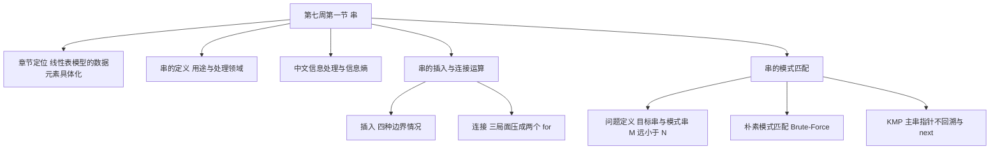
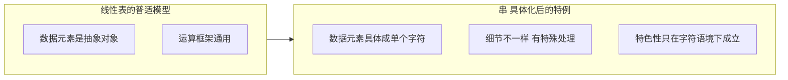
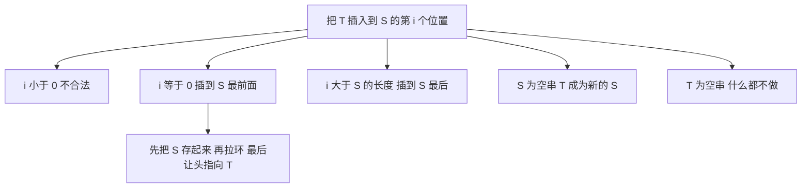
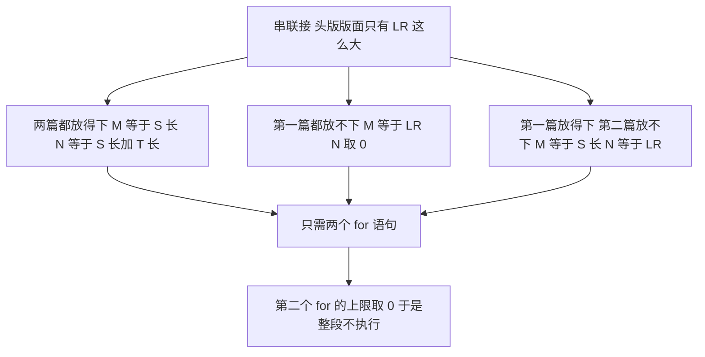
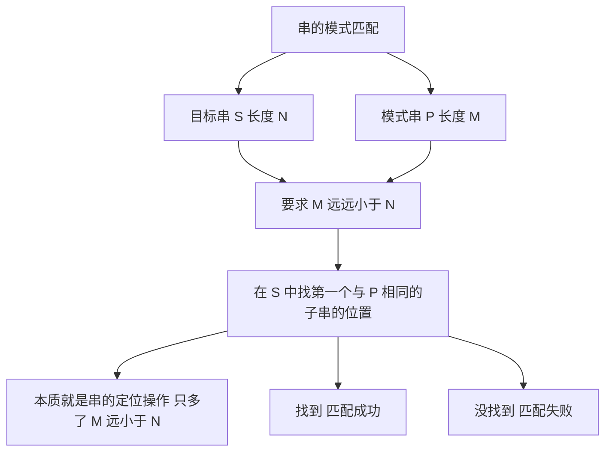
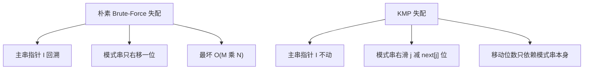
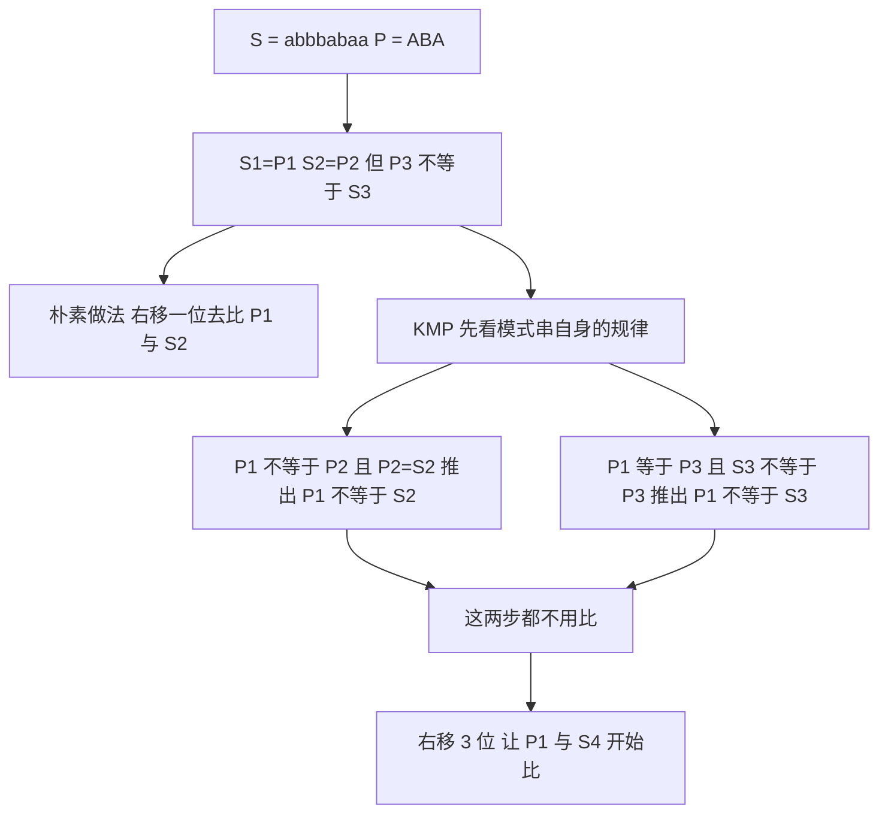

# 数据结构 · 第七周第一节 · 串 · 详细版讲义

> **来源说明**：本讲义由**授课者本人**依据课堂录音的两份本地转写与逐段素材整理，并与严蔚敏《数据结构（C语言版）》第 4 章对照校订而成，属**讲授稿性质的整理稿**。
>
> - **全篇人称**：本讲义以**第一人称**写成，写作者就是讲授者本人。文中一切课堂互动、追问、点评都以「我」的口吻呈现，不使用第三人称转述。（此前各周讲义采用第三人称记述体，本周起统一改用第一人称。）
> - **转写来源（两份本地文件，均为课堂录音的 ASR 导出文字）**：① `串相关内容课程讲解_导出原文.txt`（前半：本章在数据结构中的位置、串的定义与用途、串的处理领域、中文信息处理与信息熵）；② `串的模式匹配教学讲解_导出原文.txt`（后半：串的插入运算边界情况、串联接运算、串的模式匹配定义、朴素模式匹配、KMP 的出发点与 next 的含义）。**两段顺序的依据**：转写一是本章开场（先讲定位、再下定义、再讲用途），转写二开篇即承接「串的插入运算边界情况」这一中途话题，且其末尾留了一句「下节课讲怎么算 next 的值」；故转写一在前、转写二在后，两段之间**可能缺一段串的基本运算的完整铺陈**（见「待核实内容」）。两份合并后按 760 字左右切成 23 段，其中 2 段是转写分隔标记，**21 段正文逐段分析产出 21 份素材**（`segment_001.md` ~ `segment_004.md`、`segment_006.md` ~ `segment_022.md`）。
> - **教材对照范围**：严蔚敏《数据结构（C语言版）》**第 4 章 串**——4.1 串类型的定义、4.2 串的表示和实现（4.2.1 定长顺序存储、4.2.2 堆分配存储、4.2.3 块链存储）、4.3 串的模式匹配算法（4.3.1 定位函数 `Index`、4.3.2 改进算法 KMP）——为主要对照。**但本节课的章节定位论述、「信息熵」与中文信息处理的展开、用人脸识别／退休认证／报纸头版讲模式匹配与串联接的类比，教材中没有对应内容**，属课堂扩展，附录 A 已逐条注明。
> - **标注约定**：讲义与教材**相互参照**，每条知识点都在句末或表内注明关系——`（教材对应：4.x.x）` 表能对上，`（教材补充：4.x.x）` 表教材有而我课上未展开，`（课堂扩展）` 表教材没有的课堂内容，`（讲义补充）` 表我为讲通而作的整理，`（讲义校订：…）` 表当场裁定的口误／同音误识；裁不掉的全部进「待核实内容」。
> - **下标口径**：**本章所有算法，串的下标一律从 1 开始**（这是我课上反复强调的一条）。教材 4.2、4.3 的代码则用 `S[0]` 存串长、字符从 `S[1]` 起，两者在这一点上一致；但教材 4.3.2 的 `next` 数组定义、以及失配后指针的回退口径，与我的口述方式存在**同一对象、两种写法**的差别，正文与附录 B 均已分列标注。
> - **术语校订提醒**：转写中的「**正文**」多半是「**主串**」的同音误录，「组串／祖串」多为「**主串**」或「**子串**」，「**阶／接**」多为 `next[j]` 或下标 `j`，「**4 配／适配**」为「**失配**」，「**布鲁特福斯**」为 `Brute-Force`，「**维玛语言**」疑为「**伪码语言**」。凡此已在正文逐处校订；不确定的列入「待核实内容」。
> - **示意图说明**：正文里嵌了 8 张**操作示意图**，用 `tikz` 代码块书写，在 Obsidian 中由 TikZJax 插件渲染成 SVG（阅读视图可见）。**图内标签一律用字母、数字、数学记号与英文短语（纯 ASCII），中文解释放在图下方的「图注」里**——这不是偷懒，是 TikZJax 的硬限制：它的引擎用 `btoa()` 把 TeX 源码写进 WASM 文件系统，**源码里只要出现非 Latin-1 字符（汉字、全角标点）就会直接抛异常、连编译都不会开始**；而且该引擎只随附 Computer Modern 字体，没有中文字体，汉字即使送进去也排不出来。8 张图都已在 Chromium + TikZJax 下实测渲染通过（8/8，无 console 报错）。总览用的 7 张 Mermaid 知识地图不受此限，仍为中文标签。
> - **编号说明**：我沿用的章节号与严蔚敏教材**相差 1**——我的「第 5 章 串」＝教材第 4 章 串；我的 **5.1 节**（串的定义与基本运算）＋ **5.2 节**（串的模式匹配）合起来构成本次课的内容，其中 5.2 只讲到 `next` 的**含义**，`next` 的**计算**留到下一次课。前几年 5.2 节曾打星号、有几年考研大纲把它直接拿掉，近几年又加了回来。
> - **时间说明**：本节课为**文字模式**（无音视频轨、无关键帧），各节时间戳是按**字数折算的伪时间**（约 200 字／分钟），非音频真实时间，只作讲义内部单调递增的定位坐标，用于与 21 份分段素材对齐；全课伪时间长约 1 小时 15 分。
> - **关联阅读**：[数据结构 第六周第一节 队列 详细版讲义](数据结构%20第六周第一节%20队列%20详细版讲义.md)（上一周）、[数据结构 第五周第二节 栈的应用与递归 详细版讲义](数据结构%20第五周第二节%20栈的应用与递归%20详细版讲义.md)、[数据结构 第二章 线性表 详细版讲义](数据结构%20第二章%20线性表%20详细版讲义.md)（本章是线性表模型的数据元素具体化）。

## 开场导读

这节课讲**串**。开场我先把这一章在整门课里的位置摆正：它是**线性表模型的数据元素具体化**——线性表里每个数据元素本来是个抽象对象（可能是一本教材、一份学生档案、一张发票），现在把每个数据元素**具体化成单个字符**，就成了这一章的内容。也正因为如此，我说这一章「从模型的角度讲比较弱」：线性表的运算我前面已经全讲过了，大体框架一模一样，只是细节不一样。所以这一章要学的不是新框架，而是它的**特色性**——而特色性恰恰来自「数据元素具体成字符」这件事，换个模型就不成立。

特色性有多大？我举了两个名字：**谷歌、百度**。搜索引擎说到底都是字符处理软件演化而来的——我说「光这个字符串的处理，它的特色性就能够导致世界级的公司产生」。

接着我下定义：**字符串简称串**。然后从最早的用处讲起——输入输出语句。一个 C 语言程序要接收 3 个变量值，编译完一执行，光标一闪一闪就是一块黑屏幕，用户哪知道你要干什么？所以必须给提示信息，比如「请输入 3 个整数 X、Y、Z，以逗号隔开」。输出侧也一样：没有返回值的时候，我们就用字符串把程序运行的结果告诉用户。我数了数今天的处理领域：文档编辑（Word、PS，出版社用的更专业、要求更严格）、数据处理和检索、乐谱分析。

再往下是这一节里我最愿意多讲一段的部分——**中文信息处理**。我给它的定义是：用计算机对汉语的**音、形、义**等语言文字信息进行加工操作，包括对字、词、短语、句、篇章的输入、输出、识别、转换、压缩、存储、检索、分析、理解和生成等方面的处理过程和技术。它是一个**大的研究方向**，是**交叉学科**（语言文字学、计算机应用技术、人工智能、认知心理学、数学都要沾），论文常常发在图书情报检索类刊物上，因为它跟语言学挂钩。我还讲了一条我们的**天然优势**：中文的**信息熵**高——单个中文字符所含的信息量比别的语言多，表达同样的意思，中文所用的字／词个数少得多，因此可以减少存储量。

然后是**串的运算**。转写从这里开始接得有点突然（见「待核实内容」）：一上来就是**插入运算的边界情况**。我把它们一条条数出来——`i < 0` 不合法；`i = 0` 就是把 T 整个放到 S 的前面；`i > |S|` 就插到 S 的最后；`S` 是空串就把 T 送给 S；`T` 是空串就什么都不做。这中间有个同学追问「你前面怎么只说三种、不是四种」，我当场解释了：`i > |S|` 这一种**必须在搜索过程中才知道**，因为还没开始搜索，你无从知道 i 有没有超过 S 的长度。为了讲清 `i = 0` 那个「先把 S 存起来、再拉环、最后让头指向 T」的动作，我用了一个类比——**插队插到队首**；而 `i > |S|` 对应的是「找同学插队，班里一个人都没有，那就排在最后」。

顺着插入往下是**连接运算**。我用了一个报纸头版的场景：两位作者各写一篇文章 S、T，都要登在某报纸头版，可头版版面只有 `LR` 这么大。三种局面——两篇都放得下；第一篇都放不下（就像总理的政府工作报告放到人民日报头版），能放多少放多少、剩下的不管（报纸上写「转第几版」，那是另一个版面的事）；第一篇放得下而第二篇放不下。按朴素写法这三种局面要写 **5 个 for 语句**，太啰嗦。我给的改进目标很明确：从**代码量**角度，压成**2 个 for 语句**。诀窍在于 for 语句的性质——**上限必须不小于下限才能执行**，于是我把第二个 for 的上限取 0，它一进来判断就条件不满足，干脆不执行：三种局面就此统一成同一段代码。这段我讲了三种表示：流程图、伪码语言（转写作「维玛语言」，存疑）、以及类 C 的写法。讲完我点了一句：这不还是**线性表的复制操作**吗？无非数据元素具体化成字符后细节不一样、大体框架一样。

真正有特色的是**第二节：串的模式匹配**。问题定义我下得很干净：有两个串 P 和 S，P 长 M、S 长 N，要求 **M 远远小于 N**，要在 S 中找第一个与 P 相同的子串的位置——本质上就是前面讲过的**串的定位操作**，只是多了 M 远小于 N 这个额外要求。为什么加这个要求？因为**更符合实际**：百度主页那个输入框里能输入的字符个数是有限的，那就是**模式**；一点搜索，就在一个个网页里去找有没有出现你这个模式——**百度搜索引擎实现的就是串的模式匹配**。

把这个定义放大，就是**模式匹配问题**（也叫**模式分类**、**问题回答系统**）：把输入的模式与样本进行匹配的过程。我数了它的外延——指纹检索、图像识别、全文检索、人脸识别。指纹那一头我说得很具体：犯罪现场发现一枚指纹或一滴血，采集回去到指纹库／样本库里匹配。人脸识别那一头我讲了两笔账：坐飞机扫脸就能进去、门禁刷脸开门都很方便，可**只要拿到你一张照片就能进去**，所以它其实最不安全；小区物业搞「现代化」刷脸门禁导致业主反抗，原因就两条——**要采集肖像、涉及隐私泄露**，以及**不安全**。我还顺着讲了退休人员生存认证的演变：从「买一份当天的日报或晚报放在胸前拍照寄回单位」，到开摄像头加**眨眨眼、张张嘴、头左右转动一下**的动作提示——图像再加一个动作，为的是把安全级别提上去。

最后落到算法。最朴素的是 **Brute-Force（暴力）算法**：把 P 挨个跟 S 比较，中途失配就把整个模式向右移一位、从头再比。我写了代码，强调两条——**本章所有算法的串下标一律从 1 开始**；以及最坏情况是**每次都在最后一个字符处失配**，时间复杂度 $O(M\times N)$。慢的根子很清楚：**主串指针 I 要不停地回溯**。我先把同学提的几种想法否掉：从后往前比（遇到形如 `AAA…B` 就失效）、把第一个放到中间跳着比、首尾交替比（中间那个不合适）——都不是实质性改进。

真正的改进是 **KMP 算法**，三个人提出的，`K` 就是 Knuth。我提到 Knuth 时说的是「数据结构第一本书、1968 年编写那本书的人」（此处我标了存疑，见「待核实内容」）。他们的思路只有一句话：**失配时主串指针 I 不动**，让模式串 P 相对主串**尽量向右多滑几位**。而这个滑动位数 **K 与主串无关，只与模式串 j 前面那些已经比较过的字符的规律有关**——于是**问题转移了**：先不管 S，先把模式串每个字符失配时该挪到哪儿算出来，这个移动位数就是 **next[j]**。

我用 `S = abbbabaa`、`P = ABA` 手推了一遍：`S1=P1`、`P2=S2`，可 `P3 ≠ S3`。朴素做法要右移一位去比 `P1` 与 `S2`——由模式串自己知道 `P1 ≠ P2`，代入 `P2 = S2` 立刻得出 `P1 ≠ S2`，这一步纯属浪费；再右移一位比 `P1` 与 `S3`——又由 `P1 = P3`、`S3 ≠ P3` 得出 `P1 ≠ S3`，这一步也不需要。于是**直接右移 3 位**，让 `P1` 与 `S4` 开始比：对主串 S 而言，**回溯被消除了**。然后是 `next` 的含义：下一次要让 $S_i$ 与 $P_K$ 比较，前提是 $P_1\cdots P_{K-1}$ 与 $P_{j-K+1}\cdots P_{j-1}$ 相等；移动位数就是 $j-K$ 位，这个 K 记作 `next[j]`。KMP 相对朴素算法只改动一点点：相等时照样 `i+1`、`j+1`；**不相等时多一步**——若 `j ≠ 1`，就直接比较 $S_i$ 与 $P_{\text{next}[j]}$，而 I 指针不动。

课到这里收尾，我留了一句接口：**下节课讲怎么算 next 的值**。

## 总览知识地图

全课内容跨「章节定位 · 串的定义与用途 · 中文信息处理 · 插入与连接 · 模式匹配」五块，塞进一张图会糊掉，所以拆成 7 张小图，每张只画一层意思。

**图 1 · 全课主线：从章节定位到 KMP**



**图 2 · 串为什么「模型弱、特色强」**



**图 3 · 串的插入运算：四种边界情况与那条主干分支**



**图 4 · 串联接：三种局面统一成两个 for**



**图 5 · 串的模式匹配：问题定义与两种结果**



**图 6 · 朴素与 KMP 的分水岭：主串指针回不回溯**



**图 7 · KMP 的手推实例：S = abbbabaa、P = ABA**



## 正文

### 一、这一章的位置：线性表模型的数据元素具体化 `00:00-00:03`

这一章我们讲串。开讲之前，我想先把这一章的位置摆清楚：**从模型的角度讲，这一章是比较弱的一章**。这不是我随口下的判断，我们得回到线性表，把这个判断的来路讲明白。

**先把线性表的定义复习一遍。** 你们还记得线性表的定义吧？线性表是由 $n$（$n \ge 0$）个数据元素 $a_1, a_2, \dots, a_n$ 构成的**有限序列**。两个要点：一是**有限**，$n$ 是个有限的数，$n = 0$ 时就是空表；二是**有序**，除了第一个元素 $a_1$ 没有前驱、最后一个元素 $a_n$ 没有后继之外，每个元素有且仅有一个直接前驱和一个直接后继。就这么一句，一个线性表就定义完了。

**请注意，这个定义里没有出现"元素是什么"。** 我们研究的是模型问题，所以定义线性表的时候，只规定了"有 $n$ 个元素、元素按次序排成一条线"这件事，并没有规定数据元素本身到底是什么。同一副线性表的架子，它的数据元素可能是一本**教材**，可能是一个**学生的档案**，也可能是一张**发票**。这些东西在现实世界里性质完全不同，可它们在模型里没有区别——都只是序列里某个位置上的 $a_i$。这里我要停下来问一句：我们为什么不追究 $a_i$ 到底是个啥？因为有位同学答得很准——**模型的价值恰恰来自"不关心元素是什么"这一层抽象**；一旦开始关心，模型就不普适了，就退化成某一个具体应用了。

**这一章做的事，就是把这个抽象往下具体化一步。** 如果我们把每一个数据元素都具体化为**一个单个的字符**——字符 A、字符 B 这样——那么得到的东西，就是这一章的串。所以我先给你们一个定位性的说法：**这一章实际上是"线性表模型的数据元素具体化"的一个实例**，是线性表被特例化之后的产物。**（讲义补充）**

用抽象数据类型的形式写出来，串的数据对象和数据关系是这样的（教材对应：4.1）：

```
ADT String {
  数据对象：D = { ai | ai ∈ CharacterSet, i = 1,2,…,n, n ≥ 0 }
  数据关系：R1 = { <a(i-1), ai> | a(i-1), ai ∈ D, i = 2,…,n }
}
```

请你们把这段和线性表对照着看：**数据关系那一行一字未改**，变的只是数据对象——从"任意元素"收窄成了"字符"。教材 4.1 的原话是：串的逻辑结构和线性表极为相似，区别仅在于串的数据对象约束为字符集。**（教材对应：4.1）** 所以"数据元素具体化成字符"这句话，不是我为了好记编的口诀，它就是这两个定义之间唯一的差别。

**那为什么我说这一章从模型上讲比较弱？** 因为线性表的运算我们前面都已经讲过了。你现在只不过把元素具体化成了字符，那么它一系列的运算，它们的**大体思路、大的框架和线性表是一模一样的**，不一样的地方只在**细节**上。**（教材对应：4.1）** 既然如此，这一章真正要学、真正要看的，就是它**特色性的东西**在哪里。而这个"特色"从哪里来？恰恰来自"数据元素被具体化成了某一个字符"这件事。

这里我要强调一下**位置感**，免得你们把这一章看轻或者看重：说它"模型弱"，不是说它不重要，而是说它**没有引入新的结构范式**。结构上它还是线性关系，不是树、不是图；操作上它的框架还是从线性表沿用下来的。这就是判断的全部依据。（讲义补充）

既然框架沿用，那"细节不一样"到底不一样在哪里？我停一下再问你们一个问题：串的插入和线性表的插入，是一回事吗？有位同学答"都是往序列里塞东西，差不多"——这个答案只对了一半。差别在于**操作对象变了**：线性表的基本操作大多以**单个元素**为对象，比如在某个位置上插入一个元素、删除一个元素；而串的基本操作通常以**串的整体**为对象，比如在串中查找某个子串、求取一个子串、在某个位置插入一个子串、删除一个子串。教材 4.1 把这层差别说得很明白。**（教材对应：4.1）**

| 比较项 | 线性表 | 串 |
| --- | --- | --- |
| 数据元素 | 抽象，可以是教材、档案、发票等任意数据 | 具体化为一个单个字符 |
| 数据关系 | 一对一的前后关系 | 与线性表一模一样，不变 |
| 基本操作的对象 | 多以单个元素为轴：查找／求取／插入／删除**一个元素** | 多以整串或子串为轴：查找子串、求子串、插入子串、删除子串 |
| 框架与思路 | —— | 沿用线性表，只有细节不同 |

把"插入一个元素"这件事搬到串上来试一下就明白了：元素已经是一个字符，字符是一个不可再分的整体，"在第 3 个字符前插一个字符"在文本处理里几乎不是我们想要的操作；我们真正要干的是在整串上做**查找、取子串、连接、替换**。操作对象变了，算法自然跟着变，这一章的分量就落在这批新算法上。

最后交代一个本书贯穿到底的位置约定：**我们所有串的下标都从 1 开始**，第 1 个字符的位置就是 1；空串我们用 $\varnothing$ 表示。后面手算 next、写伪代码，你们都不要按 0 起算。**（讲义补充，教材对应：4.1）**

**操作图 1 · 串的顺序存储与下标约定**

```tikz
\begin{document}
\begin{tikzpicture}[scale=0.95]
  \foreach \i/\v in {0/5,1/a,2/b,3/a,4/b,5/a}{
    \draw[thick] (\i,0) rectangle ++(1,0.95);
    \node at (\i+0.5,0.48) {\texttt{\v}};
    \node[font=\scriptsize,gray] at (\i+0.5,-0.3) {\i};
  }
  \draw[gray] (1,1.30) -- (6,1.30);
  \draw[gray] (1,1.30) -- (1,0.95);
  \draw[gray] (6,1.30) -- (6,0.95);
  \node[above,font=\small] at (3.5,1.30) {string value: 5 characters};
  \node[above,font=\small] at (0.5,1.85) {$S[0]$ holds the length};
  \draw[->,gray] (0.5,1.78) -- (0.5,1.00);
  \node[below,font=\small] at (3,-0.75) {index counted from 1; cell 0 stores only the length};
\end{tikzpicture}
\end{document}
```

图注：串的顺序存储：`S[0]` 只存串长，串值从下标 1 起，第 i 个字符的位置就是 i。


### 二、模型弱在哪：特色性与普适性的冲突 `00:03-00:05`

上一节我把话停在这儿：这一章主要关注**特色性**的东西。这一节我要把这句话说透——因为这个"特色性"和我们基本数据结构的研究内容**是冲突的**。

**第一节课我就讲过，数据结构研究的是什么？** 研究的是**普适性的模型问题**，一个一个的普适性模型问题。什么叫普适？就是换一批数据、换一个场景，这套模型和算法**仍然成立**。我们整门课追求的就是这种东西。

**而串的特色性恰恰不是这样。** 把数据元素具体化之后，串有它自己的一些细节，有它特殊的处理在里面（后面我会讲两个例子）。这些特殊处理和线性表那套普适性的模型操作很不一样，它是**特色**；但是这个特色有一个致命的前提——它**离开"把数据元素具体化为一个字符"这个前提，就不成立**。换句话说，把线性表模型里的数据元素换成别的东西，这些特色做法立刻就散了。

这里是"模型弱在哪"的技术落点，我补充几句，你们以后做研究也用得上这个思路（讲义补充）：串的模式匹配之所以能有特殊做法，前提有两条——一是字符与字符之间只有"**相等／不相等**"这一种简单而廉价的判定关系；二是串的顺序是有意义的（`'ab'` 和 `'ba'` 是两个不同的串）。而匹配算法的改进之所以能"利用已经匹配过的信息"，靠的是**模式串自身字符的重复结构**，也就是模式串里哪一段前缀和哪一段后缀相同。你要是把数据元素换成学生档案、换成一沓发票，"两个元素是否相同"不再是一次廉价比较，"某一段前缀与某一段后缀相同"更是无从谈起——那套改进就没有依附的对象了。这就是"换一个数据元素它就不成立"的技术含义。

| 维度 | 数据结构追求的普适性模型 | 这一章的串与它的特色 |
| --- | --- | --- |
| 研究目标 | 一个一个普适性的模型问题 | 面向"元素是字符"这一特定元素域的特殊处理 |
| 检验方法 | 换数据、换场景，模型与算法仍成立 | 把元素域换掉，特色做法即失效 |
| 与线性表的关系 | 线性表的运算框架可直接沿用 | 框架相同，只有细节不同，而细节就是它全部的价值 |
| 教学定位 | 必须逐个操作掌握 | 泛泛了解一下即可，重点在特色算法 |

检验方法就一条，请你们记住：**把数据元素换成别的东西，这套做法还成立吗？** 串的特色做法在这条检验下会失效，所以我把这一章归到"模型弱"的一侧。也正因为这样，对这一章，我给的第一个学习要求是：**主要泛泛地了解一下即可**，不必像线性表那样逐个操作去死抠。**（课堂扩展）**

**但这一章在教材和考试里的地位是有起伏的，这段历史我给你们交代清楚。** 前几年，这一节——我课上说的是"5.2 节"——在书上是**打了星号的**（讲义校订：课上说的"5.2 节"是另一套编排口径，严蔚敏教材中串的这一部分在 **4.3 节**，你们以书上的 4.3 为准）。为什么打星号？理由就是刚才那套逻辑：串的模式匹配是一些**特定领域的特殊应用**，它的算法改进**离开了字符串这种环境就不成立**，不具备普适性，所以被当作选学内容处理。也正因为这个原因，有几年考研大纲**直接把它拿下**；而最近几年，考研大纲**又把它加回来了**。**（课堂扩展）**

这段进进出出的历史，我希望你们读出它的方法论味道来：一门内容重要不重要，很多时候不取决于它"普适不普适"，而取决于它背后的**应用需求是不是成了主流**。字符串与文本处理在今天的信息处理里普及到什么程度，下一节我用一个产业例子来说明；正因为这一点，它回来了。**（讲义补充）**

**由此，这一章的学习重心和尺度就定下来了。** 这一章要掌握的，是它的特色性的东西，也就是**这一章第二节的内容**；第二节主要是**模式匹配**，而朴素模式匹配的改进算法就是 **KMP 算法**（教材对应：4.3）。这里我给一个明确到不能再明确的学习尺度：

> 「KMP 算法的原理我们不需要掌握，主要要掌握的是能够手动地算那个 next 的值。」

请你们把这句话记在书上。所谓"手算 next"，在操作上要求你们同时会三件事（讲义补充）：第一，会写出模式串；第二，能按定义**逐位**求出每一个位置上失配时应该回溯到的位置；第三，能拿一个具体的主串按 next 走一遍，验证算出来的值对不对。至于为什么可以这样回溯、那几条递推式怎么来的，属于**原理**，本课程不要求你们推。**（教材补充：4.3.2）**

教材里 next 数组的定义是这样的（教材对应：4.3.2）：

$$
next[j] =
\begin{cases}
0, & \text{当 } j = 1 \text{ 时} \\
\max\{\,k \mid 1 < k < j \ \text{且}\ 'p_1 \cdots p_{k-1}' = 'p_{j-k+1} \cdots p_{j-1}'\,\}, & \text{当此集合不空时} \\
1, & \text{其他情况}
\end{cases}
$$

求 next 函数值的算法，教材写成了这样一段（教材对应：4.3.2，算法 4.7）：

```
// 求模式串 T 的 next 函数值并存入数组 next
i = 1;  next[1] = 0;  j = 0;
while (i < T[0]) {
    if (j == 0 || T[i] == T[j]) { ++i; ++j; next[i] = j; }
    else j = next[j];
} // get_next
```

这里有两处**口径**你们必须分清（讲义补充）：第一，教材里串是**用下标 0 的分量存串长**（`T[0]` 就是串长）、**字符下标从 1 开始**，所以 `while (i < T[0])` 里的 `T[0]` 不是"第 0 个字符"，而是串长——这一点和我们课上"下标从 1 开始"的约定并不矛盾，教材只是借了 0 号单元放长度。第二，教材 4.3.2 在 next 之外还给了一个 **nextval（next 的修正值）**，用来避免 $p_j = p_{next[j]}$ 这种情形下的重复比较，**（教材补充：4.3.2）** 它和 next 用的是一套手算方法，你们把 next 练熟了可以顺手看一眼。至于我课堂上口述的那套手算口径（尤其是 $next[1]$ 取 0 这一条），我在第二节分册里把每一位逐位写出来的时候，再和教材这套定义逐位对齐；这一节先把教材的定义与下标约定摆清楚。**（存疑：课堂手算的起始口径以第二节分册的逐位演示为准）**

### 三、串的定义，与它撑起的世界级公司 `00:05-00:07`

上一节结尾我转到了定义：接下来给字符串下定义。**字符串，也简称为串。** 这是本课程第一个"名字里的字比定义还少"的概念，你们记住简称就行。**（教材对应：4.1）**

串是由**零个或多个字符组成的有限序列**，一般记为

$$
s = \ 'a_1 a_2 \cdots a_n' \qquad (n \ge 0)
$$

其中 $s$ 是串的名字，用单引号括起来的字符序列是**串的值**；$a_i$（$1 \le i \le n$）可以是字母、数字或者其他字符；串中字符的数目 $n$ 称为**串的长度**。**（教材对应：4.1）**

先看这个定义和线性表的定义像到什么程度：同样是"有限序列"，同样是一对一的前后关系，唯一的区别就是 $a_i$ 的取值范围被约束成了字符集 CharacterSet。这就是上一节说的"具体化"，落到定义上就是这么一行字。

下面两个概念必须一次记住，因为考试特别喜欢在这一对概念上做文章：

- **空串**：零个字符的串，长度为零，记作 $\varnothing$。
- **空格串**：由一个或多个空格组成的串，长度等于串中空格字符的个数。

它们名字很像，性质却完全不同：空串里**一个字符都没有**；空格串里**有字符，只不过每一个字符都是空格**。教材专门提醒了一句：空格串不是空串。**（教材对应：4.1）** 我再强调一遍：空格常常是串的字符集合中的一个元素，它可以出现在其他字符中间，所以"看起来什么都没有"的那一串空格，是货真价实的字符序列，它的长度就是空格的个数。

其余几个术语一并定义清楚：

| 术语 | 定义 | 要抓到手的点 |
| --- | --- | --- |
| 子串 | 串中任意个**连续**的字符组成的子序列 | "连续"是关键词；不连续的那叫子序列，不是子串 |
| 主串 | 包含子串的那个串 | 子串与主串是相对关系，同一个串在一种场合是主串、换一种场合可以当子串 |
| 位置 | 字符在序列中的序号称为该字符在串中的位置 | 下标从 1 开始 |
| 子串的位置 | 以子串的**第一个字符**在主串中的位置来表示 | 不是末字符的位置，也不是别的什么 |
| 串相等 | 两个串长度相等，且各个对应位置上的字符都相等 | 长度不等就一定不相等 |

教材 4.1 那一组例子拿来做练习最合适（教材对应：4.1）：设 $a = \text{'BEI'}$、$b = \text{'JING'}$、$c = \text{'BEIJING'}$，那么它们的长度分别是 3、4、7；$a$ 和 $b$ 都是 $c$ 的子串，$a$ 在 $c$ 中的位置是 **1**，$b$ 在 $c$ 中的位置是 **4**。这三个数请你们对着定义核一遍：$a$ 的第一个字符在主串第 1 位，所以位置是 1；$b$ 的第一个字符在主串第 4 位，所以位置是 4；长度不同的串一定不相等。教材同处还给了一个 $d$，长度是 8，并且 $b$ 在 $d$ 中的位置是 5 —— 也就是说 $d$ 与 $c$ 只差**一个空格**，可就这一个空格，位置关系变了、两个串也不相等了。这正是"空格也是字符"这条约定的用法。**（教材对应：4.1；讲义校订：教材节选里 $d$ 的字面在抽取时被截掉了，只留下"长度为 8"和"$b$ 在 $d$ 中位置为 5"两个事实，据此可知 $d$ 与 $c$ 相差一个空格；这个空格在串首还是串尾，抽取文本已无从判断，存疑。）**

还有一个写法上的约定要说清楚：**串值必须用一对单引号括起来，但单引号本身不属于串**，它的作用只是把串值同变量名、数的常量区分开。比如写 $x = \text{'123'}$，含义是"$x$ 是一个串变量名，赋给它的值是字符序列 123"；单引号不在串里，长度是 3 而不是 5。**（教材对应：4.1）**

**定义交代完了，我要回到上一节留的那个扣：为什么我说串处理的分量不只停在课堂上。** 我说过，字符串处理的普遍性甚至能催生出**世界级的公司**——比如谷歌，比如百度。上一节我先把结论放了，现在把机制补上：**所有的搜索引擎，实际上都是字符串处理，都是由一个字符处理软件演化而来的**；而这样的东西，长成了世界级公司。**（课堂扩展）**

请你们注意这句话的分量：不是"搜索引擎顺便用到了字符串处理"，而是**它的骨架就是串处理**。搜索引擎的核心工作可以还原成一句话——在一大堆文本里找出某一小段文本出现在哪里、出现了多少次、它周围的上下文是什么。这恰好就是本节后面要反复用到的**串的定位（Index）** 与**模式匹配**：那个"一大堆文本"是主串（也叫**目标串**），那"一小段文本"是模式串。我把这个例子放在定义这一节，就是要让"子串、主串、位置"这些看着平淡的概念立刻有一个产业级的落点——**你们今天用来查资料的那个输入框，问的就是本章的核心问题。**（课堂扩展）

**最后把串的基本操作摆出来。** 既然串的操作多以整串或子串为对象，那就一次列全（教材对应：4.1）：

| 操作 | 含义 |
| --- | --- |
| StrAssign(&T, chars) | 生成一个其值等于 chars 的串 T |
| StrCopy(&T, S) | 由串 S 复制得串 T |
| StrEmpty(S) | 判空：S 为空串则返回 TRUE，否则返回 FALSE |
| StrCompare(S, T) | 比较：S > T 返回值 > 0，S = T 返回 0，S < T 返回值 < 0 |
| StrLength(S) | 返回 S 的元素个数，即串的长度 |
| ClearString(&S) | 将 S 清为空串 |
| Concat(&T, S1, S2) | 用 T 返回由 S1 和 S2 联接而成的新串 |
| SubString(&Sub, S, pos, len) | 用 Sub 返回 S 的第 pos 个字符起、长度为 len 的子串 |
| Index(S, T, pos) | 若主串 S 第 pos 个字符之后存在与 T 相等的子串，返回它第一次出现的位置，否则返回 0 |
| Replace(&S, T, V) | 用 V 替换主串 S 中出现的所有与 T 相等的不重叠子串 |
| StrInsert(&S, pos, T) | 在串 S 的第 pos 个字符之前插入串 T |
| StrDelete(&S, pos, len) | 从串 S 中删除第 pos 个字符起长度为 len 的子串 |
| DestroyString(&S) | 销毁串 S |

在这 13 种操作里，教材点出了一个**最小操作子集**：StrAssign、StrCompare、StrLength、Concat、SubString 这 5 种，它们是别的串操作实现不出来的；反过来，除 ClearString 与 DestroyString 之外的其他操作，都可以在这个最小子集之上实现。**（教材对应：4.1）** 这句话你们要能举出例子来——教材就示范了一次：用**求子串 + 串比较**，就能把**定位函数 Index** 实现出来。算法 4.1 是这样写的（教材对应：4.1）：

```
int Index (String S, String T, int pos) {
    // T 为非空串。若主串 S 中第 pos 个字符之后存在与 T 相等的子串，
    // 则返回第一个这样的子串在 S 中的位置，否则返回 0
    if (pos > 0) {
        n = StrLength(S);  m = StrLength(T);  i = pos;
        while (i <= n - m + 1) {
            SubString(sub, S, i, m);
            if (StrCompare(sub, T) != 0) ++i;
            else return i;          // 返回子串在主串中的位置
        } // while
    } // if
    return 0;                       // S 中不存在与 T 相等的子串
} // Index
```

这段代码的思想，你们读一遍就应该能复述（教材对应：4.1）：从主串 S 的第 $i$ 个字符起（$i$ 的初值就是 $pos$）取出一个长度与模式串 T 相等的子串，和 T 比；相等就返回 $i$，不等就把 $i$ 加 1，直到主串里取不出这么长的子串为止。这里面有个细节值得你们咬住不放：循环上界写的是 $i \le n - m + 1$，也就是说**最后一个还能取的起点是 $n - m + 1$**，再往后剩下的字符已经不够 $m$ 个了。**这就是"位置"和"长度"这两个概念必须配对使用的原因**，也是后面手算模式匹配时最先要用到的边界条件。（讲义补充，教材对应：4.1）

**操作图 2 · 空串与空格串**

```tikz
\begin{document}
\begin{tikzpicture}[scale=0.95]
  \node[right,font=\small] at (-5.4,0.48) {empty string $\emptyset$ :};
  \draw[gray,dashed] (-2.3,0) rectangle ++(1.1,0.95);
  \node[gray,font=\scriptsize] at (-1.75,0.48) {none};
  \draw[gray] (-2.3,1.25) -- (-1.2,1.25);
  \node[above,gray,font=\scriptsize] at (-1.75,1.25) {length $=0$};

  \node[right,font=\small] at (-5.4,-1.45) {blank string :};
  \foreach \i in {0,1,2}{
    \draw[thick] (-2.3+\i,-1.9) rectangle ++(1.1,0.95);
    \node[font=\scriptsize] at (-1.75+\i,-1.42) {$\sqcup$};
  }
  \draw[gray] (-2.3,-0.65) -- (1.0,-0.65);
  \node[above,gray,font=\scriptsize] at (-0.65,-0.65) {length $=3$, three blanks};
  \node[below,font=\small] at (-0.65,-2.35) {different lengths, different contents: never interchangeable};
\end{tikzpicture}
\end{document}
```

图注：空串与空格串：空串长度为 0、一个字符都没有；空格串长度等于空格个数，两者绝不可混同。


### 四、串最早的用武之地：输入输出里的提示语 `00:07-00:09`

**串在程序设计里最早的用武之地是什么？** 我给四个字：**输入输出语句**。这个判断不是我编的，教材开篇就是这么说的——**在较早的程序设计语言中，字符串是作为输入和输出的常量出现的**。**（教材对应：4.1）**

**我先给你们一个大家都写过的场景。** 你编了一个 C 语言程序，这个程序要接收用户输入的三个变量 $X$、$Y$、$Z$。程序一旦编译完、开始运行，它就要接收这三个变量的值，也就是要让用户把值敲进去。可是你们想想，程序一执行起来，用户直接感受到的是什么？**光标一闪一闪，屏幕是黑的。** 这时候我要停下来问一句：用户怎么知道要输什么？**程序要什么、要输几个数、按什么格式给，用户完全无从得知。** 所以你必须给一些**提示性的信息**，比如在屏幕上打出一行字：

> 「请输入 3 个整数 X、Y、Z，以逗号隔开。」

这行字是什么？就是**串**。这就是**输入语句**最典型的形态。**（课堂扩展）**

**输出一侧是同样的道理。** 在程序设计里，你要把结果交给用户。可有的程序没有返回值——处理完就结束了，用户看不到任何东西。这时候我们就**输出一些字符串**，告诉用户这个程序最终运行的结果是什么。这一侧用到的是**输出语句**，用的还是串。**（课堂扩展）**

这两个例子背后有一点技术含义，我给你们点出来，免得你们把它当成"写程序的常识"就这么滑过去（讲义补充）：

| 层次 | 内容 | 为什么只能是串 |
| --- | --- | --- |
| 界面信息 | 提示、菜单、错误说明 | 给人看的文本，形态就是字符序列 |
| 数据交换 | 读入一行、写出结果 | 早期语言以字符序列为单位与外界交换数据 |
| 结果表达 | 没有返回值时告知运行结果 | 除了字符串，没有更合适的信息载体 |

我在这里还要说一层**可用性**上的道理，这也是我为什么偏要拿"黑屏幕"来举例（讲义补充）：程序等待输入的时候如果不给提示，用户面对的是一个没有任何信息的闪烁光标，无从判断要输几个值、以什么分隔、取值范围是什么；而加一行提示串的代价极低，却把"程序要什么"这件事一次就说清楚了。**串处理之所以会成为语言层面的基础能力，原因就在这里——它不是锦上添花的装饰，而是程序和人通信的最小手段。**

顺便把教材 4.2 开头那句话接上（教材对应：4.2）：**如果串只是作为输入或输出的常量出现，那么只需要存储它的串值、也就是那串字符本身就可以了；但在多数非数值处理的程序里，串是以变量的形式出现的**，这时候就不得不考虑存储结构了。这一句正好把本节和下一节连起来：提示语那种串是"常量"，可以不谈存储；而一旦串要参与运算、要变长变短，存储结构就成了绕不开的问题。

### 五、串的处理领域：文档编辑、检索与乐谱分析 `00:09-00:11`

**前一节讲的是串最早干什么，这一节讲它现在涉及哪些领域。** 串的处理在信息处理这一块变得越来越流行，很多领域都涉及到它。我课上点了三类，我按顺序讲一遍。

**第一类，文档编辑。** 文档编辑软件有很多种，比如 Word，比如 PS。而且这里还有一个**层次差别**：一些**专门的出版社**用的编辑软件会更专业一些，要求也更严格一些。各种各样的文档编辑软件，背后都要做串处理。**（课堂扩展；存疑：课上举的"PS"具体指哪一款，转写里无法判定，可能是 Photoshop，也可能是某种排版软件。）** 这一类的数据结构落点很清楚（讲义补充）：文本的存储结构，加上子串的插入、删除、替换、定位——**排一本几十万字的书，本质上是在一个很长的串上反复做这些操作。**

**第二类，数据处理和检索。** 这一类不用多说，检索的本质就是串的定位与模式匹配——在主串（这里我们常叫**目标串**）里找模式串，正是本章后面要讲的算法。

**第三类，乐谱分析。** 教材 4.1 的领域清单里就有"音乐分析程序"这一项。**（教材对应：4.1）** 我在这里补一句它和本课程的接口（讲义补充）：把乐谱（音符、时值、小节）编码成字符序列之后，就能用串的模式匹配去分析重复出现的乐句、主题和结构——也就是说，乐谱分析在数据结构层面做的事情，和我们查一段文字在哪里出现过，是同一件事。

**而且我要强调一句：串的处理在各个语言当中实际上都需要研究。** 不管你们用什么语言写程序，串这一套东西都绕不开。课堂上我把结论给了，这里把落点补上（教材补充：4.2）：不同语言对串的表示方式不同，教材归纳成三种**机内表示**——**定长顺序存储**、**堆分配存储**、**块链存储**。语言层面的差别**不影响串的逻辑结构**，串在逻辑上仍然是有序字符序列；但它会直接影响"插入、删除、求子串、定位"这些操作的代价。

| 存储表示 | 教材节号 | 要点 | 课堂处理 |
| --- | --- | --- | --- |
| 定长顺序存储 | 4.2.1 | 定长数组 + 串长；超出上界的部分被"截断" | 课上只点结论，本节给出 Concat、SubString 的写法对照 |
| 堆分配存储 | 4.2.2 | 运行时按实际串长动态分配，长度可变 | 教材有完整实现，课上未展开（教材补充：4.2.2） |
| 块链存储 | 4.2.3 | 用链表把若干字符块串起来，有"结点大小"问题 | 教材有完整讨论，课上未展开（教材补充：4.2.3） |

**既然"各个语言都要研究串处理"，我就把教材在定长顺序存储下写的两个操作摆出来，给你们当参照。** 先交代教材的表示口径（教材对应：4.2.1）：教材用一个定长数组存串，**下标 0 的分量专门存串长**，字符从下标 1 开始放，即

```
#define MAXSTRLEN 255                       // 255 以内定义最大串长
typedef unsigned char SString[MAXSTRLEN + 1];   // 0 号单元存放串的长度
```

超过这个长度的串值会被舍去，这叫**截断**。这个"`S[0]` 存长度、字符从 1 号开始"的口径，和我们课上"串的下标从 1 开始"是相容的——教材只是把 0 号单元借去放长度了，字符的位置记号仍然是 1、2、3……

先看**串联接 Concat**。教材把它分成三种情况（教材对应：4.2.1）：

| 局面 | 条件 | 结果 |
| --- | --- | --- |
| 不截断 | $S1[0] + S2[0] \le MAXSTRLEN$ | T 是 S1 接 S2 的完整结果，返回 TRUE |
| 部分截断 | $S1[0] < MAXSTRLEN$ 而 $S1[0] + S2[0] > MAXSTRLEN$ | 只接上 S2 的前一段，超出部分舍去，返回 FALSE |
| 整体不接 | $S1[0] = MAXSTRLEN$ | T 与 S1 相等，S2 一个字符也接不进来，返回 FALSE |

```
Status Concat(SString &T, SString S1, SString S2) {
    // 用 T 返回由 S1 和 S2 联接而成的新串。若未截断返回 TRUE，否则 FALSE
    if (S1[0] + S2[0] <= MAXSTRLEN) {                    // 未截断
        T[1 .. S1[0]] = S1[1 .. S1[0]];
        T[S1[0]+1 .. S1[0]+S2[0]] = S2[1 .. S2[0]];
        T[0] = S1[0] + S2[0];   uncut = TRUE;
    }
    else if (S1[0] < MAXSTRLEN) {                        // 截断
        T[1 .. S1[0]] = S1[1 .. S1[0]];
        T[S1[0]+1 .. MAXSTRLEN] = S2[1 .. MAXSTRLEN - S1[0]];
        T[0] = MAXSTRLEN;       uncut = FALSE;
    }
    else {                                               // 截断（仅取 S1）
        T[0 .. MAXSTRLEN] = S1[0 .. MAXSTRLEN];          // T[0] = S1[0] = MAXSTRLEN
    }
    return uncut;
} // Concat
```

再看**求子串 SubString**。教材说这个操作不会出现截断的问题，但用户给出的参数可能不合法，参数非法时返回 ERROR（教材对应：4.2.1）：

```
Status SubString(SString &Sub, SString S, int pos, int len) {
    // 用 Sub 返回串 S 的第 pos 个字符起长度为 len 的子串
    // 其中 1 ≤ pos ≤ StrLength(S) 且 0 ≤ len ≤ StrLength(S) - pos + 1
    if (pos < 1 || pos > S[0] || len < 0 || len > S[0] - pos + 1)
        return ERROR;
    Sub[1 .. len] = S[pos .. pos + len - 1];
    Sub[0] = len;   return OK;
} // SubString
```

这两段代码我想让你们看出同一个共同点（讲义补充）：**在顺序存储结构里，串操作的原操作其实是"字符序列的复制"**，操作的时间代价就取决于被复制的字符序列有多长；而且只要串长上界 `MAXSTRLEN` 存在，"截断"这个隐患就会在联接、插入、置换等一连串操作里反复冒出来。教材的原话是：克服这个弊病，惟有不限定串长的最大长度，也就是动态分配串值的存储空间——这就引出了下一个表示：堆分配存储。**（教材对应：4.2.1）** 课上我没有展开这两段代码，但你们拿线性表的顺序存储来对照读，应该毫无障碍，因为**串的框架和线性表一模一样、只有细节不同**；这段代码里唯一的新东西就是**"串是一个整体，复制以一段字符为单位"**。（讲义补充）

### 六、中文信息处理：一个交叉学科的研究方向 `00:11-00:13`

**讲到这里，我要提出一个到现在为止绕不开的话题：中文信息处理。** 它是一个研究热点，而且体量不小——很多研究生就是把中文信息处理作为自己的研究方向来做这件事的。**（课堂扩展）**

**先给定义，我给的是完整的一句：**中文信息处理，就是**用计算机对汉语的音、形、义等语言文字信息进行加工操作**，包括对**字、词、短语、句、篇章**的**输入、输出、识别、转换、压缩、存储、检索、分析、理解和生成**等方面的处理过程和技术。**（课堂扩展）**

这个定义有两截：前一截说**对象**，后一截说**操作**。我分开讲。

**先说对象谱，也就是它到底拿什么当处理对象。** 定义里列的是由小到大的五级单位：

| 单位 | 说明（讲义补充） |
| --- | --- |
| 字 | 最小的书写单位，也是串处理里最基本的元素 |
| 词 | 由字构成的有意义单位，是分词、词性标注的对象 |
| 短语 | 由词构成、还没有成句的结构单位 |
| 句 | 完整的表达单位，是句法分析的对象 |
| 篇章 | 由若干句构成的整体，是篇章分析与理解的对象 |

这五级单位是**层层嵌套、逐级包含**的：篇章由句组成，句由短语组成，短语由词组成，词由字组成。我要你们注意的一点是，它们在计算机里都是以**串**的形态存在的，**区别只在于切分的粒度不同**。**（讲义补充）**

**再说操作谱，也就是它对这些对象做哪十件事：**输入、输出、识别、转换、压缩、存储、检索、分析、理解、生成。这十项我按处理方向分成四组，你们看起来更清楚（讲义补充）：

| 分组 | 操作 | 含义（讲义补充） |
| --- | --- | --- |
| 与外部交换 | 输入、输出 | 把文本读进来、送出去，含编码转换 |
| 感知与识别 | 识别 | 光学字符识别、语音识别等，把非文本对象转成串 |
| 形式变换 | 转换、压缩、存储 | 编码转换、压缩、持久化保存 |
| 理解与使用 | 检索、分析、理解、生成 | 找出目标文本、做结构与语义分析、形成理解、生成新文本 |

**把这张表放回本课程的语境里看，你们会发现它一点都不"外围"。**（讲义补充）"存储"对应的就是串的存储结构（教材对应：4.2）；"检索"对应的就是串的定位与模式匹配，也就是本章后面的核心算法（教材对应：4.3）；"压缩"的前提是文本里存在大量重复的子串与前缀，把这些重复结构找出来、替换成短编码，用的正是串的匹配与替换；而"识别、转换"做的事情，是把外部的非串对象变成串。也就是说，**中文信息处理的每一个环节，最终都要落到"串"这个数据结构上**。我把这一节放在这儿，就是因为它回答了"这一章凭什么单独存在"这个问题：串是中文信息处理的直接载体，而这一章后面的模式匹配，正是"检索"这一项操作的核心算法。**（课堂扩展）**

**中文信息处理的第二个属性是：它是一个交叉学科。** 它涉及到**语言文字学、计算机应用技术、人工智能、认知心理学，还有数学**等等各种各样的学科，这些方面的知识都要有。**（课堂扩展）** 为什么需要这么多学科？我列一张表，你们一看就明白（讲义补充）：

| 学科 | 在中文信息处理里的作用（讲义补充） |
| --- | --- |
| 语言文字学 | 提供汉语的音、形、义知识和语法规则，是处理对象的本体知识 |
| 计算机应用技术 | 提供算法、数据结构与系统实现手段 |
| 人工智能 | 提供机器学习、模式识别、自然语言理解的方法 |
| 认知心理学 | 提供人如何理解和生成语言的模型与实验依据 |
| 数学 | 提供概率统计、信息论、最优化等形式化工具 |

**这个交叉属性还有一个很实际的观察，我课上专门讲了：做中文信息处理的人会发现，自己论文发表的地方往往不在纯计算机类刊物上，而是发表在图书情报、检索之类的期刊上。** 原因就在于它**要和语言学挂钩，要和中文的语言学挂钩**——研究对象是汉语，你绕不开对汉语本身的认识。**（课堂扩展；存疑：课上把发表阵地概括为"图书情报、检索之类"，转写中紧接的几个字不可解，疑为"期刊杂志"，具体刊物类别课上未展开。）**

这个现象对我们这门课的启发是（讲义补充）：在"字→词→短语→句→篇章"这条链子上，越往"词、短语、句、篇章"那一头走，语言学知识的比重越大；越往"字"这一级靠，数据结构与算法的比重越大。但**无论在哪一级做检索，最终都归结为"在一个串里找另一个串"**——这就是你们在这一章里要学的那件事。

**最后交代一句这个方向的前景，我课上顺口预告过：未来可能有同学会涉及到中文信息处理这一块的研究内容。** 我把它写在这里，不是要你们都去做这个方向，而是让你们知道：**这一章看着"模型弱"，可它的下游是敞开的。**（课堂扩展）

### 七、中文的信息熵优势 `00:13-00:14`

**最后，我讲中文的"得天独厚的优势"。** 优势在哪里？在于中文的**信息熵很高**。**（课堂扩展）**

**先把概念澄清，我课上就是这么下定义的：所谓的信息熵，指的是单个中文字符所含的信息量。** 单个中文字符所载的信息量，比别的语言要**高、要多**，这就导致中文的信息熵比较高。**（课堂扩展）**

**信息熵高带来的直接后果是：省地方。** 如果我要表达同样的意思，用中文表达出来和用英文表达出来相比，中文所需要的**字的个数或者词的个数要少得多**；字词个数少，**存储量就可以减少**。这就是我说的"中文的优越性"。**（课堂扩展）**

我把这个概念和本课程的关系说清楚，因为它听起来像语言学，其实落在串上（讲义补充）：串的每一个元素是一个字符，那么**同一段语义内容，中文字符所需要的元素个数更少**——元素个数少，就是占用的存储单元少，也就是存储量更小。信息熵高，在这里的落点就是"用更少的符号承载同一份意思"。

有两点我必须给你们交代清楚，免得你们把它当成一条严格的定量结论（讲义补充）：

1. 信息熵在**信息论**里是香农提出的概念，度量的是一个随机变量的**不确定性**，单位是比特。把它用到语言上，量的其实是"读到下一个字符之前有多大的不确定性"。我课上给的那个定义是它的通俗版本——**单个中文字符所含的信息量**——你们按这个理解入门没有问题，但要知道它的严格形式是概率分布的函数。
2. 从"单个字符信息量高"到"整篇存储量小"，中间还隔着一步：前者是**单符号层面**的度量，后者还取决于**符号总数和编码方式**。两者通过"符号总数 × 单符号平均承载量 ≈ 总信息量"这个关系联系起来。**课堂上我是把这两步当成一条因果链来讲的，这属于通俗化的讲法**；严格的推导要放到信息论里去做。**（讲义补充，存疑）**

把这条链子说到底，就是一句话（讲义补充）：一种语言如果单个符号的平均信息量大、冗余少，那么表达同样的信息量所需要的符号数就少，编码就更紧凑。**这既解释了中文在文本存储与传输上的优势，也解释了为什么"压缩"会成为中文信息处理里的一项基本操作**——上一节那张操作谱里的"压缩、存储、检索"，在这里有了同一套来源；而它们在数据结构层面的实现手段，仍然是串的存储结构与串的模式匹配。**（教材对应：4.2、4.3）**

**到这儿，我们前七节走了一条完整的路：**我们从线性表出发，把数据元素具体化成字符，得到了串；我们承认它**模型弱、特色强**，于是把学习重心定在模式匹配、把手算 next 定为尺度；接着我们看到，就是这么一个"模型弱"的东西，撑起了搜索引擎这样的世界级公司，也通向中文信息处理这样一个交叉学科的大方向。**下一节我们正式进入本章的重点：串的模式匹配——从朴素模式匹配（Brute-Force）讲到 KMP 算法。**（教材对应：4.3）

### 八、串的插入运算（一）：四种边界情况 `00:14-00:18`

上一节我们把串的块链存储表示交代完了（教材对应：4.2.3）——串值放在一条链表上，每个结点里存若干个字符，结点之间用 `next` 串起来，结构里另外记着头指针 `head`、尾指针 `tail` 和当前长度 `curlen`。现在正式进入串的运算，第一个要讲的是**插入**：把串 T 插到串 S 的第 i 个位置上去（教材对应：4.1 的 StrInsert 定义）。

先把插入做完之后 S 长什么样说清楚。原来是「一条链 S」，插进去之后是「S 的前半段 + T 整条链 + S 的后半段」——三截接成一条更长的链，而这条链仍然挂在 S 这个名字底下。所以整个运算的第一件事，就是让指针沿着链往下走，一直走到该接的位置。走、找、接这个过程我放到下一节讲；本节我先把**插入位置**和**两个串自身取值**可能出现的边界情况一次讲干净，因为把这几种情况提前判掉之后，常规情况的代码才能写得清爽。

这里我要先说一句：下面这些情况绝大多数并不是「错误」。真正非法的只有一种，其余几种都是**合法的退化情形**，只是处理起来可以一步到位。

**第一种，插入位置 i < 0：不合法。** 给一个负数位置，这个位置根本不存在——它既不在 S 的前面，也不在 S 的后面，无论怎么解释都对不上。所以拿到负数，直接报错返回。

**第二种，i = 0：合法，含义是把 T 插到 S 的最前面。** 这个位置最容易让人犯糊涂：不少人第一反应会把 0 也当成非法，但在这里 0 是允许的。理由是我们把 i 理解为「第 i 个字符之后」这个位置。第 0 个字符并不存在，于是「第 0 个字符之后」只能落到「第 1 个字符之前」，也就是整条串 S 的最前面。所以 i = 0 的暗含含义就是：把整个 T 放到 S 的前面，让 T 成为结果串的开头部分。用排队打比方，这就是**插队插到队首**。

**第三种，i > |S|：把 T 插到 S 的最后。** 转写里把 |S| 读成「S 的绝对值」，这是从数学记号直接读出来的口语；写出来就是 $|S|$，在计算机和数学里它表示的是串 S 的**长度**，也就是串里一共有多少个字符，不是数值意义上的绝对值。举例：串 S 总共只有 5 个字符，你却要求在「第 10 个位置」插入，这个位置当然不存在。这时重点不在于位置不存在，而在于插入这件事**必须做成**：既然没有第 10 个位置，那就干脆把 T 追加到 S 的最后面，等价于在第 $|S|$ 个字符之后插入 T。类比一下：你要插队，找班里那位同学，结果班里一个人都没有——那没得挑，就排在最后。

**第四种，S 为空串：把 T 送给 S，T 成为新的 S。** 转写里说的「这个列表整个都不存在」，是「这条链表整个都不存在」的误听（**讲义校订**：「列表」→「链表」）。S 是空串，说明它没有任何字符，块链结构里也就没有任何链结点。这种情形下把 T 整个交给 S，T 就成了新的 S 串——本来是要往一个空串里插东西，插进去之后，剩下的自然就是插进去的那一整条链。类比：你去办事，窗口一看一个人都没有，那你自然就成了窗口的第一个人。

**第五种，T 为空串：什么都不做，直接退出。** 要插入的子串本身是空的，没有任何字符可插，那么无论 i 取什么值，这次插入都不会对 S 产生任何影响。直接返回、不做任何操作即可。（**讲义校订**：转写末段的「不做财务操作」→「不做任何操作」，属同音误识。）

这两个「为空」的动作方向正好相反，我特意把它们并排放在一起，请你们一定分清：

| 哪个串为空 | 我的处理 | 结果 |
| --- | --- | --- |
| S 为空串 | 把 T 整个交给 S | S 变成 T，T 的第一个链结点成为结果串的头 |
| T 为空串 | 什么都不做，直接退出 | S 原样不动 |

再补一句关于「四种」的说法：本节一共讲了五条，但严格说，**i < 0 属于参数非法**，不算边界情形；真正的边界情形是四种——i = 0、i > |S|、S 为空、T 为空。这个分类下一节还会用到，因为下节要回答「为什么你说的是三种、不是四种」这个追问（**讲义补充**：把「位置非法」与「边界情形」分开，是本讲义的整理，课堂上这两类是混在一起讲的）。

把插入位置 i 的各种取值摆成一张表，含义就一目了然了：

| i 的取值 | 含义 | 对结果串 S 的效果 |
| --- | --- | --- |
| $i < 0$ | 位置不存在 | 非法，返回错误 |
| $i = 0$ | 第 0 个字符之后（＝第 1 个字符之前） | T 插到 S 的最前面 |
| $0 < i < \lvert S \rvert$ | 第 i 个字符之后 | T 插到 S 的中间 |
| $i = \lvert S \rvert$ | 最后一个字符之后 | T 接到 S 的最后面 |
| $i > \lvert S \rvert$ | 超过串长，位置不存在 | 按追加处理，T 接到 S 的最后面 |

**与教材的对照。** 教材 4.1 里 StrInsert 的初始条件写的是 $1 \le pos \le \mathrm{StrLength}(S) + 1$，操作结果是「在串 S 的第 pos 个字符之前插入串 T」（教材对应：4.1）。两种约定只是把同一件事的编号平移了一位：教材用 pos = 1 表示「第 1 个字符之前」，课堂用 i = 0 表示同一个位置。真正的内容完全一致——插在最前面、插在中间、插在最末尾三种落点，加上两个串为空时的退化情形。你们答题的时候看清题目用的是哪一套约定，别把 0 和 1 混用。

还有一个值得对照的地方：教材在堆分配存储下也给了 StrInsert 的实现，也就是算法 4.4（教材补充：4.2.2）。那份代码的思路是「重新分配一块长度为 S.length + T.length 的连续空间」，先把 S 中第 pos 个字符之后的字符整体**往后挪** T.length 个位置，再把 T 填进空出来的位置。它是**搬字符**；而我们课堂上做的是块链存储下的插入，改的是**指针**，一个字也不用搬（课堂扩展）。这两份代码放在一起看，「链式结构插入方便」这句结论才算落到实处。

块链结构下这套边界处理，写成类 C 风格的 PDL 是这样（串下标从 1 开始，存储结构沿用教材 4.2.3 的 LString）：

```c
#define CHUNKSIZE 80
typedef struct Chunk {
    char ch[CHUNKSIZE];
    struct Chunk *next;
} Chunk;

typedef struct {
    Chunk *head, *tail;   // 串的头指针和尾指针
    int    curlen;        // 串的当前长度
} LString;

Status StrInsert(LString &S, int i, LString T) {
    // 把串 T 插到串 S 的第 i 个字符之后（下标从 1 开始；i = 0 表示插到最前面）
    if (i < 0)          return ERROR;        // 位置非法：负数位置不存在
    if (T.curlen == 0)  return OK;           // T 是空串：没有字符可插，什么都不做
    if (S.curlen == 0)  { S = T; return OK; }// S 是空串：T 整体成为新的 S

    if (i == 0) {
        // 第 0 个字符之后 = 第 1 个字符之前：整个 T 放到 S 的前面
        // 具体接法见下一节（先保存 S，沿 T 走到尾，拉环，最后改头）
        return OK;
    }
    // 0 < i：常规情况，启用搜索指针 p 沿链前进；
    // 若走完链仍未到第 i 个字符（i 超过 |S|），按「追加到末尾」处理（下一节展开）
    return OK;
}
```

- 时间复杂度：边界判断本身是常数时间，$O(1)$；真正花时间的是搜索指针沿链走到第 i 个位置，按结点个数计为 $O(i)$，最坏 $O(|S|)$。（**讲义补充**：块链存储下这一段只改指针、不搬字符，这正是链式结构在插入上的特点。）
- 关键易错点：
  1. 把 i = 0 当成非法位置直接返回错误，结果「插到最前面」这个合法需求落空；
  2. 判断顺序写反——先判 S 是否为空、后判 T 是否为空，就会把「T 为空」误当成「S 为空」，把一整条不该动的串处理掉；
  3. 把 $|S|$ 当成数学上的绝对值，或者误用 0 号单元里的串长（那是顺序存储的写法，块链存储要看的是 `curlen` 字段，教材对应：4.2.3）；
  4. 「下标从 1 开始」与「i 可以取 0」并不矛盾：字符的下标从 1 起，而「某个字符之后」这个位置编号从 0 起。

### 九、串的插入运算（二）：i=0 的拉环，与一般情况的统一 `00:18-00:29`

上一节把「S 是空串就直接把 T 送给 S」这一支讲完了，接下来正式进入**常规情况**：用一个搜索指针 p 在链上找出插入位置。

**一、为什么要配一个计数器。** 顺序存储里，第 i 个字符用下标就能直接取到；块链存储里没有现成的下标，每个结点只有数据域和指向后继的指针域，第几个字符只能从头结点出发一个一个数过去。所以必须引入一个计数器 j，跟搜索指针 p 同步推进：指针每往后挪一格，j 加一；j 数到 i，位置就找到了。计数器在这一节承担两个职责——一个是「数到第 i 个」，另一个是「说明到底有没有第 i 个」，后者马上就会用上。

**二、前进条件是一个「并且」。** 往前走要同时满足两件事：**计数还没数到第 i 个字符**，**并且还没有走到最末尾**。两个子条件缺一不可，因为它们代表两种不同的收尾方式，谁先失效，就决定走哪一支：

| 先失效的子条件 | 说明的事实 | 我的处理 |
| --- | --- | --- |
| j 已经等于 i | 已经找到了第 i 个字符之后的落点 | 常规插入：在这里把 T 链进去 |
| 搜索指针先撞上了链尾 | 这个串根本没有第 i 个字符 | 落入「i 过大」这一支：把 T 链到 S 的末尾 |

换句话说，这个循环并不预先判断 i 有没有越界，它只是老老实实往前走；越界这件事是通过「先撞上末尾」被发现的。所以「i 过大」这种情形既不会报错、也不会被拒绝，它退化成一次**追加**：直接把 T 链到 S 的最后面。请你们注意，这本身也是一种特殊情形，只不过它的处理位置跟前面几支不一样。

**三、有位同学问：前面不是只讲了三种吗，不是有四种吗？** 这个问题问得好，我特意停下来回答。前面三种是：i 给负数不合法、T 为空就什么都不做、S 为空则把 T 送给 S。既然还有第四种「i 大于串长」，为什么不也放到前面一起处理掉？

> 「因为 i 大于串长这件事，**只有在搜索的过程当中才能知道**。你都还没有开始搜索，怎么会知道它比 S 的长度还大呢？你不知道。」

前面那几种有一个共同点：**只看参数就能定案**。i 是个负数，拿到参数当场就知道不合法；T 是不是空串，看一眼也知道；S 是不是空串，同样看一眼就知道。而「i 大于串长」不一样，它依赖的是 S 的实际长度这条信息，而链式存储的串长不像顺序存储那样存在第 0 号单元里，要沿链走一遍才能数出来（教材对应：4.2.1 的 `S[0]` 存长度；块链结构另有 `curlen` 字段，教材对应：4.2.3）。更本质地说，**判断越界的过程和寻找插入位置的过程是同一趟遍历**。把它前置，等于为了判断越界先单独走一趟链、再走第二趟去插入，白白多扫一遍。所以它的正确位置就是落在搜索循环里，由「先走到末尾」自然触发。这也是为什么这一支和常规情况在代码里其实是同一个循环的两个出口，而不是两段独立的代码（**讲义补充**）。

**四、i = 0 这一支：目标容易，次序难。** i = 0 表示要插到第一个字符的前面，也就是把整个 T 放到 S 的前面去。既然 T 要整体排在 S 前头，那么 S 新的表头自然应该等于 T，这一点是明确的。但是这里我要特别强调一句：**千万不要急着去修改 S 的指针**。

为什么？因为除了「T 排在前面」之外，还要把整个原来的链表 S 接到 T 的后面去，也就是还要做那个「拉环」动作——把 T 的最后面拉给 S，让 T 的尾结点指向原来的 S。既然要做这个连接动作，就必然要拿到 S 的当前位置；一旦提前把 S 的指针改成了 T，原来的 S 就再也找不回来了。所以正确的次序是：

1. 先把 S（原链头）保存到临时指针 save——转写里说成「把 S 送给 C」，`C` 就是 save 的误识，这一步是 `save = S`（**讲义校订**：转写中反复出现的「C／C5／一三／诗／心」多半都是 save 的同音误记）；
2. 再把搜索指针 p 放到 T 的最开始位置，准备沿 T 这条链搜索；
3. 沿 T 往下走到它的**最后一个结点**；
4. 拉环：把 T 的尾结点的后继指向 save，也就是把保存下来的 S 接到 T 的尾上；
5. 最后才修改 S，让它指向 T——T 成为新的头结点。

上一节我只讲到第 2 步，把「为什么必须先保存」这个理由讲透：保存不是为了好看，而是**拉环这个动作的输入之一**。「拉环」是本课的口语说法，指的是把一条链与另一条链接上的动作：让前一条链尾结点的指针域指向后一条链的头结点。之所以用「拉」这个字，是因为链表的连接不是把两条链搬到一个连续空间里去拼接，而是在某个结点的指针域上做一个指向动作，把两条链串成一条。

**五、一般情况：四步走。** 所谓一般情况，就是 i 不为 0 的常规情形。此时 p 已经停在该停的那个结点上——停下来之后就不再移动了（转写里说「P 停在这儿了」）。接下来四步，一步都不能少：

| 步骤 | 语句 | 作用 | 少写这一步的后果 |
| --- | --- | --- | --- |
| ① 保存 | `save = p->next` | 记下 p 原来的后继，也就是被拆下来的后半段 S | 这个位置被 T 覆盖之后，后半段 S 永远找不回来 |
| ② 接链 | `p->next = T.head` | 把 T 这条链拉到 p 的后面 | T 根本没接上去 |
| ③ 走到尾 | `while (p->next) p = p->next` | 让 p 停到 T 的最后一个结点上 | 会在中间某处就把后半段接回去，T 被截断 |
| ④ 接回 | `p->next = save` | 把 T 尾结点的后继指回原来的后半段 S | 接完 T 之后，后半段整段丢失 |

第②步做完之后，只要再跑一次 `while (p->next) p = p->next`，p 就会自然地越过 T 的头结点、一路走到 T 的尾结点——因为此刻 p 的后继已经是 T 的头结点，只要它不空就往前走，直到某个结点的后继为空，那正是 T 的尾结点。所以第③步不需要额外写「先走一步」，一个循环就够了。转写里那句「连着链条走到最后一个，然后再拉环」，说的就是先走、后拉的顺序。

**六、i > |S| 落在哪个分支？答案是 else，和一般情况共用同一段代码。** 又有同学追问：那「i 大于 S 的长度」那种情形到底在代码的哪个地方？答案要从 p 停下的位置去看。当 i > |S| 时，p 在搜索过程中已经走到了 S 的尾结点（链先到头了，计数还没到 i），这时 `p->next` **本来就是空**，所以第①步保存下来的 save 就是一个空值，相当于 save 为空。接下来的处理顺序完全一样：先 `p->next = T.head`，把 S 的最后一个结点拉来指向 T；然后沿着 T 往后走到最后一个结点；最后再把那个空的 save 接回去（`p->next = save`）。因为 save 是空的，接回去的效果就是「T 的尾结点之后什么都没有」——T 被接到了 S 的最后面。

本段最值得记住的设计就在这里：**i > |S| 这种「位置越界就插到最后」的要求，并没有单独写一个 if 分支**，而是和常规情形共用同一个 else，代码一字不差。之所以能合，是因为「p 的后继是否为空」这件事在接完链之后就自然分开了：save 为空，接回去的就是空；save 非空，接回去的就是原来被拆下来的后半段。反过来，位置的合法性为什么不能提前判断，也就清楚了——**如果连搜索都还没有开始，根本不可能知道给出的 i 是不是大于 |S|**。这里还顺带确认一句：走到 else 里时 i 肯定不等于 0（否则第 i 个字符根本谈不上），所以越界情形不会被误判成 i = 0 的前插情形。

**七、这一节最该带走的一句话。** 回看链表：原来链表做的是插入**一个结点**——找到位置，断开，接上一个结点，再接回原来的后继，一共改两处指针。现在串的插入做的是**在一个链表当中插入另外一个链表**：要插入的 T 自己就是一条链表。于是改接分两步走——先把 T 这条链挂上去，然后沿 T 走到它的尾结点，再把被保存的后继接到 T 的尾结点上。多出来的这一步「沿链走到尾」，正是「插入对象从结点变成链表」带来的额外开销。操作对象从一个结点变成一条链，这是两者最本质的差别，也是这一部分比线性表插入麻烦的地方（教材对应：4.2.3；教材只说了块链存储下「和线性表的链式存储操作类似，故不作详细讨论」，这一套写法是课堂补出来的，课堂扩展）。

把整段写全，类 C 风格的 PDL 如下：

```c
// 串 S、T 均为块链存储（教材 4.2.3 的 LString 形态）；下标从 1 开始；i = 0 表示插到最前面
Status StrInsert(LString &S, int i, LString T) {
    if (i < 0)         return ERROR;          // 位置非法
    if (T.curlen == 0) return OK;             // T 是空串：什么都不做
    if (S.curlen == 0) { S = T; return OK; }  // S 是空串：T 成为新的 S

    if (i == 0) {                             // ===== 分支一：把 T 链到 S 的前面 =====
        save = S.head;                        // ① 先保存 S 的链头（先留后手）
        p    = T.head;                        // ② p 移到 T 的头结点，准备沿 T 搜索
        while (p->next != NULL) p = p->next;  // ③ 沿 T 走到最后一个结点
        p->next = save;                       // ④ 拉环：把保存的 S 接到 T 的尾上
        S.head  = T.head;                     // ⑤ 最后才改头：S 指向 T
    } else {                                  // ===== 分支二：常规情形（含 i > |S|） =====
        p = S.head;  j = 1;                   // p 是搜索指针，j 是计数器
        while (j < i && p->next != NULL) {    // 合取条件：还没数到 i，且还没到链尾
            p = p->next;  ++j;
        }                                     // 因 p->next 为空而停下 → 说明 i > |S|
        save    = p->next;                    // ① 保存 p 的后继（被拆下来的后半段 S）
        p->next = T.head;                     // ② 把 T 这条链拉到 p 的后面
        while (p->next != NULL) p = p->next;  // ③ 沿 T 走到它的最后一个结点
        p->next = save;                       // ④ 把保存的后继接回尾结点之后（save 为空即接空）
    }

    S.curlen += T.curlen;                     // 长度维护（讲义补充）
    return OK;
}
```

- 时间复杂度：搜索阶段 p 最多走 $|S|$ 步，找 T 的尾结点最多走 $|T|$ 步，所以整体是 $O(|S| + |T|)$。空间上只多用了 save 这一个临时指针，$O(1)$。（**讲义补充**：教材在块链结构里专门另设了尾指针 `tail`，并说「设尾指针的目的是为了便于联结操作」——有了尾指针，第③步「走到尾」就可以从 $O(|T|)$ 降到 $O(1)$；当然搜索阶段仍然是 $O(|S|)$。教材对应：4.2.3。）
- 关键易错点：
  1. **顺序颠倒**：先 `S.head = T.head` 再拉环，S 原来的链头就丢了，拉环无从下手；
  2. **忘记保存**：`save = p->next` 一旦漏掉，`p->next = T.head` 执行之后后半段 S 再也找不回来；
  3. **找尾结点的条件写错**：应写 `while (p->next) p = p->next`，让 p 停在尾结点上；若写成 `while (p) p = p->next`，p 会停到空指针上，随后 `p->next = save` 就是对空指针解引用；
  4. **类型弄错**：T 是串（结构体变量），它有 head 指针，所以接链要写 `p->next = T.head`，不能把整个结构体赋给一个指针；
  5. **分支划错**：i > |S| 不要单独写特判，否则破坏了统一写法；但 i = 0 绝不能混进 else，否则会被当成「插到第 1 个结点之后」；
  6. **下标从 1 开始**：计数器 j 的初值取 1，位置 0 交给专门的分支处理；
  7. 循环条件是合取，两个子条件不能只写一个，否则要么提前停下，要么越过末尾空指针继续访问。

**操作图 3 · 串的插入：一般情况的断链与接链**

```tikz
\begin{document}
\begin{tikzpicture}[scale=0.95]
  \node[above,font=\small] at (3.5,3.30) {\textbf{before the splice}};
  \foreach \i/\v in {0/{$a_1$},1.7/{$a_2$},3.4/{$a_3$},5.1/{$a_4$}}{
    \draw[thick] (\i,2.35) rectangle ++(1.3,0.85);
    \node at (\i+0.65,2.78) {\v};
  }
  \draw[->,thick] (1.3,2.78) -- (1.7,2.78);
  \draw[->,thick] (3.0,2.78) -- (3.4,2.78);
  \draw[->,thick] (4.7,2.78) -- (5.1,2.78);
  \node[left,font=\small] at (-0.12,2.78) {$S$};
  \draw[->,gray] (0.65,2.00) -- (0.65,2.33);
  \node[right,gray,font=\scriptsize] at (0.80,2.05) {insert here ($p$)};

  \node[above,font=\small] at (2.0,1.35) {\textbf{after the splice}};
  \foreach \i/\v in {0/{$a_1$},1.7/{$a_2$},3.4/{$t_1$},5.1/{$t_2$},6.8/{$a_3$},8.5/{$a_4$}}{
    \draw[thick] (\i,0.35) rectangle ++(1.3,0.85);
    \node at (\i+0.65,0.78) {\v};
  }
  \draw[->,thick] (1.3,0.78) -- (1.7,0.78);
  \draw[->,thick,blue] (3.0,0.78) -- (3.4,0.78);
  \draw[->,thick] (4.7,0.78) -- (5.1,0.78);
  \draw[->,thick,blue] (6.4,0.78) -- (6.8,0.78);
  \draw[->,thick] (8.1,0.78) -- (8.5,0.78);
  \node[left,font=\small] at (-0.12,0.78) {$S$};
  \node[blue,font=\scriptsize] at (5.45,1.75) {$T$ (a whole list)};
  \draw[->,blue] (5.45,1.62) -- (5.45,1.25);
  \node[below,font=\small] at (4.9,-0.30) {keep $p\!\to\! next$ in $save$, splice in $T$, then hang $save$ on the tail of $T$};
\end{tikzpicture}
\end{document}
```

图注：串的插入（一般情况）：先把 `p->next` 存进 `save`，把 T 整条链接进来，再把 `save` 挂到 T 的尾巴上。

**操作图 4 · 串的插入：i = 0 的「先存 S、再拉环、最后改头」**

```tikz
\begin{document}
\begin{tikzpicture}[scale=0.95]
  \node[right,font=\small] at (-1.6,2.55) {\textbf{goal: move the whole $T$ in front of $S$}};
  \foreach \i/\v in {0/{$t_1$},1.7/{$t_2$}}{
    \draw[thick] (\i,1.5) rectangle ++(1.3,0.85);
    \node at (\i+0.65,1.93) {\v};
  }
  \draw[->,thick] (1.3,1.93) -- (1.7,1.93);
  \node[left,font=\small] at (-0.10,1.93) {$T$};
  \foreach \i/\v in {3.8/{$s_1$},5.5/{$s_2$}}{
    \draw[thick] (\i,1.5) rectangle ++(1.3,0.85);
    \node at (\i+0.65,1.93) {\v};
  }
  \draw[->,thick] (5.1,1.93) -- (5.5,1.93);
  \node[right,font=\small] at (6.90,1.93) {$S$};
  \draw[->,thick,blue] (1.3,1.10) -- (3.8,1.10);
  \node[below,blue,font=\scriptsize] at (2.55,1.05) {link the tail of $T$ to the old $S$};

  \node[right,font=\small] at (-1.6,-0.20) {\textbf{result}};
  \foreach \i/\v in {0/{$t_1$},1.7/{$t_2$},3.4/{$s_1$},5.1/{$s_2$}}{
    \draw[thick] (\i,-0.95) rectangle ++(1.3,0.85);
    \node at (\i+0.65,-0.52) {\v};
  }
  \draw[->,thick] (1.3,-0.52) -- (1.7,-0.52);
  \draw[->,thick,blue] (3.0,-0.52) -- (3.4,-0.52);
  \draw[->,thick] (4.7,-0.52) -- (5.1,-0.52);
  \node[left,font=\small] at (-0.10,-0.52) {$S$};
  \draw[->,gray] (0.65,-1.48) -- (0.65,-0.98);
  \node[below,gray,font=\scriptsize] at (0.65,-1.52) {head ends up at $t_1$};
  \node[below,font=\small] at (3.4,-2.00) {order matters: save $S$ first, link, then move the head};
\end{tikzpicture}
\end{document}
```

图注：串的插入（i = 0）：顺序不能反——先存住原来的 S，把 T 的尾巴拉到 S 上，最后才把头指针改指 T₁。


### 十、串的连接运算（一）：报纸头版的三种局面 `00:29-00:36`

在往下讲之前，先回答一个同学的旁支提问：能不能把结果再转到另外一个版面上去？我的回答是——**那是另外一个版面的事，属于另外一个问题**，和这里要做的串联接不是同一件事，所以与本节无关，先搁下不谈。（转写这一句的开头「转哪哪哪几百」听不清，**存疑**。）把这类问题先请出去，是因为它会把「复制到哪里」这个约束搞混；我们马上会看到，同一个「复制」动作，在不同的上下文里约束条件是不同的。

**一、连接运算 Concat 用向量存储来实现。** 所谓向量存储，就是数组，也就是顺序存储：用一组地址连续的存储单元存放串值字符序列，数组容量在定义时就固定下来。教材对定长顺序存储的约定是——0 号单元存放串的实际长度，字符从下标 1 开始（教材对应：4.2.1）：

```c
#define MAXSTRLEN 255                          // 用户可在 255 以内定义最大串长
typedef unsigned char SString[MAXSTRLEN + 1];  // 0 号单元存放串的长度
```

**二、先给个应用场景。** 串 S 是一位作者写的一篇文章，串 T 是另一位作者写的另一篇文章，两篇文章都要登到某份报纸的头版上，而头版的版面只有 LR 这么大——这个 LR 就是定长数组的容量，也就是教材里的 `MAXSTRLEN`。版面就这么大，接下来怎么处理？大框架上，分三种局面来讨论。

**三、三种局面。** 把两篇文章按先后顺序抄到同一张版面上，就是连接运算：结果串的前一段与 S 相等、后一段与 T 相等，所以实现上只要做「串值复制」。按版面容不容得下这两篇文章来划分，就得到下面三种局面（设两篇文章长度为 $|S|$、$|T|$，版面容量为 $LR$）：

| 局面 | 条件 | 我在课堂上怎么说的 | 处理 | 需要几个 for 语句 |
| --- | --- | --- | --- | --- |
| ① 两篇都放得下 | $\lvert S \rvert + \lvert T \rvert \le LR$ | 版面足够，两篇都登得下 | S 全抄、T 全抄 | 2 |
| ② 第一篇就放不下 | $\lvert S \rvert \ge LR$ | 第一篇都放不下 | 只抄 S 的前 $LR$ 个字符，剩下的不管 | 1 |
| ③ 第一篇放得下、第二篇放不下 | $\lvert S \rvert < LR$ 且 $\lvert S \rvert + \lvert T \rvert > LR$ | 第一篇放得下、第二篇放不下 | S 全抄，T 只抄前 $LR - \lvert S \rvert$ 个字符 | 2 |

**局面①：版面长度足够，两篇都登得下。** 这种最简单，两条赋值语句就能搞定：把 S 从第 1 个字符到第 $|S|$ 个字符抄写下来，再把 T 从第 $|S|+1$ 个位置一直抄到第 $|S|+|T|$ 个位置。一段一段抄过去就好了。用循环来说，就是完整抄一篇文章 = 从它的第一个字符循环到最后一个字符 = 一个 for 语句。

**局面②：第一个人的文章本身就放不下。** 我举的例子是：政府工作报告要上人民日报头条。总理的政府工作报告很长很长，头版（第一版）放不下，怎么办？那就**能放多少放多少**——第一个人的文章本身都放不下时，就只能放多少算多少，剩下的部分就不管了。有些同学会接着问：那报纸不是可以在下面印一行小字、把余下内容转到别的版面上去吗？对，报纸排版里确实有这么个东西（**存疑**：转写到这里只问了一句「它下面有个字儿叫啥」，疑指报纸的「下转第 X 版」字样，课堂上没有把这两个字说出来）。但要分清：报纸可以把内容转到别的版面去，那是**另一个版面**的事；而在定长顺序存储里没有「另外一个版面」可用，放不下的字符只能丢掉。这正好反衬出——截断是存储结构的硬限制，不是排版技巧问题。对计算机处理来说，局面②就是**截断**：写到版面填满就停笔，后面的字符根本没有存放位置。

**局面③：第一篇放得下、第二篇放不下。** 第一篇文章可以完整抄完；第二篇文章抄不完，那就同样「能放多少放多少」，抄到版面填满为止，剩下的部分丢掉。局面③在课堂上我先只作了预告，细节放在下一节连同代码统一处理。

**四、截断与教材的三情况。** 版面是定长的：容量是预先规定的最大值（教材写作 `MAXSTRLEN`）。一旦串值的实际长度超过这个上界，超出的部分被舍去，教材把这叫**截断**（教材对应：4.2.1）。串联接是最容易发生截断的操作之一，因为两篇文章的长度之和很容易超过版面。教材把这三种情况写成算法 4.2，判断顺序是：先判「都放得下」、再判「S1 放得下而合计放不下（截断 S2）」、最后是「$S1[0] = MAXSTRLEN$，得到的串 T 并非联接结果，而和串 S1 相等」（教材对应：4.2.1，算法 4.2）。

要注意课堂与教材的**次序不同**：我先把最极端的局面②讲掉，再讲③，最后回到①；教材按「①→③→②」排。次序不影响正确性，只影响判断条件的书写顺序。另外还有个称呼上的错位要提醒你们：教材里结果串叫 T、两个源串叫 S1 和 S2；课堂里第一篇文章叫 S、第二篇文章叫 T、结果叫版面 R（或 R 缓冲区）。意义上完全对应，读教材时别被名字绕住（**讲义补充**）。

**五、两种存储在「连接」上的差别。** 链式存储做连接，只要改指针「拉链」，已有的字符一个都不用搬；顺序存储做连接，必须老老实实把两篇文章的字符逐个复制到版面上。所以教材说，串值的链式存储对连接一类的操作有一定方便之处，但总的说来不如另外两种存储结构灵活，它占用存储量大、操作复杂（教材对应：4.2.3）。

按三种局面各写一段代码，就是下面这个样子——请你们数一数里面有几个 for 语句：

```c
// 串的定长顺序存储：S[0]、T[0]、R[0] 存放各自的串长，字符从下标 1 开始
Status Concat(SString &R, SString S, SString T) {
    m = S[0];  n = T[0];  LR = MAXSTRLEN;           // 版面容量就是 LR
    if (m + n <= LR) {                              // 局面①：两篇都放得下
        for (i = 1; i <= m; ++i)            R[i] = S[i];          // for 1
        for (i = m + 1; i <= m + n; ++i)    R[i] = T[i - m];      // for 2
        R[0] = m + n;
        uncut = TRUE;
    } else if (m < LR) {                            // 局面③：第二篇被截断
        for (i = 1; i <= m; ++i)            R[i] = S[i];          // for 3
        for (i = m + 1; i <= LR; ++i)       R[i] = T[i - m];      // for 4
        R[0] = LR;
        uncut = FALSE;
    } else {                                        // 局面②：第一篇就放不下
        for (i = 1; i <= LR; ++i)           R[i] = S[i];          // for 5
        R[0] = LR;
        uncut = FALSE;
    }
    return uncut;
}
```

- 时间复杂度：局面①复制 $m + n$ 个字符，$O(m+n)$；局面②只复制 $LR$ 个字符，$O(LR)$。总之都是按实际复制的字符数计，最坏不超过版面容量，$O(|R|)$。
- 关键易错点：
  1. 串的下标从 1 开始，串长存在 0 号单元里，循环一律写 1 到实际长度，不要从 0 开始；
  2. 抄第二篇时下标要减掉偏移量：版面第 i 个位置抄的是 T 的第 $i - m$ 个字符，写成 `R[i] = T[i - m]`；
  3. 三个分支的判断顺序不能颠倒：先判 $m + n \le LR$，再判 $m < LR$，最后才是 $m = LR$；若把 $m = LR$ 放前面，串长恰好等于版面容量时就会误判；
  4. 局面②的结果串与 S 的前 $LR$ 个字符完全相同，它**并不是真正的连接结果**，所以必须返回 FALSE 说明发生了截断。

三种局面、五个 for——这就是下一节要动手术的地方（教材对应：4.2.1、算法 4.2；把三种局面统一成参数控制是本课的处理方式，课堂扩展）。

### 十一、串的连接运算（二）：把五个 for 压成两个 `00:36-00:38`

**一、先数一数：五个 for 语句。** 把上一节那段代码里的循环数出来——局面②要 1 个 for，局面③要 2 个，局面①要 2 个，加起来**一共 5 个 for 语句**。5 个 for 写下来太啰嗦了。于是要问：能不能改进？能。这里我要把改进的角度说清楚——**我们是从「代码量」的角度改进**：同一个算法，用更少的代码写出来，同时不丢掉原有的任何一种局面。请注意，这不是在改运行时间，运行时间后面再说。

**二、关键观察：三种局面其实在做同一件事。** 局面①和局面③，实际上都是两次抄写，无非是把第一篇文章 S 从位置 1 抄到位置 M，再从位置 M+1 抄到位置 N；差别只在两次抄写各抄多少。而局面②表面上只有一个 for 语句——这里我要问一句：局面②真的只有一个 for 吗？换个看法，它也可以看成「**第二个 for 语句一次都不执行**」。

**三、怎么让一个 for 不干活？** 这就要用上 for 语句的一个执行性质：for 执行的是**固定次数**的循环，它对上下界有要求——**上限一定要不小于下限，循环体才会执行**；如果上限小于下限，那么它一进来做判断，条件立刻不成立，循环体一次也不执行（转写里的「上限不为 0」是口误，**讲义校订**：「不为」→「置为」）。既然如此，想让第二个 for 不干活，就不必去改判断条件，只要把它的**上限赋成 0** 就行：判定式 `0 < M + 1` 不成立，第二个循环一进来就被跳过去。

这样三种局面就被统一成「**两个 for 语句 + 两组可控的上下界 M、N**」。三种局面下 M、N 各取什么值，这是本节的核心：

| 局面 | 判断条件 | M（第一个循环的上限） | N（第二个循环的上限） | 两个循环的执行情况 |
| --- | --- | --- | --- | --- |
| ① 两篇都放得下 | $\lvert S \rvert + \lvert T \rvert \le \lvert R \rvert$ | $\lvert S \rvert$（抄完第一篇） | $\lvert S \rvert + \lvert T \rvert$（接着抄完第二篇） | 两个都执行，各抄完各自那一篇 |
| ② 第一篇就放不下 | $\lvert S \rvert \ge \lvert R \rvert$ | $\lvert R \rvert$（版面有多大就抄多少） | 0（把第二个循环关掉） | 只执行第一个循环，抄满版面即止 |
| ③ 第一篇放得下、第二篇放不下 | $\lvert S \rvert < \lvert R \rvert < \lvert S \rvert + \lvert T \rvert$ | $\lvert S \rvert$（第一篇整篇写得下） | $\lvert R \rvert$（第二篇能抄多少抄多少） | 两个都执行，第二个抄到版面填满为止 |

局面①和③可以看成同一类（都是两次抄写，只是第二个循环的上限不同：一个由 $|S| + |T|$ 决定，一个被版面容量 $|R|$ 掐住），局面②是特例（第二个循环执行 0 次）。

**四、判定顺序。** 用流程图来表现这个过程：入口先判断两篇文章是不是都能放得下——能，则 $M = |S|$、$N = |S| + |T|$；不能，再问「第一篇文章就都放不下吗」——是，则 $M = |R|$ 并把 N 置为 0，版面有多大就抄多少；否，则 $M = |S|$、$N = |R|$，第一篇全能写得下、第二篇能写多少写多少。走完这一串判定之后，进两个 for 语句：第一个把第一篇文章抄到版面上，第二个把第二篇文章接到后面。

这样排的好处是每一步都是最简单的单条件比较，不会出现条件互相嵌套、漏判或重判的麻烦；「两篇都放得下」也是最常见、最容易判断的情形，放在最前面顺手。反过来，如果把局面②放到最前面，就要写成 $|S| \ge |R|$ 这个方向相反的判断，然后还要再排除局面①的情形，逻辑层次反而变多（**讲义补充**）。

**五、这段算法我用了三种描述方式。** 我们要的算法其实已经用两种方式描述过：一开始用**自然语言**口述过它（「把第一篇文章抄过来」「能放多少放多少」），后来也给出了**伪码语言**的写法，接着再给一个**流程图**的写法。（转写把「伪码语言」记成了「维玛语言」「维婉语言」，**存疑**：推测指 PDL，即 Program Design Language，但没有确证。）这三者描述的是同一个算法，功能完全等价，差别在于给人的信息密度和使用场合不同：

| 描述方式 | 形式 | 作用 | 谁看得懂 |
| --- | --- | --- | --- |
| 自然语言 | 口述「把第一篇文章抄过来」 | 讲清意图，适合讨论算法思想 | 人 |
| 流程图 | 方框、菱形、箭头 | 直观呈现分支与走向 | 人 |
| 伪码语言 | 以字符形式写下的类 C 伪码 | 接近实现，可以直接转成程序 | 人，也能直接落地成机器代码 |

流程图特别适合讲清「先判断什么、再判断什么」，伪码适合落到实现；**计算机识别不了流程图，它不认识流程图**，所以最终还是要用字符形式把伪码写下来——这句话是下一节的开场。

**六、抄第二篇时的偏移量 i − M。** 两个循环共用同一个位置指针 i，而 i 指的是**版面上的位置**；版面的第 $M+1$ 位对应第二篇文章的第 1 个字符，所以第 i 位对应第二篇文章的第 $i - M$ 个字符，偏移量恒为 M。举个具体例子：取 $|S| = 3$、$|T| = 4$、版面容量 $|R| = 10$（属局面①）。按上面的定值方式，$M = |S| = 3$、$N = |S| + |T| = 7$：第一个循环 i 取 1、2、3，把 S[1]、S[2]、S[3] 抄到 R[1..3]；第二个循环 i 取 4、5、6、7，抄的是 T[i − 3]，即 T[1]、T[2]、T[3]、T[4] 抄到 R[4..7]。对照着看就清楚了——版面位置与第二篇文章位置的差恒为 M。

**七、两个 for 的伪码。** 把上面这套写下来：

```c
// 串的定长顺序存储：S[0]、T[0]、R[0] 存串长，字符从下标 1 开始
Status Concat(SString &R, SString S, SString T) {
    // 用 R 返回由 S 联结 T 得到的新串；超出版面容量部分被截断
    LS = S[0];  LT = T[0];  LR = MAXSTRLEN;      // 三者的长度；版面容量为 LR

    // 第一步：按局面给两个循环定上下界
    if (LS + LT <= LR)  { M = LS;  N = LS + LT; }   // 局面①：两篇都放得下
    else if (LS >= LR)  { M = LR;  N = 0;       }   // 局面②：第一篇就放不下（关掉第二个循环）
    else                { M = LS;  N = LR;      }   // 局面③：第二篇被截断

    // 第二步：两个 for 语句，循环体各写一遍
    for (i = 1; i <= M; ++i)     R[i] = S[i];       // 抄第一篇文章
    for (i = M + 1; i <= N; ++i) R[i] = T[i - M];   // 抄第二篇文章；N < M + 1 时执行 0 次

    R[0] = (N == 0) ? M : N;                        // 结果串的实际长度
    return OK;
}
```

- 时间复杂度：三种局面做的都是字符复制，复制的字符数不超过版面容量，所以串联接的时间复杂度是 $O(|R|)$（最坏就是两篇文章把版面填满），与教材的 if/else 三分支写法同阶。**这次优化省的只是代码量，不是运行时间**（教材对应：4.2.1、算法 4.2；用 M、N 参数统一三种局面是本课的处理方式，课堂扩展）。
- 关键易错点：
  1. 串的下标从 1 开始，R[0] 存的是长度、不是字符；
  2. 必须先算完 M、N 再进循环；两个循环共用 M，第二个循环的**起点是 M+1**，不要把起点写成 1，也不要写成 LS+1（局面②里 $M = |R| \ne |S|$）；
  3. 抄第二篇文章一定要减偏移：写 `T[i]` 就错了，因为 i 是版面位置，不是第二篇文章内部的位置；
  4. 局面②里 N = 0 只表示「第二个循环不执行」，但**第一个循环仍要走满 M = |R| 次**，别把两个循环一起跳掉；
  5. 结果长度不能一律写成 N：局面①里是 $|S| + |T|$、局面③里是 $|R|$（都恰好等于 N），可局面②里 N 被置成 0 只是为了让第二个循环不执行，此时结果长度应当是 M，也就是 $|R|$，所以结果长度要按 N 是否为 0 分别取；
  6. 0 是人为约定的「本循环不执行」的开关值——正常情形下 N 至少也要大于 M，取 0 就表示「这次没有第二篇文章要抄」，这种写法应当写注释说明。

最后说说这次优化的代价。它是典型的**用参数换代码量**：代码的长度降下来了，代价是可读性——读者读那两个 for 语句时，必须回看上面那三行 if 才知道现在处在哪种局面，得从参数的取值反推当前的分支。这就是「代码短了、可读性差了」的具体表现（**讲义补充**）。

**操作图 5 · 串联接的三种局面**

```tikz
\begin{document}
\begin{tikzpicture}[scale=0.95]
  \node[left,font=\small] at (-0.30,2.72) {(1) both fit};
  \draw[fill=blue!12,thick] (0,2.3) rectangle ++(3.25,0.85);
  \draw[fill=red!12,thick] (3.25,2.3) rectangle ++(3.25,0.85);
  \node[font=\scriptsize] at (1.6,2.72) {$S$};
  \node[font=\scriptsize] at (4.9,2.72) {$T$};
  \node[right,font=\scriptsize] at (6.65,2.72) {capacity $|R|$};
  \node[right,font=\scriptsize] at (6.65,1.85) {$M=|S|,\ N=|S|+|T|$};

  \node[left,font=\small] at (-0.30,0.72) {(2) first does not fit};
  \draw[fill=blue!12,thick] (0,0.3) rectangle ++(6.5,0.85);
  \node[font=\scriptsize] at (3.25,0.72) {$S$ truncated, $T$ dropped};
  \node[right,font=\scriptsize] at (6.65,-0.15) {$M=|R|,\ N=0$};

  \node[left,font=\small] at (-0.30,-1.28) {(3) first fits only};
  \draw[fill=blue!12,thick] (0,-1.7) rectangle ++(3.9,0.85);
  \draw[fill=red!12,thick] (3.9,-1.7) rectangle ++(2.6,0.85);
  \node[font=\scriptsize] at (1.95,-1.28) {$S$ fits};
  \node[font=\scriptsize] at (5.2,-1.28) {$T$ truncated};
  \node[right,font=\scriptsize] at (6.65,-2.15) {$M=|S|,\ N=|R|$};
  \node[below,font=\small] at (3.25,-2.95) {one body for all three cases: $M$ and $N$ make the second for-loop skip itself};
\end{tikzpicture}
\end{document}
```

图注：串联接的三种局面：版面容量 $|R|$ 固定，靠 $M$、$N$ 的取值让第二个 for 自然不执行，三种局面共用一段代码。


### 十二、小结：框架还是线性表那一套 `00:38-00:40`

**一、把两个 for 的算法再复述一遍。** 优化后的算法最后只有两个 for 语句：

| 序号 | 循环变量的范围 | 循环体 | 作用 |
| --- | --- | --- | --- |
| 第一个 for | $i = 1 \dots M$ | `R[i] = S[i]` | 把第一篇文章 S 抄到版面的前半段 |
| 第二个 for | $i = M+1 \dots N$ | `R[i] = T[i - M]` | 把第二篇文章 T 接到版面的后半段 |

计算机识别不了流程图，它不认识流程图，所以还是要把伪码语言用字符的形式写下来：先按局面把 M、N 的取值定好，把它们读成 for 循环的上下界，接下来就是两个 for 语句——从 1 到 M 抄第一篇文章，从 M+1 到 N 抄第二篇文章，第二篇文章按 T 的第 $i-M$ 个字符抄给版面的第 i 个位置。完整写出来就是上一节那份 `Concat` 代码：三个 `if` 分支只为 M、N 定值，真正的复制动作只有两个 for。

**二、回头看看这件事的本质。** 讲到这里我要停一下，把整件事的性质点破：

> 「这不就是线性表的复制吗？」

对，这就是一次线性表（顺序存储、基于向量）的批量复制。它是线性表一系列操作中的一个，而且是**基于向量的操作**。前面我们已经举过链表和线性表的例子；到这里无非是把数据元素**具体化成一个字符**——细节不一样了，大体框架还是一样的。

这句话可以用教材对串和线性表关系的论述来印证（教材对应：4.1）：串的逻辑结构和线性表极为相似，**区别仅在于串的数据对象约束为字符集**；然而串的基本操作和线性表有很大差别——在线性表的基本操作中，大多以「单个元素」作为操作对象（查找某个元素、在某个位置上插入一个元素、删除一个元素），而在串的基本操作中，通常以「**串的整体**」作为操作对象（在串中查找某个子串、求取一个子串、在串的某个位置上插入一个子串、删除一个子串）。串联接正是一个「以整体为对象」的操作：它不关心某一个字符，只关心整段字符序列被搬到哪去。所以它的实现退化成了一次向量上的批量复制——把数据元素从抽象类型换成字符以后，原来那套表操作还是那套东西。

这一分册前后两半，其实正对应着这两个层次：

| 运算 | 存储结构 | 与线性表的对应 | 本课的处理 |
| --- | --- | --- | --- |
| 插入 StrInsert | 块链 | 链表的插入，但插入对象是「一整条链」而不是一个结点 | 边界情况 + i=0 分支 + else 统一四步（课堂扩展） |
| 连接 Concat | 向量 | 顺序表的批量复制，且要处理容量上界造成的截断 | 三个 if 定 M、N，两个 for 完成复制（课堂扩展） |

**三、真正有点特色性的东西在哪里。** 插入和连接讲完了，我给你们交个底：这一章真正有点特色性的东西，在**第二节**（也就是本章的 4.3 节，串的模式匹配算法）。前面的插入、连接，说到底都是线性表那一套；模式匹配才是串这个数据结构真正独特的运算。

**四、先把问题定义清楚。** 我们来讲模式匹配。有两个串 P 和 S，P 的长度是 M，S 的长度是 N；然后有一个要求——**$M$ 远远小于 $N$**（$M \ll N$）。要做的运算是：在 S 当中找第一个与 P 相同的子串，求出它的位置。

这个运算本身**并不新**：它就是前面讲过的**子串定位操作**（Index）。只不过现在加了一个额外的要求：$M \ll N$。为什么要加这个要求？因为它**更符合实际、和实际更吻合**。

在这个背景下，S 称为**目标串**（转写里说的是「S 我们称为目标，或者是正文」——这里的「正文」多半指主串，**讲义校订**：「正文」→「主串」），P 称为**模式串**，所以这个运算就叫做**串的模式匹配**。教材里对它的定义是：若主串 S 中存在和串 T 值相同的子串，则返回它在主串 S 中第 pos 个字符之后第一次出现的位置，否则函数值为 0（教材对应：4.1 的 Index 定义）。注意术语的对应关系：定义里教材把模式串写作 T，课堂把模式串写作 P，把目标串写作 S；两者不过是字母选择不同。

我特意强调一下这个「不新」：模式匹配就是拿着 P 这个模式，去匹配 S 那个目标串；它是子串定位操作加上 $M \ll N$ 这个附加条件。至于 $M$ 为什么必须远远小于 $N$、它怎样吻合实际，下一节我用搜索框的例子讲明——那个例子就是把这个抽象定义搬到现实里的样子（**讲义补充**：这与教材 4.3.1 开篇「子串的定位操作通常称做串的模式匹配（其中 T 称为模式串）」的口径一致，教材对应：4.3.1）。

**五、定位函数 Index 的写法。** 教材在 4.1 里已经借用其他串操作给过一个 Index 的实现，思路是：在主串 S 中取从第 i 个字符起、长度和串 T 相等的子串与 T 比较，相等就返回 i，否则 i 增 1，直到 S 中不存在和 T 相等的子串为止（教材对应：4.1、算法 4.1）：

```c
int Index(String S, String T, int pos) {
    // T 非空。若主串 S 中第 pos 个字符之后存在与 T 相等的子串，
    // 则返回第一个这样的子串在 S 中的位置，否则返回 0
    if (pos > 0) {
        n = StrLength(S);  m = StrLength(T);  i = pos;
        while (i <= n - m + 1) {
            SubString(sub, S, i, m);             // 从第 i 个字符起取长度为 m 的子串
            if (StrCompare(sub, T) != 0) ++i;    // 不相等则 i 后移一位再试
            else return i;                       // 相等即返回子串在主串中的位置
        }
    }
    return 0;                                    // S 中不存在与 T 相等的子串
}
```

教材把 StrAssign、StrCompare、StrLength、Concat、SubString 这五种操作称为串类型的**最小操作子集**，其他串操作都可以在这个子集上实现，Index 就是其中一个例子（教材对应：4.1）。这五个操作里，StrLength 只是返回长度，其余四个（赋值、比较、联接、求子串）都是「以串的整体为对象」的复制或比较动作——这也从操作集合这一层说明了串和线性表的关系。求子串 SubString 的实现跟串联接一样，本质就是把一段字符序列复制出来，只不过不用考虑截断（把短的一段搬进长的一段，不可能溢出），要防的只是参数越界，课堂上没有展开，这里补一句教材的写法（教材补充：4.2.1、算法 4.3）：

```c
Status SubString(SString &Sub, SString S, int pos, int len) {
    // 用 Sub 返回串 S 的第 pos 个字符起长度为 len 的子串
    // 初始条件：1 <= pos <= StrLength(S) 且 0 <= len <= StrLength(S) - pos + 1
    if (pos < 1 || pos > S[0] || len < 0 || len > S[0] - pos + 1)
        return ERROR;                       // 参数非法，不满足初始条件
    for (i = 1; i <= len; ++i) Sub[i] = S[pos + i - 1];   // 逐个字符复制
    Sub[0] = len;  return OK;               // 0 号单元记下子串长度
}
```

顺带交代一句：如果不借用这些操作、直接在定长顺序存储上写匹配，就是教材 4.3.1 的算法 4.5，也就是**朴素模式匹配**（Brute-Force）——失配时 i 要退回到 $i - j + 2$、j 重置为 1，最坏情况下指针 i 需要多次回溯，时间复杂度为 $O(n \times m)$；到 4.3.2 才是不回溯的 KMP 算法（教材补充：4.3.1、4.3.2）。这两件事我们放到下一节展开。

- 时间复杂度：算法 4.1 这种写法，最坏情况下每趟比较要 m 次，最多 $n - m + 1$ 趟，即 $O((n - m + 1) \times m)$，也就是 $O(n \times m)$；当模式在主串中很少出现「部分匹配」时，实际接近 $O(n + m)$（教材对应：4.3.1）。
- 关键易错点：
  1. 循环上界是 $n - m + 1$，不是 n——主串末尾不足 m 个字符的位置，不可能装得下模式串；
  2. 返回的是**子串第一个字符在主串中的位置**，不是末尾位置；找不到时返回 0；
  3. 本课程串的下标从 1 起算，位置 0 是「未找到」的保留值，不能与合法位置混淆。

**六、把这一分册的术语对齐一下。** 最后把这两节用到的主要术语收拢成一张表，方便你们对照复习（均按教材 4.1 的定义，教材对应：4.1）：

| 术语 | 含义 |
| --- | --- |
| 串 | 由零个或多个字符组成的有限序列 |
| 空串 | 零个字符的串，长度为零 |
| 空格串 | 由一个或多个空格组成的串，长度是空格字符的个数（注意：不是空串） |
| 子串 | 串中任意个**连续**字符组成的子序列 |
| 主串 | 包含子串的串 |
| 目标串 | 模式匹配中被查找的那条串（本课写作 S） |
| 模式串 | 模式匹配中拿去对照的那条串（本课写作 P，教材写作 T） |
| 模式匹配 | 子串的定位操作，即求模式串在目标串中第一次出现的位置 |
| 朴素模式匹配（Brute-Force） | 失配后主串指针回溯、模式串从头再比的匹配算法 |
| KMP 算法 | 失配时主串指针不回溯、利用 next 数组把模式串向右滑动的匹配算法 |

到这里，串的插入与连接两个运算就交代完了：**框架还是线性表那一套，只是在数据元素具体化成字符之后，细节上要处理边界、容量和截断这些具体问题**。下一节我们从 $M \ll N$ 这个附加条件讲起，正式进入串的模式匹配。

### 十三、串的模式匹配：问题定义与 M 远小于 N `00:40-00:44`

上一节我把串联接和串插入这两个运算讲完了。讲的时候我特意让你们盯住一件事：这两个操作表面上是在处理「串」，拆开来看，做的无非是线性表上的那一套复制动作——把数据元素具体化成一个字符之后，细节变了，大体框架并没有变（教材对应：4.2.1，教材在讲完 `Concat`、`SubString` 之后明确写「在顺序存储结构中，实现串操作的原操作为字符序列的复制」；4.2.2 的插入实现同理）。所以我在那里就直接给你们下了判断：这些内容不是这一章的特色。这一章真正有特色的东西在第二节，第二节就叫**串的模式匹配**（教材对应：4.3）。

那我们就从问题本身说起。我不急着给算法，先把问题定义清楚，因为定义不立清楚，后面朴素算法和 KMP 都会讲成一片浆糊。

**问题的提法是这样的。** 设有两个串 $P$ 和 $S$，其中 $P$ 这个串的长度是 $M$，$S$ 这个串的长度是 $N$，此外再加一条要求：

$$M \ll N$$

即 $M$ 远远小于 $N$。在这个前提下，我们要在 $S$ 当中找出**第一个与 $P$ 相同的子串**，并给出它的位置（教材对应：4.3.1 的定位函数，教材把模式串记作 $T$、把被查的那个串记作主串 $S$）。

你们把这句话和 4.1 节讲过的内容对一下就会发现：这个运算其实就是我前面讲过的**串的定位操作**，只不过现在加了一个额外的要求——$M$ 远远小于 $N$（教材对应：4.1 的 ADT String 里 `Index(S, T, pos)` 这一条操作）。

这里我要先停下来，问你们一句：为什么偏偏要加 $M \ll N$ 这个要求？我自己的答案是四个字——**更符合实际**。它不是算法本身需要的一个数学条件，而是对我们真正要处理的那一类现象的一种刻画。至于这个刻画具体刻画了什么，我不在这里空口说，下一节我拿百度给你们看。现在你们先把它当作一条**问题的前提**记住：我们讨论的不是「任意两个串的定位」，而是「**短模式**在**长目标**里的定位」。

**给两个角色起名字。** 我把 $S$ 称为**目标串**，把 $P$ 称为**模式串**（讲义校订：转写里我口头说的是「$S$ 我们称为目标，或者是正文」，这里的「正文」是「主串／目标串」的口语化误录，本章统一写作「目标串」，读教材时对应 4.3.1 的「主串」）。两个名字一合起来，这个操作的名字就顺理成章了——拿一个「**模式**」到「**目标**」里去找，所以叫**字符串的模式匹配**。名字不是随便起的，它就是问题结构的压缩：一端是待查的小东西，一端是被查的大东西。

两套叫法必须对上号，否则你们读教材会读串味，所以我把这张对照表立在这里：

| 我的叫法 | 教材 4.3.1 的叫法 | 记号 | 长度 |
| --- | --- | --- | --- |
| 目标串 | 主串 | $S$ | $N$（教材写作 $n$） |
| 模式串 | 模式串 | $P$（教材写作 $T$） | $M$（教材写作 $m$） |
| 定位操作 | 定位函数 `Index` | `Index(S, T, pos)` | — |
| 匹配成功 | 函数值不为 0 | 返回首次出现的位置 | — |
| 匹配失败 | 函数值为 0 | 返回 0 | — |

再补一句术语上的旧账：4.1 节已经定义过，「串中任意个连续的字符组成的子序列称为该串的子串，包含子串的串称为主串」（教材对应：4.1）。因此所谓模式匹配，问的是——**模式串这个待查的子串，在目标串里出现在哪个位置**。（教材对应：4.1、4.3.1）

**用集合的语言把定义再压一遍。** 我口述定义以后，习惯再写一个式子，方便你们和代码对齐（讲义补充）：

$$\mathrm{Index}(S,P,pos)=\min\{\,k \;\mid\; pos \le k \le N-M+1,\; S[k..k+M-1]=P[1..M]\,\}$$

集合不空时，取到最小值就是答案；集合为空，代表目标串里不存在与模式串相等的子串，函数值返回 0（教材对应：4.3.1 算法 4.5 的返回值约定）。这里有两个容易忽略的细节，我逐条说：

- **为什么问「第一个」。** 同一个模式串在一个目标串里完全可能出现多次，而定位函数按定义只返回**第一次**出现的位置，即 $\min$ 那个。要找出全部出现位置，得循环调用它。（讲义补充）
- **为什么上界是 $N-M+1$ 而不是 $N$。** 对齐起点再往后推，剩下的字符数就不够 $M$ 个了，根本凑不出与模式等长的子串，不必也不可能再比。这个上界后面写循环条件时天天要用。（讲义补充）

**教材在这里还给了一个初始条件的约束。** 4.1 节 ADT 里 `Index(S, T, pos)` 的初始条件是：串 $S$ 和 $T$ 存在，$T$ 是非空串，$1 \le pos \le \mathrm{StrLength}(S)$（教材对应：4.1）。也就是说，**模式串不允许是空串**。道理你们自己就能想通：空串的长度是 0，任何串里都能"找到"空串，位置无从谈起，这个操作就失去了意义。顺便提醒一个初学最容易混的地方——**空串和空格串不是一回事**：零个字符的串才是空串，由一个或多个空格组成的串叫空格串，它的长度等于空格的个数（教材对应：4.1）。空格串完全可以拿来当模式串，去目标串里找一个空格，这是合法而且常见的匹配。

**教材是怎么把定义落成代码的。** 4.1 节先借串的其他基本操作给了定位函数的一种写法，就是教材的算法 4.1：在目标串里从第 $i$ 个字符起取一段长度等于模式串的子串，跟模式串比，相等就得答案，不相等就让 $i$ 加 1 继续（教材对应：4.1 算法 4.1）。我按它的思路写成类 C 风格 PDL：

```c
int Index(String S, String T, int pos) {
    // T 为非空串。若主串 S 中第 pos 个字符之后存在与 T 相等的子串，
    // 则返回第一个这样的子串在 S 中的位置，否则返回 0。
    if (pos > 0) {
        n = StrLength(S);  m = StrLength(T);  i = pos;
        while (i <= n - m + 1) {          // 对齐起点只能在 1..n-m+1 之间
            SubString(sub, S, i, m);      // 取等长子串
            if (StrCompare(sub, T) != 0) ++i;   // 不等，起点后移一位
            else return i;                      // 相等，返回位置
        }
    }
    return 0;      // S 中不存在与 T 相等的子串
}
```

要点说明：

- 这个版本的写法**借用了 `SubString`、`StrCompare`、`StrLength` 这些基本操作**，所以它不是"从零实现"，而是"用已有操作拼出定义"。教材把它放在 4.1 节，作用正是让定义的语义一目了然（教材对应：4.1；教材 4.3.1 明确说这个算法是"借用串的其他基本操作给出的定位函数的一种算法"）。
- 教材还交代了一句来龙去脉：串赋值、串比较、求串长、串联接、求子串这 5 种操作构成串类型的**最小操作子集**，其余操作（除清除与销毁外）都可以在这个最小子集上实现——所以算法 4.1 这种写法是"站在最小子集上"的写法（教材补充：4.1 的最小操作子集）。
- 真正不依赖任何其他串操作、直接用数组下标逐字符比较的版本，是教材 4.3.1 的算法 4.5，也就是朴素模式匹配。那个版本我放到第十六节讲，因为它牵出"失配以后指针往哪儿回"这个关键问题（教材对应：4.3.1 算法 4.5）。

**这里还有一个几乎没人注意到的呼应，我要专门点一下。** 我在课堂上把 $M \ll N$ 提成了**问题的前提**，写在定义里；而教材在 4.3.2 节算完 `next` 函数值之后，轻描淡写地写了一句：「通常，模式串的长度 m 比主串的长度 n 要小得多，因此，对整个匹配算法来说，所增加的这点时间是值得的」（教材对应：4.3.2）。同一件事，两种摆法：我把它当条件写在门口，教材把它当说明写在末尾；前者告诉你"我们解决的是哪一类问题"，后者告诉你"为什么这个预处理划得来"。两句合起来才是完整的：**模式短、目标长，才值得先花一点时间处理模式串本身，去换后面每一趟匹配的省事**（讲义补充）。

最后把这一步在课程里的位置摆清楚，我用一张表对照同一个操作在两种讲法下的差别：

| 比较项 | 4.1 讲过的串的定位操作 | 本节定义的串的模式匹配 |
| --- | --- | --- |
| 输入 | $S$、$P$（教材记 $T$）、起始位置 $pos$ | 相同 |
| 对长度的要求 | 无 | 额外要求 $M \ll N$ |
| 返回结果 | $S$ 中第一个与 $P$ 相同的子串的位置 | 相同 |
| 加要求的原因 | —— | 更符合实际 |
| 典型出现场合 | 一般串处理 | 搜索引擎、检索系统、各类识别 |
| 算法 | 算法 4.1（借基本操作实现） | 算法 4.5（朴素）、KMP（改进） |

（教材对应：4.1、4.3.1、4.3.2；"提成前提"这一层属讲义补充）


### 十四、模式匹配的外延：从搜索框到指纹与人脸 `00:44-00:47`

上一节我留了一个问题没答：为什么要加 $M$ 远远小于 $N$ 这条要求。现在我用一样你们都天天在用的东西来回答——**百度**。

**先看那个输入框。** 百度主页上有一个框，框里让你输入字符，对不对。你们想一下：**这个框能让你输入的字符个数一定是有限的**。这有限的一小串输入，就是我们的**模式**。然后你一点搜索，它形成的底下那些内容，实际上是在一个一个网页里面去找：找这个网页的内容里面有没有出现你输入的这个模式。它做的就是这样一个操作。（教材对应：第 4 章引言里把"信息检索系统"列为以字符串数据为处理对象的系统之一；具体到搜索引擎这一步的拆解属课堂扩展）

一句话收口：**百度搜索引擎实现的就是串的模式匹配。**

**于是 $M \ll N$ 的来历就清楚了。** 还是那个输入框：它能容纳的字符是有限的，你输得再多，它也不可能让你把一篇文章交给它；而对面被搜索的每一个网页，正文动辄几百、几千、几万个字符。两边一比，你输入的这串东西相对于网页里的数据量，少得多得多。这就是我说"更符合实际"的意思——不是算法要求这么设定，而是**现实里的一类匹配问题天生就长这个样子**（课堂扩展）。

把它写成表格，你们看着更直：

| 现实里的东西 | 数据结构里的角色 | 规模 |
| --- | --- | --- |
| 输入框里敲进去的那一小串字 | **模式串 $P$** | $M$ 很小，几个到几十个字符 |
| 被搜索的某个网页的正文 | **目标串 $S$**（主串） | $N$ 很大，成百上千到几万 |
| 对某一个网页做一次查找 | 一次**串的模式匹配**，即定位操作 `Index` | 一次比较 $O(\cdot)$ 级别的动作 |
| 整个搜索过程 | 同一个模式，在成千上万个目标串上重复做定位 | 系统级的能力 |

我课堂上说的"它形成底下那些内容"，说的正是这件事：搜索引擎是拿**同一个模式**，到**很多个主串**上去匹配，再把命中的网页列出来。所以搜索引擎可以看成一个把"小模式 + 海量主串"重复执行的系统（讲义补充）。

**这里插一句工程上的话，帮你们把直觉补齐。** 真正的搜索引擎并不会每次都拿你的模式去原始网页正文里逐字符地扫一遍——那样太慢。它通常先把文档切开、建好索引（例如倒排索引），再把关键词拿去索引里查；也就是把"匹配"这个动作提前做掉一部分，查询的时候只做剩下的部分（讲义补充）。这不改变问题的性质：**它仍然是模式匹配，只是被工程手段加速过**。我课上没有展开这一层，你们知道有这个方向就够了。

**为什么我要花这么大篇幅讲百度和谷歌？** 因为前面我说过，串的匹配这个运算产生了世界级的公司（课堂扩展）。这句话不是修辞。这个运算本身，数学上平凡得不能再平凡——找相同，谁都会；它的分量全在"被用在多大的数据量上"。所以你们复习这一节的时候，不要只记住那两重循环，要记住它背后那个尺度：**一个平凡的操作被放大到海量数据上，就是一个系统级的能力。**

**再往上抽象一层。** 百度只是一个例子，我们把这个例子后面的一般问题拎出来：所谓**模式匹配问题**，就是把输入的模式与样本相互匹配、相互对照的过程（课堂扩展）。它也叫做**模式分类**，或者**问题回答系统**（存疑：课堂原话如此照录；教材第 4 章引言里用的是"问答系统"一词（教材对应：第 4 章引言），两者是否为同一种说法的口语变体，本讲义不作裁定）。这个定义本身是抽象的，它没有限定被查对象必须是字符。

由此得到一个必须记牢的层级关系：**模式匹配是一个大研究方向，"串的模式匹配"只是它的一个实例。** 数据对象限定成字符、匹配动作落实为字符序列的逐位比较，就落到我们这一章来了（课堂扩展）。

**课堂点名的几类应用。** 我在讲这一段的时候一口气举了几类，你们看它们的骨架是不是同一个：

| 应用 | 模式是什么 | 样本（被查的库）是什么 |
| --- | --- | --- |
| 指纹检索 | 现场采集到的那枚指纹 | 指纹库 |
| 图像识别 | 待识别的图像／模板特征 | 图像库 |
| 全文检索 | 要查的词或短语 | 大量文档的正文 |
| 人脸识别 | 现场采集的人脸 | 人脸样本库 |

它们的共同点是：**一个小模式 + 一个大样本集合 + 一个匹配动作**。差别只在"模式"和"样本"具体是什么东西。串的模式匹配之所以是最基础的一个实例，是因为字符序列最通用——文本、源程序、乃至二进制数据，都可以看成串；而指纹、人脸这些，则要先把对象抽象成特征，才能落到"比较"这个动作上（课堂扩展）。

（教材补充：第 4 章的引言里就点了"信息检索系统、文字编辑程序、问答系统、自然语言翻译系统以及音乐分析程序等，都是以字符串数据作为处理对象的"；教材只列了应用领域，没有展开搜索引擎与识别系统的内部结构，本节这些展开属课堂内容。）

**这一段我为什么放在算法前面讲？** 因为我希望你们在写代码之前先有画面的感觉。定义给的是"在 $S$ 里找 $P$"，那是静止的；应用给的是"什么东西在找什么东西、找错了会怎样"，那是活的。等下一节我们把指纹、血迹、人脸都摆到"模式"这个位置上来，你们就会发现，要写的那两重循环，其实是所有这些场景的共同骨架（讲义补充）。


### 十五、人脸识别的两笔账：隐私与安全 `00:47-00:51`

上一节我把指纹、图像、全文检索列成了表。这一节我们把人脸识别单独拎出来讲透，因为它身上有两个维度的问题，学生最容易混成一个。

**先说它普及到什么程度。** 说大家非常熟悉的人脸识别，你们应该都做过。比如说坐飞机——航空公司直接扫脸，人就进去了，**身份证可以不带**。再往日常生活里看：现在很多人家里比较现代化，大门上的门禁不用钥匙，用的是**电子锁**；电子锁就用**人脸扫描**来开门。从机场到自家大门，人脸识别已经是日常动作了（课堂扩展）。

**但是这里有一个反直觉的判断，我要你们记住：人脸识别恰恰是最不安全的。** 依据很简单：**只要拿到你的一张照片**，把这张照片对着设备扫一下，门就开了（讲义校订：转写中"扫一个3间就可以进去了"，语义为"扫一张照片就可以进去了"，其中"3间"的来源无法解释，存疑）。一张静态的照片就能通过，这就意味着它防不住最容易得到的伪造品。也正因为这样，我课上说了另一个关联判断：**有钱人一般来说反倒不愿意用人脸识别**（存疑：这是课堂给出的关联判断，是否为唯一理由并未交代，本讲义只作照录）。

**小区里的事，正好把这个问题摆到了台面上。** 很多小区的物业打着"搞现代化"的旗号，把门禁系统改成刷脸进门，也就是靠人脸来进门，结果导致很多业主**反抗**。反抗的原因有两条，这两条我在课上点名强调过：

1. 你要上人脸识别，就得**采集**我的肖像、采集我的图像，这就涉及**隐私泄露**的问题；
2. 人脸识别本身**很不安全**。

这两条理由看起来都在说"脸"，其实是两件完全不同的事，我用一张表拆开：

| 维度 | 它问的问题 | 课堂上的表述 | 问题在什么时候暴露 |
| --- | --- | --- | --- |
| **隐私**（数据合规） | 该不该采集、采集后怎么存、怎么用、会不会外流 | "你要采集我的肖像、采集我的图像，涉及隐私泄露" | 在**采集**那一刻就已经产生 |
| **安全**（机制强度） | 这套认证机制能不能被绕过 | "人脸识别实际上很不安全" | 在机制**被攻破**那一刻才暴露 |

所以业主的两条理由是**两个独立的风险源**，不是同一件事换个说法。一个系统可以既合规又脆弱，也可以既强悍又过度采集——评价它的时候，这两笔账要分别算（课堂扩展）。

补一句（讲义补充）：密码忘了可以重置，钥匙丢了可以换锁，但**脸改不了**。生物特征一旦泄露，或被取得一份可复制的样本，就没有"重置按钮"。所以这类不可撤销的凭证，适合做本地的、低风险的便利手段，不适合做高风险场景下的唯一钥匙。至于"有钱人反而不用"这句话为什么在逻辑上说得通，说到底是**风险与收益不对等**：门被打开一次的代价，对不同身家的人不是一个量级，而绕过人脸识别的成本却便宜到只有"一张照片"（讲义补充）。

**接下来这个例子，是我这一节最看重的，因为它把"模式匹配"的完整骨架演示了一遍。** 我们说，人脸识别的应用实际上已经非常广泛了；比如最早的那些老职工，他们退休之后，单位仍然要给他发工资——这笔**退休工资发到什么时候为止呢？发到这个人去世为止**。问题来了：很多退休的人年龄大了，比如某位**兰大职工**，退休之后未必在兰州生活，他可能去海南，也可能去子女所在的、别的城市一起生活；而且身体还不好。单位怎么知道你还在不在世？所以**就需要认证**（讲义校订：转写中两处"论证"按上下文校订为"认证"，同句后文已出现正确的"认证"一词）。

**认证的演变，我按时间顺序讲了两代做法。**

**第一代：当天报纸加一张胸前照片。** 原来的办法是：退休人员在外地买一份**当天的日报或者晚报**，把报纸放在胸前，拍一张照片寄回单位。单位一看，就知道人还活着。这里的关窍全在"**当天**"两个字上——当天的日报、晚报不可能是假的，旧报纸冒充不了"今天"；而照片又证明这个人当时确实在场。两条证据合起来，"这个人今天活着"就被当场证实了（讲义校订：转写"不可能中假"按上下文校订为"不可能是假的"，原字面存疑）。所以这张报纸根本不是给人看内容的，它是被当作**时间凭证**用的。

**第二代：摄像头远程认证，以及它自己的漏洞。** 现在网络发达了，不需要再寄照片，可以开着摄像头，由那边的工作人员看着，远程完成认证。但摄像头本身也可能被造假：拿一张照片对着摄像头，照样能骗过去。那怎么办？所以摄像头认证的时候往往不只看人——除了要求人待在取景框里，还会给一些**提示信息**：让你**眨眨眼**、让你**张张嘴**、或者让你**把头左右转动一下**。也就是说，用"图像"再加"一个动作"，目的就是**让安全级别更高**。

两代做法摆到一起，你们看差别在哪里：

| 做法 | 判据 | 能被一张静态照片骗过吗 | 能被预录视频骗过吗 |
| --- | --- | --- | --- |
| 当天报纸 + 胸前照片 | 时间凭证 + 在场凭证 | 不适用（照片本身是寄的） | 基本不行（报纸日期卡死） |
| 纯人脸图像比对 | 图像相似 | **能** | 能 |
| 图像 + 随机提示动作 | 图像相似，且动作与提示一致 | **不能** | 很难 |

（讲义补充）这两代做法其实是同一套思路的两副面孔：**验证方给一个无法预先准备的东西，被验证方必须当场回应**。第一代的"无法预先准备"是当天的报纸，第二代的"无法预先准备"是随机生成的提示动作。工程上这叫**挑战–应答式认证**，而"判断这份输入来自活人还是来自照片、屏幕、面具"这一步，叫**活体检测**。你们要记住的是结论：**安全性并不取决于"人脸"这个特征本身好不好，而取决于整条认证链路上有没有补齐活体检测这样的环节**（课堂扩展）。

**最后一步，把这些例子统一命名。** 除了人脸，我在课上又举了两类：一是**指纹检索**——犯罪现场发现某个物件上有一枚指纹，把它采集回去，到**指纹库**里去匹配，看这枚指纹是谁的；二是**作案现场的一滴血**——采集回去，到**样本库**里去匹配（讲义校订：转写中"哪个器件上面"，"器件"按"物件"理解，存疑）。人脸、指纹、血，它们被采集下来的那一份，都叫**模式**；拿着它到对应的目标库里去比对，就是到库里去找它到底对应谁。**人脸对人脸库、指纹对指纹库、血对样本库——库的名字不同，结构是同一个**（课堂扩展）。

这么一摆，串在哪儿就明显了：

| 应用 | 模式（待查对象） | 目标库（被查集合） | 比对的是什么 |
| --- | --- | --- | --- |
| 人脸认证 | 现场采集的人脸 | 人脸库 | 人脸特征 |
| 指纹检索 | 现场采集的一枚指纹 | 指纹库 | 指纹特征 |
| 血样比对 | 现场采集的一滴血 | 样本库 | 血样特征 |
| 退休生存认证 | 现场证据（报纸照片／摄像头画面＋动作） | 单位的退休人员名册 | 是否本人、是否在世 |
| **串的模式匹配** | **模式串 $P$** | **目标串 $S$（主串）** | **字符逐个比较** |

（教材对应：第 4 章引言列举的应用领域；表中这些具体场景与认证机制属课堂扩展，教材中没有对应内容。）既然采集下来的对象都叫模式，这个思想就可以原样搬到串上——下一节我就给出串的模式匹配的正规定义。


### 十六、串的模式匹配的定义与两种结果 `00:51-00:55`

上一节我们把指纹、血迹、人脸都放到了"模式"这个位置上。现在我把最抽象的那句定义摆出来，再一路特化到串。

**一般定义（模式匹配的定义）。** 模式匹配，就是**将输入的模式与样本相互匹配、相互对照的过程**（课堂扩展）。你们注意这个定义里没有"串"字——它不限定被查对象必须是字符串，人脸、指纹都可以充当"模式"。

**特化到串的定义。** 把它落到串这种数据结构上，就得到这一节的正题：

> 「把**从目标串当中查找模式串**的过程，就称为**串的模式匹配**。」

这一句是我们这节课的落脚点，请你们背下来（教材对应：4.3.1——教材的原话是"子串的定位操作通常称做串的模式匹配（其中 T 称为模式串）"，和我口述的定义是同一件事的两种说法）。

**这个定义换一个被查对象就能照搬。** 我把"从目标串当中查找模式串"里的"串"字换掉，就得到：从目标**指纹**当中查找模式**指纹**的过程，称为指纹的模式匹配；再换一次，就有人脸的、血液样本的等等说法（课堂扩展）。这正说明模式匹配是一类问题统一的叫法，串的模式匹配只是它在字符序列上的一个特例。

**匹配的结果只有两种。** 第一种，**找到了**，就叫**匹配成功**；第二种，**找遍了也没有**，就叫**匹配失败**。除此之外没有第三种结局——这一点看起来是废话，但它决定了后面所有循环的出口条件：要么模式串走完（成功），要么目标串扫完（失败），二者必居其一（教材对应：4.3.1 算法 4.5 返回值的两种情形）。

具体到返回值，我要求你们按本章的统一口径记：

| 结果 | 含义 | 返回值 |
| --- | --- | --- |
| 匹配成功 | 目标串 $S$ 中存在与模式串 $P$ 相等的连续子串 | 该子串**第一次**出现的位置，即与 $P_1$ 相等的字符在 $S$ 中的下标 |
| 匹配失败 | 目标串中不存在这样的子串 | 0（部分教材取 $-1$，本课取 0）（讲义补充） |

因为**本章所有串的下标一律从 1 开始**，所以返回位置的最小合法值是 1；0 这个值本来就落不到任何一个合法位置上，于是顺理成章地被留作"没找到"的标志（教材对应：4.3.1 算法 4.5 的返回值约定）。

**接下来讲最朴素的算法。** 串的模式匹配最朴素的算法，叫 **Brute-Force 算法**，也就是**朴素模式匹配算法**（讲义校订：转写中的"布鲁特福斯算法"即 Brute-Force 的音译走样，"朴斯算法"是同名的再次走样）。名字非常直白：它就是**暴力地解这个问题**，不借助任何技巧，不做任何优化设计。

具体做法我逐句说。设主串为 $S$、模式串为 $P$，把模式串与主串**挨个比较**：拿 $P_1$ 与 $S_1$ 比，比对上就接着比 $P_2$、$P_3$……一直比到第 $M$ 个（$M$ 为模式串长度）。如果中途出现某个 $P_i$ 与主串对应位置的 $S_i$ 不相等，那就把**整个模式串相对于主串整体向右移动一位**，然后重新从 $P_1$ 开始一个一个地比。（讲义校订：转写中的"相对于这个正门整个向右移一位"里的"正门"即主串 $S$；"$P_I$、$S_I$"中的大写 $I$ 是下标 $i$ 的误记，应写作 $P_i$、$S_i$。）

也就是说，**一旦失配，前面已经比对过的信息一概不再利用**，只是把对齐位置往后挪一格，从头再来一遍。这句话是整个算法性格的写照，你们把它记住，后面学 KMP 的时候才知道改进改在哪儿。

**"整体向右移一位"到底是什么动作，我用一段示意说清楚**（这里描述的是对齐关系，不是流程图）：

```text
主串 S:   a b a b c a b c a c b a b     （下标从 1 开始）
模式串 P:   a b c a c                   （P1 对齐到 S 的第 2 个字符）

设此处 P3='c' 与 S4='b' 失配 → 整体右移一位

主串 S:   a b a b c a b c a c b a b
模式串 P:     a b c a c                 （P1 对齐到 S 的第 3 个字符，从 P1 重新比）
```

准确含义是：**模式串在主串上的对齐起点往后挪一个字符**，即 $P_1$ 对齐到主串的下一个位置。它不是说移动某个字符，而是整体平移整个模式串。

**算法本身就是这样两重循环。** 一层循环控制模式串里的 $P_1$ 到 $P_M$ 逐个比较；另一层循环负责在匹配不成功（失配）的时候让指针**回溯**，使主串上的比较起点依次往后推进，最多走到 $N$（$N$ 为主串长度）。重复这个过程，直到两种结局之一出现：要么匹配成功，要么扫描完整个主串 $S$ 仍然没有找到，即匹配失败。

**这一节的框架，正好就是教材 4.3.1 的算法 4.5。** 我按教材的写法给出类 C 风格 PDL（教材对应：4.3.1 算法 4.5）：

```c
int Index(SString S, SString T, int pos) {
    // 返回子串 T 在主串 S 中第 pos 个字符之后的位置。若不存在，则函数值为 0。
    // 其中，T 非空，1 ≤ pos ≤ StrLength(S)。本课下标一律从 1 开始。
    i = pos;  j = 1;                        // i 扫主串，j 扫模式串
    while (i <= S[0] && j <= T[0]) {        // 外层：主串起点逐个后移
        if (S[i] == T[j]) { ++i; ++j; }     // 内层：P1..PM 逐个比较，比对上就同步后移
        else { i = i - j + 2; j = 1; }      // 失配：P 整体右移一位，j 回到 1（回溯）
    }
    if (j > T[0]) return i - T[0];          // 匹配成功，返回首次出现位置
    else return 0;                          // 扫描完主串仍未找到，匹配失败
}
```

**教材写法与课堂口径的差异，我逐条给你们交代清楚**，这一块最容易在考试里吃亏：

| 事项 | 教材 4.3.1 算法 4.5 的写法 | 我的口述口径 | 说明 |
| --- | --- | --- | --- |
| 下标起点 | 字符从 `S[1]` 起，下标从 1 开始 | 一律从 1 开始 | **完全一致**（教材 4.2、4.3 的代码都是这个约定） |
| 串长存哪 | `S[0]`、`T[0]` 存放串的实际长度 | 我用 $N$、$M$ 表示长度 | 同一件事，两种写法；循环上界因此写作 `i <= S[0] && j <= T[0]`（讲义补充） |
| 模式串记号 | 记作 $T$ | 我记作 $P$ | 只是字母不同，角色相同 |
| 失配后的 $i$ | `i = i - j + 2` | "把模式串整体向右移一位" | 本趟起点是 $i-j+1$，右移一位后即 $i-j+2$，这是同一动作的代数表达 |
| 失配后的 $j$ | `j = 1` | "从 $P_1$ 重新开始比" | 一致 |
| 成功返回值 | `i - T[0]` | 首次出现位置 | 一致 |
| 失败返回值 | 0 | 0 | 一致 |

**几个关键易错点，我列成表放在这里自查：**

| 易错点 | 正确做法 |
| --- | --- |
| 下标起点 | 从 1 开始；把 `i = pos` 误写成 `i = pos - 1` 会整体错位 |
| 长度存储 | `S[0]`、`T[0]` 存长度；不要把第 0 号单元当成有效字符参与比较 |
| 失配后 $i$ 的复位 | 复位到本趟起点的下一位（`i - j + 2`），不是退到 `pos`，也不是原地不动 |
| 失配后 $j$ 的复位 | 一律回到 1，即从模式串第一个字符重新比 |
| 循环终止条件 | 两个条件都要判：`i` 越界（主串扫完，失败）或 `j > T[0]`（模式串走完，成功） |
| 返回值 | 成功返回 `i - T[0]`，失败返回 0，两者不可混用 |

**最后点一句这个算法的毛病，作为下一节的引子。** 这套"失配就整体右移一位、指针回溯"的做法，正是它的效率问题的根源：每一趟比较失败以后，之前比过的字符信息全部作废，主串上的指针还要退回去重新走一遍，于是同样的字符可能被反复比较；当主串与模式串的字符分布比较特殊时，比较次数会明显偏多，算法存在效率很低的坏情况。这个坏情况到底坏到什么程度、怎么量化，以及改进算法（KMP）是怎么把这份信息捡回来的，是我下一节要讲的内容（教材对应：4.3.1 末尾给出的最坏情况 $O(n \times m)$，定量论证见 4.3.1 与 4.3.2）。这一节我们只把框架立住：**两重循环 + 失配右移一位 + 指针回溯**，这三样东西记住了，算法 4.5 就记住了。

### 十七、朴素模式匹配：Brute-Force `00:55-00:57`

上一节我们把「串的模式匹配」定义清楚了：从目标串当中查找模式串的过程。定义立住之后，紧接着要问的就是——这件事拿什么办法做？最朴素的办法叫 **Brute-Force 算法**，转写里把它记成「布鲁特福斯」（讲义校订：Brute-Force，即暴力解法）。你们可以直接把它理解成「暴力地把这个问题解掉」：**没有任何技巧**，就是硬比。（教材对应：4.3.1）

**先把两个串摆好。** 一边是主串 S（我在课上有时也叫它目标串），一边是模式串 P，两者都是由一个一个字符组成的有限序列。做法是把 P 挨个跟 S 比较：第一个位置比成功，就比较第二个，再比较第三个，一直比较到第 M 个；中途只要有某一个 $P_i$ 与 $S_i$ 不相等，就把整个模式相对于主串**向右移一位**，再从头一个一个重新比较。（教材对应：4.3.1）

> 「那如果说中途有某一个 $P_i$ 和 $S_i$ 不相等咋办？那我就把整个模式相对于这个主串整个向右移一位，再来一个一个进行比较。」

**这个算法要靠几重循环？** 两个就够了。一个循环控制 $P_1 \dots P_M$ 的逐个比较，也就是「模式串走到第几位了」；另一个循环管失配之后怎么收场——指针要回溯，起点右移一位，最多走到 N。这一层结构我在黑板上一句话带过：

> 「无非就是啥？两个循环。一个循环控制 $P_1$ 到 $P_M$，一个一个比较……另外一个循环是干啥？如果你匹配不成功咋办？你这个指针要回溯，对不对？那最多到啥？到 N。」

（讲义补充：教材算法 4.5 用一个循环把这两件事并在一起写，外层判据是 `i <= S[0] && j <= T[0]`，失配时再执行 `i = i - j + 2; j = 1;` 把起点拉回来。两层写法与一层写法效果一致，我课上分成两层讲，是为了把「管起点」和「管逐位比较」这两件事分开，你们写代码时先想清楚每一层各自负责什么。）

**本章所有算法，字符串的下标都从 1 开始。** 这一点在课上我专门停了一下重申：这一章我们所有的字符串都从下标为 1 的位置开始，0 号位置留给「没有字符」这个约定，不要拿 C 语言从 0 开始的老习惯往上套。所以一进程序，「不管三七二十一，先把 i 置成 1」。（讲义补充：教材 4.2.1 的 `SString` 就是把串长放在 `S[0]`、串值从下标 1 开始放，教材算法 4.5 里写 `S[i]`、`T[j]`、`i <= S[0]`，口径与此完全相同。）

**三个指针各自的活儿。** 我给的算法用三个指针，教材算法 4.5 只用 i、j 两个计数指针，我把「本轮起点」和「主串当前位置」拆成两个变量，于是多出来一个，比较逻辑一模一样。（讲义补充；教材对应：4.3.1）

| 指针 | 职责 | 初值 | 移动时机 |
| --- | --- | --- | --- |
| i | 记本轮匹配在主串中的**起始位置**，也是外层循环的控制量 | 1 | 失配后加 1，起点右移一位 |
| j | **扫描主串 S** 的当前位置（转写里那个「接指针」就是 j：讲义校订：「接」「街」与 j 同音，且同段出现「拿 PK 和 S、J 进行比较」，被比较的是 $S[j]$，可确证） | 本轮起点 | 与 k 同步前进；失配后回溯、复位到新的起点 |
| k | **扫描模式串 P** 的当前位置 | 1 | 与 k 同步前进；失配后复位为 1 |

**逐位比较的过程。** 每一轮拿 $P[k]$ 与 $S[j]$ 去比：

- 相等，就让 i 加 1、j 加 1、k 加 1，三个指针一起往后挪一位，接着比下一位；
- k 一直走到 M，说明模式串的 M 个字符全都和主串里一段连续的字符相等，**匹配成功，直接退出**；
- 在某个 j 上出现不等，内层的 while 不满足，就跳回来：i 加 1（回溯），控制主串的那个指针复位，等于从新的 i 重新开始；模式串回到第一个字符，重头再比一轮。

> 「每一次我们去拿 $P_k$ 和 $S_j$ 进行比较，如果相等怎么样？i 加 1，j 加 1，k 加 1，大家往后挪一个位置。那有可能如果说我这个 k 到 M 了，说明 P 匹配成功，直接退出来；否则到某一个 j 不相等，那又跳过来，i 加 1，也就是说这个指针就进行回溯，等于从新的 i 重新开始比较。」

课堂口述的类 C 风格 PDL 如下（讲义补充：把口述整理成可执行形态）：

```c
// 朴素模式匹配（Brute-Force）：返回 P 在 S 中首次出现的位置，找不到返回 0
// 本章统一约定：下标从 1 开始，S[0]、P[0] 存放串长，即 N 与 M
int Index_BF(SString S, SString P, int pos) {
    i = 1;                                 // 下标从 1 起，进程序先把 i 置成 1
    while (i <= N - M + 1) {               // 外层：起点右移，至多 N-M+1 趟
        j = i;  k = 1;                     // j 扫主串（从本轮起点起），k 扫模式串
        while (k <= M && S[j] == P[k]) {   // 内层：逐个比较 P1 … PM
            ++i; ++j; ++k;                 // 相等：i+1、j+1、k+1，三个指针一起往后挪
        }
        if (k > M) return i - M;           // k 走到 M 之后越界：匹配成功，直接退出
        ++i;                               // 失配：退出内层，i 加 1（回溯），从新的 i 重来
    }
    return 0;                              // 主串扫完仍未找到：匹配失败
}
```

**转写口径与教材口径的差异，要交代清楚。** 我在课上说的是「相等就 i+1、j+1、k+1」，失配后「i+1，指针回溯，从新的 i 重新开始比较」；教材算法 4.5 只留 i、j 两个指针，相等时 `++i; ++j;`，失配时 `i = i - j + 2; j = 1;`。两种写法的**实质完全相同**：都要做到「起点右移一位、模式串从第一个字符重头再比」。差别只在于——教材让 i 与 j 同步前移、再用 `i - j + 2` 一次性把 i 拉回本轮起点的下一位，而课堂把「本轮起点」单独立了一个变量，于是失配时看起来只是「i 加 1」。**存疑**：如果 i 与 j 严格同步前移，i 就不再等于本轮起点，此时「i+1」与「i 回到起点再右移一位」两种读法不能同时成立；我在课上的原话是「i+1……指针回溯……等于从新的 i 重新开始比较」，两种读法都说得通，故此处按教材的 `i = i - j + 2` 给出一份可直接运行的对照版本，供你们写作业时对齐。（讲义校订：教材 4.3.1 算法 4.5）

```c
// 教材算法 4.5 的口径：只留 i、j 两个指针，失配时一次性把 i 拉回起点后一位
int Index(SString S, SString T, int pos) {
    i = pos;  j = 1;                            // i 指示主串、j 指示模式
    while (i <= S[0] && j <= T[0]) {
        if (S[i] == T[j]) { ++i; ++j; }         // 继续比较后继字符
        else { i = i - j + 2;  j = 1; }         // 指针后退，重新开始匹配
    }
    if (j > T[0]) return i - T[0];              // j 走完模式串：匹配成功
    else return 0;                              // 主串走完而模式串没走完：失败
}
```

**最坏情况复杂度是 $O(M \times N)$。** 怎么构造出这个最坏？外层整个走完，内层每一次都是最后一个 $P_k$ 不成功——黑板上的画面就是「相等、相等、相等、相等、相等、相等，最后一个第 M 个不等」：前 M−1 位全相等，第 M 位才失配，前功尽弃，起点右移一位再来。这样内层每轮执行 M 次，然后起点往前挪一个位置；轮数准确说是 **N−M+1** 趟（起点取到 N−M+1 时模式串恰好对齐主串末尾，再往后剩余长度不足 M），所以总比较次数是 $(N-M+1)\times M$，量级就是 $O(M \times N)$。（教材对应：4.3.1）

> 「最坏情况就是 M×N：这个外层整个走完了，内层每一次都是最后一个 $P_k$ 不成功……里面执行了 M 次，然后往前挪一个位置。当然，这个具体的这个应该是 N−M+1，但是这个复杂度就是这个量级。」

教材里给的例子更狠：模式串取 `'00000001'`，主串是一长串 `'0'` 结尾一个 `'1'`，每趟比较都在模式的最后一个字符处出现不等，此时指针 i 要一次次回溯，整个匹配过程中 i 回溯 45 次，WHILE 循环执行 $46 \times 8$ 次。教材特别指出，这种情形在只有 0、1 两种字符的文本串处理中经常出现，因为在主串中可能存在多个与模式串「部分匹配」的子串，因而引起指针 i 的多次回溯。（教材对应：4.3.1）

| 项目 | 结论 | 说明 |
| --- | --- | --- |
| 最好情况 | $O(M)$ | 第一轮就整串匹配，只比 M 次（讲义补充：教材只给最坏结论） |
| 最坏情况 | $O(M \times N)$ | 每趟都在 $P_M$ 处失配，共 $N-M+1$ 趟，每趟 M 次 |
| 空间 | $O(1)$ | 只用 i、j、k 几个整型变量，与串长无关（讲义补充） |
| 两个出口 | 成功：k 走到 M 之后越界；失败：起点走到 N−M+1 之后仍无匹配 | 教材口径是 `j > T[0]` 与 `i > S[0]` |

**写代码时的易错点，我一个一个点出来。**（讲义补充）

1. 下标从 1 开始，j、k 的初值都不是 0；
2. k 的初值必须是 1，写成 0 会先拿 $P[0]$（也就是串长）去参与比较；
3. 失配后主串指针必须复位到新的起点，k 必须复位为 1，漏掉任何一半，模式串都没能回到「对齐到新起点」的位置上；
4. 外层上界是 N−M+1 而不是 N，写成 N 会越界访问主串，而且最后那几趟根本没有比较的必要；
5. 成功判定是「k 走完 M 位」，落地成循环里的 `k > M`；在 `k == M` 当口立刻返回，容易漏掉最后一次指针推进的后果；
6. 空模式串（M = 0）与 N < M 要单独约定：教材规定模式串 T 非空，N < M 时 N−M+1 ≤ 0，循环一次都不进入，直接判失败。（教材对应：4.3.1）

**这一节在整节课里的位置。** 到这里，模式匹配的最朴素形态已经完整落地：定义清楚、代码能写、复杂度能给、最坏情形能构造。但它很慢——而「慢在哪儿」正是下一节要逼问的问题，也是引出 KMP 的唯一入口。

---

**操作图 6 · 朴素模式匹配的回溯**

```tikz
\begin{document}
\begin{tikzpicture}[scale=0.9]
  \foreach \y/\lab/\off in {2.6/{try 1}/0,0.9/{try 2}/1,-0.8/{try 3}/2}{
    \node[right,font=\scriptsize] at (-1.85,\y+0.3) {\lab};
    \foreach \i/\v in {0/a,1/b,2/b,3/b,4/a,5/b,6/a,7/a}{
      \draw[thick] (\i,\y) rectangle ++(0.75,0.6);
      \node[font=\scriptsize] at (\i+0.375,\y+0.3) {\texttt{\v}};
      \node[font=\tiny,gray] at (\i+0.375,\y-0.22) {\i};
    }
    \foreach \i/\v in {0/A,1/B,2/A}{
      \draw[thick,blue] (\i+\off,\y-0.95) rectangle ++(0.75,0.6);
      \node[font=\scriptsize,blue] at (\i+\off+0.375,\y-0.65) {\texttt{\v}};
    }
    \node[right,font=\scriptsize,blue] at (8.05,\y-0.65) {$P$ shifted by \off};
  }
  \draw[red,thick] (3,2.6) -- (3.75,3.2);
  \draw[red,thick] (3,3.2) -- (3.75,2.6);
  \node[red,font=\scriptsize] at (3.375,3.5) {mismatch};
  \node[below,font=\small] at (3.4,-1.65) {on mismatch $I$ falls back to the start of the try and adds 1: $I,J,K$ all move};
\end{tikzpicture}
\end{document}
```

图注：朴素模式匹配：每失配一次，主串指针 I 就退回本趟起点再 +1，模式串只右移一位。


### 十八、朴素算法慢在哪：主串指针的回溯 `00:57-01:00`

算法给出来了，效率也看出来了：**很低**。低在哪里？我在课上没有直接报答案，而是先把问题摆到你们面前——「它这个主串的 i 要不停地回溯」。回溯就是答案，但我要你们真正看清回溯做掉了什么。

**失配之后，朴素算法做了什么。** 设主串 S 长为 N、模式串 P 长为 M，本课程约定两个串的下标都从 1 开始，i 表示主串上当前比较位置，j 表示模式串上当前比较位置。（讲义补充）摆在面前的只有两种情形：

- 若 $S_i = P_j$，两个指针同时后移：$i \leftarrow i+1$、$j \leftarrow j+1$，继续比下一对字符；
- 若 $S_i \neq P_j$（**失配**），朴素算法的处理是：把本轮起点加一作为新的 i（等价于「i 回溯到本轮起点，再往后挪一位」，教材写成 `i = i - j + 2`），同时把 j 复位为 1，模式串相对于主串整体向右平移一个位置，然后从 $P_1$ 开始逐一往后比。

**浪费点在哪里。** 关键在于：失配之前，我们已经逐位验证过「主串 S 的一段连续子串 $S_{i-j+1} \dots S_{i-1}$ 与模式串 P 的前缀 $P_1 \dots P_{j-1}$ 完全相等」。这是一条货真价实的结论，是花了 j−1 次比较换来的。可右移一位之后，这条结论被**整个作废**：起点换到下一个位置，模式串从第一个字符重新开始，同一批主串字符又和模式串的某个位置重新比一遍。换句话说，主串的老是要回溯，已经比较过、已经确认相等的那一截信息被全部丢掉、重新再比一遍。这就是问题的症结。（教材对应：4.3.1；讲义补充）

> 「这样子，主串老要回溯。……已经比较过的那些字符，蕴含的信息完全没有被用起来。」

**把最坏情形放到眼前看。** 最好的反例是这种形态：主串形如 `aaaa…ab`，模式串形如 `aaa…ab`。（讲义补充）每移动一位，都要把前面一大截 `a` 重新比一遍，冲突恰好出现在模式的最后一位——朴素算法的弱点被放到最大。教材给的 01 串例子（模式 `00000001`、主串 52 个 `0` 加一个 `1`）正是同一形态：每趟都要比到模式串的最后一位才失配，i 一次次回退，循环次数 $46 \times 8$。（教材对应：4.3.1）

| 环节 | 朴素算法的动作 | 代价 |
| --- | --- | --- |
| 一位一位比成功 | $i$、$j$ 同步后移 | 必要的开销，且积累了「这段相等」的信息 |
| 某位失配 | $i$ 回溯（$i = i-j+2$）、$j$ 复位为 1 | 起点右移一位，模式串从头再来 |
| 后果 | 已确认的「$S$ 的一段 $= P$ 的前缀」被作废 | 同一段主串字符被反复比较，最坏 $O(N \times M)$ |

**这里有一句教材上的重要补充，我必须提醒你们。** 朴素算法虽然在最坏情况下是 $O(N \times M)$，但在**一般情况下**，它的实际执行时间近似于 $O(N+M)$，因此至今仍被采用；KMP 算法仅当模式与主串之间存在许多「部分匹配」的情况下，才显得比朴素算法快得多。所以不要以为学了 KMP，朴素算法就没用了——恰恰相反，它是绝大多数文本编辑场景里的默认选择。（教材补充：4.3.2）这句提醒我在课上没有展开，但它在教材上是和 KMP 一起交代的，放在这里对照着看，你们对两个算法的适用面才不会有偏差。

**这一节是「立靶子」。** 靶子立起来了：真正要改的不是比较的先后次序，而是「失配后主串指针要不要退回去重比」。**主串指针的回溯是可以避免的**——这就是 KMP 的突破口。至于怎么避免，先得把「只改次序」的那几种设想一条条否掉，否则你们会觉得改进就是换换比较顺序。这是下一节的事。

---

### 十九、几种不成立的「改进」 `01:00-01:02`

问题抛出去之后，课上立刻有同学举手给方案。这些方案的精神是好的，方向却是错的，所以我一条一条当场否掉——**不是否定提方案的人，是否定「只动比较次序」这个思路本身**。

> 「现在你是从前到后比较，那我把比较的方向改成从后往前，行不行？」

**第一种：从后往前先比倒数第一个。** 想法是：模式串最后一位往往最「有信息量」，先比它可能一击失配、早退早省。可这个办法遇到反例就露馅：如果模式串形如 `AAA…B`（**第一个位置是 B**），那么从后往前比照样要把大半个串比完才碰到那个 B，一步没省。（课堂扩展）

**第二种：把第一个字符挪到中间去、跳着比。** 有同学接着说，那能不能别从头比，把第一个字符放到中间，两头兼顾。问题依旧：如果两边都是 A，挪到中间对着的仍是同一批字符——**比较的次序变了，比较的结果没有任何变化**。（课堂扩展）

> 「那有同学说，那要不我把第一个放在中间跳着比？那问题是，两边是 A，还是一样，对吧，没有实质性的改进。」

**第三种：首尾交替夹逼。** 比第一个，再比倒数第一个；比第二个，再比倒数第二个；一直往里收，最后剩下中间那个位置单独比一次。这个想法看起来最「聪明」，课上我也承认它新鲜，但结论还是不行——**最后中间那个位置不合适**：夹逼把比较的次序排得很好看，可是真正失配的位置如果恰好落在中间那一处，前面所有的比较成果照样作废。（课堂扩展）

| 提出的想法 | 具体做法 | 为什么不行 |
| --- | --- | --- |
| ① 从后往前先比倒数第一个 | 先比 $P_M$，再往前推 | 模式串形如 `AAA…B`（第一个位置是 B）时立刻失效 |
| ② 把第一个挪到中间跳着比 | 从模式串中部开始比，两头兼顾 | 两边都是 A 时，挪到中间对着的还是同一批字符，结果不变 |
| ③ 首尾交替夹逼 | 第 1 个、倒数第 1 个、第 2 个、倒数第 2 个……交替 | 最后中间那个位置不合适，失配落在中间时前面全白比 |

**三条都被否掉，原因只有一个。** 这三种改法改的都是「**比较的先后次序**」，而没有改两件更根本的事：一是失配时仍要把模式串整体只右移一位；二是**已经被比较过的字符所蕴含的信息仍然没有被利用**。次序是形式，回溯才是要害——所以它们都不是实质性的改进，最坏情况下的比较次数依旧是 $O(N \times M)$ 这个量级。（课堂扩展；讲义补充）

**那真正的改进从哪里来？** 从这里开始，话题正式转进到本节的第二个主角：**KMP 算法**。我先把话说在前面——对 Brute-Force 算法的改进有很多，但我们书上、考研大纲只要求掌握其中一种；而且这一种还不是最优的，它后面还有比它更进一步的东西。（教材对应：4.3.2）三个人的具体来历，下一节交代。

---

### 二十、KMP 的出发点：主串指针不动，让模式串尽量右滑 `01:02-01:06`

**先说这三个字母是谁。** KMP 是三个人名字的开头字母。K 指的就是 **Knuth**——转写里把它记成「cruise」（讲义校订：cruise／cru 子 → Knuth，人名音近）。Pratt 与 Morris 是另外两位。（教材对应：4.3.2）

关于 Knuth，我在课上问过你们一句：「对 Knuth 这个人还有没有印象？」——我当时的说法是「**就是数据结构第一本书、1968 年编写那本书的那个人**」。**存疑**：Knuth 1968 年出版的那部书是《计算机程序设计艺术》第一卷（The Art of Computer Programming, Vol. 1），口述里的「数据结构第一本书」这个说法不够准确，你们按前者记。（存疑；讲义校订）

三个人的改进思路**正式发表在一份杂志上，是一篇公开发表的文章**，也就是说这个算法是有正式文献出处的，不是课堂上的口头发明。（转写里没有给出刊物名与年份，此处不补。教材只交代这是三个人「同时发现」的，故称克努特—莫里斯—普拉特操作，简称 KMP 算法。）（教材对应：4.3.2）

**再说他们到底改了什么。** 前提是把朴素算法的失配动作描述准确：当前比较的是 $S_i$ 与 $P_j$，一旦 $S_i \neq P_j$ 发生失配，朴素算法让指向主串的指针回溯——i 退回本轮起点后再往后挪一位，j 回到第 1 个位置，模式串整体右移一位，再从 $P_1$ 开始逐一往后比。**他们的改法只有一句话：失配时，主串上的指针 i 不动，让模式串 P 相对于主串尽量向右多移动几位，而不是只移动一位。**

> 「我这个主串的 i 指针不动。我干嘛？我去让这个 P 尽量往后移动，尽量多的位数，而不是移动一位。……主串上的指针不动，然后模式串相对于主串尽量向右移动，移动的位数越多越好。」

**那到底滑多少位？** 假设滑动 k 位。这三个人发现了一件非常重要的事：**这个位数 k 与主串没有关系**。既然跟主串无关，那它跟谁有关？**只跟模式串 P 本身有关**——更准确地说，只跟模式串中失配位置 j 前面那 j−1 个**已经参与过比较**的字符的规律有关。参照两种解法：

| 问题 | 答案 | 理由 |
| --- | --- | --- |
| k 与主串 S 有关吗 | **无关** | 失配发生在哪个字符上由主串决定，但「该滑多少」不取决于失配的那个字符是什么 |
| k 与模式串 P 有关吗 | **有关** | 只与 P 中已比较过的前 j−1 个字符之间的对称／不对称规律有关 |
| k 与失配发生在第几位有关吗 | **有关** | 不同的 j 对应不同的 k，所以 k 是「随 j 变化的一列值」 |

（讲义补充）这里说的「**对称**」，指的是模式串已匹配的那一段里**前缀与后缀是否重复**：若 P 开头若干字符与已匹配段的末尾若干字符逐字符相同，这段公共部分就是「对称的」。正因为它们相同，主串中对应的那一截也就一定等于模式串的开头，于是这部分不必再比，模式串可以直接滑过去，让开头对上主串里那截已知的、相等的字符。这就是 k 只依赖 P、却能决定 i 不必回溯的原因。

**「问题转移了」——这一步腾挪的实质，我要你们记一笔。** 我本来要做的事是拿 P 和 S 去打比赛、去比较，实现模式匹配；现在这三个人的说法是：你先别忙着打比赛，先别管 S，先把模式串 P 拿来，看它的每一个字符在失配之后，下一次应该挪到哪个位置、应该滑动多少位。这个滑动位数 k 通过一个公式、依据模式串自身的数学规律算出来；**算出来的这个移动位数就是 $next[j]$**。先把 next 值算好放到那里存着，然后咱俩再打比赛。

> 「这三个人做的事情，问题转移了。我本来是要这个 P 和 S 去打比赛、比较，那他们现在说，你先别忙着打比赛，先不管 S，先把这个 P 的每一个字符在失配的情况下，下一次它应该挪到哪个位置去、挪动多少位……算出来放到那儿，那么这个算出来的移动的位数就是 $next[j]$。」

（讲义补充）可以拿出发前做路书来类比：真正上路时每到一个岔口不再临时推演，而是照着早已算好的转向表走，路径分析的工作被前移到出发之前。路书只依赖模式串自己长什么样，与主串路上遇到什么字符无关——这正是「k 仅依赖模式 P、与主串无关」的含义。

**这一节的逻辑链，我给你们串成五步，考试前照着回忆：**

1. 朴素算法效率不高，因为 i 要回溯、P 只肯右移一位；
2. 换一种处理方式：失配时 i 不动，让 P 尽量右滑 k 位；
3. k 只与 P 的前 j−1 个已比较字符的对称规律有关，与主串无关；
4. 于是 k 可以用公式预先算好，存成一列值 $next[j]$；
5. 算法从此变成「先算 next，再拿模式串和主串比较」——**问题被转移了**。

策略层面的骨架，记成两行就够（讲义补充；教材对应：4.3.2）：

```text
失配发生（S[i] ≠ P[j]）时的两条路线：

朴素算法：  i ← 本轮起点 + 1 ；  j ← 1        // i 回溯，P 只右移 1 位
KMP 算法：  i ← i（不动）  ；  j ← next[j]   // P 右移 j - next[j] 位
```

（讲义补充）这里就露出 KMP 能降到 $O(N+M)$ 的底子：i 一旦不回溯，主串就只被顺序扫过一遍，每个字符最多被比一次。至于「$j \leftarrow next[j]$」这句里的 next 到底怎么算，先看一个手推实例——那是下一节。

---

### 二十一、KMP 的手推实例：S = abbbabaa，P = ABA `01:06-01:10`

抽象的道理讲完，必须落到一个具体串上，否则「尽量右滑」四个字是悬空的。我课上举的例子是：**主串 S 取 `abbbabaa`，模式串 P 取 `ABA`**。

> 「比如说我们举个例子吧，主串 S 是 `abbbabaa`，P 是 `ABA`。」

（存疑：转写里读作「AB b b ABA a」，字符序列在录音里不够清楚，本稿按 `a-b-b-b-a-b-a-a` 记录。下面推理真正用到的只有三点：$S_1 = A$、$S_2 = B$、$S_3 \neq A$，即便原串与记录略有出入，结论不受影响。另：第 4 步「$P_1$ 与 $S_4$ 比较」之后是否当场匹配成功，转写没有交代。）

**第一步到第三步。** 把 P 与主串左端对齐：第一步，$P_1$ 与 $S_1$ 比较，A 对 A，$S_1 = P_1$，成功；第二步，$P_2$ 与 $S_2$ 比较，B 对 B，$P_2 = S_2$，成功；第三步，$P_3$ 与 $S_3$ 比较，A 对 $S_3$，**$P_3 \neq S_3$，失配**。

**朴素算法这时候要怎么办？** 按老办法，把 P 向右移一位，然后让 $P_1$ 去和 $S_2$ 比。可是你会发现，$P_1$ 和 $S_2$ 实际上**肯定不相等**——这一步根本不可能成功。那就再往右移一位，让 $P_1$ 去和 $S_3$ 比，结果还是**不匹配**。于是继续右移、右移，一位一位地挪。（教材对应：4.3.2 图 4.4 的匹配过程示例与此同构）

**KMP 的推理，关键在「靠模式串自己」这四个字。** 由这一趟已经知道三条：$S_1 = P_1$、$P_2 = S_2$、$P_3 \neq S_3$。现在不要去看主串，只盯着模式串 P 自己的字符分布——P 的前三个字符依次是 A、B、A，所以 **$P_1 \neq P_2$**，这一点从模式串本身的构成就能直接看出来，不需要问主串。既然 $P_1 \neq P_2$，而 $P_2 = S_2$，把 $S_2$ 代进去就推出 **$P_1 \neq S_2$**。既然 $P_1 \neq S_2$，那么「右移一位、拿 $P_1$ 和 $S_2$ 比」这一步就**注定失败**，比较根本没有必要做——我们靠模式串字符分布的规律，直接把这一步否掉了。

同理再看第二步跳跃：由模式串自身的构成可以直接看出 **$P_1 = P_3$**（都是 A）。而第三步的失配已经告诉我们 $S_3 \neq P_3$。既然 $P_1 = P_3$ 而 $S_3 \neq P_3$，那么必然 **$P_1 \neq S_3$**，于是「右移两位、拿 $P_1$ 和 $S_3$ 比」这一步同样不必做。**于是直接右移 3 位，让 $P_1$ 与 $S_4$ 开始比较——对主串 S 而言，回溯就被消除了。**

> 「由第一步可以知道 $S_1 = P_1$，$P_2 = S_2$，然后 $P_3 \neq S_3$。那么由 P 它自身，$P_1 \neq P_2$，我们就可以直接推出来 $P_1$ 肯定不等于 $S_2$……这个比较就没必要。接下来由 $P_1 = P_3$，那当然 $P_1 \neq S_3$ 了——这一步怎么样？也不需要比较。所以由这模式串，我们分析它的分布规律，就能够直接知道……我直接把模式串右移 3 位就搞定了，主串不动。那这样子让 $P_1$ 和 $S_4$ 开始比较就行了。所以这样的匹配过程，对 S 而言就消除了回溯。」

**把两次推断摆成一张表，这是本节的中心。**

| 步骤 | 本趟已知 | 由模式串自身得到 | 代入推出 | 结论 |
| --- | --- | --- | --- | --- |
| 否掉「右移一位」 | $S_1 = P_1$、$P_2 = S_2$、$P_3 \neq S_3$ | $P_1 \neq P_2$（A ≠ B） | $P_1 \neq S_2$（因 $S_2 = P_2$） | $P_1$ 对 $S_2$ 必然失败，不比 |
| 否掉「右移两位」 | 同上 | $P_1 = P_3$（都是 A） | $P_1 \neq S_3$（因 $S_3 \neq P_3$） | $P_1$ 对 $S_3$ 必然失败，不比 |
| 落到下一次真正要做的比较 | 同上 | — | 让 $P_1$ 与 $S_4$ 对齐比较 | 从第 1 次候选对齐直接跳到第 4 次 |

**这个例子要你们记住的不是「3」这个数字，而是它的推理形式**：被否掉的那两次比较，结论**完全由「模式串内部的相等关系」**加上**「本轮已匹配的那一段」**共同决定，跟主串后面还没看到的字符毫无关系。主串此时真正被「知道」的信息只有三条：$S_1 = A$、$S_2 = B$、$S_3 \neq A$；推断只用了这三条，所以 i 不需要退回去，也不需要往前多看，滑动位数可以提前算出来。这就是「k 仅依赖模式串 P 本身，与主串无关」在具体例子里的样子。（讲义补充）

**从这一个例子推广到一般情形。** 把「ABA 在第 3 位失配」换成一般情形：模式串在第 j 位失配，此时 $P_1 \dots P_{j-1}$ 与主串的一段已经匹配成功，于是主串的那一段**完全等于** P 的前 j−1 个字符；在这段已知内容里找出「前后缀相同的最大长度」，就得到模式串下一次该让哪位字符去对齐主串的当前位置。ABA 例子里，前缀 A 与后缀 A 相同，长度为 1；换成我课上那套「滑动 j−k 位、让 $P_1$ 对齐到 $S_{i+1}$」的算法口径，就落成「直接让 $P_1$ 与 $S_4$ 比较」。（讲义补充；教材对应：4.3.2）

**如果硬要写成代码，最笨的写法是这样的**（讲义补充：这一步只是把「哪些候选位移值得试」的判定过程展开，帮助你们看清 next 到底替我们省掉了什么）：

```c
// 已知：本轮 P[1..j-1] 与 S[i-j+1..i-1] 逐字符相等，且 S[i] != P[j]
// 目标：判断「把 P 右移 d 位后再从 P[1] 开始比」这一步是否需要做
for (d = 1; d <= j - 1; d++) {                 // 逐个候选位移去检验
    need = false;                              // 先假设这个位移不必做
    for (t = 1; t <= j - 1 - d; t++) {
        if (P[t] != P[t + d]) need = true;     // 只要有一位对不上，该位移就注定失败
    }
    if (!need) { /* 该位移才值得尝试：让 P[1] 对齐 S[i+d] */ }
}
```

这个「枚举位移 + 逐字符验证」的写法是 $O(M^2)$ 级别的**朴素**做法；KMP 的本事在于——用 next 数组把这一整件事在 $O(M)$ 时间里一次算好，匹配时直接查表。所以上面这段代码展示的是**原理**，不是最终的实现。（讲义补充）两个易错点顺带点一下：判断某位移是否可行时，比的是「模式串内部第 t 位与第 t+d 位」，用的是 P 自己的字符，不是主串的字符；而且必须整段比完，只对上一位不能当作「可行」的结论。

---

**操作图 7 · KMP：主串指针不动，模式串右滑**

```tikz
\begin{document}
\begin{tikzpicture}[scale=0.9]
  \foreach \i/\v in {0/a,1/b,2/b,3/b,4/a,5/b,6/a,7/a}{
    \draw[thick] (\i,1.6) rectangle ++(0.75,0.6);
    \node[font=\scriptsize] at (\i+0.375,1.9) {\texttt{\v}};
    \node[font=\tiny,gray] at (\i+0.375,1.38) {\i};
  }
  \node[right,font=\scriptsize] at (6.55,1.9) {$S$ stays};
  \foreach \i/\v in {0/A,1/B,2/A}{
    \draw[thick,blue] (\i,0.35) rectangle ++(0.75,0.6);
    \node[font=\scriptsize,blue] at (\i+0.375,0.65) {\texttt{\v}};
  }
  \draw[red,thick] (2,0.35) -- (2.75,0.95);
  \draw[red,thick] (2,0.95) -- (2.75,0.35);
  \node[right,red,font=\scriptsize] at (2.85,0.65) {$p_3\neq s_3$};
  \foreach \i/\v in {0/A,1/B,2/A}{
    \draw[thick,blue,dashed] (\i+3,-1.15) rectangle ++(0.75,0.6);
    \node[font=\scriptsize,blue] at (\i+3.375,-0.85) {\texttt{\v}};
  }
  \draw[->,thick,blue] (2.4,-0.35) -- (5.4,-0.35);
  \node[above,blue,font=\scriptsize] at (3.9,-0.42) {shift by $j-\mathrm{next}[j]=3$};
  \draw[->,gray] (1.0,2.6) -- (1.0,1.98);
  \node[above,gray,font=\scriptsize] at (1.0,2.63) {$I$ stays put};
  \node[below,font=\small] at (3.4,-1.85) {next compare $p_1$ with $s_4$: two tries are skipped};
\end{tikzpicture}
\end{document}
```

图注：KMP：主串指针 I 原地不动，模式串一次右滑 $j-\mathrm{next}[j]$ 位，中间两趟被模式串自身的规律省掉。


### 二十二、next 的定义，与 KMP 改动的那一点点 `01:10-01:13`

例子推完了，必须要回答那个悬着的问题：**这个 k 值到底怎么算？** 表述得准确一点：当 $S_i$ 与 $P_j$ 不相等的时候，因为前面的第 1 到第 j−1 个字符已经匹配成功，如果这次匹配不成功，就要让模式串尽量向右移；那么到底右移多少位？

**结论先给出来。** 下一次要让 $S_i$ 和模式串的第 k 个字符 $P_k$ 去比较，这个 k 一旦定下来，就蕴含着一个条件：

$$P_1 P_2 \dots P_{k-1} = P_{j-k+1} \dots P_{j-1}$$

也就是说，**模式串前 k−1 个字符**与**紧邻失配位置左边那 k−1 个字符**完全相同。有了这个相等，下一次直接让 $S_i$ 与 $P_k$ 比较才是对的。而这个相等所对应的移动位数，相当于 **$j - k$ 位**。把每个 j 对应的这个 k 值记作 $next[j]$——**j 就表示与它对应的那个 k 值**。（教材对应：4.3.2）

**为什么 i 可以不动——把推导补完整。**（讲义补充；教材对应：4.3.2）失配之前有

$$S_{i-j+1} \dots S_{i-1} = P_1 \dots P_{j-1}$$

教材把它写作式(4-3)；而要想下一次让 $S_i$ 与 $P_k$ 比较，前提是

$$P_1 \dots P_{k-1} = S_{i-k+1} \dots S_{i-1}$$

教材把它写作式(4-2)。两式串起来看：式(4-3)右端的末尾那 k−1 个字符等于 $S_{i-k+1} \dots S_{i-1}$，而式(4-2)又说这同一截等于 $P_1 \dots P_{k-1}$，于是

$$P_1 \dots P_{k-1} = P_{j-k+1} \dots P_{j-1}$$

即教材的式(4-4)。**主串的那一截已经等于模式串的开头，这部分不必再比，直接从 $P_k$ 接着比即可**——这就是「i 不动、模式串右移」在数学上的依据。教材的 next 函数定义（式(4-5)）是：

$$\text{next}[j] = \begin{cases} 0, & \text{当 } j = 1 \text{ 时} \\ \max\{\,k \mid 1 < k < j \ \text{且}\ p_1 \dots p_{k-1} = p_{j-k+1} \dots p_{j-1}\,\}, & \text{当此集合不空时} \\ 1, & \text{其他情况} \end{cases}$$

**我的口述口径和教材这个定义是否一致？** 一致。教材是「集合式」的写法——把所有满足条件的 k 都收集起来，取最大的那个；我在课上用的是「对齐式」的说法——下一次让 $S_i$ 与 $P_k$ 比较，k 就记作 $next[j]$，移动位数是 $j-k$。取的都必须是**满足条件的最大 k**（等价于**最小的位移量** j−k），否则就会漏配。两句只是语气不同：教材说「$next[j]$ 表明当模式中第 j 个字符与主串中相应字符失配时，在模式中需重新和主串中该字符进行比较的字符的位置」，和我课上说的 `j ← next[j]` 是同一件事。（讲义补充；教材对应：4.3.2）

| 量 | 含义 |
| --- | --- |
| j | 当前在模式串上失配的位置 |
| k | 下一次准备与 $S_i$ 比较的模式串位置，记作 $next[j]$ |
| j − k | 模式串本次向右滑动的位数 |

（讲义补充）直观上：模式串从「$P_1$ 对 $S_{i-j+1}$」平移到「$P_k$ 对 $S_i$」，正好滑过 $j-k$ 位。滑动位数越大，说明模式串自身重叠得越少、可以跳得越远，效率越高。下标约定照旧：串下标从 1 开始，$next[1] = 0$（表示此时主串要前进一位、从模式串开头重新开始），$next[j]$ 的取值范围是 $1 \le next[j] < j$。（教材对应：4.3.2）

**现在说 KMP 相对朴素算法到底改了多少。** 答案你们会有点意外：**只改动一点点**。基于朴素算法——若 $S_i = P_j$，i 和 j 同时往后走，i 加 1、j 加 1，这一样；不匹配的时候，原来的做法是直接执行「j 复位为 1、i 加 1，拿主串的下一个字符和 $P_1$ 比较」，现在不是这样了，而是**多了一个步骤**：如果这个 j 不等于 1，就直接拿当前的 $S_i$ 和模式串的 $P_{next[j]}$ 去比较。也就是说，模式串相当于向右移动了 $j - next[j]$ 这么多位，而 **i 指针完全不用改**。（教材对应：4.3.2）

> 「KMP 算法实际上就改动了这么一点点。基于朴素算法：如果 $S_i = P_j$，那我们 i+1、j+1 往后走；如果不匹配，原来直接是『j 等于 1、i+1 和 $P_1$ 比较』，现在不是这样做了，多了的一个步骤——如果这个 j 不是 1，直接拿 $S_i$ 和 $P_{next[j]}$ 比较。也就是说模式串相当于用一个 $j - next[j]$ 的位移量右移这么多位，这个 i 指针不用改动。多了这一步，就多了这一步。」

| 情形 | 朴素算法 | KMP 算法 | 差别 |
| --- | --- | --- | --- |
| $S_i = P_j$ | $i{+}{+}$、$j{+}{+}$ | $i{+}{+}$、$j{+}{+}$ | **完全相同** |
| $S_i \neq P_j$ 且 $j = 1$ | $i{+}{+}$、$j=1$（主串前进一位重来） | $i{+}{+}$（$j$ 退到 0 后与 i 同步加 1） | 本质相同 |
| $S_i \neq P_j$ 且 $j > 1$ | $i$ 回溯到本轮起点再右移一位，$j = 1$ | **多出来的那一步**：$i$ 不动，$j \leftarrow next[j]$ | **不同（唯一致命差异）** |

从这张表能看出两件事：两种算法的差异只在「**已经匹配了一部分之后才失配**」这一种情形上，改动确实只有一步；也正因为只有这一步不同，KMP 的主串指针在整个匹配过程中**只前进不后退**，主串被扫描的次数从「可能多次」降为「一次」。这就是量级改进的来源。

**KMP 匹配过程的代码**，与教材算法 4.6 同一口径（教材对应：4.3.2）：

```c
// KMP 匹配过程：求模式串 P 在主串 S 中首次出现的位置；next[1..M] 已知
// 本章约定：下标从 1 开始，S[0]、P[0] 存放串长，即 N 与 M
int Index_KMP(SString S, SString P, int pos) {
    i = pos;  j = 1;                       // 与朴素算法完全相同的初值
    while (i <= N && j <= M) {
        if (j == 0 || S[i] == P[j]) {      // j == 0 是由 next[1] = 0 引出的分支
            ++i; ++j;                      // 继续比较后继字符
        } else {
            j = next[j];                   // ← KMP 相对朴素算法多出来的那一步：i 不动
        }
    }
    if (j > M) return i - M;               // 匹配成功，返回起始位置
    else return 0;                         // 匹配失败
}
```

**易错点，一条都不能含糊。**（讲义补充；教材对应：4.3.2）

1. **i 绝不回溯**：失配分支里只有 `j = next[j]` 这一句，出现任何对 i 的复原式都是错的；
2. $j = 1$ 时失配（即 $next[1] = 0$）必须让 i 前进一位，否则会死循环；实现上通常把 `j == 0` 并进相等分支一起处理——教材的写法正是 `if (j == 0 || S[i] == T[j])`；
3. 下标从 1 开始，j 的取值范围是 1…M，循环出口判据是 `j > M`，返回值是 `i - M`；
4. **模式串右移的位数是 $j - next[j]$，不是 $next[j]$**；$next[j]$ 是「模式串上的一个位置」，把两者写反是最常见的错误；
5. `j = next[j]` 能执行的前提是 next 数组已经算好，所以 KMP 必须先做预处理，运行分「求 next」和「匹配」两段。

**最后把走路那个比方留给你们。**（讲义补充）朴素算法像每走错一步就退回起点重新走；KMP 像走错一步时**人不后退**，只是把随身带的路线图往前挪一挪、从图上另一处接着对照——人（i）位置不动，图（模式串）挪位。之所以敢挪、敢挪多远，全看这张图自己的花纹（前后缀重复）有多规整，与路上实际遇到什么字符无关。这正对应「k 仅依赖模式串 P 本身，与主串无关」。

---

**操作图 8 · next[j] 的含义**

```tikz
\begin{document}
\begin{tikzpicture}[scale=0.9]
  \draw[fill=green!18] (0,1.0) rectangle ++(1.8,0.7);
  \draw[fill=green!18] (3.6,1.0) rectangle ++(1.8,0.7);
  \foreach \i/\v in {0/{$p_1$},1/{$p_2$},2/{$p_3$},3/{$p_4$},4/{$p_5$},5/{$p_6$},6/{$p_7$}}{
    \draw[thick] (\i,1.0) rectangle ++(0.9,0.7);
    \node[font=\scriptsize] at (\i+0.45,1.35) {\v};
  }
  \node[above,font=\scriptsize] at (3.15,1.80) {pattern $P$};
  \draw[gray] (0,0.72) -- (1.8,0.72);
  \draw[gray] (0,0.72) -- (0,0.55);
  \draw[gray] (1.8,0.72) -- (1.8,0.55);
  \draw[gray] (3.6,0.72) -- (3.6,0.55);
  \draw[gray] (5.4,0.72) -- (5.4,0.55);
  \node[below,font=\scriptsize] at (0.9,0.5) {$p_1\cdots p_{K-1}$};
  \node[below,font=\scriptsize] at (4.5,0.5) {$p_{j-K+1}\cdots p_{j-1}$};
  \node[below,font=\small] at (2.7,-0.05) {these two blocks must be equal};
  \draw[->,thick,blue] (0.9,-0.85) -- (4.5,-0.85);
  \node[below,blue,font=\scriptsize] at (2.7,-0.90) {prefix $=$ suffix};
  \draw[->,thick] (6.0,1.35) -- (7.30,1.35);
  \draw (7.30,0.60) rectangle ++(2.30,1.30);
  \node[font=\scriptsize] at (8.45,1.45) {$\mathrm{next}[j]=K$};
  \node[font=\scriptsize] at (8.45,0.90) {compare with $p_K$};
\end{tikzpicture}
\end{document}
```

图注：next 的含义：$p_1\cdots p_{K-1}$ 与 $p_{j-K+1}\cdots p_{j-1}$ 相等时，下一次直接拿 $S_i$ 去比 $p_K$。


### 二十三、下节课的接口：手动算 next `01:13-01:15`

这一节很短，只做一件事：把刚讲完的 KMP 和前面那个朴素算法并排放好，让你们看清**它们到底差多少**，然后给下节课留出接口。

**把两段伪码摆在一起。** 实际上你去比较一下就会发现——**跟前那一个算法一模一样**，不一样在哪里？就在「两个字符不相等」这一种情形上。$S_i$ 与 $P_j$ 不相等的时候，两段代码要走的下一步不同：KMP 不再像朴素算法那样把 j 复位成 1、让主串指针退回去再右移一位，而是改用那个已经算好的值——当失配发生时，接下来去比较的是**当前的 $S_i$** 与**模式串上由 $next[j]$ 指定的那一位**。除了这一步之外，其余的步骤都是完全一样的：相等时 i 和 j 一起往后走，这一样；j 走完整个模式串就说明匹配成功，这一样；主串走完而模式串没走完就说明匹配失败，这也一样。（教材对应：4.3.2）

> 「你去比较一下，跟前那一个算法一模一样，不一样在哪儿？如果不相等的情况下……接下来你比较谁？你比较 $S_i$ 与模式串上 $next[j]$ 指定的那一位。这一步一样，这一步也一样。」

（讲义补充）逐句对照表如下，两段都用本课程的约定：串下标从 1 开始，N = |S|、M = |P|，i 指向主串当前比较位置，j 指向模式串当前比较位置。

| 位置 | 朴素模式匹配（Brute-Force） | KMP 算法 | 是否相同 |
| --- | --- | --- | --- |
| 初始化 | i = pos，j = 1 | i = pos，j = 1 | 相同 |
| 循环条件 | i ≤ N 且 j ≤ M | i ≤ N 且 j ≤ M | 相同 |
| 相等分支 | i++，j++ | i++，j++ | 相同 |
| 失配分支 | i 回溯到本轮起点再右移一位，j = 1 | **i 不动，j ← next[j]** | **不同（多出来的那一步）** |
| 成功出口 | j > M，返回 i − M | j > M，返回 i − M | 相同 |
| 失败出口 | i > N，返回 0 | i > N，返回 0 | 相同 |

两张代码对照着看，一句话就能说清楚：**KMP 并没有重新设计匹配的主循环，只是把失配时的处置换成了查表跳转。**

```c
// 朴素模式匹配：失配时 i 回溯、j 复位
int Index_BF(SString S, SString P, int pos) {
    i = pos;  j = 1;
    while (i <= N && j <= M) {
        if (S[i] == P[j]) { ++i; ++j; }
        else { i = i - j + 2;  j = 1; }        // ← 与 KMP 唯一的差别在这里
    }
    return (j > M) ? (i - M) : 0;
}

// KMP：失配时 i 不动、j 跳到 next[j]
int Index_KMP(SString S, SString P, int pos) {
    i = pos;  j = 1;
    while (i <= N && j <= M) {
        if (j == 0 || S[i] == P[j]) { ++i; ++j; }   // j == 0 由 next[1] = 0 引出
        else { j = next[j]; }                        // ← 与朴素算法唯一的差别
    }
    return (j > M) ? (i - M) : 0;
}
```

**改动一点点，效果差一个量级。** 朴素算法在失配时把 i 退回去，意味着同一段主串字符可能被反复比较；KMP 在失配时 i 原地不动，主串从第 1 个字符走到第 N 个字符，每个字符只与模式串的某个位置比过一次，失败后不再回头比同一对。于是匹配阶段的开销从最坏 $O(N \times M)$ 降为 $O(N)$，再加上预处理 next 数组的 $O(M)$，整体 $O(N + M)$。（讲义补充；教材对应：4.3.2）

（讲义补充）这里必须补一句限定，免得你们产生错觉：**这不代表 KMP 在任何输入上都比朴素算法快**，而是最坏情况的上界被压下来了——朴素算法最坏比较次数是 $N \times M$ 量级，KMP 是 $N + M$ 量级。同时，这一节的两个出口、初始化、循环条件都没变，所以复习时最容易犯的错就是把两段代码混起来写，**尤其容易把 KMP 里的 i 又写成回溯形式**。判别方法很简单：KMP 的失配分支里没有对 i 的任何赋值。

**下节课的接口就在这里：`j ← next[j]` 要能执行，前提是 next 数组已经算好；那 next 数组整列的值到底怎么算出来？** 这一节没有展开，留到下节课专门讲。这也就是我在课上最后一句话：

> 「那么下一次，我们下节课讲怎么来算这个 next 的值。」

（教材补充：4.3.2）教材往下走的正是这条路：从 next 的定义出发，用递推的方法求——已得 $next[1] = 0$；设 $next[j] = k$，则 $p_k = p_j$ 时 $next[j+1] = next[j] + 1$；$p_k \neq p_j$ 时把模式串右滑到 $next[k]$ 再比，成立则 $next[j+1] = next[k] + 1$，比到底仍不行则 $next[j+1] = 1$（教材算法 4.7，时间复杂度 $O(M)$）。教材还给了 next 的修正值 $nextval$——把「若 $p_j = p_k$，则失配时不必再和 $p_k$ 比」这一层补上（教材算法 4.8）。（教材补充：4.3.2）这两件教材上有、我课上没有展开的东西，下节课讲「怎么算 next」时会一并交代；至于下节课要先拿哪个模式串动手，教材 4.3.2 里那张现成的 next 值表（模式串 `abaabcac`，$next[1..8] = 0\,1\,1\,2\,2\,3\,1\,2$）就是现成的练习素材。（教材对应：4.3.2）

## 结课：把整节课串起来

- **章节定位**：这一章是**线性表模型的数据元素具体化**——把每个数据元素具体化成**单个字符**。正因如此，它「从模型的角度讲比较弱」：线性表的运算我全讲过了，大体框架一模一样，**只是细节不一样**。要学的是它的**特色性**，而特色性来自「数据元素具体成字符」，换个模型就不成立，这也是它与数据结构「研究普适性模型」的定位相冲突的地方。
- **分量**：字符串处理非常普及，**搜索引擎（谷歌、百度）都是字符处理软件演化而来的**，我说过它「能产生世界级的公司」。前几年 5.2 节打星号、有几年考研大纲直接把它拿掉，近年又加了回来。
- **学习思路**：第二节**模式匹配**是重点，朴素匹配的改进是 **KMP**；**KMP 原理不要求掌握，要掌握的是手动算 `next` 的值**。
- **串的定义**：字符串简称**串**。它最早的用武之地是**输入输出语句**——程序不能让用户面对一块一闪一闪的黑屏幕，必须给提示信息（如「请输入 3 个整数 X、Y、Z，以逗号隔开」）；没有返回值时也用字符串把结果告诉用户。
- **处理领域**：文档编辑（Word、PS，出版社用的更专业、要求更严格）、数据处理和检索、乐谱分析；各种程序设计语言都要研究它。
- **中文信息处理**：用计算机对汉语的**音、形、义**等语言文字信息进行加工操作，涵盖字、词、短语、句、篇章的**输入、输出、识别、转换、压缩、存储、检索、分析、理解和生成**；是一个大的研究方向、一门**交叉学科**（语言文字学、计算机应用技术、人工智能、认知心理学、数学）。
- **中文的信息熵优势**：单个中文字符所含信息量比别的语言高，**表达同样的意思所用字数／词数少得多，因此可以减少存储量**。
- **串的插入运算**（把 T 插入 S 的第 i 个位置）四种边界情况：**`i < 0` 不合法**；**`i = 0`** 相当于把 T 整个放到 S 前面；**`i > |S|`** 就插到 S 最后；**S 为空串**则 T 成为新的 S；**T 为空串**则什么都不做。被追问「为什么只说三种」时我的解释是：**`i > |S|` 必须在搜索过程中才知道**，因为还没开始搜索就无从判断。
- **插入的实现要点**：`i = 0` 时**千万不要急着修改 S 指针**——要先把 S 存起来，把搜索指针放到 T 的最开头，沿 T 走到最后一个结点，把 S 挂上去，再让头指向 T。一般情况则先把 `P->next` 存到 `save`，让 `P->next` 指向 T，沿 T 走到末尾，再把 `save` 挂上。**`i > |S|` 落在 `else` 分支，由于 `save` 本来就是空的，代码与一般情况完全统一。**
- **一条结论**：串的插入与「链表中插入一个结点」很不一样——它是**在一个链表当中插入另外一个链表**。
- **串联接 Concat**（向量存储）：头版版面只有 `LR` 这么大，三种局面——两篇都放得下；第一篇都放不下（能放多少放多少，剩下的「转第几版」是另一个版面的事）；第一篇放得下、第二篇放不下。
- **连接运算的优化**：朴素写法要 **5 个 for 语句**，太啰嗦；从**代码量**角度压成 **2 个 for**。诀窍是 for 语句**上限必须不小于下限才执行**，于是让第二个 for 的上限取 0，它就直接不执行。参数设定：① 都放得下 $M=|S|$、$N=|S|+|T|$；② 第一篇都放不下 $M=LR$、$N=0$；③ 第一篇放得下、第二篇放不下 $M=|S|$、$N=LR$；第二个 for 抄的是 T 的 **$I-M$** 位置。
- **回到框架**：这不就是**线性表的复制操作**吗？还是线性表那一套，无非数据元素具体化成字符后细节不一样。
- **模式匹配的问题定义**：P 长 M、S 长 N，要求 **M 远远小于 N**，在 S 中找第一个与 P 相同的子串的位置——本质是**串的定位操作**，只是多了 M 远小于 N 这个要求。S 是**目标串**、P 是**模式串**。
- **为什么 M 远小于 N**：更符合实际——百度主页的输入框能输入的字符数**有限**，那就是模式；一点搜索就去网页里找有没有出现你这个模式，**百度搜索引擎实现的就是串的模式匹配**。
- **模式匹配的外延**：模式匹配问题（也叫**模式分类**、**问题回答系统**）是把输入的模式与样本进行匹配的过程，应用有**指纹检索、图像识别、全文检索、人脸识别**。它们的共同结构是：**采集来的指纹／血／人脸都叫模式，都要到目标库里去匹配**。
- **人脸识别的两笔账**：方便（扫脸登机、刷脸开门），但**只要拿到一张照片就能进去**，**很不安全**；小区刷脸门禁引发业主反抗的两条原因是**采集肖像涉及隐私泄露**与**不安全**。退休人员生存认证的演变（当天报纸拍照 → 摄像头 → 眨眨眼、张张嘴、头左右转动）正是为了把安全级别提上去。
- **串的模式匹配的定义**：**从目标串当中查找模式串的过程**；结果两种——**找到即匹配成功，没找到即匹配失败**。
- **朴素模式匹配 Brute-Force**：把 P 挨个跟 S 比，中途失配就把整个模式**向右移一位**再来。**本章所有算法串的下标从 1 开始。**代码用 I 扫主串、J 指主串当前位置、K 指模式当前位置；K 到 M 即匹配成功。最坏时间复杂度 **$O(M\times N)$**，最坏情形是**每次都在最后一个字符处失配**，比较趟数为 $N-M+1$。
- **朴素算法慢的根子**：**主串指针 I 不停地回溯**。
- **几种不成立的「改进」**：从后往前先比（遇到 `AAA…B` 就失效）；把第一个放到中间跳着比；首尾交替比（最后剩中间那个不合适）。**都不是实质性改进。**
- **KMP 的出发点**：失配时**主串指针 I 不动**，让模式串相对主串**尽量向右多滑几位**；滑动位数 **K 与主串无关，只与模式串 j 前面已比较过的字符规律有关**。于是**问题转移了**——先不管 S，先把模式串每个字符失配时该挪到哪儿算出来，这个移动位数就是 **`next[j]`**。
- **KMP 的手推实例**（`S = abbbabaa`、`P = ABA`）：由 `P1 ≠ P2` 与 `P2 = S2` 推出 `P1 ≠ S2`；由 `P1 = P3` 与 `S3 ≠ P3` 推出 `P1 ≠ S3`——这两步都不用比，**直接右移 3 位**，让 `P1` 与 `S4` 比，**回溯被消除**。
- **`next` 的含义**：要让 $S_i$ 与 $P_K$ 比较，前提是 $P_1\cdots P_{K-1}$ 与 $P_{j-K+1}\cdots P_{j-1}$ 相等；移动位数是 $j-K$，这个 K 就是 `next[j]`。
- **KMP 相对朴素算法的改动只有一点点**：相等时照旧 `i+1`、`j+1`；**不相等时多一步**——若 `j ≠ 1`，就直接比较 $S_i$ 与 $P_{\text{next}[j]}$，**I 指针不改**；若 `j = 1`，才回到朴素算法的做法。
- **下节课的接口**：**怎么算 `next` 的值。**

## 待核实内容

下面是我整理这一节讲义时**没有当场写死**的地方。凡是我在正文里已经按上下文裁定、并用「（讲义校订）」标注清楚的口误，这里不再重复；这里留下的，都是我不敢替自己拍板的条目。每条按「转写作……／可确定的是……／我的处理是……」来写，末尾指认它牵涉的正文或附录位置。

### ① 术语与命名

1. **「正文」「祖串」「组串」三种代称**：转写里我一会儿说「正文 S」，一会儿说「祖串」，一会儿又说「在 S 当中找第一个与 P 相同的这个组串」；可确定的是这三个词都不是新概念——「正文」「祖串」指的是**主串 S**，「组串」指的是**子串**；我的处理是全文统一写**主串**或**子串**，必要时加注「（我口语里说的『正文』）」（见附录 C 术语表）。
2. **「维玛语言」／「维婉语言」疑为「伪码语言」**：同一个词在转写里出现两种写法；我怀疑它指的是**伪码语言**（PDL，Program Design Language），也就是我说的「用字符形式写下来的类 C 语言」；可确定的是它指一种介于自然语言和程序之间的描述方式，不是某种真实编程语言；我的处理是按**伪码（类 C 语言）**理解，但正文不写「PDL」这个缩写，因为无法确证（见附录 B 的 B1、B2 的「来源」栏）。
3. **我把 K 念成「cruise」，指的是 Knuth——此处需核实**：转写记的是「人名最前面那个单词 K 是 cruise」，我指的是 **D. E. Knuth**；但紧接着我说他「是数据结构第一本书、1968 年编写那本书的人」，这一句我有把握的只有年份，**1968 年出版的是《计算机程序设计艺术》第一卷**，说成「数据结构的第一本书」并不严谨；我的处理是正文只写「Knuth 与 Pratt、Morris 三人同时发现」，不替自己补书名，把年份与书名一并留在这里待核（见附录 A 中与人名相关的一行）。
4. **`|S|` 被我说成「S 的绝对值」**：转写里我在讲插入算法的边界时说的是「I 如果大于 S 的这个绝对值」，意思其实是「大于 S 的长度」；可确定的是计算机里这个记号表示**串长**；我的处理是正文一律写 `|S|`（或 `StrLength(S)`），不用「绝对值」这个说法（见附录 B 的 B1）。
5. **「列表」与「链表」、「模式钻／模辑／模式一类」与「模式串」**：转写把我课上说的链式存储写成「列表」（「列表的插入一个节点」），把模式串写成「模式钻」「模辑」「模式一类」；可确定的是这些都是同音误识，前者应读作**链表／链式存储**，后者应读作**模式串**；我的处理是统一写**链表**与**模式串**，不保留旧写法（见附录 C 辨析表）。
6. **「布鲁特福斯／布鲁特实 4／感性算法」都是 Brute-Force**：转写里我把朴素模式匹配叫过「布鲁特福斯算法」「布鲁特实 4 算法」，又在一处把它说成「这一种感性算法」；可确定的是「感性算法」不是术语，是我口播时的走音，它在上下文里指的是 KMP 那一种改进算法；我的处理是正文只保留**朴素模式匹配（Brute-Force）**这一个名字（见附录 C）。
7. **「阶／接／耐克斯」是 `next`、「信息商」是「信息熵」**：转写把 `next` 记成过「阶」「接」，把 `next[j]` 写成「next 接」，又把信息熵记成「信息商」；可确定的是它们各自指同一个对象，不是两套指标；我的处理是统一写 **next 数组**（`next[j]`）与**信息熵**（见附录 B 的 B8、B9 与附录 C）。

### ② 转写缺环与接缝

8. **两段转写之间很可能缺了一整段「串的基本运算」的铺陈**：转写一（block_00）的末尾我还停在中文信息处理与信息熵上，转写二（block_01）一开篇就已经是「接下来呢，我们找到它最后一个链接」，直接跳进了**链式存储下串的插入运算**的边界情况；同时分段编号里 `segment 005` **整段缺失**（`block_00` 只含 001–004，`block_01` 从 006 起）；可确定的是这不是我跳过去没讲，而是转写本身断了一截；我的处理是把「串的基本运算一览」按**教材 4.1 的 ADT 操作表**补进正文并标注「（讲义补充）」，缺环本身留在这里（见附录 A 与附录 B 的 B1）。
9. **开篇两处残缺句**：转写作「形成了咱们这一章的内容，所以不能串」，又作「那么模型问题，这个 I 怎么样？体是啥？我们关心」；可确定的是前一句想说「这一章就是串／所以叫串」，后一句想说「这个 item 具体是啥，我们不关心」——语义方向都清楚，字面无法还原；我的处理是正文按这层意思写，不引用原句。
10. **一批不承载知识点的转写噪声**：包括「主要泛泛地了解一下，换换抖音」中的「换换抖音」、「这是个口子经好了」中的「口子经好了」、「还有龙一……」中的「龙一」（这一处还夹着一处与语义无关的称呼噪声）、「转哪哪哪几百」、以及搜索网页那句里的「1K1」；可确定的是它们要么是口语重复、要么是 ASR 断片，都不对应任何知识点；我的处理是正文不出现这些字串，需要表达时按上下文意译（如「1K1」按「到一个个网页里面去找」写）。
11. **「提拉」「第一个字不是钱」「不做财务操作」一串口误**：分别应为「讲完前面这些之后」「第 1 个字符之前」「不做任何操作」；可确定的是这三处都由同音与上下文唯一确定；我的处理是正文直接用校订后的说法，不再逐条罗列。
12. **「它在别的模型当中……数据能够开通成立」残缺**：疑为「换成别的数据元素就不成立了」；可确定的是这句在说串的特色做法**依赖「元素是字符」这个前提**；我的处理是按这个意思写并标「（讲义校订）」。
13. **中文信息处理那一段里的三处同音字**：我把「中文信息处理」一处说成了「新闻信息处理」，把「期刊杂志」说成了「欺诈障碍」，又把「输入输出语句」说成了「也示语句」「字不段」；可确定的是这三处都靠上下文唯一还原；我的处理是正文统一写中文信息处理、图书情报类刊物、输入输出语句（「新闻」一处不排除另有强调，故仍留待核）。
14. **「诗送给心」「T 送比心」「心就下来」这一串**：转写把 `S`、`T`、`save`、搜索指针 `p` 几个符号混读成了「诗」「心」；可确定的是它们都指程序里的指针／变量，不是新对象；我的处理是按语义统一为「把 S 存进 save」「p 沿链走到尾结点」等（见附录 B 的 B1）。
15. **一串纯读音残缺的句子**：包括「匹配之败」「脾胃之败」「发天不闭裂」（应为匹配失败、失配）、「实然」（实际上）、「股树」（算法）、「当积的于 X 之接 X」（当两个字符不相等时）；可确定的是它们都在讲朴素匹配与 KMP 的差别只在失配那一步；我的处理是正文统一写**匹配失败**与**失配**，不引原句（见附录 B 的 B7）。

### ③ 算法细节口径

16. **插入算法里 I／J／K／P／save 几个指针在转写中互相串位**：转写把控制位置的指针一会儿叫 `j`、一会儿叫 `k`、一会儿叫 `p`，`save` 又被记成 `C`、`C5`、`ssave`、「一三」；可确定的是程序里只有两个真正必要的指针角色；我的处理是按语义统一为：**搜索指针 P**（用于定位插入位置，边数边走到第 pos 个结点）、**临时指针 save**（保存断链的后半段），计数器与 `save` 不混用（见附录 B 的 B1）。
17. **插入运算里 pos 的语义与教材编号不一致**：我课上用 pos（转写为 I）表示「在第 pos 个字符之后插入」，并用 **pos = 0 表示插到第 1 个字符之前**；而教材 4.2.2 的 `StrInsert(&S, pos, T)` 约定的是「在第 pos 个字符之前插入」，且 `1 ≤ pos ≤ StrLength(S) + 1`；可确定的是两者只是下标起点约定不同，不是两套操作；我的处理是正文按课堂约定（允许 pos = 0）写，并在附录 B 的 B1 易错点里显式对照教材（见附录 A 相应行）。
18. **「第四种情况」怎么数**：课上同学问「前面你这个怎么只有 3 种，不是有 4 种吗」，我把「pos 过大」说成是在搜索过程中才发现的第四种；可确定的是 pos 过大不能在边界判断处先行处理（因为不数完不知道串有多长）；我没有替自己规定「课堂上到底算 3 种还是 4 种」；我的处理是正文按「三种前置边界 + 一种搜索中出现的边界」来讲，编号上不做硬性规定（见附录 B 的 B1）。
19. **「还没到最末尾」的判断依据**：我只说了「还没到最末尾」，没有说清是以 `p` 本身为空还是以 `p` 的后继为空作为判断；可确定的是它要和后面「先撞上末尾」的说法一致；我的处理是按「还能否再往后走一格（`p->next` 是否存在）」来写（见附录 B 的 B1）。
20. **连接运算里第二个 for 的计数器与 `I − M` 的对应**：转写作「I 从 M 加一到 N……把 T 的 I−M 的位置抄过来」；可确定的是这一段在把 T 的第 `I − M` 个字符抄到输出串的第 `I` 个位置；但转写没说清 `N` 在这里到底是**连接后的总长**还是 **T 的长度**（在这一步两者数值恰好相同，写法不同）；我的处理是按「第二个 for 从 M+1 到 N，取 `T[i-M]`」写，并把这一点标进待核实（见附录 B 的 B2、B10）。
21. **「上限不为 0」应为「置为 0」**：我在讲把 5 个 for 压成 2 个的技巧时说「把这个上限怎么样，上限不为 0，那它这个条件破」；从上下文（让第二个 for 一进来就判断失败、不执行）看，应当是**把上限置为 0**；我的处理是正文按「置上限为 0 使循环体一次都不执行」写，原话的口误不保留（见附录 B 的 B2）。
22. **朴素匹配里 I／J／K 的分工，转写自相矛盾；「N−M+1」的指代也不明**：我一边说「S 用 I 指针控制」，一边又说用一个指针控制 S 的**当前位置**；可确定的是需要三种角色（扫主串的起点、主串当前比较位置、模式当前位置），且转写里那个具体的数（`N − M + 1`）既可能指轮数、也可能指起点的上界（两者数值一致）；我的处理是统一为 **I 扫主串（起点）、J 指主串当前位置、K 指模式位置**，并注明这与教材用 `i`／`j` 两个指针加 `i = i − j + 2` 回溯的写法**等价但写法不同**（见附录 B 的 B5、B6）。
23. **next 的两套口径是否同一套，以及 KMP 在 j = 1 处的边界**：我课上口述的是「`next[j]` 表明失配后模式串要移动的位数，也即使得 `P₁…P_{K−1}` 与 `P_{j−K+1}…P_{j−1}` 相等的那个 K（移动 `j − K` 位）」；教材 4.3.2 的定义是「`next[j]` 表明模式中第 j 个字符与主串相应字符失配时，需重新和主串中该字符比较的**字符的位置**」，并有 `next[1] = 0`；可确定的是两者指向**同一个 K**，差别在于我用「移动多少位」说它、教材用「改比哪一位」说它；而 `next[1] = 0` 这个哨兵我这节课**没有展开**（我说的是「j = 1 时才让 i 加 1」）；我的处理是附录 B 把两套并排列出（B8 教材口径、B9 我的口径），正文只写「next[j] 的含义」，不把两者混成一份（见附录 B 的 B7、B8、B9）。

### ④ 例子与数值

24. **KMP 手推实例的主串序列存疑，且模式串与主串的字母曾互换**：转写作「这个主串 S 是 AB b b ABA a」，而别处又出现「拿 PK 和 S、J 比较」这类把 P／S 混说的句子；可确定的是我真正用到推理里的只有 `S₁ = A`、`S₂ = B`、`S₃ ≠ A` 这三点，以及第 4 步要让 `P₁` 与 `S₄` 比较，且本节约定 **S 为主串（长 N）、P 为模式串（长 M）**；我的处理是正文按 `S = abbbabaa` 记（即 A、B、B、B、A、B、A、A）并注明「即使原串与记录有出入，结论不变」，M、N 与 P、S 的绑定全文不再变动（见附录 A 与正文的 KMP 实例）。
25. **「M 远远小于 N」是算法前提还是符合实际的说明**：我在定义模式匹配问题时把「M ≪ N」写进了问题的要求里，随后又解释说「因为它更符合实际、和实际更吻合」；可确定的是它**不是**算法正确性的前提（朴素匹配和 KMP 在 M、N 任意取值下都成立），而是对应用场景的描述；我的处理是正文把它写成「问题的现实背景」而不用「前提条件」这类措辞（见附录 A 与附录 B 的 B5）。
26. **三种连接局面的参数口径几处含混**：「5 个 for 语句」的计数（按「局面① 1 个 + 局面② 2 个 + 局面③ 2 个」理解）、局面②里 `M` 先被说成 `|S|` 又改口成 `|R|`、总长表达式「L X + L R L T」的断句、以及表示版面容量的「LR」——这几处我都口播得不够干净；可确定的是「LR」就是**定长顺序存储的最大串长 MAXSTRLEN**，总长表达式应读作 **`|S| + |T|`**，局面②的语义是「第一篇都放不下，版面有多大就抄多少」；我的处理是 B2 与 B10 按「局面②：M = |R|、N = 0」写并直接使用 `MAXSTRLEN`，口播含混留在这里（见附录 B 的 B10）。
27. **前几年「5.2 节打星号」与考研大纲拿掉又加回的时间点**：我说这一节「前几年甚至打了星号」「有几年考研大纲直接就把它拿下，但最近几年大纲又有了」；可确定的是模式匹配这一部分是考研反复加减的内容；但**具体是哪几年、大纲原文如何**，我手头没有材料；另外我同一段里还说了「第二章、第二节」和「5.2 节」两个编号，与严蔚敏教材「第 4 章、4.3 节」**对不上**；我的处理是正文只保留「这一部分曾被标注为选学、大纲也曾删去又恢复」这一层，不写具体年份，也不写编号（见附录 A）。
28. **「人脸识别扫一个照片／3 间」残句，以及「兰大职工」**：转写作「只要拿到你一张照片，立马就可以怎么样啊？扫一个 3 间就可以进去了」，紧接着又是「扫一个照片就可以进去了」；可确定的是这两句说的是同一件事（拿一张照片扫一下就能过闸），而「3 间」的「3」从哪来无法解释（可能是「一张」被切碎、也可能是量词被误识成数字）；另外「兰大职工」这个单位名也没有任何旁证；我的处理是正文只写「拿一张照片扫一下就能进去」，并把这个单位改写成「某单位的退休职工」，不写具体校名（见附录 A）。
29. **信息熵我只说了一句，没给公式**：我说的是「所谓的信息熵指的是单个中文字符所含的信息量，比别的语言要高、要多」；可确定的是我课上**没有给公式、没有给单位**；我的处理是正文保留这句定性说明并注明「（此处只作定性说明）」，公式留到信息论课程（见附录 A、附录 C）。

### ⑤ 与教材的对应存疑

30. **「这一章／第二节／5.2 节」三个编号互相矛盾**：同一段里我先说「这一章」，又说「第二章啊、第二节的内容」，还说「5.2 节打了星号」；而严蔚敏教材里串是**第 4 章**、模式匹配是 **4.3 节**；可确定的是我指的是「串这一章里的模式匹配那一节」；我的处理是正文按教材的 4.1／4.2／4.3 编号来标注对应关系，不沿用我的口语编号（见附录 A）。
31. **三处教材用词与我课上用词不一致**：我说「乐谱分析」，教材第 4 章开头列的是「**音乐分析程序**」；我说「也叫做模式分类或者问题回答系统」，教材列的是「**问答系统**」；转写里还出现过「或者有一个目标 S 组」；可确定的是前两者同指一类应用、后者应读作**主串 S**（若读成「子串」则与上下文不合）；我的处理是正文保留「乐谱分析」但用教材的「问答系统」，并把两个别名一并注出，不引入「S 组」这个说法（见附录 A、附录 C）。
32. **教材有而我课上未展开的三处：块链存储、`S[0]` 存串长、求子串 SubString**：正文里我讲串的存储只展开了**链式**和**向量（顺序）**两种，教材 4.2.3 的块链结构（结点大小、`CHUNKSIZE`、头尾指针、`curlen`、存储密度）我没讲；教材 4.2.1 用 `SString` 的**第 0 号单元存串长**、串值从下标 1 开始，我只强调了「所有串的下标从 1 开始」，没提 `S[0]`；算法 4.3 的 `SubString` 我也没展开；可确定的是这三处都属于「教材有而我未展开」，且 `S[0]` 的约定与「下标从 1 开始」并不冲突；我的处理是把它们收进附录 A 与附录 B（B4），并按教材写法照录、显式注明 `S[0]` 的含义（见附录 A、附录 B 的 B3、B4、B6）。

---

## 附录 A：课堂内容与教材对照表

下表逐行对照这一节课我讲的内容与严蔚敏教材——《数据结构（C语言版）》第 4 章「串」的对应关系。判读规则：「教材对应」表示教材有、我也讲了；「课堂扩展」表示教材没有、是我加的；「教材补充」表示教材有、我课上没展开。

| 课堂内容（第七周第一节） | 教材出处 | 对照说明 | 差异 |
| --- | --- | --- | --- |
| 章节定位：串是线性表的数据元素具体化为单个字符后的实例，所以从模型角度看这一章比较「弱」 | 教材对应：4.1 | 教材说「串的逻辑结构和线性表极为相似，区别仅在于串的数据对象约束为字符集」 | 我用「模型弱」来形容这一章在普适性上的分量，教材不用这个词，属于我的说法 |
| 串的定义：由零个或多个字符组成的有限序列 | 教材对应：4.1 | 教材式 (4-1)：`s = 'a₁a₂…aₙ'`（n ≥ 0） | 一致 |
| 串与线性表的区别：操作对象从「单个元素」变成「串的整体」 | 教材对应：4.1 | 教材明确对比：线性表以单个元素为对象，串以整串／子串为对象 | 一致；我课上用「框架一样、细节不一样」来表达 |
| 串的输入输出用武之地：早期程序里串主要出现在输入输出语句（提示信息、结果输出） | 教材对应：4.1（开篇「串作为输入和输出的常量出现」） | 教材第 4 章开头即说早期语言里串是输入输出常量 | 我举的例子（编完程序要接收入参、要给提示语）是课堂扩展 |
| 文档编辑、数据处理与检索 | 教材对应：4.1（开篇列「信息检索系统、文字编辑程序」） | 教材把文字编辑、信息检索列为串处理的典型领域 | 我举的「Word、PS、出版社的专业排版软件」是课堂扩展 |
| 乐谱分析 | 教材对应：4.1（开篇「音乐分析程序」） | 教材写的是「音乐分析程序」 | 我说「乐谱分析」，用词不同、所指相同 |
| 中文信息处理 | 课堂扩展 | 教材第 4 章未展开中文信息处理 | 我把「中文信息处理」作为一大研究方向讲：定义、涉及学科、发表去向 |
| 信息熵 | 课堂扩展 | 教材无此内容 | 我只作定性说明「单个中文字符所含的信息量更高」，未给公式与单位 |
| 串的插入运算及四种边界情况 | 教材对应：4.2.2（算法 4.4 StrInsert，堆分配存储） | 教材用堆分配存储给 StrInsert，约定 `1 ≤ pos ≤ StrLength(S)+1`，在「第 pos 个字符**之前**」插入 | 差异明显：我在**链式存储**上讲插入，且用 pos = 0 表示插到第 1 个字符**之前**、按「在第 pos 个字符之后」表述，下标约定与教材整体错开一位 |
| 串联接 Concat 与「5 个 for 压成 2 个」的优化 | 教材对应：4.2.1（算法 4.2 Concat，定长顺序存储） | 教材把 Concat 的三种情况写成三个分支（未截断／截断／只取 S1），每支带赋值语句 | 我把三种局面先归约成两个上下限 M、N 的取值，再统一用**两个 for** 写完，这是课堂优化；教材没有这个写法 |
| 串的模式匹配问题定义（M ≪ N、目标串与模式串） | 教材对应：4.3.1 | 教材定义「子串的定位操作通常称做串的模式匹配，其中 T 称为模式串」 | 我把「M 远远小于 N」写进问题的表述里，教材是在 4.3.2 末尾以「通常，模式串的长度 m 比主串的长度 n 要小得多」一句带过 |
| 模式匹配的外延：指纹检索、图像识别、全文检索、人脸识别 | 教材对应：4.1（开篇列「信息检索系统、问答系统」）＋课堂扩展 | 教材只列了串处理的领域；「模式匹配是模式分类／问答系统的一个实例」这层是教材没有的 | 人脸识别（含「拿一张照片就能过闸」「活体检测要让眨眼张嘴」）完全是课堂扩展 |
| 朴素模式匹配 Brute-Force 与 `O(M×N)` | 教材对应：4.3.1（算法 4.5 Index） | 教材给出算法 4.5，并证明最坏情况下时间复杂度为 `O(n×m)` | 一致；教材还用 `'00000001'` 对全 0 主串的例子说明最坏情形，我课上没举这个例子 |
| 几种不成立的改进 | 课堂扩展 | 教材未讨论「从后往前比」「把首字符放中间」这类改法 | 我课上把同学们提出的这几种改法逐一否掉，作为引出 KMP 的铺垫 |
| KMP 的出发点与 next 的含义 | 教材对应：4.3.2（4-5 式与算法 4.6、4.7） | 教材把改进归结为「失配时 i 不回溯、模式串向右滑动到 `next[j]`」，并给出 next 的定义式与递推求法 | 我课上的口述是「移动 `j − K` 位、让 `S[i]` 与 `P[K]` 比」，与教材是同一个 K 的两种说法；`next[1] = 0` 这个哨兵我未展开 |
| 手推实例 `S = abbbabaa`、`P = ABA` | 课堂扩展 | 教材 4.3.2 用的是模式串 `'abaabcac'` 与另一组主串做例 | 我的例题与教材例子不同；且转写里主串字符序列不清（见待核实第 24 条） |
| 下标从 1 开始的口径 | 教材对应：4.2.1 | 教材 `SString` 是「0 号单元存放串的长度」，串值从 1 号位开始 | 我不讲 `S[0]` 存长度，只说「所有串的下标从 1 开始」；两者不冲突，但教材的 `S[0]` 约定我未提 |
| 空串与空格串的区分 | 教材补充：4.1 | 教材明确：空串长度为零，记作 ∅；空格串由一个或多个空格组成，长度是空格个数，「不是空串」 | 我课上未专门区分，需在正文补出 |
| 定长顺序存储与截断 | 教材补充：4.2.1 | 教材 `#define MAXSTRLEN 255`，超长部分按「截断」处理 | 我用「版面容量」这个比喻讲它，未给 `MAXSTRLEN` 这个常量名 |
| 堆分配存储 | 教材补充：4.2.2 | 教材 `HString{char *ch; int length;}`，用 `malloc`/`free` 动态分配 | 我课上未展开，只在附录 B 的对照里出现 |
| 串的块链存储 | 教材补充：4.2.3 | 教材讲「结点大小」、`CHUNKSIZE`、头尾指针、`curlen`、存储密度 | 我只在概念上提了一句「链式存储」，未讲结点大小与存储密度 |
| 求子串 SubString | 教材补充：4.2.2（算法 4.3） | 教材给出算法 4.3，参数约束 `1 ≤ pos ≤ StrLength(S)`、`0 ≤ len ≤ StrLength(S) − pos + 1` | 我课上未展开，收进附录 B 的 B4 |
| next 的修正值 nextval | 教材补充：4.3.2（算法 4.8） | 教材指出 next 的缺陷（模式 `'aaaab'`）并给出 `get_nextval` | 我课上未讲，属于明确的「教材有而我未展开」 |
| Knuth、Pratt、Morris 三人的改进算法 | 教材对应：4.3.2 | 教材说明该算法由 D. E. Knuth、V. R. Pratt、J. H. Morris 同时发现，故称 KMP | 我把 K 念成「cruise」，并说 Knuth 是「1968 年编写那本书的人」，措辞需核实 |

---

## 附录 B：核心算法与代码清单

本附录共 10 条。凡「课堂口径」与「教材口径」不同的，一律分列并显式标注，不混写成一份。全部为类 C 风格 PDL，下标一律从 1 开始（教材 `SString` 的 `S[0]` 存串长的写法单列说明）。

### B1 串的插入（链式存储）——课堂口径

- **来源**：我口述（转写 block_01，segment 006–009）；代码由我按课上的指针分工补全为可读 PDL。
- **约定**：`S` 为主串（链式存储的串，带 `head` 与 `curlen`），`T` 为待插入的串，`I` 为插入位置；`I = 0` 表示插到第 1 个字符之前；`I` 大于 `|S|` 时一律接到末尾。

```txt
// 课堂口径：链式存储的串插入 StrInsert(&S, I, T)
// 我课上把控制位置的指针统一叫“搜索指针 p”，把断链后半段交给“临时指针 save”
Status StrInsert(LString &S, int I, LString T) {
    if (I < 0) return ERROR;                 // 边界①：插入位置不合法
    if (T == NULL) return OK;                // 边界②：待插入的串不存在，什么都不做
    if (S == NULL) {                         // 边界③：主串为空，T 直接送给 S
        S = T; return OK;
    }

    // --- 先做边界④的探测：一边数一边走，看能不能走到第 I 个结点 ---
    p = S;                                   // p：搜索指针
    j = 0;                                   // j：计数器
    while (j < I && p->next != NULL) {       // “还没到最末尾”＝ p->next 还存在
        p = p->next; ++j;
    }

    if (I == 0) {                            // 插到第 1 个字符之前
        save = S;                            // 先把 S 存起来，千万不能先改 S 的指针
        q = T;                               // q 走到 T 的尾结点
        while (q->next != NULL) q = q->next;
        q->next = save;                      // “拉环”：T 的尾接上原来的 S
        S = T;                               // 最后一步才让 S 指向 T 的头
    } else {                                 // 一般情况；I 过大时走同一段代码
        save = p->next;                      // 先保存断链的后半段
        p->next = T;                         // 把 T 接在 p 之后
        while (p->next != NULL) p = p->next; // 走到 T 的尾结点
        p->next = save;                      // “拉环”：接回断链的后半段
        // 当 I 过大时，上面这段里的 save = p->next 恰好是空，
        // 于是“接回断链”等于接空，代码与一般情况完全统一，不必另写分支。
    }
    S.curlen += T.curlen;
    return OK;
}
```

- **时间复杂度**：`O(I + |T|)`，即走到插入位置与走到 T 的尾结点之和；`I` 超过 `|S|` 时退化为 `O(|S| + |T|)`。
- **关键易错点**：
  1. `I = 0` 时要**先存 S，再拉环，最后才改 S 的指针**；若先令 `S = T`，原来的 S 就丢了（断链找不回来）。
  2. `I > |S|` 不需要单独写分支——它和一般情况共用一段代码，靠 `save` 恰好为空自然统一处理。
  3. 教材 4.2.2 的 `StrInsert` 是在**第 pos 个字符之前**插入、`1 ≤ pos ≤ StrLength(S)+1`；我这里用 `I = 0` 表示同一语义，整体错开一位，两者不可混抄。
  4. 我课上说的「插入一个结点」和这里做的「插入一个链表」不是一回事——后者要多一次遍历到尾结点、多一次接断链。

### B2 串联接 Concat——课堂优化口径（向量／顺序存储）

- **来源**：我口述（转写 block_02，segment 010–012）＋我按三种局面的参数归约补全。
- **核心思想**：把三种局面统一成两个循环上下限 `M`、`N`；第二个 for 只要上限取到使 `M + 1 > N`，就一次都不执行。

```c
// 课堂优化口径：三种局面 → 两个 for
// M、N 按局面预先赋值（见 B10 的参数表），R 为版面（输出串）
Status Concat(SString &R, SString S, SString T) {
    for (i = 1;       i <= M; ++i) R[i] = S[i];        // 抄第一篇
    for (i = M + 1;   i <= N; ++i) R[i] = T[i - M];    // 抄第二篇，取 T 的第 i-M 个字符
    return OK;
}
```

- **时间复杂度**：`O(M + (N − M))`，即 `O(|S| + |T|)` 的复制量级。
- **关键易错点**：
  1. 第二个 for 的**计数器与下标是两回事**：循环变量是 `i`，而取 T 的下标是 `i − M`，写错一步就整体错位。
  2. 让循环「不执行」的技巧是把上限置成一个使条件立刻失败的值（我这里说成「上限置为 0」），不是把循环体删掉，也不是再加判断语句。
  3. 局面②（第一篇都放不下）时 `M = |R|`，此时第一个 for 抄的是 S 的前 `|R|` 个字符，剩下的**不管**了；这一点我课上用「报纸头版放不下、剩下的转到别的版面」作比。
  4. 教材把三种情况写成三个带赋值语句的分支，我的写法是把它压成两个循环——**能对上，但不是同一种写法**。

### B3 教材 4.2.2 的 Concat——定长顺序存储（与 B2 并排对照）

- **来源**：教材 4.2.1 算法 4.2（照录）。
- **差异提示**：教材用 `S1[0]`、`S2[0]` **存放串长**，串值从下标 1 开始；截断按「截尾法」处理。

```c
Status Concat(SString &T, SString S1, SString S2) {
    // 用 T 返回由 S1 和 S2 联接而成的新串。若未截断返回 TRUE，否则 FALSE。
    if (S1[0] + S2[0] <= MAXSTRLEN) {                 // 未截断
        T[1..S1[0]] = S1[1..S1[0]];
        T[S1[0] + 1 .. S1[0] + S2[0]] = S2[1..S2[0]];
        T[0] = S1[0] + S2[0];  uncut = TRUE;
    }
    else if (S1[0] < MAXSTRLEN) {                     // 截断
        T[1..S1[0]] = S1[1..S1[0]];
        T[S1[0] + 1 .. MAXSTRLEN] = S2[1 .. MAXSTRLEN - S1[0]];
        T[0] = MAXSTRLEN;  uncut = FALSE;
    }
    else {                                            // 截断（仅取 S1）
        T[0..MAXSTRLEN] = S1[0..MAXSTRLEN];           // T[0] == S1[0] == MAXSTRLEN
        uncut = FALSE;
    }
    return uncut;
}
```

- **时间复杂度**：`O(|S1| + |S2|)`（受 `MAXSTRLEN` 封顶）。
- **关键易错点**：`S[0]` 在这里**是长度不是字符**；空串与「长度 0」要区分开；三支的返回值 `uncut` 不要漏。

### B4 教材 4.2.2 的求子串 SubString

- **来源**：教材 4.2.1 算法 4.3（照录）。
- **注**：这属于「教材有而我课上未展开」，收在这里备查。

```c
Status SubString(SString &Sub, SString S, int pos, int len) {
    // 1 ≤ pos ≤ StrLength(S) 且 0 ≤ len ≤ StrLength(S) - pos + 1
    if (pos < 1 || pos > S[0] || len < 0 || len > S[0] - pos + 1)
        return ERROR;
    Sub[1..len] = S[pos .. pos + len - 1];
    Sub[0] = len;
    return OK;
}
```

- **时间复杂度**：`O(len)`。
- **关键易错点**：求子串**不会截断**，但要校验参数；`len = 0` 返回的是空子串，合法。

### B5 朴素模式匹配 Index——课堂口径

- **来源**：我口述（转写 block_03，segment 016–017）＋我按语义统一指针后补全。
- **我的口径**：`I` 扫主串（每趟的起点）、`J` 指主串当前比较位置、`K` 指模式当前位置；下标从 1 开始。

```txt
// 课堂口径：朴素模式匹配 Brute-Force，下标从 1 开始
// S 为主串（长 N），P 为模式串（长 M）
int Index(SString S, SString P) {
    I = 1;
    while (I <= N - M + 1) {                 // 最后一趟的起点就是 N-M+1
        J = I;  K = 1;
        while (K <= M && S[J] == P[K]) { ++J; ++K; }   // 逐个比
        if (K > M) return I;                 // 整串比完，匹配成功
        ++I;                                 // 失配：这一趟作废，主串起点右移一位（回溯）
    }
    return 0;                                // 扫描完主串仍未匹配，返回 0
}
```

- **时间复杂度**：最坏 `O(M × N)`（`M×(N−M+1)` 量级）；我课上强调最坏情形就是「每趟都在模式的最后一个字符才失配」。
- **关键易错点**：
  1. 我的三个指针（I、J、K）与教材的两个指针（i、j）**角色不同但等价**：教材用 `i = i − j + 2` 一步把 i 拉回到下一趟起点，我是另设起点 `I` 并每趟重置 `J = I`。
  2. 返回的是**子串在 S 中的起始位置**，不是比较次数；无匹配时返回 0（与教材一致）。
  3. `M ≪ N` 只是现实背景，不是这个算法的前提。

### B6 教材 4.3.1 的 Index——朴素定位函数（与 B5 并排对照）

- **来源**：教材 4.3.1 算法 4.5（照录）。
- **差异提示**：教材用 `S[0]`、`T[0]` 存长度；失配时 `i = i − j + 2` 完成回溯。

```txt
int Index(SString S, SString T, int pos) {
    // 返回子串 T 在主串 S 中第 pos 个字符之后的位置。若不存在返回 0。
    // T 非空，1 ≤ pos ≤ StrLength(S)。
    i = pos;  j = 1;
    while (i <= S[0] && j <= T[0]) {
        if (S[i] == T[j]) { ++i; ++j; }        // 继续比较后继字符
        else { i = i - j + 2;  j = 1; }        // 指针后退重新开始匹配
    }
    if (j > T[0]) return i - T[0];
    else return 0;
}
```

- **时间复杂度**：最坏 `O(n × m)`（教材结论）。
- **关键易错点**：回溯量 `i − j + 2` 是「本趟起点 + 1」，写成 `i − j + 1` 就会原地打转；返回值 `i − T[0]` 是本趟起点。

### B7 KMP 的匹配过程——教材 4.3.2 算法 4.6

- **来源**：教材 4.3.2 算法 4.6（照录）＋我口述的边界口径「`j = 1` 时才 `i` 加 1」。

```c
int Index_KMP(SString S, SString T, int pos) {
    // 利用模式串 T 的 next 函数求 T 在主串 S 中第 pos 个字符之后的位置。
    // T 非空，1 ≤ pos ≤ StrLength(S)。
    i = pos;  j = 1;
    while (i <= S[0] && j <= T[0]) {
        if (j == 0 || S[i] == T[j]) { ++i; ++j; }   // j==0 时也一并后移
        else j = next[j];                          // i 不回退，模式串右滑
    }
    if (j > T[0]) return i - T[0];                 // 匹配成功
    else return 0;
}
```

- **时间复杂度**：`O(n + m)`（`n`、`m` 分别是主串与模式串长度）。
- **关键易错点**：
  1. **`i` 永不回溯**——这是 KMP 相对 B5／B6 的唯一本质区别。
  2. `j == 0` 这个条件不能省：它对应「模式的第一个字符就失配」，此时要把 `i` 与 `j` 同时加 1，等效于整体右滑一格；我课上把它说成「`j = 1` 的时候才 `i` 加 1」，是同一个意思的另一种说法。
  3. 失效分支里只改 `j`，写成 `i = i − j + 2` 就退回朴素算法了。

### B8 教材 4.3.2 的 `get_next` 求法

- **来源**：教材 4.3.2 算法 4.7（照录）。
- **口径**：`next[1] = 0`；`next[j]` 表示**失配时应改与主串第 i 个字符比较的模式位置**。

```c
void get_next(SString T, int next[]) {
    // 求模式串 T 的 next 函数值并存入数组 next
    i = 1;  next[1] = 0;  j = 0;
    while (i < T[0]) {
        if (j == 0 || T[i] == T[j]) { ++i; ++j; next[i] = j; }
        else j = next[j];
    }
}
```

- **时间复杂度**：`O(m)`（`m` 为模式串长度）。
- **关键易错点**：这个求法把**模式串自己既当主串又当模式串**；递推只有两条路（`next[j+1] = next[j] + 1` 或 `next[j+1] = 1`）；`T[0]` 又是长度、又是下标上界，别当成字符。

### B9 我口述的 `next[j]` 含义——与 B8 并排对照（课堂口径）

- **来源**：我口述（转写 block_04，segment 021）。
- **我的说法（文字化）**：

```txt
// 课堂口径：next[j] 就是失配时应把模式串右移多少位所依据的那个 K
//
//   设当前 S[i] 与 P[j] 失配。此时 P 的前 j-1 个字符与 S 中一段已匹配，
//   即  P[1..j-1] == S[i-j+1 .. i-1]。
//   下一次让 S[i] 去和 P[K] 比较，K 必须满足：
//        P[1..K-1] == P[j-K+1 .. j-1]
//   也就是「模式串的一段前缀」等于「模式串自身在失配点前面的一段后缀」。
//   记 next[j] = K，那么模式串要向右移动的位数就是  j - K。
//
//   这个 K 只依赖模式串 P 本身，与主串 S 无关 —— 所以可以提前算好、存起来。
```

- **与 B8 是否同一套口径**：**是同一个 K，但表述方式不同**。
  - 同一处：`next[j] = K` 中的 K 就是同一个数；`next[j]` 只依赖模式串本身，两者一致。
  - 不同处：我用「**移动 `j − K` 位**」描述它，教材用「**失配后改与模式的第 K 个字符比较**」描述它——一个说位移量，一个说落点位置，两者互为补数（`K = j − 位移量`）。
  - 未覆盖处：教材的 `next[1] = 0` 这个哨兵值，我课上**没有展开**（我只说了「j = 1 时才让 i 加 1」）；所以我的口述在 `j = 1` 这个边界上**没有给出数值化的 next 值**，要与 B8 一起看才算完整。
- **易错点**：不要把「移动 `j − K` 位」直接当成 `next[j]` 的值——`next[j]` 是 K（位置），移动量是 `j − K`。这也是我留给自己的待核实第 23 条。

### B10 三种连接局面的参数表（B2 的 `M`、`N` 取值）

- **来源**：我口述（转写 block_02，segment 011–012）＋我按语义整理成表。

| 局面 | 我课上的说法 | `M` | `N` | 第二个 for 是否执行 |
| --- | --- | --- | --- | --- |
| ① 两篇都放得下 | «两个人都放得下» | `\|S\|` | `\|S\| + \|T\|` | 执行，抄完 T 的全部 |
| ② 第一篇（S）都放不下 | «版面有多大就抄多少» | `\|R\|` | `0` | 不执行（`M + 1 > N`） |
| ③ 第一篇放得下、第二篇（T）放不下 | «能抄多少抄多少» | `\|S\|` | `\|R\|` | 执行，只抄 T 的前 `\|R\| − \|S\|` 个 |

> 表中 `|R|` 即版面容量，也就是定长顺序存储的最大串长 `MAXSTRLEN`（我课上把它叫作「LR」）。
> 局面②的 `M` 我口播时先说了「等于 |S|」又改成「等于 |R|」，本表按后者；这一处存疑见待核实第 26 条。

- **关键易错点**：局面②靠**把 `N` 置成 0** 让循环不执行，局面③靠**把 `N` 限制到 `|R|`** 实现截断——同一个循环体，两种截断含义完全不同，别写反。

---

## 附录 C：符号与术语速查

### C-1 术语与记号

| 中文术语 | 英文／记号 | 含义 | 易混点 |
| --- | --- | --- | --- |
| 串（字符串） | string | 由零个或多个字符组成的有限序列 | 不要把「长度」与「能存多长」混为一谈 |
| 空串 | null string，记作 ∅ | 长度为 0 的串（一个字符也没有） | 与空格串完全不同，不要合并 |
| 空格串 | blank string | 由一个或多个**空格**组成的串，长度是空格个数 | 空格串**不是**空串 |
| 子串 | substring | 串中任意个**连续**字符组成的子序列 | 必须连续；不连续的是子序列 |
| 主串（目标串） | S，长 N | 被查找的那个串 | 我口语里说的「正文」「祖串」都是它 |
| 模式串 | P，长 M | 拿去被匹配的那个串 | 我口语里说的「模式钻」「模辑」都是它 |
| 模式匹配 | pattern matching | 把输入模式与样本相匹配的过程 | 是一个比串更大的一类问题，串的定位只是它的一个实例 |
| 串的定位 | Index(S, T, pos) | 在主串 S 的第 pos 个字符之后找模式串 T 第一次出现的位置 | 返回的是**位置**，找不到返回 0 |
| 朴素模式匹配 | Brute-Force | 失配就把模式串整体右移一位、从头再比 | 又叫暴力匹配；英文名我念成「布鲁特福斯」 |
| KMP 算法 | Knuth–Morris–Pratt | 失配时主串指针不回退、靠 next 让模式串右滑的匹配算法 | 三人的首字母；我把 K 念成「cruise」 |
| `next` 数组 | `next[j]` | 失配时模式串该怎么滑的依据 | 我口述的「移动 j−K 位」与教材的「改比第 K 位」是同一个 K |
| 失配 | mismatch | `S[i] ≠ P[j]`，当前这一位比不相等 | 转写里被记成「4 配」「适配」 |
| 回溯 | backtracking | 朴素匹配里失配后主串指针退回本趟起点再右移一位 | KMP 的全部改进就在于**取消主串指针的回溯** |
| 串联接 | Concat(&T, S1, S2) | 用 T 返回由 S1 与 S2 接成的新串 | 超长时要按「截断」处理 |
| 求子串 | SubString(&Sub, S, pos, len) | 取 S 从第 pos 个字符起长 len 的子串 | 参数非法要返回 ERROR；不会截断 |
| 串的插入 | StrInsert(&S, pos, T) | 在 S 的某位置前插入子串 T | 教材用 `pos ≥ 1`，我课上用 `pos = 0` 表示插到最前 |
| 信息熵 | information entropy | 单个中文字符所含的信息量（我课上只作定性说明） | 课程里没给公式与单位，别当成精确指标用 |
| 块链存储 | LString / Chunk | 用链表存串值，每个结点可存多个字符 | 有「结点大小」问题，末结点不足要补非串值字符 |
| `S[0]` | `SString` 约定 | 教材用 0 号单元存**串长**，串值从下标 1 开始 | 这里的 `S[0]` 是长度不是字符；我课上未讲这一条 |
| 定长顺序存储 | `SString` | 预定义 `MAXSTRLEN`，超长按截断处理 | 与我课上说的「版面」「LR」是同一个东西 |
| 堆分配存储 | `HString` | `char *ch; int length;`，用 malloc/free 动态分配 | 教材用得多，我课上未展开 |
| 存储密度 | storage density | 串值所占存储位 ÷ 实际分配的存储位 | 只在块链存储里讲；结点越小处理越方便、占用越大 |
| 下标从 1 开始 | — | 本课程所有串的字符位置从 1 数起 | 与 C 语言数组从 0 数起的习惯不同 |

### C-2 易混概念辨析

| 辨析项 | A | B | 分野在哪里 |
| --- | --- | --- | --- |
| 串 vs 线性表 | 线性表 | 串 | 结构、运算框架相同；区别只在**数据对象被约束为字符集**，且操作以「串的整体」而不再以「单个元素」为对象 |
| 子串 vs 模式串 vs 主串 | 子串 | 模式串 / 主串 | 主串是被查找的长串（长 N），模式串是拿去找的短串（长 M）；子串是主串里**实际存在**的一段连续字符，模式串只是「想找的样子」 |
| 朴素匹配 vs KMP | 朴素模式匹配（Brute-Force） | KMP | 失配时前者让主串指针回溯、模式串只右移一位；后者主串指针不动、模式串按 `next[j]` 尽量右滑 |
| 主串指针回溯 vs 模式串右滑 | 回溯主串指针 `i` | 右滑模式串 | 回溯是朴素算法的做法，最坏 `O(M×N)`；右滑是 KMP 的做法，代价是预处理 `O(M)`，总代价 `O(M+N)` |
| `next` 的课堂口径 vs 教材口径 | 我的口径：移动 `j − K` 位 | 教材口径：改与 `P[K]` 比、`next[1] = 0` | 同一个 K，一个说位移量、一个说落点；我在 `j = 1` 边界上没给数值化的 next 值 |
| `i = 0` vs `i > |S|` 两种边界 | `i = 0`（插到第 1 个字符之前） | `i > |S|`（插到末尾） | 前者要「先存 S 再拉环」，后者与一般情况共用一段代码、靠 `save` 为空自然统一 |
| 插入一个结点 vs 插入一个链表 | 线性表的插入（一个结点） | 串的插入（一个子串／一个链表） | 后者插入的是**一整条链**，要多一次尾结点定位和一次接断链；代价从 `O(1)` 变成 `O(pos + |T|)` |
