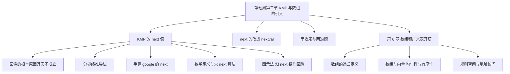
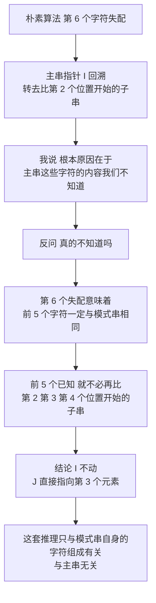
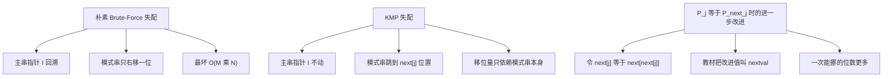
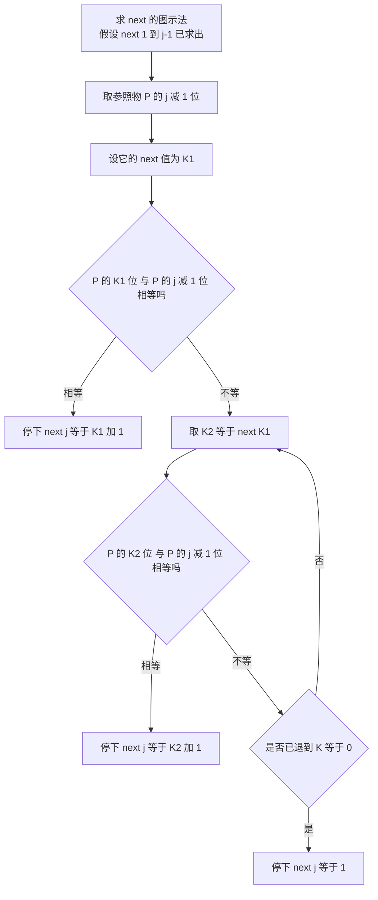
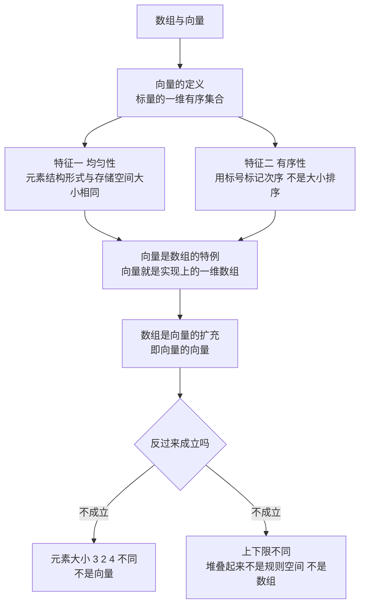
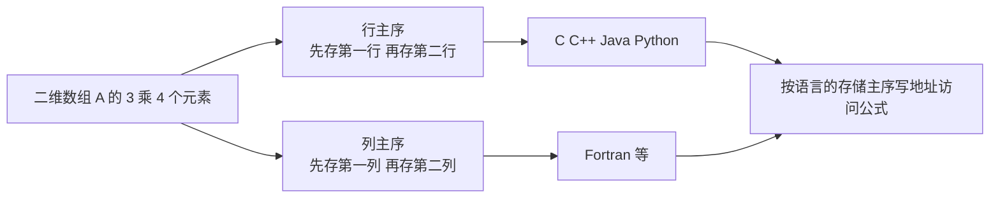

# 数据结构 · 第七周第二节 · KMP 算法与数组的引入 · 详细版讲义

> **来源说明**：本讲义由**授课者本人**依据课堂录音的本地转写与逐段素材整理，并与严蔚敏《数据结构（C语言版）》对照校订而成，属**讲授稿性质的整理稿**。
>
> - **全篇人称**：本讲义以**第一人称**写成，写作者就是讲授者本人。文中一切课堂互动、追问、点评都以「我」的口吻呈现，不使用第三人称转述。
> - **转写来源**：`KMP算法讲解_导出原文.txt`（课堂录音的 ASR 导出文字，约 2.38 万字）。按 760 字左右切成 33 段，逐段分析产出 33 份素材（`segment_000.md` ~ `segment_032.md`）。这一讲的内容分两大块：**前半是上一节留下的接口**——KMP 算法里 `next` 值到底怎么求、怎么改进；**后半是我把串这一章收尾之后，直接转入第 6 章数组和广义表的开篇**。
> - **教材对照范围**：严蔚敏《数据结构（C语言版）》**第 4 章 4.3.2 模式匹配的一种改进算法**（KMP、`next`、`nextval`，算法 4.6／4.7／4.8）与**第 5 章 数组和广义表**（5.1 数组的定义、5.2 数组的顺序表示和实现、5.3 矩阵的压缩存储、5.4 广义表的定义）为主要对照。**但本节课求 `next` 的「分界线推导法」、沿 `next` 链往前找参照物的图示法、以及数组与向量那一整套讨论，教材中没有对应写法**，属课堂扩展，附录 A 已逐条注明。
> - **命名对齐（务必注意）**：我课上把改进后的 `next` 叫作「**改进的 next**」或「改进代际函数」，教材叫 **`nextval`**——是同一个东西，正文与附录 B 都做了并排对照。
> - **标注约定**：`（教材对应：4.3.2）` 表能对上教材，`（教材补充：5.3）` 表教材有而我课上未展开，`（课堂扩展）` 表教材没有的课堂内容，`（讲义补充）` 表我为讲通而作的整理，`（讲义校订：…）` 表当场裁定的口误／同音误识；裁不掉的全部进「待核实内容」。
> - **下标口径**：**本课程所有串的算法，主串与模式串都从下标 1 开始存储**，这是我反复强调的前提——只有这样才能让「下一个要比较的元素位置」与 `next` 值一一对应。教材 4.3.2 的代码同样是 `S[0]` 存串长、串值从 1 号位开始。**若题目把串存成下标从 0 开始，则 `next` 的取值整体减 1**（学习通那两道题的陷阱就在这里）。
> - **示意图说明**：正文里嵌了 8 张**操作示意图**，用 `tikz` 代码块书写，在 Obsidian 中由 TikZJax 插件渲染成 SVG（阅读视图可见）。**图内标签一律用字母、数字、数学记号与英文短语（纯 ASCII），中文解释放在图下方的「图注」里**——这是 TikZJax 的硬限制：它的引擎用 `btoa()` 把 TeX 源码写进 WASM 文件系统，**源码里只要出现非 Latin-1 字符（汉字、全角标点）就会直接抛异常、连编译都不会开始**；它也只随附 Computer Modern 字体、没有中文字体。8 张图均已在 Chromium + TikZJax 下实测渲染通过。
> - **编号说明**：我沿用的章节号与严蔚敏教材**相差 1**——我的「第 6 章 数组和广义表」＝教材**第 5 章**；我的「第 5 章 串」＝教材**第 4 章**。本讲义在标注教材出处时，一律用教材的真实章节号。
> - **时间说明**：本节课为**文字模式**（无音视频轨、无关键帧），各节时间戳是按**字数折算的伪时间**（约 200 字／分钟），非音频真实时间，只作讲义内部单调递增的定位坐标，用于与 33 份分段素材对齐；全课伪时间长约 1 小时 59 分。
> - **关联阅读**：[数据结构 第七周第一节 串 详细版讲义](数据结构%20第七周第一节%20串%20详细版讲义.md)（上一节，KMP 的出发点与 `next` 的含义就是那一节的收尾）、[数据结构 第六周第一节 队列 详细版讲义](数据结构%20第六周第一节%20队列%20详细版讲义.md)、[数据结构 第二章 线性表 详细版讲义](数据结构%20第二章%20线性表%20详细版讲义.md)。

## 开场导读

这节课分两半：**前半把 KMP 里那个 `next` 值彻底算清楚，后半转入第 6 章数组和广义表**。

开场我先把这一节的定位摆出来。串这一章真正有特色的东西就是**模式匹配**，而上一节我们已经看到：朴素的模式匹配算法效率是 $M\times N$，一失配主串指针就**疯狂回溯**。KMP 就是为了解决这个回溯。然后我把话说明白：**这一节大家重点要掌握的是 `next` 值怎么求、要会手算**；另外编程过程里还有坑。我还交代了讲法的来路——王老师后面有个复习视频，里面讲求 `next` 值的方法，我会讲；**但在那之前，我先补一段复习视频里没有的推导**，目的是把原理讲透。因为 KMP 在数据结构里算是排前几位的难理解算法。

**这段推导是全课最精彩的地方。** 我先照朴素算法的样子走一遍：假设模式串第 6 个字符失配，主指针 `i` 就要回溯，转去匹配主串从第 2 个位置开始的子串；再失配，就再从第 3 个位置开始。接着我抛出那个我一直追问的问题——**为什么要回溯**？我说，根本原因在于「**我们认为主串这些字符的具体内容我们是不知道的**」，所以只能老老实实一个个往后挪。

然后我停下来反问：**真的不知道吗？** 不是。第 6 个字符失配，恰恰意味着**前 5 个字符一定和模式串相同**——它们不是不知道，而是可以通过这一次匹配推出来的。既然已知，就**没有必要**去比「主串第 2 个位置开始的那个子串」，也没有必要比第 3 个、第 4 个；直接让主串第 6 位跟模式串第 3 位比就行。结论是：**主串指针 `I` 不动，模式串指针 `J` 直接指向第 3 个元素。** 用同样的办法，我把第 5、第 4、第 3、第 2 个字符失配的情形一路推下去，分别得到挪到 2、2、1、1；最后**第一个字符就失配**这种情形，为了和前面保持**处理逻辑一致**，我假想 `J = 0`——这样下一轮 `I` 加加、`J` 加加，恰好就变成「主串下一个字符与模式串第 1 个字符比较」。这一整套推理最要紧的一句是：**它和主串半毛钱关系都没有，只和模式串自身固有的字符组成有关。**

于是 `next` 值的含义就出来了：模式串第 $j$ 个字符与主串第 $i$ 个字符失配时，**主串位置 $i$ 不变**，让模式串跳到 `next[j]` 位置，再拿它和主串第 $i$ 个字符比。我也把那条前提条件反复强调了一遍：**本章所有算法，主串与模式串都从下标 1 开始存储**。

接着是**手算**。`next[1]` 无脑写 0，`next[2]` 固定写 1；我拿模式串 `google` 一位一位推给大家看，得到 `0 1 1 1 2`，每一步都讲清「画一条分界线、前 $j-1$ 个字符是已知的、试着往右挪几个位置能不能对上」。然后是 `next` 的数学定义：`next[j] = K` 意味着 $P_1\cdots P_{K-1}$ 与 $P_{j-K+1}\cdots P_{j-1}$ 这两段**对称（相等）**，$K$ 越大能往后挪得越多。求法写成算法就是：$j$ 从 2 走到 $M$，拿 $P_{j-1}$ 当参照物，比较 $P_K$ 与 $P_{j-1}$，不等就令 $K = \text{next}[K]$ 往前挪，找到相等的 $K$ 之后 `next[j] = K+1`。

光有公式还是容易一头雾水，所以我又把**复习视频里那套图示法**讲了一遍：假设 `next[1..j-1]` 都求出来了，第 $j$ 个字符失配时取**参照物 $P_{j-1}$**，它的 `next` 值是 $K_1$；比较 $P_{K_1}$ 与 $P_{j-1}$，相等就停、`next[j] = K_1+1`；不等就取 $K_2 = \text{next}[K_1]$ 再比……**一路沿着 `next` 链往前跳**，直到某个 $P_{K_i}$ 与 $P_{j-1}$ 相等，或者一路退到 $K=0$ 就取 1。这里的关键是：**不是从头找，而是踩着上一位的 `next` 值往回跳。**

**然后是 `next` 的改进。** 动机来自最坏情况：模式串形如 `aaaab`、主串形如 `aaa…b`，我把原始 `next` 求出来放进去一算——**KMP 没有任何改进**。于是有学者发现，要优化的**不是 KMP 算法本身，而是 `next` 函数值**。推导很干净：$S_4$ 与 $P_4$ 失配 → `j = next[4] = 3`，比 $S_4$ 与 $P_3$ 仍不等 → `j = next[3] = 2`……一直退到 $P_1$ 还是不等。可中间这三步**全都没必要比**——因为 $P_4 = P_3 = P_2 = P_1$，既然 $S_4 \ne P_4$，那它必然不等于后面那三个。所以规则就是：**当 $P_j$ 等于 $P_{\text{next}[j]}$ 时，令 $\text{next}[j] = \text{next}[\text{next}[j]]$。** 算法的结构也因此很特别：**上面一半和求原始 `next` 一模一样，先把 `next` 全算出来**，然后再从头到尾检查一遍做替换。我把这个改进值叫「改进的 `next`」，教材叫 **`nextval`**。

紧接着是**两道学习通题目**。我特意提醒题里有陷阱：**这两道题的串是存成下标从 0 开始的**。怎么办？答案很直接——**在原来 `next` 的基础上整体减 1**。一道问 `next` 的取值（选 C），另一道问「匹配成功为止一共比较了多少次」（选 B）；后者的关键大原则是「**失配时 `I` 不动，但下一步还要从 `I` 这个位置开始比**」。串这一章到此收尾，我留了作业：下周三交。

后半段**转入第 6 章 数组和广义表**。我先把它在逻辑结构里的位置讲清楚：逻辑结构三大类——**线性（1 对 1）、树形（1 对多）、图状（多对多）**；前面讲的线性表、栈、队列**全属线性结构**。而数组和广义表很特别，**起承上启下的作用**：既可视作线性结构，也可视作树形结构，取决于你**看待问题的粒度**（我口述说成「力度」，实为粒度）——粒度大（宏观）看是线性结构，把每个元素的微观结构展开就成了树形结构。所以这一章是个**过渡模型**，不能笼统归类。

为什么研究它们？我说了两条：**数组**——计算机从计算学科发展而来，数学研究空间问题要用**坐标系**，对应到计算机里就是**数组**，数组就是计算机的坐标系；**广义表**——它的**定义不严谨**，做推理时可能掉进陷阱甚至死循环，但现实中还在大量使用，最典型的是**一元多项式用链表存、二元多项式要用广义表**。

定义给得很干净：**一维数组是一个向量，它的每个元素是结构中不可分割的最小单位**；$N>1$ 时，**$N$ 维数组是一个向量，它的每个元素是一个 $N-1$ 维数组，且具有相同的下限和上限**——后半句我专门强调「这句话很重要」。这是**递归定义**，基本项是一维数组、归纳项是「用 $N-1$ 维数组定义自己」，我顺手把它和上一章的递归两条件接了起来，还提了计算机里有个专门方向叫**粒度计算**。几何直观也讲了：一维是数轴，把许多一维坐标轴堆叠起来成二维平面，把平面再堆叠起来成三维，$N$ 维类推；矩阵就是二维数组，**把每一行看成一个元素就是线性表，把行再展开就是树形结构**。

最后一节讲**数组与向量**。向量是**标量的一维有序集合**（标量只有大小、矢量有大小和方向），它有两个本质特征：**均匀性**（各元素结构形式相同、占相同大小存储空间、能做相同运算——对应坐标系里刻度每一格一样大，像一把尺子）与**有序性**（这个「序」**不是大小排序**，而是用**标号**标记次序，标号通常取整数但不绝对）。由此：**向量是数组的特例**（向量就是实现上的一维数组，具有随机存储结构）；**数组是向量的扩充**（向量的向量）。但反过来**不成立**——若各子元素大小分别是 3、2、4，就不满足均匀性、**不是向量**；即便都是向量，若上下限不同、堆叠起来不是**规则空间**，那也**不是数组**（我用魔方抠掉一个角来打比方）。非整数标号也举了例：职业（6 种）× 信仰（3 种）× 性别（2 种）→ **6×3×2 的数组**，画出来是个立方体。数组的运算就两类：给一组下标**存取**元素、给一组下标**修改**某个数据项的值（比如把空间某点的湿度改一下）。

课在**地址访问**这里收住：数组是**静态结构**，声明时维数大小给定、编译系统划定连续空间并返回首地址；正因如此，**不管几维数组都是随机存储结构**。「你先说行还是先说列」——行与列**平权**，于是有**行主序**与**列主序**：C、C++、Java、Python 都是**行主序**，**Fortran 是列主序**。地址访问公式留到下一次课。

## 总览知识地图

这一讲跨两件事——**KMP 的 `next` 值**与**第 6 章的开篇**，塞进一张图会糊掉，所以拆成 6 张小图，每张只画一层意思。

**图 1 · 全课主线：KMP 的 next 求法与第 6 章的开启**



**图 2 · 那个「回溯的根本原因」错在哪**



**图 3 · 朴素、KMP、以及 nextval 的三级台阶**



**图 4 · 求 next 的图示法：沿 next 链往前找参照物**



**图 5 · 数组与向量：两个特征、三个断言**



**图 6 · 行主序与列主序**



## 正文

### 一、这一节要解决什么：把 next 值算出来 `00:00-00:03`

我们这一章讲的是串，而串这一章里我认为最值得花力气的东西只有一个：**串的模式匹配**。什么叫串的模式匹配？我先把这个词讲清楚——在一个主串当中去找一个模式串的过程，就叫串的模式匹配。说得再具体一点：给定一条主串 $S$ 和一条模式串 $T$，我要判断 $T$ 是不是出现在 $S$ 里；如果出现，我要求出它第一次出现时起始字符的下标；如果不出现，我就返回一个约定的失败标志。

这里我要你们注意一个定位问题。模式匹配其实是一大类问题，串上的模式匹配只是这一大类问题当中的**一个小问题、一个实例**。为什么我要先讲这个定位？因为它提醒你们：我们后面推出来的那套分析框架——利用已经比较过的信息、设法不重复比较——不只服务于字符串这一个场景，它是这类问题的共同思路。（教材对应：4.3.1）

上节课我讲过朴素的模式匹配算法（Brute-Force），你们应该还记得它的毛病出在哪里：一旦当前对齐位置上某个字符对不上，这一趟匹配就作废了，主串指针要退回去，模式串指针也从头再来。我当时用的说法是「指针会疯狂地回溯」。指针这样来回退，就是朴素算法效率上不去的根本原因。朴素的模式匹配算法，效率是 $M\times N$，这里 $M$ 和 $N$ 就是两条串的长度。（教材对应：4.3.1；教材按最坏情况记作 $O(n\times m)$，$n$ 是主串长度，$m$ 是模式串长度）

既然瓶颈在指针回退，改进的思路自然就是**把这次回退消掉**。这就是 KMP 算法。（教材对应：4.3.2）

这一节我要你们掌握的重点，我讲得很清楚，就两条：

1. **KMP 求 next 的值怎么求，要会手算。**这是这一节的考查重点，next 表求不对，后面 KMP 的匹配过程就无从谈起。（教材对应：4.3.2）
2. **编程过程当中的问题。**把手工推导搬进程序，会碰到边界、下标、循环条件一类具体的坑，这些也要留意。

接下来我要交代一下这一节的讲法来源，因为这关系到你们怎么听。王老师后面有一个复习视频，里面讲了求 next 值的一套方法，**那套方法我会讲**。但是在讲它**之前**，我先补一段复习视频里**没有**的推导。为什么我要多此一举？因为 KMP 算法在数据结构这门课里，可以说是排在前几位的、比较难理解的算法；光记结论不够，我要你们把「为什么可以这样跳」想通，后面的方法才站得住。所以这一节前半段的推导，请你们当成「原理课」来听，不要当成可以背的口诀。

（讲义校订：转写中反复出现的「适配」是「失配」的同音误识，凡处在「对不上」语境下的一律还原为「失配」；「模式平面算法」应为「模式匹配算法」；「指针回缩」统一为「回溯」；「目标串」「组串」「总串」统一为「主串」；「KM。算法」是话音中断，应为 KMP 算法。）

下面先把两副骨架摆出来，你们对照着看我后面在改什么。下标一律从 1 开始。

**(a) 朴素模式匹配的骨架（Index_BF）**——本段转写只讲了它的回溯动作，代码骨架为讲义补充：

```c
int Index_BF(SString S, SString T)      // S 主串, T 模式串, 下标从 1 开始
{
    int i = 1, j = 1;
    while (i <= S.length && j <= T.length) {
        if (S.ch[i] == T.ch[j]) {       // 当前字符相等, 继续比下一个
            ++i; ++j;
        } else {                        // 失配: 本趟作废, 指针回退重来
            i = i - j + 2;              // 这就是我说的「疯狂回溯」
            j = 1;                      // 模式串指针复位到第 1 个字符
        }
    }
    if (j > T.length) return i - T.length;   // 匹配成功, 返回起始位置
    else return 0;                            // 匹配失败
}
```

**(b) KMP 匹配的骨架（Index_KMP）**——本段只点出「改进思路就是 KMP」，next 表在后面几节里求出；代码骨架为讲义补充：

```c
int Index_KMP(SString S, SString T, int next[])
{
    int i = 1, j = 1;
    while (i <= S.length && j <= T.length) {
        if (j == 0 || S.ch[i] == T.ch[j]) {
            ++i; ++j;                   // 相等就一起前移
        } else {
            j = next[j];                // 失配只动 j, 主串指针 i 挪都不挪
        }
    }
    if (j > T.length) return i - T.length;
    else return 0;
}
```

两副骨架的差别只有失配那一支：楼上把 `i` 退回去重来，楼下让 `i` 站住不动、只把 `j` 换一个位置。这一整节要说清楚的就是楼下那一支凭什么成立、`next[j]` 到底该取多少。

**关键易错点**：

1. **把「失配」读成「匹配成功」。**失配才需要回溯，匹配成功是往前走；这两个字看反，整个逻辑就反了。
2. **以为朴素算法的代价只是「慢」。**它真正浪费的是那些本可以利用已知信息判断出必然对不上、却仍然去比一遍的比较。
3. **混淆两个指针的走向。**朴素算法里 $i$ 后退、$j$ 复位到 1；KMP 里 $i$ 只前进，动的只有 $j$。
4. **把 $M\times N$ 当成精确次数。**它是量级估计，精确式子是 $(n-m+1)\times m$，且只在最坏情况下取到。
5. **忘了下标从 1 开始这个前提。**`i = i - j + 2` 这个式子就是为下标 1 起编的，换成 0 起编要改成 `i = i - j + 1`（讲义补充）。

### 二、回溯的代价，与它的「根本原因」 `00:03-00:07`

现在我把场景正式摆开。设有一条主串 $S$，还有一条模式串 $T$，我要在 $S$ 里找 $T$。匹配的起点是约定好的：主串从自己的第 1 个位置开始，模式串也从自己的第 1 个位置开始，然后两边从各自的第 1 个字符起，一个字符一个字符地比下去。（教材对应：4.3.1）

我做一个假设：比到模式串的**第 6 个字符**时失败了。这句话的意思你们要读准——前面 5 对字符都已经比过、并且每一对都相等，一直到第 6 对才出现「这两个字符不匹配」。（教材对应：4.3.1）

按朴素的模式匹配算法，这时候主串的指针 $i$ 要回溯。怎么回溯？放弃当前这一趟对齐，转而去匹配**主串里从第 2 个位置开始的那个子串**（也就是与模式串等长的那个子串）。这里我要把话说全：朴素算法每一趟比的都是「与模式串等长的主串子串」，转写里说「第 2 个位置开始的这个子串」，隐含的正是「等长」这个条件。（讲义补充）

如果这一趟又失败了，那按同样的规矩，我还要再从主串的第 3 个位置开始比，指针再回溯一次……就这样一路退下去，每失败一趟，起点就往后挪一格。

落到指针上，这一趟收场时执行的是两条语句。设本趟从主串第 $s$ 个位置起对齐，比到模式串第 $j$ 个字符时失配，那么失配那一刻 $i$ 指向主串的第 $s+j-1$ 个字符；回退之后 $i$ 变成 $s+1$，也就是

> 「$i = i - j + 2$， $j = 1$」（讲义补充：这是朴素算法的标准写法，转写里只说「回到第二个位置」）

拿我上面那个假设代进去看：第 6 个字符失配，$j = 6$，第一趟 $s = 1$，失配时 $i = 6$，执行 $i = 6 - 6 + 2 = 2$，$j = 1$。于是第二趟从主串第 2 个位置起比。假设第二趟又在第 6 个字符处失配，此时 $s = 2$、$i = 7$，执行 $i = 7 - 6 + 2 = 3$，第三趟从主串第 3 个位置起比。这就是转写里那句「又要从第三个位置开始匹配，又要进行回溯」。

那么最关键的问题来了：**为什么要回溯？**我在课上把这个「根本原因」讲得很直白——指针扫到某个位置时，我们认为**主串中还没有参与过比较的那些字符，具体是什么内容，我们是不知道的**。既然不知道，我就没有办法预先判断「把模式串往右挪一格之后能不能对上」，于是只剩一条路：老老实实地把对齐位置整体右移一格，拿下一个等长子串来跟模式串比。

这句话是朴素算法的世界观，我要你们把它记牢，因为下一节我就要来推翻它。（课堂扩展：这一层「根本原因」的追问是课堂上的推导，教材 4.3.1 只给出朴素算法的定义与失配后的回溯写法。）

需要补一句说明，免得你们理解偏：主串本身是一串已经确定下来的字符，它客观存在、内容固定。我说「不知道」，是站在**算法此前获得的信息**这个角度说的——算法没读过的位置，对它而言就是未知量。（讲义补充）

| 区域 | 朴素算法的态度 | 实际情况 |
| --- | --- | --- |
| 本趟已经比过的部分（第 1 至第 5 个字符） | 比过了，知道它们相等 | 确实是已知的 |
| 本趟尚未比过的部分（第 7 个字符之后） | 不知道，只能当成随机取值 | 内容客观存在，但算法确实没读过 |
| 失配位置附近被重新对齐覆盖到的字符 | 也用「不知道」一概打发 | 其中一部分其实能从上一趟的结果推出来 |

最后一行就是我下一节要动手的地方：朴素算法把「未知」的范围划得太大了，把一些本来已经可以确定的事情也当成了未知。

（教材对应：4.3.1。教材补充：教材在 4.3.2 末尾有两点说明，第一点正是——虽然朴素算法的时间复杂度是 $O(n\times m)$，但一般情况下实际的执行时间近似于 $O(n+m)$，因此至今仍被采用；KMP 只在模式串与主串之间存在许多「部分匹配」时才快得多。这一点我课上没有展开，你们看书时留意。）

**关键易错点**：

1. **把「回溯」理解成模式串在动。**回溯动的是主串指针 $i$，模式串指针 $j$ 只是复位到 1。
2. **忘记 `i = i - j + 2` 里的那个 `+2`。**写成 `i - j` 或 `i - j + 1` 都会让下一趟起点错位一格。
3. **以为失配前比过的字符白比了。**恰恰相反，$j-1$ 个确认相等的字符就是信息，KMP 全靠它。
4. **把「未知」当成物理上的不确定。**它只是「算法没读过」。（讲义补充）
5. **忘了下标从 1 开始。**把「第 6 个字符」直接当成数组下标 6 用，在 0 起编的代码里就错了。

### 三、那个「根本原因」其实不成立 `00:07-00:10`

上一节我说，朴素算法之所以只能一格一格地挪，是因为「主串那些字符的具体内容我们不知道」。讲到这里我特意停下来问了一句：**真的不知道吗？**这句话我在课上连着问了两遍——第一遍是问你们的，第二遍是让我自己把结论咬死。

（教材对应：4.3.2）

问完之后我们就回头看刚才那个假设：比到**第 6 个字符**才失配。那意味着什么？意味着前面 5 对字符都已经比过、并且每一对都相等。既然比过而且相等，那么主串在当前对齐下的前 5 个字符，就等于模式串的前 5 个字符——模式串那个位置是 `a` 它就是 `a`，是 `b` 它就是 `b`。**主串前面的这 5 个字符并不是不知道的**，它们完全可以从这一次匹配的结果推出来。

也就是说，一次失配并不是「什么都没得到」。它在失配点之前留下了 $j-1$ 个已经确认相等的字符；第 6 个字符失配，留下的是 5 个。这份「坏消息」同时换来了一份「已知信息」。

那这份信息怎么用？我接下来就充分利用这一次匹配的结果，去考察一件具体的事：当第 6 个字符失配的时候，模式串的指针 $j$ 应该挪到哪一位、接下来该怎么办。做法是——主串这一侧钉住不动，让模式串一格一格地右滑，每滑一格就问一句：这一次对齐，有没有哪个位置是**由已知字符就能断定必然对不上**的？

先把已知与未知的边界钉死：

| 区域 | 内容 | 是否已知 | 理由 |
| --- | --- | --- | --- |
| 主串第 1 至第 5 个字符 | 与模式串第 1 至第 5 个字符逐一相等 | 已知且确定 | 这一趟从两端第 1 位比下来，比到第 6 位才停 |
| 主串第 6 个字符 | 与模式串第 6 个字符不相等 | 只知道「不相等」，不知道具体取值 | 它正是失配的那个位置 |
| 主串第 7 个字符及其后 | 完全未知 | 未知 | 这一趟根本没比到那里 |

然后逐格试探，我把三格的结果一次说清。（课堂扩展：这套「钉住主串、逐格右滑试探」的手工推法是我在课上加的，教材 4.3.2 是直接用式 (4-2)～(4-4) 的等式推的）这里为了讲得具体，模式串取「`abaabc`」（前 5 位 `a b a a b`，第 6 位 `c`）。（讲义补充：转写里只念出了一个字母「A」，完整的模式串字符是按本节前后文的推导补出的，标为按上下文推断，见文末「存疑」说明）

| 新对齐：模式串起点落在主串的哪一位 | 先比什么 | 判定 | 依据 |
| --- | --- | --- | --- |
| 第 2 位 | 主串第 2 个字符 vs 模式串第 1 个字符 | **必然失配**，直接跳过 | 该主串字符 = 模式串第 2 个字符 = `b`，而模式串第 1 个字符是 `a` |
| 第 3 位 | 主串第 3 个字符 vs 模式串第 1 个字符 | 第一个配上了 | 该主串字符 = 模式串第 3 个字符 = `a` |
| 第 3 位，接着比第二个 | 主串第 4 个字符 vs 模式串第 2 个字符 | 第二个配不上，本趟仍然失败 | 该主串字符 = 模式串第 4 个字符 = `a`，而模式串第 2 个字符是 `b` |
| 第 4 位 | 主串第 4、5 个字符 vs 模式串第 1、2 个字符 | 前两个都相等 | 这两位主串字符 = 模式串第 4、5 个字符 = `a`、`b` |
| 第 4 位，接着比第三个 | 主串第 6 个字符 vs 模式串第 3 个字符 | **无法判定** | 主串第 6 个字符正是失配点，只知道它不等于模式串第 6 个字符 |

所以结论是：**跳过从第 2 个、第 3 个字符开始的子串的比较，也跳过从第 4 个字符开始的那个对齐位置上前两个字符的比较，直接让主串的第 6 个位置和模式串的第 3 个位置进行匹配。**（课堂原话我记下来是这么说的）

> 「主串的第 6 个位置和我们模式串的第 3 个位置来进行匹配。」

归纳成一句话，就是本节的第一个结论：**第 6 个字符失配的时候，主串指针 I 不变，模式串指针 J 直接指向第 3 个元素。**

这里我要你们盯住「停在哪一格」的判据，它是整节推理的灵魂：

1. **能被证伪的对齐位置一律跳过**——由已知字符就能推断出「这一趟必然在某一步对不上」的，连比都不用比（第 2 位起、第 3 位起都属于这一类）。
2. **无法被证伪的对齐位置必须保留**——比较推进到了未知字符那里，推不下去了。**未知不等于不匹配，未知只等于有可能匹配。**

第 4 位起的这一次对齐正属于第二类，而且它是**第一个**属于第二类的对齐位置：比它更靠前的两次都已经被证伪。既然更靠前的对齐都确定失败，而它仍有一线可能，那主串指针就没有必要退回去重来——只要把模式串的相对起点挪到这里，从主串的第 6 个字符接着比下去就行。（教材对应：4.3.2）

我把教材的记号对过来给你们看。教材设「当主串中第 $i$ 个字符与模式中第 $j$ 个字符失配时，主串中第 $i$ 个字符应与模式中第 $k$ 个字符继续比较」，于是要有

$$'p_1p_2\cdots p_{k-1}' = 's_{i-k+1}s_{i-k+2}\cdots s_{i-1}' \tag{4-2}$$

而这一趟已经得到的「部分匹配」结果是

$$'p_{j-k+1}p_{j-k+2}\cdots p_{j-1}' = 's_{i-k+1}s_{i-k+2}\cdots s_{i-1}' \tag{4-3}$$

两式一联，主串那一段就被消掉了，剩下

$$'p_1p_2\cdots p_{k-1}' = 'p_{j-k+1}p_{j-k+2}\cdots p_{j-1}' \tag{4-4}$$

请你们注意式 (4-4)：**等号两边全是模式串自己的字符，主串一个字母都没有了。**这就是我下一节要强调的那句话的教材版本。本节的 $j = 6$、$k = 3$ 代进去，就是 $'p_1p_2' = 'p_4p_5'$，即 `ab` = `ab`，成立。（教材对应：4.3.2，式 (4-2)～(4-4)）

**关键易错点**：

1. **把「已知」的范围划错。**已知的只是前 5 个字符；失配点那个字符（第 6 个）只知道「与 $p_6$ 不相等」，并不知道它等于什么——第三步之所以能保留第 4 位起的对齐，靠的恰恰是这个「不知道」。
2. **误以为未知就等于不匹配**，于是把第 4 位起的对齐也判死，一路往后挪。这么推下去，next 表会被你填成一串 1。
3. **在试探里真的去动主串指针。**三格试探都只是「设想中的对齐」，手工推导时 $i$ 自始至终不动，变的只是模式串的相对起点。
4. **把「第 4 个字符起的那次对齐」读成「主串的第 4 个字符」。**它说的是新对齐的起点落在主串第 4 个位置。
5. **下一轮比较从模式串第 1 个字符重新开始。**第 4 位起的对齐里，前两对已经确认相等，真正要比的只有主串第 6 个字符与模式串第 3 个字符这一对；若从第 1 个字符重比，就和朴素算法没区别了。
6. **忘记下标从 1 开始的前提。**（讲义补充）

### 四、从第 6 个字符失配，一路推到第 1 个 `00:10-00:18`

先把上一节的结论收口，再往下推。结论是：

> 「当你第 6 个怎么样元素匹配失败的时候，我们就可以令主串的指针 I 不变，然后模式串的指针直接让它指向第 3 个元素。」

（教材对应：4.3.2）

在往下走之前，我要你们先听我说一句本节最重要的话：**这一整套分析，和主串半毛钱关系都没有。**它只和模式串自身固有的字符组成有关系。转写里我的原话是这么说的：

> 「这个结论和主串可以说是半毛钱关系都没有，只和模式串固有的字符组成有关系。」

这句话我拆成两层讲给你们听：

1. **换一条主串，结论不变。**推出来的「$j$ 退到 3」是由「前 5 个字符相等」这条内部信息支撑的，而这条信息来自模式串自己的字符结构。主串换成长度不同、字符完全不同的另一串，只要模式串还是那一串字符、失配位置还是第 6 位，退位结果就还是 3。
2. **一个失配位置固定对应一个退位位置。**所以 next 表可以**脱离任何一次具体匹配、事先算好**：它是模式串的固有属性，是一张只由 $T$ 决定的表。这正是 KMP 能在匹配之前先花 $O(m)$ 求 next、再拿它去匹配的原因。（教材对应：4.3.2；教材原话：此函数值仅取决于模式串本身而和相匹配的主串无关）

好，接下来就是这一节的正题：把失配位置一格一格往前挪。

**失配发生在第 5 个字符。**这一位对不上，能确定的是前面 4 个字符刚刚比过而且都相等，也就是 $'p_1p_2p_3p_4'$ 已知；至于真正停在失配位置上的那个主串字符是什么，我们并不知道，也不必知道。

- 右滑一格：模式串第 1 个字符要对上主串第 2 个字符，而它等于模式串的第 2 个字符 `b`，与模式串第 1 个字符 `a` 不同，这一格**必然配不上**，跳过。
- 再滑一格：模式串第 1 个字符对上主串第 3 个字符，也就是模式串的第 3 个字符 `a`，与模式串第 1 个字符相同，第一个配上了；可紧接着第二个字符要面对主串的第 4 个字符，也就是模式串的第 4 个字符 `a`，而模式串第 2 个字符是 `b`，**对不上**，这一格仍然配不上。
- 再往后挪一格：模式串第 1 个字符对上主串第 4 个字符（= 模式串第 4 个字符 `a`），配上了；第二个字符要面对的正是刚才失配位置上的那个主串字符，它的值我们不知道，**有可能刚好和这一位对上**，所以这一格不能排除。

停下。结论：**主串指针 $i$ 不变，模式串指针 $j$ 直接挪到第二个位置**，即 next[5] = 2。（教材对应：4.3.2）

**失配发生在第 4 个字符。**道理完全一样，只是已知的字符少了一位：前面 3 个字符确定相等。

- 右滑一格：模式串第 1 个字符对上主串第 2 个字符（= 模式串第 2 个字符 `b`），配不上。
- 再滑一格：模式串第 1 个字符对上主串第 3 个字符（= 模式串第 3 个字符 `a`），这一次能配上；再往下要比较的那个主串字符落在失配位置这一带的未知区域里，不能断定它一定不合。

停下。结论：**$i$ 保持不变，$j = 2$**，即 next[4] = 2。（教材对应：4.3.2）

这里我要专门提醒一句：第 4 位失配时右滑一格确实不成立，但**右滑两格是成立的**（$p_1$ 对 $p_3$），所以结论是 $j = 2$ 而不是 1。这门课往年最容易错的一格就在这里。

**失配发生在第 3 个字符。**这一位我的转写里说成了「第 6 个字符」，但从理由上看得很清楚，讲的其实是第 3 个：它的依据是「第三个字符不知道，前两个肯定知道」，拿「前两个字符已知」当前提——而这只在失配发生在第 3 位时才成立，第 6 位的情形前面已经推完了。（讲义校订：此处是位置口误，应为第 3 个字符失配）

前面 2 个字符确定相等。右滑一格：模式串第 1 个字符对上主串第 2 个字符（= 模式串第 2 个字符 `b`），配不上。再滑一格：模式串第 1 个字符对上的是主串上刚刚失配的那一个字符，它的值未知、也有可能匹配上，所以下一次就从这里开始比，模式串指针回到第 1 个位置。结论：**$i$ 不动，$j = 1$**，即 next[3] = 1。

**失配发生在第 2 个字符。**这时能确定的只有第 1 个字符——它已经与主串本趟的第 1 个字符确认相等。往右滑一格之后，模式串第 1 个字符要面对的主串字符正好是刚刚失配的那一个，它未知，有可能匹配上，所以这一格不能跳过。结论：**$i$ 不动，$j = 1$**，即 next[2] = 1。

**最后是失配发生在第 1 个字符。**这一位我留给下一节专门讲，它的结论是令 $j = 0$。

现在把一路上推出来的东西集中起来。这就是你们必须会**手算**的那张表——逐位列出来，一位都不能漏：

**模式串 $T$ = `abaabc`**（讲义补充／按上下文推断）

| j | 1 | 2 | 3 | 4 | 5 | 6 |
| --- | --- | --- | --- | --- | --- | --- |
| P[j] | a | b | a | a | b | c |
| next[j] | 0 | 1 | 1 | 2 | 2 | 3 |
| nextval[j] | 0 | 1 | 0 | 2 | 1 | 3 |

表下的推导说明，你们对着看：

- **j = 1**：退无可退，约定 next[1] = 0（下一节详讲）。
- **j = 2**：考察 $'p_1'$ = `a`，一个字符无法同时充当真前缀与真后缀，可退位置只有第 1 个，next[2] = 1，没有选择余地。
- **j = 3**：考察 $'p_1p_2'$ = `ab`，没有既是前缀又是后缀的串，$L = 0$，next[3] = $L+1$ = 1。
- **j = 4**：考察 $'p_1p_2p_3'$ = `aba`，`a` 既是前缀又是后缀，$L = 1$，next[4] = 2。
- **j = 5**：考察 $'p_1\cdots p_4'$ = `abaa`，最长相同前后缀还是 `a`，$L = 1$，next[5] = 2。
- **j = 6**：考察 $'p_1\cdots p_5'$ = `abaab`，最长相同前后缀是 `ab`，$L = 2$，next[6] = $L+1$ = 3。

也就是说，求 next 的值有一条可以反查的公式（讲义补充）：

$$\text{next}[j] = 1 + L,\quad L = \max\{k \mid 1 \le k < j \ \text{且}\ '\!p_1\cdots p_{k-1}\!' = '\!p_{j-k+1}\cdots p_{j-1}\!\}$$

这正是教材式 (4-5) 的定义（教材对应：4.3.2）：

$$\text{next}[j]=\begin{cases}0, & j = 1 \\ \max\{k \mid 1<k<j\ \text{且}\ '\!p_1\cdots p_{k-1}\!'='\!p_{j-k+1}\cdots p_{j-1}\!\}, & \text{此集合不空} \\ 1, & \text{其他情况}\end{cases}$$

（讲义校订：本节转写里我口述了「第 3 个字符」却说成「第 6 个字符」，已在上面就地裁掉。另外需要提示一处数字冲突——本节的笔记里有一处把 next[4] 写成了 1，与第 4 位失配的推导以及教材 `abaabc` 的表都对不上，**next[4] = 2 才对**。）

**注意 next 与 nextval 的区别。**这一节我口述里只讲到了 next；课程后面还会讲「改进的 next」，它在教材里的正式名字是 **nextval**。（教材补充：4.3.2，算法 4.8 `get_nextval`）

改进的动机教材讲得很清楚：模式串 `a a a a b` 与主串匹配、在 $i = 4$、$j = 4$ 失配时，按 next 的指示还要做 $i = 4, j = 3$、$i = 4, j = 2$、$i = 4, j = 1$ 这 3 次比较。可模式里第 1、2、3、4 个字符全是 `a`，跟主串第 4 个字符比来比去都是同一个结果，完全可以一气向右滑过 4 个字符，直接进行 $i = 5, j = 1$ 的比较。于是规则是：若 $\text{next}[j] = k$ 而 $p_j = p_k$，那么 $\text{next}[j]$ 就应当与 $\text{next}[k]$ 相同。教材给出的对照表是：

| j | 1 | 2 | 3 | 4 | 5 |
| --- | --- | --- | --- | --- | --- |
| 模式 | a | a | a | a | b |
| next[j] | 0 | 1 | 2 | 3 | 4 |
| nextval[j] | 0 | 0 | 0 | 0 | 4 |

回到 `abaabc` 那一行：next 是 `0 1 1 2 2 3`，把 $p_j = p_{\text{next}[j]}$ 的情形合并掉，得到 nextval 是 `0 1 0 2 1 3`——第 3 位（$p_3$ = `a` 与 $p_{\text{next}[3]} = p_1$ = `a` 相同，故 nextval[3] = nextval[1] = 0）和第 5 位（$p_5$ = `b` 与 $p_{\text{next}[5]} = p_2$ = `b` 相同，故 nextval[5] = nextval[2] = 1）是被合并掉的两格，其余保持与 next 一致。

**算法 PDL（类 C 风格）**，两个都写出来，你们印在脑子里：

**(a) 求 next（教材算法 4.7 的写法，教材对应：4.3.2）**

```c
void get_next(SString T, int next[])
{
    // 求模式串 T 的 next 函数值并存入数组 next
    int i = 1, j = 0;
    next[1] = 0;
    while (i < T.length) {
        if (j == 0 || T.ch[i] == T.ch[j]) {
            ++i; ++j; next[i] = j;   // 能对上, 长度加一
        } else {
            j = next[j];             // 对不上, j 沿着 next 往前退
        }
    }
}
```

**(b) 求 nextval（教材算法 4.8，教材补充：4.3.2）**

```c
void get_nextval(SString T, int nextval[])
{
    // 求模式串 T 的 next 函数修正值并存入数组 nextval
    int i = 1, j = 0;
    nextval[1] = 0;
    while (i < T.length) {
        if (j == 0 || T.ch[i] == T.ch[j]) {
            ++i; ++j;
            if (T.ch[i] != T.ch[j]) nextval[i] = j;      // 这一位和退过去的那位不同, 照常记
            else nextval[i] = nextval[j];                // 相同, 白退, 直接继承
        } else {
            j = nextval[j];
        }
    }
}
```

**手工填表的伪码**（讲义补充，帮你们考试时对着写）：

```text
for j = 1 .. T.length:
    if j == 1: next[j] = 0; continue
    if j == 2: next[j] = 1; continue
    for k = j-1 downto 1:                    // 逐格右滑试探, 优先试最长的可对齐位置
        if P[1 .. k-1] == P[j-k+1 .. j-1]: next[j] = k; break
        if k == 1: next[j] = 1               // 都对不上, 落回第 1 个字符
```

**关键易错点**：

1. **把「未知」当成「不匹配」。**本节的每一个 next 值的停点，都是被「未知即可能」顶住的；把未知当成配不上，就会一路滑到底，把所有 next 值都算小。
2. **把 $j = 4$ 的结论写成 1。**应是 next[4] = 2。
3. **把「右滑了几格」当成 next 值。**右滑的格数是 $k$，$j$ 的落点是 $j-k$：$j = 5$ 时滑 3 格、落点 2；$j = 4$ 时滑 2 格、落点 2；$j = 3$ 时滑 2 格、落点 1。两个数不要混。
4. **忘记「$i$ 不动」。**这四种情形给出的都是 $i$ 保持不变；一旦在失配分支里写 `i = i - j + 2`，就退回成朴素算法了。
5. **以为推导用到了主串的具体字符。**整段推理只用「已知／未知」这一层信息，从未用到 $S$ 的取值；把某次具体匹配的字符写进求 next 的过程，方向就错了。
6. **模式串字符记错导致连锁出错。**换一串字符，所有 next 值都要重算，不能当公式背。
7. **混淆 next 与 nextval**：nextval 是要在 next 的基础上再合并一次「$p_j = p_{k}$」的情形，不是另起一套推导。（教材补充：4.3.2）

**操作图 1 · 分界线推导：第 6 位失配时 I 不动、J 跳到 3**

```tikz
\begin{document}
\begin{tikzpicture}[scale=0.92]
  \node[left,font=\small] at (0.55,2.11) {$S$};
  \foreach \i/\v in {1/a,2/b,3/a,4/a,5/b,6/c,7/x,8/x}{
    \draw[thick] (\i*0.72,1.75) rectangle ++(0.72,0.72);
    \node[font=\scriptsize] at (\i*0.72+0.36,2.11) {\v};
    \node[font=\tiny,gray] at (\i*0.72+0.36,1.63) {\i};
  }
  \node[left,font=\small] at (0.55,1.16) {$P$};
  \foreach \i/\v in {1/a,2/b,3/a,4/a,5/b,6/c}{
    \draw[thick,blue] (\i*0.72,0.80) rectangle ++(0.72,0.72);
    \node[font=\scriptsize,blue] at (\i*0.72+0.36,1.16) {\v};
  }
  \draw[red,thick] (6*0.72,0.80) -- (6.72,1.52);
  \draw[red,thick] (6*0.72,1.52) -- (6.72,0.80);
  \node[above,red,font=\scriptsize] at (6.36,2.52) {mismatch at $j=6$};

  \node[left,font=\small] at (0.55,-0.84) {$S$};
  \foreach \i/\v in {1/a,2/b,3/a,4/a,5/b,6/c,7/x,8/x}{
    \draw[thick] (\i*0.72,-1.20) rectangle ++(0.72,0.72);
    \node[font=\scriptsize] at (\i*0.72+0.36,-0.84) {\v};
    \node[font=\tiny,gray] at (\i*0.72+0.36,-1.32) {\i};
  }
  \foreach \i/\v in {1/a,2/b,4/a,5/b,6/c}{
    \draw[thick,blue] ({(\i+3)*0.72},-2.15) rectangle ++(0.72,0.72);
    \node[font=\scriptsize,blue] at ({(\i+3)*0.72+0.36},-1.79) {\v};
  }
  \draw[fill=green!20,thick] (4.32,-2.15) rectangle ++(0.72,0.72);
  \node[font=\scriptsize] at (4.68,-1.79) {$P_3$};
  \draw[->,thick,red] (6.36,-1.62) -- (6.36,-1.24);
  \node[below,font=\small] at (3.60,-2.35) {$P_1$ now under $S_4$: the pattern shifts by 3, and $I$ stays at 6};
  \node[below,font=\small] at (3.60,-2.85) {$J \leftarrow \mathrm{next}[6] = 3$, then compare $P_3$ with $S_6$};
\end{tikzpicture}
\end{document}
```

图注：分界线推导：第 6 个字符失配时，前 5 个字符一定是配上的，所以主串指针 I 不动，只把模式串往后挪，让 P3 直接对到 S6。


### 五、第一个字符就失配：为什么要令 J = 0 `00:18-00:21`

前面几节我把 $j \ge 2$ 的情形全推完了。现在专门拿一个此前没交代清楚的情形出来问：**模式串的第一个字符就和主串当前字符对不上，该怎么办？**

先看直观的想法。第一个字符就失配，说明这一趟对齐从起点上就已经没有希望了，模式串自然要相对主串向右移动一个位置，换一个对齐的起点重新比。这话写下来只有一句，可一放进前面那套分析框架里，你们就会发现它和别的失配情形长得不一样。

前面给定的分析是这样的：当主串的第 $i$ 个字符和模式串的第 $j$ 个字符不匹配的时候，**主串的指针 $i$ 保持不变**，我们只去找模式串的指针 $j$ 应该指向哪个位置——动的是 $j$，不是 $i$。（教材对应：4.3.2）

可是第一个元素失配，性质就变了。第一个字符都对不上，意味着整个模式串在当前对齐位置上全部作废，**在模式串内部根本找不到一个「退回去接着比」的位置**；能做的只有整体换一个起点，也就是让主串的指针 $i$ 递增，去进行主串下一个位置上的匹配、去匹配下一个相邻的子串。

这里我要停下来问一句：那能不能让 $i$ 不动？**不能。**因为当前主串位置 $S[i]$ 连模式串的第 1 个字符都比不上，而模式串的起点只能是第 1 个字符，下一个可能的对齐位置必然是「模式串起点对齐到 $S[i]$ 的右边一格」——也就是 $i$ 必须前进。所以 $j = 1$ 的失配，语义上等价于「本趟作废、主串起点后移」。

于是出现了矛盾：前面的规矩是「$i$ 不动、只动 $j$」，而现在这件事非让 $i$ 动不可。这两件事怎么统一到一条更新语句上去？

我的做法是「**假想**」。我们设想：在这种情况下，模式串相对主串仍然只是向右移动了一个位置——与前面每一种失配情形在形式上完全一样，都是一个「把模式串右滑一位」的动作，只是这一次滑完之后，整个模式串都要从头开始比。

沿着这个假想再往下推：**我们把这种情况设想成模式串的指针 $j$ 等于 0。**$j$ 取 0 的效果在哪？在于下一轮的操作变得统一了——下一轮执行 $i$ 加加、$j$ 加加：

- $i$ 从当前位置走到了下一个字符；
- $j$ 从 0 变成了 1；
- 实际比较变成主串的下一个字符与模式串的第 1 个字符比较。

这恰恰就是「换到主串的下一个位置、模式串从第 1 个字符起重新开始」这件事。这样处理逻辑就顺了，它和前面所有情形用的是**同一条**更新语句：失配时一律走「改 $j$」这条路，改完 $j$ 之后统一执行指针后移。

所以结论是：**一旦第一个字符就失配，就令 $j$ 等于 0。**因为一旦 $j = 0$，下一次转一圈回来执行 $i$ 加加、$j$ 加加，主串换到下一个位置、模式串回到第 1 个字符，比较就重新开始了；而这也正是「去匹配下一个相邻的子串」这个要求的具体落实。（教材对应：4.3.2；教材原话：另一种是 $j$ 退到值为零，即模式的第一个字符失配，则此时需将模式继续向右滑动一个位置，即从主串的下一个字符 $s_{i+1}$ 起和模式重新开始匹配）

这里有两件事我要讲透，你们做题和编程都躲不开。

**第一，$j = 0$ 不是「模式串的第 0 个字符」。**模式串里根本没有这个字符。它是一个**哨兵**，含义是「当前对齐位置连第一个字符都比不上，本趟作废」。正因为它是哨兵而不是真实位置，程序里就绝不能写成 `S.ch[i] == T.ch[j]`（$j$ 为 0 时会越界），而必须把 `j == 0` 放在判断的左边：

```c
if (j == 0 || S.ch[i] == T.ch[j]) { ++i; ++j; }   // j == 0 这一支把「换起点」包办了
else j = next[j];                                  // 失配只动 j
```

**第二，next[1] = 0 和 next[2] = 1 是整张表的边界。**这两格是唯一只能靠约定和「未知即可能」来定的：

| j | 失配时已知的字符 | 右滑试探的结果 | next[j] |
| --- | --- | --- | --- |
| 1 | 没有（第一个字符就对不上） | 模式串内部退无可退，只能换到主串下一个位置 | 0（约定值） |
| 2 | 只有 $p_1$，且已确认 $p_1 = S[i-1]$ | 右滑一格后，新起点对上的那个主串字符 $S[i]$ 是未知的，仍有可能等于 $p_1$，不能跳过 | 1 |

第二行是衔接前面分析的结论：$j = 2$ 失配时，右滑一格试探之后，模式串起点落在 $S[i]$ 上，而 $S[i]$ 的取值事先不知道，所以这一格不能排除，必须保留——指针退到 1。注意这里有一个「不必真比」的细节：$S[i]$ 未知，拿 $p_1$ 去和它硬比没有意义，直接令 $j = 1$ 即可。（教材对应：4.3.2）

**KMP 匹配的完整 PDL**，$j = 0$ 这一支就落在里面（同第四节 (a)(b) 的下标约定，一律从 1 开始）：

```c
int Index_KMP(SString S, SString T, int next[])
{
    int i = 1, j = 1;
    while (i <= S.length && j <= T.length) {
        if (j == 0 || S.ch[i] == T.ch[j]) {
            ++i; ++j;              // 相等, 或 j 退到 0(本趟作废): 指针一起后移
        } else {
            j = next[j];           // 失配只动 j, 主串指针 i 始终不动
        }
    }
    if (j > T.length) return i - T.length;    // 匹配成功
    else return 0;                            // 匹配失败
}
```

**关键易错点**：

1. **把 $j = 0$ 当成一个真实的字符下标**，写出 `T.ch[0]` 这样的访问，越界。
2. **漏掉 $j = 0$ 这一支里的 `++i`。**这一节的关键恰恰是「$i$ 也得动」；若只写 `j = next[j]` 而在 $j = 0$ 时不递增 $i$，程序会在原地打转成死循环。
3. **以为首字符失配时 $i$ 要回溯。**它只是前进一格，不是退回本趟起点——本趟起点就是 $i$ 自己，退回等于不动，会重复比较。
4. **把 next[1] = 0 与 next[2] = 1 弄反**，或把 next[1] 写成 1，这样 $j$ 永远退不到 0，「换起点」的动作永远不触发。
5. **把 0 拿去和模式串的某个字符做相等判断。**它是约定值，不是模式串内部的位置。
6. **在下标从 1 开始的体系里把 next[1] 写成 −1。**−1 是下标从 0 开始那套写法的边界值，两套编号不能混用。（讲义补充）
7. **误以为「右移一个位置」真的移动了模式串。**手工推导里它只是设想中的对齐试探，程序真正改的只是 $j$ 这个编号。（讲义补充）

### 六、next 值的含义，与那条前提条件 `00:21-00:25`

到这一节，我把整个匹配过程收尾，也把 next 的含义正面说出来。

先复述结论。**第 6 个位次的字符失配**时，主串指针 $i$ 不变，模式串指针直接指向模式串的**第 3 个字符**；**第 5 个位次**的字符失配时，$i$ 仍然不变，模式串指针指向**第 2 个字符**。这两句话我课上连着说的：

> 「就第 6 个字符失配，那么我们主串的指针 I 不变，而模式串上的指针呢，让它直接指向第三个字符。」

这两个落位的形状完全一样：主串指针 $i$ 原地不动，只有模式串指针 $j$ 换了位置。把「哪一位失配」与「落到哪一位」配成对记下来，就得到 next 表里的一格。

那这样分析下来，究竟在干什么？回答就一句话：**这些落位的结果，实际上就是在求 next 的值。**把若干次失配各自的落位集中起来，得到的正是一份与位次对应的 next 值表。（教材对应：4.3.2）

接下来正面回答 next 的含义：

> **当模式串的第 $j$ 个字符与主串的第 $i$ 个字符失配时，主串的位置 $i$ 保持不动，只把模式串指针跳到 $\text{next}[j]$ 所指的位置，再让该位置的字符与主串的第 $i$ 个字符重新比较。**

（教材对应：4.3.2；教材原话：$\text{next}[j]$ 表明当模式中第 $j$ 个字符与主串中相应字符失配时，在模式中需重新和主串中该字符进行比较的字符的位置）

这句话里有三个要点，我逐个点出来：

1. **触发条件是失配**，即 $p_j \neq s_i$。
2. **失配后的动作是 $j = \text{next}[j]$**，主串指针 $i$ 一步也不退。
3. **换位后比较的对象仍是主串第 $i$ 个字符**——同一个字符挨着比两次，这是 KMP 最反直觉、也最要紧的一点。

含义讲完，我再三强调本课算法的前提条件——上节课我就强调过，现在再提一遍：

> **这一章的算法都有前提条件：主串 $S$ 是从下标为 1 的位置开始存储的，不是从 0 开始。**

（讲义补充：这一前提贯穿整个串这一章）

我为什么反复强调？两个原因。一是后面马上你们就要做题目，一旦题目换成从 0 开始编号，整套 next 值都要跟着变。二是**正因为两边都从 1 开始编号，才带来一个方便之处**：「下一个要参与比较的元素所处的位置」与「这一位的 next 值」**一一对应**——$\text{next}[j]$ 等于几，下一次参与比较的就是模式串的第几个字符，中间不必换算。模式串第 1 个字符存在下标 1 处，第 2 个存在下标 2 处，于是你把 next 值读出来，它就是「第几个字符」。一旦改成从 0 开始编号，这层便利就没了，同一个落位对应的数字要整体平移。（讲义补充）

（讲义校订：本节转写里我说「假设现在有一个主串 T」，与教材约定（$S$ 主串、$T$ 模式串）相反，也与本节前后文冲突，应为「模式串 $T$」；另有一处「在 PK 之前」应为「在我们讲 KMP 之前」，存疑。）

**手工填 next 表的通用步骤**，我把它整理成六步（讲义补充；第 1、2 步的说法在转写里就是「画一根线」「$i$ 不变」）：

```text
1. 画一条分界线, 把「已匹配过的部分」与「还没比过的部分」分开; 分界线钉在主串上, 代表本轮比较的起点
2. 主串指针钉死在分界线上不动, 坚持 i 不变这条纪律
3. 模式串整体相对主串一格格向右滑
4. 每滑一格, 检查压过来的模式串字符能否与已确知的主串字符对上
5. 滑到某位置时若压过来的一段与已匹配的主串片段完全吻合, 这个位置就是本次失配的落位, 记下来即该位的 next 值
6. 一直滑到模式串第 1 个字符都比不上时, 本轮对齐作废, 记下哨兵值 0
   对每一位次重复上述过程, 整张 next 表就填满
```

为了让你们有一张完整的、可以对着背的表，我把第四节的逐位列表在这里再收一次口（模式串 `abaabc`，讲义补充／按上下文推断）：

| j | 1 | 2 | 3 | 4 | 5 | 6 |
| --- | --- | --- | --- | --- | --- | --- |
| P[j] | a | b | a | a | b | c |
| next[j] | 0 | 1 | 1 | 2 | 2 | 3 |
| nextval[j] | 0 | 1 | 0 | 2 | 1 | 3 |

三行读法：`P[j]` 是模式串这一位是什么字符；`next[j]` 是「这一位失配了，$j$ 退到哪」；`nextval[j]` 是把「退过去还是同一个字符」的白退情形合并之后的结果。整张表**只由模式串自己决定**，和主串是哪一条毫无关系——这就是我在第四节反复讲的「和主串半毛钱关系都没有」。（教材对应：4.3.2；教材原话：此函数值仅取决于模式串本身而和相匹配的主串无关）

最后把朴素模式匹配与 KMP 摆在一起对比，两张表就是这一节的总结：

| 对比项 | 朴素模式匹配（Brute-Force） | KMP 算法 |
| --- | --- | --- |
| 失配时主串指针 $i$ | 回溯到本趟起点的下一格，$i = i - j + 2$ | 不回溯，原地不动 |
| 失配时模式串指针 $j$ | 一律重置为 1 | 置为 $\text{next}[j]$，可能大于 1；$j = 0$ 时随 $i$ 一起加加 |
| 预处理 | 不需要 | 需先求 next 表，代价 $O(m)$ |
| 已匹配过的信息 | 丢弃，下一趟重比 | 保留，用它确定 $j$ 的新位置 |
| 总代价 | $M\times N$（最坏 $O(n\times m)$） | $O(n+m)$ |

**关键易错点**：

1. **$j = 0$ 是哨兵，不是「第 0 个字符」。**取到 0 只表示这一趟对齐作废，程序的动作是 $i$ 后移一位、$j$ 回到 1。
2. **失配时 $i$ 不回溯。**这一条写错，KMP 就退化成朴素模式匹配——这也是我这一整节反复钉住的一个点。
3. **下标从 1 开始存储**，主串与模式串都是如此，0 号位置空着不用。（讲义补充）
4. **next[1] = 0 是约定值**，必须单独判定，不能套通用公式；**next[2] = 1 是定值**，任何模式串都一样，不必看字符。
5. **匹配循环里要把 `j == 0` 放在判断的左边**，否则会先求值 `T.ch[0]`，越界或读到无用字符。
6. **把「一一对应」当成巧合。**它是「两边都从下标 1 开始存储」这条前提换来的，换个编号体系就不成立。（讲义补充）

### 七、手算 next：前两位是固定的 `00:25-00:33`

上一节我把 KMP 的匹配骨架拆开讲了一遍：失配的时候，主串指针 $i$ 一步都不许后退，只让模式串指针 $j$ 退到某个位置上继续比。那个位置写在哪儿？就写在 next 表里。所以从这一节起，我们把 next 表一位一位地手工填出来。

先把丑话说在前面：**手算 next 有一个前提**，我们这一章所有的串——主串也好、模式串也好——都从下标 1 开始存储（教材对应：4.3.1，教材的 `SString` 类型把串长放在 `ch[0]` 里，真正的字符从 1 号位往后排）。这句话我上节课强调过、这节课还要强调：你们做题、考试、写代码最容易栽的地方就在这儿，手算时若习惯成自然地从 0 号位开始数，整张 next 表会整体错开一位，全盘皆输。

我还要交代一件事：手推 next 值，不是为了让你们以后真靠手算过日子，而是为了把「next 这个数字到底在说什么」彻底讲透。程序里 next 表当然由算法生成，可那套算法就是你们此刻手上这套动作的机械化翻版；手上动作不清楚，代码里的 `j = next[j]` 对你们来说就永远是一句咒语。

#### 一、第一个元素就失配：next[1] 无脑写 0

这里我要问一句：如果模式串的第一个元素就和主串当前位置对不上，接下来该怎么办？

有位同学脱口而出：「那把 $j$ 归 1，再比一次。」这个答案只答对了一半——$j$ 确实该退到某个位置，但绝不能退到 1。

按朴素模式匹配（Brute-Force）的做法想一想：模式串的头一个字符就已经对不上，那么本轮对齐显然作废，只能让**整个模式串相对于主串向右移一个位置**，换一个起始对齐位置重新比一遍，主串指针 $i$ 也要往后走一格。

问题来了。我们讲 KMP 时立下的规矩是「失配时 $i$ 不动、只动 $j$」，可这里 $i$ 明明必须往前走一格。为了让这条例外也能塞进同一套循环逻辑里，我想了个办法：**令 $j$ 等于 0**。

$j$ 一旦取 0，下一轮循环里 $i$ 与 $j$ 各自加一：$i$ 由 1 变到 2，$j$ 由 0 变到 1，新的比较就成了主串第 2 个位置的字符与模式串第 1 个字符——正好是「整体右移一位、从主串下一个字符接着比」的效果。我课上就是这么说的：

> 「next1 无脑操作写成零就行了。只要你第一个元素失配，下一次就是这个模式串要相当于整体右移一位。」
> （讲义校订：转写里的「正文」一贯是「主串」的同音误识，此句按语义补齐为「模式串相对于主串右移一位」。）

于是 next[1] 的含义就有了一个非常好记的说法：**它相当于模式串第一个字符的前一个位置**。把 $j$ 停在 1 号位之前半格，下一次自增恰好落在 1 号位，正好开始比对（讲义校订：转写作「此项模式的第一个字符串的前一个位置」，「此项模式」应为「模式串」、「第一个字符串」应为「第一个字符」）。归纳成一句话：只要第一个元素就失配，next[1] 无脑写 0 就行。

那么为什么不能把 next[1] 也写成 1？因为那样 $j$ 退到 1 之后，还是拿模式串第 1 个字符去和**同一个** $S[i]$ 比；而这个 $S[i]$ 刚刚才和模式串第 1 个字符比过、并且失败了，再比一次必然还是失败，程序就在原地打转（讲义补充）。0 在这里不指向任何真实字符，它是一个哨兵值：本轮对齐作废，模式串整体右移一位，$i$ 自增一格，从主串的下一个字符重新开始。也正因为有这个哨兵，KMP 匹配骨架里的判断才必须写成 `if (j == 0 || S[i] == T[j])`，把「j 退到 0」和「字符相等」这两种情形合并处理（讲义补充）。

#### 二、第二个元素失配：next[2] 固定写 1

第二个元素失配的时候，next 值又是多少？

先看我们知道什么。失配发生在 $j=2$ 这个位置，那么主串第 2 个位置上的字符究竟是多少，我们并不知道，只能确定它和模式串第 2 个字符不相等，别的什么都推不出来。不过反过来看，既然比较到第 2 个位置才失配，**前面那一段必然配得上**——模式串的第 1 个字符一定和主串的对应位置相等。这一步推理是整段的关键。

接着还是那个动作：在失配位置的前面画一根**分界线**，把「已经确定配上的部分」和「当前正在比较的部分」分开。线左边只剩 1 个字符，而且它是已知的：本例用模式串 google，它的第一个字符是 g，所以主串分界线左边那一个字符也一定是 g。

既然线左边只有一个字符可以依赖，把模式串相对这条线向右滑，就只有一种可能：滑一格，让模式串的第 1 个字符去对主串第 $i$ 个位置上的字符。此时 $j$ 指向 1，$i$ 保持不动。下一次要比较的是 $P[1]$ 与 $S[i]$，而主串这个位置的字符内容未知——**未知就说明有可能对得上**，所以这次比较有意义、不能跳过。结论就出来了：第二个元素失配，不需要再做别的什么，next[2] 写成 1 就行。

我课上原话是这么说的：

> 「第二个元素失配，也就是说第二个元素我也不知道，那我只能确定……它的第一个元素一定是 g。第一个元素是 g 的情况下，整个串要相对于这根线往右移一个位置，往右移一个位置的话，$j$ 就指向 1。$i$ 还是不动。因为你第二个位置你并不知道它具体是啥，所以 next2 无需操作，写成 1 就行了。」
> （讲义校订：本讲义所有 `> 「……」` 引文均为课堂口播按语义整理后的样子，删去了「呃、对不对、对吧」一类填充语，并把「适配」等语音误识校为「失配」；把缩写念出来的「$j$」「$i$」按统一下标写法转写。全分册同此例，不再逐条注明。）

把两个值合起来看：$j=1$ 与 $j=2$ 是两个**特殊位置**，它们的 next 值预先定死，**与模式串具体由哪些字符组成毫无关系**。从 $j=3$ 起，next 值才开始依赖模式串自身的字符内容，也才开始需要我们动脑子去试。

#### 三、两个定值放在一起看：差别只在 $i$ 动不动

| 失配位置 $j$ | next[j] | 失配后 $j$ 取值 | 主串指针 $i$ | 下一次比较谁和谁 |
| --- | --- | --- | --- | --- |
| $j=1$ | 0 | 0 | 自增 1，由 $i$ 变到 $i+1$ | $P[1]$ 与 $S[i+1]$，等价于模式串整体右移一位 |
| $j=2$ | 1 | 1 | 不动 | $P[1]$ 与 $S[i]$（主串当前字符，内容未知，有可能对上） |

抓住「$i$ 不动、只改 $j$」这条主线，两行的差别就只剩「$j$ 退到 0 还是退到 1」；而退到 0 时要额外补贴一次 $i$ 的自增（教材对应：4.3.2，教材的原话是「当指针 $j$ 退至零时，指针 $i$ 和指针 $j$ 需同时增 1」）。

#### 四、与朴素模式匹配逐项对照

| 比较项 | 朴素模式匹配（Brute-Force） | KMP 的 next 处理 |
| --- | --- | --- |
| 失配时的 $i$ | 回溯到本轮起始位置的下一位，即 `i = i - j + 2` | 始终不动，仅当 $j$ 退到 0 时自增 1 |
| 失配时的 $j$ | 一律回到 1 | 退到 next[j] |
| $j=1$ 就失配 | $i$ 加 1，$j$ 回到 1，整趟重比 | 令 $j=0$，转入 `j == 0` 分支后 $i$、$j$ 同时加 1 |
| 比较的「记忆」 | 没有记忆，已比过的字符还会再比 | 把「已经配上的前缀」通过 next 表记下来复用 |

两种算法在「整体右移一位」这个动作上其实重合，KMP 只是把它整理成同一套自增逻辑，好写成一个统一循环（讲义补充）。我把两个骨架并排写出来，你们对着看：

```c
/* (a) 朴素模式匹配：Index，下标从 1 开始（教材对应：4.3.1） */
int Index(SString S, SString T, int pos)
{
    int i = pos, j = 1;
    while (i <= S[0] && j <= T[0]) {
        if (S[i] == T[j]) { ++i; ++j; }      /* 继续比较后继字符 */
        else { i = i - j + 2; j = 1; }       /* 指针后退，重新开始匹配 */
    }
    if (j > T[0]) return i - T[0];           /* 匹配成功 */
    else return 0;
}
```

```c
/* (b) KMP 匹配骨架（教材对应：4.3.2，算法 4.6 的形式） */
int Index_KMP(SString S, SString T, int next[], int pos)
{
    int i = pos, j = 1;
    while (i <= S[0] && j <= T[0]) {
        if (j == 0 || S[i] == T[j]) { ++i; ++j; }  /* j==0：第一个元素就失配 */
        else j = next[j];                          /* i 不动，只让 j 退 */
    }
    if (j > T[0]) return i - T[0];
    else return 0;
}
```

本节讲的正是 KMP 骨架里 `j == 0` 这一支，以及它为什么必须存在。走查一遍：$j=1$ 失配 → 分界线画在 0 号位与 1 号位之间，线左边一个字符都没有 → 模式串内部无处可退，只能整体右移 → 取 $j=0$ → 回到判断，`j == 0` 成立 → `++i`（1→2）、`++j`（0→1）→ 下一次比较 $P[1]$ 与 $S[2]$ → next[1]=0。再看 $j=2$：分界线画在 1 号位与 2 号位之间，线左边已知字符是 $P[1]$（google 的 g）→ 右滑一格试探，让 $P[1]$ 去对 $S[i]$，其内容未知、有可能相等 → 停下，退到 1，$i$ 不动 → 下一次比较 $P[1]$ 与 $S[i]$ → next[2]=1。

#### 五、关键易错点

- **$j=0$ 不是下标越界**。下标从 1 开始，0 号位上没有字符，它是「整体右移一位」这件事的编码方式，必须靠 `j == 0` 单独兜住。
- **失配时 $i$ 不回溯**，这是 KMP 区别于朴素模式匹配的要害；本节两次强调 $i$ 不动，唯一例外是 $j$ 退到 0 时 $i$ 与 $j$ 同时自增。
- **下标从 1 开始**。next[1]=0 本身就依赖从 1 开始存储；若改成从 0 开始存，整套 next 值要整体减 1，`j == 0` 这个哨兵也不能再用 0。
- **next[1]=0、next[2]=1 是定值**，与模式串内容无关；从 $j=3$ 起才需要真正比较字符。
- **别把 next[1] 写成 1**，那会让 $j$ 退到 1 之后拿同一个 $S[i]$ 反复比，程序原地打转。
- 「整体右移一位」「分界线」这些说法都是**对齐工具**，不是一个真实存在的图形；它们的用处是把「该退到哪一位」变成一个可以数出来的位置（讲义补充）。

### 八、手算 next：google 的 next[3] 到 next[5] `00:33-00:40`

#### 一、为什么先拿 google 开刀

接下来我们真的动手算。我用的是模式串 **google**（$P[1]=g,\ P[2]=o,\ P[3]=o,\ P[4]=g,\ P[5]=l,\ P[6]=e$）。

为什么挑它？因为它前几个字符是 g、o、o——**没有任何首尾自重叠**，先算的几位一律回到 1，容易建立信心；到第 5 位又恰好出现一次「前缀 g 撞上末尾 g」的重叠，正好把「怎么往后挪」这件事演示一遍。可以说它是手算 next 最合适的一个入门例子。

先把这张表整个列出来（下一小节我给这批数字算一笔账，其中 next[6] 是转写里明确说了「不再分析」的地方，由我按算法补出，标为讲义补充）：

| $j$ | 1 | 2 | 3 | 4 | 5 | 6 |
| --- | --- | --- | --- | --- | --- | --- |
| $P[j]$ | g | o | o | g | l | e |
| next[j] | 0 | 1 | 1 | 1 | 2 | 1 |
| nextval[j] | 0 | 1 | 1 | 0 | 2 | 1 |

这张表里有三件事要你们记住：

1. 第 1、2 位是上一节的定值，写死为 0 和 1；
2. 课堂口述明确给出的是 next1=0、next2=1、next3=1、next4=1、next5=2，我在课上说到 next5 就停了，原话是「后面的我就再不分析了」；
3. 第 6 位的 1 以及整列 nextval 是我为了让表完整补上的（讲义补充），nextval 那一列等到本节最后一个大标题里再交代——它对应教材的 `nextval`，也对应我课上说的「改进的 next」。

#### 二、next[3]=1：滑一格对不上，只能滑到分界线

假设匹配到第三个元素才失配，也就是前两个位置都对得上、到第三个位置对不上了。

第三个位置具体是什么字符、值为多少，我不得而知——它是**主串**上的位置，主串内容事先并不确定。既然这个字符未知，就换个办法：在它前面画一条分界线，把「已经确定匹配过的部分」和「当前正在比较的部分」分开。分界线以左是模式串的前两个元素，这是你们肯定知道的，按上一节的推理，前两位就是 g 和 o（转写原话是「前两个肯定是 G 和 O」，大小写不改语义，讲义校订：本课模式串一律小写 google）。

接下来模式串该整体移到哪个位置？一步步试：

- 向右移一个位置，能对上吗？模式串第 1 个字符 g 落到已知区的第 2 个字符 o 上，**g 和 o 对不上**；
- 那就继续移，移到分界线那里。移到这儿以后，模式串第 1 个字符恰好对准主串第 3 个位置，只需要比较 $P[1]$ 与 $S[3]$ 这一对。

所以 next[3] 等于 1。

注意「移到这儿了」指的是落在**分界线**上，也就是说模式串第 1 个字符顶到了失配位置本身（存疑：转写只提「移一个位置……对不上」就直接跳到「移到这儿了」，第 3 位失配时究竟试滑了几格没明说；从只有两个已知字符看，滑一格之后就只能落到分界线，故本稿按「滑一格失败即落到分界线」整理）。另外，本节要你们养成一个习惯：**右滑的「格数」和 next 值是两件事**，格数是试探过程，落地后的模式串位置号才是 next 值。

#### 三、next[4]=1：位置未知，排除不掉就不能跳过

第 4 个位置失配的情形完全类似。匹配到第 4 个元素才失配时，主串在这个位置上的字符事先并不知道，正因为不知道，我们就不能断定从这里起一定对不上——把模式串换一个对齐位置挪过来之后，这个位置完全有可能恰好和模式串的某个字符相等。

还是一样：画一条分界线，把已知的部分圈出来。分界线以左是前三个位置的元素，这三个你们是知道的，是 g、o、o。在这个前提下把模式串往后挪：

- 挪一格，goo 里的 go 要和新对齐位置上的 oo 对上吗？配不上；
- 再挪一格，还是要拿 g 去对 o，仍不匹配；
- 所以只能挪到分界线这一点上，让模式串第 1 个字符对准失配位置本身，于是 next[4]=1。

我课上的说法很直白：

> 「因为我们第四个失配，这个位置是啥我就不知道了。那这个结果有可能和它能匹配上，所以我就停下了。」

这句话里藏着一条重要纪律：**手工推导只在能凭已知信息否定的对齐位置上才敢跳，碰上未知字符一律保留、必须比一次**（讲义补充）。next[4] 之所以是 1 而不是 0，也是同一个道理——0 的含义是「模式串整体右移一位、$i$ 前进」，那是第一个字符就失配时才有的事；第 4 位失配时前面还有一段能复用的匹配成果，轮不到整体右移。

#### 四、next[5]=2：滑两格拉不上，滑三格 g 对上了

现在推最后一位，也就是我在课上明确要你们掌握的那一位。

假定第五个元素失配。模式串 google 的前 4 个字符 g、o、o、g 都匹配成功，比到第 5 个才失配。于是画一条分界线，主串指针 $i$ 固定在第 5 个位置不动（失配时主串不动、只动模式串，这是 KMP 的纪律），再看模式串指针 $j$ 该挪到哪里。分界线左边那 4 个已知字符，就是刚才一路匹配成功的 goog。

把模式串逐格往右滑做试探：

| 试探轮次 | 右滑格数 | 模式串第 1 个字符落在 | 结果 |
| --- | --- | --- | --- |
| 原对齐 | 0 | 已知区第 1 个字符 g | 已知配上了，失配发生在第 5 位 |
| 第一次 | 1 | 已知区第 2 个字符 o | g 与 o 不等，对不上 |
| 第二次 | 2 | 已知区第 3 个字符 o | g 与 o 不等，对不上 |
| 第三次 | 3 | 已知区第 4 个字符 g | g 与 g 相等，对上 |

第三次对上之后，模式串指针落在第 2 个位置——因为对上的那一格是「已知区最后一个字符」，模式串要接着比的就是它的下一位，也就是模式串的第 2 个字符；接下来拿 $P[2]$ 去和主串第 5 个字符比较，所以 next[5]=2。

连起来就是：next1=0、next2=1、next3=1、next4=1、next5=2。到了这里，我在课上停住不往下算了，原话是「后面的我就再不分析了」。

#### 五、把整张表算完：next[6]=1（讲义补充）

虽说课上停了，你们自己做题时总得把表填完，我就顺手补上第 6 位。求 next[6] 时，参照物是 $P[5]=l$，它的 next 值是 2，于是先比 $P[2]$ 与 $P[5]$：o 与 l 不等 → 令 $K = next[2] = 1$，再比 $P[1]$ 与 $P[5]$：g 与 l 还是不等 → 令 $K = next[1] = 0$，退到底，停 → next[6] = 0 + 1 = 1。

把六位连起来读一遍，你们会发现一个规律：**next 值其实就是「失配之后模式串该退到第几位」**。google 这张表里只有第 5 位能退到第 2 位，别的一律退到第 1 位，原因就在这串字母的首尾重叠只有一处：前缀的 g 与第 4 位的 g。

#### 六、关键易错点

- **别把「右滑格数」当成 next 值**：右滑是试探过程，落地后的位置号才写进表。
- **比较的参照物永远是「分界线左边的那一段已知内容」**，不是主串的任意位置；主串上那个失配位置的内容我们根本不知道。
- **第 3 位、第 4 位失配为什么不继续往后试**：因为试到分界线就是最保守的落点了——模式串第 1 个字符对上失配位置，这是「无对称可用」时的兜底，也就对应 next 值取 1。
- **大小写**：转写里一会儿 G、O，一会儿 goo，本课模式串统一写作小写 google；字母大小写在模式匹配里是不同字符，整理时以模式串的原始拼写为准（讲义校订）。
- **课堂上只推到 next[5]**，第 6 位与括号里的 nextval 列是讲义的补充，不要当成课堂原话。

### 九、next 的数学定义与那个「对称性」 `00:40-00:44`

#### 一、先把「对称性」这句话说清楚

上一节我们是靠眼睛滑来滑去把 google 的 next 值试出来的。试完之后要收网了：next 值到底是个什么东西？

我课上是这么给它定性的：**next[j] = K，表示的是某一种对称性**。模式串里从第 1 个字符到第 $K-1$ 个字符，与从第 $j-K+1$ 个字符到第 $j-1$ 个字符，这两段如果能对得上，就说明第 $j$ 个字符之前存在一段长度为 $K-1$ 的「首尾重复」。有这种对称性在，失配之后就可以尽可能往后挪更多位；至于挪多少位，答案写在 next 值里——next 值是 $K$，模式串就往后挪到接近 $K$ 的位置，而不必一个位置一个位置地试探。

这句话听起来仍然抽象，我们把它拆成三句白话：

1. **比的不是主串，是模式串自己**。到这一步，主串已经完全退出了推导：分界线左边那段「已知内容」在主串上和在模式串上是同一串字符，把它换成模式串自己的前缀，等式就只剩模式串内部的比较了（教材对应：4.3.2，教材把式(4-2)与式(4-3)中共同的主串段消掉，得到式(4-4)）。
2. **前一段和后一段要一模一样**。前缀 $P[1..K-1]$ 与「失配位之前那一段」$P[j-K+1..j-1]$ 相等，这就是我说的「对称」；注意它是**平移对称**，不是镜像对称，两段字符的顺序完全一致。
3. **$K$ 越大，说明能往后挪得越多**。$K-1$ 是这段重复的长度，$K$ 是失配后 $j$ 要落到的位号。$K$ 大意味着模式串一头栽到很远的地方接着比，主串指针一步不动。KMP 相对朴素模式匹配省下来的那些无效比较，全都藏在这个 $K$ 里。

#### 二、教材给的定义式（教材对应：4.3.2，式(4-5)）

把上面那句口述写成公式，就是严蔚敏教材里 next 的标准定义：

$$
next[j]=\begin{cases}
0 & \text{当 } j=1 \text{ 时}\\
\max\{\,k \mid 1<k<j \text{ 且 } p_1\cdots p_{k-1}=p_{j-k+1}\cdots p_{j-1}\,\} & \text{当此集合不空时}\\
1 & \text{当上述集合为空时}
\end{cases}
$$

对照着读一遍（最后一行是兜底分支，意思就是集合为空、没有可用的重叠）：

- 第一行管 $j=1$，就是上一节讲的哨兵 0——模式串第 1 个字符就失配，主串指针前进一格；
- 第二行管「有对称可用」的情形，取的是**满足条件的最大的 $k$**，也就是最长的那段首尾重复的长度再加 1；
- 第三行管「找不到对称」的情形，$k$ 退到不能再退，于是取 1，等价于「回到第 1 个字符重新比」。

我对你们的要求是：**口述和公式两头都要会用**。口述版本是「画分界线、看前 $j-1$ 个字符、试着右滑看能不能对上」，用来理解；公式版本是 $next[j]=K \iff P[1..K-1]=P[j-K+1..j-1]$ 且 $K$ 最大，用来做题、用来写程序。两头可以互相验证：谁要是算出来的 next 值不满足上面那条等式，那么一定算错了。

#### 三、为什么 next[1]=0 与 next[2]=1 一定成立

上一节我用「整体右移」和「只有一个已知字符」分别解释了这两个值，这里再从定义式看一遍，你们会发现它们其实是定义直接吐出来的结果：

- $j=1$：定义式第一行就写死了 0，与模式串内容无关，任何模式串都一样。
- $j=2$：定义要求 $1<k<j$ 即 $1<k<2$，这样的整数 $k$ 一个都没有，集合为空，于是落到定义式最后一行取值 1。换句话说，$j=2$ 时连「候选对称长度」都构不成，没什么可算的，直接写 1。
- $j\ge 3$：从这一位起真刀真枪地比较字符，也才可能出现 2 以上的 next 值。google 是一个现成的例子：$j=3,4$ 时集合为空（go、goo 里找不到首尾相同的真子串），只有 $j=5$ 时 $k=2$ 满足 $p_1=p_4$，于是 next[5]=2。

这也解释了我在课上为什么把 $j=1$、$j=2$ 单独拎出来先说：它们是**边界值**，是整张表的地基；地基打歪了，后面的递推全歪。

#### 四、对称长度与「能挪多远」的换算

最容易搞混的一点，是「对称长度」和「next 值」差了 1。我把换算关系列成表，你们记这一张就够：

| 有对称的长度（$K-1$） | 对应的 next 值（$K$） | 失配后模式串右滑格数 | 含义 |
| --- | --- | --- | --- |
| 0（没有可用对称） | 1 | $j-1$ | 一路滑到分界线，$P[1]$ 对准失配位置 |
| 1 | 2 | $j-2$ | 前缀 1 个字符与失配前末尾 1 个字符重叠 |
| 2 | 3 | $j-3$ | 前缀 2 个字符与失配前末尾 2 个字符重叠 |
| $\dots$ | $\dots$ | $\dots$ | $\dots$ |
| $K-1$ | $K$ | $j-K$ | 前缀 $K-1$ 个字符与失配前末尾 $K-1$ 个字符重叠 |

google 的 next[5]=2 就是第二行的实例：对称长度 $K-1=1$（前缀 g 与末尾 g 重叠），next 值 $K=2$，模式串右滑了 $j-K=5-2=3$ 格——与我们上一节数出来的「滑三格」严丝合缝。

#### 五、google 再走一遍定义（教材对应：4.3.2）

| $j$ | $P[j]$ | 集合 $\{k \mid 1<k<j,\ p_1..p_{k-1}=p_{j-k+1}..p_{j-1}\}$ | next[j] |
| --- | --- | --- | --- |
| 1 | g | 定义式直接规定 | 0 |
| 2 | o | 无满足条件的 $k$ | 1 |
| 3 | o | $k=2$ 要求 $p_1=p_2$，即 g=o，不成立 | 1 |
| 4 | g | $k=2$ 要求 $p_1=p_3$，即 g=o，不成立；$k=3$ 已超范围 | 1 |
| 5 | l | $k=2$ 要求 $p_1=p_4$，即 g=g，成立 | 2 |
| 6 | e | $k=2$ 要求 $p_1=p_5$，即 g=l，不成立；更大的 $k$ 不可能 | 1 |

表里最后一列与上一节的表完全一致，这就是「口述」与「公式」互为验证的实例。顺带说一句：**$k$ 从 2 开始试**，因为 $k=1$ 对应「对称长度为 0」，那是兜底情形，不参与取最大。

#### 六、关键易错点

- **$K$ 是位号，不是长度**。对称长度是 $K-1$，next 值是 $K$，落位时要在停下位置的基础上加 1，这个「加 1」本节的换算表已经替你们记住了。
- **取的是最大的 $k$**。若同时有 $k=2$ 和 $k=4$ 满足，next 取 4 + 1 = 5 那一档，不能取小的——取小的虽然不会算错匹配结果，但会让模式串滑得太近，白白多比很多次（讲义补充）。
- **「对称」是平移相等，不是回文**。前后两段字符顺序必须完全一致。
- **next 只取决于模式串本身，与主串无关**（教材对应：4.3.2）。这一点极重要：一张 next 表算一次就能反复用，这也是 KMP 能做预处理的前提。

**操作图 2 · next[j] = K 的对称性含义**

```tikz
\begin{document}
\begin{tikzpicture}[scale=0.95]
  \foreach \i/\v in {1/a,2/b,3/a,4/a,5/b,6/c}{
    \draw[thick] (\i*0.80,1.20) rectangle ++(0.80,0.80);
    \node[font=\small] at (\i*0.80+0.40,1.60) {\v};
    \node[font=\tiny,gray] at (\i*0.80+0.40,1.05) {\i};
  }
  \draw[fill=green!22,thick] (1*0.80,1.20) rectangle ++(1.60,0.80);
  \draw[fill=yellow!30,thick] (4*0.80,1.20) rectangle ++(1.60,0.80);
  \node[font=\small] at (1.20,1.60) {a};
  \node[font=\small] at (2.00,1.60) {b};
  \node[font=\small] at (3.60,1.60) {a};
  \node[font=\small] at (4.40,1.60) {b};
  \draw[gray] (0.80,0.90) -- (2.40,0.90);
  \draw[gray] (0.80,0.90) -- (0.80,0.72);
  \draw[gray] (2.40,0.90) -- (2.40,0.72);
  \draw[gray] (3.20,0.90) -- (4.80,0.90);
  \draw[gray] (3.20,0.90) -- (3.20,0.72);
  \draw[gray] (4.80,0.90) -- (4.80,0.72);
  \node[below,font=\scriptsize] at (1.60,0.60) {$P_1P_2$};
  \node[below,font=\scriptsize] at (4.00,0.60) {$P_4P_5$};
  \draw[<->,thick,blue] (1.60,0.10) -- (4.00,0.10);
  \node[below,blue,font=\scriptsize] at (2.80,0.02) {equal, so $K-1=2$ and $K=3$};
  \node[below,font=\small] at (2.80,-0.95) {$\mathrm{next}[j]=K$ means $P_1\cdots P_{K-1}$ equals $P_{j-K+1}\cdots P_{j-1}$};
\end{tikzpicture}
\end{document}
```

图注：next[6] = 3 的来历：它要求 P1P2 与 P4P5 这两段相等。模式串 abaabc 里正好是 ab 与 ab，所以能往后挪 3 位；K 越大，说明对称段越长、能挪得越远。


### 十、求 next 的算法 `00:44-00:48`

#### 一、我课上给的数学函数法

定义式是个「取最大」的公式，直接照着写程序会很笨（每位都要穷举所有 $k$）。所以我们用一个更聪明的办法：**从已经算好的值往后递推**。

我课上给的步骤是这样的：

1. 两个位置上的值写死：`next[1] = 0`，`next[2] = 1`；
2. $j$ 从 2 往后递推，只要 $j \le M$（$M$ 是模式串长度）就一直做下去——真正需要计算的是 $j\ge 3$ 的那些位置，因为 next[2] 已经写死了；
3. 求 next[$j$] 时，先画一根分界线，也就是**拿第 $j-1$ 个字符作参照物**，考察 $P[j-1]$；
4. 比较 $P[K]$ 与 $P[j-1]$：不相等就继续往前挪，令 $K = next[K]$；
5. 什么时候停？停下来就是找到了某个 $K$，使得 $P[K]$ 与 $P[j-1]$ 相等。一停下来，就把这个位置 $K$ 加 1，得到的就是第 $j$ 位的 next 值。

这套步骤的两个关键动作，就是第 4 步的「$K = next[K]$ 往前挪」与第 5 步的「停下来取 $K+1$」。前者我要求你们记成一句话：**不是往前一格一格地退，而是踩着 next 值往回跳**。

我也得承认，直接看这套算法文字，第一眼会觉得一头雾水——这是我课上原话：

> 「当然你直观地看这个算法的话，你会觉得一头雾水。」

所以我把放在复习视频里的**图示法**也拿来讲了一遍（就是下一节的内容），用图形把这套过程摊开。先在算法上定下框架，再用图把 $K$ 的移动轨迹画出来，两边一对，句子就不再是咒语了。

#### 二、按我口述的写法写成 PDL

下标一律从 1 开始：

```c
/* 求 next：以 P[j-1] 为参照物，K 从 next[j-1] 出发（本节口述版本） */
void get_next_by_formula(char P[], int M, int next[])
{
    next[1] = 0;                      /* 写死：第一个元素就失配 */
    if (M >= 2) next[2] = 1;          /* 写死：第二个元素失配 */

    for (j = 3; j <= M; ++j) {        /* 从第 3 位起逐位递推 */
        K = next[j - 1];              /* 参照物：第 j-1 个字符，取它的 next 值 */
        while (K != 0 && P[K] != P[j - 1])
            K = next[K];              /* 不等就往前挪：踩 next 值往回跳 */
        next[j] = K + 1;              /* 停下来取 K+1；退到 0 时得 1 */
    }
}
```

**这里的关键易错点有三条，你们批作业时最容易在这儿挑出毛病：**

- 循环里比较的是 `P[K]` 与 `P[j-1]`，**不是 `P[K]` 与 `P[j]`**。第 $j$ 位的内容在求 next[$j$] 时还是未知的，这正是我们要画分界线的原因。
- 回退写的是 `K = next[K]`，**不是 `K = K - 1`**。一次回退要跳到 next 值指的地方，一跳可以跨好几格；写成减一虽然也能得出「不错但不最优」的表，匹配时却会多做一堆无用比较（讲义补充）。
- 循环条件里必须有 `K != 0`，否则 $K$ 退到 0 之后会去访问 `P[0]`，越界。退到 0 之后不能再用 while 去比，得直接走 `next[j] = K + 1 = 1`。

还有一条纪律性的：**只能由小 $j$ 推大 $j$**。next[$j$] 依赖的是 next[$j-1$] 以及更靠前的值，而 next[$j$] 本身正是待求量，不能拿它当依据。

#### 三、教材算法 4.7：同一件事的另一种写法（教材对应：4.3.2）

教材把求 next 写成双指针同向推进的形式，和我们课上的写法是同一个算法的两种表述：

```c
/* 教材算法 4.7：求模式串 T 的 next 函数值 */
void get_next(SString T, int next[])
{
    i = 1; next[1] = 0; j = 0;              /* T.ch 下标从 1 起，T.ch[0] 存长度 */
    while (i < T[0]) {
        if (j == 0 || T[i] == T[j]) { ++i; ++j; next[i] = j; }
        else j = next[j];                   /* 失配则回退 */
    }
}
```

两版对照着看，一一对应：

| 我课上的写法 | 教材算法 4.7 写法 | 含义 |
| --- | --- | --- |
| `K = next[j-1]` 起步 | `j` 指针本身就是「已配上的前缀长度」 | 参照物那一头的初值 |
| `P[K] != P[j-1]` 时 `K = next[K]` | `j = next[j]` | 退而求其次，找更短的重叠 |
| 停下后 `next[j] = K + 1` | `j == 0 \|\| T[i] == T[j]` 成立后 `++i; ++j; next[i] = j;` | 取「停下位置 + 1」 |
| 退到 $K=0$ 时取 1 | `j == 0` 分支让 `i`、`j` 同时增 1 | 无对称可用，回到第 1 位 |

两者求出的 next 数组完全相同。这也是我为什么坚持先讲清手算动作：教材这段代码里 `i`、`j` 两个名字被反复借用（一会儿是主串指针，一会儿是模式串指针，一会儿又变成本节里的 $K$），光看代码容易绕晕，有了手算动作垫底，再看它就只是一次「同向推进 + 失配回退」的扫描。

#### 四、复杂度：为什么这一步值得花时间

求 next 的时间复杂度是 $O(M)$：指针 $j$ 在 while 循环里每轮最多前进一格，而每次回退都让 $j$ 变小，回退的总次数不可能超过推进的总次数，均摊到每个字符是常数代价（教材对应：4.3.2，教材明确写「算法 4.7 的时间复杂度为 $O(m)$」）。

把它和匹配阶段拼起来，整个 KMP 是 $O(M+N)$（$N$ 为主串长度，$M$ 为模式串长度）。对照之下，朴素模式匹配在最坏情况下要 $O(M\times N)$。教材也提醒了一句很实在的话：算法 4.5（朴素匹配）虽然最坏是 $O(n\times m)$，但一般情况下实际执行时间近似 $O(n+m)$，所以至今仍被广泛使用；KMP 只有在模式串与主串之间存在大量「部分匹配」时才快得多。KMP 最突出的特点其实不是快，而是**主串指针永不回溯**——整个匹配过程对主串只需从头到尾扫一遍，可以边读入边匹配，处理外设上的大文件特别有效（教材对应：4.3.2）。

#### 五、关键易错点汇总

- `next[1]`、`next[2]` 是写死的规定值，不是「比较出来」的，尤其别把 0 和 1 写反。
- 停下来之后取的是 $K+1$，**不是 $K$**；位置从 1 数起，和对称长度差 1。
- 「$j$ 从 2 开始」要理解成「从已经写死的 next[2] 出发，往后面递推 $j\ge 3$ 的位置」，不要理解成「按 $j=2$ 去调用算法」。
- 求 next 与用 next 必须用**同一套下标**（都从 1 起）；一套从 1、一套从 0，是初学者最常见的翻车方式。
- 读 next[$j$] 时要读成「下一次参与比较的模式串字符位置」，而不是「长度」。

### 十一、图示法：沿 next 链往前找参照物 `00:48-00:51`

这一节把我们求 next 的全套动作摊到图上讲。这套图示法是复习视频里的讲法，我把它搬进课堂，是因为它能把上一节那段「一头雾水」的算法文字变成一条看得见的线。

先立好前提：模式串从 1 号位排到 $M$ 号位，`next[1] = 0`、`next[2] = 1`；现在要求**第 $j$ 个字符失配时它的 next 值**。还有一个前提必须记住——**next[1] 到 next[$j-1$] 全都已经求出来了**，我们是拿前面已经算好的结果，往后面推第 $j$ 位。

为什么非要强调这个前提？因为**第 $j$ 个字符本身是什么内容，我们并不知道**：它可能取各种可能的值，我们没法假设它等于什么。整套图示法能成立，靠的不是第 $j$ 位的内容，而是它前面那一段已经确定下来的、有对称性的信息。这是理解图示法的要害：**未知的只有「第 $j$ 位」，已知的却是整条前缀**。

#### 一、图示法的三条规则

1. **参照物固定**：无论回退多少次，被比较的对象**始终是 $P[j-1]$**，它一动不动。变的只是「另一头」——从 $K_1$ 退到 $K_2$、$K_3$、$K_4$……
2. **一次只比一对字符**：每次只比较 $P[K_i]$ 与 $P[j-1]$ 这一个字符，不需要回头重比前面那一段。为什么？因为 $K_i$ 与 $K_{i-1}$ 之间的关系由 next 值保证：$next[K_{i-1}]=K_i$ 意味着前缀与后缀的重叠关系是**继承**下来的，前面那一大段的相等关系不必重算（讲义补充）。
3. **停下来即取 $K_i+1$**：一旦 $P[K_i]=P[j-1]$，说明对称长度从原来的 $K_i-1$ 延长到了 $K_i$，模式串再失配时应该滑到 $K_i$ 这个位置的下一位，也就是 $K_i+1$。

具体步骤一步步写出来：

- 找参照物 $P[j-1]$，它的 next 值已经求出来了，假设等于 $K_1$；
- 走到 $K_1$ 这个位置，取出 $P[K_1]$，让它和 $P[j-1]$ 比：**相等就停，$next[j] = K_1+1$**；
- 不等，就通过 $K_1$ 再取它的 next 值，假设是 $K_2$——$K_2$ 是一个下标，走到 $K_2$ 这个位置，取出 $P[K_2]$，还是和 $P[j-1]$ 比：相等就停，$next[j] = K_2+1$；
- 还不等，再取 $K_3 = next[K_2]$，找到 $P[K_3]$ 与 $P[j-1]$ 比；
- 依此类推，直到某个 $P[K_i]$ 与 $P[j-1]$ 相等，则 $next[j] = K_i+1$；**若一路退到 $K=0$ 还是没有相等**，则 $next[j] = 0+1 = 1$。

我课上的原话：

> 「第 $j$ 个字符失配，我画一根分界线，我去以谁做参照物呢？就以 $P[j-1]$，就是它的前一个字符为参照物。然后我们来进行比较，$P[K_1]$、$P[K_2]$……直到 $P[K_i]$。那么停止的时候，它对应的就是这个 $K_i$ 加 1，就是我们的 next 值——就这么简单。」

#### 二、回退链：踩着上一位的 next 值往回跳

这一段是整套图示法的灵魂，我要你们把它单独记成一句话：**每次不是从头找，而是踩着上一位的 next 值往回跳。**

- **为什么要从 $next[j-1]$ 起步，而不是从头找？** 求 $next[j]$ 的时候，$next[j]$ 本身正是待求量，不可能拿它当依据；能用的只有下标比 $j$ 小的那些已求出的值，而其中最靠近 $j$ 的就是 $j-1$。$next[j-1]=K_1$ 告诉我们：在 $j-1$ 之前，长度 $K_1-1$ 的首尾相等是成立的。于是下一步只需检查能不能把它延长一位——看 $P[K_1]$ 是否等于 $P[j-1]$。这就是链条必须从 $K_1$ 起步的原因。
- **为什么退一步就够了，不用回头重比？** 因为「$K_2 = next[K_1]$」这个式子已经保证了更短的那段重叠，$P[K_2]$ 与 $P[j-1]$ 一旦相等，长度 $K_2$ 的首尾相等就直接成立。前一层的相等关系被继承下来了。
- **这条链为什么一定能停？** next 函数有一条基本性质：对任意位置 $i$ 都有 $next[i] < i$（$next[1]=0$ 也满足 $0<1$）。所以 $K_1 = next[j-1] < j-1$，$K_2 = next[K_1] < K_1$，$K_3 < K_2$……这条链严格递减，最终必然走到 0；走到 0 时没有可用的字符去比，算法停下，取 $0+1=1$。所以图示法里的「依此类推」不是没完没了的，最坏情况也就退到 0 为止（课堂扩展：课上我讲的是「继续往前走，依此类推」，严格递减的说明是我补的，但它是这段推导能收尾的前提）。
- **为什么沿这条链退不会漏掉候选长度？** 因为「候选长度只能沿着 next 链下降」——$K_1$ 是最大的可能，$K_2$ 是次大的可能，依次下去把所有可能的重叠长度都过了一遍，一个不漏（讲义补充）。这也是求 next 能做到线性时间的原因：同一个 $j$ 上 $K$ 的递减总次数受 $j$ 限制，均摊下来每个字符是常数代价。

#### 三、把图示法写成 PDL

```c
/* 单点求值：模式串 P[1..M]，求第 J 位的 next 值，next[1..J-1] 已知 */
int next_value(char P[], int M, int J, int next[])
{
    K = next[J - 1];                        /* K1：以 P[J-1] 为参照物 */
    while (K != 0 && P[K] != P[J - 1])      /* P[K] 与 P[J-1] 不相等 */
        K = next[K];                        /* K2 = next[K1]，K3 = next[K2] …… */
    return K + 1;                           /* 停在下标 K 处取 K+1；退到 0 时得 1 */
}
```

```c
/* 完整版本：把 3..M 每一位都求出来 */
void get_next(char P[], int M, int next[])
{
    next[1] = 0;                            /* 第 1 位写死 */
    if (M >= 2) next[2] = 1;                /* 第 2 位写死 */
    for (J = 3; J <= M; ++J) {
        K = next[J - 1];                    /* 每一步都踩着上一位的 next 起步 */
        while (K != 0 && P[K] != P[J - 1]) K = next[K];
        next[J] = K + 1;
    }
}
```

对照着看：`K = next[J-1]` 就是图上的 $K_1$，`K = next[K]` 每执行一次就是图上从 $K_i$ 退到 $K_{i+1}$ 的一次回跳，`return K + 1` 就是「停下取 $K_i+1$」。教材算法 4.7 里那句 `while (j != 0 && T.ch[i] != T.ch[j]) j = next[j];` 与这里的 while 是同一次回跳的两种写法（教材对应：4.3.2）。

#### 四、手算例子（转写字母残缺，能确定的我写出来，不能确定的标存疑）

课堂上我领着你们手算了好几位，用的模式串不是 google，是另一个例子。这里必须先交代一句：**转写把例子的字母念残了**，把模式串念作「aab」，可随后出现的字符却是「第 3 号位是 C、第 1 号位是 A」，「aab」与这两处字母对不上，也与前面用过的 google 不一致——所以模式串**整体无法还原**（存疑）。下面我只保留能确定的信息，把四个算例的过程逐步写出来。

**算例一（转写念作「B」的那一位）。**

- 先定位到它的前一个字符，也就是 $P[j-1]$；参照物的 next 值是 3；
- 「3」这个数字怎么用？就按 1、2、3 数过去，走到第 3 号位置，取出那个位置上的字符；
- 比较它与 $P[j-1]$：**相等**，停下；
- 停在哪里？停在 3 号位置，于是这一位的 next 值就是 $3+1=4$。

我在这里再三强调过一句话，你们做题时请把它当口诀：

> 「我们的下标从一开始，是 1、2、3，不是 0、1、2。」

数位置时，手指要点在 1 号位上开始数（讲义校订：转写原话是「那它的值是 33 呢我们去找 123」，是口播时重复了数字，语义即「值是 3，就去数 1、2、3 号位」）。

**算例二（紧接着的下一位）。**

- 还是画一根分界线，还是以 $P[j-1]$ 为参照物；参照物的值是 3，于是找到第 3 号位置上的字符 **C**；
- 拿 C 与参照物比较：**不等**；那就继续往前走——C 的 next 值是 1，于是找到 1 号位上的字符 **A**；
- A 与参照物比较：**还是不等**；再往前走，1 号位上的 A 所对应的 next 值是 **0**；
- 回顾算法规则：**一旦退到 0 就停下来**，直接在 0 的基础上加 1，所以这一位的 next 值是 1。

算例一和算例二的参照物 next 值都是 3，差别只在「第一次比较就中」还是「一路退到底」：前者得 $3+1=4$，后者得 $0+1=1$。这两种收尾方式就是你们必须掌握的两个基本情形。

**算例三（我课上留给你们做的那道题）。**

我把这道题留作练习，点名问过同学。过程是这样的：顺着数下来，找到那个字符，和参照物比，**不相等**；这两处字符所对应的值是 2；再往下有一个字符与参照物**相等**，于是停下——停在 2 号位置，在 2 号位置的基础上加 1。下一段开头我把结果补了出来：**它是 3**（转写里紧跟着的「N 是 3」中的 N 指的就是 next，讲义校订：「N」是 next 的误识）。

注意这一位之所以得 3 而不是 2，道理还是那句：停下位置 + 1。**停在 2 号位是「落脚的地方」，next 值记的是「下一个要落脚的地方」，所以是 3。**

**算例四（课堂上紧接着再算的一位）。**

- 参照物还是 $P[j-1]$，先在它那里画一根线；看参照物的值，是 3，那 3 就对应「找到第 3 号位置上的字符」，也就是 C；
- C 与要比较的那个字符 **A** 不相等，于是接着往前找，退到 1 号位置；
- 1 号位置上是 A，这个 A 和参照物那个 A **相等**，那就停下来；
- 停在 A 的位号（1 号位）上，在此基础上再加 1，所以这一位的 next 值是 **2**。

四个算例汇成一张表：

| 算例 | 待求位置 | 参照物 $P[j-1]$ 的 next 值 | 比较与回退过程 | 结果 |
| --- | --- | --- | --- | --- |
| 一 | 转写念作「B」的那一位 | 3 | 比 $P[3]$ 与参照物，相等，停在 3 号位 | $3+1=4$ |
| 二 | 紧接的下一位置 | 3 | $P[3]=C$ 不等 → 退 $next[3]=1$ → $P[1]=A$ 仍不等 → 退 $next[1]=0$，停 | $0+1=1$ |
| 三 | 课上留的练习题 | 2 | 比某位不等 → 退到下一个候选 → 与参照物相等，停在 2 号位 | $2+1=3$ |
| 四 | 紧接着的一位 | 3 | $P[3]=C$ 与 A 不等 → 退 $next[3]=1$ → $P[1]=A$ 与参照物相等，停在 1 号位 | $1+1=2$ |

**存疑之处，我一并交代清楚**，你们复习时不要把我整理出来的东西当成转写里的原话：

- 模式串的完整字母无法还原：转写念作「aab」，但出现的字符是 C（第 3 号位）与 A（第 1 号位），互相矛盾；**只有「第 3 号位是 C、第 1 号位是 A」这两条可靠**（存疑）。
- 「B」到底是模式串里的某个字符本身，还是口播音节的误识，不能确定；相应地，算例一求的是哪一位（$j$ 是几）也不确定（存疑）。
- 算例三的起点：转写里「看 B 对应的是 55 找到 A」中的「55」是某个 next 值还是位号，不能确定；能确定的是「该位置所对应的值是 2」以及「停在 2 号位置加 1 得 3」（存疑）。
- 四个算例的 $j$ 具体数值转写都没给出（学生答话与我的口播叠在一起，句子断裂），本讲义一律用「待求位置」代称（存疑）。

#### 五、拿教材的官方例子校验一遍（教材对应：4.3.2）

手算光靠自己心里没底，最好的办法是拿教材给出的现成结果对一遍。教材的模式串是 `a b a a b c a c`，定义式下算出来的表是：

| $j$ | 1 | 2 | 3 | 4 | 5 | 6 | 7 | 8 |
| --- | --- | --- | --- | --- | --- | --- | --- | --- |
| $P[j]$ | a | b | a | a | b | c | a | c |
| next[j] | 0 | 1 | 1 | 2 | 2 | 3 | 1 | 2 |
| nextval[j] | 0 | 1 | 0 | 2 | 1 | 3 | 0 | 2 |

next 那一行是教材原表；**nextval 那一行是我按教材算法 4.8 补算的（讲义补充）**，本节最后一个大标题里会解释它是什么。

拿这张表验证我们讲的回退链，教材自己就示范了两位（教材对应：4.3.2）：

- **求 next[7]**：已知 $next[6]=3$，而 $p_6 \ne p_3$（c 与 a），于是比较 $p_6$ 与 $p_1$（因为 $next[3]=1$）——这一步正是我们的「退到 $K_2 = next[K_1]$」；由于 $p_6 \ne p_1$，而且 $next[1]=0$，所以 $next[7]=1$。
- **求 next[8]**：因为 $p_7 = p_1$（a 与 a），于是 $next[8] = 1+1 = 2$。

你们不妨拿 google 的四个手算结果与这张表对照着体会：两张表的算法动作一模一样，差别只在于模式串里有没有可复用的首尾重叠。`a b a a b c a c` 里重叠比较多（第 4、5、6 位都能退到 2 或 3），google 里只有第 5 位能退到 2。

#### 六、数数法与算法法：两种手算姿势

我课上还教过你们一个「凭眼睛数」的办法——直接看模式串，找出「最长的、前面一段等于后面一段」的长度，再加 1。做练习题时它最快，也最能帮你们体会 next 的物理含义。

不过这个方法有它的局限，我课上专门提醒过：

> 「当然你也可以用我刚才教你的那个方法，就是凭眼睛数对称。可是字符一旦多起来，就不那么方便了、也不那么明显。」

一段对称藏在十几个字符里，眼睛是会骗人的，数错一次整张表就跟着错。所以取舍很清楚：

- **理解概念时**用数数法：一眼看出重叠多长，next 就是它加 1；
- **做题、写程序时**用算法法：从 $next[j-1]$ 出发，沿 $next[K]$ 逐个比较，直到相等或退到 0——步骤机械，字符再多也不会数错；
- 两种方法互为校验，谁快用谁，但最终答案以算法法为准。

（讲义校订：转写把「数数法」记作「数搓」，疑为「数凑」或「目测数数」的口误，未能硬定，本讲义按「凭眼睛逐段数对称长度」理解并保留原词形式的说明。同样，转写里「tab 算法」疑为 next 算法的误识，语义是「求 next 的递推思路」，存疑。）

#### 七、KMP 真的就没有改进吗——「改进的 next」就是教材的 nextval（教材对应：4.3.2）

手算讲到这儿，你们大概会觉得：next 算出来不就完了？我课上偏偏在这个地方拐了个弯，说了一句很容易被听漏的话：

> 「我们这里面优化的不是 KMP 算法，而是这个 next 的函数值可以进一步优化。」

请把这句话记牢，它有两层意思：

**第一层：KMP 的架子在最坏情况下并不占便宜。** 我课上举的是那个极端例子：模式串是 a、a、a、b，主串是一串 a，一直到最后才出现一个 b。这种输入下，哪怕你把原始的 next 值老老实实算出来、填到表里，匹配过程该走的比较还是一步不少，几乎等于没改进。原因就一句话：模式串里同一字符连续出现多次，next 表给出的落点上**仍是同一个字符**，滑过去之后拿同一个主串字符去比，注定要再失配一次，滑一段、退一段，白忙。（教材对应：4.3.2 对朴素模式匹配 $O(n\times m)$ 的讨论与此处的退化输入是同一件事。）

**第二层：能改的是 next 这张表，不是匹配流程。** 判断依据：若 $P[j]$ 与 $P[next[j]]$ 相等，那么按 $next[j]$ 滑过去之后，拿同一个主串字符去比，必然再次不相等——这几步比较可以提前判定为「白做」。既然能提前判定，就应该在算 next 表的时候直接跳过，把落点一步写到位。

**现在把它和教材对齐，这是本节最重要的一句话：我口述的「改进的 next」，就是教材 4.3.2 里的 `nextval`。**

- 教材的讲法：若按定义得到 $next[j]=k$，而模式中 $p_j = p_k$，则当主串字符 $s_i$ 与 $p_j$ 比较不等时，不需要再和 $p_k$ 比较，而直接和 $p_{next[k]}$ 比较；换句话说，此时 $next[j]$ 应与 $next[k]$ 相同。修正后的表记作 **nextval**。
- 教材给的退化实例：模式串 `a a a a b`，其 next 为 `0 1 2 3 4`，而 nextval 为 `0 0 0 0 4`——**前四位一下子全被压平到 0**，这就是「跳过必然再失配的落点」的直观效果。
- 教材的算法是算法 4.8（`get_nextval`）：

```c
/* 教材算法 4.8：求模式串 T 的 next 函数修正值，存入 nextval */
void get_nextval(SString T, int nextval[])
{
    i = 1; nextval[1] = 0; j = 0;
    while (i < T[0]) {
        if (j == 0 || T[i] == T[j]) {
            ++i; ++j;
            if (T[i] != T[j]) nextval[i] = j;        /* 落点字符与原字符不同，保留 */
            else nextval[i] = nextval[j];            /* 相同，则把落点直接前移 */
        }
        else j = nextval[j];
    }
}
```

注意最后一句：回退时用的是 `j = nextval[j]`，而不是 `j = next[j]`——整张表一路修正下来，回退也必须踩在修正后的值上。

**我课上口述的退化例子与教材的例子的差别，我也如实交代：** 我课上说的是「模式串 a、a、a、b」加「主串一串 a 到最后的 b」，那是**4 个字符**的版本；教材用的是 **5 个字符**的 `a a a a b`。两者对应的表不一样，我把两张表都逐位列出来，你们对着看「压平」这件事是怎么发生的（4 字符版是我补算的，讲义补充）：

`aaab`（我课上口述的 4 字符版）：

| $j$ | 1 | 2 | 3 | 4 |
| --- | --- | --- | --- | --- |
| $P[j]$ | a | a | a | b |
| next[j] | 0 | 1 | 2 | 3 |
| nextval[j] | 0 | 0 | 0 | 3 |

`aaaa b`（教材 5 字符版，教材对应：4.3.2）：

| $j$ | 1 | 2 | 3 | 4 | 5 |
| --- | --- | --- | --- | --- | --- |
| $P[j]$ | a | a | a | a | b |
| next[j] | 0 | 1 | 2 | 3 | 4 |
| nextval[j] | 0 | 0 | 0 | 0 | 4 |

推导说明：`aaab` 里 $P[2]=P[next[2]]=P[1]=a$，于是 nextval[2] 取 nextval[1]=0；$P[3]=P[next[3]]=P[2]=a$，于是 nextval[3] 取 nextval[2]=0；到 $P[4]=b$ 时，$b \ne P[next[4]]=P[3]=a$，落点字符与原字符不同，所以老老实实保留 next[4]=3。教材那一版多了一个 a，前四位就一路压平到 0，只有末位的 b 保住了落点 4。**这就是「跳过必然再失配的落点」的直观效果**：连成一串的 a 全被折叠掉，模式串一次滑到位，不再一步一步地白比。

至于课堂上我说的是 4 字符还是 5 字符，转写里字母念残了（「a a AB」），本讲义按 4 字符整理并在此标注（讲义校订：课上按 4 个字符口述，教材例子为 5 个字符 `aaaa b`；两者并存，存疑）。

顺带说一句：google 的 nextval 是我补算的 `0 1 1 0 2 1`（讲义补充），它和 next 表只在第 4 位分叉——next[4]=1 而 nextval[4]=0。原因是 $P[4]=g$ 恰好等于 $P[next[4]]=P[1]=g$：既然滑到 1 号位拿到的还是 g、和主串那个 g 一比必然再失配，那就干脆一步滑到 nextval[1]=0，直接让主串指针前进。这个例子很好地说明了 nextval 的「提前判定白做」是怎么回事。

**关键易错点：**

- 改进的对象是 **next 表的取值**，不是 KMP 的匹配循环；匹配循环里那句 `j = next[j]` 一个字都不用改（改成 nextval 表后写法照样是「失配就退到表里给的位置」）。
- 判据用的是 $P[j]$ 与 $P[next[j]]$（失配位字符与落点字符是否相同），**不是** $P[j]$ 与 $P[j-1]$。
- 别把「KMP 没有改进」理解成「KMP 不如朴素匹配」：KMP 的常态收益来自「主串指针不回溯、$O(M+N)$」，只是碰上几乎全是重复字符的输入时，原始 next 表会把这个收益吃掉，所以才需要 nextval。
- nextval 的整段推演（用具体主串、模式串一步步走）我放在下一段讲，本节只把「改进的 next = 教材 nextval」这件事对齐、把钩子埋好。

next 这张表到这里就算彻底讲透了：怎么手算、它的数学含义、怎么递推求、怎么沿着 next 链往回跳、以及它还能怎么改进。接下来我们就拿这套修正过的表，把 KMP 的匹配过程在主串上真正跑一遍。

**操作图 3 · 求 next 的图示法：沿 next 链往前跳**

```tikz
\begin{document}
\begin{tikzpicture}[scale=0.95]
  \foreach \i in {1,...,9}{
    \draw[thick] (\i*0.78,1.50) rectangle ++(0.78,0.78);
    \node[font=\tiny,gray] at (\i*0.78+0.39,1.36) {\i};
  }
  \node[font=\small] at (8*0.78+0.39,1.89) {$P_{j-1}$};
  \node[font=\small] at (9*0.78+0.39,1.89) {$P_j$};
  \draw[fill=yellow!30,thick] (8*0.78,1.50) rectangle ++(0.78,0.78);
  \draw[fill=gray!12,thick] (9*0.78,1.50) rectangle ++(0.78,0.78);
  \draw[fill=green!22,thick] (5*0.78,1.50) rectangle ++(0.78,0.78);
  \node[font=\scriptsize,green!50!black] at (5*0.78+0.39,1.89) {$K_1$};
  \draw[fill=blue!14,thick] (3*0.78,1.50) rectangle ++(0.78,0.78);
  \node[font=\scriptsize,blue] at (3*0.78+0.39,1.89) {$K_2$};
  \draw[fill=red!14,thick] (1*0.78,1.50) rectangle ++(0.78,0.78);
  \node[font=\scriptsize,red] at (1*0.78+0.39,1.89) {$K_3$};
  \draw[->,thick,green!50!black] (8.39,1.42) to[out=250,in=290] (5.39,1.42);
  \draw[->,thick,blue] (5.39,1.42) to[out=250,in=290] (3.39,1.42);
  \draw[->,thick,red] (3.39,1.42) to[out=250,in=290] (1.39,1.42);
  \node[below,font=\scriptsize] at (6.90,0.95) {$\mathrm{next}[j-1]$};
  \node[below,font=\scriptsize] at (4.30,0.95) {$\mathrm{next}[K_1]$};
  \node[below,font=\scriptsize] at (2.30,0.95) {$\mathrm{next}[K_2]$};
  \node[below,font=\small] at (4.30,0.20) {stop at the first $K_i$ whose character equals $P_{j-1}$; then $\mathrm{next}[j]=K_i+1$};
  \node[below,font=\small] at (4.30,-0.30) {if the chain falls through to $K=0$, take $\mathrm{next}[j]=1$};
\end{tikzpicture}
\end{document}
```

图注：求 next 的图示法：以 P(j−1) 为参照物，先看它的 next 值 K1；P(K1) 对不上就取 K2 = next[K1]，再对不上就取 K3 = next[K2]——一路沿着 next 链往前跳，跳到哪一个能对上，next[j] 就是那个位置加 1。


### 十二、从 next 到 nextval：最坏情况逼出的改进 `00:51-00:59`

上一节我们把 next 数组怎么求讲完了，你们现在应该能拿一个模式串，一位一位地把 next 表手算出来。这一节我们不求新表，而是回头检查这张老表——把它放进匹配流程里跑一遍，你们就会发现，有些比较是「结果早就定了」的，可我们还在老老实实地做。

**改进的动因，是一个最坏情况。**（教材对应：4.3.2）

我把例子摆出来：模式串取 $P = \texttt{aaaab}$，主串取前面一串 `a`、最后才冒出一个 `b` 的那种 $\texttt{aaa}\cdots\texttt{b}$。教材里讨论 next 的缺陷用的就是这一对串（教材对应：4.3.2）。为什么说它是最坏情况？因为模式串前四个字符全是同一个 `a`，这就意味着 next 表里会排出一串「退一位」的落点。

先把原始 next 求出来，和教材给的改进值放在同一张表里，你们可以对照着看：

| j | 1 | 2 | 3 | 4 | 5 |
| --- | --- | --- | --- | --- | --- |
| P[j] | a | a | a | a | b |
| next[j] | 0 | 1 | 2 | 3 | 4 |
| nextval[j] | 0 | 0 | 0 | 0 | 4 |

这张表的推导要一位一位交代清楚，别死记：

- `next[1] = 0` 是约定好的哨兵值，不参与推导，它的含义是「连第一个字符都对不上，已经退无可退」；
- `next[2]`：第 2 位之前只有一个字符 `a`，谈不上成对的相等前后缀，按定义取 1；
- `next[3]`：第 3 位之前的子串是 `aa`，最长的一对相等前后缀长度是 1（前一个 `a` 对后一个 `a`），于是 $\texttt{next}[3] = 1 + 1 = 2$；
- `next[4]`：第 4 位之前是 `aaa`，最长相等前后缀长度是 2，于是 $\texttt{next}[4] = 2 + 1 = 3$；
- `next[5]`：第 5 位之前是 `aaaa`，最长相等前后缀长度是 3，于是 $\texttt{next}[5] = 3 + 1 = 4$。

看出来了吧：因为前四位字符全一样，next 值就变成了 1、2、3 这样一个挨一个的等差数列，每个值都比前一个多 1，也就是「每失配一次，只退一位」。这正是麻烦的源头。

**先把推演走完：中间那三步为什么是白做的。**

设主串和模式串已经对齐着比到了第 4 位，此刻发现 $S_4 \neq P_4$。按 KMP 的纪律，失配时主串指针不动，所以 $i$ 仍然是 4，只把 $j$ 改成 $\texttt{next}[4] = 3$，下一步去做 $S_4$ 与 $P_3$ 的比较。这一步的物理含义就是：主串不动，模式串往右挪了一位。结果不用算也知道——$S_4$ 和 $P_3$ 肯定不相等。

不相等，$i$ 还是不动，还是 4；$j$ 再取 $\texttt{next}[j]$。第 3 个位置的 next 值是 2，于是下一步比较 $S_4$ 与 $P_2$。还是不等。

那就再往右挪一位，看第 2 个位置的 next 值——它是 1，于是下一步比较 $S_4$ 与 $P_1$，相当于模式串再往右挪一位。仍然不等。

走到这一步已经很明确了：模式串的第一个字符都失配，没有任何可复用的前缀。规则是主串指针 $i$ 加 1，模式串指针复位，于是下一步变成比较 $S_5$ 与 $P_1$。

把这条链子完整列出来，看得更清楚：

| 步骤 | I | J | 本次比较 | 结果 | 说明 |
| --- | --- | --- | --- | --- | --- |
| 1 | 4 | 4 | $S_4$ 与 $P_4$ | 不等 | 首次失配 |
| 2 | 4 | $\texttt{next}[4] = 3$ | $S_4$ 与 $P_3$ | 不等 | 模式串右移一位 |
| 3 | 4 | $\texttt{next}[3] = 2$ | $S_4$ 与 $P_2$ | 不等 | 模式串再右移一位 |
| 4 | 4 | $\texttt{next}[2] = 1$ | $S_4$ 与 $P_1$ | 不等 | 模式串再右移一位 |
| 5 | 5 | 1 | $S_5$ 与 $P_1$ | —— | 第一位也失配，主串后移、模式串复位 |

对应的类 C 风格 PDL（下标从 1 开始，`S` 是主串、`P` 是模式串）：

```c
/* 本轮：I = 4，J = 4，首次失配 */
I = 4;  J = 4;
while (J != 0 && S[I] != P[J])   /* 失配：I 一动不动，J 沿 next 回退 */
    J = next[J];                 /* 4 → 3 → 2 → 1，对应 S4 分别与 P3、P2、P1 比较 */
if (J == 0) { ++I; J = 1; }      /* I: 4 → 5，J 复位为 1 */
/* 下一步比较 S5 与 P1 */
```

**关键易错点**：

- `J = next[J]` 这条回退链里，**I 一动不动**；只要你在循环体里写了 `++I`，KMP 立刻退化成朴素模式匹配（Brute-Force）；
- 只有 $J$ 退到 0 时才执行 `++I; J = 1;`，不能每退一次就让主串前进一步，否则主串会被推得太快，正确答案会被跳过；
- 回退是 `J = next[J]`，不是 `J = J - 1`。本例从 4 退到 3、2、1 恰好和「减一」的结果一样，是因为模式串前四位全相同、next 值正好是 3、2、1——这是个陷阱式的巧合，换成别的模式串就对不上了。

**关键判断：中间这三步根本没必要比较。**

这里我要问一句：第 2、3、4 步真的需要做吗？

有位同学当时答「因为模式串往右挪了，所以还得再试试」——这个答案只答对了一半。往右挪没错，但**挪过去要比的那个字符，和刚才已经比输的那个字符是同一个字符**。理由只有一条，却是全部的依据：

- 已知 $S_4 \neq P_4$；
- 而模式串这一段的字符满足 $P_4 = P_3 = P_2 = P_1$（前四位全是同一个 `a`）；
- 由相等关系的传递性，立刻推出 $S_4 \neq P_3$、$S_4 \neq P_2$、$S_4 \neq P_1$。

也就是说，第 2、3、4 步比较的两边，和第一次失败的那一对是同一个东西：左边永远是 $S_4$，右边换来的还是同一个字符 `a`。同一个问题问了四遍，答案当然一样。既然结果必然失配，这三步就可以不做——**一旦 $S_4$ 与 $P_4$ 比较不等，我可以直接从第 1 步跳到第 5 步**：$i$ 加 1，直接去比 $S_5$ 与 $P_1$。

（讲义校订：这一段转写里反复念作「适配」，都是「**失配**」的同音误识——「适配」在模式匹配里不是一个概念，别被它带偏；同一段里「模式算／模式上」是「模式串」的误识，「组串」是「主串」的误识。）

**代价的量化。** 从 $i = 4$ 到 $i = 5$，主串只前进了 1 个字符，模式串指针却跑了 4 → 3 → 2 → 1 → 0，一共做了 4 次比较，其中 3 次是白做的。主串越长、而且失配总是落在同一个字符上（模式串又是大量重复字符），这种「主串走一步、模式串退一串」的模式就会累积起来，总比较次数还是 $n \times m$ 量级——**把原始 next 求出来放进 KMP，在这个最坏情况里等于没有任何改进**。

教材把这一段结论写得很直白，我念给你们听：

> 「实际上，因为模式中第 1、2、3 个字符和第 4 个字符都相等，因此不需要再和主串中第 4 个字符相比较，而可以将模式一气向右滑动 4 个字符的位置直接进行 $i = 5, j = 1$ 时的字符比较。」

**要改的是 next 函数值，不是 KMP 算法本身。** 这一点我要特别提醒，因为很容易理解成「KMP 失败了、要换算法」。不是。KMP 的匹配流程一点不动，主串指针不回退这条纪律一点不动，要动的只是 next 表里那些「注定还要失配」的数字。（教材对应：4.3.2。教材在推出修正算法后写了一句「此时匹配算法不变」，说的就是这件事。）

那么，怎么把这一位一位地改掉？改进的判据是什么、改完之后的表长什么样？这就是下一节的内容。

### 十三、nextval 的改进规则与改进后的样子 `00:59-01:02`

**先把改进规则一句话说清：当 $P_j$ 等于 $P_{\texttt{next}[j]}$ 时，令 $\texttt{next}[j] = \texttt{next}[\texttt{next}[j]]$。**

这句话展开是这么来的。匹配过程中一旦失配，我们就知道 $S_i \neq P_j$。原来的做法是不管三七二十一，主串指针 $i$ 不动，只把 $j$ 挪到 $\texttt{next}[j]$ 的位置，再拿 $S_i$ 与 $P_{\texttt{next}[j]}$ 接着比。可这里有一件事值得琢磨：如果把 $\texttt{next}[j]$ 记成一个 $K$，那么条件就是 $P_j = P_K$，也就是**当前位置的字符，和它将要退到的那个位置上的字符一模一样**。既然已知 $S_i \neq P_j$，而 $P_j = P_K$，就必然有 $S_i \neq P_K$——接下来这一次比较注定失败，比完还得再走一遍「$i$ 不动、$j$ 再退」的流程，纯属白费。

所以改进的办法就是：不挪了，直接把这一位上的 next 值改成「再退一步」的那个值，也就是 $\texttt{next}[\texttt{next}[j]]$。下次在同一个位置失配，$j$ 一步退到位，中间那个「字符和刚失配的字符长得一样」的位置被整个跳过，那次注定失败的比较也就不再发生。

**判据里比的是字符，不是 next 值。** 这是我反复要强调的一点：条件判断的是 $P_j$ 与 $P_{\texttt{next}[j]}$ **两个字符**是否相等，而不是两个 next 数值是否相等。只有字符与字符相同，才谈得上「必然再失配」，才有跳过的依据。写错成拿两个 next 值互相比，整张表就全错了。

**改进算法的结构：先算完，再回头检查。** 转写里那句话我原样记着：

> 「不管三七二十一，你要先把 next 的值算出来。」

这句话描的就是改进算法的形状——**上半部分和求原始 next 的函数一模一样**：$\texttt{next}[1] = 0$，从第二个位置开始一位一位地比、退、回填，把整张 next 表先算出来；**算完之后，再从头到尾（$j$ 递增）检查一遍**，凡是某个位置 $j$ 满足 $P_j = P_{\texttt{next}[j]}$ 的，就把该位置的 next 值改成 $\texttt{next}[\texttt{next}[j]]$。

两个「必须」要交代清楚：

- **必须先把原值求出来**：判据 $P_j = P_{\texttt{next}[j]}$ 里用到了 $\texttt{next}[j]$ 这个原值，原值不存在，判据无从谈起；
- **必须从前往后扫**：由 next 的定义（$j \ge 2$ 时 $\texttt{next}[j]$ 等于 $P_{1..j-1}$ 的最长相等前后缀长度加 1）立刻得到 $\texttt{next}[j] < j$，所以轮到 $j$ 时，$\texttt{next}[j]$ 与 $\texttt{next}[\texttt{next}[j]]$ 涉及的位置全都比 $j$ 小、早就处理过了。读到的 $\texttt{next}[\texttt{next}[j]]$ **已经是改好的新值**，改进的效果一环一环往下传，最后一次退到位。倒着扫，读到的就是没改过的旧值，整张表就废了。

我把这个两趟式写法写成 PDL：

```c
/* 输入：模式串 P[1..n]，下标从 1 开始；next[] 先由求 next 的那一趟填满 */
void get_nextval(char P[], int next[])
{
    int j, k;
    next[1] = 0;                        /* 第一位是哨兵，不参与改进 */
    for (j = 2; j <= n; ++j)            /* 必须从前往后，j 递增 */
    {
        k = next[j];                    /* 这就是转写里记作 K 的那个值 */
        if (k != 0 && P[j] == P[k])     /* 判据：P[j] == P[next[j]] */
            next[j] = next[next[j]];    /* 一退再退，跳过注定失配的落点 */
        /* 不相等则保持原值不动 */
    }
}
```

**易错点**：

- `k != 0` 这个前置判断不能省，否则 `P[0]` 越界；位置 1 也永远不参与改进（$\texttt{next}[1] = 0$ 是标记，不存在 $P_0$ 可供比较）；
- `P[j] == P[k]` 两个下标都指向模式串，不要把右边写成 `next[j]` 或 `next[k]`；
- 被改的是**表里的值**，不是模式串里的字符；模式串本身在整个过程中一个字都不动；
- 改进值算好之后，匹配时失配的动作换成 $j \leftarrow \texttt{nextval}[j]$，而 $i$ 依旧不动——两条规则必须配套使用。

教材的做法是把「检查」并进求 next 的同一个循环里，用已经算好的 nextval 值去判断，少跑一趟遍历（教材对应：4.3.2，算法 4.8）。我把它也写出来，你们对照着看：

```c
void get_nextval(String T, int nextval[])
{
    /* 求模式串 T 的 next 函数修正值并存入数组 nextval ——教材算法 4.8 */
    i = 1;  nextval[1] = 0;  j = 0;
    while (i < T[0]) {
        if (j == 0 || T[i] == T[j]) {
            ++i;  ++j;
            if (T[i] != T[j]) nextval[i] = j;        /* 字符不同：就用 j */
            else              nextval[i] = nextval[j]; /* 字符相同：抄前面的改进值 */
        }
        else j = nextval[j];                          /* 求改进值阶段这里的 j 已是改进值 */
    }
}
```

两趟式与一趟式结果相同，区别只是书写顺序：手工做题用两趟式更好检查，写代码用一趟式更省一趟遍历。

**教材口径对照（这一条务必记牢）。** 严蔚敏教材 4.3.2 把上面这套改进值叫 **nextval**，求它的算法是**算法 4.8**（`get_nextval`）；我课上口头上一直叫它「**改进的 next**」「改进的 next 函数值」。**这两个名字是同一个东西、同一份数据**，没有第二套逻辑。教材原话是：

> 「若按上述定义得到 $\texttt{next}[j] = k$，而模式中 $p_j = p_k$，则当主串中字符 $s_i$ 和 $p_j$ 比较不等时，不需要再和 $p_k$ 进行比较，而直接和 $P_{\texttt{next}[k]}$ 进行比较，换句话说，此时的 $\texttt{next}[j]$ 应和 $\texttt{next}[k]$ 相同。由此可得计算 next 函数修正值的算法如算法 4.8 所示。此时匹配算法不变。」

你们以后在习题里看到 `nextval`，直接对应到我说的「改进的 next」即可。教材例题给的表（模式串 `aaaab`，教材对应：4.3.2）就是本节开头那张：$\texttt{next} = 0,1,2,3,4$，$\texttt{nextval} = 0,0,0,0,4$。

**改进以后的样子：0 是什么意思，效果好在哪。**

先看 `aaaab` 这张表的第 4 位：原始 $\texttt{next}[4] = 3$，而 $P_4 = P_3 = \texttt{a}$，两个字符相等，于是 $\texttt{nextval}[4] = \texttt{nextval}[3] = 0$。0 是什么？它表示「**第一个位置都不匹配**」——连模式串的第一个字符都和主串当前位置的字符对不上，退到第一个位置也没用，只能让主串指针往后挪一格，**整个模式串整体右移，进入下一次对齐、下一次比较**。所以 0 不是模式串内部的退位，而是宣布这一趟对齐作废。

效果就在这里：第 1 步失配之后，原来要经过「$i = 4, j = 3$」「$i = 4, j = 2$」「$i = 4, j = 1$」三次白做的比较，现在一步到位、直接进入 $i = 5, j = 1$。用改进值写出来，同一情形只剩一步：

```c
J = 4;
if (S[I] != P[J]) J = nextval[J];   /* nextval[4] 已跳过注定失败的落点，一次到位 */
```

**一次能挪动的位数更多，效率就更高。** 这一点还可以算实：失配发生在模式串第 $j$ 位、退到第 $k$ 位，模式串相对主串右移的位数就是 $j - k$。第 5 位失配时，用原始 next 要退到 4（挪 1 位），用 nextval 也是 4；但前四位失配时，原始 next 只能挪 1 位，nextval 一次就挪 $j$ 位。把若干次连续退位压缩成一步，而「哪些对齐位置有可能是答案」的信息一点没丢——改进值只会变小或不变，绝不会变大。

**课堂例子的逐位对照。** 课上我是拿另一个模式串过这张表的，前八位的字符和数值逐位列出来（第 7 位转写残缺，标「存疑」）：

| j | 1 | 2 | 3 | 4 | 5 | 6 | 7 | 8 |
| --- | --- | --- | --- | --- | --- | --- | --- | --- |
| P[j] | A | B | C | A | A | B | 存疑 | A |
| next[j] | 0 | 1 | 1 | 1 | 2 | 2 | 3 | 1 |
| nextval[j] | 0 | 1 | 1 | 0 | 2 | 1 | 3 | 0 |

逐位推导（讲义补充：板书上的 next 值转写只有零星数字，这张表是我按定义逐位重算后与课堂口述的改进结果对齐的）：

- 第 2 位：$P_2 = \texttt{B}$，$\texttt{next}[2] = 1$，而 $P_1 = \texttt{A}$，两个字符不等，**不改进**，仍是 1；
- 第 3 位：$P_3 = \texttt{C}$，$\texttt{next}[3] = 1$，$P_1 = \texttt{A}$，不等，**不改进**，仍是 1；
- 第 4 位：$P_4 = \texttt{A}$，$\texttt{next}[4] = 1$，$P_1 = \texttt{A}$，**相等**，于是 $\texttt{nextval}[4] = \texttt{nextval}[1] = 0$，由 1 改成 0——这正是课上讲的「第四个的 next 值从 1 改成 0，这样挪动的位数更多」；
- 第 5 位：$P_5 = \texttt{A}$，$\texttt{next}[5] = 2$，$P_2 = \texttt{B}$，不等，**不改进**，仍是 2；
- 第 6 位：$P_6 = \texttt{B}$，$\texttt{next}[6] = 2$，$P_2 = \texttt{B}$，**相等**，于是 $\texttt{nextval}[6] = \texttt{nextval}[2] = 1$，由 2 改成 1；
- 第 7 位：转写只说「没有改进」，字符与 next 值都没有念出来，**存疑**；
- 第 8 位：$P_8 = \texttt{A}$，$\texttt{next}[8] = 1$，$P_1 = \texttt{A}$，**相等**，于是取第一位那一格的值，改成 0。

再看一个教材上的完整例子（教材对应：4.3.2）：模式串 `abaabcac`，$\texttt{next} = 0,1,1,2,2,3,1,2$，改进后 $\texttt{nextval} = 0,1,0,2,1,3,0,2$。

| j | 1 | 2 | 3 | 4 | 5 | 6 | 7 | 8 |
| --- | --- | --- | --- | --- | --- | --- | --- | --- |
| P[j] | a | b | a | a | b | c | a | c |
| next[j] | 0 | 1 | 1 | 2 | 2 | 3 | 1 | 2 |
| nextval[j] | 0 | 1 | 0 | 2 | 1 | 3 | 0 | 2 |

第 3 位是 $\texttt{a}$，$\texttt{next}[3] = 1$，而 $P_1 = \texttt{a}$，字符相同，所以 $\texttt{nextval}[3] = \texttt{nextval}[1] = 0$；第 5 位是 $\texttt{b}$，$\texttt{next}[5] = 2$，而 $P_2 = \texttt{b}$，字符相同，所以 $\texttt{nextval}[5] = \texttt{nextval}[2] = 1$；第 7 位和第 3 位同理，得 0。其余位置两个字符不同，原值不动。

**这一节的易错点，我打包再列一次**：判据比的是字符不是数值；被改的是表不是串；位置 1 不参与改进；$\texttt{next}[j]$ 取到 0 时条件整体不成立、直接沿用原值；改进值算好之后匹配时查的是新表、$i$ 依旧不动；求 nextval 一定发生在求 next 之后。还有一条最容易踩的坑：如果模式串里出现「相同字符成链」的情形（$P_j = P_{\texttt{next}[j]} = P_{\texttt{next}[\texttt{next}[j]]} = \cdots$），只跳一级是不够的，必须沿着链继续查下去，直到字符不同、或者退到 0 为止——这就是教材算法 4.8 右边写成 $\texttt{nextval}[j]$ 而不是 $\texttt{next}[j]$ 的原因（教材对应：4.3.2）。

**操作图 4 · nextval 的改进：省掉那三步白比的比较**

```tikz
\begin{document}
\begin{tikzpicture}[scale=0.92]
  \foreach \i/\v in {1/a,2/a,3/a,4/a,5/b}{
    \draw[thick] (\i*0.85,1.60) rectangle ++(0.85,0.80);
    \node[font=\small] at (\i*0.85+0.425,2.00) {\v};
    \node[font=\tiny,gray] at (\i*0.85+0.425,1.47) {\i};
  }
  \node[left,font=\small] at (0.70,2.00) {$P$};
  \foreach \i/\v in {1/a,2/a,3/a,4/a,5/a}{
    \draw[thick,blue] (\i*0.85,0.50) rectangle ++(0.85,0.80);
    \node[font=\small,blue] at (\i*0.85+0.425,0.90) {\v};
    \node[font=\tiny,gray] at (\i*0.85+0.425,0.37) {\i};
  }
  \node[left,font=\small] at (0.70,0.90) {$S$};
  \draw[red,thick] (4*0.85,0.50) -- (4*0.85+0.85,1.30);
  \draw[red,thick] (4*0.85,1.30) -- (4*0.85+0.85,0.50);
  \node[above,red,font=\scriptsize] at (4*0.85+0.425,2.32) {$S_4 \neq P_4$};
  \draw[->,thick,red] (4.25,2.40) -- (4.25,2.36);
  \node[below,font=\small] at (3.40,-0.20) {naive chain: compare $S_4$ with $P_3$, then $P_2$, then $P_1$ --- all three must fail};
  \node[below,font=\small] at (3.40,-0.70) {because $P_4=P_3=P_2=P_1$, so jump straight to $i+1$: $\mathrm{nextval}[4]=0$};
\end{tikzpicture}
\end{document}
```

图注：nextval 的改进：P4 = P3 = P2 = P1 全等于 a，既然 S4 与 P4 已经不等，那么比 P3、P2、P1 三步纯属浪费——直接从第一步跳到第五步，即 next[4] 取 0，整个模式串右移一位。


### 十四、两道学习通题目：下标从 0 开始怎么办 `01:02-01:06`

把改进后的表讲完，我把两道题发布到学习通上，留了几分钟让你们当堂做（转写里先出现「5 分钟」，紧接着又说「给你们 8 分钟」，具体时长存疑）。**这两道题本质上是一回事：会做一道，另一道必然也会**，所以不必因为多出一道就紧张。要盯住的只有一件事——**next 值所依赖的下标起点**。

前面所有讨论都默认模式串存放在**下标从 1 开始**的位置。这两道题里有一道，字符串是从**下标为 0** 的位置开始存放的。这就是题目埋的陷阱。

**下标从 0 开始，next 值怎么办？**

从编程的角度想一想就通了：C 语言里主串、子串、模式串的下标本来就是从 0 开始，那么 next 值该怎么办？答案很直接——

> 「在原来 next 的基础之上全部减 1。」

为什么能这样整体减 1？因为 next 值描述的是「失配后从模式串的第几个字符重新开始比较」，下标体系平移了一位，这个位置编号自然也要跟着平移一位；而模式串字符之间的相等关系、推导过程一点没变。**原理不变，变的只是记法。**

以学习通那两道题用的模式串 `ababc` 为例，两种编号摆在一起：

| 下标（从 1 开始） | 1 | 2 | 3 | 4 | 5 |
| --- | --- | --- | --- | --- | --- |
| 字符 | a | b | a | b | c |
| next（1 基） | 0 | 1 | 1 | 2 | 3 |
| 下标（从 0 开始） | 0 | 1 | 2 | 3 | 4 |
| next（整体减 1） | −1 | 0 | 0 | 1 | 2 |

1 基那行的推导，我按定义一位一位来：$\texttt{next}[1] = 0$ 是哨兵；第 2 位之前的子串只有 `a`，没有成对的相等前后缀，取 1；第 3 位之前的子串是 `ab`，最长相等前后缀长度为 0，同样取 1；第 4 位之前是 `aba`，最长相等前后缀是 `a`、长度为 1，于是 $\texttt{next}[4] = 1 + 1 = 2$；第 5 位之前是 `abab`，最长相等前后缀是 `ab`、长度为 2，于是 $\texttt{next}[5] = 2 + 1 = 3$。所以 1 基的 next 是 $0,1,1,2,3$。（讲义补充：这张逐位表是按 `ababc` 重算的，录音里没有逐项念出，请与学习通原题给的表逐格核对。）

**两个边界必须分清**：1 基约定下 $\texttt{next}[1] = 0$ 是哨兵；0 基约定下哨兵变成 $-1$，程序里必须把 $j == -1$ 单独判出来，表示「连模式串第一个字符都不匹配，只能让 $i$ 前进一格、$j$ 归 0 重新开始」。1 基表里的 0 和 0 基表里的 $-1$ 是同一件事，混用就会出现「退不动」或者「退过头」，0 基版本忘了在开头补上 $-1$ 更是会直接把下标退成负数。

**第一道题：问 next 的取值，答案选 C。**

题面给的模式串就是按 0 基下标存放的。陷阱在哪？就在你以为自己算出来的数字可以原样填进去。

课上我拿 `C` 失配这一个位置，把两种约定摆在一起讲：

| 下标约定 | C 的下标 | C 失配后 j 落到 | 实际被比较的字符 |
| --- | --- | --- | --- |
| 从 1 开始 | 5 | 3 | 第 3 个字符，即 A |
| 从 0 开始 | 4 | 2 | 下标值为 2 的字符，即 A |

两行里「3」和「2」看着不一样，指向的却是同一个字符 `A`——第 3 个字符（1 基）与下标 2 的字符（0 基）本来就是同一个位置。这就是「**这个过程是一样的**」「**万变不离其宗**」的确切含义：换的只是编号方式，匹配的推进过程没有变。做题时如果只盯着 next 表里的数字，很容易以为两道题是两套算法；看清被比较的字符，就会发现是同一套。**这道题选 C。**

**第二道题：问「匹配成功为止共比较了多少次」，答案选 B。**

模式串还是 `ababc`，next 值已经给你；问的是从开始比较到匹配成功为止，匹配过程中一共进行了多少次单个字符的比较。

做这道题要先记住一条大原则：

> 「模式匹配失败的情况下，这个 I 不动，I 不动，动的只有 J……挪到下一个的时候，这两个还要比较。」

也就是说，失配时主串指针 $I$ 一动不动，只把 $J$ 按 $\texttt{next}[J]$ 回退；而 $J$ 挪到新位置之后**并不自动算作已经匹配，还要拿当前这个主串字符与模式串新位置上的字符再比一次**。失配本身不消耗「成功」，只消耗了一次比较。

计数口径要明确，五条：

1. 每一次「主串字符 vs 模式串字符」的实际比较都记一次，不论结果是相等还是失配；
2. 失配后 $J$ 回退到 $\texttt{next}[J]$，$I$ 不动，紧接着发生的那次比较也要记一次——**这是最容易漏掉的一次**；
3. $J$ 回退到 0（0 基约定下是 $-1$）时，这一步只是空推进、$I$ 前移一格，不发生字符比较，按本题口径不计次；
4. 匹配成功的那一刻也是比较过的，要记进去；
5. 不要把「模式串挪动」误当成「从头再来」，把已经比过的几次重新数一遍。

按课上口述的推进过程整理：

| 比较序号 | 说明 |
| --- | --- |
| 1 ～ 5 | 模式串第 1 至第 5 个位置依次比较，共 5 次 |
| 6 | 前面失配，J 回退到位置 3（即前缀 ABA 那一段），同一个 I 继续比，两者相同 |
| 7、8、9 | 从该位置继续往后比 |
| 再往后 | 又出现一次失配，失配处的模式串字符是 A、它的 next 值是 1，J 退回位置 1，**回退之后紧接着的那一次比较同样计入** |

**漏计第 6 次，是这道题最常见的错法**；课上我专门提醒「还是要从 I 开始比较」「这两个还要比较」，说的就是它。这道题的答案选 B。（转写里最终数值没有念出来，**存疑**；解析我已经发给你们，课上时间仓促不再逐句念，回去自己再走一遍。）

为了让上面五条口径落到实处，我自己构造一个小例子走一遍（讲义补充，非课堂原例）：主串 $S = \texttt{abababc}$，模式串 $T = \texttt{ababc}$。

- 第 1 轮：$S_1 \sim S_5$ 与 $T_1 \sim T_5$ 逐位比，`a=a`、`b=b`、`a=a`、`b=b` 都相等（4 次），第 5 次比 $S_5 = \texttt{a}$ 与 $T_5 = \texttt{c}$，失配——到此计 5 次；
- $J$ 回退：$\texttt{next}[5] = 3$，$I$ 仍然指向 $S_5$；比 $S_5 = \texttt{a}$ 与 $T_3 = \texttt{a}$，相等——**第 6 次**；
- $I$、$J$ 同时前移：$S_6 = \texttt{b}$ 与 $T_4 = \texttt{b}$，相等——第 7 次；$S_7 = \texttt{c}$ 与 $T_5 = \texttt{c}$，相等——第 8 次；
- $J = 6 > 5$，匹配成功。**合计 8 次**。

这个例子里最容易漏的同样是第 6 次：它既不是「新的一轮」，也不是「失败」，而是回退之后拿同一个 $I$ 再比一次的那一次。

**把计数写成 PDL**（下标从 1 开始，教材对应：4.3.2）：

```c
int Index_KMP_Count(SString S, SString P, int next[])
{
    int i = 1, j = 1;            /* 本课程下标从 1 开始 */
    int count = 0;               /* 单字符比较次数 */
    while (i <= S.length && j <= P.length) {
        if (j == 0) {            /* 空推进：不发生字符比较，不计次 */
            i++;  j++;           /* i 前移一格，j 归 1 */
        } else {
            count++;                     /* 先计数：这一次要真比字符了 */
            if (S.ch[i] == P.ch[j]) {
                i++;  j++;               /* 匹配：双双前移 */
            } else {
                j = next[j];             /* 失配：i 不动，只把 j 回退 */
            }
        }
    }
    printf("比较次数 = %d\n", count);
    if (j > P.length) return i - P.length;   /* 成功，返回主串中的起始位置 */
    return 0;                                /* 失败 */
}
```

0 基的等价写法（课堂扩展）：

```c
i = 0;  j = 0;                   /* next0 是 1 基 next 表整体减 1 的结果 */
while (i < n && j < m) {
    if (j == -1) { i++;  j++; }  /* 哨兵：空推进，不计次 */
    else {
        count++;
        if (S[i] == T[j]) { i++;  j++; }
        else j = next0[j];       /* i 不动，j 回退到减 1 后的落点 */
    }
}
```

关键易错点：

- `count++` 必须放在**真正比字符**的分支里。若把它放在 `while` 开头，$j == 0$ 的空推进也会被记一次，总数就会比答案多；
- 失配分支只改 `j`，绝不改 `i`——这是 KMP 与朴素模式匹配的分界线；
- 循环结束用 $j > P.\text{length}$ 判断成功，不要用 $i$ 判断；
- 0 基约定里哨兵是 $-1$ 而不是 0，写成 $j == 0$ 就会把「下标 0 的字符还可以比」这件事直接跳过，导致漏比一个字符；
- 两段代码的计数结果应当一致，因为**实际被比较的字符序列完全相同**——这正是「过程是一样的」在代码层面的体现。

**操作图 5 · 下标从 0 开始：next 整体减 1**

```tikz
\begin{document}
\begin{tikzpicture}[scale=0.95]
  \node[left,font=\small] at (0.55,1.60) {$j$ (from 1)};
  \foreach \i/\v in {1/0,2/1,3/1,4/2,5/3}{
    \draw[thick] (\i*0.85,1.20) rectangle ++(0.85,0.75);
    \node[font=\small] at (\i*0.85+0.425,1.58) {\v};
    \node[font=\tiny,gray] at (\i*0.85+0.425,1.07) {\i};
  }
  \node[left,font=\small] at (0.55,0.45) {$j$ (from 0)};
  \foreach \i/\v in {0/0,1/1,2/1,3/2,4/3}{
    \draw[fill=blue!10,thick] ({(\i+1)*0.85},-0.15) rectangle ++(0.85,0.75);
    \node[font=\small] at ({(\i+1)*0.85+0.425},0.23) {\v};
    \node[font=\tiny,gray] at ({(\i+1)*0.85+0.425},-0.28) {\i};
  }
  \draw[->,thick,red] (3.83,1.10) -- (3.83,0.68);
  \node[right,red,font=\scriptsize] at (3.95,0.89) {each value minus 1};
  \node[below,font=\small] at (2.75,-0.75) {pattern ABABC: $\mathrm{next} = 0\,1\,1\,2\,3$ in 1-based form};
  \node[below,font=\small] at (2.75,-1.25) {the same array read from index 0 becomes $0\,0\,1\,1\,2$};
\end{tikzpicture}
\end{document}
```

图注：下标从 0 开始的题目陷阱：把串改成从下标 0 存储以后，next 的取值就是原来那套整体减 1。例题模式串 ABABC，一行一比照即可。


### 十五、串这一章收尾，转入第 6 章 `01:06-01:13`

**串这一章到此讲完。** 我们这一章走过的路是完整的：先建立串的概念与存储，再讲朴素模式匹配（Brute-Force）——失配时主串指针要回退、模式串指针归 1，最坏情形接近 $O(n \times m)$ 次比较；然后讲 KMP——失配时主串指针 $I$ 全程不回退，只把 $J$ 沿 next 回退，加上 $O(m)$ 的预处理（求 next），总代价 $O(n + m)$；最后把 next 本身再优化成 nextval，把那些「注定失败还要再比一遍」的比较整段跳过去（教材对应：4.3.2）。

> 「整个字符（串）这一章我们就讲完了。回去我给布置作业……下个周三交。」

作业下个周三交，解析我已经发到学习通上，课上时间仓促我没有逐句念，你们回去把两道题再自己走一遍。**作业要求里的手算部分必须掌握**：求 next、求 nextval、数比较次数，这三样都是必考的基本功。

**串这一章的三条路线，我用一张表对照收口**（教材对应：4.3.1、4.3.2）：

| 做法 | 失配时的动作 | 主串指针 | 代价 | 教材出处 |
| --- | --- | --- | --- | --- |
| 朴素模式匹配（Brute-Force） | 主串指针回退到本轮起点加一，模式串从头来 | 来回跑 | 最坏 $O(n \times m)$，一般近似 $O(n + m)$ | 4.3.1 的 `Index` |
| KMP + 原始 next | I 不动，只把 J 退到 $\texttt{next}[J]$ | 全程不回退 | $O(m)$ 预处理 + 匹配 $O(n)$，合计 $O(n + m)$ | 4.3.2，算法 4.6 / 4.7 |
| KMP + nextval | I 不动，只把 J 退到 $\texttt{nextval}[J]$ | 全程不回退 | 同上，常数更小 | 4.3.2，算法 4.8，且**匹配算法不变** |

再把我这一章反复强调过的三句话留给你们，做题时照着念：

1. 失配时 **I 不动**，动的只有 J；
2. **J 挪到新位置之后还要再比一次**，那一次要计入比较次数——计数题里十有八九就丢在这儿；
3. **下标起点先看清**：1 基和 0 基差的是编号，不是语义；把 1 基求出的 next 整体减 1，再在开头补一个 $-1$，就是 0 基版本。

**进第 6 章之前，先把逻辑结构的分类回顾一遍。** 数据结构里逻辑结构有三大类：

| 逻辑结构 | 元素之间的关系 | 典型结构 |
| --- | --- | --- |
| 线性结构 | 一对一（1 对 1） | 线性表、栈、队列、串 |
| 树形结构 | 一对多（1 对多） | 树、二叉树 |
| 图形结构 | 多对多（多对多） | 图 |

第一大类是线性结构，元素之间一对一；第二大类是非线性结构，非线性又分两类，一类是树，树是一对多，另一类是图，图是多对多。以前讲过的线性表、栈、队列，全都属于线性结构；我们刚讲完的串，也属于线性结构。

**第 6 章叫数组和广义表**（关于章号：本课程编为第 6 章，严蔚敏教材里数组和广义表是第 5 章，**存疑**，以课程口径为准）。这两个模型很有意思，它们起一个**承上启下**的作用：往下，它们扎在线性结构上，可以把线性结构里的次序关系与存储方式再复习一遍；往上，它们又通向后面要讲的树和图——树和图的顺序存储、压缩存储都要靠数组和广义表来承载。所以这一章放在串之后、树图之前讲，位置是有讲究的：它不只是一个新模型，而是把「逻辑结构—存储结构—运算」这条主线继续往前推的一环（课堂扩展）。

### 十六、数组和广义表在逻辑结构里的位置 `01:13-01:17`

上一节我们说数组和广义表「可以认为它是线性结构」。这一节把这句话说细：**它既可以认为属于线性结构，也可以认为属于树形结构。** 为什么两种说法都成立？因为看问题的角度不一样，看问题的**粒度**大小不一样。

**什么叫粒度。** 所谓粒度大小，就是你这个颗粒有多大。同一章内容，颗粒划得粗还是细，得到的是同一对象的两种描述（课堂扩展。讲义校订：转写里写作「力度大小」，应作「**粒度大小**」——原件紧接着自己解释「所谓的力度大小就是你这个颗粒有多大」，说的正是粒度；同一段里「塑形结构／竖形结构」应作「**树形结构**」，「这一张」应作「这一章」）：

- **粒度大（宏观）**：把每个元素当成一个整体、当成不可再分的最小单位，元素之间只剩下「一个挨着一个」的次序关系，于是它就是一个线性表，属于**线性结构**；
- **粒度小（微观）**：宏观上它仍是线性结构，但把每一个元素内部的微观结构再展开，每个元素本身又带着若干下级元素，元素之间就出现一对多的层次关系，于是呈现**树形结构**。

两种说法并不矛盾：对象是同一个，只是抽象层次不同。所以这一章很特别，**不能笼统地说它究竟属于线性结构还是非线性结构**，可以把它看作一个介于两者之间的**过渡模型**（课堂扩展），这就是这一章在课程里的地位、它与前后内容的衔接关系。

**教材对这件事其实给了同一个答案**（教材对应：5.1）。教材说：$n$ 维数组中含有 $\prod_{i=1}^{n} b_i$ 个数据元素，每个元素都受着 $n$ 个关系的约束，而在每个关系中元素都有一个直接后继，**「因此，就其单个关系而言，这 $n$ 个关系仍是线性关系」**；同时教材也点明**「当 $n = 1$ 时，$n$ 维数组就退化为定长的线性表」**、**「$n$ 维数组也可以看成是线性表的推广」**。这几句话是「大粒度下是线性结构」的教材版表述——盯着单个关系看，它处处是线性的。

「小粒度下是树形结构」在教材里也有对应的写法：二维数组可以看成「它的每个数据元素也是一个定长线性表」的定长线性表，其中每个数据元素是一个**列向量形式**的线性表，也可以是一个**行向量形式**的线性表（教材对应：5.1，图 5.1(b)(c)）。行是一层、行里的元素又是一层，这就是层次关系。

| 看的角度 | 二维数组看成什么 | 得到的关系 |
| --- | --- | --- |
| 大粒度：把每一行（或每一列）当成一个整体 | 定长线性表，元素是行向量（或列向量） | 一对一，线性结构 |
| 小粒度：再把每一行展开 | 每个元素内部又是一张表，一层套一层 | 一对多，树形结构 |

**数组的定义是递归的，这是本节最要紧的一句话**（教材对应：5.1）。这里我要问一句：递归定义要抓哪两项？有位同学答「第一句话」——对，就是**基本项和诱导项**两项（课堂扩展）。

- **基本项**：一维数组是一个向量，它的每一个元素是该结构中不可分割的最小单位，这就是元素规模最小的情况，即 $N = 1$；
- **诱导项**：当 $N > 1$ 时，$N$ 维数组也是一个向量，它的每个元素是一个 $N - 1$ 维数组，并且**这些元素具有相同的下界和上限**。定义 $N$ 维数组时用到了 $N - 1$ 维数组、也就是又用到了数组自身，所以它是递归定义。

**「相同的下界和上限」这句话非常重要**，我课上专门重述过。它把数组死死限制在一个四四方方的规则空间里：每一层、每一维的形状都必须一样，元素的个数和元素之间的关系一经定义就不再变动。正因为有这条约束，数组才能用一组连续存储单元装下、才能用地址公式直接定位；而后面要讲的广义表恰恰没有这条约束——元素本身可以是一张形状完全不同的表，这正是它「定义不严谨」的根子。这句话也是教材 5.1 里「数组一旦被定义，它的维数和维界就不再改变」那句的由来。

**课堂上没有展开、但教材有的两块内容，我在这里指给你们，自己去补**：

- （教材补充：5.2）数组的顺序表示和实现。存储单元是一维的，数组是多维的，所以把多维数组放进连续存储单元时有个次序约定：**以列序为主序**（column major order）和**以行序为主序**（row major order）两种。教材给了行主序下二维数组的地址公式 $\mathrm{LOC}(i, j) = \mathrm{LOC}(0, 0) + (b_2 \times i + j)L$，并推广到 $n$ 维：$\mathrm{LOC}(j_1, j_2, \dots, j_n) = \mathrm{LOC}(0,0,\dots,0) + \sum_{i=1}^{n} c_i j_i$，其中 $c_n = L$、$c_{i-1} = b_i \times c_i$，这个式子叫**映像函数**。因为元素存储位置是其下标的线性函数，算任一元素位置的时间相等，存取任一元素的时间也相等，所以数组是**随机存储结构**。教材还顺带交代了一句语言差异：扩展 BASIC、PL/1、COBOL、PASCAL 和 C 语言用行主序，**FORTRAN** 用列主序。
- （教材补充：5.3）矩阵的压缩存储。对值相同的元素或零元素按一定规律分布的**特殊矩阵**（对称矩阵、三角矩阵、对角矩阵），可为每一对对称元只分配一个空间（如 $n$ 阶对称矩阵压到 $n(n+1)/2$ 个元里，教材给了 $sa[k]$ 与 $a_{ij}$ 的一一对应式）；分布没有规律的**稀疏矩阵**，则用三元组顺序表、行逻辑链接的顺序表或十字链表来存。

**易错点**：

- 把「属于线性结构还是非线性结构」当成一个必须有唯一答案的是非题——它是**观察粒度**决定的，不是一个固定标签；
- 把「元素是该结构中不可分割的最小单位」理解成「元素内部什么都没有」——它的意思是站在数据结构这一层抽象上不再往下拆；
- 记不住递归定义的基本项——**基本项就是 $N = 1$ 的一维数组**，诱导项是把 $N$ 维化归 $N - 1$ 维；
- 漏掉「相同的下界和上限」这句限定，就说不清数组为什么能随机存取、又和广义表差在哪里。

### 十七、为什么要研究数组与广义表 `01:17-01:21`

**先说为什么要研究数组。** 凡是涉及数学，我们研究的是空间问题。我一再说：计算机实际上是从计算学科发展来的，计算学科刚开始的时候，计算机造出来就是为了解决数学问题。而在数学问题当中，凡是涉及空间的那一类，就需要用**坐标系**——我们做数学分析需要坐标系。那么这个坐标系对应到计算机环境里是什么？**实际上就是数组。**

所谓空间问题，就是你要研究**有方向、甚至有位置的这样一些量**；重点不在数值本身，而在「有方向」「有位置」这两个属性。数学家用的是坐标系这个工具，我们计算机用的是数组这个数据结构模型。既然如此，**数组承接的是数学里坐标系的位置**，我们就有必要对数组进行研究。

那么坐标系怎么一步步长成数组的？这条链条我拆开给你们看（讲义补充的整理，素材来自课堂）：

1. 计算机来自计算学科，造出来的初衷是解决数学问题；
2. 数学问题中涉及空间的那一类，需要工具来处理；
3. 数学里处理空间问题的工具是坐标系；
4. 坐标系对应到计算机环境，就是数组；
5. 所以数组这个数据结构模型，承担的是计算机里「描述空间、定位元素」的职能。

**一维是最简情况。** 研究空间问题要从坐标系讲起，最简单的坐标系是一维坐标系，它在数学里也叫**数轴**（再往上才轮到 X 轴、Y 轴那一套说法）。所以 $N = 1$ 的数组是数组模型的最简情况。

顺着这条线，数组的定义就落地了（教材对应：5.1）：

- **一维数组是一个向量**，它的每一个元素是该结构中**不可分割的最小单位**；
- 一维坐标系里各个具体的点、各个具体的数字本身就是不可分割的。为什么不可分割？因为要符合数据结构的定义：数据结构里讲的是**信息处理的基本单位**，这个基本单位就是**数据元素**；数据元素是基本单位，所以它不可分割。（转写讲到这里断开了，后面接的正是「数据元素」这一层，具体措辞**存疑**。）

（讲义补充，教材对应：5.1）数组除了「元素不可再分」，还有两条性质要记：一是一经定义，维数与各维长度不再改变，元素个数固定；二是除了初始化和销毁，数组只有**存取元素**和**修改元素值**两种操作，既不能插入也不能删除，所以它是最可预测、最静态的模型之一。

**再说为什么要讲广义表。** 广义表这种模型，**它在定义的时候是不严谨的一个模型**。不严谨会带来什么后果？拿它做推理的时候容易出问题：逻辑不严谨，推理过程就可能掉入陷阱，**甚至进入死循环**。

（讲义补充）所谓「进入死循环」，说的是**推理与展开层面**的现象，不是程序跑飞了：广义表允许元素本身又是一张表，一层套一层地往外展开，什么时候到底没有天然的上限，于是很容易陷进自我指涉、绕不出来。教材里那个 $E = (a, E)$ 的例子——它相当于一个无限的列表 $E = (a, (a, (a, \cdots)))$——就是这种递归表（教材对应：5.4）。不过，从推理角度会兜圈子，并不等于它在现实中没有价值：现实中还有大量地方在不断地使用广义表这类模型，所以我们有必要把它也讲一讲、研究研究。

**最典型的例子是多项式的存储。** 一元多项式用什么存？用**链表**：链表的每个结点存一个系数、一个指数，两个一元多项式相加，就是两条有序链表之间的一次归并（教材在第 2 章把一元多项式作为线性表的应用实例讨论过）。那么二元多项式呢？二元意味着式子里有**两个变量 x 和 y**，一条「系数—指数—next」的链装不下这种按两个变量分层的结构，这时就要用到**广义表**。

（教材对应：5.6）教材在讲 $m$ 元多项式时把这件事说透了：$m$ 元多项式的每一项最多有 $m$ 个变元，若用线性表表示，每个数据元素需要 $m + 1$ 个数据项，会造成两类麻烦——按 $m$ 个变元统一分配存储空间则浪费，按各项实际变元数分配则结点大小不匀、给操作带来不便；而且 $m$ 值不同的多项式结点大小也不同，存储管理不便。所以办法是**先分解出一个主变元、再分解第二个变元**，一层一层套下去：教材那个三元多项式的例子，最终写成主变元 $z$ 的多项式 $Az^2 + Bz + 15z^0$，而 $A$、$B$ 本身又是 $(x, y)$ 的二元多项式；这样每个多项式都可看作由一个变量加上若干个「系数—指数」偶对组成，用广义表就能表示，而**广义表的深度就是变元的个数**。

我把这两种存储落到 PDL 上，你们可以和后面章节的加法运算接起来（课堂扩展）：

```c
// 一元多项式：单链表结点
typedef struct PNode {
    float  coef;         // 系数
    int    expn;         // 指数
    struct PNode *next;  // 指向下一项
} PNode, *Polynomial;

// 两个一元多项式相加（归并思路，a、b 均按指数升序）
void AddPolyn(Polynomial a, Polynomial b, Polynomial &c)
{
    p = a->next;  q = b->next;
    c = 空表;  r = c;
    while (p != NULL && q != NULL) {
        if      (p->expn < q->expn) { 摘 p 挂到 r 后; p = p->next; }
        else if (p->expn > q->expn) { 摘 q 挂到 r 后; q = q->next; }
        else {                       // 指数相等，系数相加
            sum = p->coef + q->coef;
            if (sum != 0) 生成系数为 sum、指数为 p->expn 的结点挂到 r 后;
            p = p->next;  q = q->next;   // 系数相消为 0 时该项整个丢掉
        }
    }
    把尚未遍历完的那条链整段接到 r 后;
}
```

```c
// 二元多项式需要的那一层「表里的表」：广义表结点（教材对应：5.4 的定义，存储为课堂扩展）
typedef enum { ATOM, LIST } ElemTag;   // ATOM：原子；LIST：子表
typedef struct GLNode {
    ElemTag tag;                       // 公共部分，区分原子结点与表结点
    union {
        AtomType atom;                                  // tag == ATOM 时用
        struct { struct GLNode *hp, *tp; } ptr;         // tag == LIST 时用：表头、表尾
    };
} *GList;
```

关键易错点：

1. 一元多项式相加的两条链都要求**按指数有序**。若原链无序，必须先排序或改用别的方法，直接归并会得到错误结果；
2. 指数相等且系数相加为 0 时，这一项要从结果里彻底删掉，而不是挂一个系数为 0 的结点；
3. 广义表结点的 `tag` 必须与 `union` 中被使用的那一支一致，否则 `hp/tp` 与 `atom` 会被解释成同一段内存，运行期出错且难以定位；
4. 递归结构与「进入死循环」的隐患是连在一起的：向下递归求解（求深度、复制、比较）时，必须先判空表，并保证每次递归都在更小的子表上进行；
5. 「定义不严谨」不等于「这个模型没用了」——定义方式不严谨与实用价值是两件事；
6. 一见到多项式就先想数组：**一元多项式配链表，二元（乃至 m 元）多项式配广义表**；口头上别把「一元一次」与「一元多项式」混为一谈，函数次数与变量个数是两回事。

到这里，这一章的两半内容——数组与广义表——各自的来历和身份就都交代清楚了（教材对应：5.1、5.4、5.6）。归纳成两句留给后面用：**数组是随机存储结构**——给定起始地址、维数和各维上下界，就能用地址公式直接定位任一元素；**广义表是递归定义的嵌套结构**——元素本身可以又是一张表，因此它既要按线性表去理解，又要按层次结构去展开。

### 十八、数组的递归定义 `01:21-01:25`

**先把上一节的话头接住：我们正式进第 6 章了。**（章号按我们课程的口径；在严蔚敏教材里，数组和广义表是第 5 章，节号对照见本节各处标注，章号差异存疑。）串那一章讲完之后，我把这一章的地位先交代给你们，因为它的身份有点特殊——它不是一根干干净净的线性结构，我要先把这个「说不清」说清楚，你们后面看定义才不会被绕晕。

**这一章为什么两头都沾。** 上一节收尾时我把逻辑结构的分类摆过一遍，这里再对着数组和广义表看一眼：

| 逻辑结构 | 元素之间的关系 | 我们学过的典型结构 |
| --- | --- | --- |
| 线性结构 | 一对一（1 对 1） | 线性表、栈、队列、串 |
| 树形结构 | 一对多（1 对多） | 树、二叉树 |
| 图状结构 | 多对多（多对多） | 图 |

以前讲过的线性表、栈、队列，全都属于线性结构；刚讲完的串，也属于线性结构。现在我要问一句：数组和广义表算哪一类？我课上给你们的回答是——**它既可以认为是线性结构，也可以认为是树形结构**：

> 「也可以认为它是树形结构啊，那问题怎么样？为什么都可以认为呢？是你看待问题的角度不一样，看待问题的**粒度**大小不一样，就会导致出现这个情况啊。」

（讲义校订：转写在这里念的是「力度大小」，同段还有「力度比较大」「力度计算」等一串说法，一律是**粒度**的同音误识，本书全篇写作「粒度」。后文再一次出现「密度变小」，同样校订为「粒度变小」。）

这句话的关键在最后半句：**结论不一样，是因为看待问题的粒度不一样。** 粒度大的时候——我不管元素里面还有什么，只把它们看成一个个不可再分的方块，看它们在空间里排成一串——那我看到的是一张线性表，它就是线性结构。粒度小的时候——我把每个元素内部的微观结构再展开一层——原本排成一串的元素各自又分出了若干下一级元素，这就是「展开」两个字带来的分叉，它就变成树形结构了。

所以这一章很特别，你们不要指望一句话钉死它：**不能笼统地说它是线性结构还是非线性结构，它是一个过渡模型，介于两者之间**（课堂扩展）。这是数组和广义表在整门课里的身份：往下，它扎在线性结构上；往上，它通向后面要讲的树和图。所以这一章起的是**承上启下**的作用——树和图的顺序存储、压缩存储，最后都要靠数组和广义表来承载，这一章放在串之后、树图之前讲，位置是有讲究的（课堂扩展）。

**那为什么要专门研究数组这个模型？** 因为凡是涉及空间的问题，我们都需要坐标系（课堂扩展）：

> 「我们研究空间问题……计算机实际上是从计算学科发展来的，计算学科它刚开始，计算机造出来就是为了解决数学问题。而数学问题当中，凡是涉及到空间问题，大家知道数学涉及到空间问题，我们需要用啥？需要用坐标系。那么我们进行数学分析需要坐标系，那么这个坐标系在对应到我们计算机环境当中，实际上就是我们的数组。」

所以说到底，**数组就是计算机里的坐标系**。数学家用坐标系去刻画有方向、有位置的量，我们在计算机里没有坐标系这个类型，我们有的是数组——它是我们描述空间位置关系的那个工具。（课堂扩展）

**那又为什么要研究广义表？** 坦率讲，广义表这个模型**在定义上是不严谨的**：它的元素可以是一个原子，也可以又是一张广义表，套多少层没有硬性约束（教材对应：5.4，教材把广义表的定义也写成递归定义，元素或取自原子集合、或本身又是一个广义表）。（课堂扩展）定义不严谨会带来什么后果？在推理的过程中，你有可能掉到陷阱里去，甚至进入死循环。可是——这里有个「可是」——它在现实生活中的使用一点都不少，所以我们有必要讲它。最典型的例子就是多项式（课堂扩展）：

- **一元多项式用链表存。** 比如两个一元多项式相加，用链表把它们按指数有序地串起来即可。（教材补充：见严蔚敏教材第 2 章一元多项式的表示及相加一节；本次节选未含该节原文，节号存疑。）
- **二元多项式就得用广义表了。** 二元指的是它里面有两个变量 $x$、$y$，一个变量对应一层，层里再套层，这正好是广义表能表达而数组、线性表都表达不了的结构。（教材补充：教材 5.6 节讲 $m$ 元多项式的表示，用的正是广义表的存储结构，并且指出这种存储结构可以表示任何元的多项式。）

**为什么广义表和数组的待遇差这么多？** 因为数组研究的是**规则空间**问题，它的定义里带足了约束；而广义表不带这些约束。这一点你们在后面的「向量的向量是不是数组」那里还会再撞见一次。这里先记一句话：**受约束的是数组，不受约束的是广义表**（讲义补充）。

**下面正式下定义。一维数组的定义很干净**（教材对应：5.1）：

> 一维数组是一个向量，它的每一个元素是结构中不可分割的最小单位。

为什么强调「不可分割」？因为「基本单位」这个身份就是这么用的（教材对应：5.1 的数据对象定义；数据结构基本术语里，数据元素是信息处理的基本单位）：

> 「我们说信息处理的基本单位是什么？数据元素。那数据元素怎么样？它就具有什么特性啊？它是基本单位，所以它不可分割。」

一个结构无论多复杂，最后总要落到一个最小单位上，这个单位就是数据元素；在数组这一层看，它不能再往下拆。所以一维数组就是一个向量，里面的每个元素是这个结构里的原子。（讲义校订：「信息处理的基本单位就数据结构当中的数据基本单位」是转写残句，书面表述为「数据处理的基本单位就是数据结构中的数据元素」。）

**N > 1 的时候，定义就换了写法**（教材对应：5.1）：

> N 维数组又是一个向量，它的每个元素是一个 N−1 维数组，**且具有相同的下界和上限**。

我课上念到这里是停了一下、又重复了一遍的：

> 「注意啊，注意它且具有相同的下限和上限，**这句话很重要**，且具有相同的下限和上限。」

（讲义校订：口语用的是「下限和上限」，本书按数组的术语统一写作「**下界和上限**」。）

这句话为什么值得我当场重复？因为它是数组区别于其他结构的**约束**所在。设某一维的下界是 $L$、上限是 $U$，那么这一维上一共有 $U-L+1$ 个位置。要求同一层的各个 $N-1$ 维元素具有相同的下界和上限，等价于要求：

- 每一维上的长度是统一的，整个结构是四四方方的「规则空间」，而不是参差不齐的锯齿；
- 维度往下展开时，每一层的下标取值范围完全一样，因而才能只用「维数 + 各维的下界上限 + 存放次序」把事情说清楚（教材对应：5.2）。

要是允许下界上限各不相同，得到的就不是数组，而是广义表那种可以任意套接的东西了（教材对应：5.4）。**这就是「数组」与「广义表」的分水岭**：数组每一层的长度必须一致，广义表里表的长度可以不同、元素还可以又是表（讲义补充）。

**反过来说，「相同的下界和上限」不许省。** 这句话不是修饰语，是定义里真正起作用的那一半——少了它，得到的就不是数组。下一节我从几何直观上给你们摆一个反例，你们把两处对着看，这条约束的分量就清楚了（讲义补充）。

**为什么这是递归定义。** 把上面两句话连起来读，你们会发现一件事：**定义数组用到了数组自身**。要定义 $N$ 维数组，我先要说清它的元素是 $N-1$ 维数组；那 $N-1$ 维数组又是什么？还是这套话。这跟你们在递归算法设计里学到的东西是同一个模子（讲义补充）：

| 递归定义的要件 | 在数组定义里的具体内容 |
| --- | --- |
| **基本项**（规模最小的情形，递归出口） | 1 维数组：它的每个元素是该结构中不可分割的最小单位 |
| **归纳项**（用较小规模的问题定义较大规模的问题） | N 维数组是一个向量，每个元素是一个 N−1 维数组，且具有相同的下界和上限 |

（讲义校订：转写里念的是「诱导项」，标准说法是「**归纳项**」（归纳步），与「基本项」配对。）

这里我要问一句：**既然是递归定义，它的基本项是谁？** 有位同学当时答得很痛快——「第一句话」。这个答案的方向是对的，但要再追一步：不是「第一句话」这个位置，而是第一句话所描述的**情形**，也就是元素规模最小的那一档，即 1 维数组，它的每个元素是该结构中不可分割的最小单位。也就是说，讨论数组问题，退到底就是讨论一根坐标轴上的点。（教材对应：5.1）

顺着这个思路往下想一步（讲义补充）：有了基本项，归纳项就把问题一次降一维地交下去，$N \to N-1 \to \cdots \to 1$，迟早会落到 1 维数组上停住。**归纳项必须让规模严格减小**，这一条是判断「它到底是不是一个合格的递归定义」的硬标准。

**从定义顺手推出的一条性质：数组是静态结构。** 一旦维数和各维的下界、上限确定，元素的个数就固定了，既不能插入也不能删除，能做的只有取值和赋值两类操作。教材在 5.1 末尾写得很直白（教材对应：5.1）：

> 「数组一旦被定义，它的维数和维界就不再改变。因此，除了结构的初始化和销毁之外，数组只有存取元素和修改元素值的操作。」

这两条基本操作在教材的 ADT Array 里就是 `Value` 与 `Assign`（教材对应：5.1）。你们记住「元素个数固定、每个元素占用的存储单元相同」这一对事实，后面讲顺序存储和地址计算，全靠它撑着（教材补充：5.2）。

把递归定义写成类 C 风格的 PDL 骨架：

```c
/* 数组的递归定义（ADT 骨架，讲义补充） */
Array(N):
    基本项:  if N == 1
                 D = { a_i | 下界 <= i <= 上限 }   /* 元素不可再分，是结构的原子 */
    归纳项:  else                                   /* N >= 2 */
                 D = { a_i | 下界 <= i <= 上限 }   /* 整体仍是一个向量 */
                 其中每个 a_i 是一个 (N-1) 维数组
                 且所有 a_i 的下界与上限相同         /* 漏掉这一句，D 就不是数组 */
```

**关键易错点**：

- 归纳项必须让规模减小：这里体现为维数从 $N$ 降到 $N-1$，最后必然落到 $N=1$ 的基本项上；不满足这一条的写法，看着像递归，其实收不了口；
- 「各元素具有相同的下界和上限」是归纳项里的**附加约束**，不是修辞。漏掉它，向量的向量就不一定是数组了（这一点后面会专门拿例子算给你们看）；
- 方向别写反：是**用低一维的数组去定义高一维的数组**，不是反过来；
- 下标口径：教材 5.1 的 ADT 里下标取 $0 \le j_i \le b_i - 1$，即从 0 起算；我们课程为了和串那一章的习惯一致，讲数组时按**下标从 1 开始**处理（讲义校订：两种口径都成立，写循环和算元素个数时务必先确认用的是哪一套，$U-L+1$ 和 $U-L$ 的差别就出在这里）。

（讲义校订：顺便把上一章的一处名词口径对齐——我课上口述的「**改进的 next**」，教材里的名字是 `nextval`，也就是 4.3.2 里的 next 修正值 `nextval[j]`；算法 4.6 是朴素模式匹配的 `Index`、算法 4.7 是求 `next`、算法 4.8 是求 `nextval`（教材对应：4.3.1、4.3.2）。这属于串那一章的内容，这里只作口径统一，不重复展开。）

### 十九、从数轴到 N 维：数组的几何直观 `01:25-01:28`

**一维数组，就是一条数轴。**（教材对应：5.1）一维坐标系在数学里也叫数轴，是最简单的情形：一条轴上有很多个点，每个点就是这条轴上的一个位置，也就是一个数据元素。轴上的点**不可再分割**——你盯着一个点看，它不可能再往下分，这正是「一维数组的每个元素是该结构中不可分割的最小单位」这句话在几何上的样子。

**二维数组是从数轴堆出来的。** 我课上就是这么画的：

> 「这是一个一维的坐标图，这又是另外一个一维的坐标图，它呢又是另外一个一维的坐标图。那我们把这些个坐标轴，沿着这个方向，我们怎么样又给它堆叠起来，我们就形成了一个二维的数据，或者二维的坐标图。」

（讲义校订：这里的「坐标图」，一维语境下指的是**坐标轴**，二维语境下指的是**平面／坐标系**；「二维的数据」应为「二维数组」——「数据」与「数组」在这一段转写里混用过。）

这一步里真正要看清的，是「**元素**」这个身份发生变化了：

> 「我们把一维的坐标图，它上面就有一系列的点，它就不可能是一个点，那么很多个点，我们把它整个看成一个整体，它就是一个元素。那这个坐标图是一个元素，这个坐标图是一个元素，这个坐标图是一个元素，每一个坐标图都是单独的一个元素。」

一条一维轴上有一串点，它自己不可能只是一个点——所以**我把整条轴连同它上面的那串点看成一个整体，它就是一个元素**。于是这个轴是一个元素、那个轴是一个元素、再一条轴还是一个元素；把这些元素按新的一维方向排列好，就形成了二维平面，也就是二维坐标系。

于是二维数组可以这样刻画：它是一个向量，它的每个元素都是一个一维数组（也就是刚才被当成一个整体的那一条条坐标轴），并且这些一维数组具有**相同的下界和上限**——这半句你们现在应该能理解了，只有形状完全一样的轴，才堆得出一个规整的平面；长短不一的轴垒出来是斜的，不是数组。

**三维：把平面再堆起来。**（教材对应：5.1）

> 「我这一个一个的二维平面给它串起来，是不是就是我们的三维坐标系？三维的数组。所以每一个三维的坐标系或者三维的数组，它的每一个**元素**实际上就是一个切面——就是一个平面。」

（讲义校订：转写这里是「穿起来」，口语里把平面在方向上连成一串的意思，书面写作「**串起来**」或「沿固定方向堆叠」；同一句里说的是「它的每一个值」，指的是三维数组的每一个**元素**，不是「值」。）

然后继续：把这一个一个平面按某个固定的方向堆叠起来，又形成一个向量——这就是三维数组。再往上，四维、五维乃至 N 维，情形完全类似：**把低一维的数组当作元素，若干个这样的元素按同一个方向排起来，维数就升一级**。（讲义校订：转写「那 N 维的内似」，按语境应为「N 维的**类似**」，此处标存疑。）整理成一张表：

| 观察层级 | 看作什么 | 元素是什么 | 元素个数由什么决定 |
| --- | --- | --- | --- |
| 一维（数轴） | 一维数组（向量） | 一个数据元素（点） | 该维下界到上限的位置个数 |
| 二维（平面） | 二维数组 | 一整条一维数组（坐标轴） | 堆叠方向上的取值个数 |
| 三维（空间） | 三维数组 | 一个平面（一个二维数组） | 堆叠方向上的取值个数 |
| N 维 | N 维数组 | 一个 N−1 维数组 | 最高一维的取值个数 |

**这一步的教材依据。** 教材讲二维数组时给过一个等价看法：二维数组可以看成「它的每个数据元素也是一个定长线性表」的定长线性表，并且用 C 语言的类型定义把这件事写死（教材对应：5.1）：

```c
typedef ElemType Array2[m][n];
```

等价于

```c
typedef ElemType Array1[n];
typedef Array1   Array2[m];
```

教材接着把这句话推广到任意维：「一个 $n$ 维数组类型可以定义为其数据元素为 $n - 1$ 维数组类型的一维数组类型」（教材对应：5.1）。**这就是我们嘴上说的「堆叠」在类型系统里的对应写法**：堆一层，就多一层「元素的类型本身又是一个数组」；配上下界上限相同这一条，堆出来的才是四四方方的规则空间。

**这一步还没讲到的事情。** 上面全部是**逻辑结构**层面的画法。真把元素塞进计算机时，存储单元是一维的，而数组是多维的，于是立刻冒出一个次序约定问题：先把一整行放完再放下一行，还是先把一整列放完再放下一列？（教材补充：5.2「数组的顺序表示和实现」讲的正是这件事，包括以行序为主序的**行主序**（row major order）与以列序为主序的**列主序**（column major order）。）这里只留个接口，具体怎么排、地址怎么算，留到后面几节。

把「按新的一维堆叠」这件事写成 PDL：

```c
/* 沿第 k 维堆叠成更高一维的结构（讲义补充，仅示构造思路） */
Build_Dim_k:
    给定 m 个结构完全相同的 (k-1) 维数组 X_1, X_2, ..., X_m
    要求: X_1..X_m 的维数、各维下界与上限完全相同    /* 形状必须一致，否则堆不成规整结构 */
    for t = 1 to m do
        Y[t] = X_t                                   /* 把每个 (k-1) 维数组整体当作一个元素 */
    end for
    /* Y 是一个 k 维数组：Y 本身是向量，元素 Y[t] 是 (k-1) 维数组 */
```

**关键易错点**：

- 堆叠的**前提**是形状一致：$X_1 \dots X_m$ 的下界、上限必须各自相同，这正是定义里那半句约束的用处；形状不一时垒出来的不是数组（要表达锯齿数据，请用广义表，教材对应：5.4）；
- 「方向」在数组里是有地址的：堆叠方向就是**新增的那一维**，也就是多出来的那个下标；哪一个下标管哪一维，不能随口说；
- 每多一维，就多一层「把低一维对象当作一个整体」的抽象。看不清「谁是元素」的时候，回头看当前这一层的粒度切在哪；
- 下标口径仍是本课程从 1 起（讲义校订：教材 5.1 的 ADT 写成 $0 \le j_i \le b_i-1$，从 0 起；两套都合法，但一篇推导里不要混用）。

**反例：参差不齐就不是数组**（讲义补充）。假如第一行 3 个元素、第二行 5 个元素，这两条「轴」的形状就不一样，沿新方向堆起来得不到平面，得到的是斜一间、窄一间的锯齿。这说明「各元素具有相同的下界和上限」不是可有可无的修饰语，而是数组定义里真正起作用的约束——**它把数组和广义表分了家**（教材对应：5.4）。

**操作图 6 · 从数轴到 N 维：数组的堆叠直观**

```tikz
\begin{document}
\begin{tikzpicture}[scale=0.9]
  \node[below,font=\small] at (1.10,-0.55) {1D: an axis};
  \draw[->,thick] (0,0.30) -- (2.30,0.30);
  \foreach \x in {0.35,0.85,1.35,1.85}{
    \fill (\x,0.30) circle (1.6pt);
  }
  \node[above,font=\scriptsize,gray] at (1.10,0.42) {points are the elements};

  \node[below,font=\small] at (5.60,-0.55) {2D: stack axes};
  \foreach \k in {0,1,2}{
    \draw[->,thick] (4.20,0.10+\k*0.42) -- (6.90,0.10+\k*0.42);
    \foreach \x in {4.60,5.10,5.60,6.10,6.60}{
      \fill (\x,0.10+\k*0.42) circle (1.3pt);
    }
  }
  \node[above,font=\scriptsize,gray] at (5.60,1.50) {each axis is one element};

  \node[below,font=\small] at (10.30,-0.55) {3D: stack planes};
  \foreach \k in {0,1,2}{
    \draw[thick] (9.10+\k*0.35,0.05+\k*0.32) -- (11.10+\k*0.35,0.05+\k*0.32)
                 -- (11.10+\k*0.35,1.05+\k*0.32) -- (9.10+\k*0.35,1.05+\k*0.32) -- cycle;
    \fill[blue!10,opacity=0.55] (9.10+\k*0.35,0.05+\k*0.32) rectangle (11.10+\k*0.35,1.05+\k*0.32);
  }
  \node[above,font=\scriptsize,gray] at (10.65,1.90) {each plane is one element};
  \node[below,font=\small] at (5.60,-1.40) {every level is a vector whose elements are arrays of one dimension less, with the same lower and upper bounds};
\end{tikzpicture}
\end{document}
```

图注：数组的几何直观：一维数组就是数轴；把许多一维坐标轴沿一个方向堆叠起来就是二维平面（每根轴整体看成一个元素）；再把平面堆叠起来就是三维；N 维依此类推。


### 二十、矩阵的两种看法：线性表还是树形结构 `01:28-01:32`

**矩阵就是二维数组。** 上面讲的全是抽象定义，现在拿一个具体的数学对象落地：

> 「我们举个例子，具体的数学问题，比如说这是一个矩阵，矩阵就可以看成是一个二维数组。那我们怎么看待这个矩阵呢？我们就可以这样来进行判断——我们把每一行看成一个元素。」

（讲义校订：转写这几句被口语停顿切得很碎，「这是一个啥，哎，这是一个矩阵对吧？矩阵的话就可以看成是啥，一个二维的什么呢？数组」合并为「矩阵可以看成二维数组」。）

这个矩阵是三行四列，先按行看。

**行视角：把每一行看成一个元素。** 既然每一行是一个元素，这个矩阵有三行，整个矩阵就含有 3 个元素。于是矩阵 $A$ 里面就有 $a_1$（第 1 行）、$a_2$（第 2 行）、$a_3$（第 3 行），整体可以看成一个向量，也可以看成一个**线性表**：

$$A = (a_1, a_2, a_3), \quad \text{外层长度} = 3$$

（讲义校订：转写把「线性表」念成了「信息表」，并且把行向量记号写成大小写混用的 `A1／a1`，本书统一为小写 $a_i$，$i$ 是行号。）

然后**把每一行展开**：$a_1$ 这一行含有 4 个元素，$a_2$ 这一行也含有 4 个元素，$a_3$ 这一行同样含有 4 个元素。注意它们下标的共同点——第一行、第二行、第三行的列下标**都是从 1 到 4**，一模一样：

> 「你看它的下标是不是具有相同的 1~4？然后第二个呢，1 到 4；第三行呢，1~4。」

（讲义校订：口语用的是「相同的 1~4」这种区间写法，按数组定义的统一说法就是「**具有相同的下界和上限**」，教材 5.1 的用词即「相同的下界和上限」——教材对应：5.1。）

**列视角：把每一列看成一个元素。** 也可以反过来从列的角度考虑：把整个矩阵看成一个线性表，它里面有 4 个元素——列 1、列 2、列 3、列 4。这四列再各自展开，每一列里面有 3 个元素。于是从列的视角看，同样是一个线性表：

$$A = (c_1, c_2, c_3, c_4), \quad \text{外层长度} = 4$$

（讲义校订：转写里序号混用「列一、列 2、列 3」，统一为列 1、列 2、列 3、列 4；元素记号 `A 11、A 12、a 13、a 14` 里的字母与数字被口语空格切开，校订为一个整体记号 $a_{ij}$，$i$ 是行号、$j$ 是列号。）

把两种视角摆在一起对照，差别一眼可见：

| 视角 | 外层线性表的长度 | 外层每个元素（内层向量）的长度 | 内层下标的范围 |
| --- | --- | --- | --- |
| 行视角 | 3（行数） | 4 | 1 ~ 4（列号） |
| 列视角 | 4（列数） | 3 | 1 ~ 3（行号） |

**这里不是我在发明一种看法，教材就是这么写的。** 教材讲二维数组时给了两种展开方式：既可以看成「每个数据元素是一个列向量形式的线性表」，也可以看成「每个数据元素是一个行向量形式的线性表」，并配了两张图（教材对应：5.1 图 5.1(b) 与 5.1(c)）。教材还补了一句很值得琢磨的话——$n$ 维数组的 $n$ 个关系 $R_1, R_2, \cdots, R_n$，**「就其单个关系而言，这 $n$ 个关系仍是线性关系」**（教材对应：5.1）。这半句正是「粒度大时它是线性表」的教材依据：你只顺着一个下标方向看，看到的永远是一对一的链条。

**把一行再展开一步：$a_1 \to a_{11}, a_{12}, a_{13}, a_{14}$。** 它这一行有 4 个元素，依次记作 $a_{11}$、$a_{12}$、$a_{13}$、$a_{14}$。展开一层之后，元素由「行向量」变成了「单个数据元素」，于是记号上就多出一个下标——两重下标 $a_{ij}$ 就是这么来的：$i$ 说的是第几行，$j$ 说的是这一行里的第几列。

**微观上再往下看，它就分叉了——树形结构。**（课堂扩展）

> 「整个上面这个结构是个 A，展开有三个元素，每一个元素展开又有四个元素。那你看这是啥？展开，微观就是树形结构。」

把它画成层次：$A$ 下面挂 3 个元素，这 3 个元素每一个下面再挂 4 个元素。**在第二层上就分叉了**，一个节点带若干孩子，这就是树形结构的样子。这也正是我一开始说的那句话的来源——这一章不能笼统地说它是线性还是非线性。

**决定结论的只有一把尺子：粒度。**（课堂扩展）

| 粒度 | 看到的元素 | 结论 |
| --- | --- | --- |
| 大（宏观）：整行或整列是一个不可再分的元素 | 3 个行向量（或 4 个列向量）排成一串 | **线性表**（线性结构） |
| 小（微观）：把元素内部再展开一层 | 每个元素又分出 4 个（或 3 个）下一级元素 | **树形结构**（非线性） |

我在课上是这么收的：

> 「所以从这个角度，粒度比较大的情况下，这是不是一个线性表？粒度变小怎么样？变成一个树形结构——展开嘛，展到细处就是树。」

（讲义校订：转写此处念作「力度比较大的情况下」，以及后文「密度变小怎么样变成一个竖形结构」——「力度」「密度」都是**粒度**的同音误识，「竖形结构」是**树形结构**的同音误识，一并校订。）

所以**数组是过渡模型，既可以是线性，也可以是非线性**，取决于你站在什么粒度上看。计算机领域里甚至有一个专门的研究方向就叫**粒度计算**，它研究的就是「把粒度取到多大才合适」这个问题，并且有自己的一套方法（课堂扩展）。粒度太粗，内部结构被掩盖，看不出元素之间的关系；粒度太细，组织层次又被看成一堆琐碎细节——数组之所以被称为过渡模型，本质原因就在这里（讲义补充）。

**把两种视角写成 PDL**（讲义补充；课上只讲了看法，没有写代码）：

```c
/* 矩阵 A：下标从 1 开始，A[1..m][1..n]，本例 m = 3 行、n = 4 列 */

/* —— 行视角：外层是「行的表」，内层是「行内的元素」 —— */
for i = 1 to m do
    a_i = A[i][1..n]          /* 第 i 行：含 n = 4 个元素，下标 1..n */
end for
/* (a_1, a_2, ..., a_m) 是长度为 m = 3 的线性表 */

/* —— 列视角：外层是「列的表」，内层是「列内的元素」 —— */
for j = 1 to n do
    c_j = A[1..m][j]          /* 第 j 列：含 m = 3 个元素，下标 1..m */
end for
/* (c_1, c_2, ..., c_n) 是长度为 n = 4 的线性表 */

/* —— 行视角再展开一步：把第一行的元素逐个取出 —— */
for j = 1 to n do
    visit(A[1][j])            /* 依次访问 a11, a12, a13, a14 */
end for
```

**关键易错点**：

- **两种视角的外层长度不同**：行视角是行数 3，列视角是列数 4。把「有几行」和「有几列」说反，是这一节最容易犯的错；
- **展开一层，内层下标的范围就跟着换**：行视角内层取列号 $1..n$（4 个），列视角内层取行号 $1..m$（3 个），两个内层长度一个是 4、一个是 3；
- **下标从 1 起**：写循环就是 `for i = 1 to m`，别顺手写成 `0 to m-1`（讲义校订：教材 5.1 的 ADT 里下标是 0 起的，两套都合法，但同一段推导里不能混用）；
- **粒度要和操作对齐**：一次操作处理整行或整列，就用外层那一个下标；处理单个数据元素，才需要两重下标 $A[i][j]$；
- 判断「它到底是不是线性表」之前，先问自己没有说明粒度——不说明粒度，这个问题本身就问不清楚。

**矩阵还有什么下文。** 上面讲的是「怎么看矩阵」。矩阵本身还有一大块内容，是「怎么省着存矩阵」：对称矩阵、对角矩阵这类特殊矩阵，以及非零元很少的稀疏矩阵，教材把它们归在矩阵的压缩存储里讲（教材补充：5.3，其下分 5.3.1 特殊矩阵、5.3.2 稀疏矩阵；稀疏矩阵的三元组顺序表、行逻辑链接的顺序表、十字链表都在这一节）。那是后面的事，这里先把接口留好。

**操作图 7 · 矩阵的两种看法：宏观线性表、微观树形**

```tikz
\begin{document}
\begin{tikzpicture}[scale=0.92]
  \foreach \r in {1,2,3}{
    \foreach \c in {1,2,3,4}{
      \draw[thick] (\c*0.80,\r*0.72+0.60) rectangle ++(0.80,0.72);
    }
    \node[left,font=\small] at (0.72,\r*0.72+0.96) {$A_{\r}$};
  }
  \node[below,font=\scriptsize] at (2.00,0.45) {row view: three elements};

  \node[draw,thick,rounded corners,font=\small] (root) at (6.60,2.90) {$A$};
  \foreach \c in {1,2,3,4}{
    \node[draw,thick,rounded corners,font=\scriptsize] (n\c) at (5.20+\c*0.78,1.55) {$a_{1\c}$};
    \draw[->,thick] (root) -- (n\c);
  }
  \node[draw,thick,rounded corners,font=\scriptsize] (n2) at (6.60,2.10) {$A_2$};
  \node[draw,thick,rounded corners,font=\scriptsize] (n3) at (8.30,2.10) {$A_3$};
  \draw[->,thick] (root) -- (n2);
  \draw[->,thick] (root) -- (n3);
  \node[below,font=\scriptsize] at (6.60,1.05) {micro view: a tree};
  \node[below,font=\small] at (4.20,-0.30) {macro: a linear list; micro: a tree --- that is why this chapter is a transitional model};
\end{tikzpicture}
\end{document}
```

图注：矩阵的两种看法：把每一行看成一个元素，整个矩阵就是一个线性表（三行三个元素）；把某一行再展开成四个元素，微观上就是一棵树——这就是数组既能算线性、又能算树形的原因。


### 二十一、数组与向量：向量的两个本质特征 `01:32-01:36`

**先把上一节的尾巴接上：我为什么要用向量来定义那些结构？** 回顾一下我们用过的工具——定义栈，我用的是向量；队列，还是用向量；线性表更不用说。那问题就来了（讲义校订：转写把「栈」念成了「站」，本课程中与队列、线性表并列、又能被同一组性质支撑的线性结构是**栈**，不存在名叫「站」的结构）：

> 「我为什么用向量来进行定义呢？这向量和数组有什么关系呢？」

这一节我先把账算清：**不是所有东西都能拿来当定义别人用的底座**。向量凭什么？我要交给你们的是向量的**本质特征**——正是这两个特征，让它有资格去定义栈也好、队列也好、线性表也好，也让它有资格去定义一个数组（教材对应：5.1；此处是本课的设问式推进，属课堂扩展）。

**向量在数学里是什么。**（课堂扩展）

> 「向量实际上是一个标量的一维有序集合。」

这句话里有两个词要钉死。第一是「**标量**」：标量和矢量是相对应的一对概念——**标量只有大小的量，没有方向**；矢量则既有大小、也有方向。向量研究的对象是标量，不是矢量，所以它是「标量的一维有序集合」，而不是别的量的一维有序集合。（讲义校订：转写「所谓的标量的个方向」漏了一个「没」字，按紧接着「只有大小的量」以及「矢量既有大小也有方向」的对举关系，补为「标量没有方向」。）第二是「**一维**」：出现在这一列里的都是标量，按位置排成一列——至于「有序」这两个字怎么解释，那是第二个本质特征，后一节专门讲。

（讲义校订：转写「那标量的因为有聚集」一句语义不通，「聚集」疑为「集合／聚集成列」的误识或漏字，无法当场裁定，**存疑**，此处不强行改写。另「那么导致怎么样」按上下文推断为「那么到底怎么样」，也属同音误识的合理推测，同样**存疑**。）

**向量有两个本质特征。** 第一个叫**均匀性**，第二个叫**有序性**。这一节先把第一个讲透，第二个留到下一节——这不是我随手切开的：讲完均匀性，我要先带你们看它在坐标图和尺子上的样子，再往下才轮到「序」这个字被人误读的地方。所以本段的推进是「设问—回答—再设问」一路走下来的，你们读的时候别把这几问抹平：先问「向量在数学当中有什么基本含义」，答「标量的一维有序集合」；再问「为什么可以用它来定义栈、队列以及数组」，指出关键在本质特征；然后问「向量有什么本质特征」，答「有两个」；接着只展开第一个——均匀性，并且用「什么是均匀性」「均匀性反映在哪里」这两问把它讲完（课堂扩展）。

**均匀性：各个元素具有相同的结构形式。**

> 「所谓的均匀性就是什么呢？就各个元素具有相同的结构形式，比如说元素的类型啊，长度啊，大小都一模一样。」

这句话可以在坐标系里直接看到：在一个坐标系里，这就是一维向量，坐标轴上的一个一个点，就是一维向量里的一个一个元素。均匀性的意思是——**不管这个点是 $-3$、是 $50$、是 $10000$，每一个点存到计算机里面去，情况都是一样的**。从 C 语言的角度讲，如果它是整型数，那么每一个数都被归到同一类：占用**相同大小的存储单元**，同时具有相同的属性，可以做相同的运算，比如加减乘除。（讲义校订：转写说的是「相同大小的内存单元」，按本课程术语统一写作「**存储单元**」；「给它分类一下」是口语，书面表述为「把这类数归为同一类、分配相同大小的存储单元」。）

把均匀性拆成三层来看，你们会发现三个「相同」其实是同一件事的三种说法（讲义补充）：

| 层面 | 具体含义 | 课上的依据 |
| --- | --- | --- |
| 结构形式相同 | 元素的类型、长度、大小一模一样 | 「各个元素具有相同的结构形式」 |
| 存储空间相同 | 每个元素在内存中占据同样大的存储单元 | 「相同大小的存储单元」 |
| 运算能力相同 | 可以施加同一组运算（如加减乘除） | 「大家都具有相同的属性，可以进行相同的加减乘除」 |

这三条是连锁的：结构形式相同，所以空间大小相同；空间大小相同，所以访问方式和运算方式相同。**也正因为如此，向量才能同时当栈、队列、线性表、数组这几种结构的统一定义基础**（课堂扩展）。

**这里有一个必须当场掐掉的直觉错误。**（课堂扩展）

> 「并不会因为你是一万，我是负三，我比你小，然后我的存储空间就比你少。大家是平等的地位。」

「数大就占地方多」是日常直觉，在数据结构里不成立：$-3$、$50$、$10000$ 都是同一类型的数，就被分到同一类存储单元里，占地一样多。**占用多少空间由类型决定，跟它这个值多大没有关系**；元素之间是平等的地位。

（讲义补充：转写里说「比如大家都是两个字节」，这是 16 位平台下 `int` 的口径。在现在常见的 32 位／64 位编译环境里，`int` 通常是 4 个字节。这里要紧的不是具体字节数，而是那句话本身——**同一类型的所有元素，字节数相同**。你们写程序时以自己编译器里的实际值为准，`sizeof` 一测就知道。）

**均匀性到底反映在哪里？它反映在这两件事上。** 第一，它让「同一个结构能用同一套操作处理所有元素」成为可能：正因为类型、长度、结构形式一致，访问第 $k$ 个元素时才知道要跳过多少个单元，读写才能用统一的规则完成；否则每遇到一个元素都要先问一句「你长什么样」，也就谈不上固定算法了（讲义补充）。第二，它让**随机存储**成为可能——只有当每个元素占用的存储单元大小完全一致时，「第 $k$ 个元素」与「它的起始地址」之间才存在一个统一的线性换算关系，才可能对任意下标用同一个代价算出地址。（讲义补充：向量是随机存储结构、有访问公式，这两件事后面会正式给出；均匀性是这个公式成立的前提，公式本身不在这里展开。）

**均匀性和我们的数组定义对得上吗？对得上。** 教材的 ADT Array 里有一句「和线性表一样，所有的数据元素都必须属于同一数据类型」（教材对应：5.1），这正是均匀性在数组定义里的落点——**均匀性管的是「元素的类型与形状一致」，下界上限管的是「每层的长度一致」，两半合起来才构成数组**（讲义补充）。后半关于下界上限的约束，在讲「向量的向量是不是数组」时才会被真正用上。

把均匀性写成可检查的 PDL（讲义补充）：

```c
/* 均匀性判据：一组元素能不能放进同一个向量里 */
IsHomogeneous(D):                       /* D = (a_1, a_2, ..., a_n) */
    for i = 1 to n do
        if sizeof_type(a_i) != sizeof_type(a_1) then
            return FALSE                /* 类型/长度/大小不一致，均匀性不成立 */
    return TRUE

/* 均匀性支撑的批量同型运算（讲义补充） */
for i = 1 to n do
    a_i = a_i + a_1                     /* 每个元素都能做同一组运算，且代价相同 */
end for
```

**关键易错点**：

- 均匀性说的**不是**「值相等」，而是「类型、长度、结构形式相同」；$-3$ 和 $10000$ 值差得远，照样均匀；
- 均匀性也**不只是**「长度一样」：类型、内部字段的构成、可施加的运算都算在里面，只盯长度会漏掉半边；
- 元素占多少空间由**类型**决定，不由**值**决定——这是本节的中心；
- 均匀性是「能用同一个公式算出任意元素地址」的前提，别把它当成一句形容整齐的话读过就算（讲义补充：具体访问公式见后文）。

**最后我把下一节要接的那个问题先摆在这儿**：均匀性反映到坐标图上，是什么样子？我课上讲到均匀性的时候停在这里问了一句，然后才往下讲。答案是有的，而且它顺手把第二件事——「序」——也带出来了：坐标图上的刻度、你们手里那把尺子，都把均匀性摆在明面上；而刻度一个接一个排下去的这个「次第」，就通向第二个本质特征了。

### 二十二、均匀性与有序性 `01:36-01:43`

**先把均匀性的直观补齐，再讲第二个本质特征。**

> 「哎，你可以按照我们坐标图建一个坐标图的话，它的刻度啊，每一格这个格子大小怎么样？是一样的。你们买回来的那个标尺，任何一把尺子，这个格子刻度大小都是一样的。」

坐标图上每一格刻度大小一致，尺子上刻度与刻度之间等长——**格子大小处处一致、刻度间距处处一致，体现的正是均匀性**。为什么尺子能当量长度的工具？前提就是「每格等长」；刻度忽宽忽窄，量出来的长度就没有意义了（讲义补充：这个类比的作用边界要看清——它支撑的是「元素占据等大的存储单元，位置才能用统一的办法算出来」，不是用来说明怎么算地址）。

同样的性质落到栈、队列这类结构上一样成立：它们的每一个元素都具有均匀性，大家占用的存储空间一样大；元素内部所包含的数据，诸如 data 域、next 域，大小也完全一样。（讲义校订：转写念作「什么 date 域啊」，是**data** 域的同音误识，指存放数据元素值的数据域，与 next 指针域并称。另：「均匀性第二一个是什么呢？」——句中的「均匀性」是承前一句误加，实际在问「第二个（特征）是什么」。）

**第二个本质特征：有序性。**（教材对应：5.1）

> 「有序性就是说这个序啊，不是指的排序、大小排序，而是指的什么呢？它们之间是用标号来进行标记的。」

这句话必须先掰开。有序性里的「**序**」，指的**不是按大小排序**，而是元素之间用**标号**互相标记位置关系：反映到坐标图上，就是第一个元素、第二个元素、第三个元素、第四个元素、第五个元素；反映到线性表当中，就是第一个元素、第二个元素、第三个元素（讲义校订：转写这里说「就我们信息表当中」，语境是在讲元素的位次，应为「**线性表**」；不能完全排除是别的词，标**存疑**）。每个元素都有一个属于自己的**处理序号**，表示它处在这个结构当中的第几个位置。

**这个过程与元素数值的大小无关，只看它排在第几个。** 两条要分清：

- 大小排序：元素之间能比较大小，按值排成先后——这不是有序性；
- 位次标号：元素之间无所谓大小，只按「第几个」确定位置，标号本身就是位置的记号——这才是有序性。

所以有序性回答的是「**你是第几个**」，不是「你比我大还是小」。

**标号在计算机里靠什么表达。** 元素处在「第几个」，在 C 语言里通常是通过**下标变量**来表达和反映的：下标变量往往是一个整数，也就是说标号往往是整数。（讲义校订：转写里的「C 一点」应为「**C 语言**」，依据是上一节讲的正是语言层面用什么表达下标；「下标反应」应为「下标**反映**」；「光标号就是整数」里的「光标号」应为「**标号**」。）

但是——这一点我要专门留一句——**「标号是整数」并不绝对**。它不是有序性本身的要求，只是实现上的常见做法：

> 「它不是绝对的，这个标号也可以怎么样？不是整数啊？我们等会就给大家举一个不是整数的例子。」

（讲义补充：这个非整数标号的例子不在本分册范围内，后面会专门讲，这里只把伏笔埋下。转写中「等会就给大家举一个不是整数的例子」之后，本段没有继续展开该例子，具体内容需到后面对应段落核实，**存疑**。）

**把两个特征合起来，就得到向量与数组的关系。**（教材对应：5.1）

> 「那向量怎么样？刚才我们说有什么呢？两个特性——均匀性和有序性。那从逻辑上来看，向量实际上体现在计算机里面就是什么？它的实现就是一维数组。所以向量是数组的特例。」

推导链条是这样走的：

1. 向量的定义要素是「标量的一维有序集合」（承上一节）；
2. 各元素结构形式相同 → 均匀性成立；
3. 各元素按位次统一编号 → 有序性成立；
4. 同时具备均匀性与有序性的一维结构，在计算机里的实现形态就是**一维数组**（教材对应：5.1，教材里一维数组正是「$n = 1$ 时 $n$ 维数组退化为定长的线性表」的那一档）；
5. 于是：**向量是数组的特例，一提到向量，实际上说的就是一维数组**（教材对应：5.1）。

**两条特性缺一不可。** 只有均匀性而没有编号，元素无法被「第几个」定位，谁是谁都说不清；只有编号而没有均匀性，各元素大小不等，就无法用统一方式访问——第 $k$ 个元素在哪里，每次都要重新算一遍，随机存储也就无从谈起（讲义补充）。

**均匀性、有序性各自在我们已学结构里的落点**（讲义补充）：

| 特征 | 含义要点 | 在数组定义里的对应 | 在已学结构里的对应 |
| --- | --- | --- | --- |
| 均匀性 | 元素类型、长度、结构形式相同，占同样大的存储单元，能做同一组运算 | 「所有的数据元素都必须属于同一数据类型」（教材对应：5.1） | 栈、队列的元素：data 域、next 域大小一致 |
| 有序性 | 元素用标号标记位次，只看「第几个」，与值的大小无关 | 元素由一组下标 $(j_1, j_2, \dots, j_n)$ 定位（教材对应：5.1） | 线性表里的第 1 个、第 2 个、第 3 个元素 |

**几组容易混的说法，我列成一张表，你们对着改自己的第一反应**：

| 说法 | 是不是本节要表达的意思 | 说明 |
| --- | --- | --- |
| 有序性＝按从小到大排序 | 不是 | 这里的「序」是位次，不是值的次序 |
| 有序性＝元素之间能比较大小 | 不是 | 元素不必可比较，只需能被编号 |
| 均匀性＝元素长度都一样 | 部分对 | 长度只是其中一条，还包括类型、内部字段构成与可施加的运算 |
| 均匀性＝元素占用空间一样大 | 是 | 这是均匀性在存储层面的直接结果 |
| 标号一定是整数 | 不绝对 | 本节明确说明它也可以不是整数，后面会举例子 |

把「均匀性 + 有序性」落成 PDL（讲义补充）：

```c
/* 判定一组元素是否构成一个向量（一维数组）：两条特性一起查 */
IsVector(D, n):                          /* D = (a_1, a_2, ..., a_n) */
    /* 第一关：均匀性——各元素类型、长度、结构形式必须一致 */
    for i = 1 to n do
        if sizeof_type(a_i) != sizeof_type(a_1) then
            return FALSE
    /* 第二关：有序性——每个元素都有唯一的位次标号，按位次访问 */
    for i = 1 to n do
        visit_by_index(i, a_i)           /* 按「第 i 个」定位，而不是按值查找 */
    return TRUE                           /* 是一维向量，其计算机实现即一维数组 */

/* 有序性支撑的顺序访问：位次从 1 起，与元素的值无关 */
for i = 1 to n do
    printf("第 %d 个元素 = %d\n", i, a_i)
end for
```

**关键易错点**：

- **位次从 1 起**：本课程串与数组的下标自 1 开始，`for i = 1 to n`；教材 5.1 的 ADT 里下标自 0 起（$0 \le j_i \le b_i-1$），两套都合法，但同一段推导不要混用（讲义校订）；
- **有序性 ≠ 排序**：不要写成「先把元素排好序」，那是值的次序，不是位次；
- **「标号是整数」写在实现里，不写在定义里**：它的反例后面会见到，先别把这条当铁律；
- **均匀性不是「元素值好比较」**：判断均匀性看的是类型与结构形式，跟值的大小、能不能比较毫无关系；
- 这两条特性是后面「向量的向量是不是数组」那场判断的**唯一依据**，判定时一定是两条一起查，只查一条就会得出错误结论（讲义补充：那场判断在后面的分册里）。

**这一节在整章里的位置。** 到这里我们完成了一次从数学对象到存储对象的过渡：先把向量在数学上的两个本质特征（均匀性、有序性）说清，再指出向量在计算机中的实现就是一维数组，从而把「向量」与「数组」这两个词绑在一起。有了这个绑定，后面讨论数组的存储表示、下标与上下界、多维数组怎么映射到一维存储空间时，就有了一致的出发点（教材对应：5.1；教材接下来在 5.2 里就进入了顺序存储的次序约定问题）。

还有几件事本节**故意没做**，你们别以为漏了（课堂扩展）：多维数组是不是随机存储结构、地址访问公式是怎么来的、下界上限为什么必须一致——这些都要往后面几节走。本节只负责把「向量是数组的特例、一维数组就是向量」这个等价关系立住。

### 二十三、向量是数组的特例，数组是向量的扩充 `01:43-01:47`

讲到这里，我要把话头往回拉一拉。前面讲栈、讲队列、讲线性表的时候，我一直用的是"向量"这个词；现在要讲数组，我更得先把向量交代清楚——**向量在数学当中到底是个什么东西，它有什么本质特征，以至于我们可以拿它来定义栈、定义队列、定义线性表，还可以拿它来定义数组**。这个问题不问明白，后面讲数组就成了空中楼阁。（教材对应：5.1）

**一、向量的定义：标量的一维有序集合**

所谓向量，实际上就是**标量的一维有序集合**。

这里要先把"标量"这两个字钉住。**标量和矢量是相对应的两个概念：标量只有大小，没有方向；矢量则既有大小，也有方向**。力、速度这一类量是矢量；温度、人数、长度这一类量是标量。向量研究的对象是标量，所以这句话说得完整一点应当是——向量是"标量"的一维有序集合，而不是别的什么量的一维有序集合。（讲义校订：转写此处念作「所谓的标量的个方向」，紧接着又用「只有大小的量」与「矢量既有大小也有方向」作对举，显然是漏了"没有"二字，"个"是连读下的误识，校订为"标量没有方向"。）

把这句话拆成两半看：一半是"标量"，说的是元素本身是什么性质的东西；另一半是"一维有序集合"，说的是这些元素是怎么组织起来的。后面那两个本质特征，正是从"组织方式"这一半里长出来的。至于我为什么可以用向量来定义栈、队列、线性表、数组——答案也在这两半里，我们一个一个看。

**二、第一个本质特征：均匀性**

向量的第一个本质特征叫**均匀性**。所谓均匀性，就是**各个元素具有相同的结构形式**：元素的类型、长度、大小都一模一样。

这句话不能只停在字面上，我们把它对应到坐标系里看。在一个坐标系系统当中，一条坐标轴就是一个一维向量，轴上的一个点就是这个向量里的一个元素。不管这个点是 $-3$ 也好，是 $50$ 也好，是一万也好——**每一个点存到计算机里去，情况都是一样的**。比如从 C 语言的角度讲，如果它是整型数，那么每一个数都被归到同一类里：占用相同大小的内存单元，比如大家都是两个字节；同时它们也都具有相同的属性，可以做相同的运算，比如加减乘除。所以元素不只是"长得一样"，更是"待遇一样"。

我要特别强调均匀性在存储上的落点：**各个元素在内存当中占据相同大小的存储空间**。这里有一个特别容易犯的直觉错误——**不会因为你是一万、我是负三，我比你的数值小，我在内存里占的地方就少一点**。数值的大小和占用空间的大小，是两件互不相干的事。大家占的空间一样多，地位是平等的。（讲义补充：课上举的"整型占两个字节"是 16 位平台的口径；在现代常见的 32 位、64 位编译环境里，`int` 通常是 4 个字节。这里要紧的不是具体几个字节，而是"同一类型的所有元素字节数完全相同"。)

| 均匀性的三个侧面 | 具体含义 | 由谁决定 |
| --- | --- | --- |
| 结构形式相同 | 元素的类型、长度、内部字段构成一模一样 | 数据类型 |
| 存储空间相同 | 每个元素占用同样大的存储单元 | 数据类型 |
| 运算能力相同 | 可以施加同一组运算（如加减乘除） | 数据类型 |

三条是连锁的：**结构形式相同，所以空间大小相同；空间大小相同，所以访问和运算的代价、方式相同**。正因为如此，向量才能作为栈、队列、线性表、数组这几种结构的统一描述基础。（课堂扩展）你们可以拿尺子来体会这件事：任何一把买回来的尺子，刻度与刻度之间的大小都是一样的；坐标系里画出来的每一个格子，大小也是一样的。**刻度每一格大小一样，这就是均匀性**。（讲义补充）尺子为什么能用来量长度？前提正是"每格等长"；如果刻度忽宽忽窄，量出来的长度就毫无意义。数据结构里也一样——只有每个元素占用的单元大小完全一致，"第 $i$ 个元素"和"它的起始地址"之间才存在一个统一的换算关系。

**三、第二个本质特征：有序性**

向量的第二个本质特征叫**有序性**。这里我要先把最容易误解的一点挑明：**这个"序"不是大小排序**。

什么不是大小排序？就是"谁大谁小、谁排前面"的意思——那叫排序，不叫有序性。这里的"序"，指的是**元素之间用"标号"来互相标记位置关系**。反映到坐标图上，就是第一个元素、第二个元素、第三个元素、第四个元素、第五个元素；反映到线性表当中，就是第一个元素、第二个元素、第三个元素——**每一个元素都有一个属于自己的处理序号，表示它处在这个结构当中的第几个位置**。这个过程与元素数值的大小毫无关系，只看它排在第几个。

那么"第几个"这个标号在计算机里靠什么表达？在 C 语言里，通常就是靠**下标变量**来表达、来反映。下标变量往往是一个整数，也就是说，**标号往往是整数**。

但这句话**不绝对**。标号也可以不是整数——"标号必须是整数"只是实现上最常见的一种做法，不是有序性本身的要求。后面我就要专门给你们举一个标号不是整数的例子，你们现在先把这个口子留着。（讲义补充：把有序性理解成"元素能比较大小"，是这一节最容易走偏的地方。元素之间不必可比较大小，只需要能被一组有序的标号区分开；标号集合自身有序，有序性就成立了。）

| 两个特征 | 管的是什么 | 一句话判据 |
| --- | --- | --- |
| 均匀性 | 元素之间"同不同构" | 结构形式与占用的存储空间是否一模一样 |
| 有序性 | 元素之间"排第几" | 能否用标号把元素按次序一一标出 |

两个特征缺一不可：只有均匀性而无编号，元素没法被"第几个"定位；只有编号而无均匀性，各元素大小不等，也没法用统一的办法访问。

**四、向量是数组的特例**

现在把两个特征合起来，看向量和数组的关系。**从逻辑上看，向量的实现就是一维数组；所以反过来说，向量是数组的特例，一提到向量，实际上说的就是一维数组。**（教材对应：5.1 的数组递归定义——一维数组就退化为定长的线性表）

而且这个特例不是空谈：**一维数组具有随机存储结构的特性，并且能给出它的访问公式**。这个公式我前面已经给过你们了，这里再写一遍，作为后面讨论的落脚点。（教材对应：5.2）

```c
/* 一维数组 A[1..n]，每个元素占 L 个存储单元，LOC(a_1) 为首地址 */
/* 本课程下标从 1 开始 */
FUNC Loc1(Array A, int i)
1.  IF i < 1 OR i > n THEN 返回越界错误        /* 先查界，再算地址 */
2.  RETURN LOC(a_1) + (i - 1) * L             /* 第 i 个元素 = 首地址 + 前面元素的单元数 */
```

**关键易错点**：

- **下标基别写错**。本课程下标从 1 起，所以是 $(i-1)\times L$；顺手减 0 就整体偏出一个元素。
- **查界不能省**。越界时公式照样能算出一个地址，那个地址属于别的数据，程序不会崩，只会悄悄改错东西。
- **$L$ 由元素类型决定**，不由元素的值决定——这正是均匀性在公式里的体现。如果元素大小参差不齐，$(i-1)\times L$ 这一步就无从写起。

**五、N 维数组是不是随机存储结构？**

一维我们说清楚了，那我就要问一句：**N 维数组是不是随机存储结构？**

在你们回答之前，我先把判据摆正：**所谓随机存储结构，就是访问每一个元素时，所花的代价一模一样**。请注意，是"访问的代价"，不是"数据本身的规模"；也就是说，不管你先访问第一个元素还是访问最后一个元素，代价必须相同，才叫随机存储结构。

我点名请靠门那一侧倒数第一位同学回答这个问题——你的结论是"不是"，那我要追问一句：**为什么**？我们把判据再念一遍：随机存储结构的意思是，访问每一个元素，代价都一模一样。（存疑：转写里这个座位描述记作"倒数第一个扣门儿那个"，"扣门儿"疑为"靠门儿"，具体指向待核。）

这位同学的回答只答对了一半。要说清楚这件事，我们回顾一下 N 维数组——**先以它的特例二维数组来说**。

第一，**你声明一个二维数组，首先就是申请空间**。第二，**这两个维度的大小都需要给定**，就是说行和列具体有多少个值，我都要给定。为什么必须给定？原因在于：**不管你是几维数组，它实际上都是一个静态结构**。所谓静态结构，就是**元素在声明的时候，编译系统就要给你划定空间大小**。

给定之后发生了什么？编译系统识别到这个数组名 $A$，就默认为它分配空间，并把首地址记下来——**首地址一旦知道，后面按下标取元素就有了落脚点**。那么要访问下标为 $I$ 和 $J$ 的元素，该怎么访问？走一个**地址访问公式**。这个公式后面我会讲它是怎么来的，这里先把它意味着什么说透：**只要给一个 $I$、给一个 $J$，编译系统就会把地址访问公式构造出来，把 $I$、$J$ 代进去，地址立刻就能算出来，元素马上就能取到**——不管下标变量的取值是多少，取元素的代价和一维数组完全一样。

| 对象 | 空间何时确定 | 首地址 | 访问任一元素的代价 |
| --- | --- | --- | --- |
| 一维数组（向量） | 声明时由编译系统划定 | 声明后即已知 | 一次公式计算，随机存储结构 |
| 二维数组 | 两个维度的大小都须给定 | 分配后即已知 | 由地址访问公式算出，代价相同 |
| N 维数组 | 各维度的大小都须给定 | 分配后即已知 | 维数只改变公式的项数，代价性质不变 |

所以结论是：**N 维数组也是随机存储结构**。理由链只有三环：数组是静态结构（声明时划定连续空间）→ 首地址已知、每个元素占用单元数已知 → 任意元素的地址由公式解析地算出来，与下标取值无关，于是访问代价恒定。**只要是数组，它就是静态结构；只要是静态结构，就一定也是随机存储结构。**

（讲义补充）这里还有一层对比值得记住：正因为空间在声明的时候就被划定了，数组的大小不能像动态结构那样在运行中随意伸缩；但也正因为空间一次划清、位置固定，每个元素的落点才可以事先确定，"代价一样"这句话才谈得上。静态是代价的前提，不是代价的对立面。

**六、反过来：数组是向量的扩充**

既然"向量是数组的特例"已经立住，那我要问：**反过来成不成立呢？**——**数组是向量的扩充**，这句话也可以这样认为：所谓扩充，就是**向量里面又套了一个向量**，也就是"向量的向量"。

一个线性表，如果它的每个元素本身又是一个向量，那它就长成了"向量的向量"的样子。这就是数组的一个形态。

那么，**向量的向量是不是一定是数组呢？**这个问题先摆在这里——它值得专门花一段来回答。我提示一句：判断的依据不会超出刚才那两条，还是**均匀性**和**有序性**。（教材对应：5.1）

**七、与前文的接续（讲义补充）**

上面从"向量是一维的有序集合"讲到"数组是向量的扩充"，这一节就此转入第 6 章；前面几节讲的 KMP 部分到此收束，其中课堂上我口述的**"改进的 next"**，在教材里叫 **`nextval`**（教材对应：4.3.2，算法 4.8 为求 `nextval` 的算法，算法 4.6 为 KMP 主过程、算法 4.7 为求 `next` 的算法），逐位的 $j$／$P[j]$／$next[j]$／$nextval[j]$ 推导表见本讲义第十二、十三两节，这里不重复。本分册里"next"一词只以一种身份出现，就是链式结点里那个指向后继的 **next 域**（讲义校订：转写中的"date 域"是"data 域"的同音误识，与 next 指针域并称，与 KMP 的 `next` 无关）。

### 二十四、向量的向量不一定是数组：规则空间 `01:47-01:54`

上一节末尾我留了一个问题：**向量的向量，是不是一定是数组？**这一节就来回答它。我把结论先摆出来，再一步一步验：**向量的向量不见得还是向量，更不见得是数组**——要成为数组，还得再补一条约束。

**一、先把"向量的向量"展开看看**

我们来考虑一个具体情形：**向量元素本身就是向量**。

我本来有一个线性表 $A$，它有三个元素 $A$、$B$、$C$。这么一罗列出来，它**肯定是线性表**；而 $A$、$B$、$C$ 每个元素的结构形式、大小都相同，所以它**一定是一个向量**。到这里都没有问题：外层整齐，均匀性和有序性都在。

问题是——如果我把每个元素本身也展开呢？假设 $A$ 有 3 个元素、$B$ 有 2 个元素、$C$ 有 4 个元素，把它们都带进去、展开，然后再问一句：**这个玩意儿是不是向量？**

我们想一下向量要满足什么：第一是**均匀性**——每一个元素的结构形式、所占的内存空间都要一样大小；第二是**有序性**。展开之后，各分量的规模分别是 3、2、4，**大小并不一样，均匀性就不成立了**——所以它**不是向量**。

这里我要把话说得再准一点：**外层整齐，不等于展开后整齐**。判断向量身份，必须展开到底再检验。

| 观察的层次 | 看到的元素 | 各元素规模 | 均匀性 | 是不是向量 |
| --- | --- | --- | --- | --- |
| 外层（不展开） | $A$、$B$、$C$ | 结构形式、大小均相同 | 成立 | 是 |
| 内层（展开后） | 各自的分量 | 3、2、4，大小不等 | 不成立 | 否 |

再换一种情形：**如果各个子向量的结构、大小都一样，比如都是 3 个元素**，那么展开以后每一个分量的结构、大小仍然相同，均匀性依然成立，有序性由标号（下标）保证——这种"向量的向量"**仍然是向量**。所以你看，同一件事，换一个数据，结论就翻了。

| 情形 | 各子向量长度 | 展开后分量大小 | 满足均匀性？ | 是向量？ |
| --- | --- | --- | --- | --- |
| $A=3$、$B=2$、$C=4$ | 3、2、4，不等 | 3、2、4 | 否 | 不是 |
| 各子向量都等长（都是 3） | 相同 | 全部相同 | 是 | 是 |

由此可以得到第一条结论：**向量的向量再展开，不见得还是向量**；只有在各子向量等长的情形下，它才仍然保持向量的身份。

（存疑：转写里说的是"都是 3 个字符"，这个例子的分量到底是元素还是字符，仅凭转写不能确定；另外 3／2／4 这组长度与后面 1~3／2~4／5~7 这组区间，是否是同一个例子的两种说法，也无法断定，这里按"各子向量等长"的语义处理，不强行指定。）

**二、再问一步：它是数组吗？**

上面第二种情形虽然还是向量，**却未必是数组**。为什么？

**我们研究的数组，默认是"规则空间"。**所谓规则空间，形状上是**四四方方**的。这个"方"的依据来自数组的定义——**它要求各维具有相同的下界和上界**（教材对应：5.1；讲义校订：转写把"下界"听成了"下限"，本课程与教材的用词是"下界／上界"，后文为行文方便简称"上下限"）。也就是说，**规则空间的实质是：每一维的边界都是确定的、整齐的**。

这里用魔方来打比方最直观：魔方的每个维度都一样大小，所以它是规则的；**如果在魔方中间抠掉一个角、抠掉一个方块，那它就成了不规则空间**。方向明确、边界整齐，才叫规则。

那我们再把各子向量摆到坐标图上验看一遍。$A$ 落在 $1$、$2$、$3$ 这一段；接着是 $4$，然后 $5$、$6$、$7$；$B$ 落在 $5$、$6$、$7$ 这个位置；$C$ 落在 $2$、$3$、$4$ 这个位置。**把三者堆叠起来，就成了那幅参差不齐的图形**——这样的图形显然不是规则空间。

于是对"向量的向量"要加一条约束：**要让它成为数组，就必须使各子向量具有相同的上下限**。

- 上下限**不同**的那一种：虽然满足均匀性、仍然是向量，但由于上下限不同，**它不是数组**；
- 各子向量的上下限**都落在同一区间**（转写里说"大家都是 5~7、5~7"）的那一种，堆叠起来整齐对齐，**才是数组**。

（存疑：转写在此处以"那这个呢，大家都是 5~7、5~7，所以怎么样？"设问收尾，后续结论没有录到；按上下文应当是"所以这个是数组"，但原文没有给出，此处不作定论。另外"$123$ a1 怎么样？$A$ 在这个位置"中的"a1"疑为图中标注或识别杂音，无法确认。）

**三、把这条约束换成可执行的判断步骤**

到这里，"向量的向量是不是数组"这个问题就变成一个可以逐步执行的过程了（讲义补充）：

```c
/* 判断一个"向量的向量" L 能否称为数组：三步走，任一步不过即否决 */
FUNC IsArray(L)
1.  展开（flatten）：把 L 的每一层嵌套拿掉，列出全部分量
2.  /* 第一步：查均匀性 */
    FOR L 的每个子向量 v DO
        IF v 的结构形式 / 类型 / 长度 / 大小 与其它子向量不一致 THEN
            RETURN "不是向量，更不是数组"        /* 均匀性不过，后面不用查 */
3.  /* 第二步：查上下界 */
    FOR L 的每个子向量 v DO
        IF v 的下界 ≠ 统一下界 OR v 的上界 ≠ 统一上界 THEN
            RETURN "是向量，但不是数组"          /* 长度相同也可能上下界不同 */
4.  RETURN "是数组"                              /* 三步全过 */
```

**关键易错点**：

- **"长度相同"不等于"上下界相同"**。$A$ 取 $1\sim3$、$C$ 取 $2\sim4$，长度都是 3，可起点不同，堆叠起来就对不齐；$B$ 取 $5\sim7$，起点差得更远。所以判据必须写成"相同的上下限"，不能简写成"相同的长度"。
- **"规则"不等于"各维长度相等"**（讲义补充）。$3\times4$ 的二维数组照样是规则空间；魔方那种"每维都一样大"只是最直观的一类规则空间，用来建立"边界整齐"的直觉，不能反过来当作数组的必要条件。
- **均匀性不过就不要再看上下界**。均匀性是被否决的第一道门，先过第一道门，才有资格谈规则空间。
- **展开到什么程度**。判"向量的向量"是否还是向量，必须把嵌套拿掉一层、看展开后的分量；只盯着外层三个元素，永远看不出问题。

**四、这一段的落点**

把这一节收成一句：**向量是数组的特例，数组是向量的扩充，但"向量的向量"只是数组的必要形态，不是充分条件——还必须再补上"子向量上下限相同"这一条约束。**（教材对应：5.1）

（讲义补充）这条结论看着绕，实际是把"向量"和"数组"两个外延不同的概念摆正位置：向量的门槛只有均匀性和有序性两条，而数组在均匀性之外还额外要求空间规则。所以凡是数组都必然是有序、均匀的集合，但反过来由向量拼出来的东西能不能叫数组，要再单独检查一遍空间形状。这一段我用两组数据把这个检查过程演示了两遍——一遍失败（3、2、4），一遍成功（都是 3）——再转到坐标图上比较上下界，最后把判据收敛到"子向量的上下限是否相同"。

顺便交代一句后文的接口：第 6 章还有两块内容要留到后面讲。

一块是矩阵"怎么省着存"——对称矩阵、对角矩阵这类特殊矩阵，以及非零元很少的稀疏矩阵，教材把它们归在**矩阵的压缩存储**里讲（教材补充：5.3，其下分 5.3.1 特殊矩阵、5.3.2 稀疏矩阵；三元组顺序表、行逻辑链接的顺序表、十字链表都在这一节）。

另一块是**广义表**——线性表的推广，表中的元素本身又可以是广义表（教材补充：5.4 广义表的定义；广义表的表头、表尾、递归结构都在这一节）。你们有没有觉得它和这一节的"向量的向量"很像？确实像：广义表和数组都是"表中的元素本身也是一个数据结构"这种意义上的扩展，区别在于**数组要求规则空间**——各维上下界一致，形状四四方方；而广义表不要求整齐，表里套表、长短不一都允许。也正因为广义表形状不规则，它不能用顺序存储表示，一般用链式存储（教材补充：5.5）。这两块都是后面的事，这里先把接口留好。

### 二十五、非整数标号与数组的运算 `01:54-01:58`

上一节最后那条约束——**各维要具有相同的下界和上界**——到这里就确认下来了：是相同，各维的上界、下界之间也相同。（教材对应：5.1）至此，数组定义的**三条约束**都清点完毕：均匀性、有序性、各维上下界一致。定义讲全了，接下来就该看它的**运算**。不过在看运算之前，我要先替你们松掉一个成见。

**一、下标（标号）不必是整型**

刚才我们说数组的下标，往往以为它就是**整型的标号**——这是最常见的形态，代码里几乎总是这样写。但我要说：**下标不必是整型**。我现在就举一个非整型标号做下标的例子。（存疑：转写此处另有一句"不见得是唯一的"，主语残缺，究竟是说"下标的类型不见得只有一种"还是别的意思，无法确定，不硬猜。）

以**人员**这一类对象为例，它有几个属性：

| 维 | 取值 | 该维大小 |
| --- | --- | --- |
| 职业 | 工人、农民等等 | 6 |
| 信仰 | 三种 | 3 |
| 性别 | 男、女 | 2 |

三个维度一乘，就是 $6\times3\times2$ 的数组，**画出来就是一个立方体**（教材对应：5.1——$n$ 维数组中含有 $\prod_{i=1}^{n} b_i$ 个数据元素，这里就是 $6\times3\times2=36$ 个元素）。

这个立方体里任意一个元素都代表确定的东西。拿三个标号一比——"**教师当中、共产党员、并且是男性**"——就唯一定位到了立方体上的一个点。可见**数组的下标（标号）也可以是非整型的**，下标类型不见得只有一种形式。

（讲义补充）这里要分清一层：所谓"非整型下标"，说的是**逻辑层面**——元素的标号集合不限于整数，只要它自身有序、能把元素一一区分开就行；至于存储层面，数组仍然落在连续内存里，仍然要靠编号来算地址。也就是说，这个例子说明的是下标的**逻辑外延**，不是存储方式的改变。整型下标只是"标号"在计算机里最经济的一种实现。

（存疑：转写只说"工人、农民等等"，没有一一列出；"6"是从 $6\times3\times2$ 这个维度大小倒推出来的，课堂上是否确实列了六种职业，无法确定。）

**二、数组的运算只有两个**

数组的运算，我说得干脆一点：**只有两个**（教材对应：5.1——"除了结构的初始化和销毁之外，数组只有存取元素和修改元素值的操作"）。

| 运算 | 操作对象 | 语义 | 例子 |
| --- | --- | --- | --- |
| 运算一 | 整个数据元素 | 给定一组下标，**存取**相应的数据元素（取出来，或者存进去） | 按一组下标取出／存入一个元素 |
| 运算二 | 元素内部的某个数据项 | 给定一组下标，**修改**相应数据元素中某个数据项的值 | 把空间中某一点的湿度改一下 |

运算二这一点要配合"一个元素可以是由多个数据项组成的整体"才看得懂。**空间当中某一点，它的数值不见得只有一个**：这一点我可以谈它的温度，谈它的湿度，谈它的压强。运算二就是把这个元素的某一个数据项改掉——比如把湿度改一改。所以**运算二的落点不在"换掉整个元素"，而在"改元素内部的一个数据项"**。两个运算的区别，其实是一个**粒度**问题：一个是整元素一级，一个是数据项一级。（讲义校订：转写里这两处都说成"给另一组下标"，句读处连读容易误听，规范表述按教材是"**给定一组下标**"。）

（讲义补充）你们可能会问：线性表还有插入、删除、查找、求长度，数组怎么只剩两个？原因还是那两个字——**静态**。数组的元素个数在声明时就定死了，**不能变**，所以没有"插入一个新元素""删掉一个元素"这类改变规模的运算，能做的只是在既定的格子里**存取**与**改写**。至于"查找"，对数组来说退化成"按下标直接定位"，不需要逐个比对——这正是下半节要讲的地址访问要解决的问题。

**三、为什么它敢只做两个运算：静态结构**

我前面讲过很多次数组怎么定义，现在要强调它的**性质**了：**不管你是几维数组，它都是静态结构。**

所谓静态结构，就是**元素的个数一定是确定下来的**——只要你一声明，个数就定了，因为声明时你已经给定了两个、或者几个维度的大小。既然大小提前给定，编译器干的事情就是三件（教材对应：5.2）：

1. **在内存空间里划分出一片连续的区域**，分配给这个数组；
2. **返回这个数组的首地址**；
3. 据此**把其中每个元素的地址都推算出来**。

（讲义补充）这三步里有一条因果必须理清：**"个数确定"是因，"一片连续区域"是果，"能算地址"又是"连续"的果**。个数确定，编译器才敢一次性划出刚好够用的连续空间；空间连续、元素又等长（均匀性），任意元素的地址才能用一个公式从首地址一步算出；一步算出，访问元素就不必从头找起——这就是数组的**随机存储结构**。所以"静态结构"不是一句空话，它正是数组访问效率的来源。

（存疑：转写此处作"并且把这个地都抽造出来"，语义方向应是"把每个元素的地址推算（构造）出来"，"地"是否即"地址"、"抽造"是否即"构造／算出"，均属推断。）

**四、把两种运算写成 PDL**

数组的两种运算落到代码上是什么样子，我写给你们看。下面用类 C 风格 PDL，**本课程的数组下标从 1 开始**，`sub[1..n]` 是一组下标，$n$ 为维数。（教材对应：5.2 的 `Locate`／`Value`／`Assign`）

```c
/* 运算一之取：给定一组下标，取出相应数据元素 */
STATUS Value(Array A, int sub[1..n], ElemType &e)
1.  FOR k = 1 TO n DO                        /* 逐维查界，一维都不能漏 */
2.      IF sub[k] < 下界_k OR sub[k] > 上界_k THEN RETURN ERROR
3.  off  ← Locate(A, sub)                    /* 由下标按存储主序算出相对地址 */
4.  e    ← *(A.base + off)
5.  RETURN OK

/* 运算一之存：给定一组下标，把数据元素存进去 */
STATUS Assign(Array &A, int sub[1..n], ElemType e)
1.  同 Value 的第 1~3 步（逐维查界 + 定位）
2.  *(A.base + off) ← e                      /* 换掉整个元素 */
3.  RETURN OK

/* 运算二：给定一组下标，修改该元素内某个数据项的值 */
STATUS ModifyItem(Array &A, int sub[1..n], int k, ItemType v)
1.  同 Value 的第 1~3 步（逐维查界 + 定位）
2.  (*addr).第 k 个数据项 ← v                 /* 只改一项，元素内其余数据项不动 */
3.  RETURN OK
```

**关键易错点**：

- **下标从 1 开始**。合法区间是 $[\text{下界}_k,\ \text{上界}_k]$，不是 $[0,\ \text{size}-1]$；写查界别顺手写成 `< 0`。
- **查界必须逐维做**。$n$ 维数组里漏查任何一维，都可能算出另一个元素、甚至另一个变量的地址。
- **越界不一定报错**。公式算出的地址仍落在本进程的内存里，程序不会崩，只会悄悄改错数据——所以查界这一步永远不能省。
- **分清 Assign 与 ModifyItem**。前者换整个元素，后者只改元素内部的一个数据项；转写里"把湿度改一下"是后者。
- **`Locate` 依赖存储主序**。同一组下标，行主序与列主序算出的地址不同，这个公式下一节详细给出。

**五、过渡：转入地址访问**

这一节数组的定义大概就讲到这儿，接下来我们看**数组元素的地址访问**。我再三强调过：研究空间问题主要靠数组；**不管你是几维数组，它都是静态结构**。既然大小提前给定，编译器就划出一片连续区域、返回首地址、推出各元素地址——那么"推"这个动作究竟怎么做的？这就是下一节的内容。

### 二十六、数组元素的地址访问与行列主序 `01:58-02:00`

现在回答上一节末尾那个问题：**元素到底怎么访问？**

**一、二维数组像不像一个二维坐标系**

一个二维数组，有点类似于我们平时用的**二维坐标系**：我手上有了一个 $X$ 方向的值，有了一个 $Y$ 方向的值，两个值合起来才确定平面上一个点。数组也是这样——**要访问一个二维数组的元素，手上就得有一组两个下标**。

那问题来了：**有两个值，我先说哪一个？**这个问题你们有没有想过？我有 $X$、有 $Y$，我**先说 $X$ 还是先说 $Y$**？这就好比我嘴巴要说出两件事——**一次只能蹦出一个音，你不可能同时蹦出两个字**，一次只能蹦一个字。那么到底先说谁？

落到数组上：二维数组既有行也有列，所以就要问——**先说行，还是先说列？**

这里我要停一下，因为课堂上正是在这一步出了分歧。有位同学先给了一个先后的说法（存疑：转写记作"有的同学说先说好啊，提上"，被识别打碎，"提上"所指不明，只能确认这位同学先提供了某种先后次序的意见）。我紧接着把问题再推一步：**有 $X$ 和 $Y$，就一定先说 $X$ 吗？**

**不对。$X$ 和 $Y$ 实际上是平权的**——两者之间没有谁天然在前的道理。我们之所以习惯把点写成 $(x,\ y)$，只是人为的书写约定，不是 $X$ 天生优先。**行与列同样平权**。这个"平权"两个字请你们记住，它是理解后面两种次序的钥匙：既然谁都不天然在前，那就必须**人为约定一个次序**，而且这个约定必须写清楚。

**二、次序由词典编辑序给出**

在计算机当中访问元素，当然是用**下标变量**。那么下标谁先谁后？

**这个下标次序遵从词典编辑序**——也就是字典序：先比第一位，第一位相同再看第二位，以此类推。按这个规矩排下来，就有两种情况：一种是**行主序**，一种是**列主序**。次序这样定下来不是随意的，它直接决定元素在内存里怎么排。（讲义校订：转写把"主序"念成了"组序"——"行组序""列组序"都是同音误识，本课程统一用"行主序／列主序"；教材 5.2 的用词是"以行序为主序""以列序为主序"，简称行优先／列优先，两套说法指同一件事。）

- **行主序**：对这二维数据，就像刚才讲的那个矩阵——**先存第一行，存完第一行再存第二行，存完第二行再存第三行，存完第三行再存第四行**。先把行走完；行号是"变化得最慢"的那一位。
- **列主序**：**先关注列**——先存第一列的数据，存完第一列再存第二列，存完第二列再存第三列，依次类推。列的次序是"变化得最慢"的那一位。

把这件事说白了就是一句话：**谁先"走完"，谁就排在后头；谁走得慢，谁就在前头**。行主序里列号走得快，列主序里行号走得快。

以 3 行 4 列的数组 $A$（下标从 1 开始，行区间 $1..3$、列区间 $1..4$）为例，两种主序在内存里的排列次序是（教材对应：5.2）：

| 主序 | 存储序列（元素在内存中自前向后） |
| --- | --- |
| 行主序 | $a_{11}\ a_{12}\ a_{13}\ a_{14}$ · $a_{21}\ a_{22}\ a_{23}\ a_{24}$ · $a_{31}\ a_{32}\ a_{33}\ a_{34}$ |
| 列主序 | $a_{11}\ a_{21}\ a_{31}$ · $a_{12}\ a_{22}\ a_{32}$ · $a_{13}\ a_{23}\ a_{33}$ · $a_{14}\ a_{24}\ a_{34}$ |

| 项目 | 行主序（行优先） | 列主序（列优先） |
| --- | --- | --- |
| 拉直方向 | 先读第一行，再读第二行 | 先读第一列，再读第二列 |
| 变化最快的一维 | 列号 | 行号 |
| 变化最慢的一维 | 行号 | 列号 |
| 地址公式乘的长度 | 列的长度 | 行的长度 |
| 典型语言（课堂扩展） | C、C++、Java、Python | Fortran 等 |

**三、下标次序为什么必须先定下来（讲义补充）**

内存是一维的——就是一串线性编号的存储单元；而数组是多维的。要让"一组下标"落到"一个地址"上，就必须先把多维下标**拉直**成一条线。按什么方向拉直，就是**存储主序**（也叫存储次序）；次序不同，同一个元素下标算出的地址就不同。

因果链是这样的：**元素等长（均匀性）+ 空间连续 + 拉直次序确定 → 任意元素的地址可以由首地址一步算出 → 数组具有随机存储结构。**所以"行主序还是列主序"看着只是抄写习惯，实际是地址公式的一部分，含糊不得。

**四、现实语言里两种都有，用之前必须查清**

这一点我要专门提一句，因为它是会出真错的：**C 语言、C++、Java、Python 都是行主序**；而**计算机的第一门高级语言 Fortran，用的又是列主序**；此外还有别的语言也是列主序（存疑：转写此处后半句只重复了"也是列主序"，语言名没有录清，我不代填）。教材 5.2 也是这个口径：扩展 BASIC、PL/1、COBOL、PASCAL 和 C 语言用行序为主序，FORTRAN 用列序为主序（教材对应：5.2）。

（讲义补充）这个差异有实实在在的后果：**同一组下标，在两种主序下算出的地址不同**。跨语言传递同一块数据——比如 C 与 Fortran 混合编程，或者按行主序写入、再按列主序读出来——如果不做转置、不按对方的主序解释，读出来的就是"转置过"的数据。所以**你用某个语言的时候，一定要注意：它那个地址访问公式到底是以行为主还是以列为主**。这不是一句客套话。

**五、两种主序下的地址访问公式**

设二维数组 $A$ 的第一维下标从 $c_1$ 到 $d_1$、第二维下标从 $c_2$ 到 $d_2$，$LOC(a_{c_1c_2})$ 为首地址，$L$ 为每个元素占用的存储单元数，则（教材对应：5.2）：

- **行主序**：$\mathrm{LOC}(a_{ij}) = \mathrm{LOC}(a_{c_1c_2}) + [\,(i-c_1)\times(d_2-c_2+1) + (j-c_2)\,]\times L$
- **列主序**：$\mathrm{LOC}(a_{ij}) = \mathrm{LOC}(a_{c_1c_2}) + [\,(j-c_2)\times(d_1-c_1+1) + (i-c_1)\,]\times L$

公式里的 $(d_2-c_2+1)$ 就是**列的长度**，$(d_1-c_1+1)$ 就是**行的长度**——注意是"上界减下界**加一**"。**行主序里乘的是列长，列主序里乘的是行长，两者恰好互换**，这是最容易写反的地方。

三维数组（下设长度 $n_1=d_1-c_1+1$、$n_2=d_2-c_2+1$、$n_3=d_3-c_3+1$，偏移量以元素个数计）：

- 行主序：$\mathrm{offset} = (i-c_1)\times n_2\times n_3 + (j-c_2)\times n_3 + (k-c_3)$
- 列主序：$\mathrm{offset} = (k-c_3)\times n_1\times n_2 + (j-c_2)\times n_1 + (i-c_1)$

$n$ 维数组（行主序）的通式：

$$\mathrm{offset} = \sum_{t=1}^{n}(\mathrm{sub}_t-c_t)\times\prod_{s=t+1}^{n}n_s$$

也就是每一项都乘上"排在它后面的所有维的长度之积"。（讲义补充）记法上有个窍门：从最细的那一维往粗的算——行主序下最细的一维（第 $n$ 维）权为 1，第 $n-1$ 维乘 $n_n$，第 $n-2$ 维乘 $n_{n-1}\times n_n$，依此类推，第一维的权最大。

（教材对应：5.2）教材把这件事写得更透一步：二维数组在逻辑上可以看成"数组的数组"——每个元素本身又是一个一维数组（就是我们在第二十三节说的"向量是数组的特例"，教材 5.1 里那一串 `typedef ElemType Array1[n]; typedef Array1 Array2[m];` 说的正是这件事）；而无论几维，最终都要映到一维的连续内存上，映法就是存储主序。教材用的下标是 0 起的写法：$\mathrm{LOC}(i,j)=\mathrm{LOC}(0,0)+(b_2\times i+j)L$，推广后缩写成 $\mathrm{LOC}(j_1,\dots,j_n)=\mathrm{LOC}(0,\dots,0)+\sum_{i=1}^{n}c_ij_i$，其中 $c_n=L,\ c_{i-1}=b_i\times c_i$，并把这一式称为**$n$ 维数组的映像函数**；教材由此下结论："数组元素的存储位置是其下标的线性函数"，计算各元素位置的时间相等，所以存取任一元素的时间也相等，这就是**随机存储结构**。本课程的下标从 1 起，因此公式一律写"下标 − 下界"，两者是同一个式子的两种写法。

**六、同一组下标，两种主序落在两处（讲义补充）**

我们算一遍数，把话说实。设 `int` 型二维数组 $A[1..3][1..4]$（3 行 4 列，下标从 1 开始），每个元素占 $L=4$ 个字节，首元素 $a_{11}$ 的地址为 1000。求 $a_{23}$ 的地址：

- **行主序**：一行的长度 $=4$，$\mathrm{LOC}(a_{23})=1000+[(2-1)\times4+(3-1)]\times4=1000+6\times4=\mathbf{1024}$
- **列主序**：一列的长度 $=3$，$\mathrm{LOC}(a_{23})=1000+[(3-1)\times3+(2-1)]\times4=1000+7\times4=\mathbf{1028}$

差的这 4 个字节，只来自"$a_{23}$ 前面已经排了几个元素"这一个区别：

| 主序 | 存储序列（粗体即 $a_{23}$） | $a_{23}$ 前面有几个元素 |
| --- | --- | --- |
| 行主序 | $a_{11}a_{12}a_{13}a_{14}a_{21}a_{22}$ **$a_{23}$** $a_{24}\dots$ | 6 |
| 列主序 | $a_{11}a_{21}a_{31}a_{12}a_{22}a_{32}a_{13}$ **$a_{23}$** $a_{33}\dots$ | 7 |

同一个格子、同一组下标，两套走法把它放到两个位置上。所以"用某个语言就一定要注意它的地址公式以行为主还是以列为主"，说的就是这个差别。

**七、把两种主序写成 PDL**

```c
/* 二维：行主序地址计算。下标从 1 开始，c1..d1 为第一维下界到上界，c2..d2 为第二维 */
FUNC LocRow(Array A, int i, int j)
1.  IF i < c1 OR i > d1 OR j < c2 OR j > d2 THEN 报错返回
2.  rowLen ← d2 - c2 + 1                  /* 一行的长度 = 上界 - 下界 + 1 */
3.  RETURN LOC(a_c1c2) + ((i - c1) * rowLen + (j - c2)) * L

/* 二维：列主序地址计算 */
FUNC LocCol(Array A, int i, int j)
1.  IF i < c1 OR i > d1 OR j < c2 OR j > d2 THEN 报错返回
2.  colLen ← d1 - c1 + 1                  /* 一列的长度 = 上界 - 下界 + 1 */
3.  RETURN LOC(a_c1c2) + ((j - c2) * colLen + (i - c1)) * L

/* 三维：行主序 */
FUNC Loc3Row(Array A, int i, int j, int k)
1.  IF i < c1 OR i > d1 OR j < c2 OR j > d2 OR k < c3 OR k > d3 THEN 报错返回
2.  n1 ← d1 - c1 + 1
3.  n2 ← d2 - c2 + 1
4.  n3 ← d3 - c3 + 1
5.  offset ← (i - c1) * n2 * n3 + (j - c2) * n3 + (k - c3)
6.  RETURN LOC(a_c1c2c3) + offset * L

/* N 维：行主序通式（递推形式） */
FUNC LocNRow(Array A, int sub[1..n])
1.  FOR t = 1 TO n DO
2.      IF sub[t] < c_t OR sub[t] > d_t THEN 报错返回      /* 逐维查界 */
3.  offset ← 0
4.  FOR t = 1 TO n DO                                     /* 从粗到细累加 */
5.      w ← 1
6.      FOR s = t + 1 TO n DO w ← w * (d_s - c_s + 1)      /* 权 = 后面各维长度之积 */
7.      offset ← offset + (sub[t] - c_t) * w
8.  RETURN LOC(A 的首元素) + offset * L
```

**关键易错点**：

- **各维长度一律"上界 − 下界 + 1"**。长度不是"上界 − 下界"；漏掉加一，地址整体偏小，而且偏得随下标增大越来越离谱。
- **乘错长度**。行主序乘列长、列主序乘行长，写反了就是按另一种主序在算。
- **权的方向最容易反**。行主序里第一维权最大（乘后面所有维长度之积），最后一维权为 1；列主序把 $i$ 与最细维的角色对调。
- **不能把两种主序混用**。首地址的取得、存储序列、地址公式必须出自同一种主序，否则同一个下标会算出两个不同位置。
- **先查界、再算地址**。越界时公式不会报错，只会安静地指向别的数据，所以查界这一步必须显式拦截。
- **两个公式只差 $(i,j)$ 与 $(c_1,c_2)$ 的配对顺序**。记住这一点，就不容易记混。

**八、这一节的收束，与下课接着讲什么**

以上讲的，就是**存储主序**这件事。用我课堂上原原本本的两句话再说一遍：

> 「存储主序先读第一行，再读第二行；再可以先读第一列呀。」

行主序是"先读第一行，再读第二行"（依次读完所有行，每行内部按列走）；列主序是"也可以先读第一列，再读第二列"（依次读完所有列，每列内部按行走）。**两种读法合起来，就是存储主序的全部两种可能**——次序必须显式约定，这是这一节要你们记住的最后一件事。（讲义校订：转写"再可以先读第一列呀"里的"再"是口语衔接词，语义是"也可以先读第一列"。）

到这里，首地址（上一节）与存储主序（这一节）这两件前提就摆齐了：**首地址 + 存储主序 = 任意元素的地址能够一步算出**。地址访问公式的由来与更细的考察，后面还要继续。

> 「后面的话呢，我们再来考察一下……那下一节课我们……」

（存疑：转写在此处被切断，"下一节课我们"后面缺谓语和宾语，下一节课究竟考察什么——是继续算地址、讲二维数组的具体实现，还是转到矩阵的压缩存储——原文没有给出，我不替它补全。）

**九、举例与类比**

- **二维坐标系**：二维数组的元素由一对下标确定，就像平面上一个点由一对坐标确定。坐标系里先有 $X$ 还是先有 $Y$，本身没有天然次序——这正是"$X$ 和 $Y$ 平权"这句类比的落点。
- **"嘴巴一次只能蹦一个音"**：要说出两件事，一次只能蹦一个字，不可能同时蹦两个字。类比的是内存访问的一维性——一次只能落到一个地址上，所以多维下标必须先拉出先后。这是本节最直白的一个类比，专门用来解释"为什么非要有存储主序"。
- **矩阵逐行抄与逐列抄**：行主序像横着抄一张表，抄完一行再抄下一行；列主序像竖着抄，抄完一列再抄下一列（讲义补充）。这个类比让"存储序列"看得见。
- **C 语言族与 Fortran**：C、C++、Java、Python 是行主序，Fortran 是列主序。它说明存储主序不是理论上的两选一，而是现实语言里真的分成两派，用的时候必须查清。
- **1000 与 1024／1028**：首元素落在 1000；同一个 $a_{23}$，行主序落在 1024、列主序落在 1028——差的就是"前面已排 6 个还是 7 个元素"。同一个格子被两套走法安放到两个位置，这个算例最能把"主序决定数据落在哪"讲实。

## 结课：把整节课串起来

- **这一节的定位**：串这一章真正有特色的是**模式匹配**；朴素算法效率是 $M\times N$，失配时**主串指针疯狂回溯**，KMP 就是为治这个回溯。我明确要求：**重点掌握 `next` 值怎么求、要会手算**，另外编程过程里还有坑。
- **讲法说明**：王老师的复习视频里有求 `next` 的方法；**在那之前我先补一段复习视频里没有的推导**，目的就是把原理讲透——KMP 在数据结构里算排前几位的难理解算法。
- **回溯的「根本原因」**（我给出的）：指针扫到某处时，**我们认为主串这些字符的具体内容不知道**，所以只能一个个往后挪。
- **这个原因不成立**：第 6 个字符失配，恰恰说明**前 5 个字符一定与模式串相同**——它们是可以通过本次匹配推出来的。既然已知，就不必去比第 2、第 3、第 4 个位置开始的子串。
- **分界线推导的结论**（模式串 6 位、`next` 依次为 $0,1,1,2,2,3$）：第 6 位失配 → **`I` 不动，`J` 指向第 3 位**；第 5 位失配 → `J` 到 2；第 4 位失配 → `J` 到 2；第 3 位失配 → `J` 到 1；第 2 位失配 → `J` 到 1；**第 1 位失配 → 假想 `J = 0`**，为的是让处理逻辑一致（下一轮 `I` 加加、`J` 加加，恰好比下一个字符与模式串第 1 位）。
- **最重要的那句洞察**：这套推理**与主串半毛钱关系都没有，只和模式串自身固有的字符组成有关**。
- **`next` 值的含义**：模式串第 $j$ 位与主串第 $i$ 位失配时，**主串位置 $i$ 不变**，模式串跳到 `next[j]` 位再与主串第 $i$ 位比。
- **前提条件（我反复强调）**：**本章所有算法，主串与模式串都从下标 1 开始存储**，这样「下一个要比较的元素位置」才与 `next` 值一一对应。
- **固定值**：`next[1] = 0`（无脑写，可理解成模式串第一个字符的前一个位置），`next[2] = 1`。
- **手算示例 `google`**：`next = 0 1 1 1 2`——每一步都是「画一条分界线、前 $j-1$ 位已知、试着右移几位看能不能对上」。
- **`next` 的数学含义**：`next[j] = K` 意味着 $P_1\cdots P_{K-1}$ 与 $P_{j-K+1}\cdots P_{j-1}$ 两段**对称（相等）**；$K$ 越大能往后挪得越多。
- **求 `next` 的算法**：$j$ 从 2 到 $M$；以 $P_{j-1}$ 为参照物，比较 $P_K$ 与 $P_{j-1}$；**不等就令 $K = \text{next}[K]$ 往前挪**；找到相等的 $K$ 后 **`next[j] = K + 1`**。
- **图示法（复习视频的方法）**：设 `next[1..j-1]` 已求出 → 取参照物 $P_{j-1}$，其 `next` 为 $K_1$ → 比 $P_{K_1}$ 与 $P_{j-1}$：**相等就停、`next[j] = K_1+1`**；不等取 $K_2 = \text{next}[K_1]$ 再比……**沿 `next` 链一路往回跳**，退到 $K = 0$ 就取 1。
- **改进的动机**：最坏情况如模式串 `aaaab`、主串 `aaa…b`——**原始 `next` 算好放进去，KMP 没有任何改进**。
- **要改的对象**：不是 KMP 算法本身，而是 **`next` 函数值**。
- **改进的推理**：$S_4$ 与 $P_4$ 失配后逐步退到 $P_3$、$P_2$、$P_1$，可 $P_4 = P_3 = P_2 = P_1$，既然 $S_4 \ne P_4$，**中间三步全都没必要比**。
- **改进规则**：**当 $P_j$ 等于 $P_{\text{next}[j]}$ 时，令 $\text{next}[j] = \text{next}[\text{next}[j]]$**。
- **改进算法的结构**：**上面一半与求原始 `next` 完全一样**（先把 `next` 全算出来），再从头到尾检查一遍做替换。改进值取 0 表示「第一位就不匹配」，整个模式串整体右移、进入下一次比较。
- **命名对齐**：我课上叫「**改进的 `next`**」，教材 4.3.2 叫 **`nextval`**——同一个东西。
- **下标从 0 开始的陷阱**：学习通那两道题的串存成下标从 0 开始，**把原来的 `next` 取值整体减 1**即可；一道问 `next` 取值（选 C），一道问匹配成功的比较次数（选 B），后者的关键是「**失配时 `I` 不动，但下一步还要从 `I` 这个位置开始比**」。
- **串收尾**：整章讲完，作业下周三交。
- **第 6 章的定位**：逻辑结构三大类——**线性（1 对 1）、树形（1 对多）、图状（多对多）**；前面的线性表、栈、队列**全属线性结构**。**数组和广义表起承上启下的作用**，既可视作线性结构也可视作树形结构，**取决于看待问题的粒度**（我口述说成「力度」，实为粒度），是个**过渡模型**。
- **为什么要研究它们**：**数组**——数学研究空间问题用坐标系，计算机里对应的就是数组；**广义表**——**定义不严谨**、推理时可能死循环，但现实中仍在用（**一元多项式用链表、二元多项式用广义表**）。
- **数组的定义**：一维数组是一个**向量**，每个元素是结构中**不可分割的最小单位**；$N>1$ 时，$N$ 维数组是一个向量，每个元素是 **$N-1$ 维数组**，**且具有相同的下限和上限**。这是**递归定义**：基本项是一维数组，归纳项用 $N-1$ 维数组定义自己。
- **几何直观**：一维是数轴；一维坐标轴堆叠成二维平面；平面再堆叠成三维；$N$ 维类推。
- **矩阵的两种看法**：把**每一行看成一个元素**就是线性表；把行再展开成 4 个元素，微观上就是**树形结构**。计算机里有个专门方向叫**粒度计算**。
- **数组与向量**：向量是**标量的一维有序集合**；两个本质特征是**均匀性**（结构形式与存储空间大小相同、能做相同运算——像尺子的刻度）与**有序性**（用**标号**标记次序，**不是大小排序**；标号通常取整数但不绝对）。
- **三个断言**：**向量是数组的特例**（向量就是实现上的一维数组，具有随机存储结构）；**数组是向量的扩充**（即向量的向量）；**反过来不成立**——元素大小 3、2、4 不同就不是向量，上下限不同、堆叠起来不是**规则空间**就不是数组（魔方抠掉一个角）。
- **非整数标号**：职业（6 种）× 信仰（3 种）× 性别（2 种）→ **6×3×2 的数组**，画出来是个立方体。
- **数组的运算**两类：给定一组下标**存取**元素；给定一组下标**修改**某个数据项的值。
- **地址访问**：数组是**静态结构**（声明时维数大小给定、编译系统划定连续空间并返回首地址）；**不管几维数组都是随机存储结构**。
- **行主序与列主序**：行与列**平权**，所以有这两种次序；**C、C++、Java、Python 是行主序**，**Fortran 是列主序**。地址访问公式留到下一次课。

## 待核实内容

这一章是**留给我自己的账**。前面五册正文里，凡是转写残缺、我拿不准、只能靠上下文或教材补出来的地方，正文里都当场标了「存疑」「讲义补充」。这里把散落各处的那些点收拢、编号、分类，一条一条说清：转写当时是什么样子、哪一部分是可以确定的、我最后怎么处理的、在正文第几节。凡是能当场裁定的口误（比如「适配」一律校为「失配」、「组串」一律是「主串」），正文里已经改过，这里不再重复登记。

### 一、术语与命名

1. **「tab 算法」**：转写作「咋优化呢？……tab 算法……」，上下文紧接的正是求 next 的递推思路与改进动机；可确定的是这里在讲「求 next 的那一套」；我的处理是把它读作「next 算法（或 KMP 的 next 求法）」的口误或误识，**不硬定**，正文只保留「求 next 的递推思路」这一层意思（见正文第十二节）。
2. **「力度」应校订为「粒度」**：转写作「看待问题的力度大小不一样」，紧接着自己解释「所谓的力度大小就是你这个颗粒有多大」；可确定的是这里说的是看待数据的粗细程度，即粒度（granularity）；我的处理是统一校订为「**粒度**」，并在首次出现处标出校订依据（见正文第十六节、第二十四节）。同一段里「这一张」也是「这一章」的误识。
3. **「塑形结构／竖形结构」应校订为「树形结构」**：转写中该词与「树形结构」交替出现，语境是「元素之间一对多的层次关系」；可确定的是指树形结构；我的处理是统一写作「**树形结构**」（见正文第二十节）。
4. **「改进的 next」与教材 `nextval` 的命名对齐**：我课上口头上一直说「改进的 next」「改进后的 next 函数值」，转写里还混着「改进代际函数」这种明显误识；可确定的是这套值就是教材 4.3.2 的 **`nextval`**、求它的算法就是**算法 4.8**；我的处理是在正文里两套名字并写、显式声明「同一个东西、同一份数据」，并在附录 A、附录 C 各写一遍（见正文第十三节）。**课堂上我究竟有没有亲口念出「nextval」这三个字母，转写里看不到**，这一条需要听原录音确认。
5. **「第 6 章」＝教材第 5 章**：转写里我说「第 6 章叫数组和广义表」；可确定的是严蔚敏教材里数组和广义表是**第 5 章**，本课程自己有另一套章号；我的处理是文中一律写「第 6 章（本课程编号）」，并每次附带说明「教材第 5 章」，两套编号差 1 这件事在正文里点明（见正文第十五节）。
6. **「`K` 念作 cruise」**：这是上一节录像里登记过的口误（把模式串指针 `K` 念成一个别的音），**本节转写里没有再出现**；我的处理是不在本节登记，只在这里说明一句，避免你们回看上一节时对不上。
7. **「数搓」**：转写原文如此，疑为「数凑」或「凭眼睛目测数数」；可确定的是它在讲手算 next 时的一个动作——分段数对称长度；我的处理是**保留原词形式**，按「凭眼睛逐段数对称长度」理解（见正文第十一节）。
8. **「维玛语言」一类词**：前几节出现过的这类明显误识，本节转写里**没有再出现**，故不在本节登记，此处仅说明一句。

### 二、模式串字母与 next 取值

9. **分界线推导里那个 6 位模式串**：转写只留下「对于 a BABC 这样的一个字符」这样的残片，大小写混排、字符残缺；可确定的是：这一段一路推下去，最后落到的 next 值是 $0,1,1,2,2,3$——这与严蔚敏教材 4.3.2 里那个经典例子 **`abaabc`** 完全吻合（前 5 位 `a b a a b`，第 6 位 `c`）。**这个模式串是我按 next 序列反推出来的，不是转写原文**；我的处理是正文里用到这个串的地方一律标注「按 next 序列反推／讲义补充」，并把「a BABC」的残片原样留在这里（见正文第四节）。
10. **手算 `google`**：转写里我明确念出的是 next1=0、next2=1、next3=1、next4=1、next5=2，之后原话是「后面的我就再不分析了」；可确定的是字母与取值这两样都能对上（$P[1]=g,P[2]=o,P[3]=o,P[4]=g,P[5]=l,P[6]=e$，前五位 next 为 $0,1,1,1,2$）；**第 6 位的 1、以及整列 nextval 是我为把表补齐而按算法推出的（讲义补充）**，不是课堂原话。另外转写里同一处一会儿大写 G、O，一会儿小写 goo，本课模式串一律小写 `google`（见正文第八节）。
11. **线 307–349 那段「aab／停在 3 号位就取 4」的手算**：转写里的字母与数字残缺（冒出 4、3、2、1 等多个值），能确定的只有「第 3 号位是 C、第 1 号位是 A」和「停在 3 号位就 $3+1=4$、退到 0 就 $0+1=1$」这两条动作规则，**无法复原它到底是哪个模式串**；我的处理是**只保留方法、不写死这组数值**，模式串整体不还原（见正文第十一节）。
12. **改进的 next 举例里的那个模式串**：转写里我说到「第四个的 next 值从 1 改成 0」、「第六个的 next 值从 2 改成 1」、「第八个也有改进」；可确定的是这些改进结果和它的改进规则；**但该模式串本身没有被完整念出**——能辨认的只有第 5 位是 A、第 6 位是 B、第 8 位是 A，第 7 位的字符与数值完全缺失。我的处理是正文里那一行的第 7 位标「存疑」，其余按 $A B C A A B ? A$ 列出并注明是「按定义逐位重算后与课堂口述的改进结果对齐」（见正文第十三节）。
13. **两道学习通题目的模式串与主串**：可确定的是模式串为 `ABABC`（转写里有一处念作「a ababc」，多出一个 a，存疑），且其中一道题里串是**存成下标从 0 开始**的；主串的完整字符序列**转写残缺**（只留下「ABAA 什么 B 啥 a BABA bc」这类碎片），第 9 次之后还有几次比较、失配落在哪个字符上都看不到（见正文第十四节）。
14. **`ababc` 两种编号表的逐项值**：正文里那张「1 基 next = 0,1,1,2,3 / 0 基 next = −1,0,0,1,2」的表，**录音里没有逐项念出**，是我按定义重算的（讲义补充），需要与学习通原题给出的表逐格核对；题目给的那张表本身是 1 起还是 0 起，转写也未明说（见正文第十四节）。
15. **最坏情况例子的字母大小写**：`aaaab` 与 `aaa…b` 这一对在转写里大写 A、B 与小写 a、b 混用，无法判定原文写法；可确定的是「前四位是同一个字符、末位是另一个字符」这一结构；我的处理是统一按小写 `aaaab` 写（见正文第十二节）。

### 三、算法口径

16. **next 定义式里 $k$ 的取值范围**：教材式(4-5)把一般情形写成 $\operatorname{Max}\{k \mid 1 < k < j\}$，而课堂上我是用「最大的一对相等前后缀长度**再加 1**」这套说法讲的；可确定的是两套说法给出同一张表；我的处理是正文两套都出现，并说明「长度加 1」与「位号 $k$」是同一件事的两种读法（见正文第九节）。
17. **nextval 判据的两个细节**：一，判据比的是 $P_j$ 与 $P_{\text{next}[j]}$ **两个字符**，不是两个 next 数值；二，若出现「相同字符成链」（$P_j = P_{\text{next}[j]} = P_{\text{next}[\text{next}[j]]} = \cdots$），只跳一级不够，必须沿链一直查到字符不同或退到 0 为止。这两条转写里没有逐字讲透，是我按教材算法 4.8 的写法补明的（见正文第十三节）。
18. **下标从 0 开始「整体减 1」的口径**：转写原话是「在原来 next 的基础之上全部减 1」；可确定的是这条规则本身；**但「0 基时哨兵是 −1」这一步课堂有没有说清，转写看不出**。我的处理是把「整体减 1，并把哨兵 0 换成 −1」作为课堂口径写全，同时在附录 B 里单独标注这是「课堂口径」而非教材口径（教材通篇用 1 基）（见正文第十四节、附录 B 之 B6）。
19. **比较次数的统计口径**：转写里没有明说 $j$ 回退到 0（0 基时是 −1）的那一次空推进算不算「一次比较」；可确定的是这一类计数题的关键在「失配回退之后紧接着的那一次还要比、要计入」；我的处理是按「空推进不发生字符比较、**不计次**」处理，并把这个口径与题目参考答案可能的差异写在正文里（见正文第十四节、附录 B 之 B7）。
20. **主串与模式串的命名**：教材约定主串 $S$、模式串 $T$（`SString S, SString T`），而课堂上我一度把「假设现在有一个主串 T」说反了；可确定的是正文所有匹配算法一律按教材用 $S$ 主串、$T$／$P$ 模式串；我的处理是把口误处的角色改正，并在术语速查里把这个易混点列出来（见正文第六节、附录 C）。
21. **当堂练习的时长**：转写里先冒出一个「5 分钟」，紧接着又说「给你们 8 分钟」；可确定的是确实留了当堂练习时间；我的处理是写「先出现 5 分钟、紧接着说 8 分钟，具体时长存疑」，不取其一（见正文第十四节）。
22. **正文没有给出的东西：地址访问公式**：本节讲到数组元素的地址访问与行主序、列主序就下课了，**我没有写出任何一条地址公式**；教材 5.2 里是有式(5-1)、式(5-2) 的。我的处理是正文里只交代「首地址 + 存储主序 + 元素等长 ⇒ 任意元素地址可一步算出」这条因果链，公式留到下节课，这里显式说明缺口（见正文第二十六节、附录 A）。

### 四、例子与数值

23. **学习通第一题（问 next 取值，答案选 C）**：转写只留下「这是选 C」，**题干与四个选项的内容残缺**；可确定的是题目给的模式串是 0 起的 `ABABC`，陷阱在「下标起点变了，next 值要不要跟着变」；我的处理是正文用一道对照表把「1 基第 3 个字符」与「0 基下标值 2 的字符」是同一个字符这件事讲实，并注明题面残缺（见正文第十四节）。
24. **学习通第二题（问比较次数，答案选 B）**：转写只留下「选 B」，**最终比较次数的具体数字没有念出来**；可确定的是答案对应的推进过程与我课上列的五条计数口径；我的处理是正文只讲口径与推进过程、不写死那个数字，并补一个我自己构造的小例子（主串 `abababc`、模式串 `ababc`，合计 8 次）把口径走一遍，明确标注该例子是「讲义补充，非课堂原例」（见正文第十四节）。
25. **非整数标号的例子里「职业 6 种」的分法**：转写只举了「工人、农民等等」，没有一一列举；可确定的是三个维度的规模是 $6\times3\times2$、乘出来是一个立方体、任意三个标号唯一定位一个点；**「6」是从 $6\times3\times2$ 倒推出来的**，课堂上是否确实列了六种职业不能确定。我的处理是表里「职业」一栏只写「工人、农民等等」、规模写 6，并在正文留下存疑标注（见正文第二十五节「一、下标（标号）不必是整型」）。
26. **几处数字噪声**：转写里有「I 也等于 24K 了」这类明显噪声，数字残缺、无法复原；还有一个位置出现「第一个元素、第二个元素……第五个元素」连续数数的残句，无法确认是否与前面「第几个」的举例属同一组编号。我的处理是**不采信、不硬猜**，正文里这些位置一律按上下文整理（见正文第七节、第八节）。
27. **两次失配的先后次序**：学习通第二题那段里有「第 9 个我看一下适配了还有一次适配是吧」；可确定的是该题过程中出现过两次失配；**但「第 9 次比较时失配」还是「第 9 个位置处失配」、以及这两次失配哪个在前，转写说得含混**。我的处理是正文按「先失配→回退到位置 3 继续→其后又出现一次失配、失配处字符 A、其 next 值为 1」这一顺序整理，并标注存疑（见正文第十四节）。

### 五、转写缺环与接缝

28. **段末截断群**：本节转写有多处句子被切断，切口处的后续内容落在下一段，因此我做过跨段拼接。已知的截断点至少有这些——「那么当第四个字符的时候怎么样啊」「那么」「先画这么多」「它如果……」「那么」；以及本节末尾的「那下一节课我们」在谓语前被切掉。我的处理是**只续写有明确依据的部分，接不上的地方明确写「原文没有给出，我不替它补全」**（见正文第四节、第六节、第二十六节末）。
29. **广义表本节没有正式下定义**：关于广义表，我课上只说了这么几件事——「定义不严谨」「可能引起死循环（递归表）」「一元多项式用链表」「二元多项式用广义表」；**没有给出正式定义**，也没有讲表头表尾、深度、复制这些内容。教材 5.4 是有完整 ADT GList 定义的（含表头 Head、表尾 Tail、递归表 $E=(a,E)$）。我的处理是正文只按我口述的范围写，不把教材的定义搬进正文，缺口在这里登记（见正文第十七节、附录 A）。
30. **「不见得是唯一的」主语残缺**：转写此处只剩这半句，究竟是说「下标的类型不见得只有一种」「数组的表示不见得唯一」，还是别的意思，无法确定；我的处理是**不硬猜**，正文里把它改写成「下标类型不见得只有一种形式」这一可由上下文支撑的说法，并留存疑（见正文第二十五节）。
31. **几处示意数据的来路**：矩阵那一段转写只给出「三行」「每行 4 个元素」「四个列」「每列三个元素」，矩阵各元素的具体数值、$a_{11}\dots a_{14}$ 的取值转写里完全没有；数组递归定义那一段的「展开有三个元素、每个又有四个元素」也只留下 3 和 4 两个数字。我的处理是这些规模数字一律标为「示意／讲义补充」，不当作课堂上的真实规模（见正文第十八节、第二十六节、附录 A）。
32. **重复数字残片**：转写里有多处「55」「11」「22」「33」这样的重复数字（例如「看 B 对应的是 55 找到 A」、「C 的 next 值是 11 的话」）。可确定的是它们多为 ASR 把单个数字念了两遍或把字母读成数字；**具体是 next 值还是位号不能确定**。我的处理是正文里凡是靠这类数字才能定的写法一律标存疑，能绕开就绕开（见正文第十一节、第十三节）。
33. **同音误识的成批处理**：「主算／模式算／模式上」→ 主串／模式串；「组串」→ 主串；「接／阶」→ 指针 $j$；「适配」→ 失配；「I」与「J」大小写混用且不具区分意义。这一类校订在正文里已逐处改过，此处只作总说明，不再逐条登记。**唯一需要回听确认的是**：个别处「适配」若原录音确实是「适配」，则该处语义要重新判断——转写质量限制下这一点无法完全排除。

---

## 附录 A：课堂内容与教材对照表

这张表把本节的核心知识点逐条摆给教材。**出处栏**用教材的编号：4.3.1 是朴素模式匹配、4.3.2 是 KMP 与 next／nextval、5.1 是数组的定义、5.2 是数组的顺序表示、5.3 是矩阵的压缩存储、5.4 是广义表的定义；凡教材里没有、由我课上展开的，写「课堂扩展」。

| 课堂内容（第七周第二节） | 教材出处 | 对照说明 | 差异 |
| --- | --- | --- | --- |
| 本节定位与学习要求：把 next 值一位一位手算出来 | 4.3.2 | 教材把 next 的求法写在 4.3.2 的式(4-5) 之后，用递推法给出；我课上把它拆成一套手算动作 | 教材重「递推证明」，我重「手上怎么数」；学习要求口径相同（手算必考） |
| 回溯的代价，与它的「根本原因」 | 4.3.1 | 教材算 4.5（`Index`）最坏 $O(n\times m)$，一般近似 $O(n+m)$ | 教材只给复杂度，我把「为什么贵」拆成一根回退链讲 |
| 「这个根本原因不成立」：前 5 个字符已由本趟匹配确定 | 4.3.2 | 教材原话是「从第三趟部分匹配的结果就可得出，主串中第 4、5 和 6 个字符必然是 b、c 和 a」 | 同一件事，教材从实例说，我按「分界线左边已知」说；课堂扩展了「未知字符一律保留、必须比一次」这条纪律 |
| 分界线推导法，一路推出 $0,1,1,2,2,3$ | 4.3.2 | 教材图 4.6 给的模式串是 `abaabcac`，其前 6 位 `abaabc` 的 next 正是 $0,1,1,2,2,3$ | **课堂举例的 6 位串转写残缺（「a BABC」），该串是我按这组 next 值反推的**；取值与教材吻合，串本身见正文第四节 |
| `next` 的含义：失配后模式串该退到第几位 | 4.3.2 式(4-5) | 教材定义「$next[j]$ 表明当模式中第 $j$ 个字符失配时，需重新和主串中该字符比较的字符的位置」 | 口径一致；我另给一句口语版「next 值就是失配之后该退到第几位」 |
| 前提条件：模式串下标从 1 开始 | 4.3.1 | 教材的 `SString` 把串长放在 `ch[0]`，字符从 1 号位排起 | 一致；我把它强调成「手算正确性的前提」，教材未特别强调 |
| `next[1] = 0`、`next[2] = 1` 是两个定值 | 4.3.2 式(4-6) | 教材只写 $next[1]=0$（式 4-6）；$next[2]=1$ 由定义「其他情况取 1」推出 | 一致；我把两个定值并排讲，教材分散在定义与递推里 |
| 手算 `google`，前五位 $0,1,1,1,2$ | 教材补充 | 教材 4.3.2 的例题串是 `abaabcac`，**没有 `google`** | `google` 是我课上另选的入门例子；第 6 位与整列 nextval 是讲义补出，课堂只推到 next5 |
| `next` 的对称性定义（前缀＝后缀） | 4.3.2 式(4-4)、式(4-7) | 教材用 $p_1\dots p_{k-1} = p_{j-k+1}\dots p_{j-1}$ 表述「最长相等前后缀」 | 一致；我用「前缀与后缀对称」的口语说法 |
| 求 `next` 的算法 | 4.3.2 算法 4.7（`get_next`） | 教材：`i=1; next[1]=0; j=0;` 循环里 `if (j==0 || T[i]==T[j]) {++i; ++j; next[i]=j;} else j=next[j];` | 写法一致；我把「$j=0$ 是哨兵、不是越界」单列成易错点 |
| 图示法：沿 next 链往前找参照物 | 4.3.2 递推式(4-9)、式(4-11)、式(4-12) | 教材给的是递推公式；我把每一次回退画成「沿 next 链跳」的一串落脚点 | **课堂扩展**：教材没有这套图示流程，但它与式(4-11)「$next[j+1]=next[k]+1$」是同一件事 |
| 改进的动机：`aaaab` 与一串 `a` 的最坏情形 | 4.3.2 | 教材原话：模式 `aaaab` 与主串匹配时，$i=4,j=4$ 失配后「还需进行 $i=4,j=3$，$i=4,j=2$，$i=4,j=1$ 这 3 次比较」 | 完全一致（同一对串、同三个白做的比较）；教材表给 $next=0,1,2,3,4$、$nextval=0,0,0,0,4$ |
| 改进规则：$P_j=P_{\text{next}[j]}$ 时令 $\text{next}[j]=\text{next}[\text{next}[j]]$ | 4.3.2 | 教材原话：「若……$p_j=p_k$，则……直接和 $P_{next[k]}$ 进行比较，换句话说，此时的 $next[j]$ 应和 $next[k]$ 相同」 | **同一回事**；我口述成一行规则式，教材叙述成一句话；我另外强调「比的是字符不是数值」 |
| `nextval` 的命名对齐 | 4.3.2 算法 4.8 | 教材算法 4.8 的 `get_nextval` 用 `if (T[i]!=T[j]) nextval[i]=j; else nextval[i]=nextval[j];` | **我的「改进的 next」＝教材 `nextval`**；我课上是否念过 `nextval` 这三个字母，转写看不到（见正文第十三节） |
| 下标从 0 开始则 next 整体减 1 | 课堂扩展 | 教材全篇按 1 基定义与实现，**没有 0 基版本** | **课堂口径**：原话「在原来 next 的基础之上全部减 1」；我补明哨兵由 0 变 −1。做题时以题目给的编号为准 |
| 两道学习通题目（一道选 C、一道选 B） | 课堂扩展 | 教材 4.3.2 的练习是 `abaabcac` 那类 1 基题；**0 基的题是课程自己出的** | 题干与选项转写残缺；已知模式串 `ABABC`、0 起存放（见正文第十四节） |
| 逻辑结构三大类：线性、树形、图形 | 教材补充 | 教材第 1 章讲逻辑结构分类（线性结构／非线性结构） | 一致；我把「数组广义表是承上启下的**过渡模型**」这一步定性标为课堂扩展 |
| 「粒度」的意义：看问题的粗细不同，描述就不同 | 课堂扩展 | 教材 5.1 直接给数组的 ADT 定义与「线性表的推广」这一说法，没有用粒度这个词 | 转写里的「力度」是误识，应作「粒度」；这一层论证是我课上补的 |
| 数组定义的递归性（基本项／归纳项） | 5.1 | 教材：「一个 $n$ 维数组类型可以定义为其数据元素为 $n-1$ 维数组类型的一维数组类型」，$n=1$ 时退化为定长线性表 | 一致；教材用「推广／退化」，我用「基本项＋归纳项」的递归口径 |
| 几何直观：一维是数轴、二维是平面、三维是空间 | 5.1 | 教材只有矩阵形式与行向量／列向量的两种展开，**没有坐标系的类比** | **课堂扩展**：数轴→平面→空间的堆叠，是我课上为建立直观补的 |
| 矩阵的两种看法：行视角的线性表 vs 微观的树形结构 | 5.1 | 教材图 5.1 给二维数组的两种看法：(b) 列向量的一维数组、(c) 行向量的一维数组 | 一致（教材给行、列两种展开）；「微观看作树形结构」是我从粒度角度补的一层 |
| 向量的两个本质特征：均匀性、有序性 | 5.1 | 教材：「所有的数据元素都必须属于同一数据类型」（均匀性）、每个元素受 $n$ 个关系约束（有序性） | 一致；教材散在定义里，我把它提炼成两条并配坐标图（格子大小一样＝均匀） |
| 向量与数组的三个断言 | 5.1 | 教材：$n=1$ 时 $n$ 维数组退化为定长线性表；「$n$ 维数组也可以看成是线性表的推广」 | 一致；我把三个断言讲成「向量是数组的特例、数组是向量的扩充、但向量的向量不一定是数组」 |
| 规则空间：向量的向量何时才等于数组 | 5.1 | 教材要求每个 $N-1$ 维元素具有**相同的下界和上界**（各维长度一致） | 一致；我用 $3/2/4$ 三个不同长度的分量作为反例（分量长度不齐 ⇒ 不是数组），教材只正面陈述条件 |
| 非整数标号：职业 6 种 × 信仰 3 种 × 性别 2 种 | 5.1 | 教材：$n$ 维数组含 $\prod b_i$ 个元素，下标范围 $0\le j_i\le b_i-1$（即下标是整数） | **课堂扩展**：教材的下标是整数，「标号可以不是整数」是我补的一层；例子里的「6」是倒推值，存疑 |
| 数组的两类运算：存取整个元素、修改元素内某个数据项 | 5.1 | 教材原话：「除了结构的初始化和销毁之外，数组只有存取元素和修改元素值的操作」 | 一致；我把第二个运算落到「改空间中某一点的湿度」这个例子上，并说明两者差别是粒度不同 |
| 静态结构与随机存储结构 | 5.2 | 教材：地址是下标的线性函数（式 5-2 映像函数），「计算各个元素存储位置的时间相等……称为随机存储结构」 | 一致；我把「个数确定 ⇒ 连续 ⇒ 能算地址 ⇒ 随机存取」这条因果链显式串起来 |
| 行主序与列主序 | 5.2 | 教材：行序为主序（row major）与列序为主序（column major）；**扩展 BASIC、PL/1、COBOL、PASCAL 和 C 用行主序，FORTRAN 用列主序** | 一致；我课上举的语言名单是 C 族对 Fortran，教材的名单更长——**以教材名单为准** |
| 数组元素的地址访问公式 | 5.2 式(5-1)、式(5-2) | 教材给足：$\operatorname{LOC}(i,j)=\operatorname{LOC}(0,0)+(b_2\times i+j)L$，以及 $n$ 维的 $\operatorname{LOC}(j_1,\dots,j_n)=\operatorname{LOC}(0,\dots,0)+\sum c_i j_i$ | **本节没有给出公式**：我只讲到「首地址 + 存储主序 + 元素等长 ⇒ 可一步算出」，公式留到下节课（见正文第二十六节、待核实第 22 条） |
| 广义表：定义不严谨、可能死循环、一元多项式用链表、二元多项式用广义表 | 5.4 | 教材 5.4 给完整 ADT GList，定义表头 Head、表尾 Tail，并给出递归表 $E=(a,E)$ 相当于无限表 | **本节只提了这四句，没有正式下定义**；教材的表头表尾、深度、复制、存储结构（5.5）本节都未涉及 |

---

## 附录 B：核心算法与代码清单

以下七段是本节的算法总清单。**来源**一栏写明它是我口述的、讲义补全的、还是教材原文口径；凡「课堂口径」与「教材口径」不同的，我都分列并显式标注。所有代码用类 C 风格 PDL，本课程默认**下标从 1 开始**。

### B1 朴素模式匹配 `Index`（对照基线）

- **来源**：教材 4.3.1；我课上作为「回溯要付多少代价」的参照基线复述。
- **要点**：失配时主串指针 $i$ **回溯**，模式串指针 $j$ 归 1。

```c
/* B1 朴素模式匹配 Index —— 教材 4.3.1；下标从 1 开始 */
int Index(SString S, SString T, int pos)
{
    int i = pos, j = 1;
    while (i <= S[0] && j <= T[0]) {
        if (S[i] == T[j]) { ++i; ++j; }        /* 继续比较后继字符 */
        else { i = i - j + 2; j = 1; }         /* 主串指针退到本轮起点下一位 */
    }
    if (j > T[0]) return i - T[0];             /* 匹配成功，返回在主串中的位置 */
    return 0;                                  /* 失败 */
}
```

**关键易错点**：
- 回溯式是 $i = i - j + 2$，不是 $i - j + 1$；差这一个 1，就是「退到本轮起点」还是「退到本轮起点的下一位」。
- 成功判据用 $j > T[0]$，不要用 $i$ 判断；$i$ 停在主串里匹配片段的**末位之后**，所以返回的是 $i - T[0]$。
- 教材说这条路最坏 $O(n\times m)$，但一般情况下近似 $O(n+m)$——不要因为「最坏」就以为它在实用中被淘汰；它至今仍被采用。

### B2 KMP 匹配过程

- **来源**：教材 4.3.2 算法 4.6；我课上逐句讲通了 $j=0$ 这一支。
- **要点**：$i$ 永不回退；失配只做 $j=\text{next}[j]$；$j$ 退到 0 时 $i$、$j$ **同时**加 1。

```c
/* B2 KMP 匹配 —— 教材 4.3.2 算法 4.6 口径；下标从 1 开始 */
int Index_KMP(SString S, SString T, int next[], int pos)
{
    int i = pos, j = 1;
    while (i <= S[0] && j <= T[0]) {
        if (j == 0 || S[i] == T[j]) { ++i; ++j; }   /* j==0：i、j 同时加 1 */
        else j = next[j];                           /* i 一动不动，只让 j 沿 next 退 */
    }
    if (j > T[0]) return i - T[0];                  /* 匹配成功 */
    return 0;
}
```

**关键易错点**：
- **循环体里绝不能出现 `++i` 的失配分支**——写了，KMP 立刻退化成朴素模式匹配。
- `j == 0` 这一支必须与「字符相等」合并成同一个条件分支；0 号位上没有字符，它是「整体右移一位」的编码，不是越界。
- $j$ 退到 0 时**两条都要加**：$i$ 加 1、$j$ 加 1（$0\to1$）；只加一个，主串就会被推得太快或者原地打转。
- 回退是 $j = \text{next}[j]$，不是 $j = j - 1$。在 `aaaab` 那种例子里两者碰巧结果相同（next 正好是 $3,2,1$），这是陷阱式的巧合。

### B3 求 `next`（教材 4.3.2 算法 4.7 口径）

- **来源**：教材 4.3.2 算法 4.7；我课上把它讲成「手算动作的机械化翻版」。

```c
/* B3 求 next —— 教材 4.3.2 算法 4.7 口径；下标从 1 开始 */
void get_next(SString T, int next[])
{
    i = 1;  next[1] = 0;  j = 0;                  /* 第三个赋值是哨兵 j = 0 */
    while (i < T[0]) {
        if (j == 0 || T[i] == T[j]) { ++i; ++j; next[i] = j; }
        else j = next[j];                          /* 不等就沿 next 继续往前退 */
    }
}
```

**关键易错点**：
- `next[1] = 0` 与 `j = 0` 是**两件事**：前者是数组第一个格子的取值，后者是递推变量 $j$ 的初值。教材把两者写在同一行，容易看混。
- 循环条件是 `i < T[0]`（还在 $i$ 自增前），不是 `i <= T[0]`；多跑一轮会越界写 `next[m+1]`。
- 赋的是 `next[i] = j`（$i$ 已经自增过），不是 `next[i-1] = j`。这一点和第 11 条待核实的「停在 K 号位就取 K+1」是同一件事的两种写法。
- **课堂口径与教材口径的差别**：教材用 $i$、$j$ 双指针递推；我手算时用的是「以 $P[J-1]$ 为参照物、取 $K = \text{next}[J-1]$、比 $P[K]$ 与 $P[J-1]$」这套动作（见 B4）。两者等价，但**手算时不要直接把教材代码的变量名搬进去数数**，容易把 $i$ 和 $J$ 混掉。

### B4 求 `next` 的图示法（课堂口径的手算流程）

- **来源**：**我课上口述的图示法**（教材无此流程，对应的是式(4-9)、式(4-11)、式(4-12) 那套递推）。
- **要点**：沿 next 链**往前跳**，一跳一个落脚点；比较的参照物始终是 $P[J-1]$。

```txt
/* B4 求 next 的图示法 —— 课堂口径，手算流程，下标从 1 开始 */
1. 先写两个定值：next[1] = 0，next[2] = 1（与模式串内容无关）。
2. 从 J = 3 起，在待求位置 J 之前画一根"分界线"；线左边是已确定的 P[1..J-1]。
3. 取 K ← next[J-1]（以 P[J-1] 为参照物，取它那一位的 next 值）。
4. 比较 P[K] 与 P[J-1]：
       相等  → 停在 K 号位 → next[J] ← K + 1，本位算完；
       不等  → K ← next[K]（沿 next 链往前跳，注意不是 K - 1），回到第 4 步再比。
5. K 退到 0 → 退无可退 → next[J] ← 0 + 1 = 1。
6. J ← J + 1，回到第 2 步，直到把 M 格填满。
```

**关键易错点**：
- 参照物是 $P[J-1]$，**不是 $P[J]$**。要算的 $J$ 那一位内容是未知的，能依赖的只有它前面那一位的 next 值。
- 回退是 $K \leftarrow \text{next}[K]$，**不是 $K \leftarrow K-1$**。正文第十一节的算例里从 3 直接退到 1，就是 next 值跳转而不是减一。
- **「右滑的格数」和「next 值」是两件事**：右滑是试探过程，落地后的位置号才写进表。`google` 第 5 位右滑 3 格，但 next[5] 是 2。
- 收尾一律是「停下的位号 + 1」：停在 3 得 4，停在 2 得 3，退到 0 得 1。
- 只在能凭已知信息**否定**的对齐位置上才敢跳；碰上未知字符一律保留、必须比一次（这条纪律是我课上补的）。

### B5 求 `nextval`（教材 4.3.2 算法 4.8），与我的口述规则的关系

- **来源**：教材 4.3.2 算法 4.8（一趟式）；**B5-a 是我口述规则的两趟式写法**，等价于它。
- **等价性说明**：我口述的规则是「$P_j = P_{\text{next}[j]}$ 时令 $\text{next}[j] = \text{next}[\text{next}[j]]$」，教材算法 4.8 写的是「`if (T[i] != T[j]) nextval[i] = j; else nextval[i] = nextval[j];`」。**这是同一回事**：教材在 `++i; ++j;` 之后比 $T[i]$ 与 $T[j]$（此时那个 $j$ 恰好就是 $next[i]$ 的原值），字符相同就取 `nextval[j]`（即 $\text{nextval}[\text{next}[i]]$），字符不同就留 $j$。我口述的规则只是把「先算完再回头检查」这一趟拆成了独立的一趟，教材把检查并进了同一个循环——**少跑一趟遍历，结果完全相同**。

```c
/* B5-a 两趟式：先求完 next，再从前往后检查（课堂口述规则，下标从 1 开始） */
void get_nextval_twopass(char P[], int next[], int n)
{
    int j, k;
    get_next(P, next);                    /* 第一步：必须先把原值算出来 */
    next[1] = 0;                          /* 位置 1 是哨兵，永不改进 */
    for (j = 2; j <= n; ++j) {            /* 第二步：必须从前往后扫，j 递增 */
        k = next[j];
        if (k != 0 && P[j] == P[k])       /* 判据比的是两个字符 */
            next[j] = next[next[j]];      /* P_j = P_next[j] ⇒ next[j] = next[next[j]] */
    }
}
```

```c
/* B5-b 一趟式：教材 4.3.2 算法 4.8 口径 */
void get_nextval(String T, int nextval[])
{
    i = 1;  nextval[1] = 0;  j = 0;
    while (i < T[0]) {
        if (j == 0 || T[i] == T[j]) {
            ++i;  ++j;
            if (T[i] != T[j]) nextval[i] = j;          /* 字符不同：就用 j */
            else              nextval[i] = nextval[j]; /* 字符相同：抄前面的改进值 */
        }
        else j = nextval[j];                           /* 这一步用的已经是改进值 */
    }
}
```

**两趟式的验算（课堂例子）**：模式串 $P = A B C A A B \,?\, A$，取 $P[7]$ 存疑不影响其余各格。逐位检查——第 2 位 $B$ 对 $P_1=A$，不等，不改；第 3 位 $C$ 对 $P_1=A$，不等，不改；第 4 位 $A$ 对 $P_1=A$，**相等**，改成 $nextval[1]=0$（由 1 改成 0）；第 5 位 $A$ 对 $P_2=B$，不等，不改；第 6 位 $B$ 对 $P_2=B$，**相等**，改成 $nextval[2]=1$（由 2 改成 1）；第 8 位 $A$ 对 $P_1=A$，**相等**，改成 $0$。

**关键易错点**：
- 判据比的是**字符**（$P_j$ 与 $P_{\text{next}[j]}$），不是两个 next 数值。写成拿数值互比，整张表就全错了。
- `k != 0` 这个前置判断不能省，否则访问 $P[0]$；位置 1 也永远不参与改进（$next[1]=0$ 是标记，不存在 $P_0$ 可供比较）。
- **必须从前往后扫**。因为 $\text{next}[j] < j$，轮到 $j$ 时它依赖的两格早已改好；倒着扫读到的是旧值，整张表就废了。
- **被改的是表里的值，不是模式串里的字符**；模式串自身在整个过程中一个字都不动。
- 若出现「相同字符成链」（$P_j = P_{\text{next}[j]} = P_{\text{next}[\text{next}[j]]} = \cdots$），只跳一级不够，必须沿链查到字符不同或退到 0——这正是教材算法 4.8 右边写 `nextval[j]` 而不是 `next[j]` 的原因。
- 改进值只会**变小或不变，绝不会变大**；算好之后匹配时查的是新表，而 $i$ 依旧不动。

### B6 下标从 0 开始时的换算（整体减 1）

- **来源**：**课堂口径**（原话「在原来 next 的基础之上全部减 1」）。**教材没有 0 基版本**——教材全篇按 1 基定义与实现。这一条必须与教材口径分列。

```txt
/* B6 下标从 0 开始的换算 —— 课堂口径 */
1. 记 m 为模式串长度，next[1..m] 是 1 基表。
2. 换算：next0[k] = next[k+1] - 1        （k = 0 .. m-1）
   等价于：把 1 基 next 表整体减 1，哨兵由 0 变成 -1。
3. 例：模式串 ababc
        1 基：下标 1 2 3 4 5      next  =  0 1 1 2 3
        0 基：下标 0 1 2 3 4      next0 = -1 0 0 1 2
4. 匹配循环里：j == -1 时 ++i; ++j;     其余与 1 基完全相同，失配仍 j = next0[j]。
```

**关键易错点**：
- **1 基的 0 与 0 基的 0 不是同一个东西**。1 基里 $next[1]=0$ 是「退无可退」的哨兵；0 基里哨兵变成 $-1$，而 $next0[0] = -1$ 才是那一位的值。0 基表里出现 0 只是普通落点，别再当哨兵用。
- **0 基版本忘了在开头补 $-1$**，或者循环里写成 `j == 0`，就会把「下标 0 的字符还可以比」这件事直接跳过，漏比一个字符。
- 换算只在**记法**上平移一位；被比较的字符序列、匹配的推进过程一个字都没变——这正是「过程是一样的」「万变不离其宗」在代码层面的意思。
- 做题时**先看清题目给的串是从下标 1 还是从下标 0 存的**，再决定填哪张表；两套表的数字长得像，混用必错。

### B7 「匹配成功前比较了多少次」这类计数题的通用走法

- **来源**：我课上强调的五条计数口径（见正文第十四节）；代码是我把它落成的 PDL。
- **通用走法**：① 每一次「主串字符 vs 模式串字符」的实际比较都记一次，不论相等还是失配；② 失配后 $J$ 回退到 $\text{next}[J]$，**$I$ 不动**，紧接着发生的那次比较也要记——**这是最容易漏掉的一次**；③ $J$ 回退到 0（0 基时是 $-1$）时只是空推进、$I$ 前移一格，不发生字符比较，按本题口径**不计次**；④ 匹配成功那一刻也是比较过的，要记进去；⑤ 不要把「模式串挪动」误当成「从头再来」，把已经比过的几次重新数一遍。

```c
/* B7 计数版 KMP —— 课堂口径；下标从 1 开始 */
int Index_KMP_Count(SString S, SString P, int next[])
{
    int i = 1, j = 1;
    int count = 0;                                /* 单字符比较次数 */
    while (i <= S.length && j <= P.length) {
        if (j == 0) { i++; j++; }                 /* 空推进：不发生字符比较，不计次 */
        else {
            count++;                              /* 先计数：这一次要真比字符了 */
            if (S[i] == P[j]) { i++; j++; }       /* 相等：双双前移 */
            else j = next[j];                     /* 失配：i 不动，只让 j 回退 */
        }
    }
    return count;                                 /* j > P.length 时即匹配成功 */
}
```

**关键易错点**：
- `count++` 必须放在**真正比字符**的分支里。放到 `while` 开头，$j==0$ 的空推进也会被记一次，总数就比答案多。
- 失配分支只改 $j$，绝不改 $i$——这一条是整个 KMP 计数题的分界线。
- **回退之后紧接着的那次比较要计**（上面通用走法的第 ② 条）。拿我自己构造的一对串走一遍（讲义补充，非课堂原例）：主串 `abababc`、模式串 `ababc`——$S_1{\sim}S_4$ 与 $T_1{\sim}T_4$ 相符共 4 次，第 5 次比 $S_5{=}\texttt{a}$ 与 $T_5{=}\texttt{c}$ 失配（到此 5 次）；$J$ 回退到 $\text{next}[5]=3$，$I$ 仍指向 $S_5$，比 $S_5$ 与 $T_3{=}\texttt{a}$ 相等（**第 6 次**，最容易漏的一次）；再往后 $S_6$、$S_7$ 各比一次，合计 **8 次**。
- 循环结束用 $j > P.\text{length}$ 判成功，不要用 $i$ 判断。
- 统计口径要先与题目参考答案对齐（尤其「空推进算不算一次」）；本课程按「不算」处理，并在正文里标明了这一点。

---

## 附录 C：符号与术语速查

### 表一：模式匹配与 KMP

| 中文术语 | 英文／记号 | 含义 | 易混点 |
| --- | --- | --- | --- |
| 模式匹配 | pattern matching | 在主串中找模式串首次出现的位置 | 也叫「串的定位」；不是「比较两个串是否相等」 |
| 朴素模式匹配 | Brute-Force，`Index` | 失配时主串指针回溯、模式串从头再比的匹配 | 不是「错的算法」；一般情况下它照样近似 $O(n+m)$ |
| KMP | Knuth–Morris–Pratt | 失配时主串指针不回退、靠 next 表跳模式串的匹配 | 改进的是**跳法**，不是「换一套匹配流程」 |
| `next` | `next[]` | 模式串第 $j$ 位失配后，模式串该退到的位置号（教材式 4-5） | 既是「最长相等前后缀长度 + 1」，又是「下一次落脚的位置」；两个读法别混 |
| `nextval` | `nextval[]` | `next` 的修正值，跳过「注定还要失配」的落点（教材算法 4.8） | ＝我课上说的「改进的 next」；比 `next` 只会更小或相等 |
| 失配 | mismatch，$S_i \neq P_j$ | 主串当前位置的字符与模式串当前位置的字符不相等 | 转写里常被误识为「适配」；「适配」在本课不是概念 |
| 回溯 | backtracking | 指针往回退，重新比较已经比过的位置 | 只属于朴素模式匹配；**KMP 的主串指针不回溯**（模式串指针的 $j=\text{next}[j]$ 不算回溯，叫「退」） |
| 前缀／后缀对称 | $\text{prefix}=\text{suffix}$，式(4-4) | 模式串某段的前缀与同长后缀相等，这就是可复用的「已配上的部分」 | 比的是同一个串自己的头尾，不是主串与模式串之间 |
| 主串 | $S$（教材 `SString S`） | 被搜索的那个长串 | 转写里我说反过一次「假设有一个主串 T」；教材约定 $T$ 是模式串 |
| 模式串 | $T$／$P$ | 拿来匹配的那个短串 | 教材叫模式串 $T$，我课上有时写 $P$；两者指同一个东西 |
| 下标从 1 开始 | 1-based | 串与数组从 1 号位存放；`next[1]=0` 是哨兵 | 本课程默认；手算时从 0 数起会让整张 next 表错开一位 |
| 下标从 0 开始 | 0-based | 串从 0 号位存放；next 整体减 1，哨兵变 $-1$ | 学习通那道题的陷阱；1 基的 0 与 0 基的 0 不是同一个东西 |

### 表二：数组与向量

| 中文术语 | 英文／记号 | 含义 | 易混点 |
| --- | --- | --- | --- |
| 数组 | array | $n$ 维数组：每个元素受 $n$ 个关系约束，元素本身也是一个数据结构 | 与「向量的向量」不是无条件等价，要满足各维上下界一致 |
| 向量 | vector，一维数组 | $n=1$ 时的数组，即定长线性表 | 向量是数组的特例，数组是向量的扩充，但反向不成立 |
| 标量 | scalar | 不再分解的单个数据（有无方向这一层由上下文定） | 标量与向量是一对（教材「非结构的原子类型」） |
| 均匀性 | homogeneity | 所有数据元素属于同一数据类型、各元素等长 | 讲的是**元素之间**一致；别与「各维上下界一致」混成一件事 |
| 有序性 | order | 元素之间有一个明确的先后次序 | 是「次序」，不是「已排序」 |
| 随机存储结构 | random access | 存取任一元素的代价都相等（地址是下标的线性函数） | 这里的「随机」是「任意、直接」，不是「不确定」 |
| 静态结构 | static structure | 声明时就定下元素个数，不能插入、删除改变规模 | 数组的运算只有存取与修改两个，根源就在这两个字 |
| 规则空间 | regular space／规则结构 | 各维都取相同上下界的那种数组空间（$3,2,4$ 长度的分量不齐就不是） | 与「向量的向量」相对照；规则的是数组，不齐的只是向量的向量 |
| 行主序 | row major order | 先行后列地存：存完第一行再存第二行 | C 族用行主序；与列主序算出的地址不同 |
| 列主序 | column major order | 先列后行地存：存完第一列再存第二列 | Fortran 用列主序；两套公式只差 $i$、$j$ 的配对顺序 |
| 广义表 | generalized list，GList | 线性表的推广：元素可以是原子，也可以是子表 | **本节只提了四句话，没有正式下定义**；教材 5.4 才有完整 ADT |
| 粒度 | granularity | 看问题时把「颗粒」划得多粗／多细 | 转写里写成「力度」，是误识；粗细不同，同一对象会得出两种描述 |
| 数据元素 | data element | 数据结构里信息处理的基本单位 | 不是「数据项」——一个元素可以由多个数据项组成（温度、湿度、压强） |

### 表三：易混概念辨析

| 易混的一对 | 怎样区分 |
| --- | --- |
| `next` vs `nextval` | `next` 是按定义直接求出的落点；`nextval` 是在 `next` 基础上把「$P_j$ 与 $P_{\text{next}[j]}$ 字符相同」的落点继续往前跳一步的结果。二者对同一张表比较时，失配动作分别是 $j=\text{next}[j]$ 与 $j=\text{nextval}[j]$，**$i$ 都不动**。改进值只会更小或相等，绝不会更大。 |
| 我的「改进的 next」vs 教材 `nextval` | **同一个东西、同一份数据**，不存在第二套逻辑。我课上口述的规则「$P_j=P_{\text{next}[j]}$ 时令 $\text{next}[j]=\text{next}[\text{next}[j]]$」与教材算法 4.8 的 `if (T[i]!=T[j]) nextval[i]=j; else nextval[i]=nextval[j];` 完全等价。习题里看到 `nextval`，直接对应到我说的「改进的 next」。 |
| `next[1]=0` vs 下标从 0 时的 0 | 1 基约定下 $next[1]=0$ 是**哨兵**，含义是「整体右移一位、$i$ 前进」，程序里靠 `j == 0` 单独兜住；0 基约定下哨兵变成 $-1$，此时表里的 0 只是普通落点（对应 1 基的 1）。把两者混用，就会出现「退不动」或「退过头」。 |
| 向量 vs 数组 | 向量是**一维**数组，是数组的特例（$n=1$ 时 $n$ 维数组退化为定长线性表）；数组是向量的扩充，但「向量的向量」要成为数组，还必须满足各维上下界一致。 |
| 向量的向量 vs 数组 | 外层是线性表、每个元素本身又是一个向量，这只是**形式上的嵌套**；只有当各分量具有**相同的下界和上界**（长度齐整）、且元素同类型时，它才等于数组。分量长度不齐（如 3、2、4），它就落在「规则空间」之外，不能叫数组。 |
| 行主序 vs 列主序 | 行主序「先读第一行，再读第二行」；列主序「先读第一列，再读第二列」。**同一组下标在两种主序下算出不同地址**（同一个 $a_{23}$ 可以差 4 个元素的位置）。首地址的取得、存储序列、地址公式必须出自同一种主序。 |
| 粒度 vs 力度 | 正字是**粒度**（granularity），说的是「颗粒有多大」。转写里的「力度」是同音误识，本讲义已统一校订；教材不用这个词，这是我课上补的一层论证。 |
| 我的「第 6 章」vs 教材第 5 章 | 本课程把「数组和广义表」编为**第 6 章**，严蔚敏教材里它是**第 5 章**，两套编号差 1。正文里一律写「第 6 章（本课程编号）」，并同时注明教材章号，以免你们对照教材时找不到地方。 |
| 数据元素 vs 数据项 | 元素是**存取与修改的落点**（运算一级），数据项是元素**内部的一项**（运算二级）。「把空间中某一点的湿度改一下」改的是数据项，不是换掉整个元素——这正是数组两类运算的分界。 |
| 静态结构 vs 随机存储结构 | 静态说的是**规模不能变**（声明即定死），随机说的是**存取代价相等**（地址由公式一步算出）。两者是因果关系：个数确定 ⇒ 编译器敢划一片连续区域 ⇒ 元素又等长 ⇒ 地址可一步算出 ⇒ 存取代价相等。 |

**操作图 8 · 行主序与列主序的存储次序**

```tikz
\begin{document}
\begin{tikzpicture}[scale=0.92]
  \foreach \r in {1,2,3}{
    \foreach \c in {1,2,3,4}{
      \draw[thick] (\c*0.80,\r*0.70+1.90) rectangle ++(0.80,0.70);
    }
  }
  \node[above,font=\small] at (2.00,4.60) {$3\times 4$ matrix};
  \foreach \r/\c/\n in {1/1/1,1/2/2,1/3/3,1/4/4,2/1/5,2/2/6,2/3/7,2/4/8,3/1/9,3/2/10,3/3/11,3/4/12}{
    \node[font=\scriptsize,gray] at (\c*0.80+0.40,\r*0.70+2.25) {\n};
  }
  \node[right,font=\small] at (4.30,3.30) {row major: $1,2,3,4$ then $5,6,7,8$ then $9,10,11,12$};

  \foreach \r in {1,2,3}{
    \foreach \c in {1,2,3,4}{
      \draw[thick] (\c*0.80,\r*0.70-0.30) rectangle ++(0.80,0.70);
    }
  }
  \foreach \r/\c/\n in {1/1/1,2/1/2,3/1/3,1/2/4,2/2/5,3/2/6,1/3/7,2/3/8,3/3/9,1/4/10,2/4/11,3/4/12}{
    \node[font=\scriptsize,gray] at (\c*0.80+0.40,\r*0.70-0.30+0.35) {\n};
  }
  \node[right,font=\small] at (4.30,-0.30) {column major: $1,2,3$ then $4,5,6$ then $7,8,9$ then $10,11,12$};
  \node[below,font=\small] at (2.00,-1.15) {C C++ Java Python use row major; Fortran uses column major};
\end{tikzpicture}
\end{document}
```

图注：行主序与列主序：同一个 3×4 矩阵，行主序先存第一行再存第二行，列主序先存第一列再存第二列。C、C++、Java、Python 都是行主序，Fortran 是列主序。

