# 数据结构 · 第九周第一节 · 树与二叉树（上）：逻辑表示、存储与性质 · 详细版讲义

> **来源说明**：本讲义依据课堂录音的本地转写整理，并与严蔚敏《数据结构（C语言版）》第 6 章对照校订而成，属**讲授稿性质的整理稿**。全篇以**第一人称**写成——写作者就是讲授者本人，课堂上的追问、点评都以「我」的口吻呈现。
>
> - **转写来源**：两份连续的 ASR 导出文字——`树形结构相关知识讲解_导出原文.txt`（约 1.46 万字）与`二叉树相关知识点讲解_导出原文.txt`（约 1.11 万字），合计约 2.57 万字。**两份是同一次课的前后两段**：前一份讲到课间休息，末尾把「高度为 $H$ 的 $m$ 叉树至少有多少个结点」这道题留给大家去想；后一份开口第一句就是「那么这个很简单，那么最小情况，因为你已经规定高度是 H 了」——这是在接着回答那道题。所以**合成一份讲义**，不做拆分。
> - **这一节的主线**：一对一走到一对多 → 树的四种逻辑表示法 → 树的五种运算 → 树的四种存储（双亲／定长孩子／变长孩子／孩子链表／孩子兄弟）→ 二叉树的递归定义与三个错误命题 → 五种基本形态 → 六条性质与四道随堂题 → 二叉树的三种存储结构。
> - **这一节的边界**：课末我说「**那我们这节课讲到这，下一节课我们讲最重要的遍历这个操作，下课**」，所以**二叉树的遍历、线索二叉树、树与森林的转换、赫夫曼树**都不在本讲义内。
> - **教材对照范围**：**6.1 树的定义和基本术语**（递归定义、ADT Tree、四种表示法、基本术语）、**6.2.1 二叉树的定义**（ADT BinaryTree、五种基本形态）、**6.2.2 二叉树的性质**（性质 1～5、满二叉树与完全二叉树）、**6.2.3 二叉树的存储结构**（顺序存储、二叉链表、三叉链表）、**6.4.1 树的存储结构**（双亲表示法、孩子表示法、孩子兄弟表示法）。**注意教材的顺序是"先二叉树、后树的存储"（6.2 在前、6.4 在后），而我这一节是"先树的存储、后二叉树"**——因为我把树的存储当成"复杂模型怎么落进一维内存"的第一次实战，讲完存储再进二叉树，逻辑上更顺。附录 A 逐条标出了这个次序差异。
> - **一处必须点名的排版缺陷**：教材 6.2.2 性质 3 的证明，最后一步在我手上的电子版里 OCR 成了「$n_1 = n_2 + 1$」，**这是识别错误，正确结论是 $n_0 = n_2 + 1$**。正文第三十五节里我把推导完整走了一遍，你们照推导走就不会被这个错字带偏。
> - **编号说明**：我沿用的章节号比严蔚敏教材**大 1**——我的「第 7 章 树和二叉树」＝教材**第 6 章**。标注教材出处时一律用教材真实章节号。
> - **时间说明**：本节课为**文字模式**（无音视频轨、无关键帧），各节时间戳是按**字数折算的伪时间**（约 200 字／分钟），非音频真实时间，只作讲义内部单调递增的定位坐标；全课伪时间长约 2 小时 44 分（含课间那五分钟）。
> - **示意图说明**：正文里的 11 张数据结构示意图**全部是独立的 SVG 图片文件**，存放在 `数据结构/插图/`（文件名 `w83_01` ～ `w83_11`），正文用 `` 直接嵌入。**为什么用 SVG 而不是别的格式**：SVG 是矢量图，**不依赖任何插件、不需要联网**，在 Obsidian 阅读视图、导出 PDF、以及任何 Markdown 查看器里都能直接显示，放大到任意倍数也不糊；而转成 PNG 会在缩放时发虚，用 `tikz` 代码块则依赖 TikZJax 插件、换机器就可能不显示。
> - **图的源文件**：这 11 张图是用 TikZ 画的，TeX 源码整份保存在 `_讲义插图/figlib_w83.py`（字典 `FIGS`，键名与 SVG 文件名一一对应），需要改图时取出来重新渲染即可。源码有三条硬约束要交代：**其一**，源码必须是**纯 ASCII**——TikZJax 把 TeX 源码经 `btoa()` 写进 WASM 的虚拟文件系统，**出现一个非 Latin-1 字符就会抛异常**，而它自带的字体只有 Computer Modern、**没有中文字库**，所以中文解释一律放在图下面的「图注」里；**其二**，坐标里**不能出现嵌套括号**（写 `({(i+1)*0.8},y)`，不能写 `((i+1)*0.8,y)`，否则报 `No shape named '(1+3'`）；**其三**，`\foreach` 的循环体里做乘除要把整个算式用括号包起来，否则报 `Missing number, treated as zero`。另外，TikZJax 是**串行**渲染的（内部用 `reduce` 一张接一张），**一张图语法错会让整页全部不渲染**，所以这 11 张图我都单独验过渲染结果，再导出成 SVG 固化下来。
> - **图注与编号**：每张 SVG 下面是「图注」，讲清图里每个结点、每个格子、每条箭头的含义。「总览知识地图」那 5 张是 Mermaid **流程图**（`mermaid` 代码块），Obsidian 原生就把它渲染成 **SVG**，**在阅读视图和 PDF 导出里同样是矢量图**；它们是「可编辑的图」，改一个词就能重排，所以保留代码块形式、不固化成文件。也就是说：**全篇的图都是矢量的 SVG** —— 11 张是 `.svg` 文件，5 张是 Mermaid 现渲染的 SVG。
> - **关联阅读**：[数据结构 第八周第一节 数组的存储与特殊矩阵 详细版讲义](数据结构%20第八周第一节%20数组的存储与特殊矩阵%20详细版讲义.md)（上一节，课末已把"树形结构"作为第 7 章的开头点到）、[数据结构 第七周第二节 KMP算法与数组的引入 详细版讲义](数据结构%20第七周第二节%20KMP算法与数组的引入%20详细版讲义.md)、[数据结构 第二章 线性表 详细版讲义](数据结构%20第二章%20线性表%20详细版讲义.md)（树的存储里反复借用的"向量／链接"两套基本功都出自那里）。

## 开场导读

上一节收尾时我说了一句「接下来就是第 7 章，树形结构」，这一节就把这句话兑现。

我开场只讲了一件事：**模型换了**。前面六章，从线性表到栈、队列、串、数组，全都是**一对一**——一个元素有一个唯一的前驱、一个唯一的后继。树不一样，树是**一对多**：一个结点下面可以挂好几个孩子，而且**挂几个事先不知道**。这个"一对多"就是所谓**复杂模型**的入口。我没有给"复杂模型"下定义，反而故意绕了一下：什么叫复杂模型？**太难描述了，太复杂了，所以我们称为复杂模型**。这句话是玩笑，但也是实话——这一整章我做的事，本质上就是**给"说不清楚"的东西找一个能说清楚的说法**。

于是这一节分两大块。

**第一块是树本身**。先解决"怎么表示"：人类在没有计算机之前就在研究一对多的关系（家谱、行政层级、书的编目），攒下了**四种逻辑表示法**——树形表示法、文氏图（嵌套集合）、括号嵌套、凹入（缩进）表示法。我把这四种摆出来，是想说明一件事：**这四种图形只要出现，就说明你在表达一种包含关系，那就是树形结构**。表示法讲完讲**运算**。这一段我讲得很坦白：**复杂模型的运算只能"虚着讲"**——因为一讲运算就得举实例，一举实例就落到具体应用上，而"基本数据结构"研究的恰恰是**普适的、大家都共有的模型**，这两件事是冲突的。所以这一章我只把运算**列出来、点一句**，真正的重头戏留给后面的遍历。列出来的五条是：访问给定性质的结点、遍历、确定某结点的子结点（以及反过来找双亲）、删除某结点的子树、用一棵树替换某个子结点。这五条我每条都配了一个生活例子，其中"删子树"和"用树替换结点"这两条最能说明树和线性结构的差别——**线性结构删的是一个元素，树删的是一整棵子树**；**线性结构是拿元素换元素，树是拿一棵树换一个结点**。然后讲**存储**：内存是一维的，线性结构一对一，物理相邻的单元正好就是前驱和后继，可以直接搬进去；树一对多，**直接后继有好几个，可物理上相邻的单元只有一个**，你存谁？所以树的存储**不能拿来主义**，只能按运算需求去设计。这一段的落点是四种方案：**双亲表示法**（只认父亲，就能塞进数组）、**定长孩子表示法**（以"度"为标准开指针，好管但费空间）、**变长孩子表示法**（按实际孩子数开指针，省空间但难管）、**孩子链表**（把"整体"拆成"逐个"）、**孩子兄弟表示法**（firstchild + nextsibling，一棵树就用二叉链表存下了）。

**第二块是二叉树**。我先给了递归定义，然后花了很长时间去**打三个错误命题**：「二叉树是度不超过 2 的树」「二叉树是度不超过 2 的有序树」「把树也规定成可空之后，二叉树就是度为 2 的树」。这三个命题全都是错的，而且错得很有迷惑性——它们每年都在选择题里出现。我给的判据只有一条，但很硬：**树的"序"必须有两个及以上的兄弟才谈得上**（一个巴掌拍不响，独生子女不排老大老二），**而二叉树即使只有一个孩子，也必须指明是左还是右**。这一条就是二叉树永远不可能被"度不超过 2 的树"覆盖住的原因。接着是五种基本形态、六条性质、四道随堂题，最后落到三种存储结构。

这一节信息密度不小，但**真正的考点只有三处**：**二叉树与树的辨析**、**六条性质（尤其 $n_0=n_2+1$ 与 $\lfloor\log_2 n\rfloor+1$）**、**完全二叉树的编号关系**。其余的（四种逻辑表示法、五种运算、四种存储方案）是**理解性内容**，考得浅，但它们是后面讲遍历、讲树与森林转换、讲赫夫曼树的地基。

## 总览知识地图

这一节从"树的表示"走到"二叉树的性质"，跨度大，一张图会糊，所以拆成 5 张小图。

**图 1 · 全课主线**

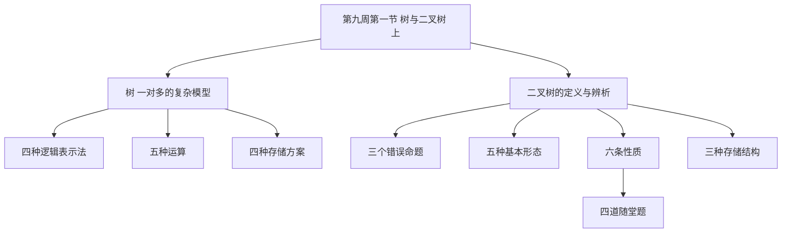

**图 2 · 树的四种逻辑表示法**

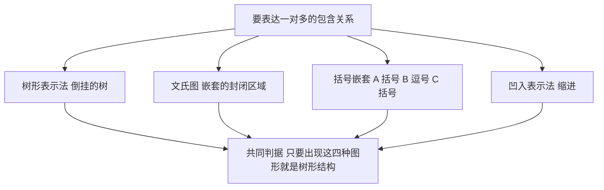

**图 3 · 树的存储方案是怎么一步步被逼出来的**

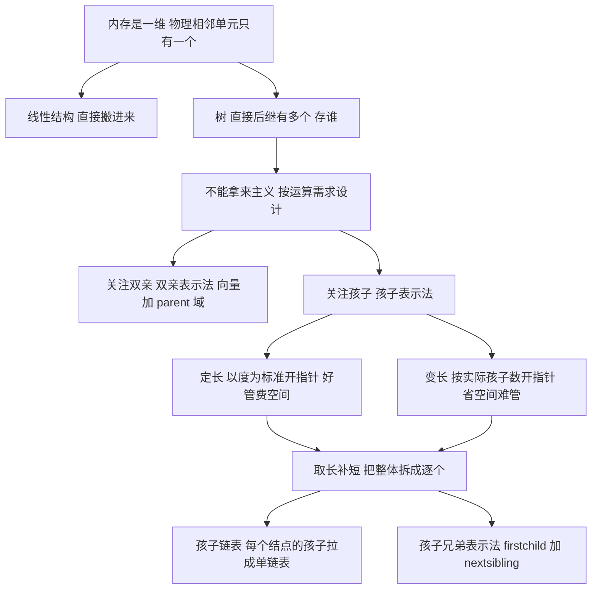

**图 4 · 二叉树为什么不是树**

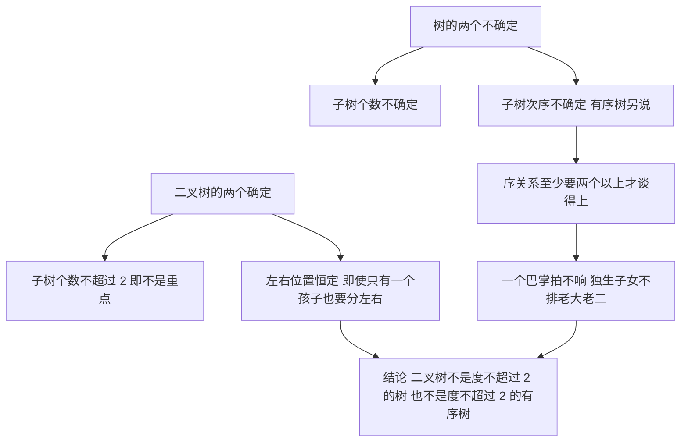

**图 5 · 六条性质各自的用途**

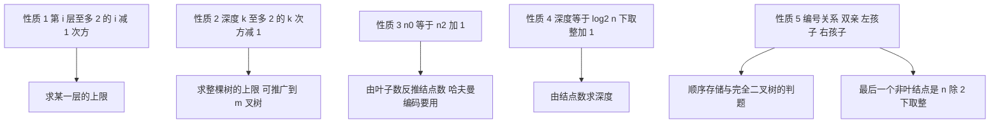

## 正文

### 一、从一对一走到一对多：这一章为什么换了个模型 `00:00-00:03`

我先把这个"换模型"的动作说清楚。

前面讲过的东西，从线性表、栈、队列、串，一直到数组和广义表，它们的骨架都是**一对一**：给你一个元素，它的前驱是唯一的一个，它的后继也是唯一的一个。栈和队列只是把"在哪儿进出"限死了；串是元素被限成字符；数组是把一对一**重复了若干维**。**底层那个"一前一后"的线性骨架，一次也没变过。**

树不一样。树是典型的**一对多**：一个结点下面可以挂若干个孩子。

我特意把这句话说得含糊一点——「若干个」，不是「两个」，也不是「固定几个」。因为**这个"若干个"到底几个，树上事先没规定**。这一点很要命，后面讲存储的时候你们会看到，正是这个"不确定"，把树的存储从"搬进来就行"逼成了"必须设计"。

那为什么现在才讲树？因为树已经是**非线性的、典型的复杂模型**了。我课上原话说的是：「树形结构已经进入了典型的什么？非线性结构，你也可以称它为什么，它是进入了复杂模型。」

接着我自问自答了一句，这句话你们别当玩笑听：

> **啥是复杂模型？就这个问题太难描述了，太怎么样太复杂了，所以我们称为复杂模型。**

这句话其实是在交代一门课的态度。**一个东西难到无法用一两句话说清楚，我们在教材里就给它一个笼统的名字，然后绕着它做能做的事。** 这一整章我做的事，就是绕着"一对多"这个说不清楚的东西，把能说清楚的部分一件件拆出来：怎么画、怎么存、有什么性质、怎么遍历。

**这里要提前说一个术语口径**，免得你们后面看书的时候觉得对不上。教材 6.1 给树的定义是：

> 树是 $n\,(n\geqslant 0)$ 个结点的有限集。在任意一棵非空树中：(1) 有且仅有一个特定的称为**根**（Root）的结点；(2) 当 $n>1$ 时，其余结点可分为 $m\,(m>0)$ 个**互不相交**的有限集 $T_1,T_2,\cdots,T_m$，其中每一个集合本身又是一棵树，并且称为根的**子树**（SubTree）。

这个定义是**递归**的——用树定义树。而我们课上是从**集合论**的角度切入的：树就是一个集合，里面套着若干互不相交的子集合，子集合里再套子集合。教材 6.1 里也提了这套说法，写成二元组 $Tree=(root,F)$，其中 $F=(T_1,T_2,\cdots,T_m)$ 是 $m$ 棵树的森林，并给出关系

$$
RF=\{\,<root,\,r_i>\ \mid\ i=1,2,\cdots,m,\ m>0\,\}.
$$

我在课上说过一句评价：**从集合论的角度定义是最简洁的**。「虽然我们也可以用关系代数的方式来进行定义，但是集合的方式它是最简洁的。」这句话你们记住就行——**后面四种逻辑表示法里，有两种（文氏图和括号嵌套）本质上就是把集合论那个定义直接画出来**。

**本节要点**

- 树是**一对多**的非线性结构；"一对多"的"多"**个数不确定**，这是树与线性结构的第一个分水岭。
- 树的定义是**递归定义**：树 = 根 + 若干互不相交的子树，每棵子树又是一棵树。
- 教材 6.1 给了两种等价口径：**集合／子树口径**（$n$ 个结点的有限集，根唯一，其余分成 $m$ 个互不相交的子集）与**二元组口径**（$Tree=(root,F)$）。**集合口径最简洁**，关系代数口径也能写但不划算。

### 二、树形表示法：一棵倒挂的树 `00:03-00:06`

第一种表示法，就是最直觉的那个：**画一棵树**。

我在课上把这个词拆开讲了一遍，因为"树"这个词其实是**拟人化**的借词：

> 我们在这说树形结构的话呢，实际上它是一个**拟人化的用词**了，就好比我们自然界当中的树对吧。我们自然界当中的树的话呢，咱们是由下到上进行增长的，那么到这儿怎么样？多出来一个分支；到这儿又冒出来一个分支，不断的有什么，有分支冒出来或者枯死。

请注意这段话里藏了一个非常关键的信息，我后面讲"删除子树"的时候要用它：**自然界里的树，分支会"冒出来"，也会"枯死"**。所以树这个结构天生带着"**动态生长**"的味道——这也解释了为什么树最自然的存储方式是链式而不是顺序。

然后就是那个经典的反差：

> 自然界当中的树，形态虽然是从下往上升的，但是我们在纸张上面的**书写形式是从上到下**进行的，所以就用**倒挂着**的这棵树这种形态来画出来。

**根在最上面，叶子在最下面**——这是纸上书写习惯逼出来的，不是自然界的样子。这一点看着是小节，但它决定了一件大事：**所有的层次编号、所有的"深度"定义，都是从根往下数的**。根是第一层，不是第零层，也不是最下面那层。

下面这张图就是教材 6.1 图 6.1(b) 那棵 13 个结点的树。这一棵树我这一节要反复用——**四种表示法、四种存储方案、五种运算，全都拿它当例子**。你们最好把它记住：

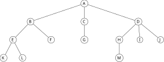

> **图注（树 $T$ 的树形表示法）**：根 $A$ 在最上面；$A$ 有三个孩子 $B,C,D$；$B$ 的孩子是 $E,F$；$E$ 的孩子是 $K,L$；$C$ 的孩子是 $G$；$D$ 的孩子是 $H,I,J$；$H$ 的孩子是 $M$。全树 13 个结点，$A$ 的度为 3，$C$ 的度为 1，$K,L,F,G,M,I,J$ 的度为 0（都是叶子），**树的度为 3**，**深度为 4**。

这棵树为什么好用？因为它把树的几个"不整齐"都占全了：**有的结点三个孩子，有的两个，有的一个，有的没有**。这就意味着——**任何"按固定格式开空间"的存储方案，在这棵树上都会浪费**。这话第十三到十八节会用上。

**本节要点**

- 树形表示法＝**倒挂的树**：根在上、叶在下，是书写习惯逼出来的。
- 「树」是**拟人化借词**；自然界里的树会"冒分支"也会"枯死"，树的**动态生长性**由此而来。
- 层次与深度**一律从根往下数**，**根是第一层**。

### 三、文氏图与括号嵌套：用「包含」说「层次」 `00:06-00:11`

第二、第三种表示法，是我从**数学**那边借过来的。我在课上强调了一句很长的话，这句话是这一章的"方法论"：

> **数学的这种符号化的语言，对我们影响很大。**

接着我举了数学里最熟的一个例子——**表达式**：

> 数学当中对于表达式，大家还记得吗？我们表达是为了表达它的**优先关系**，我们往往用什么？用**括号**来进行，把它括起来对不对？

所以**括号天生就是一个表达"包含／优先"关系的符号**。树是包含关系，那括号当然也能表达树。这就是第三种表示法：**括号嵌套**。

第二种表示法是**文氏图**（我课上读成"文视图"，就是 Venn diagram）。它的做法特别朴素：

> 从集合的角度来考虑，这个**包含关系**的话，它一般往往是**用一个封闭的区域**来进行表示。比如说 $A$ 这个集合，它用一个封闭的区域来表示，那么 $A$ 里面有两个子集合，一个 $B$ 一个 $C$，那么依次类推。当然这个包含关系**只要封闭就行**，你画成圆形、画成方形都 OK。

"**只要封闭就行**"这句话是这一段的精髓：文氏图表达的不是形状，是**嵌套**。外圈包含内圈，就是父包含子。所以**画几个圈、圈是什么形状，全无所谓**。

第三种是**括号嵌套**。我课上把它对着文氏图讲了一遍：

> 括弧嵌套实际上也表示的是一种包含关系。就是说 $A$ 里面有两个子集合，这两个子集合分别是 $B$ 和 $C$；那其中 $B$ 里面，$B$ 又是一个集合，它里面包含 3 个元素；$C$ 里面包含什么呢？两个元素。**每一个元素我们给号来进行表示。**

对着那棵 13 结点的树，括号写法就是：

$$
T=A\big(B(E(K,L),F),\;C(G),\;D(H,I,J,M)\big)
$$

**这个式子和图 1 是同一棵树**。你们对着看：最外层是 $A$，$A$ 后面拖着三对括号，正好对应 $A$ 的三个孩子 $B,C,D$；$B$ 那对括号里又是两对，对应 $E,F$；$E$ 那对括号里是 $K,L$ 两个叶子。

**这里有一个必须点出来的差别**：括号嵌套能表达"谁是孩子"，但**表达不了"谁是第几个孩子"**——除非你约定"从左到右按次序"。而**只要一谈"第几个孩子"，你就已经跑到"有序树"那片地方去了**（第二十四、二十五节会专门讲这个"序"字凭什么成立）。

顺便说一句：教材 6.1 里把这种括号写法叫**广义表形式**，「根作为由子树森林组成的表的名字写在表的左边」。这个说法跟我们第 5 章学的广义表是同一套东西——**广义表本来就是树的线性化写法**。所以你们如果觉得广义表那一节玄，回头看看这棵树，一切都清楚了。

下面这张图把文氏图和括号嵌套摆在一起，你可以直接看出它们是一回事：


> **图注（文氏图与括号嵌套是同一件事的两种写法）**：左边的大椭圆是 $A$，套在里面的小椭圆是 $A$ 的孩子 $B,C,D$，$B$ 里再套 $E$（$E$ 里再含 $K,L$）与 $F$。右边那行括号同样是这棵树——**外层括号就是根，并列的每一对括号就是一个孩子**。文氏图只要求"封闭"，所以圆圈、椭圆、方块都行，形状不携带任何信息，**只有嵌套关系携带信息**。

**本节要点**

- **文氏图（嵌套集合）**：用**封闭区域**表示集合，用**嵌套**表示包含。**只要求封闭，形状随意**——形状不携带信息。
- **括号嵌套（广义表形式）**：$T=A(B(E(K,L),F),C(G),D(H,I,J,M))$。**外层＝根，并列的每对括号＝一个孩子**。
- 教材用**广义表**称呼括号形式；第 5 章学的广义表与树是同一套东西。
- 括号嵌套**只能表达"谁是孩子"，表达不了"谁是第几个孩子"**——要谈次序就进入"有序树"的辖域。

### 四、凹入表示法：缩进就是层次 `00:11-00:14`

第四种表示法是从**排版惯例**里长出来的，我叫它**凹入表示法**，也叫**缩进**、**锯齿状**的凹入方式。教材 6.1 的说法是「凹入表示法（类似书的编目）」。

我课上是从一个**国民生产总值**的例子切进去的：

> 比如说一个国家的国民生产总值是这么多，其中粮食是这么多，钢铁是这么多，你看**把它往里缩进一些**，把它往里缩进一些，就是我们**第四种方式，锯齿状的凹入方式**。

这个例子其实就是**报表**：总产值一行，粮食、钢铁这些分项往右缩进一格。看的人不用画线，光靠**左边留白的多少**就知道谁从属于谁。

紧接着我把它和**编程语言**对上了，这一段是本节的第二个"方法论"：

> 那么这跟我们编程语言不是一样的吗？你比如说这是一个 `if` 条件，这个 `if` 条件满足了之后……进去执行做两个动作 $I$ 和 $J$，这两个动作是**并排**的形式，它俩是**一样的地位**。那么其中 $I$ 和 $J$ 包含在这个循环里面，所以它**往里缩进一点**。我们不管是 C 也好、Python 也好，你写程序，为了**层次分明**的话，我们往往用**缩进**的形式来进行表达。

这里有两层意思，我都想让它落地：

1. **并排＝同一个父亲**。缩进相同的两项，地位平等，它们是兄弟。
2. **缩进更深＝更靠里**。往里缩得越深，说明它被包含得越深，层次越低。

**所以"缩进量"就是"深度"**。Python 干脆把这件事做成了语法——缩进错了程序就跑不了；C 只是排版习惯，编译不管。这就是为什么我说"数学的这种符号化语言对我们影响很大"：**凹入表示法不是画出来的，是排出来的**。

那棵 13 结点的树用凹入表示法写出来，就是下面这样。注意右边那列数字——**我把层次标出来了，它是从根往下数的**：

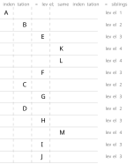

> **图注（凹入／缩进表示法）**：每一行一个结点，**左边的留白越多，层次越深**。$A$ 顶格（第 1 层）；$B,C,D$ 缩进一格（第 2 层，三者**并排**，是兄弟）；$E,F,G,H,I,J$ 再缩进（第 3 层）；$K,L,M$ 缩进最深（第 4 层）。**同一缩进量 = 同一个父亲**，这个判据和 C／Python 里"缩进表示代码块层次"是同一条。注意 $M$ 挂在 $H$ 下面，所以虽然在 $D$ 的子树里，但它的缩进比 $H,I,J$ 更深一层。

**本节要点**

- **凹入（缩进）表示法**＝靠**左边留白**表达层次，教材 6.1 说它「类似书的编目」。
- **同一缩进量＝同一个父亲（兄弟）**；**缩进越深＝层次越低（被包含得越深）**。
- 编程语言的缩进（Python 是语法，C 只是排版）与它是同一套逻辑：**层次分明靠缩进**。

### 五、四种表示法合起来，就是树的判据 `00:14-00:16`

四种表示法讲完，我在课上做了一个总结，这句话是这一节第一个真正的"考点"：

> 那这 4 种方式也就是**逻辑表达方式**。也就是说我们人类在没有计算机之前研究树形结构，那么**只要看到这 4 种方式，我们就认为它是树形结构**对不对？它是**反映这种包含关系**的。

把这句话拆成两句：

1. **四种表示法是等价的**——它们描述的是同一棵树的同一个逻辑结构。你给一张文氏图、给一行括号、给一段缩进，我都能还原出同一棵树。
2. **判据是"包含关系"**——你看到封闭区域套封闭区域、括号套括号、缩进套缩进、枝干连枝干，**你就知道它在说一件事：谁归谁管**。反过来，只要一个图形表达的是这种归属，它就是树形结构，叫什么名字不重要。

这里我要专门提一句**这四种表示法各自的"信息量"差别**，因为考研选择题真的考这个：

| 表示法 | 能表达"父子" | 能表达"兄弟次序" | 能表达"是第几个孩子" | 典型用途 |
|---|---|---|---|---|
| 树形表示法 | 能 | 能（从左到右） | 能（显式画出来） | 教材插图、示意图 |
| 文氏图／嵌套集合 | 能 | **不能** | **不能** | 讲"包含"这个概念 |
| 括号嵌套（广义表） | 能 | 仅靠书写顺序 | 仅靠书写顺序 | 广义表、序列化 |
| 凹入／缩进 | 能 | 能（上下顺序） | 能（上下顺序） | 目录、编目、代码 |

看最后两列——**文氏图是四种里唯一"完全不携带次序"的**。这也正好印证了第二十四节要讲的那件事：**树本身（无序树）就不携带次序**，所以文氏图并不缺信息；而**一旦你要求次序，文氏图就不够用了**。这个观察在辨析"二叉树是不是有序树"的时候非常有用。

教材 6.1 里还有一句话，我这儿也带一下，因为它解释了为什么"表示法多样"本身是有意义的：

> 表示方法的多样化，正说明了树结构在日常生活中及计算机程序设计中的重要性。一般说来，**分等级的分类方案都可用层次结构来表示**，也就是说，都可导致一个树结构。

「分等级的分类方案」这七个字，就是树在整个计算机里的地盘：**文件系统的目录、XML／HTML 的文档树、编译器的语法树、数据库的索引（B 树）、家族谱系、行政层级、书的章节目录**——全是它。

**本节要点**

- 四种逻辑表示法**彼此等价**，共同判据是**包含关系**；见到这四种图形，就按树形结构处理。
- **文氏图是四种里唯一不携带次序的**；要表达"第几个孩子"必须靠书写顺序或显式画出。
- 教材的判断：「**分等级的分类方案都可用层次结构来表示**」——这就是树的地盘。

### 六、复杂模型的运算，为什么只能「虚着讲」 `00:16-00:19`

表示法讲完，该讲**运算**了。但我在进入运算之前，先花了几分钟讲**为什么这一章的运算讲不实**。这一段是我这一节说得最"方法"的一段，你们别急着翻过去。

先给运算定位：

> 我们看一下树形结构的**运算**。我们说运算的话呢，也就是说反映的是**管理处理**，那个需求——**用户的需求**。

**运算 = 用户对这份数据要做什么**。这个口径前面几章一直没变：线性表要插入删除，栈要进出，队列要排队，都是"用户需求"的翻译。树也一样。

然后问题来了：

> 因为在复杂模型当中，大家想一下，我们要研究它的运算，那么往往**需要借助于实例来说明问题**，因为复杂模型涉及到的细节比较多，那么必然**你要用实例，就是举一个实例来进行说明这个复杂模型的运算**。但是这一点往往又和**基本数据结构的研究内容冲突**。

冲突在哪儿？我下一句就点破了：

> 咱们说基本数据结构，我们实际上研究的是**那个普适性的**，就是大家都共有的那些个**模型**。那所以到复杂问题这一块，你又是从基本数据结构、从模型的角度出发，那么**就不好举例**。

这段话值得展开，因为它解释了一个你们可能一直在纳闷的问题：**为什么前面几章的算法都写得出来，到了树这一章，教材全是"操作说明"而不是"算法代码"？**

原因就在这个"冲突"里，它是两条相互拉扯的要求：

- **你为了讲清楚，必须举实例**。举个家谱，我就能说"找出这一代里所有有功名的人"；举个文件系统，我就能说"把某个目录连同子目录一起删掉"。**有了实例，需求才具体，运算才落地。**
- **但你一举例，就绑死在那个例子上**。家谱的运算搬到文件系统上就不是那个意思了；**一旦绑死实例，"普适的模型"就没了**，剩下的只是"这个应用怎么实现"。

所以这件事**没法两头都要**。我课上给了一句很形象的话：

> 从务实务虚的角度来讲啊，**树形结构这里面讲运算它更虚**，更是怎么样，**就是在表面上一层飘着呢**。

**「在表面上一层飘着」**——这就是我要求你们对"树的运算"采取的阅读姿态：**知道有这几条、知道每条大致干什么、知道它跟线性结构的对应运算差在哪儿**，至于"具体怎么实现"，等我讲到遍历、讲到后面具体的树（二叉排序树、赫夫曼树、B 树）时再落到代码上。

那这一节到底讲不讲运算？讲，但**只列清单、只点性质**：

> 实际上我们讲运算只能讲**其中的一种**，那我们后面会讲。那这个运算的话呢，我们还得总结一下——从模型的角度，简单、虚虚的，我们总结一下它**有哪些运算**。

「**其中一种**」指的是**遍历**——它是后面唯一会被写成完整算法的那一条。其余四条，我只讲"它是什么、它跟线性结构差在哪"。

教材 6.1 的 ADT Tree 里把运算列成了 13 个基本操作（`InitTree`、`DestroyTree`、`CreateTree`、`ClearTree`、`TreeEmpty`、`TreeDepth`、`Root`、`Assign`、`Parent`、`LeftChild`、`RightSibling`、`DeleteChild`、`TraverseTree`）。你们看这个清单会发现：**它们全是"问结构"和"改结构"，没有一个"算数值"**。这跟线性表那边（`ListInsert`、`ListDelete`、`LocateElem`、`PriorElem`、`NextElem`）是一个套路——**抽象数据类型的操作集，只描述"能对它做什么"，不描述"用它算出了什么"**。

下面五节，我按课上讲的顺序，一条一条过。

**本节要点**

- **运算 = 用户需求**的翻译；树与线性表在这件事上没有区别。
- 树的运算"虚"的根因是一个**冲突**：讲清楚要举实例，而基本数据结构要讲**普适模型**，两者不可兼得。
- 所以这一章**只讲"有哪些运算"**，只有**遍历**会被写成完整算法。
- 教材 6.1 的 ADT Tree 给出 13 个基本操作，全是"问结构／改结构"，**没有数值计算**，与线性表的 ADT 同一套路。

### 七、运算一：访问给定性质的结点 `00:19-00:22`

第一条运算，**访问树中具有给定性质的结点**。

这是树上最"应用导向"的一条。我课上用了**家谱图**当例子：

> 首先第一种运算就是**访问树中给定性质的结点**啊。比如说我们用树来研究**家谱图、家族图**，那我们就可以问你说：**哪一代当中啊，有功名的人有哪些？**

请注意这个问句的形状：**"哪一代"给定了层次，"有功名"给定了性质，"有哪些"要的是集合**。一条运算里同时用上了树的**层次**和结点的**属性**——这就是树比线性表强的地方：线性表只有一个"第几个"，树有"第几层""哪个分支"。

然后我把"功名"这个词拆了一下，这段拆得挺有意思，而且它其实是在**教你们怎么把模糊需求变成可判定的条件**：

> 我们说**功和名啊，实际上是两个角度**。**功**实际上指的是从**当官**的角度；**名**的话，可能有的人一辈子没当官，但是他**名望很高**——比如说一个族的**族长**，他可能一辈子没当官，但是他在这个家族里面**名望很高**。

所以"有功名的人"这个说法，落到程序里其实是**两个谓词的析取**：

$$
\text{hasHonor}(x)\;=\;\text{isOfficial}(x)\ \lor\ \text{isRenowned}(x)
$$

**「功」是官职这个属性，「名」是声望这个属性**——两条不同的判定，硬被日常语言压成了一个词。这就是我常说的：**需求文档里的一个名词，落到数据上往往是好几个字段**。

第二个例子是**国家五年规划**：

> 或者说我们国家怎么样，**十四五规划**，每一个五年规划，那么它的**突出贡献**有哪些呢？

这个例子的结构其实和家谱是同构的：**五年规划是一层一层的（国家 → 领域 → 项目），"突出贡献"是结点上的一个属性**。所以"找出每一层里标了'突出贡献'的结点"——**换一个应用，运算一模一样**。

**这一条运算对应的教材操作**是 `TraverseTree(T, Visit())` 的**受限形式**：本质上就是"遍历全树，对每个结点调用一个判定函数，把通过的收集起来"。所以它其实**不是一条独立的运算，而是遍历的一个应用**。这一点我课上没明说，但你们看教材 ADT 就会发现——**ADT Tree 里根本没有"按性质查找"这个操作**，只有 `TraverseTree`。**"按性质访问"是用 `TraverseTree` 加上你自定义的 `Visit` 拼出来的。**

**本节要点**

- 运算一的形状：**给定层次 + 给定性质 → 求集合**。它同时用到树的**层次**和**结点属性**。
- 「功名」这类日常词落到程序里往往是**多个谓词的析取**（官职 $\lor$ 声望）；**需求里的一个名词常常对应数据上的多个字段**。
- 这条运算**不是独立操作**，它＝`TraverseTree` + 自定义 `Visit`。教材 ADT 里没有它。

### 八、运算二：遍历，以及它为什么在树里变成难题 `00:22-00:24`

第二条，**对树进行遍历**。这一条我只讲了三句话，但三句话都很重。

第一句，讲**为什么在这儿才单独拎出来讲**：

> 实际上我们**在线性结构当中也研究**，只不过那个时候比较简单，那我们就不把它怎么样，**单独拎出来讲**。那现在的话，面临复杂数据结构、非线性结构的话呢，这个**遍历操作它就有了一定的难度**了。所以我们在这儿把它**专门拿出来讲**。

线性结构的遍历有多简单？一句话：**从头到尾走一遍**。顺序表就是下标从 $1$ 加到 $n$；链表就是沿着 `next` 一路走到底。**因为线性结构只有一个方向、只有一条路**，所以"遍历"根本不需要方法——它甚至不需要名字。

树不一样。树的每个结点**可能有两个、三个、好几个后继**，你走到一个岔路口，**先走哪条**？走完一条回来，**怎么回到岔路口**？回来之后**剩下那几条怎么记着还没走**？这三个问题一出来，"遍历"就从"走一遍"变成了"**设计一种访问次序**"。

这也是我在这一章反复念的一句话的由来：**非线性结构上的遍历，本质是"找一种规律，把非线性的结点排到一个线性序列上去"**。教材 6.3.1 开头那段话几乎就是这个意思：

> 由于二叉树是一种非线性结构，每个结点都可能有两棵子树，因而需要**寻找一种规律**，以便使二叉树上的结点能**排列在一个线性队列上**，从而便于遍历。

第二句，讲**遍历为什么是这一章的"真运算"**：

> 我们**后面会讲**——那这个运算的话呢，我们还得总结一下……（遍历）**这个运算它就有一定的难度了，所以我们在这儿把它专门拿出来讲**。

第三句其实就是**预告**：遍历是下一节的正题，这一节只把它**列进清单**。

我在这儿补一个你们现在就该建立的观念，虽然课上没细说：**树的绝大部分运算都要靠遍历来实现**。找双亲、找孩子、求深度、求结点数、判相等、复制一棵树、销毁一棵树——**底子全是遍历**。所以你如果只会背"先序中序后序"，但不知道它们是"实现其他运算的工具"，那这一章就白学了。**遍历是树的操作系统。**

**本节要点**

- 线性结构的遍历**简单到不必单列**（只有一条路、一个方向）；树的遍历**必须设计访问次序**，所以成了专门课题。
- 遍历的本质：**给非线性结构找一个线性化次序**，把结点排进一个线性序列（教材 6.3.1 原话）。
- 遍历是这一章**唯一会被写成完整算法**的运算；**树的绝大多数运算都靠遍历实现**——遍历是树的操作系统。

### 九、运算三：找孩子，以及反过来找双亲 `00:24-00:28`

第三条，**确定某结点的子结点**。我课上第一句就把它和它的**逆运算**绑在一起说：

> 第三一个就是**确定某结点的子节点**，就是某个结点它的孩子节点有哪些。当然这个**有找孩子的话，就有什么呢，反过来找父亲**对吧。

**找孩子／找双亲是一对逆运算**。这一对逆运算在本节里地位极高——**后面四种存储方案，全都是围绕"这两个方向哪个好走"来取舍的**。这一点我先埋在这儿，第十三到二十二节会反复回收。

然后我用了两个生活场景，一个讲**找双亲**，一个讲**找孩子**。

**场景一：幼儿园放学。**

> 你比如说幼儿园的小朋友放学，然后**找我爹在哪呢**？或者说**我妈在哪呢**？**找父母，找双亲**。

这个例子妙在它说明了**双亲的个数是唯一的**：小朋友有爸爸、有妈妈，但**"我的直接上级"只有一个**（在树的模型里，双亲就是一个）。所以找双亲这件事**天生比找孩子简单**——因为答案唯一，不用挑。

顺着这个"唯一"，我把它接到了**职场**：

> 那我们实际上这个**父节点就是我的直接上级**。我们经常说**有困难找领导**，找领导的话，你一般找谁呀？一般**你不会越级**去找，你一般要找谁？找你的**直属领导、直管领导**——就是这个管你的**直接上层**领导，你**不能越级**去找。

「**不能越级**」这四个字，就是树的结构约束在组织行为上的投影：**每个结点只有一个双亲，所以"向上"这条路是唯一的、没有岔路的**。你从任何一个位置往上走，只有一条路，走到头就是根。这也是教材 6.1 讲 `Root(T)` 操作时的依据：

> 反复调用 `PARENT` 操作，直到遇见无双亲的结点时，便找到了树的根。

**场景二：科长想往上爬。**

> 那我们从当官的角度，我就经常会说，那我**一级一级要往上爬**。那你比如说我当前是**科长**，那我**下一个台阶在哪呢**？我要**朝哪个方向努力**？

这个例子的落点其实是**"向上的路径唯一，所以方向明确"**：科长上面是处长，处长上面是局长，**每一步只有一个选择**。所以「都是看什么呢？**父节点、关注节点**」——你只要盯着双亲，路就只有一条。

**但找孩子就不一样了**，我课上紧接着就把这个对比点出来：

> 那关注孩子的话就有一个问题：我们的孩子怎么样？刚才说的因为我们树啊，**这个定义子树的个数是不确定的**……所以根据它的这种**动态增长性**，关注孩子节点的话，我们往往用**链接结构**来进行存储。

这段话是**存储那一大段的引子**，我在这儿先记下来：**孩子的个数不确定 → 不能用定长开空间 → 只能用链接**。第十五到十八节全部围绕这句话展开。

**教材对照**：ADT Tree 里对应的是 `Parent(T, cur_e)`、`LeftChild(T, cur_e)`、`RightSibling(T, cur_e)` 三个操作。注意教材只给了 `LeftChild`（最左孩子）和 `RightSibling`（右兄弟），**没有给"第 $i$ 个孩子"**——因为树的孩子个数不定，"第 $i$ 个"要顺着兄弟链走 $i-1$ 步才能到，教材把这个留给读者自己实现（6.4.1 讲孩子兄弟表示法时明确说了这件事）。

**本节要点**

- **找孩子与找双亲是一对逆运算**；本节后文四种存储方案的取舍，全看**这两个方向哪个好走**。
- **双亲唯一**（"不能越级"，向上只有一条路），所以找双亲天然简单；`Root` 操作就是"反复取双亲直到没有双亲"。
- **孩子个数不确定**（树会"动态生长"），所以找孩子麻烦，也直接导致**孩子只能用链式存储**。
- 教材 ADT 给 `Parent`／`LeftChild`／`RightSibling`，**不给"第 $i$ 个孩子"**——那个要沿兄弟链走。

### 十、运算四：删除的是子树，不是结点 `00:28-00:31`

第四条运算，**删除某结点的子树**。这一条我讲得最重，因为它是**树与线性结构差别最刺眼的地方**：

> 另外一个**删除某节点的子树**——**删除的是子树**。注意**这个和线性结构不一样**。线性结构我们研究的是**删除一个节点**，这里面是**删除子树**。

为什么？我给的理由是**从自然界借来的**：

> 这个实际上跟我们**自然界当中那个树的生长形态是一样的**。我们经常说自然界当中的树，**一旦说树是死的还是活的呀？活的**。因为死了的树我们叫啥？我们不叫树，叫啥？叫**木头或者木材**。

这句"死了的叫木头"是个段子，但它**卡住了一个真正的区别**：**树是"活"的结构**，它的每一个分支都是**连通着**的。所以：

> 所以一棵树它是活的，那么活着的情况下，它往往**不断的有分支节点冒出来**，那它也会**不断的有分支节点枯死**。那么一般来说，我们**某一个分支节点枯死**的情况下呀，那么往往**不是某个节点去掉，而是**——它一旦枯死了，**这整棵子树就都活不了**……**整棵子树也就废掉了**。

**关键就在"废掉"这两个字**：一根枝子枯了，**长在它上面的所有枝子、所有叶子一起死**。你不能把中间一节摘掉、让上面的还活着——**那就不成一棵树了**。

这也直接对应到**为什么树的结构不能"挖洞"**：线性表删一个元素，后面的往前挪一位，结构还是线性的；树要是删掉中间一个结点，**它下面的整棵子树就悬空了**，悬空的东西在树的模型里**不存在**（每个非根结点必须有且只有一个双亲）。所以"删一个结点"这个操作在树上**根本没法定义**，能定义的只有"**删掉一棵子树**"。

教材 6.1 的 `DeleteChild(&T, &p, i)` 就是这么定义的：

> 初始条件：树 $T$ 存在，$p$ 指向 $T$ 中某个结点，$1\leqslant i\leqslant p$ 所指结点的度。操作结果：**删除 $T$ 中 $p$ 所指结点的第 $i$ 棵子树。**

注意它删的是**第 $i$ 棵子树**，删完 $p$ 还在，只是少了第 $i$ 个孩子。**"删子树"这个操作的粒度是"一棵子树"，不是"一个结点"。**

然后我给了一个真实的商业例子，这个例子在课上讲了挺长，但它是这一条运算最好的注脚：

> 这个实际上对应到我们现实中也有例子呀。你比如说咱们**华为**，曾经为了应对国际形势，把华为的**荣耀业务整个都扔出去了**——扔出去了、**卖掉了**。那么实际上你想一下，把荣耀那个业务卖出去的同时，那么**跟荣耀有关的什么生产部门、销售部门、设计部门等等之类的，那整个子部门也全都扔出去了**。

**这就是删子树**：卖掉"荣耀"这个结点，它底下的生产、销售、设计**一整片**跟着走。你不能只卖"荣耀"这个牌子、把底下的部门留下——**留下的部门没有归属了，在模型里不成立**。

我课上还补了一句更狠的话，是关于**这个操作的代价**：「**全都扔出去了**」——也就是**一次删除可能带走一整片**。这句话在算法上意味着：**删子树的时间复杂度，正比于那棵子树的规模**，而不是 $O(1)$。这一点你们现在记着，等讲链表删除、讲树的后序遍历销毁时会对上。

**本节要点**

- 树上**没有"删除一个结点"这个操作**，只有「**删除某结点的第 $i$ 棵子树**」（教材 `DeleteChild`）。原因是**树是连通的"活"结构**：中间一节断掉，上面那片就悬空，而悬空在树的定义里不成立。
- 与线性结构对照：线性表删**一个元素**，树删**一棵子树**——**粒度不同**。
- 华为剥离荣耀：**卖掉一个结点，它底下的整片部门跟着走**，这就是"删子树"的现实版。
- **代价**：一次删子树的时间正比于**被删子树的规模**，不是 $O(1)$。

### 十一、运算五：用一棵树替换一个子结点 `00:31-00:34`

第五条运算，**用某棵树来替换子结点**。这一条与第四条是一对：**一个"拿走一片"，一个"塞进一片"**。

我在课上是这么起头的：

> 第六一个就是**用某棵树来替换子节点**。还是一样，**我们不是用节点来替换节点，而是用某棵树来替换子节点**。

**"不是拿结点换结点，是拿一棵树换一个结点"**——这句话就是这条运算的全部。它和线性结构的 `ListInsert` 差在哪儿？**线性表插进去的是一个元素（一个格子），树上插进去的是一整棵子树（一片格子）。**

现实例子我用了**猎头公司**，这段讲得很生动，而且它其实是"人才流动"这个现象的树模型：

> 你们以后从事这个工作了以后你就会知道，有一种公司叫**猎头公司**。猎头公司是干什么的？**猎人的**。那么咋猎人呢？就是**挖人才**。

关键在于**挖的规模**：

> 据说这个**浙江大学**，人家那个**挖人才不是挖一个**。他们第一个院士实际上就是**南大化工院**过去的……把那一个人才挖过去了之后，人家怎么样？**呼啦啦兰大（南大）怎么样？那整个团队好几个老师全都过去了**。

> 所以猎头公司呀，人家**不是说猎你一个人，他的目标是你的整个团队**。

**这就是"用一棵树替换一个子结点"**：浙江大学原本在"化工"这个位置上可能是空的、或者有个小团队；挖来一个学科带头人，**跟着来的是他的整个团队**——带头人是一个结点，团队是一棵子树，**一起搬过去**。

我课上还插了一句关于"人才流失"的评述，虽然是闲话，但它点出了一个结构上的事实：

> 南大走的人**再建一个学校，比咱们现在的还好**——这个确实是事实。

这句话的结构含义是：**一棵子树是可以整体搬走的，搬走之后能在别处重新扎根**。**因为子树本身是一棵完整的树**（有自己的根、自己的层次），所以它**不依赖原来的父结点也能活**。这正好解释了"替换"这个操作在模型上的合法性：**你塞进去的那棵子树，本来就是一棵合法的树**。

教材 6.1 的 ADT 里对应的是……其实**没有直接对应**。教材在 6.2.1 的 ADT BinaryTree 里给了 `InsertChild(T, p, LR, c)`：

> 根据 $LR$ 为 0 或 1，插入 $c$ 为 $T$ 中 $p$ 所指结点的**左或右子树**。$p$ 所指结点的原有左或右子树则成为 $c$ 的右子树。

你们看这个定义——**"原有的子树成为新子树的右子树"**，这就是"替换"的严谨写法：不是丢掉原来那棵，而是**把它挂到新来的那棵下面去**。所以"替换"在教材里被拆成了"插入 + 重挂"。

**注意这里有个不对称**：教材这个 `InsertChild` 是**二叉树**的操作，因为二叉树才有"左或右"这个确定位置。**一般树没有"左或右"，只有"第 $i$ 个孩子"**，所以一般树的"替换第 $i$ 棵子树"要先定位到第 $i$ 个孩子。这也又一次说明：**树的运算一旦要落到具体位置，就得先有"次序"的概念**——这又回到了第二十四节那个"序"字。

**本节要点**

- 运算五是「**用一棵树替换一个子结点**」——**不是结点换结点，是树换结点**。
- 与线性结构对照：线性表插入**一个元素**，树插入**一棵子树**。
- **子树本身是一棵完整的树，不依赖原父结点也能独立存在**，所以"整体搬走／整体塞入"在模型上合法（猎头挖整个团队、荣耀整体剥离，都是这个结构）。
- 教材用 `InsertChild(T, p, LR, c)` 表达，并把**原有的子树挂到新子树下面**；一般树没有"左右"，只能按"第 $i$ 个孩子"定位。

### 十二、存储的前提：内存是一维的，而树是一对多 `00:34-00:38`

运算讲完（五条，全是"虚虚的"），进入这一节第一个硬骨头：**存储**。

我开场的逻辑链很朴素，但每一步都不能省：

> 接下来我们来看一下树的**存储**。我们说**所有的数据**，你再怎么样，不管是数据也好、程序也好，你都需要干嘛？需要先**装到计算机里面**。装到计算机的哪儿呢？**内存空间**。

第一步：**内存空间是典型的"一维"**。

> 那你想一下，我们的**内存空间是典型的啥？一维空间**。

第二步：**线性结构为什么能直接搬进去**。

> 那原来**线性结构一对一**，怎么样？我们某一个内存单元——比如说这个内存单元，那么以它**物理相邻**的、它的**直接前驱**，紧邻的这个单元**有着唯一的一个**；那么跟这个内存单元编号紧邻的**直接后继**，**物理上相邻的直接后继也有着唯一的一个单元**。

这段话里有两个"唯一"，我特意都用上了：**物理上相邻的单元只有一个在前、一个在后**（内存的线性地址空间），**而线性结构里每个元素的前驱、后继也各自只有一个**。**两边都是"唯一"，所以能对上**，直接搬进来就行：

> 那这样子的话，你**线性结构一对一，可以直接搬进来**，直接搬进来就可以了。

第三步：**树为什么搬不进去**。这是全节的转折点，我讲得最细：

> 但现在问题是我们的**树形结构是一对多**。如果你关注的是**前驱**，好办，**只有唯一的一个**；但是如果说你要关注**后继**呢？你的**直接后继有多个**——有多个、有多个！但是你的**存储器、内存空间**，它的**紧邻的那个存储单元、物理上相邻的存储单元，只有这唯一的一个**。那你到底，这 $N$ 个直接后继，**你存谁呀？你存谁呀？**

「**你存谁呀**」这三个字问了两遍，这个问题是本节后面所有存储方案的出发点。我把它整理成一个"账"：

| | 每个结点的前驱（双亲） | 每个结点的后继（孩子） | 内存里物理相邻的单元 |
|---|---|---|---|
| 线性结构 | 唯一 | 唯一 | 前一个、后一个，各唯一 |
| 树 | **唯一** | **$N$ 个（个数不定）** | 前一个、后一个，各唯一 |

看中间那一行：**双亲唯一，孩子不唯一**。这就是"一对多"落在存储上的全部麻烦。

所以结论是：

> 所以我们说树形结构，因为我们进入复杂模型，所以树形结构当中它的**存储往往就不能是"拿来主义"**，只能是干嘛呢？**根据你特定的运算需求，我来设计特定的存储方式**。当然你在设计的过程当中有个前提条件，就是**使得你这个运算更方便、更快捷**。

这段话里有三个词要圈出来：

1. **"不能拿来主义"**——不能照搬线性表那套。
2. **"根据特定的运算需求"**——**存储跟着运算走**。这话是这一章最重要的方法论，我在后面每一种方案里都要回收它。
3. **"更方便、更快捷"**——设计的目标是**运算效率**，不是"好看"。

然后我马上又给了一颗定心丸，因为"设计特定的存储方式"这个说法听着很吓人：

> 不过这种设计、这种特定的存储方式，大家**也不要被它吓到了**。我们实际上就好像好比**一栋摩天大楼**，它要建起来，看起来尽管再奇形怪状，**那它不也是一块一块砖头垒起来的吗**？

> 我们设计特定的存储结构，这个设计咋设计？它的**基本元素实际上还是我们前面讲的那 4 种存储结构当中的一种**。一种或几种，我们给它**组合起来**。就像**搭积木**一样——你把基本的什么小方块、小三角形垒起来，组合出各种各样不一样的复杂的存储方式。

这段话请一定记住，因为它是**这一整章"存储"部分的心法**：

> **再复杂的存储结构，拆开来都是"顺序"和"链接"这两块基本积木的组合。**

教材里那些看着复杂的东西——十字链表、孩子兄弟链表、线索链表、B 树的结点、赫夫曼树的静态三叉链表——**没有一个是新发明的基本结构**，全是顺序和链接的组合。所以你们看到一个新结构，第一件事应该是**问"哪儿是数组、哪儿是指针"**，而不是"这是什么新东西"。

**本节要点**

- **内存是一维地址空间**，物理相邻的单元只有前后各一个。
- **线性结构的前驱、后继都唯一**，与内存的"前后唯一"对得上，所以**可以直接搬进去**。
- **树的双亲唯一、孩子不唯一**（个数还不定），与"物理相邻只有一处"对不上，所以**"你存谁"**这个问题无解——**树的存储不能拿来主义**。
- 设计准则：**存储跟着运算需求走**，目标是**运算更方便更快捷**。
- **心法**：再复杂的存储结构，都是**顺序与链接**这两块积木的组合（搭摩天大楼，一块块砖垒）。

### 十三、双亲表示法：只认父亲，就能搬进数组 `00:38-00:43`

第一种方案，**双亲表示法**。它的出发点就是上一节那张表里的"双亲唯一"：

> 那接下来我们来看一下**第一种存储方式**就是什么呢？**双亲表示法**。意思就是**如果我关注的是我父亲**。那关注父亲的话，因为**任何一个节点，他的父亲有着唯一的一个**，那很好——对应到我们**向量**这种方式当中，怎么样？就可以**直接搬进来**。

这段逻辑是接得死的：**双亲唯一 → 双亲的"位置"是一个确定的量 → 确定的量可以放在一个格子里 → 所有结点排成一排就是向量**。所以：

> 所以我们如果关注父亲节点，我们就可以用**一组连续的空间**来存储树的节点。那么并且当然**每个节点当中增加附加一个指示器，来指示它的双亲的位置**——因为你的父节点有的唯一的一个。

**"数据 + 一个 parent 域"**，这就是双亲表示法的全部。教材 6.4.1 的写法是：

```c
// - - - - - 树的双亲表存储表示 - - - - -
#define MAX_TREE_SIZE 100
typedef struct PTNode {      // 结点结构
    TElemType data;
    int parent;              // 双亲位置域
} PTNode;
typedef struct {             // 树结构
    PTNode nodes[MAX_TREE_SIZE];
    int r, n;                // 根的位置和结点数
} PTree;
```

请注意 `int parent` 这一行——**它存的不是指针，是下标**。这一点我课上讲得很明确：

> 这个**数据域**之外，我还关注它的父亲节点。那父亲节点的话呢，我们可以看到，比如说这个 $B$，这个节点它的父节点是谁呢？是 $A$。$A$ 在哪呢？**1 号位置**。所以这里面父节点怎么样，**存储的是我节点所在的索引值，或者说下标变量值**。

**下标，不是地址**。这是双亲表示法最容易被忽略的细节，也是它被归类为"**静态结构**"的原因：

> 所以这是属于一种**静态结构**——像我们说的双亲表示法。

**静态**的意思是：**整张表是一块定长的数组，位置靠下标算，不靠指针链**。好处是省空间（一个 `int` 比一个指针小）、好处是能随机存取；坏处是**一旦要插一个结点、删一个结点，整张表的下标全得跟着改**——因为"谁是 1 号位"变了。

然后是根结点那个"没有父亲"的坑：

> 那么 $A$（根）这个节点怎么样？**它没有父亲**。所以**根节点用一个特殊的值零来进行表示**。但是人说我用**负一**行不行？**也行**——只要你**方便**，只要你觉得**运算方便**，**约定俗成**来做就可以了。

教材用的是另一种写法：`PTree` 里单独留了一个 `int r`，**专门记根的下标**，这样结点的 `parent` 域就不用塞特殊值了。两种写法都行，我在课上把"约定俗成"这个词说了两遍——**特殊值的具体数字不重要，重要的是全表统一约定**。

下面这张图就是这棵树的双亲表示法：

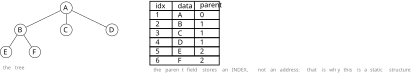

> **图注（双亲表示法）**：左边是那棵树的前 6 个结点；右边是一张**一维数组**（下标 `1..6` 依次存 $A,B,C,D,E,F$），每个结点除了 `data` 只多一个 `parent` 域。$B$ 的父是 $A$，$A$ 在下标 1，所以 $B$ 的 `parent` 写 **1**；根 $A$ 没有双亲，`parent` 写 **0**（写 $-1$ 也可以，**只要全表约定一致**）。**注意存的是下标不是地址**——这正是它"静态结构"的含义。找 $B$ 的双亲是一次数组下标访问，$O(1)$；但找"$A$ 的孩子有哪些"，得**把整张表扫一遍**，看谁的 `parent` 等于 1。

刚才图注最后那句话，就是双亲表示法的**致命短板**，教材 6.4.1 说得非常直白：

> 这种存储结构利用了**每个结点（除根以外）只有惟一的双亲**的性质。`PARENT(T,x)` 操作可以在**常量时间**内实现。反复调用 `PARENT` 操作，直到遇见无双亲的结点时，便找到了树的根，这就是 `ROOT` 操作的执行过程。但是，在这种表示法中，**求结点的孩子时需要遍历整个结构**。

**一个 $O(1)$，换一个 $O(n)$**。这就是双亲表示法的账。

**本节要点**

- **双亲表示法**＝一维数组 + 每个结点一个 `parent` 域（教材 `PTNode{data, parent}`、`PTree{nodes[], r, n}`）。
- `parent` 存的是**下标（索引值），不是指针**——所以它是**静态结构**。
- 根的双亲用**特殊值**表示（0 或 $-1$ 均可，**约定俗成**）；教材另用 `r` 单独记根的位置。
- **账**：`Parent` 是 $O(1)$，`Root` 是"反复取双亲"（深度次），但**求孩子的集合要扫全表 $O(n)$**。
- 适用场合：**只关心"往上走"的运算**（找祖先、找根、判层次）。

### 十四、孩子表示法之一：定长，以「度」为标准开指针 `00:43-00:47`

第二种方案，**孩子表示法**。它的出发点正好和双亲表示法相反：

> 那么自然界当中，实际上我们除了关注父亲，**可能更多的是关注啥？关注孩子**。

为什么？因为**树这个结构的价值就在"往下分"**：家谱要看后代，目录要看子目录，组织架构要看下属。**"往上"只有一条路，"往下"才有信息量。**

但"关注孩子"立刻撞上第十二节那个问题——**孩子个数不定**：

> 那关注孩子的话就有一个问题：我们的孩子怎么样？刚才说的，因为我们树啊，**这个定义子树的个数是不确定的**。它有可能在某个地方，某一个分支**营养不够了，它就立马又冒出一个新的分支**了。所以根据它的这种**动态增长性**，关注孩子节点的话，我们往往用**链接结构**来进行存储——因为你**孩子个数不确定**嘛。

「**营养不够就冒出一个新分支**」这个说法，就是把树的"动态生长"具体化了：**树的结构不是设计时定好的，是运行时长出来的**。所以孩子这部分**天生适合链接**。

不过链接也有两种做法，我先讲**定长**（也叫**多重链表**、同构结点）：

> 但是链接方式的话呢，也有问题，就是**我有可能有两种方式：定长和变长**这两种方式来进行存储。你比如说**定长**这种方式，也就是说**给每一个子树，它的子节点的这个指针，大家都一样多**。大家都一样多，那一样多那就有一个问题：**你必须取子树个数最多的那个节点，以它为标准来进行创建**。

「**以最多的那个为标准**」——那"最多的那个"是什么？我课上现场追问了一句，然后自己接上：

> 也就是说，**子树个数的最大值**，这个玩意儿是啥呀？这玩意儿是啥？我们**上节课刚刚讲过的那个定义**——指数个数的最大值，实际上就是啥？就是叫做**树的度**，大家还记得吧？**树的度那个定义**，指数个数的最大值。

**树的度 = 各结点度的最大值**。教材 6.1 的原话是「**树的度是树内各结点的度的最大值**」。所以定长孩子表示法里的那个 $d$，**就是树的度**。

这一点非常关键，因为**"树的度"这个词在教材里前后出现过两次、含义不同**，后面第三十二节还要专门辨析"度为 $m$ 的树"和"$m$ 叉树"。你们现在先记住：**这里用的"度"是"树的度"，是一个由全树统计出来的数，不是某个结点的度。**

教材 6.4.1 给的两种结点格式长这样（$d$ 就是树的度）：

$$
\boxed{\;\text{data}\;\mid\;\text{child}_1\;\mid\;\text{child}_2\;\mid\;\cdots\;\mid\;\text{child}_d\;}
\qquad
\boxed{\;\text{data}\;\mid\;\text{degree}\;\mid\;\text{child}_1\;\mid\;\cdots\;\mid\;\text{child}_{\overline{d}}\;}
$$

左**定长（同构）**，右**变长（不同构）**。这一节先讲左边。

**定长的好处**，我说得非常实在：

> 那当然这个**定长的这种方式**，好处就是**便于管理**。你比如说我怎么样给大家发下去作业？大家**统一用 A4 纸**来写作业，那你们交上来，大家 A4 纸都是**统一规格**的，那我就比较好管理、比较整齐嘛。

**A4 纸**这个比方太好了，我后面讲变长的时候还要用它。**统一规格 = 好管理**，这是定长的唯一优点，但也是真优点：**结点的结构体只有一种，代码里不用写一堆分支**。

下面这张图把定长与变长两种结点结构摆在一起（下一节再算定长的账）：


> **图注（孩子表示法的两种结点格式）**：上排是**定长（同构）**结点：`data` 后面**固定挂 $d$ 个孩子指针**，$d$ 取**树的度**（全树结点度的最大值，本例为 3）。下排是**变长（不同构）**结点：`data` 后面先放一个 `degree` 域记录**本结点实际有几个孩子**，再跟 $\overline{d}$ 个指针（$\overline{d}$ 是本结点的度）；虚线框表示"个数由 `degree` 决定，各结点长度不等"。**教材 6.4.1 的两种结点格式就是这两排。**

**本节要点**

- **孩子表示法的动机**：树的价值在"往下分"，所以"关注孩子"比"关注双亲"更常见。
- 但**孩子个数不定**（树会动态生长），所以孩子部分**只能用链接**。
- 链接有两种：**定长（同构，多重链表）**与**变长（不同构）**。
- **定长的 $d$ = 树的度 = 全树各结点度的最大值**（教材 6.1 定义），**不是某个结点的度**。
- 定长的唯一优点是**便于管理**（统一 A4 纸、结构体只有一种），缺点是废空间——下一节算账。

### 十五、定长的两笔账：二十多个孩子与十三亿人 `00:47-00:51`

定长的毛病，我课上是用**两个互相独立的例子**说的，而且两个例子的**浪费量级完全不同**——一个浪费几十倍，一个浪费到荒诞。

**第一笔账：家族问题。**

> 那但是问题是这个定长方式，有个比较**致命的缺陷**就是啥？**有可能导致大量空间浪费**。为啥呢？你比如说我们拿这个树来进行**研究家族问题**。家族问题，**每一个家庭，他有个孩子数目**。

关键在于**孩子数目的分布极不均匀**：

> 那么咱们国家可能因为大家知道我们国家**计划生育**了，那你有的孩子数目可能是什么？两三个、七八个都可能，但是**很少有孩子数目很多**的。但是那我们进行了计划生育了，那**人家美国**怎么样？美国他们**没有计划生育**，他们愿意生多少个生多少个。那这就有个问题——曾经有个报纸就报道**一对夫妇总共生了 20 多个孩子**，而且这 20 多个**还是亲生的**。

于是：

> 那你想一下，如果你用**定长**这种方式，**每一个节点、每一个家庭，你用 20 多个指针**——那你想一下，**大部分的家庭又达不到那么多个孩子**，所以就造成啥？**空间浪费**。

这笔账是可以算的。设树的度为 $d$（本例 $d=20$），结点数为 $n$，每个结点的孩子指针域有 $d$ 个，其中**实际用上的**等于该结点的度。于是**空指针域的个数**是

$$
\sum_{i=1}^{n}\big(d-\text{degree}(i)\big)\;=\;nd-\sum_{i=1}^{n}\text{degree}(i).
$$

而一棵 $n$ 个结点的树，**除根以外每个结点恰好被一个指针指着**，所以

$$
\sum_{i=1}^{n}\text{degree}(i)=n-1 .
$$

代入得

$$
\text{空链域数}=nd-(n-1)=\;n(d-1)+1 .
$$

**这个 $n(d-1)+1$ 就是教材 6.4.1 里那个式子**：

> 不难推出，在一棵有 $n$ 个结点、度为 $k$ 的树中必有 $n(k-1)+1$ 个空链域。

代入 $n=10$、$d=20$：空链域 $=10\times19+1=191$ 个，**真正用上的只有 $n-1=9$ 个**——**有用率不到 5%**。这就是"大量空间浪费"的定量版。

**第二笔账：认识关系。**

> 那还有一个问题，如果说我这个**子树的个数**，我是用来反映什么呢？**认识关系**——大家知道认识关系以及**被认识关系**。那你想一下，**被认识关系，就是说我有多少个人认识我**。那大家想一下，我们要取这个什么？**最大值**。那你想一下，习近平主席，**全国 13 亿人全都认识他**——那你想一下，**每一个节点带着 13 亿个指针**，那还得了？

这个例子在量级上比第一个荒谬得多，但它点出的道理是同一个：**只要"度"这个最大值是极端值，定长就把极端值摊到了所有结点身上。**

**而"取最大值"这件事，是定长方案的宿命**，因为它必须**用一种结点结构**覆盖**所有**结点。我课上那句话说得很好：

> 所以**定长这种方式，大部分情况下会造成大量空间的浪费**。

这里我要补一句方法上的话，课上没明说，但你们该想到：**"以最大值定长"是设计模式里最常见的一种"用空间换简单"**。它的适用前提是**最大值不太离谱、且分布比较均匀**。一旦分布长尾（少数极大、多数很小），定长就一定亏。**这不只是数据结构的事，是所有"统一规格"设计的共同代价。**

下面这张图把两笔账画在一起，你们看着量级差距就明白了：

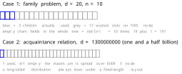

> **图注（定长方案的浪费）**：上排用 20 个格子表示定长的 20 个孩子指针域，蓝色是实际用上的 3 个，灰色是空的 17 个——**每个结点都要带 20 个格子**，代入 $n(d-1)+1$ 得 **191 个空链域**，而真正有用的指针只有 $n-1=9$ 个。下排把"认识关系"里 $d=13$ 亿的情形画成同一种示意图（格子只是示意，画不完），说明**"以最大值定长"在长尾分布下必然崩掉**。

**本节要点**

- 定长的**致命缺陷**：**大量空间浪费**，因为**极端值被摊到了所有结点上**。
- 两个例子：**家族（$d=20$，一对夫妇 20 多个孩子）**、**认识关系（$d=13$ 亿）**——浪费量级从"几十倍"到"荒诞"。
- **空链域公式**：$\sum\big(d-\text{degree}(i)\big)=nd-(n-1)=n(d-1)+1$（教材 6.4.1 写作 $n(k-1)+1$，$k$ 即树的度）。
- **"以最大值定长"是通用的"用空间换简单"**，前提是最大值不离谱、分布够均匀；**长尾分布下必然亏**。

### 十六、孩子表示法之二：变长，省空间但不好管 `00:51-00:54`

**定长亏了空间，那就变长。** 变长的思路一句话：

> 那我们不浪费咋办？**变长**呗。**你需要、你有几个孩子，我给你几个指针**给你指出来。那当然**具体你有多少个孩子呢？前面有一个 `degree` 就是度**——有 5 个孩子，这个 `degree` 写个 5；那么有 8 个孩子，这个地方写个 8。

**"数据 + 度 + 按度开指针"**。教材 6.4.1 的说法是：

> 若采用第二种结点格式，则多重链表中的结点是**不同构**的，其中 $\overline{d}$ 为**结点的度**，`degree` 域的值同 $\overline{d}$。此时，虽能**节约存储空间**，但**操作不方便**。

注意教材这里的记号：**$d$ 是树的度，$\overline{d}$ 是结点的度**。这两个符号长得像，你们抄笔记的时候别抄错——**一个是全树的最大值，一个是这个结点自己的实际值**。

变长的好处我承认得很干脆：

> 那么当然**变长这种方式**，它**省空间**。

但坏处也立刻来了，而且这个坏处**不是空间上的，是管理上的**：

> 但是它也有一个问题——**它就不便于管理**。那大家想一下，就好比我发了一些作业让大家写，那大家**交上来的作业，那个纸张大大小小**，那我**拿回去就不方便**，大大小小一摞子就**不好管理**。

**还是那张作业纸，但这次是不统一的。** 上一节我用"统一 A4"夸定长，这里用"大大小小一摞"贬变长——**同一个比方，两头都成立**，这就是好例子的用处。

"不好管理"落到程序上到底是什么？我紧跟着就说了：

> 那同样的反映到我们**编程上面**了，那大家想一下，你定义那个**结构体**的时候就要定义啥？**有一个孩子节点的这种结构体、有 3 个孩子节点的结构体、有 10 个孩子节点的结构体**——那你管理起来就**非常的难**。

这句话是本节的枢纽。**变长的真正代价是"结点类型不唯一"**：你没法用一个 `struct` 覆盖所有结点，得按不同的度写不同的类型，或者用"柔性数组"（C99 的 `struct { T data; int degree; T child[]; }`）这类技巧。而**柔性数组那套东西，本质上还是"一个结点一块独立的内存"，已经退化成链式了**。

教材的结论和我一模一样：

> 此时，虽能节约存储空间，但**操作不方便**。

于是形成了一对**对称的取舍**：

| | 空间 | 管理（代码复杂度） | 典型隐喻 |
|---|---|---|---|
| **定长** | **浪费**（$n(d-1)+1$ 个空链域） | **好**（一种结构体） | 统一 A4 纸 |
| **变长** | **省**（按实际度开） | **难**（多种结构体） | 大小不一的作业纸 |

**定长和变长各有优缺点。** 那就有下一个问题了——**能不能两头都占**？

> 我们说定长和变长各有优缺点吧？那**各有优缺点的话，那我能不能取这两种方式的长处而避开它的短处呢**？

我课上给的第一个反应是"**乍一看应该是不行**"，理由很硬：

> 因为我们现在**处理这个孩子的方式**是干什么呢？**把所有的孩子作为一个整体，捆绑到一起来进行管理**。那所以这种方式的话呢，你就**没有办法改进**。

**"捆在一起"**这三个字点中了要害：定长和变长，**都把孩子当成"一个整体的一块"**（一块定长的、或一块变长的）。**只要还捆在一起，就只能在"块多大"上做文章，逃不出那个取舍。**

要破这个局，只能**换思路**——**别捆了，拆开**。这就是下一节的孩子链表。

**本节要点**

- **变长**＝`data | degree | child[1..degree]`；教材记号 $\overline{d}$ 是**结点的度**，注意与树的度 $d$ 区分。
- 变长的优点是**省空间**，代价是**不便于管理**——落到代码上就是**结点类型不唯一**（要定义一堆不同度的结构体）。
- **定长与变长是一对对称取舍**：定长"费空间、好管理"（统一 A4 纸），变长"省空间、难管理"（大小不一的作业纸）。
- 两者都**逃不出取舍**，因为**都把结点所有的孩子捆成一个整体**；要突破只能**换思路——拆开**。

### 十七、孩子链表：把「整体」拆成「逐个」 `00:54-00:58`

上一节卡在"捆在一起就改不动"。这一节的破法就一个字：**拆**。

> 那你**换个思路**——换个思路就干什么呢？说我对孩子的管理啊，**你不要捆绑到一起嘛，我从中间怎么样？我从中间断开**。断开，**每个孩子的管理松散一些**，我**不把它看成一个整体**，而是怎么样？**每个节点的孩子，我分开独立地表示**。

**"分开独立地表示"**——每个孩子**自己占一个结点**，不再挤在父结点里。于是：

> 那然后怎么样？**我建立一个兄弟链**，然后我们来进行管理。

**兄弟链**这个词是课上的说法，教材管它叫**孩子链表**（6.4.1 第 2 小节）。它的做法是：

> 另一种办法是把每个结点的**孩子结点排列起来，看成是一个线性表**，且**以单链表作存储结构**，则 $n$ 个结点有 $n$ 个孩子链表（**叶子的孩子链表为空表**）。而 $n$ 个头指针又组成一个线性表，为了便于查找，**可采用顺序存储结构**。

我课上把这个过程**边画边讲**了一遍，讲的是那棵树：

> 你看我们用**链接形式**：$A$ 怎么样？**第一个节点，他只有一个孩子**（指某个具体位置）；然后第二层的话，第二层有 3 个孩子——**我们有几个孩子，给他申请多少个节点空间**。这是不是就相当于**松散式的管理**？**我不把它看成一个整体了，我把它断开来**。然后第三层怎么样？只有一个孩子。好了，那**每一层有一个兄弟链把它链起来**。

这里要注意"**有几个孩子就申请多少个结点空间**"这句话——**这才是"变长"的正解**：不是"变长的结构体"，而是"**定长的结点，按需申请若干个**"。**用链式把"变长"实现掉了**，而每个结点本身仍然是定长的、同构的。这就是"取长补短"的技术路径：**定长的结点 + 变长的链**。

教材的数据结构是：

```c
// - - - - - 树的孩子链表存储表示 - - - - -
typedef struct CTNode {      // 孩子结点
    int child;
    struct CTNode *next;
} *ChildPtr;
typedef struct {
    TElemType data;
    ChildPtr firstchild;     // 孩子链表头指针
} CTBox;
typedef struct {
    CTBox nodes[MAX_TREE_SIZE];
    int n, r;                // 结点数和根的位置
} CTree;
```

请注意这套结构里**有三个东西**，别只看到一个：

1. **`CTBox` 数组**——$n$ 个"表头"，每个表头是 `data + firstchild`。这是**顺序结构**。
2. **`CTNode` 链**——每个表头拖一条链表，链上的每个结点存 `child`（孩子的**下标**）和 `next`。这是**链接结构**。
3. **`int n, r`**——结点数和根的位置。

**"顺序的表头 + 链接的孩子"**，这正是第十二节那个"搭积木"心法的第一次现身：**顺序和链接组合起来，就得到了一个既省空间又好找孩子的新结构**。

下面这张图就是它：

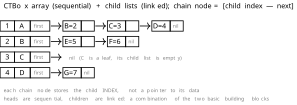

> **图注（孩子链表）**：左边是**顺序存储的 `CTBox` 数组**（下标 1..4 存 $A,B,C,D$，每格后跟一个 `firstchild` 指针）；右边是**每个结点的孩子单链表**，链上的 `CTNode` 存 `child`（孩子的**下标**）与 `next`。$A$ 的孩子链是 $B\to C\to D$（下标 2、3、4）；$B$ 的是 $E\to F$（5、6）；$C$ 是叶子，链空；$D$ 的是 $G$（7）。**表头是顺序的，孩子是链接的**——这就是"顺序 + 链接"的组合，也是"定长结点 + 变长链"实现变长的办法。

教材对它的评价是:

> 与双亲表示法相反，**孩子表示法便于那些涉及孩子的操作的实现，却不适用于 `PARENT(T,x)` 操作**。

**正好把上一节那个账反过来了**：双亲表示法找双亲 $O(1)$、找孩子 $O(n)$；孩子链表找孩子 $O(\deg)$（顺着链走）、**找双亲要扫全表**。**一个结构的优点，恰好是另一个结构的缺点**——这不是巧合，是"信息存在哪儿"的必然结果。

教材接着给了一个"和稀泥"的解法：

> 我们可以把**双亲表示法和孩子表示法结合起来**，即将**双亲表示和孩子链表合在一起**。

也就是在每个 `CTBox` 里再加一个 `parent` 域。这样**找双亲 $O(1)$、找孩子 $O(\deg)$**，两个方向都好走了——**代价是每个表头多一个 `int`**。这笔交易划不划算？**如果两个方向的运算都频繁，就划算**；如果只用一个方向，就是浪费。**又回到"存储跟着运算走"**。

**本节要点**

- **破局思路**：不把结点所有孩子"捆成一块"，而是**每个孩子独立一个结点**、用**兄弟链**串起来。
- 实现要点：**定长的结点 + 按需申请的个数**——用链式把"变长"做掉，每个结点仍是同构的。
- 教材结构 `CTree{ CTBox nodes[]; n, r }`，`CTBox{data, firstchild}` + `CTNode{child, next}`：**表头顺序、孩子链接**。
- **账正好反过来**：找孩子 $O(\deg)$，**找双亲要扫全表**；教材给的改进是**每个表头再加 `parent` 域**（双亲 + 孩子链表结合），两个方向都 $O(1)$／$O(\deg)$，代价是每个表头多一个 `int`。

### 十八、$n$ 个表头指针，这 $n$ 个东西怎么管 `00:58-01:01`

孩子链表一建起来，立刻冒出一个新问题。我课上把它问得很急：

> 那问题是，**这 $n$ 层每一层有一个链表，每一个链表它有个表头指针，那这个表头指针又咋管理呢**？$n$ 个表头指针咋管理？**又回到原来的那个问题**，对吧？

「**又回到原来的那个问题**」——这句话是这一节最有意思的地方。**原来的那个问题**就是第十二节那个问题：**一堆东西怎么存**。你为了解决"孩子怎么存"，造出了"一堆孩子链表"；结果**这堆链表的表头，本身又成了"一堆东西"**，又得存。

这就是**递归式的追问**：每一步的解法都会生出新的待解问题。**但这次好办了**，因为我课上马上给了判据：

> 这 $n$ 个表头指针咋看待它、咋管理它呀？**它是怎么样？相同属性的事物**——大家都是**指向一个链表的表头**。所以把它看成啥？**抽象成啥？线性表**。

**"相同属性的事物"**——这句话是**抽象**的定义。$n$ 个表头指针，**类型一样、作用一样**（都指向一条孩子链），所以它们**构成一个线性表**。而线性表怎么存？**前面几章学过的两套**：

> 那对于这个表头指针的管理，我们**可以用链接方式，也可以用向量**。那我现在**用向量的方式来管理**，也就是说用一个数组给它管理起来——那当然这是一个**指针数组**了。它的表头是**指针数组**。

**指针数组**——就这四个字。`CTBox nodes[MAX_TREE_SIZE]` 里那个 `nodes`，**就是一个数组，每个元素里含一个指针**。所以孩子链表里那个"表头数组"，**本质上是"用向量管理一组指针"**。

这里有个小结论值得单独记下来，因为它在整门课里反复出现：

> **当你要管理"一堆同类型的东西"时，先把它抽象成线性表，再用"向量 or 链接"二选一。**

这句话你们在后面会遇到无数次：$n$ 个孩子链表表头、稀疏矩阵里的 $N$ 个行链表表头（第七周第一节讲过，十字链表把 $2N$ 个表头并成 $N$ 个）、图的邻接表里 $n$ 个顶点表头、字符串里的 `next` 数组——**全是同一招**。

然后我补了一个很实用的细节，这个细节**是孩子链表相比"纯孩子表示法"的额外好处**：

> 那如果我要知道说，**那你这每一层有一个兄弟链，那这些个孩子到底是谁的孩子呢**？到底谁的孩子呀？那**我们往往在表头这个地方，把它的父亲节点的信息也给它反映出来，存储到表头里面**。那么这样子的话呢，是我们**变形的这种方式，用的比较多**。

**在表头里再存一份"双亲"** ——这就是教材说的"双亲表示法和孩子表示法结合"，但教材是从"补上 `PARENT` 操作"的角度讲的，我课上是从"**回答'这是谁的孩子'**"的角度讲的。**两个角度是同一件事**：你不存双亲，看到一条链上的三个结点，你就不知道它们属于谁。

那为什么这一招"用得比较多"？因为**它把两个方向的运算都救回来了，而代价极小**：每个表头多一个 `int`（存下标），换来的却是**"往上"也能 $O(1)$**。这就是为什么工程上常见的树存储（比如并查集的父指针数组、某些编译器符号表的树）都会**同时存父和孩子**。

**本节要点**

- 孩子链表建好后，**$n$ 个表头指针本身又成了"一堆东西"**——这是"存储一切皆需存储"的递归追问。
- 破法：**表头指针属性相同、作用相同 → 抽象成线性表 → 用向量（指针数组）或链接管理**。教材用**指针数组**。
- 一条贯穿全课的方法论：**管理一堆同类型的东西，先抽象成线性表，再在"向量／链接"里二选一**。
- **实用改进**：在表头里**再存一份双亲信息**，这样"这是谁的孩子"有了答案，"往上"也回到 $O(1)$——这就是教材说的"双亲 + 孩子链表结合"，**工程上用得多**。

### 十九、孩子兄弟表示法：`firstchild` 与 `nextsibling` `01:01-01:05`

第四种方案，也是这一节**最重要的一种**，因为它是**树与二叉树之间的桥**。教材 6.4.1 第 3 小节：

> 又称**二叉树表示法**，或**二叉链表表示法**。即以二叉链表作树的存储结构。链表中结点的两个链域分别指向该结点的**第一个孩子结点**和**下一个兄弟结点**，分别命名为 `firstchild` 域和 `nextsibling` 域。

```c
// ---- 树的二叉链表(孩子-兄弟)存储表示 ----
typedef struct CSNode {
    ElemType data;
    struct CSNode *firstchild, *nextsibling;
} CSNode, *CSTree;
```

**只有两个指针**：一个指**第一个孩子**，一个指**下一个兄弟**。就这两个，一棵任意度的树就存下来了。

我课上是这么过渡过去的——先说前两种方案的账，再把它们"综合"起来：

> 那好了，那我们前面讲的**双亲表示法**，我们关注父亲。**孩子表示法**呢，这个怎么样？**孩子链很容易得到，但是父亲怎么样？不容易得到**。那我**能不能综合一下**？哎，**综合一下就是孩子兄弟表示法**。

**"孩子容易、父亲不容易 → 综合"** ——这是表面上的动机。但真正让这个结构成立的，是**一个更巧的观察**：

> 那我们关注比较的时候，往往会去比较**同辈的节点**。比如说，我去关注我的**兄弟节点**——他怎么样？他优不优秀？是不是比我优秀？那**我也会关注我的孩子节点**。那我就用**一个指针指向你的第一棵子树**，把你的孩子**穿起来**。

关键在于**"兄弟"这个关系是可以串成链的**：你有 $k$ 个孩子，那么"第一个孩子"是**入口**，第 2、3、$\cdots$、$k$ 个孩子全是**第一个孩子的兄弟**。所以：

- **`firstchild`**：从父结点**往下**走一步，进入"我的孩子们"这条链的**表头**。
- **`nextsibling`**：在同一条链上**横着**走一步，到"我的下一个兄弟"。

**用"往下"和"横着"两个方向，就把"一对多"拆成了"两条单向链"。** 这就是它能用两个指针存下任意度数的原因——**不是把 $k$ 个孩子并列存，而是把它们串成一条链，只记链头。**

教材对它的评价是：

> 利用这种存储结构**便于实现各种树的操作**。首先易于实现找结点孩子等的操作。例如：若要访问结点 $x$ 的第 $i$ 个孩子，则只要**先从 `firstchild` 域找到第 1 个孩子结点，然后沿着孩子结点的 `nextsibling` 域连续走 $i-1$ 步**，便可找到 $x$ 的第 $i$ 个孩子。当然，如果为每个结点**增设一个 `PARENT` 域**，则同样能方便地实现 `PARENT(T,x)` 操作。

「**走 $i-1$ 步**」这句话回答了第九节留下的那个问题（教材为什么只给 `LeftChild` 和 `RightSibling`，不给"第 $i$ 个孩子"）：**"第 $i$ 个孩子"不是一次寻址，是一次"链上行走"**。

我课上用了一个具体的小例子说明"一拽就全出来"：

> 比如说我问你 **5 号节点他孩子在哪儿呢？孩子是谁呀**？很简单，我们**沿着 5 号节点的那个孩子链**——**第一棵子树**——**拉着这个链条一拽，这三个节点全都出来了**，所有的孩子就都有了。

「**一拽就出来**」这个说法很传神：**知道链头，整条链就都拿到了**。

下面这张图把同一棵树和它的孩子兄弟链表摆在一起：

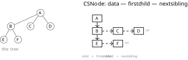

> **图注（孩子兄弟表示法／二叉链表）**：左边是那棵树；右边是它的孩子兄弟链表，**每个结点只有两个指针**。**实线箭头 = `firstchild`**（$A\to B$，$B\to E$），**虚线箭头 = `nextsibling`**（$B\to C\to D$、$E\to F$）。$A$ 只有一个孩子 $B$，所以 $B$ 没有兄弟，$A$ 的 `nextsibling` 为空；$C$ 的孩子链为空、$D$ 的也为空。**看到"往下"就是父子，看到"横着"就是兄弟**——一棵任意度的树，用二叉链表就存完了。

**这里必须提前埋一个伏笔**（下一章会正式讲）：既然一棵树能用二叉链表存，而二叉树也是用二叉链表存，那么**"树转二叉树"就根本不需要搬数据**——**同一份物理结构，换个解释方式而已**。教材 6.4.2 开头说的就是这个：

> 由于二叉树和树都可用二叉链表作为存储结构，则**以二叉链表作为媒介可导出树与二叉树之间的一个对应关系**。也就是说，给定一棵树，可以找到**惟一的一棵二叉树**与之对应，从**物理结构来看，它们的二叉链表是相同的，只是解释不同而已**。

**"物理结构相同，只是解释不同"**——这句话是全章最漂亮的一句。它解释了为什么这一节要花这么大力气讲孩子兄弟表示法：**它不只是"一种树的存储方案"，它是"树与二叉树之间的转换通道"**。

**本节要点**

- **孩子兄弟表示法**＝二叉链表：`CSNode{data, firstchild, nextsibling}`，**只有两个指针**存任意度数的树。
- **两个方向**：`firstchild` 往下（父子），`nextsibling` 横着（兄弟）；**$k$ 个孩子串成一条链，只记链头**。
- **取第 $i$ 个孩子**＝`firstchild` 走 1 步后，沿 `nextsibling` 走 $i-1$ 步——这就是教材不给 `Child(T,x,i)` 的原因。
- **可增设 `PARENT` 域**把"找双亲"也救回来。
- **最重要的伏笔**：树和二叉树**都用二叉链表**，所以**树转二叉树是"同一物理结构、换解释"**（教材 6.4.2）。

### 二十、为什么这么设计：同辈比较与「母以子为贵」 `01:05-01:09`

这一节看着像闲话，其实是我在给"孩子兄弟表示法"找**现实依据**——**为什么"往下 + 横着"这两个方向是自然的？**

我先从**本专业**切进去：

> 我们说咱们这个专业呀，实际上**不好搞**。咱们这个专业，我再三说，你**不光要有计算机的专业知识，你还需要掌握别的一些知识**，比如说**美学**呀，或者说**心理学**。因为我们这个专业，在分析、设计软件的时候，你是**给人家设计软件**的，你就需要去**调研这个软件有什么需求**。那你调研这个需求的过程当中，实际上你就要**跟人打交道**。跟人打交道，那必然就涉及到**心理学的问题**。

这段是从"软件工程要调研需求"推到"要懂人"，再推到"人和人怎么比"。**这个转折其实是在给"兄弟比较"铺路**：

> 我们经常说，**人比人气死人**。那么人比人气死人，要劝人说你不要去比。那么**人进行比较的时候，你会怎么比较呢**？

我举了一个**师门**的例子，这个例子是本节的核心：

> 我们现实生活中，比如说 $A$ 怎么样？**有 3 个孩子，$A$ 收了 3 个徒弟 $B,C,D$**。那你想一下，**从 $C$ 它的角度来出发**，它如果做比较，**他会怎么比较**？

答案是**三个方向，逐一排除**：

> 我们说他**不会去和 $A$ 比**，为啥呢？**人家 $A$ 是我的师傅呀**，他比我厉害**应该的**。那么这个 $C$ 怎么样**也不去看 $B$ 来和 $B$ 比较**，为啥呢？**人家 $B$ 是我师兄**，他怎么样**比我先入门**，那他比我厉害，那也是**应该的**——人家**待的时间长**嘛。

于是只剩一个方向：

> 那所以这个 $C$ 往往他比较会去看谁？**看同门师弟**。

我再把"为什么"说透：

> 如果说从心理学的角度，**如果这个 $D$ 比 $C$ 厉害**，那么这个**心态不太好**的 $C$，如果他不太好，我们说他就有可能**很难受**。为啥呢？他**一想你比我入门还晚，结果你还比我厉害**，那就会造成什么？**心理不平衡**。

然后是第二个方向——**往下看**：

> 那当然我们还会去干什么呢？**关注孩子**。我们中国有句古话叫啥？叫**子以母为贵，母以子为贵**——**母以子为贵**。那你想一下，如果这个 $D$ 还有一个，**他收了一个徒弟 $F$**，那如果说这个 $F$ 比 $C$ 还要强，那这个 $C$ 怎么样？**心态更扭曲了**——你都是我的**孙子辈**了，结果**你怎么还比我厉害呢**？

我把这个结论推到"崩溃"：

> 所以这个**心态不太好的人有可能就会崩溃**。

**这一段为什么值得写进讲义？** 因为它把"孩子兄弟表示法"的两个指针解释成了**两种社会比较**：

- **`nextsibling`（横向）对应用"同辈比较"**——师弟比师兄强，让人不平衡；所以人会**盯着同辈**。
- **`firstchild`（纵向）对应用"母以子为贵"**——孩子强，是荣耀；所以人会**盯着孩子**。

我课上把这两条直接映射到了存储上：

> 所以我们关注比较的时候，往往会去比较**同辈的节点**。比如说我去关注我的**兄弟节点**——他优不优秀？是不是比我优秀？那我**也会关注我的孩子节点**。那我就用**一个指针指向你的第一棵子树**，把你的孩子穿起来。

再回到那个具体的编号例子，这一段是"结构照进现实"的点睛：

> 比如说**8 号节点**，他**不会说去关心 7 号节点**，因为人家是**师兄**，对吧？他会往往**去关注 9 号节点**——**9 号节点是他的师弟**：**我来看一下你是不是比我厉害**。

**8 号关心 9 号（师弟），不关心 7 号（师兄）**——这就是 `nextsibling` 指向"下一个"而不是"上一个"的现实理由。**顺着兄弟链往后走，走的正是"我该比较的那些人"。**

我课上给这一段的结论很轻，但其实很重：

> 所以这个实际上这种设计啊，也**来源于现实生活**。

我在讲义里想把它讲得更硬一点：**一个存储结构能不能被记住、能不能被"想出来"，往往取决于它有没有一个自然的现实原型。** 孩子兄弟表示法之所以好记，是因为它把"往下看孩子、横着看同辈"这个人人都会做的动作，直接变成了两个指针。

**本节要点**

- 孩子兄弟表示法的两个指针，对应**两种自然的比较方向**：**横向 `nextsibling`（同辈／师兄弟）**、**纵向 `firstchild`（孩子／母以子为贵）**。
- 心理学例子：$A$ 收 $B,C,D$ 三个徒弟，$C$ **不比师傅 $A$**（该的）、**不比师兄 $B$**（先入门、该的），**只盯师弟 $D$**——所以"顺着兄弟链往后走"正是人真实的比较方向。
- 由此，"8 号关心 9 号（师弟）而不关心 7 号（师兄）"就是 `nextsibling` 往后指的现实理由。
- **结论：好的存储结构往往有现实原型**；这也呼应 6.4.1「便于实现各种树的操作」的设计动机。

### 二十一、树不讲了，账先结清：四种存储方案对照 `01:09-01:11`

树的存储到此讲完。我课上的收尾是这样的：

> 所以我们这是**孩子兄弟表示法**。孩子兄弟表示法好，那这是我们说的这个——**这很容易捕获兄弟和孩子节点**。那**整个树的这个存储我们就讲这么多**，当然**运算我们不讲**。我们再三说，我们实际上**这一章重点还是研究二叉树这个模型**。

「**运算我们不讲，重点还是二叉树**」——这句话是本节的分界线。所以树这一块，**只把"存储"讲透、把"运算"点到**。我把四种方案的账集中结在这儿：

| 方案 | 物理形态 | 找双亲 | 找孩子 | 取第 $i$ 个孩子 | 空间 | 性质 |
|---|---|---|---|---|---|---|
| **双亲表示法** | 数组 + `parent` 下标 | $O(1)$ | $O(n)$（扫全表） | $O(n)$ | 最省（每结点一个 `int`） | **静态** |
| **定长孩子（多重链表）** | 数组或链，每结点固定 $d$ 个指针 | $O(n)$ | $O(d)$ | $O(1)$ | 浪费 $n(d-1)+1$ 个空链域 | 半静态 |
| **变长孩子** | 每结点 $1+d_i$ 个指针 | $O(n)$ | $O(d_i)$ | $O(1)$ | 省 | 结点不同构，难管 |
| **孩子链表** | 表头数组 + 孩子单链 | $O(n)$（加 `parent` 域则 $O(1)$） | $O(d_i)$ | $O(d_i)$ | 省 | 顺序＋链接组合 |
| **孩子兄弟（二叉链表）** | 二叉链表 | $O(n)$（加 `PARENT` 域则 $O(1)$） | $O(d_i)$ | $O(d_i)$ 步 | 最省指针 | **动态**，且能转二叉树 |

这张表你们可以照着**做题**：题目问"哪种结构找双亲最快"→双亲表示法；"哪种最省空间又能动态增长"→孩子兄弟；"既要找孩子又要找双亲"→孩子链表加 `parent`，或孩子兄弟加 `PARENT`。

我把这四种方案背后的"设计动作"总结成三步，这三步是这一大段的**方法论**：

1. **先问"我主要用哪个方向"**——往上（双亲）还是往下（孩子）。**方向决定方案。**
2. **再问"这一堆东西能不能用一块定长的空间装下"**——能就向量，不能就链接，或者**表头用向量、内容用链接**。
3. **最后看"能不能加一个域把另一个方向救回来"**——`parent` 域、`PARENT` 域，都是这个思路。**加一个 `int`／一个指针，换一个 $O(n)$ 变 $O(1)$，通常很划算。**

**本节要点**

- 树的运算**不在本节深入**，本节重点落在**存储**；这一章真正的主角是**二叉树**。
- 四种方案（双亲／定长孩子／变长孩子／孩子链表／孩子兄弟）的**账**见上表：**双亲 $O(1)$ 换孩子 $O(n)$**，孩子方案反之；**孩子兄弟最省指针且能动态增长**。
- **设计三步**：①先定主用方向；②判断能否定长装下（向量／链接／表头向量+内容链接）；③用**附加一个域**把另一方向救回来（`parent`／`PARENT`）。

### 二十二、二叉树的定义：一个递归定义 `01:11-01:14`

树讲完，正式进二叉树。我先给了定义，而且只给了一句，然后立刻转去"挑错"——**因为二叉树的定义最好背，但最容易被理解错**。

> 那啥是二叉树呢？我们给个定义：**二叉树 $T$ 是满足一定性质的结点为有限集合**。$T$ 是空集，也就说**可以是空二叉树**；或者它包含**一个根节点**，其余节点**分成两个不相交的集合**，分别称为根的**左子树**和**右子树**。当然，它是一个**递归定义**——左子树怎么样**又是一棵二叉树**，右子树也是一棵二叉树。

我课上那句"满足一定性质"是口误式省略，教材 6.2.1 的完整版是：

> **二叉树（Binary Tree）是另一种树型结构**，它的特点是**每个结点至多只有两棵子树**（即二叉树中不存在度大于 2 的结点），并且**二叉树的子树有左右之分，其次序不能任意颠倒**。

教材接着用 ADT 形式给了递归定义，核心是四条：

1. 若 $D=\Phi$，则 $R=\Phi$，称 **空二叉树**；
2. 若 $D\neq\Phi$，则存在**惟一的根** root，它在关系 $H$ 下**无前驱**；
3. $D-\{\text{root}\}$ 被分成**两个不相交的集合** $D_l$ 与 $D_r$（左、右），各自有惟一的 $x_l,x_r$ 满足 $<\text{root},x_l>,<\text{root},x_r>\in H$；
4. **$(D_l,\{H_l\})$ 与 $(D_r,\{H_r\})$ 各自又是一棵符合本定义的二叉树**，分别称为根的**左子树**与**右子树**。

**第 4 条就是"递归"所在**：定义里用到了"二叉树"这个词本身。所以二叉树的定义是一个**归纳定义**：

> **基础**：空集是二叉树。
> **归纳**：若 $T_l,T_r$ 是二叉树，则 $\{\text{root}\}\cup T_l\cup T_r$（$T_l\cap T_r=\Phi$）是二叉树。
> **极小性**：二叉树只能由有限次使用上面两条得到。

**归纳定义意味着"证明也得用归纳"**。这一点很重要——后面性质 1（第 $i$ 层至多 $2^{i-1}$）教材就是用归纳法证的。你们做证明题的时候，看到"二叉树的定义"，第一反应就该是"**对结点数／层数做归纳**"。

我课上给定义的时候，特意强调了两个词，这两个词就是后面所有辨析的根：

- **"可以是空"**——$T$ 可为空集。**这是二叉树与树（教材口径下非空）的第一个形式差别。**
- **"两个不相交的集合"**——**有序**、**不交**、**最多两个**。

我把这两个词记在这儿，是因为接下来三节我要用它们去**打三个错误命题**。这三个命题你们在选择题里一定见过：

> 命题 A：**二叉树是度不超过 2 的树。**
> 命题 B：**二叉树是度不超过 2 的有序树。**
> 命题 C：**若规定树可以空，则二叉树就是度为 2（或度不超过 2）的树。**

我在课上的态度非常明确，而且是**先给结论、再给理由**：

> 那么有了这个定义之后呢，大家就要关注一下。因为树是一种模型、二叉树是一种模型，有的人就会说——你判断二叉树，比如说他说是什么呢？**度不超过 2 的树**；或者说**二叉树是度不超过 2 的有序树**。那么这一系列的这种观点啊，**你一定要记住，你要立场坚定**：**所有的这种论证都不成立，都是错的**。

「**立场坚定**」这四个字我用了很重的语气，因为**这几个命题错得"很讲道理"**——它们表面上完全对得上二叉树的两个特征（度 ≤ 2、有左右），所以特别容易被接受。**判断一个定义对不对，不是看它"像不像"，是看它"能不能反推出全部"。**

**本节要点**

- 二叉树是**递归（归纳）定义**：**空集是二叉树**；或由**根 + 两棵互不相交的左、右子树**组成，且**左、右子树各自又是二叉树**。
- 教材 6.2.1 的两个特征：**每个结点至多两棵子树**（不存在度 $>2$ 的结点）、**子树有左右之分且次序不能颠倒**。
- 归纳定义 ⇒ **证明要用归纳**（性质 1 就是这么证的）。
- 三个待打的错误命题：**A 度不超过 2 的树、B 度不超过 2 的有序树、C 规定树可空后的度为 2 的树**——**全都错**。

### 二十三、反驳一：二叉树不是「度不超过 2 的树」 `01:14-01:17`

**命题 A：二叉树是度不超过 2 的树。** 这个命题错在哪儿？

我课上是从"树这个概念里有两个不确定"切进去的：

> 我们前面讲过**树**。首先从概念这个角度，我们说**树有两个弊端在里面**：它这个概念，一个是啥？**子树的个数怎么样，不确定**；另外一个是啥？**子树的次序，怎么样也没规定**。

**"两个不确定"**——这是本节最重要的一句话，请把它当成"树"这个名字的定义性特征记下来：

$$
\text{树}=\underbrace{\text{子树个数不确定}}_{\text{所以树会动态生长}}+\underbrace{\text{子树次序不确定}}_{\text{所以树是无序的}}
$$

现在把树的这两个特征和二叉树对一下：

| | 子树个数 | 子树次序 |
|---|---|---|
| **一般树** | **不确定**（$0$ 到 $m$） | **不确定**（无序树；有序树另作规定） |
| **二叉树** | **至多 2**（可以为 0、1、2） | **确定**（左、右固定） |

看第一行第一列：**树的"不确定"里包含了二叉树的"至多 2"**——所以在"个数"这一条上，二叉树**确实是**树的一个子情形。**这就是命题 A 看上去成立的原因**：它在"个数"这个维度上没错。

**但它漏掉了"次序"这一维。** 而"次序"恰恰是二叉树区别于树的地方。所以命题 A 的错法是：**只对齐了两个维度里的一个**。

第二个错处在**"空"**。我课上预判了学生的反驳，并且**先把这个反驳堵死**：

> 当然有同学会说：**你看树怎么样可以啊？非空**——它必须是非空的，而**二叉树可以是空集**。那我们现在**假设我规定树也可以空**，那你能不能说**二叉树是度小于等于 2 的树呢**？

**"假设我规定树也可以空"**——这是一个**让步**：我先把"空不空"这个差别抹掉，让对方无话可说。抹掉之后还剩什么？只剩"次序"。于是：

> 我们说**也不行**。为什么呢？因为在我们树里面，**除了子树的个数不确定之外，还有很重要的一点就是子树的次序**——**我们会谈序关系**。

**"空不空"这个差别是可以靠约定抹平的，"次序"这个差别是抹不平的。** 这是本节的方法论：**在一堆差别里，要分清哪些是"约定性的"、哪些是"模型性的"**。约定性的可以改，模型性的改不了。

顺带说一句，这里有个**术语陷阱**你们要注意：**教材 6.1 明确说"树是 $n\,(n\geqslant 0)$ 个结点的有限集"，也就是教材口径下树也可以是空树**（$n=0$ 时）。所以"树必须非空"这个说法其实是**某些教材的口径**，不是严蔚敏的口径。我在课上用"假设我规定树也可以空"把这个争论绕过去了——**绕过去之后，命题 A 照样是错的**。这一点恰恰说明：**命题 A 的错不在"空不空"，在"序"。**

**本节要点**

- **树的定义性特征是两个不确定**：**子树个数不确定** + **子树次序不确定（无序树）**。
- 命题 A（二叉树 = 度不超过 2 的树）**只对齐了"个数"一个维度，漏掉了"次序"**——所以错。
- **"空不空"是约定性的差别**（教材 6.1 允许空树），可以让步；**"次序"是模型性的差别**，让步之后命题 A **依旧为假**。
- 方法论：辨析两个概念，要分清**约定性差别**与**模型性差别**。

### 二十四、反驳二：也不是「度不超过 2 的有序树」 `01:17-01:20`

命题 A 被挡回去之后，对方会退一步——**那我加上"有序"呢？**

> 那当然有同学会说：那**序关系的话，我们也研究了一种叫有序树**嘛。那我能不能说**二叉树是度小于等于 2 的有序树**呢？我们能不能说它是有序树呢？

**"有序树"是教材 6.1 里确实存在的概念**：

> 如果将树中结点的各子树看成**从左至右是有次序的（即不能互换）**，则称该树为**有序树**，否则称为**无序树**。在有序树中**最左边的子树的根称为第一个孩子，最右边的称为最后一个孩子**。

所以对方这一步退得**很有水平**：你不是说二叉树有次序吗？那我把树也规定成有序的，不就对上了？**看上去命题 B 已经无懈可击了。**

但我课上给的答案是：

> **我们说也不能。**为什么呢？因为我们**一谈到序，序指的是啥？就是次序、顺序**。这个实际上是研究什么呢？**两个节点之间的**——比如说对于树来说，**这是第一个孩子，这是第二个孩子，这是第三个孩子**。那么我们这个序关系一谈序呀，**必然我们说起码是两个及两个以上的事物，才能谈到序**。

**"起码是两个及两个以上的事物才能谈到序"** ——这一句就是命题 B 的**死穴**。它下面直接引出了那个著名的比方：

> 就好像我们说的**一个巴掌拍不响**。所以在树这种结构当中，**如果说你只有一个孩子节点，谈不谈序关系啊？就不谈序关系了**。

**如果只有一个孩子，"他是老大还是老二"这个问题是无意义的**——不是"老大"也不是"老二"，**是"唯一"**。所以：

> 因为我们刚才说的**一个巴掌拍不响**。这个序关系**必须两个及两个以上**，你才能说**你是老大还是老二**。

**而二叉树呢？**

> **但是在二叉树当中，他即使只有一个孩子，他也得排次序关系**——就是**他是第一个，就是左孩子**，还是**右孩子**。**这就是最大的一点不同。**

**这就是命题 B 错的地方，而且它错得比命题 A 隐蔽得多**：

- 命题 A 错在**漏了"次序"这一维**——比较显眼。
- 命题 B 把"次序"这一维补上了，**但仍然错**——因为**"有序树"的"有序"是"兄弟之间可比较"，而二叉树的"有序"是"每个位置都已被命名"**。**这是两种不同强度的"序"。**

我把它整理成一个精确的对照，这一条请务必记住：

| | 只有一个孩子时 | 有两个及以上孩子时 |
|---|---|---|
| **有序树** | **不谈次序**（一个巴掌拍不响） | 谈次序（老大、老二、$\cdots$） |
| **二叉树** | **必须谈**（是左孩子还是右孩子） | 谈次序（左、右） |

**"二叉树即使在只有一个孩子时也有左右之分"** ——这一条是二叉树**永远无法**被"度不超过 2 的有序树"覆盖住的原因。**有序树的"序"是"兄弟之间的相对次序"，二叉树的"序"是"两个位置上分别有什么"。后者是绝对的，前者是相对的。**

一个现实类比我课上用了，而且它正好把这个区别说清楚了：

> 反映到现实生活中就是说，比如说**你们家只有你一个孩子**，那别人见面会不会说**你是家里的老大呀，还是家里的老二呀**？会不会这么问？**不会**。因为**一个孩子就谈不上序关系**，明白吧？

**独生子女不排老大老二**——这就是有序树；**而二叉树里，哪怕只有一个孩子，也必须说清"这是左手边那个位置"**。

我课上把这一段的结论收在一句话上，这句话是本节的核心命题：

> **二叉树不是特例，也不是"二有序树"的特例。**为什么呢？因为**二叉树除了子树的个数确定之外，它子树的次序也是必须恒定的**——恒定了**左右两棵子树**。**即使你只有一棵子树，我也得规定，明确说它是左子树还是右子树**，这一点就跟树不一样了。

「**不是特例**」这三个字很重。**特例的意思是"在原有定义上加一条限制"**；如果二叉树真是"度不超过 2 的有序树"的特例，那么它就该**继承有序树的全部性质**。但它不继承——**它在"只有一个孩子"这种情形下，行为和有序树完全不同**。所以它**不是特例，是一种独立的模型**。

**本节要点**

- **有序树**（教材 6.1）：各子树**从左至右有次序、不能互换**；最左子树的根是"第一个孩子"。
- 命题 B（二叉树 = 度不超过 2 的有序树）**仍然错**：**"序"至少要两个及以上的对象才谈得上**（一个巴掌拍不响、独生子女不排老大老二）。
- **有序树的"序"是兄弟之间的相对次序；二叉树的"序"是左右两个位置的绝对命名。**
- 所以**二叉树即使只有一个孩子也必须分左右**，这一条使它**不可能**是"度不超过 2 的有序树"的特例——**二叉树是独立的模型，不是树的特例**。

### 二十五、$T_1$、$T_2$、$T_3$：三棵树到底一样不一样 `01:20-01:23`

前面两节都是"讲道理"，这一节是**上例子**。我课上说：

> 所以我们来看一下这**三棵树**，从**树的角度**，它们是**相同的树**——因为**次序无所谓**。但是如果是**有序树**的话，**$T_1$、$T_2$ 是一样的，它们俩和 $T_3$ 是不同的有序树**。因为这里面 $B$ 是什么呢？**老大，$C$ 是老二**；但在这里面 **$C$ 是老大，$B$ 是老二**——**不一样排序关系**。

> 那如果从**二叉树的角度**怎么样？**这三棵是完全不同的二叉树**——因为在这儿 **$D$ 是 $C$ 的左孩子**，在这儿 **$D$ 是 $C$ 的右孩子**。

> 那么同样的，这两个**区别是啥**呢？**$C$ 是 $A$ 的右孩子**，在这个二叉树里面；在这里面呢，**$C$ 是 $A$ 的左孩子**。

这段话说得快，但信息量很大。我把它还原成三棵具体的树：

- $T_1$：$A$ 有一个孩子 $C$；$C$ 有一个孩子 $D$。
- $T_2$：$A$ 有一个孩子 $C$；$C$ 有一个孩子 $D$——**但 $D$ 画在 $C$ 的另一侧**（相对于 $T_1$）。
- $T_3$：$A$ 有一个孩子 $B$，$B$ 有一个孩子 $C$——**$B$ 和 $C$ 的上下位置/左右位置与 $T_1,T_2$ 不同**。

按我课上的原话整理，判别结果是一张表：

| 视角 | $T_1$ 与 $T_2$ | $T_1$／$T_2$ 与 $T_3$ | 理由 |
|---|---|---|---|
| **一般树（无序）** | **相同** | **相同** | 树**没有次序**，只比"谁是谁的孩子" |
| **有序树** | **相同** | **不同** | $T_1,T_2$ 里 $B$ 是老大、$C$ 是老二；$T_3$ 里 $C$ 是老大、$B$ 是老二 |
| **二叉树** | **不同** | **不同** | $T_1$ 里 $D$ 是 $C$ 的**左**孩子，$T_2$ 里是**右**孩子；$T_3$ 里 $C$ 是 $A$ 的**右**孩子（$T_1,T_2$ 里是**左**孩子） |

**这张表是本节所有辨析的"压缩包"**。你们做题时只要把题目给的两棵树往这三行里套：

- 问"**作为树是否相同**" → 只看父子关系，**不看左右** → 若父子关系一致则相同。
- 问"**作为有序树是否相同**" → 看**兄弟之间的相对次序**；**只有一个孩子时不比**。
- 问"**作为二叉树是否相同**" → **左右必须完全一致**，哪怕只有一个孩子。

**"只有一个孩子时不比"** 这一条，正是 $T_1$ 与 $T_2$ 在"有序树"口径下**相同**、在"二叉树"口径下**不同**的原因——**$C$ 只有一个孩子 $D$，作为有序树，$D$ 无所谓左右；作为二叉树，$D$ 在左还是在右是两棵不同的树。**

**这一节最值得学的是"换视角"这个动作**：同一组图形，换个定义口径，答案就变了。**数据结构的选择题，一半以上是"口径题"**——题目问的是"作为什么"看。你们看题时先把那个"作为"圈出来。

**本节要点**

- **一般树**只看父子关系、**不看左右**；**有序树**看**兄弟间的相对次序**（只有一个孩子时不比）；**二叉树**看**左右位置**（一个孩子也比）。
- 所以同一组 $T_1,T_2,T_3$：**作为树全同；作为有序树 $T_1=T_2\ne T_3$；作为二叉树三者互不相同**。
- **做题先圈"作为什么"**——数据结构的选择题大量是**口径题**。

### 二十六、二叉树的五种基本形态 `01:23-01:26`

辨析完，我给了"形态"的完备枚举。这一段我讲得很干脆，因为它的用处很直接：**判完备性**。

> 那所以接下来我们看一下二叉树的**哪些基本形态**。就是说我们考察二叉树的时候，我们要把它的形态**总体有哪些**谈完备了。

> 那总体来说，二叉树**考察以下五种基本形态**：
> 第一种，**有根节点，然后两棵子树都非空**——就**儿女双全**；
> 第二种是**根节点和空的右子树、非空的左子树**——注意它的**右子树存在，只不过它是空的**；
> ……**根节点和空的左子树、非空的右子树**；
> ……**根节点和空的左右子树**——你**千万不要说它没有左右子树，它有，只不过左右子树为空而已**；
> ……还有**啥都没有，空的二叉树**。

我课上讲这段的时候语速很快，而且用了"儿女双全"这种俏皮说法。我把五种形态按教材 6.2.1 图 6.3 的次序整理一下：

$$
\begin{aligned}
&\text{① 空二叉树} && T=\Phi\\
&\text{② 只有根} && T_l=\Phi,\ T_r=\Phi\\
&\text{③ 左子树非空、右子树空} && T_l\ne\Phi,\ T_r=\Phi\\
&\text{④ 左子树空、右子树非空} && T_l=\Phi,\ T_r\ne\Phi\\
&\text{⑤ 左右子树都非空} && T_l\ne\Phi,\ T_r\ne\Phi
\end{aligned}
$$

**为什么正好是五种？** 因为 $T_l$、$T_r$ 各有两个取值（空／非空），组合起来 $2\times2=4$ 种，**再加上"根都没有"的空二叉树**，共 $5$ 种。**这是"树本身是否为空"乘上"两棵子树的空／非空"，一个简单的笛卡尔积。**

下面这张图就是这五种形态：

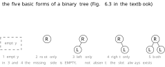

> **图注（二叉树的五种基本形态，对应教材图 6.3）**：①**空二叉树**（虚线框，连根都没有）；②**只有根**（左右子树都空）；③**右子树空、左子树非空**；④**左子树空、右子树非空**；⑤**左右子树都非空**（"儿女双全"）。**注意 ③④ 里的"空"是"有位置但没东西"，不是"没有这个分支"**——这正是下一节要专门说的事。五种形态的个数来自"根是否为空"×"左空／非空"×"右空／非空"中的合法组合。

**本节要点**

- 二叉树**恰好五种基本形态**（教材图 6.3）：**空／只有根／左非空右空／左空右非空／左右都非空**。
- 数法：**"根是否存在" × "{左,右} 各自空或非空"** 的合法组合。
- **形态的完备性**是二叉树能"讨论清楚"的前提——这也回应了第六节那个"树不好讨论"的困境：**二叉树把规模与形状控制住了，才能谈性质**。

### 二十七、「空子树」不等于「没有子树」 `01:26-01:28`

上一节我留了一个反复强调的点，这一节单独拎出来，因为**它是初学者最容易错的地方，而且它牵涉到存储**。

> **注意它的右子树，有没有存在？**要注意，**只不过它是空的右子树**——**你千万不要说它没有右子树，它有右子树，只不过右子树是空的**。

为什么这句话这么重要？我用**内存分配**来解释：

> 这个对应到我们**编程**当中，就是说你某一个节点，你把**那个节点的空间分配出去了**之后，左子树、右子树——**不管你有没有这个节点，空间是存在的**，只不过里面可能**不放东西、为空**嘛。但是**这个空间是已经给你分配了的**。至于**你用不用，那是另外一回事**。

这段话要拆成两层：

1. **逻辑上**：二叉树的结点结构**固定有左、右两个域**（在二叉链表里就是 `lchild`、`rchild`）。**这两个域永远存在**，只是可能为 `NULL`。
2. **物理上**：分配一个结点的空间时，**两个指针域一起分配**（`sizeof(BiTNode)` 是固定的），**不会因为"没有右孩子"就少分配 4／8 个字节**。

所以"空子树"和"没有子树"的区别是：

| | 逻辑上 | 物理上 | 代码里 |
|---|---|---|---|
| **没有右子树**（错误说法） | 结构里缺少右分支 | 少一个指针域 | 不存在 |
| **右子树为空**（正确说法） | **右分支存在，内容为空** | **两个指针域都分配了，一个是 `NULL`** | `p->rchild == NULL` |

**这个区别直接决定了后面好几个量**：

- **$n$ 个结点的二叉树有 $2n$ 个指针域**（不是"用掉几个算几个"）——因为每个结点**固定两个**。
- 其中**非空的 $n-1$ 个、空的 $n+1$ 个**——这个结论第四十七节要正式推。
- 也决定了**线索二叉树**（下一节之后的内容）能不能成立：**正因为有 $n+1$ 个空指针域闲着**，才想到拿它们来存"前驱／后继"。教材 6.2.3 那句话就是这个意思：「容易证得，在含有 $n$ 个结点的二叉链表中有 $n+1$ 个空链域。在 6.3 节中我们将会看到**可以利用这些空链域存储其他有用信息**，从而得到另一种链式存储结构——线索链表。」

所以你们看：**"空子树存在"这个观念，不是咬文嚼字，它是后面三个重要内容（指针计数、线索二叉树、顺序存储的空位）的出发点。**

**本节要点**

- **"右子树为空" ≠ "没有右子树"**：二叉树结点的左、右两个域**永远存在**，只是可能为空。
- **物理上**：分配结点时**两个指针域一起分配**，不因"没孩子"而少分配。
- 这个观念的三个下游后果：**$2n$ 个指针域**的计数、**$n+1$ 个空链域**、**线索二叉树拿空链域存线索**（教材 6.2.3 明说）。

### 二十八、性质 1 与性质 2：二叉树「优良」在哪儿 `01:28-01:31`

进入性质。我先说了一句"为什么二叉树值得研究"，这句话是这一章所有性质的**动机**：

> 第一个特性，**二叉树好，好在于哪儿？就是它有一系列的优良的特性。**

"优良"具体指什么？我紧接着说的这句话才是关键：

> 比如说在二叉树当中，**第 $i$ 层节点数目最多为 $2^{i-1}$**。当然这个**比较好的一点是我们可以控制二叉树的规模**，是**可控的**。我们**前面说树，我们为啥不研究它呢？因为它子树的个数不确定**。那**人类对于这种不确定性的东西，往往不研究**——或者说太难研究了，我们就不研究了。

**"规模可控"** 这四个字，就是二叉树全部性质的价值所在。**树没法研究，因为它的规模没有上界（度不定）；二叉树有上界，所以能算、能证、能考。**

**性质 1**（教材 6.2.2）：

> 在二叉树的**第 $i$ 层上至多有 $2^{i-1}$ 个结点**（$i\geqslant 1$）。

教材用归纳法证，我把它写清楚，因为**这个证明是"归纳定义 ⇒ 归纳证明"的样板**：

- **基础**：$i=1$ 时，只有一个根结点，$2^{i-1}=2^0=1$，成立。
- **归纳**：设对一切 $1\leqslant j<i$ 成立，特别地第 $i-1$ 层至多有 $2^{i-2}$ 个结点。由于二叉树每个结点**度至多为 2**，第 $i$ 层的结点数**至多是第 $i-1$ 层的 2 倍**，即
$$
2\times 2^{i-2}=2^{i-1}.
$$

**性质 2**：

> **深度为 $k$ 的二叉树至多有 $2^{k}-1$ 个结点**（$k\geqslant 1$）。

证明就是把性质 1 **按层求和**：

$$
\sum_{i=1}^{k}\big(\text{第 } i \text{ 层上的最大结点数}\big)=\sum_{i=1}^{k}2^{i-1}=2^{k}-1 .
$$

这是**等比数列求和**，公比 $q=2$、首项 $a_1=1$、项数 $k$：

$$
S_k=\frac{a_1(1-q^{k})}{1-q}=\frac{1\cdot(1-2^{k})}{1-2}=2^{k}-1 .
$$

**这两个性质我课上专门提醒"千万别搞混"，而且给了一个"抓住本质就不会混"的判据**：

> 那这个**要注意**，这两个的话大家**千万不要搞混**了。实际上我们说，**你把它的本质抓住，根本不可能搞混**。

> 它一个谈的是啥？**第 $i$ 层——就是某一层，它最多有多少个结点**，就这一层上面，最多有 $2^{i-1}$ 个结点。**一个拿的是整棵树**，整棵树它的节点是什么呢？$2^{k}-1$。那这两个**谁大**呀？**你这个指数，$i-1$ 在上面；这个是 $i$ 次方**。那肯定是这个大。

我把这个"本质判据"整理成一句话：

> **性质 1 说的是"一层"，性质 2 说的是"整棵"。一层永远比整棵少。**

具体地：

| | 说什么 | 公式 | 指数 | 量级对比（$k=i=10$） |
|---|---|---|---|---|
| **性质 1** | **第 $i$ 层**的结点数上限 | $2^{i-1}$ | $i-1$ | $2^{9}=512$ |
| **性质 2** | **深度 $k$ 的整棵树**结点数上限 | $2^{k}-1$ | $k$ | $2^{10}-1=1023$ |

**$1023 \approx 2\times 512$**——整棵树大约是**最后一层**的两倍（因为上面各层加起来正好比最后一层少 1）。**抓住"一层 vs 整棵"，两个公式永远不会串。**

**本节要点**

- 二叉树"优良"的本质是**规模可控**；树不可研究的根因是**度（子树个数）不确定**。
- **性质 1**：第 $i$ 层至多 $2^{i-1}$ 个结点（$i\geqslant 1$），**用归纳法证**（归纳定义 ⇒ 归纳证明）。
- **性质 2**：深度 $k$ 至多 $2^{k}-1$ 个结点，由性质 1 **按层等比求和**得出。
- **判据**：**性质 1 说"一层"，性质 2 说"整棵"**——一层永远比整棵少，抓住这一点就不会混。

### 二十九、推广到 $m$ 叉树：那个除以 $m-1$ 是怎么来的 `01:31-01:35`

性质 1、2 讲完，我立刻做了推广——**这是考研里最爱考的一步**：

> 那很多考研的题目当中还会涉及到 **$m$ 叉树**，比如说**三叉树**。三叉树的话，问你**总节点数目有多少**？三叉树就是说**每一个节点最多可以有三个分支**。那最多怎么样？**第一层 $3^0=1$ 个节点，第二层 $3^1=3$ 个节点，第三层 $3^2$，一直加，加到第 $k$ 层是 $3^{k-1}$。**

于是

$$
1+3+3^2+\cdots+3^{k-1}=\sum_{i=1}^{k}3^{i-1}.
$$

这是一个**等比数列**，我课上专门强调了这个求和的**易错点**：

> 那这是一个**等比数列**，所以它的结果是啥？**要注意结果那个等比数列公式**啊，大家一定要注意：**底下有一个 $1-q$，这个 $q$ 是 3，所以底下有个 2**——千万注意，**这个没有 2**，对吧？**它底下要除以一个 2**，咋来的？因为**你有 $k$ 项**。

> 那你就是怎么样？**底下 $1-q$**，然后**$1-q$ 的 $n$ 次方**嘛，上面是 **$a_1$ 乘上一个 $1-q^{n}$**。所以是这么得来的，**要注意有一个除以 2**。

把公式写全：

$$
S_k=\frac{a_1\,(1-q^{k})}{1-q}=\frac{1\cdot(1-3^{k})}{1-3}=\frac{3^{k}-1}{2}.
$$

**分母是 $q-1=m-1=2$**——这就是"**那个 2 从哪儿来的**"。一般地，**深度为 $k$ 的 $m$ 叉树至多有**

$$
\boxed{\;\frac{m^{k}-1}{m-1}\;}
$$

个结点。**当 $m=2$ 时，分母 $m-1=1$，公式退化成 $2^k-1$，正好是性质 2**——**这就是"推广"的验证方式：把 $m=2$ 代回去，必须能还原原来的公式。**

我课上给了三组数字，让你们回去自己验：

> 你可以回去总结一下：**四层的三叉树最多 40 个节点**，加起来**五层最多 121 个节点**，**六层最多 364 个节点**。

验一下：

$$
k=4:\ \frac{3^4-1}{2}=\frac{81-1}{2}=40;\qquad
k=5:\ \frac{3^5-1}{2}=\frac{243-1}{2}=121;\qquad
k=6:\ \frac{3^6-1}{2}=\frac{729-1}{2}=364.
$$

**三个数全对**。你们做题时可以用这个"代入验证"的习惯——**公式记不清的时候，代一个小数字试一遍**。

顺便把"第 $i$ 层"也推广一下：**$m$ 叉树第 $i$ 层至多有 $m^{i-1}$ 个结点**。$m=2$ 时就是 $2^{i-1}$。

**本节要点**

- **$m$ 叉树第 $i$ 层至多 $m^{i-1}$ 个结点**；**深度 $k$ 的 $m$ 叉树至多 $\dfrac{m^{k}-1}{m-1}$ 个结点**。
- 分母 **$m-1$** 来自等比数列求和公式 $\dfrac{a_1(1-q^k)}{1-q}$ 的 $1-q$，$q=m$——**别忘了除以 2（三叉树）这件事**。
- **验证方法**：把 $m=2$ 代回去，必须还原 $2^k-1$（性质 2）。
- **三叉树的三个常用数**：$k=4\to 40$、$k=5\to 121$、$k=6\to 364$。

### 三十、$n$ 个结点、高度 $n$ 的二叉树，有多少种形态 `01:35-01:37`

上一节的公式都是"给层数求结点数"。这一节反过来问一个**形态计数**的问题，题面是这样的：

> 那问这个问题：**具有 $n$ 个节点且高度为 $n$ 的二叉树，它的数目为多少**？

我课上是**先拆条件、再数形态**：

> 这个意思是啥？就是说**具有 $n$ 个节点、高度为 $n$ 的二叉树，它的形态有多少种**？我们刚才不是讲了吗，二叉树的话**总共的形态有 5 种**。那到这里面，如果有 $n$ 个节点、高度为 $n$，那这个二叉树它的形态总共有多少种？

关键是那两个条件**同时成立**意味着什么：

> 我们这个里面要注意的：**有 $n$ 个节点，意味着它又是高度为 $n$，意味着怎么样？它每一层只有一个节点**。

**"$n$ 个结点 + 高度 $n$ + 每一层至少一个结点" ⇒ "每一层恰好一个结点"**。这条推理的中间那一步是：**高度为 $n$ 的树至少有 $n$ 个结点**（每一层至少一个），**而题设正好是 $n$ 个结点**，所以**每一层不多不少一个**。这种树教材里有个名字——**单支树**（6.2.3 提到过：「一个深度为 $k$ 且只有 $k$ 个结点的**单支树**（树中不存在度为 2 的结点）」）。

然后数形态：

> 它只有一个节点，问题是**这一个节点可以是左子树，也可以是右子树**，所以总共有多少？**除了根节点是确定下来只有一个节点**，其他的节点怎么样？**有可能在左、也有可能在右，每一层有两种选择**。

> 所以总共形态有多少种？**$2^{n-1}$**（或者 $H-1$ 次方）。**是这样子的。**

**推导**：根结点位置固定（它就是根，没有"在左在右"的说法）；**第 $2$ 层到第 $n$ 层，共 $n-1$ 层，每层那个唯一的结点可以在左、也可以在右**，所以

$$
\underbrace{2\times 2\times\cdots\times 2}_{n-1\ \text{个}}=\;2^{\,n-1}.
$$

**这个"根不算"的细节一定要抓住**——很多同学一上手就写 $2^n$。**根没有"左还是右"的问题，因为它没有父结点，它不在任何人的左／右位置上。**

我用一个小数字验一下：$n=3$ 时应有 $2^{2}=4$ 种。列出来（每层一个结点，第 2 层左／右、第 3 层左／右，共 $2\times2=4$）：

$$
\begin{aligned}
&\text{LL}: A\to B(\text{左})\to C(\text{左}) &&\text{LR}: A\to B(\text{左})\to C(\text{右})\\
&\text{RL}: A\to B(\text{右})\to C(\text{左}) &&\text{RR}: A\to B(\text{右})\to C(\text{右})
\end{aligned}
$$

**正好 4 种**。这 4 种作为"树"其实是同一棵（都是 $A-B-C$ 一条链），但**作为二叉树互不相同**——这又一次印证了第二十四节那条：**二叉树连"只有一个孩子"的情形都要分左右**。

**本节要点**

- **$n$ 个结点且高度为 $n$ 的二叉树** ⇒ **每一层恰好一个结点**（因为"高度 $n$ ⇒ 至少 $n$ 个结点"，而题设正好 $n$ 个）⇒ 这就是**单支树**。
- 形态数 **$2^{\,n-1}$**：**根的位置固定不算**，第 $2\sim n$ 层共 $n-1$ 层，每层可左可右。
- **易错点**：**别写成 $2^{n}$**——根不在任何人的左／右位置上。

### 三十一、「度为 $m$ 的树」与「$m$ 叉树」不是一回事 `01:37-01:41`

上一节的推广留下一个坑，这一节专门填它。我课上开宗明义：

> 好了，那接下来大家考虑一下这个**度为 $m$ 的树**和 **$m$ 叉树**啥意思呢？这个是**两个比较容易搞混的概念**。

**先看它们的共同点**：

> **度为 $m$ 的树**就是说，当然**任意节点的度小于等于 $m$**；**$m$ 叉树**也是一样，**任意节点的度小于等于 $m$**。

**共同点：都要求"每个结点的度 $\leqslant m$"。** 如果只看到这儿，两个概念就没区别了。**差在下面这一句**：

> 但是**度为 $m$ 的树**啊，有个前提是啥？**它至少有一个节点，它的度并且是等于 $m$ 的**——因为**度为 $m$ 嘛**。

> 但是 **$m$ 叉树**呢？**允许所有节点的度都小于 $m$**。

**差别就在"度 $=m$ 这个值有没有被取到"**：

| | 每个结点的度 | 有没有"度恰好 $=m$"的结点 | 能不能为空 |
|---|---|---|---|
| **度为 $m$ 的树** | $\leqslant m$ | **必须有至少一个** | **不能空**（空树没有"度"可谈） |
| **$m$ 叉树** | $\leqslant m$ | **不要求**（可以全都 $<m$） | **可以空** |

我课上接着把这个差别推成了**最少结点数**：

> 那这就导致怎么样？**度为 $m$ 的树一定是非空的**，并且它**至少总共有多少个节点**？总共有 $m+1$ 个节点——**它最少情况是啥？只有一个根节点，下面跟着 $m$ 个孩子**。所以它总共是 $m+1$ 个节点。

**为什么是 $m+1$？** 因为要有"度 $=m$"的结点，最小的构造就是**一个根 + 它的 $m$ 个孩子**：根贡献了度 $m$，孩子们都是叶子（度 0）。**结点数 $=1+m$。**

> 但是 **$m$ 叉树**呢？**它可以是空树。**

所以：

$$
\min|T_{\text{度为 }m}|=m+1,\qquad \min|\text{$m$ 叉树}|=0 .
$$

**这一节的价值在提醒你"看题先看是哪个词"**。我课上把这两个概念摆出来，就是为了后面那道题（下一节）——**同一道题问"高度 $H$ 的树至少几个结点"，得先知道它是"度为 $m$ 的树"还是"$m$ 叉树"，答案差一个常数。**

顺带说一下**为什么教材要用"$m$ 叉树"这个词**：因为**"$m$ 叉树"才是"每个结点至多 $m$ 个孩子"这个模型的干净名字**，它**允许退化**（度更小、甚至空）。而"度为 $m$ 的树"是**对一棵具体树的描述**（"这棵树的度是 $m$"）。**一个是类型，一个是属性**——这就是它们最本质的区别。

**本节要点**

- **共同点**：都要求**每个结点的度 $\leqslant m$**。
- **差别**：**度为 $m$ 的树**要求**至少有一个结点的度恰好等于 $m$**（所以**必然非空**，最少 $m+1$ 个结点：根 + $m$ 个孩子）；**$m$ 叉树**不要求（**可以为空**，最少 $0$ 个）。
- 本质：**"$m$ 叉树"是类型**（允许退化），**"度为 $m$ 的树"是属性描述**（度取到了 $m$）。
- **看题先分清是哪一个词**——后面求"最少结点"时两者答案不同。

### 三十二、课间那五分钟的两道题：高度 $H$ 至少几个结点 `01:41-01:46`

上一节末尾，我把两道题留给了课间。这一节就是**课的**后半段（第二份转写）**开头**，我开口就在回答它们。这两段能接上，正是我把两份转写合成一份讲义的依据。

**第一道：高度为 $H$、度为 $m$ 的树，至少有多少个结点？**

> 那么这个很简单，那么**最小情况**，因为你**已经规定高度是 $H$ 了**。那你可以这样：**其他的地方都是一个一个节点，只有其中某一层，它必须是 $m$ 节点的**。

**这个"最小情况"的构造是关键**，我把它说全了：

> 所以比如说像这种情况：**上面 $H-1$ 层每层一个节点**，然后**最后一层有 $m$ 个节点**，对不对？所以是 **$H-1+m$**。

**为什么必须有一层是 $m$ 个？** 因为它是"**度为 $m$ 的树**"——**必须有一个结点的度恰好为 $m$**，也就是**必须有某一层上有 $m$ 个兄弟**。为了让总数最小，就把这 $m$ 个兄弟**放在最后一层**（这样它们**不再往下生**，不额外增加层数）。而上面 $H-1$ 层**每层只放一个**（刚好把高度撑到 $H$）。

$$
\boxed{\;\min|T_{\text{高度 }H,\ \text{度为 }m}|=(H-1)+m\;}
$$

**第二道：高度为 $H$ 的 $m$ 叉树，至少有多少个结点？**

> 那**高度为 $H$ 的 $m$ 叉树**呢？至少多少？**它就都是单个的节点**——所以**至少有 $H$ 个节点**。

**因为 $m$ 叉树不要求"度恰好 $=m$"，所以它可以退化成一条链**：每层一个结点，高度 $H$ 就要 $H$ 个结点。

$$
\boxed{\;\min|\text{高度 }H \text{ 的 } m \text{ 叉树}|=H\;}
$$

**两个答案差在哪儿？** 差在 **$m-1$**：

$$
(H-1+m)-H=m-1 .
$$

**这个 $m-1$ 就是"必须有某个结点的度恰好为 $m$"所付出的代价**——你要多摆 $m-1$ 个结点，才能让某个结点凑够 $m$ 个孩子（本来那层只有 1 个，现在要 $m$ 个）。

**第三问：至多呢？**

> **那至多呢？至多的话是一模一样的——都是那个公式，等比数列公式 $\dfrac{m^{H}-1}{m-1}$**。就我们那个等比数列的公式，**这两个是一模一样的**。所以**看到这个要区分开来**：**度为 $m$ 的树和 $m$ 叉树，它有点不一样**。

**为什么"至多"是一样的？** 因为"至多"要的是**每层都塞满**，而**塞满的树必然有结点的度 $=m$**（只要 $H\geqslant 2$）——所以**"度为 $m$ 的树"这个额外条件在"至多"的情形下自动满足**，两个上界重合。

把四个答案列成表：

| | 高度 $H$、**度为 $m$ 的树** | 高度 $H$ 的 **$m$ 叉树** |
|---|---|---|
| **至少** | $(H-1)+m$ | $H$ |
| **至多** | $\dfrac{m^{H}-1}{m-1}$ | $\dfrac{m^{H}-1}{m-1}$ |
| **差值** | 至少多 $m-1$ | — |
| **为什么** | 必须有结点的度恰好 $=m$，得摆出 $m$ 个兄弟 | 可退化成单链，允许所有度 $<m$ |

**这一组题是"概念辨析"最典型的考法**：**公式都不难，难在你得先看清题目问的是哪一个概念。** 我课上那句"看到这个要区分开来"，就是这个意思。

**本节要点**

- **高度 $H$、度为 $m$ 的树**：至少 **$(H-1)+m$**（上面 $H-1$ 层各一个，最后一层摆 $m$ 个兄弟）；至多 $\dfrac{m^{H}-1}{m-1}$。
- **高度 $H$ 的 $m$ 叉树**：至少 **$H$**（可退化成单链）；至多 $\dfrac{m^{H}-1}{m-1}$。
- **两者"至多"相同**（塞满时必然有结点的度 $=m$，额外条件自动满足），**"至少"差 $m-1$**。

### 三十三、满二叉树与完全二叉树 `01:46-01:50`

两道题答完，进入本节第二个重头：**两种特殊形态的二叉树**。我课上先给了一句"这是两种形态、要对着看"：

> 好了，接下来我们再来看一下。这个**性质非常重要，就满二叉树和完全二叉树**呀。它实际上**谈了两种树的形态**，然后**映照着对应的来进行看**。

**满二叉树**，教材 6.2.2 的定义是：

> 一棵深度为 $k$ 且有 $2^{k}-1$ 个结点的二叉树称为**满二叉树**。这种树的特点是**每一层上的结点数都是最大结点数**。

我课上的说法是：

> **马二三四**（"满二叉树"的口误转写），说白了就是**每层节点数目达到最大**，就**硕果累累**。**每一层达到了最大**。

「**硕果累累**」这个形容挺准：满二叉树的特点是**每一层都塞满**，一个空位都没有。所以深度 $k$ 的满二叉树**结点数被唯一确定**：$2^{k}-1$。**它没有形态变化，只有一种。**

**完全二叉树**，教材的定义是：

> 深度为 $k$ 的、有 $n$ 个结点的二叉树，**当且仅当其每一个结点都与深度为 $k$ 的满二叉树中编号从 $1$ 至 $n$ 的结点一一对应时**，称之为**完全二叉树**。

这个定义的关键是"**编号一一对应**"——也就是**把一棵满二叉树的结点从上到下、从左到右编号 $1,2,\cdots$，然后"掐掉"最后几个**，剩下的就是一个完全二叉树。我课上是这么讲的：

> **完全二叉树**呢，就是说它要和**深度为 $k$ 的满二叉树**进行**比对着来看它的编号**。**从 $1$ 到 $n$ 那个节点一一对应**，就有一个**映射关系**。

> 我们看一下，比如说把二叉树左边是三层、右边四层，**从上到下、从左到右进行编号，从小到大进行编号**。

所以完全二叉树的**判据只有一条**：**按层序编号，编号必须是连续的一段 $1\cdots n$，中间不能断。**

然后我给了一个**很好用的几何直觉**：

> 那么完全二叉树的话呢，当然**有的教科书也叫顺序观察树**。我们可以看到，你可以把它**当成一种树形结构**……你把它盖到这上面，你会发现怎么样？**它只有最右边、最下面那一层，如果它不满的话，只有最右边最下面那一层是空的**。

**"盖上去"** 这个动作就是把完全二叉树**想象成一棵满二叉树被削掉右下角**。由此得到两个必须记住的性质：

> 所以完全二叉树有一个非常好的性质，是什么性质呢？**第一个就是，如果它有 $H$ 层，上面的 $H-1$ 层一定是满的**，那么**不满在哪儿呢？不满只在最后一层**。

> 那么并且这个不满啊，它这个**元素存放的时候，从左到右进行存放，中间不能跳过任何一个节点**。所以这是完全二叉树。

**"上面 $H-1$ 层满 + 最后一层从左到右连续、不跳号"**——这就是完全二叉树的定义性质。

教材把这两个性质写成两条（6.2.2 定义之后那段"显然，这种树的特点是"）：

> (1) **叶子结点只可能在层次最大的两层上出现**；(2) 对任一结点，若其右分支下的子孙的最大层次为 $l$，则其左分支下的子孙的最大层次必为 $l$ 或 $l+1$。

我课上把第 (1) 条单独拎出来讲了：

> 那这个的话呢，它的**叶节点怎么样？有三层有叶的节点**……我们完全二叉树还有个特别好的性质，就是啥？**它的叶节点只可能出现在倒数两行，只可能出现在倒数两层**。

**"叶子只可能在最后两层"**——这条在判题里非常实用：**给你一棵二叉树，只要出现"倒数第三层有叶子、而最后一层还有结点"，就不是完全二叉树。**

至于教材第 (2) 条（**左分支的深度 $\geqslant$ 右分支的深度**），方向是对的：**完全二叉树"缺"只能缺在右下角**，所以**任何结点的左子树不可能比右子树浅**。我课上没直接说这条，但它其实等价于我讲的"只有最右最下那层是空的"。

我还现场演示了**怎么用"盖上去"的判法识别非完全二叉树**，这段很实用：

> 那你也可以举什么呢？举**非完全二叉树**。比如说 $T_5$ 的话，那么它 **2 号节点**怎么样？**这应该有两个子树，它没有**——所以**不是完全的**。那你看一下这个呢，这个 **3 号节点**怎么样？**它的左子树没有存，你就去存它的右子树**——你把它盖到这上面，你发现**重合不了**。那这个也是一样，**2 号的右子树没有，你就去存 3 号的左子树**了——**没有依次存储，就是从左到右依次存储**。

**"重合不了"** 就是判据的全部：**你把这棵树按层序摆到满二叉树的编号位置上，摆完发现中间有空位（比如 3 号有、4 号空、5 号又有），那就不是完全二叉树。**

下面这张图把满二叉树与完全二叉树摆在一起，编号也标上了：

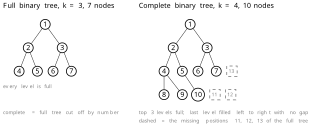

> **图注（满二叉树与完全二叉树）**：左图是**深度 3 的满二叉树**，7 个结点，**每层都塞满**，编号 $1\sim7$。右图是**深度 4、10 个结点的完全二叉树**：**上面 3 层全满**（$1\sim7$），**第 4 层从左到右连续填了 $8,9,10$**，虚线框是满二叉树里 $11,12,13$ 号位置，**空着但位置还在**。所以完全二叉树＝"把满二叉树按编号 $1\cdots n$ 掐掉尾巴"。**判据：按层序编号必须是连续的一段，中间不许跳号**——若出现"3 号有孩子、4 号空、5 号又有孩子"，就不是完全二叉树。

**本节要点**

- **满二叉树**：深度 $k$、结点数 $2^{k}-1$，**每层都达到最大**（"硕果累累"）；**形态唯一**。
- **完全二叉树**：**每个结点都与深度 $k$ 的满二叉树中编号 $1\sim n$ 的结点一一对应**——即"按层序编号是连续的一段，中间不跳号"。
- 两个等价刻画：**上面 $H-1$ 层全满、只有最后一层不满且从左到右连续**；**叶子只可能出现在最后两层**（教材第 (1) 条）。
- 教材第 (2) 条：**任一结点左分支的子孙最大层次 $\geqslant$ 右分支的**——因为"缺"只缺在右下角。
- **判法**：把树按层序盖到满二叉树的编号位置上，**重合不了就不是完全二叉树**。

### 三十四、教材流派之争：满二叉树到底怎么定义 `01:50-01:54`

这一节是**本节唯一一段"学术八卦"**，但它讲的是一个很严肃的问题：**同一个术语，不同教材的定义不一样。**

我课上是从一句"虽然数据结构很重要，但是……"切进去的：

> 那然后接下来我们说啊，我们再三强调，**数据结构很重要的一门专业基础课**，对不对？尽管数据结构这么重要，但是**我们国际上也好、国内也好，对于满二叉树和完全二叉树这个概念的内涵都不一样**。

> 就我们**中国没有统一**，迄今为止**不光是世界上，咱们中国都没有统一**。为啥呢？

> 咱们中国实际上呢，数据结构可以说**追根溯源的话有三大派**——**比较早的出这个数据结构书的**，这三大派**实力不相上下**。

然后是一个很关键的观察，它解释了**为什么考研题不指定教材**：

> 因此你们可以去看，那个**考研国家考研题 408，他都没有指定任何一本教材是他的参考书目**。为啥呢？那大家想一下：你如果说我们现在采用的是**严蔚敏**的，那人家**也有别的教材**。那你想一下，如果采用别的派系的，那严蔚敏心里该有想法了——说**为啥呀？凭啥呀？是不是他比我好呀？**它的结构、它的安排比我更优啊，对不对？**那他受不了啊。**

这段话虽然是调侃，但它说明了一个真事实：**408 是全国统考，命题组不能偏向任何一本教材，所以它只考"各派都同意"的东西，或者考"给出定义再判断"的题。**

然后我举了具体的例子，这一段信息量很大，我尽量保真地记下来：

> 我们举个例子，比如说**许卓群**这本书（清华派系），**曲德平**是北大的（这一段是转写中的讹误，实际指代见下）。那你看一下，如果说**许卓群这本书**——实际上我们知道咱们在座的，**拿学位有两种方式**：一种方式就是你们这种方式，叫**学历教育**，脱产来上学；那还有一种方式是**自考**，自考就**非学历教育**。那么**自考的那个指定教材就是许卓群这本书**。

> 所以这本书它的**内涵、概念**之类的，**编的比我们推荐严蔚敏的教材只丰富不少**。而且它的**发行量**，因为它是自学考试的**指定教材**，**发行量也很大，不亚于咱们现在的这本教材**。

> 那么这一本教材的话呢，如果人家考研，**指定参考书目是这本书**，然后你去答题——问你**什么是满二叉树**，你这么答：「**每层都结点数目达到最多**」，**扣分**！为啥？**他的满二叉树是这么定义的**：**一个节点它的度要么为 $0$、要么为 $2$**。也就是说**这个节点要么没孩子，要有孩子两个都长出来**。**他认为这个是满二叉树。**

**这就是关键的分歧点**，我把它整理成一张对照表（这一张表你们最好抄下来）：

| 口径 | 满二叉树的定义 | 完全二叉树的定义 |
|---|---|---|
| **严蔚敏（本课采用）** | 深度 $k$、结点数 $2^k-1$，**每层结点数都最大** | 与深度 $k$ 满二叉树**编号 $1\sim n$ 一一对应** |
| **许卓群（清华／自考指定）** | **每个结点的度要么 0、要么 2**（"要么没孩子，要么两个都长"） | 与严蔚敏**相同**（从上到下、从左到右编号不跳号） |
| **王广芳（国防科大）** | 与严蔚敏**相同**（每层达到最多） | **与严蔚敏不同**：按"度要么 0 要么 2"那套 |
| **另一派（转写作"齐德义"）** | 与严蔚敏**相同** | 与严蔚敏相同，但**另立"顽强二叉树"**定义为"度为 0 或 2" |

我课上还有两句补充：

> 那然后**北大的话呢，张敏**的话呢，他也是**许卓群这个派系**，所以他的**满二叉树和完全二叉树**怎么样？**是一样的**。

> 那人家**国防科大的王广芳**，人家又编了一本书叫《数据结构》，那么它的数据结构当中，你看一下吧：**二叉树跟咱们这一样**，就是每层达到最多；**在它的完全二叉树怎么样呢？又跟我们不一样了**——他是**完全按照度数，要么为 0、要么为 2**。

> 那还有提异议的，**齐德义**这本书把两者都跟严蔚敏一样，它有个顺序——二叉树跟咱们这完全二叉树一样，**但是他又来一个"顽强二叉树"**，这样定义为 **0 或者度为 2**。你看又不一样了。

> 人家**国防科大**怎么样，大家知道**科研实力非常强**，咱们也才有多少老师呀？国防科大**可以带研究生的导师就有将近 200 号人**。他的科研实力非常强。

**这一段的价值在哪儿？** 我课上给了一句总结：

> 所以**咱们这个书啊，不光是数据结构难学**——**难不光是说算法设计难，还难在概念的内涵都没有统一**。**概念的内涵都没有统一**啊，所以**难学也难学在这儿**。

我把这句话发挥一下，因为它是这一节的落点：**"满二叉树"这个词在不同教材里指的不是同一个东西**——

- 严蔚敏口径的"满"是**"每层都满"**（形状满）；
- 许卓群口径的"满"是**"每个结点要么 0 个孩子、要么 2 个孩子"**（**度满**）。

**这两个定义的交集不是空集，但谁也不包含谁**：

- 严蔚敏的满二叉树 ⇒ **一定满足**"度 0 或 2"（因为每层都满，非叶结点必然有两个孩子）——**所以严蔚敏的满树是许卓群满树的特例**。
- 但"每个结点度 0 或 2"的树，**未必每层都满**：比如一棵"根有左右两个孩子，左孩子又有两个孩子，右孩子是叶子"的树——**每个结点度是 0 或 2**，但**最后一层不满**。按许卓群口径它是满二叉树，按严蔚敏口径它不是。

**这就是为什么"照着定义答题"会掉坑**：你答的是严蔚敏的定义，人家考的是许卓群的教材。

所以这一节的**实用建议**，我课上给得很明确：

> 所以啊，提醒大家一下：**你如果要考那个 C9 那些院校，人家如果指定了教材，你一定要去看他的参考书目是咋说的**——**概念的内涵都不一样**。

我把它扩成三条操作建议：

1. **统考（408）**：不给参考书，所以**只考各派共识**；遇到"满二叉树"的题，**用严蔚敏口径**（因为这是绝大多数高校的教学口径），且题目通常会给足够信息。
2. **自命题院校**：**先查该校指定参考书**，如果是许卓群那本，**满二叉树按"度 0 或 2"答**。
3. **答论述题时**：**把两种口径都写出来**再加一句"本课程采用前者"——**这是最安全的答法**。

最后我补了一句**为什么我们选严蔚敏**：

> 那接下来当然我们**为什么采用严蔚敏这本书**的？严蔚敏的这本书啊，它的**形式化程度比较高**，**比较适合高校**。说白了就是**抽象程度更高一些**。然后许卓群这本书的话呢，它**更偏实践一些，形式化程度没有那么高**。

**"形式化程度高 = 适合高校 = 抽象"**，这个评价标准你们以后选教材、写论文都用得上：**形式化程度决定了能不能做证明、能不能被推广**。

**本节要点**

- **"满二叉树"的定义在不同教材里不同**，中国至今**没有统一**；408 因此**不指定参考书**。
- 严蔚敏口径：**每层结点数都最大**（形状满，结点数 $2^k-1$）。许卓群（清华／自考）口径：**每个结点的度要么 0、要么 2**（度满）。两者**互不包含**——严蔚敏的满树满足"度 0 或 2"，反之不然。
- **完全二叉树**的定义，许卓群与严蔚敏**相同**；**王广芳（国防科大）** 与严蔚敏**不同**（按"度 0 或 2"）；还有一派另立"顽强二叉树"。
- **应试建议**：统考按严蔚敏；自命题**先查指定参考书**；论述题**两种口径都写**并注明本课程采用哪个。
- 选严蔚敏的理由：**形式化（抽象）程度高，适合高校**；许卓群那本**更偏实践**。

### 三十五、性质 3：$n_0=n_2+1$，用两种算法逼出来 `01:54-01:58`

现在讲本节**最重要的一个性质**。我课上开口就说：

> 好了，接下来我们看**第三个性质**。**任意一棵二叉树**，如果**终端结点的个数为 $n_0$**，**度为 2 的节点的数目为 $n_2$**，那么就有这样子的一个关系：**度为 0 的节点数目等于度为 2 的节点数目加 1**。

$$
\boxed{\;n_0=n_2+1\;}
$$

**注意这是"任意一棵二叉树"，没有任何附加条件**——不是完全二叉树，不是满二叉树，**随便哪棵都成立**。我课上强调了两次：

> **这是对于任何一棵二叉树，任何一棵二叉树啊。**

> 那这个关系的话呢，我们**后面讲二叉树的应用，有哈夫曼编码呀，他会用到这个概念**。

**这个性质为什么重要？** 因为它给了你一条**"叶子数 ↔ 二叉结点数"的换算关系**。后面第四十二到四十四节那些题（"124 个叶子最多多少结点"），全靠它。

然后我讲了**证明**，而且讲了一个**方法论**，这段是本节最漂亮的地方：

> 这个证明也很简单。实际上怎么样？我们就来考察——对于二叉树啊，**你要研究什么玩意儿**？实际上你对于一棵二叉树，你研究的**无非就是两个方面**：一个方面是**节点，或者事物本身**；另外一个方面是**关联关系**。

**"结点本身" + "关联关系"** ——这两个视角，就是证明的全部。我课上把它落成了**两套数法**：

**第一套数法：数结点。**

> 如果说我这棵树假设有 $n$ 个节点，那么这 $n$ 个节点，它**只可能有度为 0 的节点、度为 1 的节点和度为 2 的节点**——因为**二叉树嘛，都不能超过 2**。所以它的节点个数就是**这三种节点相加**。

$$
n=n_0+n_1+n_2 \tag{6-1}
$$

**这就是教材的式 (6-1)**。它的特点是**完全从"结点"这个角度数的**：每个结点归到一类，三类加完就是总数。

**第二套数法：数边。**

> 那我也可以考察啥？**关系，也就是边**。我们来考察**有多少条边**。这个节点总数为 $n$ 的这样一棵二叉树，它**边的条数**假设是 $B$，那么边的条数是多少呢？

关键在于**"边是怎么产生的"**：

> 你怎么才能产生一条边呢？就**任何一个子节点，他都有一条边射入**——或者说你可以这样认为，**任何孩子节点，他都可以追根溯源，可以找到他的父亲**。但是**除了某一个节点，其中的一个节点很特殊，谁呀？这个根节点**。

然后是我课上那段"女娲造人"，这段比方我很喜欢，因为它把"根没有入边"讲得无法忘记：

> 这个根节点**它没有源头**。就好比我们**中国神话**，我们中国神话**人是咋来的呢？女娲造的**。那**女娲造人，这个始祖——这个女娲，她的父亲是谁呢？无从考究**。

> 所以这个根节点**它没有摄入的边**，**追不到、不能追根溯源**。

于是：

> 所以我们**边的条数啊，实际上是多少？是我们节点的数目减一**。因为**你有多少个孩子节点，你就有多少条边**——**除了根节点，其他节点都是"孩子节点"，都有一条边射入**。

$$
B=n-1 \tag{a}
$$

**这是"数边"的第一种算法：边 = 点数 − 1。** 依据是**"每个非根结点恰有一条入边"**。

**第二种数边的方法** —— 从"出边"数：

> 那这个 $B$ 又是怎么来的呢？我们的**度为 0 的节点，它可以发出去 0 条边**；**度为 1 的节点，它可以发出去 1 条边**；**度为 2 的节点，它可以发出去 2 条边**。所以从这个角度来讲，**边的数目**又有这样子的一个公式成立。

$$
B=0\cdot n_0+1\cdot n_1+2\cdot n_2=n_1+2n_2 \tag{b}
$$

**这就是教材的式 (6-2) 的来源**：把 (a) 与 (b) 联立，

$$
n=B+1=n_1+2n_2+1. \tag{6-2}
$$

**最后联立 (6-1) 与 (6-2)**：

$$
\left\{
\begin{aligned}
n&=n_0+n_1+n_2\\
n&=n_1+2n_2+1
\end{aligned}
\right.
\;\Longrightarrow\;
n_0+n_1+n_2=n_1+2n_2+1
\;\Longrightarrow\;
\boxed{n_0=n_2+1}
$$

我课上把这一步说成"把几个式子联合起来看"：

> 所以我们把这几个式子联合起来看待——**分支数目怎么样？不为 0 的不产生**（指度为 0 的结点不产生分支）……那么把这几个联合起来，就能够得到：**度为 0 的节点，一定是度为 2 的节点数目加 1**。

> 那这个性质的话呢，**我们以后还会经常用到，这个性质很重要**。

**这里有一个必须点出来的坑**：教材 6.2.2 在我手上的电子版里，最后一步 OCR 成了

$$
n_1=n_2+1 \qquad\text{（错）}
$$

**这是识别错误，正确是 $n_0=n_2+1$。** 你们如果拿的是扫描版或电子版，看到最后一行是 $n_1$，**不要跟着抄**——按上面那个联立过程自己推一遍，一定得出 $n_0$。**这个坑我用"验证法"帮你们兜底**：随便画一棵小树验一下就行（下一节就验）。

**为什么这个证明值得反复讲？** 因为它示范了**"同一组对象，用两种不同的方式计数，得到两个表达式，然后令其相等"**这个技巧——数学上叫**双重计数（double counting）**。你们以后证明"度数关系"、证明"握手定理"、证图论里的边数公式，用的都是这一招。

**本节要点**

- **性质 3**：**任意一棵二叉树**都有 $n_0=n_2+1$（终端结点数 = 度为 2 的结点数 + 1）。**哈夫曼编码要用它。**
- 证明是**双重计数**：从"**结点本身**"数得 $n=n_0+n_1+n_2$（式 6-1）；从"**关联关系（边）**"数得 $n=B+1=n_1+2n_2+1$（式 6-2）；联立得 $n_0=n_2+1$。
- 边的两种数法：**入边**（每个非根结点恰一条 ⇒ $B=n-1$，根"女娲无父"）与**出边**（度 0／1／2 分别出 0／1／2 条 ⇒ $B=n_1+2n_2$）。
- **电子版排版坑**：最后一步 OCR 成了 $n_1=n_2+1$，**正确是 $n_0=n_2+1$**——自己推一遍就不会抄错。

### 三十六、性质 3 的推广：三叉树该怎么写 `01:58-02:00`

性质 3 讲完，我马上做了推广，因为**这是标准考法**：

> 那我们来看一下，那现在问你：**如果是三叉树，那你推导这个关系**？咱们现在是二叉树对吧？那**曾经有一年的考研题，就是让你推导三叉树节点的个数**。

> 那**度为 3 的、度为 2 的之间，和不为 0 的之间**（的关系），**你自己回去推一下**——这个**推导过程是一样的**。

**推导过程完全一样**，我把它走完整：

设三叉树中度为 $0,1,2,3$ 的结点数分别为 $n_0,n_1,n_2,n_3$，结点总数 $n$。

**数结点**：

$$
n=n_0+n_1+n_2+n_3 . \tag{1}
$$

**数边（入边）**：每个非根结点恰有一条入边，所以

$$
B=n-1 . \tag{2}
$$

**数边（出边）**：度为 $i$ 的结点出 $i$ 条边，所以

$$
B=0\cdot n_0+1\cdot n_1+2\cdot n_2+3\cdot n_3=n_1+2n_2+3n_3 . \tag{3}
$$

由 (2)(3)：

$$
n=n_1+2n_2+3n_3+1 . \tag{4}
$$

联立 (1) 与 (4)：

$$
n_0+n_1+n_2+n_3=n_1+2n_2+3n_3+1
\;\Longrightarrow\;
\boxed{\,n_0=n_2+2n_3+1\,}
$$

**注意这个结果的结构**：$n_0$ 等于**"每一个非 0、非 1 的度，乘以 $(d-1)$ 后求和，再加 1"**。一般地，对 $m$ 叉树：

$$
\boxed{\;n_0=1+\sum_{d=2}^{m}(d-1)\,n_d\;}
$$

验一下：$m=2$ 时 $n_0=1+(2-1)n_2=n_2+1$ ✓；$m=3$ 时 $n_0=1+n_2+2n_3$ ✓。

**这个通式值得记，因为它是"性质 3 的母公式"**。你们以后遇到"四叉树""五叉树"的题，直接套：

$$
n_0=1+n_2+2n_3+3n_4+\cdots+(m-1)n_m .
$$

**为什么系数是 $(d-1)$？** 直观解释：**度 $d$ 的结点"多占"了 $d-1$ 个位置**——它一个结点却生出 $d$ 个孩子，跟"叶子不生"相比**净多出 $d-1$ 条边**，而每条边都要"占掉一个结点名额"，所以叶子数要**补回** $d-1$ 个。我课上没这么讲，但这个直观解释能帮你记住系数。

**本节要点**

- **三叉树的推广结论**：$n_0=n_2+2n_3+1$。
- **通式（$m$ 叉树）**：$n_0=1+\sum_{d=2}^{m}(d-1)n_d$；系数是 $(d-1)$，因为**度 $d$ 的结点比叶子净多出 $d-1$ 条边**。
- **推导方法完全同性质 3**：数结点 + 数边（入边 $n-1$、出边 $\sum i\,n_i$）联立。**这就是"双重计数"的复用。**

### 三十七、性质 4：完全二叉树的深度 `02:00-02:03`

下一个性质，**性质 4**：

> 然后接下来我们再来看一下：**一个有 $n$ 个节点的完全二叉树，它的深度是 $\lfloor\log_2 n\rfloor+1$**。

$$
\boxed{\;\text{深度}=\lfloor\log_2 n\rfloor+1\;}
$$

**证明的思路是"夹逼"**（用性质 2 和完全二叉树的定义），教材写得很简洁，我课上把它讲成了"用上下界夹住 $n$"：

> 这个实际上是这样：我们要利用**完全二叉树有一个非常好的性质**——**如果高度为 $H$，前面的 $H-1$ 层一定是满的**。那么前面 $H-1$ 层这个满二叉树**总共有多少个节点呢？$2^{H-1}-1$**。

于是 **$n$ 的下界**是"上面 $H-1$ 层全满、最后一层至少 1 个"：

$$
n\geqslant \left(2^{H-1}-1\right)+1=2^{H-1} .
$$

我课上说的是：

> 也就是说我们这个节点数目呀，**肯定会大于等于**前面咱们上面的 $H-1$ 层都围满了，然后它要**小于等于**什么呢？我们第 $H$ 层——**除了 $H-1$ 层，我的第 $H$ 层最少有一个节点，最多有多少个节点？最多就能满了**。满了，第 $H$ 层有多少个节点？$2^{H-1}$ 个。

于是 **$n$ 的上界**是"整棵满二叉树"：

$$
n\leqslant 2^{H}-1 .
$$

合起来（教材写法）：

$$
2^{H-1}-1<n\leqslant 2^{H}-1
\qquad\text{或等价地}\qquad
2^{H-1}\leqslant n<2^{H}.
$$

对两边取 $\log_2$：

$$
H-1\leqslant \log_2 n<H .
$$

**因为 $H$ 是整数**，所以 $H$ 就是"**大于 $\log_2 n$ 的最小整数**"，也就是

$$
H=\lfloor\log_2 n\rfloor+1 .
$$

我课上把最后这一步说成"去掉不等号、变成等号"：

> 那好了，那我们把这个展开，这个减一、加一怎么样？就变成这样。**首先左边**，我们取 $\log_2 n$，也就得到 $H-1\leqslant\log_2 n$，得到 $H\leqslant\log_2 n+1$。那我**为了把这个小于号去掉、变成等号咋办？下取整**。所以是 $\lfloor\log_2 n\rfloor+1$。

> 那**右边**呢？右边这个 $n$，你把 $+1$ 挪过来，也就是说 $H$ 要**大于等于** $\log_2(n+1)$。那所以**要去掉这个大于号、变成等号怎么办？上取整**。

**这一步是本节的"技术活"**：**从"$H$ 落在某个区间里"变成"$H$ 等于某个取整表达式"，靠的是"整数 + 取整"。** 我把这套逻辑单独放到下一节讲。

**本节要点**

- **性质 4**：$n$ 个结点的完全二叉树，**深度 $=\lfloor\log_2 n\rfloor+1$**。
- 证明用**夹逼**：上面 $H-1$ 层全满 ⇒ $n\geqslant 2^{H-1}$；整棵满树是上界 ⇒ $n\leqslant 2^H-1<2^H$。于是 $2^{H-1}\leqslant n<2^H$ ⇒ $H-1\leqslant\log_2 n<H$ ⇒ 因 $H$ 为整数得 $H=\lfloor\log_2 n\rfloor+1$。
- 关键技巧：**把"H 在区间内"翻译成"$H$ 等于某个取整表达式"**。

### 三十八、下取整与上取整：地板与天花板 `02:03-02:06`

性质 4 的证明里冒出了 $\lfloor\cdot\rfloor$ 和 $\lceil\cdot\rceil$，我课上花了整整一段讲这两个符号——**因为很多同学到考研还分不清**。

我用的比方是**地板和天花板**，这个比方一旦记住就再也不会错：

> 那**下取整是啥玩意儿呢**？下取整是这样：比如说我 $3.2$ 下取整，结果是多少？……**你可以想象成怎么样？所有小于等于 $3.2$ 的，就是往下看——地板上看**。

> **所有比 $3.2$ 小的整数，我们假设都躺在地板上**。比 $3.2$ 小的整数有无数个：$-100$、$1$、$2$，都比 $3.2$ 小。那其中**有一个整数它很特别，谁呀？它是其中最大的一个**。**小于 $3.2$ 的那些整数当中，有一个最大的，那一个它是不是很特别**？然后它是几啊？**是 3**。

> 那我还有**上取整**呢？那 $3.2$ 上取整是啥呢？上取整指的是你**来考察大于等于 $3.2$ 的那些个整数**——你可以想象**在干嘛？我看着天花板**。**所有比 $3.2$ 大的整数都在天花板上躺着**。然后**其中有一个啥？有一个最小的**，最小的是谁啊？**是 4**。

我把这个定义写成严格的形式：

$$
\lfloor x\rfloor=\max\{\,k\in\mathbb{Z}\;\mid\;k\leqslant x\,\}
\qquad
\lceil x\rceil=\min\{\,k\in\mathbb{Z}\;\mid\;k\geqslant x\,\}
$$

**口诀**：

> **下取整往"地板"看，取"不大于它的最大整数"；上取整往"天花板"看，取"不小于它的最小整数"。**

几条**必须记的性质**（这些考研直接用）：

$$
\lfloor x\rfloor\leqslant x<\lfloor x\rfloor+1,
\qquad
\lceil x\rceil-1<x\leqslant\lceil x\rceil,
$$

$$
\lceil x\rceil=\lfloor x\rfloor+1 \quad (x\notin\mathbb{Z}),
\qquad
\lceil x\rceil=\lfloor x\rfloor \quad (x\in\mathbb{Z}),
$$

$$
\lfloor -x\rfloor=-\lceil x\rceil,
\qquad
\lceil -x\rceil=-\lfloor x\rfloor .
$$

**最后两条（负数）特别容易错**：$\lfloor -3.2\rfloor=-4$，不是 $-3$；$\lceil -3.2\rceil=-3$。**负数的时候，"地板"和"天花板"的方向感觉要反过来**——因为地板在下面（更小、更负），天花板在上面。

我课上还顺口提了一个变体：

> 当然你也有权"**向零取整**"对吧？

**"向零取整"**（truncation）就是 C 语言里 `(int)` 强转的行为：`(int)3.9 == 3`、`(int)(-3.9) == -3`。**它和"下取整"在正数时一致、在负数时不同**——这一点在处理"下标偏移"、二分查找取中点时经常踩坑（`(lo+hi)/2` 在 `lo+hi` 溢出时也出问题，那是另一回事）。

**本节要点**

- **下取整 $\lfloor x\rfloor$**＝"地板"＝**不大于 $x$ 的最大整数**；**上取整 $\lceil x\rceil$**＝"天花板"＝**不小于 $x$ 的最小整数**。
- 例：$\lfloor 3.2\rfloor=3$、$\lceil 3.2\rceil=4$；**负数要小心**：$\lfloor -3.2\rfloor=-4$、$\lceil -3.2\rceil=-3$。
- 常用恒等式：$\lceil x\rceil=\lfloor x\rfloor+1$（$x\notin\mathbb{Z}$）；$\lfloor -x\rfloor=-\lceil x\rceil$；$\lceil -x\rceil=-\lfloor x\rfloor$。
- **"向零取整"是 C 的 `(int)` 强转**，正数时等于下取整，**负数时不同**。

### 三十九、$n$ 个结点的完全二叉树，深度还有另一种写法 `02:06-02:08`

上上节我讲到"右边那个不等号去掉变成上取整"，于是就出现了**第二种写法**。我课上专门停下来问了一句：

> 那所以啊，那么我们怎么样要去掉这个大于号、变成等于号怎么办？**上取整**。所以啊，当然**有同学会说：这俩玩意儿一样吗**？**这俩玩意儿绝对一样啊**。

> 所以你要注意：**不光是 $\lfloor\log_2 n\rfloor+1$，也很多时候会表现成 $\lceil\log_2(n+1)\rceil$，这两个是等价的**。注意，**这两个等价，算出来绝对——对于任何 $n$，这俩玩意儿是一样的**。

$$
\boxed{\;\lfloor\log_2 n\rfloor+1\;=\;\lceil\log_2(n+1)\rceil\;}
$$

**注意括号的位置**，我课上特意强调了：

> 就是只要你取整，**它等于 $\log_2 n$ 下取整再加 1**——注意啊，**这个区别：那个是 $n+1$ 在里面**，看到没有？**这个 $n+1$ 在外面**。**这两个是一样大小的**。

**一个在里面、一个在外面**——这就是这两个式子最容易混的地方：

- $\lfloor\log_2 n\rfloor+1$：**先取对数，再下取整，再加 1**。
- $\lceil\log_2(n+1)\rceil$：**先加 1，再取对数，再上取整**。

**为什么相等？** 用上一节那两条恒等式推一下：

由 $\lfloor\log_2 n\rfloor\leqslant\log_2 n$ 得 $\lfloor\log_2 n\rfloor+1\leqslant\log_2 n+1=\log_2(2n)$。设 $H=\lfloor\log_2 n\rfloor+1$，则由性质 4 的夹逼有

$$
2^{H-1}\leqslant n<2^{H}
\;\Longrightarrow\;
2^{H-1}+1\leqslant n+1\leqslant 2^{H}
\;\Longrightarrow\;
\log_2\!\left(2^{H-1}+1\right)\leqslant\log_2(n+1)\leqslant H .
$$

而 $2^{H-1}<2^{H-1}+1\leqslant 2^{H}$，所以 $\log_2(2^{H-1}+1)>H-1$，即

$$
H-1<\log_2(n+1)\leqslant H
\;\Longrightarrow\;
\lceil\log_2(n+1)\rceil=H .
$$

**所以两个式子恒等**——注意这个证明的关键是**严格不等号**：右端是 $n+1\leqslant 2^H$（可以取等），左端是 $n+1>2^{H-1}$（**严格大于**）。**正因为左端严格，才把"上取整"钉死在 $H$ 上。**

我把它**用数字验一遍**，你们做作业也可以用这招：

| $n$ | $\lfloor\log_2 n\rfloor+1$ | $\lceil\log_2(n+1)\rceil$ | 是否相等 |
|---|---|---|---|
| $1$ | $\lfloor 0\rfloor+1=1$ | $\lceil\log_2 2\rceil=1$ | ✓ |
| $2$ | $\lfloor 1\rfloor+1=2$ | $\lceil\log_2 3\rceil=2$ | ✓ |
| $3$ | $\lfloor 1.585\rfloor+1=2$ | $\lceil\log_2 4\rceil=2$ | ✓ |
| $4$ | $\lfloor 2\rfloor+1=3$ | $\lceil\log_2 5\rceil=3$ | ✓ |
| $7$ | $\lfloor 2.807\rfloor+1=3$ | $\lceil\log_2 8\rceil=3$ | ✓ |
| $8$ | $\lfloor 3\rfloor+1=4$ | $\lceil\log_2 9\rceil=4$ | ✓ |
| $1001$ | $\lfloor 9.967\rfloor+1=10$ | $\lceil\log_2 1002\rceil=10$ | ✓ |

**七组全对**，包括 $1001$（下一节那道题要用）。

**本节要点**

- **两种等价写法**：$\lfloor\log_2 n\rfloor+1=\lceil\log_2(n+1)\rceil$（对一切 $n\geqslant 1$）。
- **别混括号**：一个是"$n+1$ 在**里面**"（先加 1 再取对数），一个是"$+1$ 在**外面**"（先对数再取整再加 1）。
- 恒等成立的根源：夹逼得 $2^{H-1}<n+1\leqslant 2^{H}$，**左端严格** ⇒ 上取整正好是 $H$。
- **验证习惯**：代 $n=1,2,3,4,7,8,1001$ 试一遍。

### 四十、完全二叉树里 $n_1$ 只能取 $0$ 或 $1$ `02:08-02:11`

性质 4 之后，我讲了一个**推论**，它在做题时极其好用：

> 好，接下来我们再来看一下，对于完全二叉树，**你可以由节点数 $n$ 推出度不为 0 的、度为 1、度为 2 的节点数目**，它们之间的关系为啥呢？我们可以看这儿。

我课上是从**画图**入手的：

> 这是一个完全二叉树，那我问你：**完全二叉树度为 1 的节点个数有几个**？$0$ 个。这样呢？**度为 1 的节点怎么样？一个**。所以我们**度为 1 的节点啊，只能取 $0$ 或 $1$**。

$$
\boxed{\;n_1\in\{0,1\}\;}
$$

**为什么？** 因为完全二叉树"只缺右下角"：

- 如果最后一层**恰好填满**（也就是整棵是满二叉树），那么**每个非叶结点都有两个孩子**，$n_1=0$。
- 如果最后一层**没填满**，那么**只有一个结点可能"只有左孩子、没有右孩子"**（就是最后一层的父结点里最靠右的那个），$n_1=1$。
- **不可能有两个"只有一个孩子"的结点**——因为那意味着"缺"了两次，而"缺"只发生在最右边一处。

**不能取 $2$ 或更多**——这一点是判题的关键。

然后我把它和性质 3 联起来，推出了**"奇偶反推"**：

> 那然后我们又由刚才那个完全二叉树可以得到：这个是必然的，**任何二叉树都有的**——只要是二叉树，**度为 0 的节点就等于度为 2 的节点加 1**，那这样子 **$n_0+n_2$ 就一定是个奇数**。

**$n_0+n_2$ 是奇数**，因为 $n_0=n_2+1$，所以 $n_0+n_2=2n_2+1$。

于是：

> 那这样子的话就能够得到：如果告诉你**完全二叉树总共有 $2k$ 个节点**（偶数个），那你就可以反推出来**度为 1 的节点数目有多少个**？**一定是有 1 个**。为啥？因为**奇数加奇数才是偶数**。

**推导**：设 $n$ 为偶数。$n=n_0+n_1+n_2=(n_0+n_2)+n_1$，其中 $(n_0+n_2)$ 是**奇数**，$n$ 是**偶数**，所以 $n_1$ 必须是**奇数**；而 $n_1\in\{0,1\}$，所以 $n_1=1$。

$$
n\ \text{为偶数}\;\Longrightarrow\;n_1=1 .
$$

> 那反过来呢？如果**完全二叉树有 $2k-1$ 个节点**（奇数个），那必然怎么样？因为 $n_0+n_2$ 是奇数，那再加个 $n_1$，**这个 $n_1$ 肯定得是个偶数**——**一个奇数加一个偶数才能总共是奇数的值**。所以就会推出 **$n_1=0$，$n_0=k$，$n_2=k-1$**。

**推导**：$n$ 为奇数、$(n_0+n_2)$ 为奇数 ⇒ $n_1$ 为偶数 ⇒ $n_1=0$。再由

$$
\left\{
\begin{aligned}
n_0+n_2&=n\\
n_0&=n_2+1
\end{aligned}
\right.
\;\Longrightarrow\;
n_0=\frac{n+1}{2}=k,\qquad n_2=\frac{n-1}{2}=k-1 .
$$

我把这两条整理成表——**这张表是"完全二叉树三量互推"的全部**：

| $n$ 的奇偶 | $n_1$ | $n_0$ | $n_2$ | 验证 |
|---|---|---|---|---|
| **$n=2k$（偶数）** | **$1$** | $\dfrac{n}{2}=k$ | $\dfrac{n}{2}-1=k-1$ | $k+(k-1)+1=2k$ ✓ |
| **$n=2k-1$（奇数）** | **$0$** | $\dfrac{n+1}{2}=k$ | $\dfrac{n-1}{2}=k-1$ | $k+(k-1)+0=2k-1$ ✓ |

**注意两行的 $n_0$ 和 $n_2$ 公式其实长得一样**：都是 $n_0=\lceil n/2\rceil$、$n_2=\lfloor n/2\rfloor-1$…等等，要小心。我直接给最稳的记法：

$$
n_0=\left\lceil\frac{n}{2}\right\rceil,\qquad
n_2=\left\lfloor\frac{n}{2}\right\rfloor-1 .
$$

验一下：$n=10$（偶）：$n_0=5$、$n_2=4$、$n_1=1$，和 $5+4+1=10$ ✓。$n=9$（奇）：$n_0=5$、$n_2=3$、$n_1=0$，和 $5+3+0=8$ ✗——不对！$n=9$ 时 $n_0=5,n_2=4,n_1=0$，$5+4=9$ ✓。所以 $n_2=\lfloor 9/2\rfloor-1=4-1=3$ 错了。

重新算：$n=2k-1$ 时 $k=(n+1)/2=5$，$n_0=k=5$，$n_2=k-1=4$。所以 $n_2=\frac{n+1}{2}-1=\frac{n-1}{2}$。而 $\lfloor n/2\rfloor=\lfloor 4.5\rfloor=4$。所以 $n_2=\lfloor n/2\rfloor$ 在 $n=9$ 时是 4 ✓。在 $n=10$ 时 $n_2=4$，$\lfloor 10/2\rfloor=5$ ✗。

所以两个情形不能统一成同一个依赖 $\lfloor n/2\rfloor$ 的式子——**必须分奇偶**。统一写法是：

$$
n_0=\left\lceil\frac{n}{2}\right\rceil,\qquad
n_2=\left\lfloor\frac{n-1}{2}\right\rfloor .
$$

验：$n=10$：$n_0=5$, $n_2=\lfloor 4.5\rfloor=4$ ✓（$5+4+1=10$）。$n=9$：$n_0=5$, $n_2=\lfloor 4\rfloor=4$ ✓（$5+4+0=9$）。**对了。**

所以正确的统一记法是

$$
\boxed{\;n_0=\left\lceil\frac{n}{2}\right\rceil,\qquad n_2=\left\lfloor\frac{n-1}{2}\right\rfloor,\qquad n_1=n-n_0-n_2\;}
$$

而 $n_1$ 从奇偶直接读：**$n$ 偶 $\Rightarrow n_1=1$；$n$ 奇 $\Rightarrow n_1=0$**。

**这里我要诚实说一句**：上面这段"统一记法"是我在整理讲义时补的，课上只讲了分奇偶的两组结论（$n=2k$ 时 $n_1=1$；$n=2k-1$ 时 $n_1=0,\,n_0=k,\,n_2=k-1$）。**你们考试时用分奇偶的写法最稳，不要背我补的这个统一式**——因为分奇偶的写法**不会记错**。

我课上还给了一句判断：

> 这个也有针对这个知识点来进行出题的。

**"这个知识点"指什么？** 就是**"由结点总数反推 $n_0,n_1,n_2$"**。这类题的标准解法只有两步：

1. **看 $n$ 的奇偶 → 定 $n_1$**（偶 1、奇 0）。
2. **用 $n_0=n_2+1$ 与 $n_0+n_2=n-n_1$ 联立** → 解出 $n_0,n_2$。

**本节要点**

- **完全二叉树 $n_1\in\{0,1\}$**——因为"缺"只发生在右下角，**最多只有一个结点只带左孩子**。
- **$n_0+n_2$ 恒为奇数**（$=2n_2+1$），所以：**$n$ 偶 $\Rightarrow n_1=1$**（奇数+奇数=偶数）；**$n$ 奇 $\Rightarrow n_1=0$**。
- 配套结论：$n=2k\Rightarrow n_0=k,\,n_2=k-1$；$n=2k-1\Rightarrow n_0=k,\,n_2=k-1$。
- **标准解题两步**：①看 $n$ 奇偶定 $n_1$；②用 $n_0=n_2+1$ 与 $n_0+n_2=n-n_1$ 联立。

### 四十一、性质 5：编号与下标的对应 `02:11-02:15`

最后一个性质，也是**做题用得最多**的一个。我课上的引入很直接：

> 接下来我们来看一下，**有 $n$ 个节点的完全二叉树**，节点**按顺序编号**，那我们就能有：**$i$ 的双亲是 $\lfloor i/2\rfloor$**；并且**如果 $i$ 是根，就没有双亲**。

教材 6.2.2 **性质 5** 的完整表述是：

> 如果对一棵有 $n$ 个结点的完全二叉树（其深度为 $\lfloor\log_2 n\rfloor+1$）的结点**按层序编号**（从第 1 层到第 $\lfloor\log_2 n\rfloor+1$ 层，每层从左到右），则对任一结点 $i\,(1\leqslant i\leqslant n)$，有
> (1) 如果 $i=1$，则结点 $i$ 是二叉树的根，**无双亲**；如果 $i>1$，则其双亲 `PARENT(i)` 是结点 $\lfloor i/2\rfloor$。
> (2) 如果 $2i>n$，则结点 $i$ **无左孩子**（结点 $i$ 为叶子结点）；否则其左孩子 `LCHILD(i)` 是结点 $2i$。
> (3) 如果 $2i+1>n$，则结点 $i$ **无右孩子**；否则其右孩子 `RCHILD(i)` 是结点 $2i+1$。

整理成公式：

$$
\text{PARENT}(i)=\left\lfloor\frac{i}{2}\right\rfloor\ (i>1),
\qquad
\text{LCHILD}(i)=2i\ (2i\leqslant n),
\qquad
\text{RCHILD}(i)=2i+1\ (2i+1\leqslant n).
$$

**这三个式子的意义**：**双亲、左孩子、右孩子都能用一次算术算出来**——不需要指针、不需要搜索。**这就是顺序存储能"随机存取"的全部理由**（四十六节会用到）。

教材的证明思路很聪明，我把它复述一下：

> 我们只要先证明 (2) 和 (3)，便可以从 (2) 和 (3) 导出 (1)。

**为什么？** 因为如果"$i$ 的左孩子是 $2i$"，那么反过来说"**结点 $j$ 的双亲是 $\lfloor j/2\rfloor$**"——对 $j=2i$ 来说，$\lfloor 2i/2\rfloor=i$ ✓；对 $j=2i+1$ 来说，$\lfloor(2i+1)/2\rfloor=i$ ✓。**所以 (1) 是 (2)(3) 的逆命题。**

而 (2)(3) 的证明是**对 $i$ 做归纳**（教材分了"$i$ 是某层第一个结点"和"$i$ 是某层中间结点"两种情形）。我课上没细证，但**这个证明的结构值得知道**：**用"第 $j$ 层的第一个结点编号是 $2^{j-1}$"** 做归纳起点——这正好是性质 1 的推论。

我课上把这三条用**具体数字**过了一遍，这段很实用：

> 那同样的，我也可以知道他的**孩子节点编号**。**如果 $2i\leqslant n$，$i$ 的左孩子是 $2i$**；否则**如果 $2i>n$，$i$ 没有左孩子**——比如说 **7 号节点**，它怎么样？**就没有左孩子**，因为 $2\times 7=14$，你总共才只有 13 个节点。但是比如说 **5 号节点**，它的左孩子是谁呀？$2\times 5=10$，**10 号节点**。同样的，**右孩子 $2i+1$**，当然有前提条件 $2i+1\leqslant n$；如果 $2i+1>n$，**$i$ 是没有右孩子的**。

**"$2\times 7=14>13$，所以 7 号没左孩子"**——这就是判据的用法：**先算 $2i$，再和 $n$ 比**。

下面这张图把"编号"和"数组下标"摆在一起，因为**这里有一个 $1$ 的偏移，是考试和编程的双重坑**：

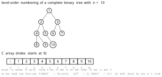

> **图注（完全二叉树的层序编号与顺序存储下标）**：上面是一棵 10 个结点的完全二叉树，**按层序编号 $1\sim10$**（从上到下、从左到右）。下面两行：上行灰色是**数组下标 $0\sim10$**（C 语言从 0 开始），下行是**存进去的结点编号 $1\sim10$**。所以**结点 $i$ 存在 `a[i-1]` 里**——编号 5 的结点在下标 4 的格子里。**这就是那个"差 1"的坑**：教材讲性质 5 用**编号 $1\sim n$**（所以双亲是 $\lfloor i/2\rfloor$、左孩子 $2i$），而 C 数组下标从 $0$ 起，**写代码时全部要减 1**（左孩子在 `a[2*i-1]`）。

**本节要点**

- **性质 5**（$n$ 个结点的完全二叉树，层序编号 $1\cdots n$）：**双亲 $\lfloor i/2\rfloor$**（$i>1$）；**左孩子 $2i$**（若 $2i\leqslant n$，否则无左孩子即叶子）；**右孩子 $2i+1$**（若 $2i+1\leqslant n$）。
- **证明次序**：先证 (2)(3)（对层数归纳，用"第 $j$ 层首结点编号 $2^{j-1}$"），(1) 是它们的**逆命题**。
- **判无孩子的算法**：先算 $2i$、$2i+1$，**与 $n$ 比大小**（如 $n=13$ 时 $7$ 号无左孩子，因为 $14>13$）。
- **C 语言差 1**：编号 $i$ 存 `a[i-1]`，左孩子存 `a[2*i-1]`——**教材公式用编号，代码用下标**。

### 四十二、最后一个非叶结点的编号是 $\lfloor n/2\rfloor$ `02:15-02:18`

性质 5 最常用的一个**推论**，我课上单独讲了：

> 那我们说了，对于完全二叉树，它的**最后一个内节点，或者说最后一个分支节点，它的下标是多少**？

> 下标就是 **$n/2$ 下取整**。比如说对于这棵完全二叉树，**我的最后一个内节点是几啊？6 号节点**——$13$ 除以 $2$ 下取整**等于 6**。然后 6 以后的那些个编号，**7、8、9、10，这些都是叶子节点**。

$$
\boxed{\;\text{最后一个非叶（分支／内部）结点的编号}=\left\lfloor\frac{n}{2}\right\rfloor\;}
$$

**推导**：一个结点 $i$ 是叶子 ⇔ **它没有左孩子** ⇔ $2i>n$ ⇔ $i>\dfrac{n}{2}$。所以

- $i\leqslant\left\lfloor\dfrac{n}{2}\right\rfloor$ ⇒ $2i\leqslant n$ ⇒ **有左孩子 ⇒ 非叶**；
- $i>\left\lfloor\dfrac{n}{2}\right\rfloor$ ⇒ $2i>n$ ⇒ **无左孩子 ⇒ 叶子**。

于是**非叶结点的编号恰是 $1,2,\cdots,\lfloor n/2\rfloor$**，**叶子的编号恰是 $\lfloor n/2\rfloor+1,\cdots,n$**。我课上就是这么说的：

> 对于完全二叉树来说，它的**内节点的编号一定是从 $1$ 到 $\lfloor n/2\rfloor$**。然后**叶子节点在这个基础之上加 1，再往后边**——你看这个，这个**内节点最大的编号是 7**（指 $n=15$ 的满二叉树），那**叶子节点就是 8 到 15**。

**由此立刻得到一个极好用的结论**：

$$
\boxed{\;\text{完全二叉树的叶子数}=\left\lceil\frac{n}{2}\right\rceil\;=\;n-\left\lfloor\frac{n}{2}\right\rfloor\;}
$$

验一下：$n=13$ ⇒ 叶子 $=13-6=7$ 个（编号 $7\sim13$）✓；$n=10$ ⇒ 叶子 $=10-5=5$ 个（编号 $6\sim10$）✓；$n=15$ ⇒ 叶子 $=15-7=8$ 个（编号 $8\sim15$）✓。

**注意这个 $n-\lfloor n/2\rfloor=\lceil n/2\rceil$ 的恒等式**——它和上一节那个 $n_0=\lceil n/2\rceil$ **是同一个结论的两种说法**：**"叶子数"就是 $n_0$**。所以这两节的结果**互相印证**，你们可以用一个去验另一个。

我课上紧接着就上了题，而且第一句就点出"这题靠的就是刚讲的那个式子"：

> 好了，这个很简单了，那我们来看这个题目。

**本节要点**

- **最后一个非叶（分支／内部）结点的编号 $=\lfloor n/2\rfloor$**；**叶子编号从 $\lfloor n/2\rfloor+1$ 到 $n$**。
- 推导：$i$ 是叶子 ⇔ $2i>n$ ⇔ $i>\frac{n}{2}$。
- **叶子数** $=n-\lfloor n/2\rfloor=\lceil n/2\rceil$——**和上一节的 $n_0=\lceil n/2\rceil$ 是同一件事**，可互相验算。

### 四十三、随堂题一：$1001$ 个结点的完全二叉树有多少叶子 `02:18-02:20`

第一道题，我课上念题、念解一气呵成：

> 那我们来看一下这个题目：**一棵完全二叉树，告诉你有 $1001$ 个节点，问你叶子节点个数是多少**？

> 就刚才我们说的，**完全二叉树它的最后一个分支节点、或者说内节点，它的编号一定是 $\lfloor n/2\rfloor$**。那你现在有 $1001$ 个节点，它的内节点最下面、最后面的一个编号是几？$1001\div 2$ 就是多少？**$500$**。

> 所以也就是说，**编号从 $1$ 到 $500$ 的都是内节点**，**都是有孩子节点的**；那 **$501$ 开始编号就都是叶子节点**。所以**叶子节点有多少个啊？$501$ 个**。**立马就能看出来。**

**标准解法**：

$$
n=1001,\qquad
\left\lfloor\frac{1001}{2}\right\rfloor=500,
$$

非叶结点编号 $1\sim500$，叶子编号 $501\sim1001$，共

$$
1001-500=501\ \text{个}.
$$

用上一节的式子验：$\lceil 1001/2\rceil=\lceil 500.5\rceil=501$ ✓。

**这道题的三个考点**（我课上没明说，但我希望你们自己看出来）：

1. **"完全二叉树"这个前提不能丢**——一般二叉树没有"编号连续"这个性质，这套算法完全不适用。
2. **$\lfloor n/2\rfloor$ 是"最后一个非叶"的编号，不是叶子数**——很多人算到 500 就填答案，**错**。叶子数是 $n-\lfloor n/2\rfloor$。
3. **$n$ 是奇数时的直觉**：$1001$ 个结点，最后一层（第 10 层）有 $1001-(2^9-1)=1001-511=490$ 个结点。第 9 层有 $256$ 个结点，其中 $490$ 个有孩子的是 $\lceil 490/2\rceil=245$ 个，其余 $256-245=11$ 个是叶子。**总叶子数 = 第 9 层的 11 个 + 第 10 层的 490 个 = 501** ✓。**这个"分层算法"是验算的好办法**，你们做完可以用它自查。

**本节要点**

- $n=1001$ 的完全二叉树：**最后一个非叶结点编号 $\lfloor 1001/2\rfloor=500$**，**叶子编号 $501\sim1001$，共 $501$ 个**。
- **易错**：$\lfloor n/2\rfloor=500$ 是"最后一个非叶的编号"，**不是叶子数**；叶子数 $=n-\lfloor n/2\rfloor=\lceil n/2\rceil$。
- **验算法**：按层算——第 9 层 $256$ 个结点里 $\lceil 490/2\rceil=245$ 个有孩子、$11$ 个是叶子，加上第 10 层 $490$ 个，共 $501$ ✓。

### 四十四、随堂题二：$124$ 个叶子，最多有多少结点 `02:20-02:23`

第二道题**方向相反**——给叶子数，求结点数，而且问"**最多**"。

> 另外一个，比如说有这样**一棵有 $124$ 个叶节点的完全二叉树，问你最多有多少个节点**？

> 要**利用刚才那个 $n_0$、$n_1$、$n_2$ 的关系**。$n_0$ 现在告诉你是 $124$，那 $n_2$ 呢？

我课上在这里**现场引导了一个同学**（这段对话保留了课堂的推理过程）：

> 第一个同学回答，这个最多选哪个？…… **$124$ 加 $124$ 减一**……叶子结点 $n_0$ 是 $124$。刚才有一个关系，**$n_0$ 等于啥？** 除了一和二的有什么关系？**$n_0=n_2+1$**——是的啊。**你实际上你如果看不出来，你随便画一个吧**：比如说**三个节点**，**度为 0 的多少、度为 2 的多少**，立马就有。

> 那所以 **$n_2$ 等于多少**？$n_0$ 是 $124$，**$n_2=123$**。那 **$n_1$ 呢**？**度为 1 的**——刚才给你们总结了，**对于完全二叉树，$n_1$ 最多有几个？最多有一个**。可以加起来是多少？**坐下选 B**——**$248$ 个**。

**标准解法**：

$$
n_0=124
\;\Longrightarrow\;
n_2=n_0-1=123,
$$

$$
n=n_0+n_1+n_2=124+n_1+123=247+n_1 .
$$

**要使 $n$ 最多，就要让 $n_1$ 最大**；而完全二叉树 **$n_1\in\{0,1\}$**，所以取 $n_1=1$：

$$
n_{\max}=247+1=\boxed{248}.
$$

**验算**：$n=248$ 是偶数 ⇒ 由第四十节结论 $n_1=1$ ✓，$n_0=\lceil 248/2\rceil=124$ ✓，$n_2=248-124-1=123$ ✓。**三个数全对上**。

**这道题的两个陷阱**：

1. **"最多"这个词**——如果问"**最少**"，就取 $n_1=0$，得 $247$。**题目问最多还是最少，决定 $n_1$ 取 1 还是 0。**
2. **"完全二叉树"这个前提**——一般二叉树 $n_1$ 可以是任意值（只要满足 $n_0=n_2+1$），那就没有上界了。**正因为是完全二叉树，$n_1$ 才被卡在 $\{0,1\}$，题目才有唯一答案。**

我课上给了一句"看不出来就画一个"的建议，这条建议很实用：

> **你如果看不出来，你随便画一个吧**——比如说三个节点，度为 0 的多少、度为 2 的多少，立马就有。

**"画一个小例子验证公式"**——这是应对所有"度数关系"题的通用办法，因为**公式对小树和大树是一样的**。

**本节要点**

- $n_0=124$ ⇒ $n_2=123$ ⇒ $n=247+n_1$；**完全二叉树 $n_1\in\{0,1\}$** ⇒ **最多 $248$（取 $n_1=1$）**、最少 $247$（取 $n_1=0$）。
- **"最多／最少"就是在选 $n_1=1$ 还是 $0$**。
- **前提是"完全二叉树"**——否则 $n_1$ 无上界，题目无解。
- **通用技巧**：看不出关系就**画一棵三结点的小树**验一下。

### 四十五、随堂题三、四：至少结点与「度 $6$ 的完全二叉树」 `02:23-02:27`

第三道题我课上只说了半句，因为它和前面"高度 $H$"那组题**同型**：

> 好了，那然后这个呢？**这个我就不说了吧**——这个**至少的节点数目是多少**？**度为 0 和度为 2**，它**最小的情况**是这样：**除了第一层有一个节点，其他每一层都是两个节点、两个节点**。那除以 $1$ 是多少？**选 B**。

> 那因为 **$H-1$ 层啊，下面的 $H-1$ 层都是两个节点，再加上根节点**，是不总共……

我把它补完整。题目应该是"**高度为 $H$ 的二叉树至少有多少个结点**"这一类，答案是：

$$
\min n=1+2(H-1)=2H-1 .
$$

**推理**：高度为 $H$ ⇒ **每层至少一个结点**；而**要让结点最少**，就**让每层尽量只放一个**。但"**每层只放一个**"会得到 $n=H$ ——这就够了吗？**不够**，因为题目里还有"**度为 0 和度为 2**"这个条件（我课上那句"度为 0 和度为 2"是题面的一部分）。

**如果要求"树中不存在度为 1 的结点"**（也就是所有非叶结点都有两个孩子），那么**每一层（除第一层）至少要放两个**——因为**一个结点一旦有孩子，就必须有两个**。所以

$$
n_{\min}=1+2+2+\cdots+2=1+2(H-1)=2H-1 .
$$

**这就是"度为 0 和度为 2 的二叉树"（教材叫"**正则二叉树**"或"**真二叉树**"）高度与结点数的关系**：

$$
n=2H-1\quad\Longleftrightarrow\quad H=\frac{n+1}{2}.
$$

顺便验一下度数关系：这种树 $n_1=0$，所以 $n_0=n_2+1$，且 $n=n_0+n_2=2n_0-1$ ⇒ $n_0=\frac{n+1}{2}$，**和 $H$ 的表达式正好一样**——因为**"每层两个"的树里，每层的两个结点恰好一叶一内**（最后一层除外），**$n_0$ 正好等于层数 $H$**。这是一个漂亮的自洽。

第四道题我只说"自己回去做"：

> 那然后**度为 $6$ 的完全二叉树，告诉你第六层三个叶节点，问你总共有多少个叶节点**——**自己回去看**啊，**自己去做**。

这道题**非常经典**（教材习题 6.8 的同型题），我把它完整解出来，因为它的坑很深。

**题目**：一棵**度为 $6$ 的完全二叉树**（注意：这里的"度"应理解为**每个结点至多 6 个孩子**，即**六叉树**；"完全"指**层序编号连续**），**第 6 层有 3 个叶子结点**，求**整棵树的叶子结点总数**。

**第一步：定层数与结点数。** 第 6 层有结点 ⇒ 树高 $H\geqslant 6$。而"**完全**"意味着**前 5 层全满**。若这是六叉树，第 $i$ 层最多 $6^{i-1}$ 个结点，所以

$$
\text{前 5 层结点数}=1+6+36+216+1296=1555 .
$$

**第二步：第 6 层的结点数。** 第 6 层最多 $6^{5}=7776$ 个。题目只说"**第 6 层有 3 个叶子**"，没说第 6 层只有 3 个结点。**关键推理**：第 6 层的结点**都是叶子**（因为如果第 7 层还有结点，第 6 层就不会只有 3 个叶子这么少——更准确地说，题目给定"第 6 层有 3 个叶子"是**已知条件**，而**完全二叉树里叶子只出现在最后两层**）。

**第三步：用"叶子只出现在最后两层"这条。** 若 $H=6$（第 6 层是最后一层），则**第 6 层的所有结点都是叶子**。设第 6 层有 $m$ 个结点，则 **$m=3$**（因为第 6 层全是叶子，题给 3 个叶子就是 3 个结点）。于是

$$
n=1555+3=1558 .
$$

叶子的构成：**第 6 层的 3 个** + **第 5 层里没有孩子的那些**。第 5 层有 $1296$ 个结点，前 3 个（对应第 6 层的 3 个孩子）有孩子，**其余 $1296-3=1293$ 个是叶子**。所以

$$
n_0=1293+3=\boxed{1296}.
$$

**验算**：$n=1558$ 为偶数 ⇒ $n_1=1$？**不对**——这是六叉树，$n_1\in\{0,1\}$ 那条结论**只对二叉树成立**。所以不能这样验。改用"六叉树的度数关系"验：$n_0=1+n_2+2n_3+3n_4+4n_5+5n_6$。这里 $n_6=1296-3=1293$（第 5 层有孩子的 3 个，但"有孩子"不等于"6 个孩子都有"——第 6 层只有 3 个结点，所以第 5 层只有 1 个结点有孩子，且它只有 3 个孩子，度为 3）……

**这里我必须停一下，诚实地说明**：这道题我课上只念了题干（"度为 6 的完全二叉树，第六层 3 个叶子节点，问总共有多少个叶节点"），**没有给答案**，也**没有说清"度 6"是"六叉树"还是"每结点至多 6 个孩子的一般树"**。而这两个解释**答案完全不同**。我在讲义里给出**最常规的解读**（六叉树、完全＝层序编号连续、第 6 层为最后一层）：

$$
\boxed{n_0=6^{5-1}-3+3=6^{4}=1296\ \text{（在第 6 层为最后一层、且第 6 层恰 3 个结点的解读下）}}
$$

**但请注意**：如果"度为 6"指的是"**这棵树的度是 6**（存在度为 6 的结点）"而它仍是**二叉树**，那么"第六层三个叶子"的解法就完全是另一套（用二叉树的性质 5 与 $n_0=n_2+1$）。**这两种解读的答案我没有把握，所以把这道题列进了「待核实内容」**——你们手上有教材习题 6.8 的话，请以教材题干为准。

**本节要点**

- **"度为 0 和度为 2 的二叉树"（正则／真二叉树）**：高度 $H$ 时最少 $n=2H-1$（每层除第一层外至少两个结点）；反过来 $H=\dfrac{n+1}{2}$。
- 注意这个"最少"是**被"无度为 1 的结点"这个条件逼出来的**：没有这个条件，高度 $H$ 最少只要 $H$ 个结点（一条链）。
- **"度 $6$ 的完全二叉树、第 6 层 3 个叶子"**这道题**题干有歧义**（"度 6"是六叉树还是二叉树？），课上只念题未给答案——**已列入待核实**，请以教材习题 6.8 原文为准。

### 四十六、顺序存储：数组里的完全二叉树 `02:27-02:31`

性质讲完，进入**存储结构**。我课上一句"来不及了"就切进来了，因为前面铺垫已经足够：

> 那就这样，那我们**因为时间关系来不及了**，接下来我们看一下**二叉树存储**。存储怎么做？**最简单的我们用顺序或者向量、数组结构**。

> 那这种方式怎么样？**特别适合完全二叉树**——因为**你一次存储嘛**。

**"一次存储"** 指**按编号依次放进数组**，中间不空。教材 6.2.3 的规定是：

> 用一组地址连续的存储单元**依次自上而下、自左至右**存储完全二叉树上的结点元素，即将完全二叉树上**编号为 $i$ 的结点元素存储在如上定义的一维数组中下标为 $i-1$ 的分量中**。

```c
// - - - - - 二叉树的顺序存储表示 - - - -
#define MAX_TREE_SIZE 100           // 二叉树的最大结点数
typedef TElemType SqBiTree[MAX_TREE_SIZE];  // 0 号单元存储根结点
SqBiTree bt;
```

**好处**，我课上说得非常直接：

> 那么**好处是啥**呢？我们完全按照说**任何一个节点，我们可以快速地找到他的父亲和孩子节点**。

具体例子我课上过了一遍：

> 你比如说 **4 号节点**，他的父亲谁呢？$4\div 2=2$，**2 号节点是 B**。然后 **4 号节点的孩子是谁呢**？$2\times 4=8$，**8 号节点是 I**（按某个具体树的编号）；那么 **I 的左孩子是谁呢**？$2\times 4+1=9$，**9 号节点**。

> 那我问你，**6 号节点，那 6 号孩子是谁呢**？左孩子是谁呢？$2\times 6=12$——**没有**。

**"双亲、孩子都特别容易捕获"**，这就是顺序存储的唯一优点，但它是**真优点**：**全是 $O(1)$ 的算术运算，没有一次访存是"猜"出来的**。

**但它也有两个致命缺陷**，我课上只提了一个（另一个我补上）：

> 但是怎么样？**向量存储固有的缺陷就是插入删除操作怎么样，不方便**——**大量元素移动**。

1. **插入删除不方便**：往中间插一个结点，**后面所有结点的编号全变**，得整体挪——**$O(n)$**。这在"树"这里尤其糟，因为**树本来就是动态生长的**（第十二节说过）。
2. **非完全二叉树会大量浪费**——这个下一节专门算。

我先给结论：

> **补充声明**：课上说"向量存储（顺序存储）的最简单、最适合完全二叉树"，这一点与教材一致（教材原文："由此可见，这种顺序存储结构**仅适用于完全二叉树**"）。

**本节要点**

- **顺序存储**：按**层序编号依次**放进一维数组，**编号 $i$ 存在下标 $i-1$**（教材 `SqBiTree`，0 号单元存根）。
- **优点**：双亲、左孩子、右孩子**全部由算术式算出（$O(1)$）**——"一次存储，三向直达"。
- **缺点一**：**插入删除要大量移动元素**（$O(n)$），而树恰恰是动态生长的。
- 教材结论：**顺序存储仅适用于完全二叉树**（下一节算"为什么"）。

### 四十七、非完全二叉树的浪费，与「压缩方式」 `02:31-02:34`

这一节算顺序存储的第二笔账，也是**这一章最后一个"取舍"**。

> **那对于非完全二叉树呢**？你还是可以采用它，**但问题是就会造成大量的浪费**。

我课上给了一个**具体的浪费例子**，这个例子请记住，因为它的数字很刺眼：

> 我们这棵树**实际上只有 4 个节点**——就这个绿色的节点。那你**为了要轻易地捕获某个节点的双亲或者孩子节点信息，你用完全二叉树顺序存储下来**，那么这样子，**蓝色的东西是补上去的，它实际上没有**——那你**存储 4 个节点，你要用 11 个存储空间，太浪费了**。

**为什么是 11？** 因为 4 个结点如果构成一棵"**深度 4 的单支树**"（$A\to B\to C\to D$ 一路往右），按完全二叉树的编号摆，它们的编号是 $1,3,7,15$——**最后一个是 15，所以数组要开到 15**。我课上说的"11"来自另一棵具体的 4 结点树（比如编号 $1,2,3,5$，最大编号 5 要 5 格…）。

**这里我要诚实地标注一下**：课上说的"4 个结点要用 11 个存储空间"，我在转写里找不到对应的具体树形（转写只提到"绿色的节点"和"蓝色的补上去的"）。**但教材 6.2.3 给了一般结论，这个结论是硬的**：

> 在最坏的情况下，一个**深度为 $k$ 且只有 $k$ 个结点的单支树**（树中不存在度为 2 的结点）**却需要长度为 $2^{k}-1$ 的一维数组**。

**这就是最坏情况**：$k$ 个结点的单支树（一路向同一侧），按完全二叉树编号，**最深的那个结点编号是 $2^{k}-1$**，所以数组必须开到 $2^k-1$ 长，**而实际只用了 $k$ 个格子**。空间利用率

$$
\frac{k}{2^{k}-1}\;\xrightarrow{\ k\ \text{增大}\ }\;0 .
$$

**$k=10$ 时：$10/1023\approx 0.98\%$**——**用了不到 1%**。这就是"太浪费了"的定量版。

我课上说的"4 个节点用 11 个空间"应该是某个中间例子（比如深度 4 的树用到编号 11），**量级是对的**：**指数级膨胀**。

**然后我讲了补救办法——「压缩方式」**：

> 那能不能**紧凑一点**呢？节省点，节省点我们采用啥？**采用所谓的紧缩方式**，也叫做**压缩方式**。

> 压缩方式就是什么呢？**某一个节点的孩子节点**，比如说 $A$，他的**左孩子是 $B$**，$B$ 在哪儿呢？**$B$ 在 2 号位置**——**左右还有一个组成分是下标变量，也就是索引值**。那他的**右孩子**怎么样？**右孩子没有，是零**。

**压缩方式 = 顺序表 + 每个结点存"左孩子在数组里的下标"和"右孩子在数组里的下标"**：

```c
/* 压缩（紧缩）顺序存储：结点内直接记孩子在表中的下标 */
typedef struct {
    TElemType data;
    int lchild;   /* 左孩子在数组中的下标，0 表示无 */
    int rchild;   /* 右孩子在数组中的下标，0 表示无 */
} CSNode2;
```

注意**它和双亲表示法是同一招**（第十三节）：**用下标代替指针**。所以它也是**静态结构**。

我课上算了一下这笔账划不划算，这段很有意思：

> 还有那个，我说**不压缩 11 个**，现在压缩**三四一十二**——**还是那个问题**。

> 我们怎么样？**我们研究模型问题呀**。这实际上怎么样？**$A,B,C,D$ 是啥？有可能是一大堆数据**。那我**只需要压缩、只需要存 4 个嘛**，**其他用两个整型数**，然后**这个要 11 个**嘛，**还是有所改善，节省空间**。

**这段话的逻辑非常重要，我把它讲清楚**：如果每个结点存的是**一个巨大的数据项**（"一大堆数据"），那么

- **不压缩**：11 个格子 × 巨大数据 = 巨大浪费；
- **压缩**：4 个格子 × 巨大数据 + 4×2 个 `int` = 省得多。

**所以"压缩划不划算"取决于"数据项有多大"**——数据项越大，压缩越值。这也是那个"稀疏矩阵三元组哪里省空间"的老问题的同一个答案（第七周第一节）：**研究的对象是"模型"，元素本身可能很大**。

**但压缩的代价也来了**，我课上说得干脆：

> 但问题是有利必有弊——**你这个"五元素"这个性质啊（应指"顺序存储能 $O(1)$ 定位双亲／孩子"这个性质），就怎么样？就丧失了，就比较麻烦**。

> 你**找儿子节点好找**，**但是你找父亲节点就要去搞搜索了**。比如我问你 **$B$ 的父亲是谁呀**？**那就麻烦了**，你要去搞搜索。

**这就是"用下标存孩子"的必然结果**：

| 操作 | 顺序存储（按编号） | 压缩方式（存孩子下标） |
|---|---|---|
| 找双亲 | $O(1)$：$\lfloor i/2\rfloor$ | **$O(n)$：得扫全表找"谁的孩子是我"** |
| 找左／右孩子 | $O(1)$：$2i$、$2i+1$ | $O(1)$：直接读 `lchild`／`rchild` |
| 空间 | 指数浪费（非完全二叉树） | 紧凑（只存实际结点） |

> 所以**增删也是一样，凡是涉及到静态结构动态的改变都不行**。

**"静态结构扛不住动态变化"**——这句话把第十三节（双亲表示法）和这一节串起来了：**凡是用下标代替指针的结构，都是静态的；静态结构一遇到插入删除就要重建。**

> 那所以我们再三说，**二叉树总是动态的——这儿增长、那儿减少**，所以我们**更常见的这种链接存储方式，适应二叉树的动态变化**。

**"树是动态的"** 这个观察，我在第十二节讲树的存储时说过一次（"营养不够就冒出新分支"），在第二十节讲孩子兄弟时又用过一次，这里是第三次——**三次都指向同一个结论：树必须用链式存**。

**本节要点**

- 非完全二叉树用顺序存储**大量浪费**；**最坏情况**是**深度 $k$ 的 $k$ 结点单支树**，**要开 $2^{k}-1$ 长的数组**（教材结论），利用率 $\dfrac{k}{2^{k}-1}\to 0$（$k=10$ 时不到 $1\%$）。
- **压缩（紧缩）方式**：顺序表 + 每个结点存**左／右孩子在表中的下标**（教材讲静态链表、赫夫曼编码的静态三叉链表都走这条路）；**用下标替代指针 ⇒ 静态结构**。
- **压缩划不划算取决于数据项大小**：数据项越大，省得越多（和稀疏矩阵三元组"哪里省空间"是同一逻辑）。
- **压缩的代价**：**找双亲要扫全表 $O(n)$**（"$B$ 的父亲是谁"得搜索）。
- **静态结构扛不住动态变化**——而树总是动态的，**所以工程上更常见的是链式存储**。

### 四十八、二叉链表：$2n$ 个指针都去哪儿了 `02:34-02:39`

进入链式存储。我先说结论：

> 那我们说**以后研究运算问题，默认情况下存储形式都是咱们这儿的什么呢？左右孩子的链接模式**。

也就是**二叉链表**。教材 6.2.3：

```c
// - - - - - 二叉树的二叉链表存储表示 - - - -
typedef struct BiTNode {
    TElemType data;
    struct BiTNode *lchild, *rchild;   // 左右孩子指针
} BiTNode, *BiTree;
```

**注意教材的注释：`*lchild, *rchild`**——这里有个**著名的排版问题**：很多印次里印成了 `*lchild. *rchild:`（用句号、冒号当逗号），是排版错误。你们抄的时候用逗号。

我也提了另一个术语口径：

> 那用**两个指针**，当然**有的教科书也叫做什么？男的叫 L 桑和 R 上**（L son / R son），**有 `l link`、`r link`，也有 L 翘、R 翘的**——**反正一个意思**。

也就是 `lchild`／`rchild`、`lson`／`rson`、`llink`／`rlink`，**都是同一件事**。我课上还提了"声明的时候就用什么？**记录形式**"——指用 `struct`（记录）。

**然后是我这一节最想讲的那个"计数"问题**：

> 那现在既然讲到链接存储模式，那**问大家一个问题**：**我们如果有 $n$ 个节点，总共有多少个指针**？

> 总共有 **$2n$ 个指针**——因为**每一个节点带两个指针**。那现在问你：**非空的指针有多少个？空指针有多少个**？

我课上**现场问了同学**（这段保留了课堂的互动感）：

> 对于有 $n$ 个节点的二叉树，**非空的指针有多少个**？**空的指针又有多少个呢**？想一想。……**告诉你了，非空的指针**……

答案是：

> 实际上这个**非空的指针**，你要**从这个角度来理解**：**所谓的非空指针，必然是他摄入的一个指针**——那么这个指针一定是指向一个**孩子节点**。

> 那我还是刚才那个问题：**有 $n$ 个节点的一棵二叉树，孩子节点有多少个**？

> 任何一个二叉树，它的**孩子节点有多少个**？总共 $n$ 个节点的话，他的**孩子节点一定是有 $n-1$ 个**。就我们刚才说的那个啥——**你去看那个谁，每个孩子节点都能找到他父亲是谁**，但是**只有唯一的一个——这个根节点，那个女娲呀，她没有父亲**。所以它**没有指针摄入它**。

**所以：**

$$
\boxed{\;\text{非空指针}=\text{孩子结点数}=n-1\;}
$$

> 所以它**非空的指针，$n$ 个节点一定是 $n-1$ 个**。那**空的呢**？$2n$ 减去 $(n-1)$ 等于多少？**$n+1$ 个**。

$$
\boxed{\;\text{空指针}=2n-(n-1)=n+1\;}
$$

我把这个结论和性质 3 联一下，因为它们**其实是同一个事实的两种说法**：

- **非空指针数** $=n-1$，**这是"边数"**（每条边对应一个非空指针）——就是性质 3 证明里的 $B=n-1$。
- **空指针数** $=n+1$，**这是"$2n$ 个域减去用掉的"**。
- 而**每个非空指针指向的那个孩子，恰好贡献一条"入边"**——所以"非空指针数 = 边数"。

**由此得到那个著名的结论**：

> 所以说啊，**任何一棵二叉树，你会发现它的存储效率怎么样？还没到 50% 呢**。**非空的就 $n-1$ 个，空的呢？$n+1$ 个，还更多**。所以**指针的利用率还没有 50%**。

$$
\text{指针利用率}=\frac{n-1}{2n}\;<\;\frac{1}{2}\quad(n\geqslant 1).
$$

**$n$ 越大，利用率越接近 $50\%$；但永远小于 $50\%$**。这就是"**任何二叉树都有超过一半的指针是空的**"。

**这个"浪费"后来变成了宝**——教材 6.2.3 明说：

> 容易证得，在含有 $n$ 个结点的二叉链表中有 $n+1$ 个空链域。**在 6.3 节中我们将会看到可以利用这些空链域存储其他有用信息，从而得到另一种链式存储结构——线索链表。**

**线索二叉树就是把"$n+1$ 个空指针"用起来**：空 `lchild` 存"前驱"、空 `rchild` 存"后继"。所以**"指针利用率不到 50%"这件事，不是缺陷，是后面一个大算法的资源。**

**顺便回答一个"为什么二叉树用二叉链表而不是三叉链表"的问题**——其实是下一节。

**本节要点**

- **二叉链表**：`BiTNode{data, *lchild, *rchild}`；术语变体 `lson/rson`、`llink/rlink` **同义**。
- **$n$ 个结点共 $2n$ 个指针域**；**非空 $=n-1$**（等于"孩子结点数"＝"边数"，根是"无父的女娲"）；**空 $=n+1$**。
- **指针利用率 $\dfrac{n-1}{2n}<50\%$**——**任何二叉树都有超过一半的指针是空的**。
- **这 $n+1$ 个空链域是"资源"**：线索二叉树用它们存前驱／后继（教材 6.2.3 明说，6.3 节兑现）。

### 四十九、三叉链表，为什么几乎没人用 `02:39-02:42`

上一节那个"指针利用率不到 50%"引出一个自然的想法：**那我加一个指向双亲的指针，不就不浪费了吗？** 这就是**三叉链表**。教材 6.2.3 提到它：

> 有时，为了便于找到结点的双亲，则还可在结点结构中**增加一个指向其双亲结点的指针域**。利用这两种结点结构所得二叉树的存储结构分别称之为**二叉链表**和**三叉链表**。

我课上讲了它，但**立刻把它否了**，而且否得很有意思：

> **另外还有一些书提到这所谓的三叉链表的存储方式**——就是说**我为了怎么样，除了存左右孩子之外，我还有一个指针指示出来它的什么呢？它的父亲**。

> 但是这种存储方式呀，**几乎没有人在实际应用当中应用**。它**只是理论上谈一谈**。

**为什么没人用？** 我课上给的理由不是"多一个指针费空间"，而是一个**模型论的理由**：

> 为什么是这样呢？大家想一下，我们再三强调：实际上**二叉树它有什么呢？它有一个指针，比如我从 $A$ 到 $B$**——因为**$B$ 是由 $A$ 演化得来的，是从 $A$ 这儿生长出来的**。所以这个指针实际上**反映了一个演化关系**，对不对？**它是实实在在存在的**，**有这种父子关系**。

> 但如果说你现在**生成一个从 $B$ 指向 $A$ 的这样一个指针**，**实际上相当于我从 $B$ 到 $A$ 按理来说是没关系的**。那你把这个**不存在的这个关系**，通过一个**负指针**给它**演化出来了**——那这个怎么样呢？**我们实际上没有什么实际意义**。

> 我们再三强调：**你研究模型也得符合实际**呀。**我本来就是一个复杂模型**，行，然后怎么样**我都研究不清楚你们了**，然后你怎么样**还把一个不存在的关系又给他单独地演化出来了**，就像**无中生有**一样。所以这种存储方式**没有几个人采用**。

**这段是这一节最有"方法论味道"的一段**，我把它拆成三层：

**第一层：什么是"真实存在的关系"。** `lchild`／`rchild` 是**父指向子**的指针——它对应**"生长"这个真实的、单向的过程**：$B$ 是从 $A$ 长出来的，所以"$A$ 记住 $B$"是**结构本身**的一部分。

**第二层：什么是"派生出来的关系"。** 从 $B$ 指向 $A$ 的 `parent` 指针，**不是生长过程的一部分**——$B$ **并没有"长出"$A$**。它只是一个**为了查询方便而额外记录的冗余信息**。

**第三层：为什么"冗余"在这里不能接受。** 因为在别的结构里（比如**孩子兄弟表示法**、**双亲表示法**），我们加冗余是**有代价收益比**的：加一个 `int` 换一个 $O(1)$，很值。但**在一个已经有 $n+1$ 个空指针的结构上，再加一个"反向"指针**，等于：

- **空间**：每个结点多一个指针（**$n$ 个指针**），换来"找双亲 $O(1)$"；
- **但**：**这个"找双亲"的需求，本身只在"从下往上"的算法里需要**——而二叉树的绝大多数算法（遍历、求深度、求结点数）都是**自顶向下**的，**根本不需要找双亲**。
- **而且**：真要找双亲，**有更好的办法**——遍历一遍建个映射表，或者用"从根搜索"（$O(n)$ 一次）。

所以三叉链表的**真正问题不是空间，是"它解决了一个不该用这种办法解决的问题"**。我课上那句"**无中生有**"，说的就是这个。

**我课上还提了一个更"硬"的反面理由**：**它破坏了"结构 = 关系"的纯粹性**。教材给的原则是：

> 由此，在具体应用中采用什么存储结构，**除根据二叉树的形态之外还应考虑需进行何种操作**。

**"考虑需进行何种操作"** ——这句话就是前面第十三到二十一节反复出现的"**存储跟着运算走**"。三叉链表之所以没人用，是因为**它服务的那个运算（找双亲）在二叉树上不是主流运算**；而它服务的代价（每个结点多一个指针、并且引入"反向"关系）**破坏了结构的简洁**。

**三叉链表什么时候有用？** 我课上没说，我补一句：**在需要频繁"从结点回溯到根"的场合**，比如**并查集的路径压缩**（但那用的是父指针数组，不是三叉链表）、**某些需要"知道自己在哪"的算法**（比如在线段树上定位）、**线索二叉树的部分变体**。但在"教材意义上的二叉树"里，**它确实基本不用**。

**本节要点**

- **三叉链表**＝`data + *lchild + *rchild + *parent`（教材 6.2.3）。
- **它几乎没人用**，理由**不是费空间，而是模型上"无中生有"**：`lchild`／`rchild` 反映的是**真实的"生长／演化"关系**（$B$ 从 $A$ 长出来），而 `parent` 是**反向的、为了查询方便而硬造的冗余**。
- 二叉树的主流运算（遍历、求深度、计数）**都是自顶向下的，不需要找双亲**——三叉链表"解决了一个不该这样解决的问题"。
- 教材原则：**存储结构既要看树的形态，也要看需要什么操作**——这就是"存储跟着运算走"的又一次现身。

### 五十、三种存储的取舍，与这一节的收束 `02:42-02:44`

二叉树三种存储讲完，我把账结一下。教材 6.2.3 给了一句总结性的话，我课上也是这个意思：

> 在**不同的存储结构**中，实现二叉树的操作方法也不同。如找结点 $x$ 的双亲 `PARENT(T, e)`，在**三叉链表**中很容易实现，而在**二叉链表**中则需**从根指针出发巡查**。由此，在具体应用中采用什么存储结构，**除根据二叉树的形态之外还应考虑需进行何种操作**。

整理成表：

| 存储方式 | 结构 | 找双亲 | 找孩子 | 空间 | 动态增长 | 适用 |
|---|---|---|---|---|---|---|
| **顺序存储** | 一维数组，按编号 | $O(1)$（$\lfloor i/2\rfloor$） | $O(1)$（$2i$、$2i+1$） | **完全二叉树最省；非完全指数浪费** | **不行**（要重建） | **完全二叉树** |
| **压缩（紧缩）顺序** | 顺序表 + 孩子下标 | **$O(n)$**（搜索） | $O(1)$（读下标） | 紧凑 | **不行** | 静态、结点数固定的树 |
| **二叉链表** | `data, *lchild, *rchild` | $O(n)$（从根搜） | $O(1)$ | 每结点 3 个域，**$n+1$ 个空指针** | **行** | **默认**，运算为主 |
| **三叉链表** | 加 `*parent` | $O(1)$ | $O(1)$ | 每结点 4 个域 | 行 | 需频繁回溯，**实际少用** |

我课上给了一个明确的"默认口径"，这句话你们要记住：

> 我们**以后研究运算问题，默认情况下存储形式都是咱们这儿的什么呢？左右孩子的链接模式**。

**"默认二叉链表"** ——这门课后面所有的算法（遍历、线索化、树与森林转换、哈夫曼树）**除非特别说明，都按二叉链表讲**。原因是它**最能适应树的动态性**（插结点、删子树都只是改指针），而**顺序存储和压缩方式都是静态的，扛不住增删**。

到这里，这一节的内容就讲完了。我课末说：

> **那我们这节课讲到这，下一节课我们讲最重要的遍历这个操作，下课。**

「**最重要的**」这四个字，我在第八节的清单里已经预告过了。下一节要回答的是第八节留下的那个问题：**一棵二叉树有几个孩子、走哪个方向、怎么记住回来的路**——这就是遍历。

**本节要点**

- 四种存储的取舍见上表：**顺序存储适合完全二叉树但不能动态增删**；**压缩方式省空间但找双亲要搜索、也是静态的**；**二叉链表是默认口径**（适应动态、运算方便）；**三叉链表找双亲最快但实际少用**。
- **教材原则**：存储结构**既要看树的形态，也要看要进行什么操作**。
- **本课默认二叉链表**——后面所有算法（遍历、线索化、树转二叉树、赫夫曼树）都按它讲。
- 下一节正题：**遍历**——第八节留置的那个"非线性结构怎么找次序"的问题。

## 结课：把整节课串起来

这一节从"模型换了"讲到"存储定了"，跨度不小。我用一条线把它串起来。

**第一条线：从一对一到一对多，本质是"不确定"。** 树是**一对多**，而"多"的**个数不定**、**次序也不定**——这就是我在第二十三节说的"**树有两个不确定**"。整节课所有的麻烦，都从这个"不确定"里长出来：因为个数不定，所以存储不能定长；因为个数不定，所以规模没法控制、性质没法谈；因为次序不定，所以"二叉树是不是树"这个辨析才成立。**二叉树之所以被我们选中当主角，恰恰是因为它把这两个"不确定"都收住了**——个数至多两个、左右位置恒定。

**第二条线：四种表示法 → 五种运算 → 四种存储。** 这是"树"这一半的三段论。

- **四种表示法**（树形、文氏图、括号嵌套、凹入）解决的是"**怎么画出来**"，判据是**包含关系**。
- **五种运算**（访问、遍历、找孩子／双亲、删子树、换子树）解决的是"**要做什么**"。这一半我讲得"虚"，因为**复杂模型一举例就掉进具体应用**，跟"研究普适模型"冲突。五条里我反复强调两条的**粒度**：**删的是一棵子树、换的也是一棵子树**——**树上的操作以"片"为单位，不以"个"为单位**。
- **四种存储**（双亲、定长孩子、变长孩子、孩子链表、孩子兄弟）解决的是"**怎么放进去**"。这一半的心法只有一句：**存储跟着运算走**；技术手段只有一招：**顺序与链接的组合**。

**第三条线：二叉树的定义 → 辨析 → 形态 → 性质 → 存储。** 这是"二叉树"这一半的路线。

- **定义**是递归（归纳）的：空，或根 + 两棵互不相交的左右子树。
- **辨析**打掉三个错误命题，核心判据是**"有序树的序"与"二叉树的序"强度不同**：**有序树要两个以上兄弟才谈序，二叉树只有一个孩子也必须分左右**。
- **形态**恰好五种（空／只有根／左有右空／左空右有／双全）。
- **性质**六条，我用一张表收一下：

| 性质 | 内容 | 用途／易错 |
|---|---|---|
| **1** | 第 $i$ 层**至多 $2^{i-1}$** | 说"一层"；归纳法证 |
| **2** | 深度 $k$ **至多 $2^{k}-1$** | 说"整棵"；等比求和；推广为 $\frac{m^k-1}{m-1}$ |
| **3** | **$n_0=n_2+1$**（任意二叉树） | 双重计数（结点／边）；推广 $n_0=1+\sum(d-1)n_d$；**哈夫曼编码要用** |
| **4** | 深度 $=\lfloor\log_2 n\rfloor+1=\lceil\log_2(n+1)\rceil$ | 夹逼证明；完全二叉树 |
| **5** | 双亲 $\lfloor i/2\rfloor$、左 $2i$、右 $2i+1$ | 顺序存储的基础；**C 代码要减 1** |
| **推论** | 最后一个非叶 $=\lfloor n/2\rfloor$；叶子 $=\lceil n/2\rceil$；$n_1\in\{0,1\}$ | 四道随堂题全靠它 |

- **存储**三种：顺序（适合完全二叉树、静态）、压缩（省空间、找双亲要搜）、二叉链表（**默认**、动态）、三叉链表（找双亲快、**实际少用**）。

**最后留一句话给你们带走。** 这一节我讲了很多"取舍"——定长还是变长、双亲还是孩子、顺序还是链接、二叉还是三叉。**每一个取舍都不是"哪个更好"，而是"在什么运算需求下哪个更合适"。** 我课上反复念的那句"**根据你特定的运算需求来设计存储方式**"，就是这个意思。**你以后写程序选数据结构，问的第一个问题不该是"哪个高级"，而该是"我要拿它做什么"。**

## 待核实内容

以下 6 条是我在整理这份讲义时**无法从转写或现有教材电子版中确证**的，列出供核对：

1. **「度 6 的完全二叉树，第六层 3 个叶子结点，求叶子总数」这道题**（第四十五节）。课上只念了题干、说了"自己回去看"，**没有给答案**；转写里也没有说清"度为 6"是"**六叉树**"还是"**每个结点至多 6 个孩子的一般树**"。我在讲义里按"六叉树、第 6 层为最后一层、第 6 层恰 3 个结点"的解读给了 $n_0=1296$，**但这个解读没有把握**。请以教材习题 6.8 的原题干为准；若"度为 6"指的是二叉树（这棵树的度是 6 不成立，因为二叉树度 $\leqslant 2$，所以这种解读不成立），则应改用二叉树口径重算。
2. **「4 个结点要用 11 个存储空间」的具体树形**（第四十七节）。转写只提到"绿色的节点"和"蓝色的补上去的"，**没有给出编号**，我无法还原出"11"这个数对应的具体树。讲义里保留了课上原话，并补了教材的一般结论（深度 $k$ 的 $k$ 结点单支树需 $2^k-1$ 长数组）。**请对照课件原图确认。**
3. **教材流派之争里三个人名的转写**（第三十四节）。转写中出现了"许卓群""曲德平""张敏""王广芳""齐德义"等名字，其中**"曲德平"疑为讹误**（北大的数据结构教材作者应为**张乃孝**或**许卓群**一系，具体待查），**"齐德义"疑为"齐德昱"**（华南理工，确著有数据结构教材）。**人名与派系归属请以原书为准**，我在表里已标注"转写作……"。
4. **「顽强二叉树」的定义出处**（第三十四节）。转写读作"顽强二叉树"，**疑为"满二叉树"另一派定义的口误**，或某教材对"度 0 或 2 的二叉树"的特有命名（一般称**正则二叉树／真二叉树**）。讲义按转写保留，并注明了通用名称。
5. **「度为 0 和度为 2」的第三道随堂题**（第四十五节）。转写是"度为 0 和度为 2，它最小的情况是这样，就是除了第一层有一个节点，其他每一层都是两个节点"，我据此还原为"**高度 $H$、无度为 1 结点的二叉树至少有多少结点**"（答案 $2H-1$）。**题干原文待核**——也可能问的是别的量（比如"至少多少叶结点"）。
6. **「3M 右边嘛」「马二三四」「S 的节点」「2 的 X10 平方」等转写碎片**（第二份转写开头等处）。这些是 ASR 的明显讹误，我按上下文分别还原为"度为 $m$ 的树（高度 $H$ 至少 $H-1+m$ 个结点）""满二叉树""$H$ 个结点""$\dfrac{m^H-1}{m-1}$"。**若原话另有含义，请以录音为准。**

另外还有两处**明确的教材排版／识别错误**，已在正文标注，此处汇总备查：

- **教材 6.2.2 性质 3 证明的最后一步**，电子版 OCR 为 $n_1=n_2+1$，**正确是 $n_0=n_2+1$**（第三十五节）。
- **教材 6.2.3 二叉链表定义**，电子版 OCR 为 `struct BiTNode *lchild. *rchild:`，**正确是 `*lchild, *rchild`**（第四十八节）。

## 附录 A：课堂内容与教材对照表

教材指严蔚敏《数据结构（C语言版）》（清华大学出版社）。**注意：我的章节号比教材大 1**——我的「第 7 章 树和二叉树」＝教材**第 6 章**。

| 本讲义节次 | 内容 | 教材出处 | 口径差异／说明 |
|---|---|---|---|
| 一 | 一对多、复杂模型、树的递归定义 | **6.1** | 教材从 $n\geqslant 0$ 的有限集讲起（**允许空树**），我从"一对多"切入；**两者相容** |
| 一 | 集合论／二元组两种口径 | **6.1**（$Tree=(root,F)$） | 我强调"集合口径最简洁"，教材给了完整的二元组 + 关系 $RF$ |
| 二 | 树形表示法（倒挂的树） | **6.1 图 6.1**、图 6.2(a) | 教材把它列在"其他表示法"之前，我作为第一种 |
| 三 | 文氏图（嵌套集合） | **6.1 图 6.2(a)** | 教材称"嵌套集合"，我课上称"文氏图／文视图" |
| 三 | 括号嵌套 | **6.1 图 6.2(b)** | 教材称**广义表形式**，「根作为表名写在左边」 |
| 四 | 凹入／缩进表示法 | **6.1 图 6.2(c)** | 教材称「凹入表示法（类似书的编目）」 |
| 五 | 四种表示法的判据 | **6.1**（"表示方法的多样化……"） | 我补了"四种表示法携带次序能力"的对照表，教材无 |
| 六 | 运算为何"虚"、只列清单 | **6.1 ADT Tree**（13 个基本操作） | 我明确说"只讲遍历一种算法"，教材在 6.3 才给算法 |
| 七 | 访问给定性质的结点 | **6.1 `TraverseTree`** | **教材无独立操作**，它是 `TraverseTree` + 自定义 `Visit` |
| 八 | 遍历 | **6.3.1**（下一节） | 本节只预告，正式内容在 6.3 |
| 九 | 找孩子／找双亲 | **6.1 `Parent`／`LeftChild`／`RightSibling`** | 教材**无"第 $i$ 个孩子"**，需沿兄弟链走 $i-1$ 步（6.4.1） |
| 十 | 删除子树 | **6.1 `DeleteChild(&T,&p,i)`** | 口径一致：**删第 $i$ 棵子树**，不删结点 |
| 十一 | 用一棵树替换子结点 | **6.2.1 `InsertChild(T,p,LR,c)`** | 教材用"插入 + 把原子树挂到新子树下"表达；**一般树无左右，只能按第 $i$ 个** |
| 十二 | 内存一维、不能拿来主义 | 无直接对应 | 我的"设计动机"论述，教材直接给方案 |
| 十三 | 双亲表示法 | **6.4.1 第 1 小节** | 一致（`PTNode{data,parent}`、`PTree{nodes,r,n}`）；教材用 `r` 记根，我用特殊值 |
| 十四 | 定长孩子（多重链表） | **6.4.1 第 2 小节**（第一种结点格式） | 一致；$d$ 为**树的度** |
| 十五 | 定长的浪费 $n(d-1)+1$ | **6.4.1**（"$n(k-1)+1$ 个空链域"） | 一致；我补了两笔账（家族、认识关系） |
| 十六 | 变长孩子 | **6.4.1**（第二种结点格式） | 一致；教材用 $\overline{d}$ 表结点度，我用 `degree` |
| 十七 | 孩子链表 | **6.4.1 第 2 小节**（`CTree`／`CTBox`／`CTNode`） | 一致；我称"兄弟链"，教材称"孩子链表" |
| 十八 | $n$ 个表头指针怎么管 | **6.4.1**（"$n$ 个头指针又组成一个线性表……采用顺序存储"） | 一致；我补了"抽象成线性表"的方法论 |
| 十九 | 孩子兄弟表示法 | **6.4.1 第 3 小节**（`CSNode`） | 一致；我强调它是"树转二叉树的通道"（教材 6.4.2） |
| 二十 | 心理学例子 | 无 | 课堂插入的现实类比，教材无 |
| 二十一 | 四种存储对照 | **6.4.1** 全节 | 我补了完整的复杂度与空间对照表 |
| 二十二 | 二叉树定义 | **6.2.1** | 一致；教材给 ADT 四条，我给归纳定义三步 |
| 二十三 | 反驳"度不超过 2 的树" | **6.2.1**（"另一种树型结构"） | 教材只给正定义，**不做辨析**；辨析是我的课堂内容 |
| 二十四 | 反驳"度不超过 2 的有序树" | **6.1**（有序树定义）+ **6.2.1** | 同上；教材无此辨析 |
| 二十五 | $T_1,T_2,T_3$ 判别 | 无直接对应 | 课堂自编例子 |
| 二十六 | 五种基本形态 | **6.2.1 图 6.3** | 一致（顺序略不同，我按"空→只有根→左有→右有→双全"） |
| 二十七 | "空子树"≠"没有子树" | **6.2.3**（$n+1$ 个空链域那段的精神） | 教材未明说，我明确点出并连到线索二叉树 |
| 二十八 | 性质 1、性质 2 | **6.2.2 性质 1、2** | 一致；我补了"一层 vs 整棵"的判据 |
| 二十九 | 推广 $m$ 叉树 $\frac{m^k-1}{m-1}$ | 教材**无**（只在习题层面） | 考研常考，我按课堂内容详讲 |
| 三十 | $n$ 结点高 $n$ 的形态数 $2^{n-1}$ | 教材**无**（6.2.3 提到"单支树"） | 课堂题 |
| 三十一 | 度为 $m$ 的树 vs $m$ 叉树 | 教材**无明确区分**（6.1 只给"树的度"） | 课堂辨析，考研常考 |
| 三十二 | 高度 $H$ 的最少结点 | 教材**无** | 课堂题（课间留的两问） |
| 三十三 | 满二叉树／完全二叉树 | **6.2.2**（定义 + 两条"特点"） | 一致；我补了"盖上去"的判法 |
| 三十四 | 教材流派之争 | 教材**无** | 课堂内容，涉及许卓群／王广芳等 |
| 三十五 | 性质 3 $n_0=n_2+1$ | **6.2.2 性质 3** | 一致；**电子版 OCR 把末行写成 $n_1$，是错的** |
| 三十六 | 三叉树推广 | 教材**无** | 课堂内容（"曾经有一年考研题"） |
| 三十七 | 性质 4 深度公式 | **6.2.2 性质 4** | 一致 |
| 三十八 | 下取整／上取整 | 教材只用符号，**未解释** | 我补了"地板／天花板"的直观与恒等式 |
| 三十九 | $\lfloor\log_2 n\rfloor+1=\lceil\log_2(n+1)\rceil$ | 教材**只给前一种** | 我补了等价式与证明 |
| 四十 | $n_1\in\{0,1\}$ 与奇偶反推 | 教材**无**（但有"$n_0+n_2$ 必为奇数"的精神） | 课堂内容 |
| 四十一 | 性质 5 编号关系 | **6.2.2 性质 5** | 一致；**教材用编号 $1\sim n$，C 数组要减 1** |
| 四十二 | 最后一个非叶 $=\lfloor n/2\rfloor$ | 教材**无**（性质 5 的推论） | 课堂推论 |
| 四十三～四十五 | 四道随堂题 | 教材**习题 6.5、6.8** 一系 | 具体题号待核（见「待核实」） |
| 四十六 | 顺序存储 | **6.2.3 第 1 小节** | 一致（`SqBiTree`、编号 $i$ 存下标 $i-1$、"仅适用于完全二叉树"） |
| 四十七 | 压缩方式、单支树的浪费 | **6.2.3**（"$2^k-1$ 长的一维数组"） | 教材讲最坏情况，我讲"压缩方式"（教材在静态链表／赫夫曼树处才用） |
| 四十八 | 二叉链表、$2n$ 与 $n+1$ | **6.2.3 第 2 小节** | 一致；教材只说"$n+1$ 个空链域"，我补了"利用率 $<50\%$" |
| 四十九 | 三叉链表 | **6.2.3 第 2 小节** | 教材中立陈述；**我课上明确否定其实用性**（"无中生有"） |
| 五十 | 三种存储取舍 | **6.2.3** 末段 | 一致（"除根据形态还应考虑需进行何种操作"） |

**关于顺序的一处重要差异**：教材的编排是 **6.2 二叉树（含存储）在前、6.4 树和森林（含树的存储）在后**；而**我这一节是先讲树的存储（第十三～二十一节）、再讲二叉树（第二十二～五十节）**。原因是：**树的存储正好是"复杂模型怎么落进一维内存"的第一次实战**，讲透它，后面二叉树的存储就是"特例"；反过来先讲二叉树存储，会让人觉得"二叉链表"是凭空规定的。**这个次序不影响任何结论，只影响叙述顺序。**

## 附录 B：核心公式与算法清单

### B.1 树

| 项目 | 公式／结论 | 备注 |
|---|---|---|
| 树的度 | 各结点度的**最大值** | 教材 6.1 |
| 结点的度 | 该结点**子树（孩子）的个数** | — |
| 树的深度（高度） | 结点的**最大层次** | **根为第 1 层** |
| 森林 | $m\,(m\geqslant 0)$ 棵互不相交的树的集合 | 教材 6.1 |
| 空链域（定长孩子） | $n(d-1)+1$ | $d$＝树的度；教材作 $n(k-1)+1$ |
| 二叉树表示（孩子兄弟） | `CSNode{data, firstchild, nextsibling}` | 二叉链表 |
| 取第 $i$ 个孩子 | `firstchild` 走 1 步 + `nextsibling` 走 $i-1$ 步 | 教材 6.4.1 |

### B.2 二叉树：性质

| 编号 | 结论 | 条件 |
|---|---|---|
| 性质 1 | 第 $i$ 层至多 $2^{i-1}$ | $i\geqslant 1$ |
| 性质 2 | 深度 $k$ 至多 $2^{k}-1$ | $k\geqslant 1$ |
| 性质 2' | 深度 $k$ 的 $m$ 叉树至多 $\dfrac{m^{k}-1}{m-1}$ | $m\geqslant 2$ |
| 性质 3 | $n_0=n_2+1$ | **任意**二叉树 |
| 性质 3' | $n_0=1+\sum_{d=2}^{m}(d-1)n_d$ | $m$ 叉树（如三叉树 $n_0=n_2+2n_3+1$） |
| 性质 4 | 深度 $=\lfloor\log_2 n\rfloor+1=\lceil\log_2(n+1)\rceil$ | **完全**二叉树 |
| 性质 5 | 双亲 $\lfloor i/2\rfloor$；左 $2i$（$2i\leqslant n$）；右 $2i+1$（$2i+1\leqslant n$） | **完全**二叉树，编号 $1\cdots n$ |
| 推论 | 最后一个非叶 $=\lfloor n/2\rfloor$；叶子 $=\lceil n/2\rceil$ | 完全二叉树 |
| 推论 | $n_1\in\{0,1\}$；$n$ 偶 $\Rightarrow n_1=1$，$n$ 奇 $\Rightarrow n_1=0$ | 完全二叉树 |
| 推论 | $n$ 结点、高 $n$ 的二叉树形态数 $=2^{n-1}$ | 单支树 |
| 推论 | 高度 $H$、度为 $m$ 的树：至少 $H-1+m$；$m$ 叉树：至少 $H$；至多均为 $\frac{m^H-1}{m-1}$ | 辨析题 |

### B.3 二叉树：存储

| 存储 | 指针／空间 | 找双亲 | 找孩子 | 空指针 |
|---|---|---|---|---|
| 顺序（数组） | $n$ 个结点占 $n$ 格（完全二叉树）；最坏 $2^{k}-1$ 格 | $\lfloor i/2\rfloor$，$O(1)$ | $2i$、$2i+1$，$O(1)$ | — |
| 压缩顺序 | 每结点 +2 个 `int` | **$O(n)$ 搜索** | $O(1)$ | — |
| 二叉链表 | $2n$ 个指针域 | $O(n)$ 从根搜 | $O(1)$ | **$n+1$**（非空 $n-1$） |
| 三叉链表 | $3n$ 个指针域 | $O(1)$ | $O(1)$ | 实际少用 |

### B.4 必背的五个数（$n$ 个结点的完全二叉树）

$$
\left\lfloor\frac{n}{2}\right\rfloor\ \text{（最后一个非叶编号）};\qquad
\left\lceil\frac{n}{2}\right\rceil\ \text{（叶子数）};\qquad
\lfloor\log_2 n\rfloor+1\ \text{（深度）};\qquad
n-1\ \text{（非空指针）};\qquad
n+1\ \text{（空指针）}.
$$

## 附录 C：符号与术语速查

### C.1 符号

| 符号 | 含义 | 备注 |
|---|---|---|
| $n$ | 结点总数 | — |
| $n_0,n_1,n_2$ | 度为 $0,1,2$ 的结点数（$n_0$ 即叶子数） | $n_0=n_2+1$ |
| $n_d$ | 度为 $d$ 的结点数 | $m$ 叉树用 |
| $m$ | 每结点最多的孩子数（$m$ 叉树）；或"度为 $m$ 的树"里的 $m$ | **两个概念不同** |
| $d$ | 树的度（各结点度的最大值） | 定长孩子存储用 |
| $\overline{d}$ | 某结点的度（教材记号） | 与 $d$ 区分 |
| $H$／$k$／$h$ | 深度（高度） | **根为第 1 层** |
| $i$ | 结点编号（$1\leqslant i\leqslant n$） | 完全二叉树层序编号 |
| $T_l,T_r$ | 左子树、右子树 | — |
| $B$ | 分支（边）总数 | $B=n-1$ |
| $\lfloor x\rfloor$／$\lceil x\rceil$ | 下取整／上取整 | 地板／天花板 |

### C.2 术语

| 术语 | 定义 | 易错点 |
|---|---|---|
| **结点的度** | 该结点**子树（孩子）的个数** | 不是"层数" |
| **树的度** | 各结点度的**最大值** | 与"结点的度"不同 |
| **叶子（终端结点）** | 度为 $0$ 的结点 | — |
| **分支（非终端）结点** | 度不为 $0$ 的结点 | 除根外又称**内部结点** |
| **孩子／双亲** | 子树的根是该结点的孩子 | 双亲**唯一**，孩子**不唯一** |
| **兄弟** | 同一双亲的孩子互称 | — |
| **堂兄弟** | 双亲在同一层的结点 | — |
| **祖先／子孙** | 从根到该结点路径上的所有结点／以其为根的子树中所有结点 | — |
| **层次** | 根为第 1 层 | **不是第 0 层** |
| **深度（高度）** | 结点的**最大层次** | — |
| **有序树／无序树** | 各子树从左至右**有／无**次序 | 有序树的"序"**需两个以上兄弟** |
| **森林** | $m\,(m\geqslant0)$ 棵互不相交的树的集合 | — |
| **满二叉树** | **严蔚敏口径**：深度 $k$、$2^k-1$ 个结点，每层都最大；**许卓群口径**：每结点度 0 或 2 | **两派定义不同！** |
| **完全二叉树** | 与深度 $k$ 满二叉树**编号 $1\cdots n$ 一一对应**（层序编号连续不跳号） | 叶子只在最后两层 |
| **单支树** | 深度 $k$、$k$ 个结点，无度为 2 的结点 | 顺序存储最坏情形 |
| **二叉链表** | `data + lchild + rchild` | 教材默认 |
| **三叉链表** | 再加 `parent` | 实际少用（"无中生有"） |
| **孩子兄弟表示法** | `data + firstchild + nextsibling` | 又称**二叉树表示法**；树转二叉树的通道 |
| **双亲表示法** | 数组 + `parent` 下标 | **静态结构** |
| **孩子链表** | 表头数组（顺序）+ 孩子单链（链接） | 可加 `parent` 域兼顾两个方向 |

### C.3 三种"序"的强度（本课最易混）

| 概念 | 只有一个孩子时 | 两个以上孩子时 |
|---|---|---|
| **无序树** | 不谈次序 | 不谈次序 |
| **有序树** | **不谈次序**（一个巴掌拍不响） | 谈次序（老大、老二） |
| **二叉树** | **必须谈**（左还是右） | 谈次序（左右固定） |

