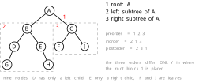
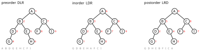
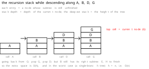
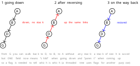

# 数据结构 · 第九周第二节 · 二叉树的遍历与逆转链 · 详细版讲义

> **来源说明**：本讲义依据 **10 月 28 日**那一次课的课堂录音转写整理，并与严蔚敏《数据结构（C语言版）》6.3.1 对照校订而成，属**讲授稿性质的整理稿**。全篇以**第一人称**写成——写作者就是讲授者本人，课堂上的追问、点评都以「我」的口吻呈现。
>
> - **转写来源**：两份连续的 ASR 导出文字——`二叉树遍历课程讲解_导出原文.txt`（约 0.97 万字）与`二叉树遍历逆转链方法讲解_导出原文.txt`（约 0.15 万字），合计约 1.12 万字。**两份是同一次课的前后两段**：前一份最后一句是「刚才写的那个递归的算法，你跑到高级语言里面去怎么样，它没法运行」，后一份开口第一句就是「为什么呢？」——这是在接着解释「为什么递归算法在某些语言里跑不起来」。所以**合成一份讲义**，不做拆分。
> - **这一节的主线**：复习上节三条结论 → 遍历的定义（四个关键词）→ 访问与遍历的区别 → 课堂列举的十种走法（层次 4 ＋深度 6）→ 「左为先、左为上」是一条约定 → 先根／中根／后根三种次序与递归算法 → 展开法求序列 → 由序列反推二叉树 → 为什么研究非递归 → 栈寄存器回退信息 → **逆转链**与它的代价。
> - **这一节的边界**：课末我讲到「逆转链」这条路子并把它否掉了，转写在这一段之后**截断**（最后一句是「而且你这个处理过程也要花时间啊……实际上我们」）。所以**层次遍历的队列实现、线索二叉树的线索化算法**都不在本讲义内，只在末节点了一句它们的区别。
> - **教材对照范围**：**6.3.1 遍历二叉树**（遍历定义、$L,D,R$ 六个排列、先／中／后序的操作定义、递归算法、表达式树的前缀中缀后缀、非递归中序、时空复杂度、以及「利用指针域暂存遍历路径可省栈但时间损失大」那句判词）。教材 6.3.2 线索二叉树属于下一节。
> - **一处必须交代的还原缺陷**：课上让大家现场练的那棵 8 结点树，学生口答的序列在转写里被打散（「中根是 A 不是 B，然后 G 然后 D 然后 A 然后 E……」），**这棵树的形状与那两问的答案都无法从转写唯一还原**。所以正文的演算**另画了一棵 9 结点的树**（三种序列都逐一算过、并用两种方法交叉验证），随堂题的答案**没有编**，列进了「待核实内容」。
> - **一处必须点名的转写讹误**：讲"某些语言不支持递归"时，转写是「比如说**化学语言**对不对花群语言」——**这是 ASR 对语言名称的错识**，仅凭文字无法确定是哪一门。所以正文只说"某些早期语言或实现"，**不把它断言成 FORTRAN**（现代 Fortran 是支持递归的）。
> - **编号说明**：我沿用的章节号比严蔚敏教材**大 1**——我的「第 7 章 树和二叉树」＝教材**第 6 章**。标注教材出处时一律用教材真实章节号。
> - **时间说明**：本节课为**文字模式**（无音视频轨、无关键帧），各节时间戳是按**字数折算的伪时间**（约 200 字／分钟），非音频真实时间，只作讲义内部单调递增的定位坐标；全课伪时间长约 1 小时 16 分。
> - **示意图说明**：正文里的示意图**全部是独立的 SVG 矢量图片**，存放在 `数据结构/插图/`（`w92_01` ～ `w92_04`），正文用 `` 直接嵌入。SVG **不依赖插件、不需要联网**，在阅读视图、导出 PDF、任何 Markdown 查看器里都能显示，放大不糊。图的 TeX 源保存在 `插图/figlib_w92.py`，要改图取出来重渲即可。
> - **关联阅读**：[[数据结构 第九周第一节 树与二叉树 详细版讲义]]（上一节：二叉树的性质与存储结构，本节复习的三条结论就出自那里）、[[数据结构 第五周第二节 栈的应用与递归 详细版讲义]]（本节后半段反复用到的"栈"与"递归"两套基本功）、[[数据结构 第六周第一节 队列 详细版讲义]]（层次遍历要用队列，属下一节）。

## 开场导读

这一节只讲一件事：**遍历**。

它是上一节课末我预告过的「**最重要的操作**」。为什么最重要？因为**二叉树的其他几乎所有操作，底子都是遍历**——求结点数、求深度、找双亲、判相等、复制一棵树、销毁一棵树，全是「按某种次序把每个结点走一遍，边走边做」。所以遍历不是「又一种操作」，它是**树的操作系统**。

我开场先做了两件事。**第一件是复习**上一节那三条最容易搞混的结论——**非空二叉树都有 $n_0=n_2+1$**（不需要是完全二叉树，但空树要排除）、**完全二叉树前 $H-1$ 层必满、不满只在最后一层且从左到右**、**编号从 1 连续编时，最后一个非叶结点的编号是 $\lfloor n/2\rfloor$**（这条依赖完全二叉树和编号方式，不能往任意二叉树上套）。我特意说了一句「**你别死记硬背，随便画一棵小树嘛**」——这三条都是**画一棵小树就能验**的，验一遍比背十遍管用。

**第二件是立规矩**：遍历的定义我抠得很细，四个词一个个过——**给定的**数据结构、**系统的**（有规律、有规则，不是东一榔头西一锤子）、**访问**（对元素做某种操作）、**仅一次**（公平性）。这里有个**用词的讲究**，是本节第一个考点：

> **访问是针对元素（结点）的；遍历是针对结构（整棵树）的。**
> 所以先序遍历的正确说法是「**访问根结点、遍历左子树、遍历右子树**」——**左、右那两处绝不能写成"访问"**。

接着我告诉大家一件事：**课上能数出十种走法，不是三种**。按层次走，层间两个方向、层内两个方向，**两两组合是 4 种**；按深度走，把树看成**根／左子树／右子树**三块，**全排列 $3!=6$ 种**。这 4＋6 是**课堂列举的两组规则**，**不是世界上所有遍历方式的穷尽**——比如隔层换方向的"之"字形走法就不在这十个里。只是我们约定**"左为先、左为上"**，6 种里去掉一半，剩下 3 种，才是书上那三种。为了说明「左为尊」是**约定**而不是数学必然，我讲了小半节课的酒桌座次——**上位为尊、左为尊**。这段听着像闲话，但它回答的是真问题：**为什么偏偏"先左后右"？** 答案是约定俗成；**各地各时代的座次习惯并不一致**，所以这些类比只能帮你们记，**不能当成遍历规则的历史来源**。

三种次序讲完，我落到本节最实在的两段。**一段是手算**：**展开法**——把树拆成根、左、右三块，按次序排，再对每棵子树重复。这里我特意堵了两个"小聪明"：**中序不是"把树拍扁了从左往右读"**（画图时结点的横坐标是画图人摆的，左子树深处的右孩子完全可能画到根的右边去），**后序的第一个也不一定是"一路往左走到底"**（根只有右孩子时，第一个是右边那个）。**另一段是反推**：给定**先序＋中序**或**后序＋中序**（且**各结点标识互不相同**）能唯一还原一棵树；但**只有先序不够**，**先序＋后序也不够**——$A$ 只有左孩子 $B$、和 $A$ 只有右孩子 $B$，这两棵树的先序都是 $AB$、后序都是 $BA$，光看这两条序列分不出是哪棵。

最后落到「**为什么非要研究非递归**」。理由不是效率，是**能不能跑**：**递归本身就要用栈**（系统替你管的递归工作栈），而有的语言或实现对递归有限制、有的环境怕栈溢出。于是引出**栈**：二叉树有分叉，遍历要压成一维序列，**回退的时候得知道"我从哪儿来"**，这个"来路"通常就存在栈里。**那能不能不用栈？** 这才有了课末那条野路子——**逆转链**：下降的时候临时把指针反过来，回退时沿逆向路径找上级，回来再改回去，栈就省掉了。我把原理讲清楚之后，**当堂把它否了**：它要**临时改写公共结构**（别人正在读这棵树就会读到中间状态），**一旦中途异常退出、恢复没做完，树就留在半改状态**；再加上要额外判别方向、实现复杂、可读性差。判词是：**不提倡，没有实际应用价值**。

这一节信息量不算大，但**三处最容易丢分**：**「访问」与「遍历」的用词**、**三种序列的展开法**、**"哪种序列组合能唯一还原"**。其余（十种走法、酒桌座次、逆转链）是**理解性内容**——考得浅，但它们是后面讲线索二叉树、讲非递归算法的地基。

## 总览知识地图

这一节两条线：**「遍历是什么、怎么写出来」**和**「不用栈行不行」**。

- **概念**：遍历的定义四要素（给定结构／系统的／访问／仅一次）；**访问针对元素，遍历针对结构**。
- **走法**：课堂列举 **层次 4 种 ＋ 深度 6 种**（非穷尽）；约定"左为先"后，深度优先剩 **3 种**。
- **三种次序**：先根 $DLR$、中根 $LDR$、后根 $LRD$；名字标的是**根被访问的时机**。
- **手算**：展开法（拆三块 → 按次序排 → 递归下去）；两个边界（中序首项、后序首项）。
- **反推**：先序＋中序、后序＋中序（值互异）可唯一还原；先序＋后序不行。
- **实现**：递归（工作栈 $O(h)$）→ 显式栈 → 其它无栈手段（父指针、临时改指针）。
- **代价**：逆转链省了栈，换来**共享性**与**异常恢复**上的风险；它与**线索二叉树**不是一回事。

## 正文

### 一、先复习：上节那三条结论，画一棵小树就能验 `00:00-00:03`

开讲之前我先把上一节的三条结论过了一遍，因为**这一节要用它们**，而且它们**最容易搞混**。

**第一条：非空二叉树的 $n_0=n_2+1$。**

> 大家一定要注意：这个二叉树的话呢，前面讲的那个，一个是**完全**二叉树的性质，一个是什么呢？一个是**任意**二叉树的性质，**你别搞混了**。对于**任意一棵二叉树**，都有 $n_0=n_2+1$——**这个不需要是完全二叉树**。

我课上紧接着说了一句方法上的话：

> 你也**不要去牢记、死记硬背**——你**随便画一棵二叉树嘛**。画一个二叉树，你看这个 $n_0$ 等于几啊？

**"随便画一棵"** 是应对所有度数关系题的通法。但有一条要补上：**这个式子对空树不成立**。空树里 $n_0=n_2=0$，$0\neq 0+1$。所以严格的说法是「**非空**二叉树」。做题时题目一般默认非空，但你要知道这个前提在哪儿。

推导只有两行，比记忆可靠：**边数**一方面等于 $n-1$（$n$ 个结点、$n-1$ 条边），另一方面等于 $n_1+2n_2$（度为 1 的结点出 1 条边、度为 2 的出 2 条）；再配上 $n=n_0+n_1+n_2$，就得到 $n_0=n_2+1$。

**第二条：完全二叉树的结构性质。**

> 完全二叉树的性质非常好：**高度为 $H$ 的话，前面的 $H-1$ 层一定是一棵满二叉树**；**不满存在最后一层**；并且**从左到右进行存放**。

这三句是连在一起的，缺一句都不完整：

1. **上面 $H-1$ 层全满**；
2. **不满只在最后一层**；
3. **最后一层从左到右连续填、中间不跳号**。

**第三句是本节后半段的伏笔**——「从左到右」这四个字，就是**层次遍历**的定义。

**第三条：内部结点的最大编号。**

> 然后我们就能知道：**有孩子结点的这些结点，编号最大的一个是 $\lfloor n/2\rfloor$**。一旦**超过 $\lfloor n/2\rfloor$，那些结点都是叶结点**。

这条要加三个前提，否则会误用：

- **必须是从 1 开始、按层序连续编号**（这是完全二叉树的编号法，不是随便标号）；
- **完全二叉树**——任意形态的二叉树没有这种"编号与位置对应"的关系；
- **$n\geqslant2$**；$n=1$ 时整棵树只有一个根，它没有孩子，谈不上"非叶结点"。

$$
\boxed{\;\text{完全二叉树（}n\geqslant2\text{、1 起连续编号）：最后一个非叶结点编号}=\left\lfloor\frac{n}{2}\right\rfloor\;}
$$

**三条结论的共同点**：都能用「**画一棵小树**」或「**代一个小 $n$**」当场验掉。**这就是我让你们做的动作**——不是背，是**验**。

**本节要点**

- **$n_0=n_2+1$ 对非空二叉树成立**（任意形态都行），**空树除外**；
- 完全二叉树三句话：**前 $H-1$ 层全满 ＋ 不满只在最后一层 ＋ 从左到右连续**；
- **最后一个非叶结点编号 $=\lfloor n/2\rfloor$**，前提是**完全二叉树 ＋ 1 起连续编号 ＋ $n\geqslant2$**；
- 三条都**画一棵小树就能验**——不要死记硬背。

### 二、遍历为什么是"最重要的操作" `00:03-00:06`

进入正题。我开口先给了一句定性：

> 这节课我们开始讲**遍历二叉树**。**遍历这个操作，实际上对我们计算机信息处理来说，是非常重要的一个运算。**

"重要"在哪儿？先说它的**普适性**：

> 实际上我们对**线性表、对树、对图、对森林，都可以谈遍历**。像这样的操作，**对任何结构都可以谈**。

**遍历是少有的"跨结构通用"的运算**——线性表能谈、树能谈、图能谈、森林能谈。这一点很特别：**插入、删除、查找，每种结构的做法都不一样，连名字都不一样**；但**遍历对谁都能说**，说的是同一件事——**把结构里的每个元素都过一遍**。（注意"少有"不是"唯一"：求规模、判空这类操作同样可以跨结构谈。）

**那为什么线性结构的遍历不用单讲，树的遍历要单讲？**

> 只不过在**线性结构**当中，这个**遍历的运算非常简单**，我们**就不单独把它拎出来**讲。但是到了**树结构**，我们面临**非线性结构**，这个问题就**稍微复杂一些**了。

**对比一下就很清楚**：

| | 线性结构 | 二叉树 |
|---|---|---|
| 一个元素有几个"后继" | **1 个** | **最多 2 个** |
| 走法有几条 | **只有一条** | **每到一个结点都要选方向** |
| 要不要事先"设计次序" | **不要**，从头走到尾 | **要**，必须先定规则 |
| 会不会"回退" | **不会** | **会**，而且回退要记住"从哪儿来" |

看最后一行：**回退**。这就是本节后半段那一大堆东西（栈、逆转链）的根源。

然后我把遍历**提到"处理过程"的高度**：

> 遍历实际上谈的就是**对我们整个一个结构，做一个一体化的处理过程**。就**每个结点都要给他处理到**，最终**形成一个序列**的这样一个过程。

「**一体化**」这个词用得好：**遍历不是"一个动作"，是一整套"走法＋处理"的组合**。所以它才需要单独定义、单独设计算法。

**难度到底在哪儿？** 一句话：**非线性结构里，"下一个"不是唯一的**。线性表说"下一个"，指的就是 `next`；树里说"下一个"，**得先问"按哪种次序"**。**这就是遍历在树上变成一门学问的全部原因。**

**本节要点**

- 遍历是**跨结构通用**的运算：线性表、树、图、森林都能谈（不是"唯一"能通用的，但确实通用）。
- 线性结构的遍历**简单到不必单列**（只有一条路、没有分叉、不用回退）；树的遍历**必须设计次序**，所以成了专门课题。
- 遍历是**"一体化处理过程"**：每个结点都处理到，最终产生**一个序列**。
- 树的遍历难在**"下一个"不唯一**，以及**回退要记住来路**——后者直接引出栈（第十四节）。

### 三、遍历的定义：四个词逐个抠 `00:06-00:12`

我给的定义是标准的：

> 对于**给定的数据结构**，**系统地访问**该结构中的**每个结点**，并且**每个结点仅可以访问一次**的操作过程，我们就称为**遍历**。

四段话，我**一段一段拆开**讲，因为每一段都藏着考点。

#### 3.1 「给定的数据结构」——得先说清是什么结构

> **对于给定的数据结构**，啥意思呢？**这个数据结构是你给我的是给定的**。因为我们刚才说了，你可以对树谈遍历，对森林谈遍历，对图谈遍历，**线性表也谈遍历**。那**到底是对哪种数据结构谈遍历呢**？**每一种数据结构它具体的遍历方法是不一样的**。所以我们要**对于给定的数据结构**——**你要告诉我是什么样的逻辑结构**。

这段话的意思是：**"遍历"这个词不带方法，方法是由结构决定的。** 你只说"遍历这棵树"，等于什么也没说——**必须先说"按先序"还是"按层次"**。

考试里很实在：题干若只说「写出该二叉树的遍历序列」，**这题是不完整的**，一定有前后文限定次序。

#### 3.2 「系统的」——有规律，不是东一榔头西一锤子

> 再一个就是**系统的**。所谓的系统的，就是**有规律的、有规则的，不是杂乱无章的**，**按照一定的次序**。也就是说我们做这件事儿——不能杂乱无章地**东一榔头西一锤子**那么做。所以**有规律、有规则**。

「**东一榔头西一锤子**」这个说法很传神：**你也可以把每个结点都"碰"一遍，但那是乱撞，不是遍历**。遍历要求**可复现的、确定的次序**——**同一棵树、同一条规则，走出来的序列必须完全一样**。

这条要求背后是工程约束：**遍历序列要能当"数据"用**。比如把一棵树存成文件再读回来重建，靠的就是"某种遍历序列 ＋ 空标记"（教材算法 6.4 的 `CreateBiTree` 就是按先序序列建树）。**次序不确定，存下来的东西就重建不回去。**

#### 3.3 「访问」——对元素做某种操作

> 第三个词，**访问**。访问指的是啥呢？**访问实际上指的就是对元素进行的某种操作**——**是一个操作**。只不过这个操作比较重要，所以我们用了**"访问"**这个词儿。

这里我讲了很长一段"用词的讲究"，解释**为什么偏偏用"访问"这么文雅的词**：

> 我们现实生活中，根据语境不同、**因人而异，用词就不一样**。比如说你的**高中同学**过来，**拜访你**；或者你一个**老乡**来找你玩，那你就领着他**在校园里逛了一圈**。旁人问你，你说「我带我老乡逛一下」。

> 那同样是"逛"，人不一样怎么样？比如说曾经——应该是前几届了——有一位**外校的书记**也来我们校区**逛了逛**。第二天**学校的主页上面挂的新闻是啥呢**？「**某某书记来我校视察工作**」。

**同样是在校园里走一圈，老乡来了叫"逛"，书记来了叫"视察"。** 我课上把这个对比一路推下去：

> 所以**访问这个词儿也是一样**。比如说你**出国留学**，那人家**领导**出国叫啥？**不叫出差，叫"访问"**。为啥？因为它是一种**比较重要的活动**——他有可能**签订了一个条约**，有可能**参观了某个工厂**，有可能**进行了一场谈判**，有可能**做了一个比较重要的报告**。**你看，因人而异，人家叫"访问"。**

**结论**：**"访问"指的就是对元素的某种操作**，只不过这种操作在计算机里**比较重要**。

**为什么重要？** 因为**遍历的"信息产出"全在"访问"这一步**。走法只是"路"，**"访问"才是"摘果子"**。所以要把 `Visit` 当成**一个参数**来理解——**同一套走法，换一个 `Visit`，就是另一个功能**。

#### 3.4 为什么教科书都用「输出结点信息」代替「访问」

> 但是因为还是**模型问题**啊，**这个"访问"的动作不好具体化**。所以**大部分的教科书**，这个"访问"都干嘛呢？**用"输出结点信息"来进行替代**。

> 那你想一下，我把这个结点信息**打印输出**，是不是一种操作？**是的**。当然你也可以有很多别的操作——比如说**修改结点信息**，比如说后面的**线索化**等等之类的那些个操作都行。我们**统一用输出结点的信息来进行替代**，简单点——**因为我们谈模型问题嘛**。

**这段话解释了一个常见困惑**：为什么教材上所有遍历例题都是 `printf`？**不是因为遍历只能打印**，而是因为**"打印"是最容易写、最容易验的一种 `Visit`**。**"访问"是一个占位符**，具体做什么由你填。

| 你想做的事 | 对应的 `Visit` 做什么 |
|---|---|
| 输出序列（教材默认） | 打印结点值 |
| 统计结点数 | 计数器加一 |
| 求和 | 累加到总和 |
| 找最大值 | 与当前最大值比较 |
| 判两棵树是否相同 | 逐点比较 |
| 复制一棵树 | 边遍历边建新结点 |
| **线索化**（下一节） | 填空指针、填标志位 |

**同一套走法，七种用途**——这就是"`Visit` 是参数"的意义。

#### 3.5 最后一个词：「仅访问一次」

> **我们对每个结点仅访问一次**。**为啥只访问一次呢**？这个体现了什么？体现了**公平性**。就**我对于这个结点当中的每个对象，他们的地位是平等的**，所以每个结点**做且仅做一次**。

「**公平性**」这个说法很轻，但它其实是**定义的技术核心**：

- **漏掉某个结点** ⇒ 不是遍历（不"系统"）；
- **某个结点访问两次** ⇒ 也不是遍历（不"仅一次"）。

**为什么要较这个真？** 因为**访问可能有副作用**。如果 `Visit` 是"给计数器加一"，访问两次结果就错了；如果是"修改结点"，可能改两遍。所以**"仅一次"不是修辞，是正确性条件**。教材的定义也是这么写的：「使得**每个结点均被访问一次，而且仅被访问一次**」。

还有一句要分清：**"仅访问一次"说的是 `Visit` 只作用于每个结点一次，不是说算法只"碰到"每个结点一次**。走的过程中会反复经过祖先、会检查空指针，那是**路径**，不是**访问**。

**本节要点**

- 定义四段：**给定结构**（方法由结构定）、**系统的**（有规律、可复现）、**访问**（对元素做某种操作）、**仅一次**（公平性／正确性）。
- **用词讲究**：老乡来了叫「逛」，领导来了叫「视察」，领导出访才叫「访问」——**重要的操作才配叫"访问"**。
- **教科书用"输出结点信息"代替"访问"**，是因为谈模型问题时"访问"没法具体化；**"访问"是占位符，`Visit` 才是真动作**。
- **"仅一次"是正确性条件**：`Visit` 有副作用，重复访问就会错；但"仅访问一次"不等于"只经过一次"。

### 四、「访问」与「遍历」：一个针对元素，一个针对结构 `00:12-00:16`

上一节把两个词分开讲了，这一节把它们**对立起来**——这是本节第一个**会扣分**的地方。

> 那我们要**稍微强调一点**：**访问是一个动作**，它是**针对某个元素**来谈的，或者说**针对某个结点**来谈的。但是我们的**遍历**，它是**针对结构**来谈的。

为什么？理由很朴素：

> 因为你是针对一个结构——比如说我拿到一棵二叉树、拿到一棵树，那么这棵树里面**就不可能只有一个结点**，它是**有结构的**。那我们拿到一棵二叉树谈什么呢？谈**遍历**。

> 这个结构里面**有可能有多个元素**，那我们对**每个元素都进行访问一次**，那么就会**形成一个序列**。所以**遍历实际上是对结构来谈的**。

于是这条对照就成立了：

| | **访问** | **遍历** |
|---|---|---|
| 对象 | **一个元素（结点）** | **一个结构（整棵树）** |
| 是什么 | **一个动作**，一次具体操作 | **一个过程**，一系列访问的**统称** |
| 结果 | 对那个元素做了什么 | **一个序列** |
| 能说"访问左子树"吗 | **不能** | **只能说"遍历左子树"** |

我把最后一行单独拎出来，因为它就是**扣分点**：

> 所以**遍历实际上是一个运算过程的统称**——我们拿到一个结构，对这个结构整体地处理一下，**形成一个序列**。所以**遍历是针对结构来谈的**，而**访问是针对元素来谈的**。**遍历一定会形成一个序列**。

**为什么"访问左子树"是错的？**

> **根结点是"访问"**，为什么根结点是"访问"？**因为根结点只有一个结点**，那我们是**访问**——访问是一个动作嘛。而**对于左子树，它是一个结构**啊，我们需要谈什么呢？**遍历**——因为**遍历是针对一个结构来谈的**。

**一个结点 = 一个元素 = 只能"访问"；一棵子树 = 一个结构 = 只能"遍历"。** 层次分明。

然后是我的"威胁"：

> 所以**如果期末考试问到先序遍历的遍历方法是啥**，有的同学瞎来——「**遍历根结点、访问左子树、访问右子树**」。**我要扣分的啊！再次强调这个说法。**

**正确的说法只有一种**：

$$
\text{先序}=\textbf{访问根结点}+\textbf{遍历左子树}+\textbf{遍历右子树}
$$
$$
\text{中序}=\textbf{遍历左子树}+\textbf{访问根结点}+\textbf{遍历右子树}
$$
$$
\text{后序}=\textbf{遍历左子树}+\textbf{遍历右子树}+\textbf{访问根结点}
$$

**看这三个式子的用词**：`访问` 只出现在**根结点**那一处，`遍历` 出现两次（左、右子树）。**一个字都不能换。**

**为什么这个区别这么要紧？** 因为它反映的是**递归的层次**：`Visit(p)` 是**终止动作**，`Traverse(T)` 是**递归展开**。你写「访问左子树」，等于**把一次递归调用降格成了一个动作**——**逻辑上塌了一层**。考试扣分不是因为抠字眼，是因为**你暴露了没理解递归结构**。

**本节要点**

- **访问**针对**元素（单个结点）**，**遍历**针对**结构（整棵树）**；**遍历是访问的统称，结果是一个序列**。
- **「访问左子树」是错的**，只能说「**遍历左子树**」——**左、右子树是结构，不是元素**。
- 三种次序的规范表述：**只有根结点用"访问"，左右子树一律用"遍历"**。
- 实质是**递归层次**：`Visit` 是终止动作，`Traverse` 是递归展开——把递归调用降格成动作，逻辑就塌了一层。

### 五、课上能数出十种走法：层次 4 种 ＋ 深度 6 种 `00:16-00:22`

定义讲完，我问了一个问题：**既然要"按一定次序"，那有哪些次序？**

> 那接下来我们再看一下：二叉树我们说遍历，**按照某种次序**——那他**有哪些遍历次序**呢？就是我们**按照什么规则来进行访问**呢？

我把答案分成**两大类**，而且**先把数报出来**：

> 实际上**遍历的策略，总共是两大类**。其中**层次是有 4 种**，**深度实际上是有 6 种**。只不过大部分教科书重点就谈了**这三种**。

#### 5.1 层次：靠"两个方向"数出 4 种

> 给你一棵二叉树，你会发现它有**明显的层次性**——**根结点是第一层，然后孩子是第二层，依次类推**。所以既然它有层次性，那**第一种遍历的策略就是层次策略**。

层次的走法是"**一层一层过**"。而"层"这个字里含了**两个方向**：

> 层次策略，**按照我们的书写规则**，我们可以**从上到下**——**第一层先处理，再处理第二层、第三层**。那另外**同一层当中，我们又有两个方向**，比如**从左到右**。

> 那你既然有**从左到右**，那我也**可以从右到左**——**咱们老祖宗写字不就从右到左吗？毛笔字**。那你可以**从上到下**，我也可以**从下到上**。**你两个方向，上下、左右，所以组合起来有四种。**

$$
\underbrace{\{\text{上}\to\text{下},\ \text{下}\to\text{上}\}}_{\text{层间方向}}\times
\underbrace{\{\text{左}\to\text{右},\ \text{右}\to\text{左}\}}_{\text{层内方向}}=4\ \text{种}
$$

**要注意两点**：

1. 这是**在这个分类下的 4 种**，不是层次遍历的全部可能。比如**隔层换方向的"之"字形**（第一层左→右、第二层右→左……）就不在这四个里；
2. **通常说的"层序遍历"**，指的就是"**从上到下、同层从左到右**"这一种，实现上用**队列**（下一节）。

**"老祖宗从右到左写字"** 这句闲话其实在提醒：**方向的选择是约定，不是必然**。

#### 5.2 深度：从递归定义里数出 6 种

> 第二大类呢，我们是**深度策略**。深度策略是因为**根据二叉树的定义**——二叉树的定义是**递归定义**，它**明显地有三个部分：根结点、左子树、右子树**。

> 那我把它**抽象成三个部分**，我们就可以**先根结点**，然后**再处理它的左子树**，然后再**处理它的右子树**。

**"三块"** 是深度策略的全部秘密。我用"往下纵深"来形容它：

> 每次我拿到一棵新的左子树，我就可以**往下纵深方向延伸一次**——**往纵深方向行，不断地推进**。所以这个叫**深度策略**。

**为什么三块能生出 6 种？** 因为**三块的全排列是 $3!=6$**：

$$
P_3=3\times2\times1=6 .
$$

把"访问根"记作 $D$（Data）、"遍历左子树"记作 $L$、"遍历右子树"记作 $R$，六种就是：

$$
DLR,\quad LDR,\quad LRD,\quad DRL,\quad RDL,\quad RLD .
$$

教材原话一样：「以 $L$、$D$、$R$ 分别表示**遍历左子树、访问根结点和遍历右子树**，则可有 $DLR$、$LDR$、$LRD$、$DRL$、$RDL$、$RLD$ **这 6 种方案**。若**限定先左后右**，则只有前 3 种，分别称之为**先（根）序、中（根）序和后（根）序**。」

**注意教材用 $D$ 而不是 $V$**——$D$ 是 Data，提醒你**根要做的是"访问"（取其数据），不是"遍历"**。这跟第四节那个用词讲究是同一件事。

**为什么去掉后 3 种？**

> 那根据我们**中国人，或者说应该全世界都是**，干什么呢？**左为先，左为上**。那么我们规定**先处理左子树、再处理右子树**的话，就**只剩下 3 种**。

**"中国人，或者说全世界都是"** 这句话很关键：**"先左后右"不是中国特产，是人类书写的通例**。**所以它是一条约定，而不是一条定理。** 右先左后同样能定义出一套自洽的遍历，只是我们不这么约定。

#### 5.3 「十种」这个数要怎么说才准确

我要把话说死一点，免得你们出去跟人抬杠：

- **4＋6＝10，是"课堂上列举的两组规则"的数量**；
- **它不是"世界上所有遍历方式的穷尽"**——隔层换向、按深度选不同规则、乃至"先按层次再按深度"的混合走法，都能定义出合法的遍历；
- **同理，也不能说"遍历一定能唯一确定一个序列、所以树的信息量就是 $n$ 个数"**——序列由"树＋规则"共同决定，规则一换序列就变。

**考试怎么写？** 题目问"二叉树有几种遍历方案"，**按教材答 6 种（限定先左后右则 3 种）**；问"有哪些遍历策略"，**层次 4 ＋深度 6 的说法也成立**，但要加"**这是常见的两类划分**"。附录 A 我把这个差别单独标了出来。

**本节要点**

- **层次 4 种** ＝ 层间方向（上→下／下→上）× 层内方向（左→右／右→左）；常说的"层序遍历"只是其中一种，用**队列**。
- **深度 6 种** ＝ 把树看成**根／左／右**三块，**全排列 $3!=6$**：$DLR,LDR,LRD,DRL,RDL,RLD$。
- 教材用 $D$（Data）而非 $V$：**根要做的是"访问"，不是"遍历"**。
- 约定**左为先、左为上**（人类书写通例），6 种去一半，**只剩先根、中根、后根**。
- **4＋6＝10 是课堂列举的两组规则**，**不是全部遍历方式的穷尽**。

### 六、为什么「左为先、左为上」：酒桌上的规矩 `00:22-00:26`

上一节留了一句话没解释：**为什么偏偏规定"先左后右"？** 我花了小半节回答它，因为**这个问题不回答，"三种次序"就永远是硬背的**。

> 那为什么**左为先、左为上**呢？这个实际上**又有生活的来源**。

我举的场景是**吃席的座次**：

> 比如说你在农村**吃席**，**四四方方的这个桌子**，来了一位**长者**，你为了表示尊敬，**把他让到哪个位置合适啊**？**哪个位置是最尊的**？

> 现在有 4 个选项——这是 4 条长凳子，你把它放到哪个位置合适？**最上面这就是尊者，上位为尊嘛**。

**第一步结论：上位为尊。**

然后我把问题**逼进一步**，这是这一段的精彩处：

> 那么问题是，**这上首这一条长凳上摆着两个人呢**？**1 和 2，哪一个更尊**？

> 你有没有看**连续剧**？比如说那个**皇帝、皇后**坐在座位上，那个**金銮宝殿**上，你有没有观察一下**皇帝坐在哪**呢？

我的答案**是从皇后那边推出来的**：

> **这个位置更尊，为啥？** 因为**皇后坐在这儿**——你想一下，**1、2 并排坐，对于皇后来说，2 号位置，她的左边是谁？她的左边是皇帝**。所以我们**左为尊、左为上**，**就这么来的**。

**注意这个推理链**：皇帝必须比皇后尊 ⇒ 皇帝的位置定下来 ⇒ **从皇后的视角看，皇帝在她的"左边"** ⇒ 所以**左为尊**。**"左"这个字是站在"次尊者"的视角说的**——这一点很多人没想过。

> 你别说——人家来一个**辈分比你高的**，你赶紧**让他坐到这儿**；你给他坐到别处啊，**那一看就不懂规矩**。

**"不懂规矩"** 这四个字说明：**座次是有强约束的社会规则，违反会被识别为失礼**。我说这个，是想让你们体会**"约定"的力量**——它不需要论证，但**违反了就出局**。

然后我给了两个"升级版"的场景，因为它们展示了**规则怎么在约束变化时被修补**：

**场景一：圆桌怎么办？**

> 但有人说**现在不对呀，现在是圆桌，圆桌咋办**？来了一个尊者，**你让他坐哪儿**？

> 如果说**这是门**，你让他坐哪儿？**坐正对着门的那个位置**。为什么呀？因为**门这边是比较危险的**，并且是**上菜的地方**。所以**对着门的位置是尊位**。

**"上位为尊"在圆桌上失效了**（圆桌没有"上"），于是规则换成**"面门为尊"**。**规则变了，但"要有一个最尊位置"这个需求没变**——这就是**约定**的本质。

**场景二：敬酒的杯子该多高？**

> 还有一个，比如说你去**敬酒**，有好多同学就不懂啊——**你明明是怀着敬意去敬人家酒**，结果你把这个酒**给高高抬起**。你**应该要干啥**？这个**酒杯高度一定不能高于**你去敬酒的那个人。

> 往往很多人还会专门**手托着他的杯子**，自己再去敬——这都有**文化底蕴**在里面的。

**这三段合起来在讲什么？**

> 所以**左为先**——那左为先的话，我们怎么样？**因为根节点先处理**，所以我们这个叫**先根**。然后**根节点在中间处理**，所以叫**中根**。那么**根节点最后处理**，我们叫做**后根**。

**座次讲完了，三种次序的名字也就出来了。**

最后必须补一句**边界**，否则这段会被误读成"历史考证"：**各地、各时代的座次习惯并不一致**（有的场合以右为尊），**书写方向也不统一**（古人竖排从右往左，今人横排从左往右）。所以这些类比**只能帮你们记住"这是一条约定"**，**不能当成"先左后右"来自中国酒桌"的证明**。**我要你们记住的是"它是约定"，不是"它来自哪儿"。**

**本节要点**

- **上位为尊**（四方桌）；两人并排时**左为尊**——因为**皇帝坐在皇后的左边**，"左"是**站在次尊者视角**说的。
- 圆桌上"上位"失效 ⇒ 改成**面门为尊**（门是危险的、上菜的地方）；**敬酒杯沿不能高于对方**。
- 这些例子说明**"先左后右"是社会约定，不是数学必然**——**约定不需要论证，但必须全程一致**。
- **但座次习惯与书写方向各地各代并不一致**，类比只能帮助记忆，**不能当作遍历规则的历史来源**。
- 由此得名：**根先处理叫先根，根中间处理叫中根，根最后处理叫后根**。

### 七、先根、中根、后根：名字标的是「根什么时候被访问」 `00:26-00:28`

座次讲完，我把三种次序的名字交代清楚。先说**这套名字不是唯一的**：

> 二叉树的遍历规则呀，**并不只有这 3 种**——大家一定要注意。很多教科书**重点就谈了这 3 种**，但是你**一定要反应过来**：实际上**是不止这三种的**。

然后给一张"**别名表**"，这张表在考试里很实用，因为**同一个东西在不同书上叫法不同**：

| 次序 | 本课叫法 | 常见别名 | 根的位置 |
|---|---|---|---|
| $DLR$ | **先根**遍历 | 先序、前序、前根 | **最先** |
| $LDR$ | **中根**遍历 | 中序、**对称序**、内序 | **中间** |
| $LRD$ | **后根**遍历 | 后序、后根 | **最后** |

我课上专门点了中序的别名多，因为**它用得最多**：

> **中序遍历**……我们也叫**中根遍历**，它是**广泛使用的一种次序**。所以**应用的场合多了，叫法也就很多**：比如说有叫**对称序**的，有叫**中序**的，有叫**内序**的。

**为什么中序又叫"对称序"？** 因为 $LDR$ 的访问顺序**关于根对称**——**根的左边全在它前面访问，根的右边全在它后面访问**。这个"对称"是**处理位置上的对称**，**不是数值上的中点，也不是左右子树结点数一样多**（我们那棵示例树，根左边 5 个、右边 3 个，一样叫中序）。这个区别下一节讲二叉排序树时会用到。

**命名的一句话总结**：

> **根节点先处理，叫先根；根节点在中间处理，叫中根；根节点最后处理，叫后根。**

**"根"这个字放在名字里，标的是"根被访问的时机"**——不是"从根开始"的意思。这一点容易误会：**后序遍历也是从根出发的**，只是**根最后才访问**。

**本节要点**

- 三种次序的名字标的是**"根被访问的时机"**：先根（最先）、中根（中间）、后根（最后）；**三者都从根出发**。
- **别名**：中序＝**对称序**＝内序；先序＝前序＝前根；后序＝后根。
- "对称"指**处理位置**关于根对称，**不是数值中点、也不是左右结点数相等**。
- **遍历规则不止 3 种**，只是教科书重点讲这 3 种。

### 八、先序遍历：定义、用词与递归算法 `00:28-00:36`

先看**先根（先序）遍历**的定义。教材的写法是：

> 若二叉树为空，则**空操作**；否则
> (1) **访问根结点**；
> (2) **先序遍历左子树**；
> (3) **先序遍历右子树**。

我课上的说法：

> 首先**先根遍历**。**二叉树为非空的，那我们就处理**；当然对于**空的**，我们说你**没有对象，那就不用做任何动作**。如果说**非空**，那我就**先访问这个结点，然后遍历左子树，然后遍历右子树**。

**注意这句话的用词**：`访问`这个结点、`遍历`左子树、`遍历`右子树——**和第四节讲的规范完全一致**。

#### 8.1 先拿一棵树来：这一节反复用的 $T$

下面这棵 9 结点的树是本节的"主角"，请记住它——**先序、中序、后序、栈、逆转链，全都拿它当例子**：



> **图注（二叉树 $T$ 与它的"三块"分解）**：全树 9 个结点。$A$ 是根；$A$ 的左子树以 $B$ 为根（$B$ 的左孩子 $D$、右孩子 $E$；$D$ 只有左孩子 $G$、$E$ 只有右孩子 $H$）；$A$ 的右子树以 $C$ 为根（左 $F$、右 $I$）。图中两个虚线框把树按递归定义拆成**三块**：**①根 $A$、②左子树、③右子树**。三种次序的差别**只在这三块的排列**：先序 $=①②③$、中序 $=②①③$、后序 $=②③①$——**"左为先"已经写进这三个式子里了**（②永远在③前面）。图上的红色数字标的是**这三块**的编号，**不是各结点的访问次序**。

**这棵树为什么好用？** 因为它把几个特殊情形都占全了：**$D$ 只有左孩子、$E$ 只有右孩子、$F$ 和 $I$ 是叶子**。上一节反复强调"二叉树即使只有一个孩子也分左右"，这棵树就是活证据——**$D$ 的 $G$ 在左，$E$ 的 $H$ 在右，位置不能互换**。

#### 8.2 递归算法：基本项不能省，但"动作"可以省

> 那因为你这是一个**递归的**，所以我们把这个程序**写成递归的是最自然不过**。

复一下递归函数设计的两件事：

> 递归函数设计的时候，你主要需要关注**两个方面**：第一个方面是**基本项**，第二个方面是**递归项**。那么**基本项**指的是啥？指的是**这个数据集最小的情况下**。

> 那这个地方，我说这个 `if (T != NULL)`——**这是什么项**？……这是**递归项**。**最小规模的基本项应该是啥？应该是 `T == NULL`。**

> 那问题是，**按理来说两种情况，我们用 `case` 语句，对吧？`if-else`**。但问题是 **`T == NULL` 的时候，我们说啥都不做**——**啥都不做，我们就不需要处理了嘛**。因为**你都没有对象，都不需要有动作**。所以我们这个**基本项直接省略、不用写了，啥都不做**。

**这里要卡一个关键区别，很多同学会听岔**：

- **可以省的是"空树时要做的动作"**（因为确实没有动作）；
- **不能省的是"空树时的返回值"**——如果函数返回 `Status`，**空树这条路径必须 `return OK`**，否则函数走到最后没有返回值，是**未定义行为**。

所以标准写法是这样（教材算法 6.1 的形状）：

```c
Status PreOrderTraverse(BiTree T, Status (* Visit)(TElemType e)) {
    if (T) {
        if (Visit(T->data))                            /* ① 访问根结点 */
            if (PreOrderTraverse(T->lchild, Visit))     /* ② 遍历左子树 */
                if (PreOrderTraverse(T->rchild, Visit)) /* ③ 遍历右子树 */
                    return OK;
        return ERROR;
    } else return OK;      /* 空树：不访问任何结点，但要明确返回成功 */
}
```

**三个细节**：

1. **`if (T)` 是递归项**，`else return OK` 是**基本项**——**动作可以省，返回值不能省**；
2. **`Visit` 是函数指针**——这就是第三节讲的"`Visit` 是占位符"在代码里的样子；
3. **三层嵌套 `if`** 靠**短路求值**：任何一步失败就 `return ERROR`。

**如果你写 `void` 版本**，那就没有返回值的问题，`if (T) { ... }` 自然结束即可：

```c
void PreOrder(BiTree T) {
    if (!T) return;                 /* 空树：直接返回 */
    visit(T->data);
    PreOrder(T->lchild);
    PreOrder(T->rchild);
}
```

**"空树也要递归进去一次吗？"** 这取决于实现：**上面两版都会对空孩子发起一次调用，然后立刻返回**。也可以在调用之前先判空、不发起调用——**两种都对**，只是前者的活动栈帧最多到 $h+1$ 层，后者的常数小一点，**渐近复杂度都是 $O(h)$**。

**我课上讲"没有对象怎么办"，用了一个特别好的比方**：

> 这就好比：**我让你去给某个教室跟学生谈个话**，结果你**推开那个教室门，结果没人**。没人咋办？**没人的话，那我就不喊了**，对不对？**没有对象嘛**——**我们的操作要有对象，我们的运算要有对象**。没有对象怎么办？**我就回来，啥都不做**。

> 但是怎么样？**这个门你还得推开一下**！为啥？**因为你不推开那个门，你咋知道教室里没人呢**？

**"门还得推开"** 对应到代码就是：**`if (T)` 这个判断本身必须执行**——你不能"预知"它是空的就不来。

#### 8.3 先序序列：$A\,B\,D\,G\,E\,H\,C\,F\,I$

按"访问根 → 遍历左 → 遍历右"走一遍：

$$
\text{先序}\;T=\underbrace{A}_{\text{根}},\;\underbrace{B,D,G,E,H}_{\text{左子树}},\;\underbrace{C,F,I}_{\text{右子树}}
$$

**左子树那一段**自己也是先序：$B$（根）、$D,G$（左子树）、$E,H$（右子树）。**再往里**：$D,G$ 是"$D$（根）+ $G$（左）+ 空（右）"。

$$
\boxed{\;\text{先序}=A\;B\;D\;G\;E\;H\;C\;F\;I\;}
$$

**验算小技巧**：**先序序列的第一个一定是根**，而且**任意一棵子树的先序序列，第一个就是那棵子树的根**。看到 $A\,B\,D\,G\,E\,H\,C\,F\,I$，你只能读出"$A$ 是整棵树的根"；**至于 $B$ 后面那段是 $A$ 的左子树、$C$ 前面那段是右子树，是因为序列里 $B$ 出现在 $C$ 之前且我们都按"左先右后"**——**仅凭一条先序序列，其实分不出 $B$ 是左孩子还是右孩子**（这一点第十二节还会说）。

**本节要点**

- **先序**：空则空操作；否则 **①访问根 ②先序遍历左子树 ③先序遍历右子树**。
- **递归算法**：`if (T)` 是递归项，**空树是基本项**；**"动作"可以省，"返回值"不能省**——`Status` 版本必须 `else return OK`。
- **`void` 版本**用 `if (!T) return;` 即可；**是否对空孩子发起调用**两种实现都对，**渐近空间都是 $O(h)$**。
- **先序序列 $=A\,B\,D\,G\,E\,H\,C\,F\,I$**；先序的第一个是根，但**仅凭先序分不出左右孩子**。

### 九、中序遍历：别名、「对称」与「第一个是谁」 `00:36-00:41`

中序（中根）遍历的定义：

> 若二叉树为空，则空操作；否则
> (1) **中序遍历左子树**；
> (2) **访问根结点**；
> (3) **中序遍历右子树**。

> 那它递归算法很简单：**先遍历左子树，再访问根结点，再遍历右子树**。

#### 9.1 「对称」这两个字

中序又叫**对称序**，为什么？我课上从"对称"这个审美讲起，讲了一长段，看似跑题，其实在**建立"为什么这个次序用得最多"的直觉**：

> **中序遍历**……它是**广泛使用的一种次序**。我们现实生活中应用非常多，比如说**男婚女嫁对称**，**古时候讲啥？门当户对**。

> 然后你看现实生活中的，比如说**凡是人身上的、有两个的，都是对称的**——**两只手、两只脚、两叶的肺、两只耳朵**。所以**对称怎么样？中国建筑也以对称为美**。

**"以对称为美"** 这四个字，我一路推到了**建筑**：

> 我们的建筑大多数**以对称为美**。凡是很讲究一点的人家，比如**皇宫**，或者一个**大户人家**，他的**建筑分布非常有规律**：**中间正对着的是正厅**，然后**左右两边有稍微矮一点的两个房子**，这两个房子叫什么？叫**耳房**。

> 那这种叫什么？在中国**风水学**上面有讲究，叫「**二鬼抬轿**」。

**"二鬼抬轿"** 这个说法很有意思：**中间高、两边低**，正是**中序遍历里"根在中间"的那个形状**——只不过建筑上是**空间**对称，遍历上是**处理次序**上的对称（左边处理完、访问根、再右边）。

**这里必须把"对称"说准**：$LDR$ 的对称，是**"根的左边全在它前面、右边全在它后面"**这种**位置上的对称**；**不是"根在序列正中间"**（我们这棵树根的左边 5 个、右边 3 个），**也不是"左右子树结点数相等"**。

> **顺带说一句边界**：课上还提到二进制、八卦、八位字节那些，说"二进制是中国人发明的""8 位字节来自八卦"。**这些是课堂上的联想，不能当结论**——二进制的历史是多源的，现代二进制算术与莱布尼茨等人的工作相关；**8 位字节是计算机体系结构演变与标准化的结果**，不能归因于八卦。**听个意思就行，别写进卷子。**

#### 9.2 「第一个访问的一定是谁？」

讲完定义，我**当场提问**，这是本节最实用的一问：

> 那好，我问一下大家：**拿到这棵二叉树的话，它第一个访问的一定是谁**？

> 所以我们一定是**沿着左孩子一路下来**的那个结点。所以**第一个访问的肯定是它**。

**结论**：

> **中序遍历的第一个结点，是"从根出发，一路沿左孩子走到底"的那个结点。**

**对树 $T$**：$A\to B\to D\to G$，$G$ 没有左孩子，**所以中序第一个是 $G$** ✓。

**这个结论要加半句**：**"沿左走到底"的那个结点，不一定是叶子**。比如根 $A$ 没有左子树、只有右子树 $B$，那么沿左一步都走不了，**中序第一个就是根 $A$ 自己**。

**最后一个**同理：**一路沿右孩子走到底**。对树 $T$：$A\to C\to I$，**最后一个是 $I$**。

**用处**：这是**判断"某个序列是不是中序序列"**最快的办法——**第一个必须是"最左"那个结点，最后一个必须是"最右"那个**。

#### 9.3 中序序列：$G\,D\,B\,E\,H\,A\,F\,C\,I$

$$
\text{中序}\;T=\underbrace{G,D,B,E,H}_{\text{左子树的中序}},\;\underbrace{A}_{\text{根}},\;\underbrace{F,C,I}_{\text{右子树的中序}}
$$

**再拆一层**：左子树（根 $B$）的中序 $=G,D$（$D$ 子树的中序）$+\,B\,$（根）$+\,E,H$（$E$ 子树的中序）。

$$
\boxed{\;\text{中序}=G\;D\;B\;E\;H\;A\;F\;C\;I\;}
$$

**验算**：中序里 **$A$ 的左边正好是左子树的 5 个结点、右边正好是右子树的 3 个**——这就是"对称"的可检验含义：**根的左右两段，就是它两棵子树的全部结点**（数量不必相等）。

**本节要点**

- **中序**：空则空操作；否则 **①中序遍历左子树 ②访问根结点 ③中序遍历右子树**；别名 **对称序**。
- 「对称」指**处理位置**关于根对称——**根左边是左子树的全部、右边是右子树的全部，但两边个数不必相等**。
- **中序第一个＝一路沿左孩子走到底的结点**（**不一定是叶子**；没有左子树时就是根本身）；**最后一个＝一路沿右孩子走到底**。
- **中序序列 $=G\,D\,B\,E\,H\,A\,F\,C\,I$**。
- 课上关于二进制、八卦、8 位字节的说法是**联想，不是结论**，不要当知识记。

### 十、后序遍历：把根留到最后 `00:41-00:44`

后序（后根）遍历的定义：

> 若二叉树为空，则空操作；否则
> (1) **后序遍历左子树**；
> (2) **后序遍历右子树**；
> (3) **访问根结点**。

$$
\text{后序}\;T=\underbrace{G,D,H,E,B}_{\text{左子树的后序}},\;\underbrace{F,I,C}_{\text{右子树的后序}},\;\underbrace{A}_{\text{根}}
$$

$$
\boxed{\;\text{后序}=G\;D\;H\;E\;B\;F\;I\;C\;A\;}
$$

**三个特点**（考试常用）：

1. **后序的最后一个永远是根**（与先序"第一个是根"对称）；
2. **后序的第一个**：**从根出发，有左孩子先走左、没有左孩子才走右，一直走到叶子**——**不是简单地"一路往左"**。反例：根 $A$ 只有右孩子 $B$，后序是 $B,A$，第一个是 $B$（它在右边）；
3. **后序里，任何一个结点都在它的所有子孙之后**——**根最后**。

第 3 点没展开，但它是后序存在的**全部理由**：**销毁一棵树必须先销毁孩子、再销毁自己**（否则孩子没指针指向了，内存泄漏）；**求深度必须先知道两棵子树的深度、才能算自己的**。**凡是"先要孩子结果、后要自己结果"的操作，都用后序。**

**三种序列放在一起对照**（同一棵树 $T$）：

| 次序 | 三块的排列 | 序列 | 特点 |
|---|---|---|---|
| **先序** $DLR$ | ①根 ②左 ③右 | $A\,B\,D\,G\,E\,H\,C\,F\,I$ | **第一个是根** |
| **中序** $LDR$ | ②左 ①根 ③右 | $G\,D\,B\,E\,H\,A\,F\,C\,I$ | **根在左右之间；第一个最左** |
| **后序** $LRD$ | ②左 ③右 ①根 | $G\,D\,H\,E\,B\,F\,I\,C\,A$ | **最后一个是根** |

**两条规律**：

- **根的位置**：先序最前、中序在左右之间、后序最后——这就是"先根／中根／后根"的字面意思；
- **左右子树的相对次序不变**：三种序列里，**左子树的结点永远在右子树之前**。**所以三种序列的"骨架"是同一个，只是根被搬到了三个位置。**

但要小心：**"骨架相同"不等于"三种序列只差根的位置"**。因为**每棵子树内部也在换序**——树 $T$ 里 $D$ 那一段在先序是 $D,G$、在中序是 $G,D$、在后序是 $G,D$，**内部顺序也变了**。真正不变的是**"左在右前"这条大次序**。

**本节要点**

- **后序**：空则空操作；否则 **①后序遍历左子树 ②后序遍历右子树 ③访问根结点**；**后序序列 $=G\,D\,H\,E\,B\,F\,I\,C\,A$**。
- 三个特点：**最后一个是根**；**第一个是"有左走左、否则走右"到叶子**（**不是一路往左**）；**任何结点都在其子孙之后**。
- **后序的用途**：凡"先要孩子结果、后要自己结果"的操作（**求深度、释放整棵树、求结点数**）都用后序。
- **三种序列"左在右前"这条大次序不变，但每棵子树内部也在换序**——不是"只把根搬个位置"。

### 十一、展开法：三种序列怎么手算出来 `00:44-00:49`

三种次序讲完，我教了一个**手算方法**，因为考试不会给你时间慢慢递归：

> 你**如果开始不熟悉，拿到它的遍历序列怎么得到**？**你把它分成三部分**，对不对？**先左再根再右**。那么对于**左子树**，它又是怎么样？**左、根和右**。**这样子就很清晰了。**

**展开法三步**：

1. **把树拆成三块**：根、左子树、右子树；
2. **按次序把三块排成一排**（先序 $123$、中序 $213$、后序 $231$）；
3. **对每一块（只要它还是一棵子树）重复第 1、2 步**，直到**全是叶子**为止。

下面这张图画的是**同一棵树在三种次序下的访问次序编号**——对着数字念一遍，就是序列：



> **图注（同一棵树的三种访问次序）**：三张图画的是**同一棵树**，**红字是该结点被访问的次序**。**先序**（左）：$A$ 是 1，然后一头扎进左子树，$G$ 是 4，最后才轮到右子树的 $C\,F\,I$。**中序**（中）：$G$ 是 1（最左），$A$ 排在第 6——**正好在左子树 5 个结点之后、右子树 3 个结点之前**。**后序**（右）：$G$ 还是 1，但**根 $A$ 变成第 9（最后）**。**三种次序里"左总在右前面"始终没变**，变的只是**根被挪到了第 1／第 6／第 9 位**，以及每棵子树内部也跟着重排。

#### 11.1 两个加速技巧，和一个必须避开的错误

**技巧一：先序"一路向左"。** 先序可以这样读：**从根出发，能往左就往左，走到底之后再回头处理右子树**。对树 $T$：$A\to B\to D\to G$（一路向左走完），回退，$G$ 右空 → 回 $D$ 右空 → 回 $B$ 处理右子树 $E\to H$ → 回 $A$，处理右子树 $C\to F$、再 $I$。**得到 $A\,B\,D\,G\,E\,H\,C\,F\,I$** ✓

**技巧二（也是常见错法）：中序不能用"投影"。** 有人说"把树从上往下拍扁，结点水平投影的左右次序就是中序"——**这是错的**。结点画在哪儿是画图的人摆的，**不是序列决定的**。

**反例**：根 $A$ 的左孩子 $B$，$B$ 的右孩子 $C$（$A$ 没有右子树）。这棵树的**中序是 $B,C,A$**。但如果你把 $C$ 画在 $B$ 的右下方、并且放在 $A$ 的右侧（画图时完全允许这么摆），"水平投影"读出来就是 $B,A,C$——**错**。

**只有当你画图时额外保证"左子树的每个结点横坐标都小于根、右子树的都大于根"**，投影才恰好等于中序。**那是画图的约束，不是二叉树的性质。** 稳妥的做法还是**按定义展开**。

**那有没有能快速验算中序的办法？** 有：**用"最左"和"最右"卡两端**（第一个是最左、最后是最右），再用**"根左边正好是左子树全部结点"**卡中间——**两头一卡，剩下靠展开补**，比盲抄投影可靠。

#### 11.2 随堂那道题

课上我让大家现场做了一棵 8 结点的树（先序是 $A\,B\,D\,G\,C\,E\,F\,H$），然后点名回答：

> 好，那接下来我们**先根和中根，自己练习一下，快速地**。先根和中根，等会儿叫我同学回答。

> 「先段（先序）的话是 $A\,B\,D\,G\,C\,E\,F\,H$，中根呢？中根是……」

后面同学的口答在转写里被 ASR 打散了（「中根是 $A$ 不是 $B$，然后 $G$ 然后 $D$ 然后 $A$ 然后 $E$，$C$ 的话……」），**我无法从转写还原那棵树的形状**，所以这道随堂题的具体答案我**没有写**——列进了「待核实内容」。**你们手上有课件原图的话，请自己对着算一遍**，方法就是上面那两条。

**本节要点**

- **展开法**：拆三块 → 按次序排 → 对每棵子树重复，直到叶子；**先序 $123$、中序 $213$、后序 $231$**。
- **加速技巧（先序）**：**能往左就往左**，走到底再回头处理右子树。
- **常见错法**：**中序不能用"水平投影"**——结点位置是画图人摆的；只有额外保证"左子树全在根左、右子树全在根右"时投影才等于中序。
- **快速验算**：**用"最左"卡第一、用"最右"卡最后、用"根左边是左子树全部"卡中间**，比投影可靠。
- 随堂那棵 8 结点树的形状转写还原不了，**答案未写**，已列「待核实内容」。

### 十二、由序列反推二叉树：什么时候能推、什么时候不能 `00:49-00:55`

这一段是课上"逆向工程"那个话题的落点：**树和规则定了，序列就定了；那反过来，给了序列，能不能把树倒推出来？**

> 我们可以反过来，**根据这个线性序列、根据这个规则，这两个确定下来**，我们**反过来倒着推**：**这个二叉树长啥样**。

> 我们谈工程，还可以谈啥？**逆向工程**。

#### 12.1 三种常见的组合

先把结论摆出来（**前提：各结点标识互不相同、所给序列合法且来自同一棵树**）：

| 给了什么 | 能不能唯一还原 | 怎么还原 |
|---|---|---|
| **先序 ＋ 中序** | **能** | 先序第一个是根 → 在中序里找到根，左边是左子树、右边是右子树 → 按规模切分先序 → 递归 |
| **后序 ＋ 中序** | **能** | 后序最后一个是根 → 同样用中序分左右 → 按规模切分后序 → 递归 |
| **层序 ＋ 中序** | **能** | 层序第一个是根 → 中序分左右 → **把层序其余结点按"属于左／属于右"稳定筛开** → 递归 |
| **先序 ＋ 后序** | **一般不能** | 见下面的反例 |
| **只有先序**（或只有后序、只有层序） | **不能** | 信息不够 |

**"先序＋后序也不行"的反例**（这个反例必须会画）：

- 树甲：$A$ 只有**左**孩子 $B$；
- 树乙：$A$ 只有**右**孩子 $B$。

两棵树的**先序都是 $A,B$**，**后序都是 $B,A$**——**一模一样**。所以**光有这两条序列，你根本不知道 $B$ 在左边还是右边**。这就是"二叉树即使只有一个孩子也分左右"在反推上的后果。

**唯一还原的条件要说全**：

1. **必须有一条"中序"**（或等价地，有一条能确定左右划分的序列）；
2. **结点标识互不相同**——如果有重复值，中序里"找到根"可能找到好几个，划分就不唯一；
3. **两条序列必须真的来自同一棵树**（合法且相容），否则推出来的东西没意义。

#### 12.2 手工演示

课上给的那两组字母序列，转写里有多处辨认不清（`GBQ`／`ACD` 之类），**我不去硬猜**。换一个能核验的小例子，方法完全一样：

- **先序**：`A B D E C`
- **中序**：`D B E A C`
- **后序**：`D E B C A`

**推一遍**：

1. 先序第一个 `A` 是根；在中序里找 `A`，**左边 `D B E` 是左子树、右边 `C` 是右子树**；
2. 左子树有 3 个结点，所以先序里 `A` 后面紧接的 `B D E` 是左子树的先序、`C` 是右子树的先序；
3. 左子树先序第一个 `B` 是它自己的根；在中序 `D B E` 里 `B` 左边 `D`、右边 `E`；
4. 于是：**$A$ 的左孩子 $B$、右孩子 $C$；$B$ 的左孩子 $D$、右孩子 $E$**。三步推完，树唯一。

**验算**：按这棵树走一遍——先序 $A,B,D,E,C$ ✓、中序 $D,B,E,A,C$ ✓、后序 $D,E,B,C,A$ ✓。**三条全对上，说明推对了。**

#### 12.3 这套划分怎么写成递归程序

课上还把它落成了代码，思路是**"抓两个要素：基本项、要传的参数"**：

> 你**抓到它的基本项**，然后**抓到它的要传的参数**就可以了。

设当前子问题的**后序段**起点为 `post`、**中序段**起点为 `in`、长度为 `n`，根在中序里的局部下标为 `j`，则：

| 子问题 | 后序起点 | 中序起点 | 长度 |
|---|---|---|---|
| **左子树** | `post` | `in` | `j` |
| **右子树** | `post + j` | `in + j + 1` | `n - j - 1` |

**为什么右子树的后序从 `post + j` 起？** 因为后序的布局是「**左子树的后序（$j$ 个）｜右子树的后序（$n-j-1$ 个）｜根（1 个）**」，**左子树那 $j$ 个正好占掉 `post` 到 `post+j-1`**，所以右子树从 `post+j` 开始。

**为什么右子树的中序从 `in + j + 1` 起？** 因为中序是「**左子树（$j$ 个）｜根（1 个）｜右子树**」，跳过左子树和根，正好是 `in+j+1`。

**根是谁？** `post[n-1]`（后序段的最后一个）。

**直接打印先序**（不建树）：

```c
/* 前提：n >= 0；两段序列合法、结点值互异且来自同一棵树。 */
void print_preorder(const char *post, const char *in, size_t n)
{
    if (n == 0) return;                  /* 基本项：空子树 */
    char root = post[n - 1];             /* 后序末项是根 */
    size_t j = 0;
    while (j < n && in[j] != root) ++j;  /* 在中序里找根 */
    if (j == n) return;                  /* 防非法输入越界，不是完整校验 */
    printf("%c ", root);                 /* 先输出根 = 先序 */
    print_preorder(post, in, j);                 /* 左子树 */
    print_preorder(post + j, in + j + 1, n - j - 1); /* 右子树 */
}
```

**复杂度**：每层都在中序段里线性找根，**最坏 $O(n^2)$**；递归栈 $O(n)$。**如果先把"值 → 中序下标"建成映射**（值互异时可行），查找变成 $O(1)$，**总时间降到 $O(n)$**，代价是多一块 $O(n)$ 的空间。

**真要建树**，就把 `printf` 换成"申请结点、递归建左右、返回根指针"，并**处理分配失败**——课上讲的"勤劳的小蜜蜂把树建起来"，就是这一步。

**本节要点**

- **先序＋中序**、**后序＋中序**、**层序＋中序**（值互异、序列相容）可**唯一还原**；**先序＋后序一般不行**（$A$ 只有左 $B$／只有右 $B$，两条序列完全相同）。
- **只有一种序列推不出树**；**值重复时"找根"不唯一**，也要另外处理。
- 切分口诀：**后序 = 左｜右｜根**，**中序 = 左｜根｜右**；由此得左子树 `(post, in, j)`、右子树 `(post+j, in+j+1, n-j-1)`。
- 直接打印先序是 $O(n^2)$（每层线性找根），**建"值→下标"映射可降到 $O(n)$**；建树还要处理分配失败。

### 十三、递归为什么"不靠谱"：为什么非要研究非递归 `00:55-00:59`

三种次序和递归算法都有了，那**为什么还要研究非递归**？理由不是效率，是**能不能跑**。

> 接下来……**为什么要研究这个问题**？我们前面讲过：**递归的话，凡是涉及到引用调用，都需要有一个栈**……

先把话摆正：**递归本身就要用栈**，只是那个栈是**系统替你管的**（叫**递归工作栈**）。所以问题不是"要不要栈"，而是"**栈由谁来管**"。

然后我讲了一段很生动的比喻，解释**为什么有些语言干脆不支持递归**：

> 我们说**所有的程序设计语言，对于引用调用别人，他都支持**。但是**有的语言对于自己引用自己、自己调用自己，也就是说递归这种程序，他总觉得不靠谱，所以他不支持**。

> 比如说**化学语言**（转写如此，语言名称被 ASR 认错了），就好比现实生活中的一个人，**说话总是说"我以前咋咋咋""我以前说啥"**——那你就**自圆其说**？**你自圆其说，我们觉得他这个人不咋靠谱**。

**"一个人总说'我以前如何如何'"** ——这个比喻说的是：**递归是一种"自指"**，而**自指在直觉上就让人不放心**。所以有些语言干脆**不支持**它。

**这里要留个心**：转写里那个语言名是错的（「化学语言对不对花群语言」），**仅凭文字定不了是哪一门**，所以我不写具体名字。**历史上确实有一些早期语言或实现对递归有限制**，但**现代 Fortran 等语言是支持递归的**——**不能一概而论"某某语言不支持递归"**。

**但更深一层的问题是"深度"**：

> 所以递归怎么样呢？也就是说**刚才写的那个递归的算法，你跑到（某些）高级语言里面去，怎么样？它没法运行**。

"没法运行"有**两种情形**：

1. **语言或实现根本不给递归**——语法层面就不让你写；
2. **支持递归，但栈会溢出**——递归深度等于**树的高度**，最坏（单支树）**深度 $=n$**，$n$ 大了就 **stack overflow**。

**所以"研究非递归"的真实动机是**：**把"系统替你管栈"改成"你自己管栈"**——你自己管，就能**控制栈的大小、控制栈放在哪儿（堆上分配）、控制失败时的行为**。教材也是这么引的：「**仿照递归算法执行过程中递归工作栈的状态变化状况可直接写出相应的非递归算法**」。

**"仿照递归工作栈的状态变化"** ——这七个字是**写非递归算法的通用方法**：**先想清楚递归时栈里存了什么、什么时候进出，然后自己用栈把这个过程重演一遍**。

**本节要点**

- **递归本身就要用栈**（系统替你管的**递归工作栈**）；"非递归"不是"不用栈"，而是**"栈由谁管"**。
- 两个真实动机：**① 有的语言或实现不给递归**；**② 递归深度＝树高，最坏 $=n$，会栈溢出**。
- 转写里的语言名是 ASR 错识，**不断言具体是哪一门**；**早期语言有递归限制，现代语言多已支持**，不能一概而论。
- **写非递归的通用方法**：**仿照递归工作栈的状态变化**——先搞清"栈里存什么、何时进出"，再自己重演。

### 十四、栈：回退信息的寄存处 `00:59-01:04`

进入本节后半段的正题。第一句就把"为什么要栈"讲透了：

> 为什么呢？咱们现在实际上**二叉树它是一个二维的结构**，对吧？然后你**遍历实际上是得到一个一维的序列**。**那你直接做不了**——**直接做不了，怎么样呢？**

> 那你**递归的话，所以要借助于啥？要借助于栈**。把那个**保存的结点**、**遇到的信息、返回的信息，我们要先保存上**——因为**你还要回退**，那**用栈来进行**。

**这段话里有三个判断**：

**判断一：二叉树是"二维"的，遍历序列是"一维"的。**

- **"二维"** 说的不是"平面图形"，而是**每个结点有两个方向可走**（左、右），**选择不唯一**；
- **"一维序列"** 指遍历的**输出**：$A\,B\,D\,G\,E\,H\,C\,F\,I$——一个接一个，线性排列；
- **所以遍历的本质是"降维"**：**把分叉的结构压成一条线**。

**判断二：回退需要记住来路。**

你从 $A$ 走到 $B$、走到 $D$、走到 $G$。$G$ 是叶子，**处理完 $G$ 要回哪儿？** 回 $D$。**"回 $D$"这件事，$G$ 自己不知道**——它的 `lchild`、`rchild` 都是空的，**没有"父指针"**（上一节讲的**二叉链表没有 `parent` 域**，后果就在这里）。

**所以"来路"必须存在别的地方。** 最常用的地方就是**栈**。

**判断三：栈里存的是"还没做完的事"。**

递归里每一层存的是**"当前结点 ＋ 我做到第几步了"**（教材说得更细：工作记录含**递归调用的语句编号**和**指向根结点的指针**两项）。用算法 6.1 的写法，**存的就是每一层的 `T`**——因为"做到第几步"可以由代码位置隐含。

下面这张图是**下降过程中栈的变化**：



> **图注（递归下降时栈的变化）**：四个快照对应 `PreOrder` 递归到 $A\to B\to D\to G$ 的过程。**栈里存的是"还没做完的结点"**：调用 $A$ 压 $A$，进入左子树压 $B$、再压 $D$、再压 $G$。**栈顶就是当前结点**。**最大的栈深＝树高**（本例 4），这就是教材说的"**所需辅助空间为遍历过程中栈的最大容量，即树的深度，最坏情况下为 $n$**"。

**这张图解释了三件事**：

1. **为什么空间是 $O(h)$**（$h$ 是树高）——**栈深就是树高**；最坏（单支树）$h=n$，所以**最坏 $O(n)$**；
2. **为什么先序"一路向左"写得出来**——**压栈的顺序就是向左的顺序**；
3. **为什么回退不用额外信息**——**出栈就是把"回到哪儿"取出来**。

#### 14.1 回退不是"一口气弹到底"

这里有个**很容易讲错的地方**，我特意提出来：**从 $G$ 回来，不等于 $G,D,B,A$ 连着弹出去**。

按树 $T$ 走一遍：

- $G$ 处理完，**弹出 $G$**，回到 $D$；
- $D$ 的右子树是空的，**弹出 $D$**，回到 $B$；
- **但 $B$ 不能马上弹！** $B$ 还有**右子树 $E,H$** 没做——于是**在 $B$ 这一层转向右子树**，压 $E$、压 $H$，做完 $H$ 再弹；
- $B$ 的左右都做完了，**才弹出 $B$**，回到 $A$；
- **$A$ 也还不能弹**——它还有右子树 $C,F,I$。

**所以真实的退栈节奏是"退一步、转个弯、再往下"**，不是一路弹空。**这一点想通了，非递归算法就通了**：`while (p || !StackEmpty(S))` 里那个 `else` 分支，干的就是"退一步、转向右子树"。

#### 14.2 但栈不是唯一办法

**必须补一句**：说"要用栈"是说**常规做法**，**不能说"遍历二叉树必须有栈"**。

- **显式栈**：自己开一个栈，把递归的工作重演一遍（教材算法 6.2、6.3 就是中序的两个版本）；
- **父指针**：结点里加 `parent`，回退时直接 `p = p->parent`——但**光有父指针还不够**，你还得知道"我是从左孩子上来的、还是从右孩子上来的"，否则不知道该转向哪边，**所以通常还要配一个状态或标志**；
- **临时改指针**：把回退路径**存进指针域**，走完再改回来——这就是下一节的**逆转链**；
- **Morris 遍历**：利用空闲的右指针临时串成"线索"，做到 $O(1)$ 额外空间（但它也会改树，只是改的是"空闲指针"）。

**四条路的共同点**：**都得让"我从哪儿来"有地方存放**——要么存进**额外的栈**，要么存进**结点自己**（父指针／改指针／线索）。**差别在"存在哪儿、付多少代价"。**

**本节要点**

- **二叉树有分叉、遍历序列是一维的**——遍历的本质是**降维**，而**降维要回退**，**回退要知道来路**。
- **二叉链表没有 `parent` 域**，所以**来路通常存在栈里**（教材：工作记录＝**语句编号＋根指针**）。
- **栈的最大深度＝树高**，**空间 $O(h)$，最坏 $O(n)$**。
- **退栈不是一口气弹到底**：$G\to D\to B$ 之后，**$B$ 还要转向右子树 $E,H$**；`while (p || !StackEmpty)` 的 `else` 分支就是"退一步、转向右子树"。
- **栈不是唯一的**：显式栈、父指针（要配状态）、临时改指针、Morris 遍历都能省栈——**共同点是"来路要有地方存"**。

### 十五、逆转链：把回退路径存进指针里 `01:04-01:07`

上一节说"来路要有地方存"。最省地方的办法是：**把来路存进指针本身**——这就是课末那条野路子：

> 那我**能不能不用栈呢**？把这个空间省掉——**这里面的"逆转链"**。那么省掉它是咋做的呢？

**原理，我课上是一边比划一边讲的**：

> 比如说我这个 $A$、$B$、$C$……那我**当前处理到 $B$**，对吧？是 $P$ 指向它。那你 **$B$ 从哪儿来的，你肯定知道**——它的**前一个（双亲）**，你也肯定知道；那 **$B$ 的后一个（孩子）**，肯定也知道。**那这样子咋做呢？**

> 我这样做：**我在处理 $B$ 的时候，下来了之后**——**为了要保证回去吗，回去咋办**？**我把这个链条反过来，反向指向他的父亲节点。**

> 那怎么样？**处理到 $C$ 的时候，我把 $C$ 原来指向儿子，现在不指向儿子了，变成指向父亲节点。**

**"原来指向儿子，现在指向父亲"** ——这就是**逆转链**的全部：**把"下行链"临时改造成"上行链"**。

整理成三步：

1. **下降之前**：先把**下一步要用的指针保存好**，再把当前那条"**指向孩子**"的指针**改成指回双亲**；
2. **走到底**（叶子）：此时链已经**逐段反转**，**从下往上沿着这条链走，就能一级一级回到根**；
3. **返回途中**：每回到一个结点，**把它改回去**，恢复原样。

> 那么这个**逆转链的方法，目标就是为了节省那个栈的空间**。你**在下降的时候，把那个指向孩子结点的指针改成指向双亲结点**——目标就是为了**等会儿我还要回来**，回来我就**把那个栈空间省掉了**。

下面这张图是它的三步：



> **图注（逆转链的三步）**：**①下降**：链正常指向孩子（$A\to B\to D\to G$），**但不压栈**。**②反转**：走到底之后，**同样的指针域被反过来指**（$G\to D\to B\to A$，红色），于是**沿着这条链就能一级级回到根**——**栈省掉了**。**③返回时改回**：每回到一个结点就恢复成"指向孩子"（蓝色）。**代价在最后**：**同一个指针域，下去时指孩子、上来时指双亲**——**它现在指谁？必须靠额外的标志区分**。

**这张图只是个"示意"，不是能直接写的算法**，有两点必须说清：

1. **不能先覆盖掉唯一的孩子指针、再去找那个孩子**——顺序反了就再也找不到下去的路。**正确的顺序永远是"先保存、后改写"**；
2. **改了之后必须有办法判断"这一格现在指孩子还是指双亲"**，否则回退时不知道该往哪儿走。**判别办法要么加标志位，要么靠遍历阶段（第几次到这个结点）推**——具体怎么设计，取决于算法。

**本节要点**

- **逆转链的目标：省掉栈的 $O(h)$ 空间**——把"来路"存进**指针域**里。
- **三步**：**下降时把"指向孩子"的指针改成"指向双亲"** → **走到底后沿这条上行链一级级退回** → **返回途中逐个改回**。
- **必须"先保存、后改写"**，不能先覆盖掉下去的路。
- **必须能判别"这一格当下指孩子还是指双亲"**——靠标志位或遍历阶段，**具体方案随算法而定**。
- 上面的图是**示意**，**不是可直接运行的完整算法**。

### 十六、逆转链的两个致命缺陷，和它跟线索二叉树的区别 `01:07-01:16`

原理讲完，我**当堂把它否了**，而且否得很干脆：

> 但是**这种方法不提倡大家使用，它没有什么实际应用价值**。为什么呢？**它有两个致命的缺陷。**

#### 16.1 缺陷一：临时改写会破坏共享

> 第一个缺陷就是：**它会破坏共享性**。

我用了一个**特别贴切的比方**，你们听完不会忘：

> 比如说**网上有一篇小说**，**很多个人都可以共享地去阅读**同一篇小说。那如果**有这样一个人，他的阅读习惯非常不好**——他在阅读这个小说的时候，**他进行勾勾画画**：这个地方用词不合适，把它**删掉**；那个地方位置不合适，把它**往前提一提**。

> 那你想一下，他**在勾勾画画的过程当中，那别人还能阅读吗**？**就不能阅读**，对吧？**只能你独享**。

**"在共享的小说上勾勾画画"** ——这就是逆转链干的事：

| | 常规遍历（只读） | 逆转链 |
|---|---|---|
| 对树做了什么 | **只读**，指针不动 | **改指针**（下降时反转、返回时改回） |
| 中途别人能不能用这棵树 | **能** | **不能**——读到的是"反向"的中间状态 |
| 能不能并发读 | **能**（多读） | **不能**（变成写操作） |

**准确的说法是**：**不是"必然出错"，而是"必须额外协调"**——你可以加锁、可以保证"同一时刻只有一个人在遍历"，**但那些都是额外代价**，而且**锁住一棵树的所有读者，往往比多开一个栈贵得多**。

#### 16.2 缺陷二：中途退出，恢复可能做不完

> 第二个问题就是：**你在勾勾画画的中间出错了咋办**？比如说**断电了**。那你想，你把那个小说**已经改得乱七八糟**了，然后**断电了**怎么样？**你又改不回去了吧**？

**"断电"** 这个例子是**异常安全的原型**：**逆转链的正确性依赖"改回"这一步一定执行**。而"一定执行"这个前提**并不自动成立**：

- **断电 / 进程被杀** ⇒ 改不回去（除非另做持久化）；
- **遍历中途 `return` / 抛异常** ⇒ 改不回去；
- **`Visit` 里出错提前返回**（教材 6.1 的 `return ERROR` 就是这条路径）⇒ **改不回去**。

**第 3 条尤其值得注意**：**教材的 `PreOrderTraverse` 在 `Visit` 失败时会 `return ERROR`**——**这是一个合法的非正常退出路径**。逆转链遇到它，**树就停在"半改"状态**。

**同样要说准**：**这不是"永远无法恢复"**——你可以设计清理逻辑、可以用 `try/finally` 式的结构保证恢复、可以把原指针先记下来。**问题在于：这些补救措施本身就要花空间和代码，一旦要花，"省一个栈"的初衷就打了折扣**。而**断电那种场景，靠程序内清理是救不回来的**。

#### 16.3 还有几条次要的毛病

> 而且你为了表明——那你想，**你的指针一会儿指向 $D$、一会儿指向孩子，你到底指向谁呀**？**你还得有标记**。**标记也不是特简单**。**这个实现的过程，那个算法的可读性怎么样？就很差。**

> 而且你这个**处理过程也要花时间**啊。

1. **必须加标志或状态**：指针含义二义，**得额外存东西**——**多了空间，还没省多少**；
2. **可读性差**：一个指针域两种含义，**看代码的人得在脑子里维护"现在是下去还是上来"**；
3. **费时间**：下降写一次、返回写一次，**读操作变成了写操作**。至于"恰好是两倍"——**这要看具体算法怎么写，不能一概而论**；但**写内存比读内存贵**（缓存、写屏障）是大方向。

第 3 条正好对上教材那句"**时间上有很大损失**"。

#### 16.4 它和线索二叉树不是一回事

这是最容易被混的一处，必须掰开：

| | **逆转链** | **线索二叉树** |
|---|---|---|
| 改什么 | **非空的孩子指针**，临时反向 | **空的孩子指针**，永久填成**前驱／后继线索** |
| 什么时候改 | **遍历过程中**临时改，**遍历完恢复** | **建树时（线索化）一次建好**，**长期保留** |
| 标志位表示什么 | "这一格现在指**孩子**还是指**双亲**" | "这一格是**孩子**还是**前驱／后继线索**" |
| 目的 | **省掉回退用的栈** | **不遍历也能找前驱后继** |
| 能否随时使用 | **不能**——遍历中树是"半改"状态 | **能**——线索是结构的一部分 |

**关键差别**：**线索的 tag 不是"指双亲"的标记**。线索树里 `ltag=1` 表示"这个左指针存的是**前驱**"，`rtag=1` 表示"这个右指针存的是**后继**"——**指向前驱后继，不是指向双亲**。**所以"逆转链需要标志位"和"线索树有 tag"只是形式上像，用途完全不同**，**也不能说线索树是从逆转链发展来的**。

#### 16.5 教材对这条路子的判词

教材 6.3.1 末尾确实写了这件事：

> 遍历时也可采用二叉树的**其他存储结构**，如**带标志域的三叉链表**，此时因**存储结构中已存有遍历所需足够信息**，则**遍历过程中不需另设栈**；也可……采用**带标志域的二叉链表**作存储结构，并**在遍历过程中利用指针域暂存遍历路径**，也可**省略栈的空间**，**但这样做将使时间上有很大损失**。

**逐条对上**：

| 教材说的 | 课上说的 | 对不对得上 |
|---|---|---|
| **带标志域**的二叉链表 | **"你还得有标记"** | ✓ 一致 |
| **利用指针域暂存遍历路径** | **"把指向孩子的指针反过来"** | ✓ 同一件事 |
| **省略栈的空间** | **"目标就是节省那个栈的空间"** | ✓ 一致 |
| **但时间上有很大损失** | **"处理过程也要花时间"** | ✓ 一致 |
| —— | **破坏共享性** | ✗ 教材没提 |
| —— | **中途退出恢复难** | ✗ 教材没提 |

**教材还给了另一条"正解"**：**带标志域的三叉链表**——每个结点多一个 `parent`。**有了 `parent`，回退不用栈**；但如第十四节说的，**光有父指针还不够，还得知道"从左上来还是从右上来"**，所以要配状态。**好处是：不改指针、不怕异常**。

**"不用栈"有三条路，代价各不相同**：

| 方案 | 回退机制 | 额外空间 | 改树 | 异常安全 |
|---|---|---|---|---|
| **显式栈** | 栈里存来路 | $O(h)$ | **不改** | **安全** |
| **逆转链** | 指针临时反向 | $O(1)$ | **改**（临时） | **要额外保证** |
| **父指针**（＋状态） | `p->parent` | 每结点 +1 指针 | **不改** | **安全** |

**没有一条是"无条件最优"**——**看你在意空间、在意并发、还是在意实现复杂度**。这正是上一节"存储结构跟着运算走"的又一次印证。

**本节要点**

- **缺陷一：临时改写破坏共享**——别人读到的是"反向"的中间状态；**可以靠加锁协调，但代价往往比多开一个栈大**。
- **缺陷二：中途退出，恢复可能做不完**——断电、异常、`Visit` 失败（教材 6.1 的 `return ERROR`）都会让树停在"半改"状态；**可以设计清理逻辑，但补救本身也要花代价**。
- **次要毛病**：必须加标志或状态、可读性差、读变写更费时间（"恰好两倍"不能一概而论）。
- **逆转链 ≠ 线索二叉树**：前者改**非空指针**、**临时**、为**省栈**；后者填空指针、**长期**、为**找前驱后继**。**线索的 tag 不是"指双亲"的标记。**
- **教材判词**：「利用指针域暂存路径可省栈，**但时间上有很大损失**」——与我课上一致；我另加的两条（共享性、异常）是**工程视角**，教材不从这个角度评价。

## 结课：把这一节课串起来

这一节只有一条主线，但从"定义"一路走到了"否定一个算法"。

**第一段：遍历是什么。** 定义拆成四个词——**给定的结构**（方法由结构定）、**系统的**（有序、可复现）、**访问**（对元素的一个操作）、**仅一次**（公平性、正确性）。然后立了本节第一个规矩：**访问的对象是元素，遍历的对象是结构**。所以「**访问**根结点、**遍历**左子树、**遍历**右子树」——**一个字都不能换**。

**第二段：有多少种走法。** 课上数出来是**十种**：**层次 4 种**（上下 × 左右）＋**深度 6 种**（根／左／右的全排列）。这十个是**课堂列举的两组规则**，**不是全部遍历方式的穷尽**；因为约定"左为先"，6 种剩 3 种，才是书上那三种。为了说明"左为尊"是**约定**，我讲了酒桌座次——但**各地各代的座次与书写方向并不一致**，类比只能帮记忆，**不能当历史来源**。

**第三段：三种次序。** 名字标的是**根被访问的时机**——先根、中根、后根，**三者都从根出发**。递归算法只差一句话的次序，**用词必须规范**；**空树的"动作"可以省，"返回值"不能省**。

**第四段：怎么手算。** **展开法**：拆三块 → 按次序排 → 递归下去。两个加速与纠偏：**先序"能往左就往左"**；**中序不能用"水平投影"**（给过反例），要靠"最左／最右／根左边是左子树全部"来卡。本节所有序列都算过、验过：

$$
\text{先序}=A\,B\,D\,G\,E\,H\,C\,F\,I,\quad
\text{中序}=G\,D\,B\,E\,H\,A\,F\,C\,I,\quad
\text{后序}=G\,D\,H\,E\,B\,F\,I\,C\,A .
$$

**第五段：能不能反推。** **先序＋中序**、**后序＋中序**（**值互异**、序列相容）能唯一还原；**先序＋后序不行**（$A$ 只有左 $B$ 与只有右 $B$，两条序列完全相同）；**只有一种序列更不行**。

**第六段：为什么不用栈不行、又怎么才能不用。** 因为**递归本身就在用栈**，而**有的语言或实现不给递归、栈深最坏到 $n$**。**栈为什么必需**？因为**结构有分叉、序列是一维的**，**降维要回退、回退要知道来路**，而**二叉链表没有 `parent`**。于是有了**逆转链**：**下降时把"指向孩子"的指针临时反向，走到底沿链退回，返回时改回**。它的**唯一优点是省掉 $O(h)$ 的栈**。然后我**当堂把它否了**：**破坏共享**（在共享的小说上勾勾画画）、**中途退出恢复难**；外加**要标志、可读性差、读变写费时间**。判词是**不提倡**。

**最后落到教材**：教材承认了这个思路（**带标志域的二叉链表 ＋ 利用指针域暂存路径 ＋ 省栈**），判词是「**但这样做将使时间上有很大损失**」；而它给的**正解是"带标志域的三叉链表"**——**有 `parent` 就不用栈**，安全、不改树，代价是**每结点多一个指针**。

**一条留给你们的判断**：**"不用栈"有三条路**——**显式栈、逆转链、父指针**。三条路的取舍只看一件事：**你更在意空间，还是更在意"这棵树还能被别人用"**。**逆转链输的不是效率，是它把公共结构改成了私有的临时状态**——**这在有并发、有异常的系统里要付额外代价**。数据结构课讲到这里，已经不只是"算法对不对"，而是"**你敢不敢把它放进真实系统**"。

## 待核实内容

以下 5 条是我整理这份讲义时**无法从转写或现有电子版教材确证**的，列出供核对：

1. **随堂那棵 8 结点树的形状与两种序列的答案**（第十一节）。转写里学生口答被 ASR 打散（「中根是 A 不是 B，然后 G 然后 D 然后 A 然后 E，C 的话……」），**树形无法唯一还原**，所以正文的演算**改用另画的 9 结点树 $T$**（三条序列都独立算过、并用"最左／最右／根切分"交叉验证），随堂题**答案未写**。请以课件原图为准。
2. **转写中的语言名称**（第十三节）。原文「比如说化学语言对不对花群语言」，**ASR 错识，无法确定指哪门语言**；正文只说"某些早期语言或实现"，**未断言 FORTRAN**。请以录音为准。
3. **一堂课的真实时长与两段转写的衔接处**。两份转写都在句子中间截断（前一份止于「它没法运行」，后一份止于「实际上我们」），**中间是否还有内容、是否有课间，无法确定**；正文的伪时间只是内部定位坐标，**不是录音时间**。
4. **教材 6.3.1 的两个非递归算法（算法 6.2、6.3）的逐字原文**。本地教材为 OCR 版，**标点与个别符号（如 `Push(S.p)` 的逗号／点号）不可靠**；正文**只复述其思想，不逐字照抄**，需要精确引用请核对纸本。
5. **"中序＝对称序"这一别名在不同教材中的用法**。本课与部分教材用"对称序"指中序，**但也有教材不用这个别名**；正文按本课说法整理，**未把它当作全国统一定名**。

## 附录 A：课堂内容与教材对照表

教材指严蔚敏《数据结构（C语言版）》。**注意：我的章节号比教材大 1**——我的「第 7 章」＝教材**第 6 章**。

| 本讲义节次 | 内容 | 教材出处 | 口径差异／说明 |
|---|---|---|---|
| 一 | 复习 $n_0=n_2+1$、完全二叉树性质、$\lfloor n/2\rfloor$ | **6.2.2 性质 3、4、5** | 教材默认非空；$\lfloor n/2\rfloor$ 依赖完全二叉树与 1 起连续编号 |
| 二 | 遍历的普适性、为什么树要单讲 | **6.3.1** 开头 | 一致（教材：「遍历对线性结构来说，是一个容易解决的问题。而对二叉树则不然……」） |
| 三 | 遍历定义四段 | **6.3.1** | 教材一句带过；本课**逐词拆开**，并讲"逛／视察／访问"的用词层次——**教材无** |
| 三 | 用"输出结点信息"代替"访问" | **6.3.1**（`PrintElement`） | 一致；本课补了"`Visit` 是占位符"的用途表 |
| 四 | **访问 vs 遍历**（元素 vs 结构） | 教材**未明说** | **本课重点**；教材只用 $L,D,R$ 隐含了这个区别 |
| 五 | **层次 4 ＋ 深度 6＝10** | **6.3.1** 只给 6 种与 3 种 | **教材没有"层次 4 种"这一层**；本课按"上下 × 左右"组合补出，且明确**非穷尽** |
| 五 | $DLR$、$LDR$、$LRD$ 等 6 种方案 | **6.3.1** 原文 | **完全一致** |
| 六 | 左为先／左为上的文化来源 | 教材**无** | **课堂插入**；本课已声明**类比不构成历史来源** |
| 七 | 命名与中序别名 | **6.3.1** | 一致；教材称"先（根）序／中（根）序／后（根）序"，"对称序"为常见别名 |
| 八 | 先序定义、递归算法 | **6.3.1 算法 6.1** | 一致；本课补了"动作可省、返回值不可省"的 C 语言层面说明 |
| 九 | 中序定义、对称、"第一个是谁" | **6.3.1** | 定义一致；对称的审美与建筑（耳房、二鬼抬轿）——**教材无** |
| 十 | 后序定义、三种序列对照 | **6.3.1** | 一致；本课补了"后序用于自底向上操作"与首项的准确说法 |
| 十一 | 展开法、投影法反例、随堂练习 | 教材**无**（教材用图 6.10 的虚线箭头示意递归执行过程） | **方法为本课自编**；"投影法不成立"为校订时补充的反例 |
| 十二 | 由序列反推二叉树 | 教材**未系统展开**（散见于习题） | 本课重点；切分公式与代码为课堂内容＋校订补充 |
| 十三 | 为什么要非递归 | **6.3.1** 末段（引出算法 6.2、6.3） | 一致；"自指不靠谱"的比喻**教材无** |
| 十四 | 栈为什么必需、退栈节奏 | **6.3.1**（工作记录、空间 $O(h)$） | 一致；教材"辅助空间为栈的最大容量，即树的深度，最坏为 $n$" |
| 十五 | **逆转链**原理三步 | **6.3.1 末段**（"利用指针域暂存遍历路径"） | **同一件事**；教材一句带过，本课讲三步并画图 |
| 十六 | 两个致命缺陷、与线索树的区别 | 教材**只提"时间上有很大损失"** | 共享性与异常安全为**本课补充**；线索树属 **6.3.2**，下一节 |
| 附录 C | 中序非递归的两个算法 | **6.3.1 算法 6.2、6.3** | 教材内容，课上未逐行讲，本附录仅备查 |

**关于"10 种"这个说法的说明**：教材只讲 **6 种**（$DLR$ 等）再缩到 **3 种**，**没有"层次 4 种"这一层**。本课把层次方向也算进"策略"里，得到 **10**。**这两种数法不矛盾**——**教材数的是"深度优先的排列"，本课数的是"课堂列举的两类规则"**。考试若问"遍历方案有几种"，**按教材答 6 种（限定先左后右则 3 种）**；若问"有哪些遍历策略"，**层次 4 ＋深度 6 的说法也成立**，但**都要加"常见划分"的限定**。

## 附录 B：核心公式与算法清单

### B.1 三种深度优先遍历

| 次序 | 记号 | 三块的排列 | 操作定义（**用词必须规范**） | 本节树 $T$ 的序列 |
|---|---|---|---|---|
| **先序**（先根） | $DLR$ | ①根 ②左 ③右 | **访问根结点；遍历左子树；遍历右子树** | $A\,B\,D\,G\,E\,H\,C\,F\,I$ |
| **中序**（中根） | $LDR$ | ②左 ①根 ③右 | **遍历左子树；访问根结点；遍历右子树** | $G\,D\,B\,E\,H\,A\,F\,C\,I$ |
| **后序**（后根） | $LRD$ | ②左 ③右 ①根 | **遍历左子树；遍历右子树；访问根结点** | $G\,D\,H\,E\,B\,F\,I\,C\,A$ |

### B.2 计数

$$
\text{课堂列举的层次规则}=2\times2=4,\qquad
\text{深度规则}=3!=6,\qquad
\text{合计}=10 .
$$

**限定"先左后右"后，深度优先只剩 3 种**（$DLR,LDR,LRD$）。**10 不是全部遍历方式的穷尽。**

### B.3 序列的三个"锚点"

| 锚点 | 先序 | 中序 | 后序 |
|---|---|---|---|
| **根在哪** | **第 1 个** | **左右子树之间** | **最后 1 个** |
| **第一个是谁** | 根 | **沿左孩子走到底**（不一定是叶子） | **有左走左、否则走右，直到叶子** |
| **最后一个是谁** | **优先右、否则左，直到叶子** | **沿右孩子走到底** | 根 |

### B.4 递归算法骨架

```c
Status PreOrderTraverse(BiTree T, Status (* Visit)(TElemType e)) {
    if (T) {
        if (Visit(T->data))
            if (PreOrderTraverse(T->lchild, Visit))
                if (PreOrderTraverse(T->rchild, Visit))
                    return OK;
        return ERROR;
    } else return OK;        /* 空树：不访问，但必须明确返回 */
}
```

**要点**：`if (T)` 是**递归项**，空树是**基本项**；**"动作"可省，"返回值"不可省**；`Visit` 是**函数指针**；三层 `if` 依赖**短路求值**。

### B.5 复杂度

$$
\text{时间}\;O(n),\qquad
\text{辅助空间}\;O(h)\quad(\text{栈深}=\text{树高};\ \text{最坏}\;h=n\Rightarrow O(n)).
$$

### B.6 由序列反推的切分

$$
\text{后序}=\underbrace{\text{左}}_{j}\mid\underbrace{\text{右}}_{n-j-1}\mid\underbrace{\text{根}}_{1},\qquad
\text{中序}=\underbrace{\text{左}}_{j}\mid\underbrace{\text{根}}_{1}\mid\underbrace{\text{右}}_{n-j-1}
$$

左子树 `(post, in, j)`；右子树 `(post + j, in + j + 1, n - j - 1)`；根 `post[n-1]`。

### B.7 三条"不用栈"的路

| 方案 | 回退机制 | 额外空间 | 改树 | 异常安全 |
|---|---|---|---|---|
| **显式栈** | 栈里存来路 | $O(h)$ | 否 | **安全** |
| **逆转链** | 指针临时反向 | $O(1)$ | **是**（临时） | **要额外保证** |
| **父指针**（＋状态） | `p->parent` | 每结点 +1 指针 | 否 | **安全** |

## 附录 C：符号与术语速查

### C.1 符号

| 符号 | 含义 | 备注 |
|---|---|---|
| $D$ | **访问根结点**（Data） | 教材用 $D$ 而非 $V$：**根要做的是"访问"** |
| $L$ | **遍历左子树** | 注意是"遍历"，不是"访问" |
| $R$ | **遍历右子树** | 同上 |
| $DLR$／$LDR$／$LRD$ | 先序／中序／后序 | 另三种 $DRL,RDL,RLD$ 因"右为先"被约定排除 |
| $h$ | 树的高度（层数） | **栈的最大深度** |
| $n$ | 结点数 | 时间 $O(n)$ |
| $j$ | 根在中序段中的局部下标 | 决定左右子树规模 |

### C.2 术语

| 术语 | 含义 | 易错点 |
|---|---|---|
| **遍历** | 对**给定结构**系统地访问每个结点**且仅一次** | **对象是结构**；结果是一个**序列** |
| **访问** | 对**一个元素（结点）**做的某种操作 | **对象是元素**；**不能说"访问左子树"** |
| **先序／先根** | 根最先访问（$DLR$） | 也叫前序、前根 |
| **中序／中根** | 根在左右之间访问（$LDR$） | 又叫**对称序**；"对称"指处理位置，不是数值中点 |
| **后序／后根** | 根最后访问（$LRD$） | 三者**都从根出发** |
| **层次遍历** | 按层从上到下、同层从左到右 | 用**队列**，不是栈（下一节） |
| **递归工作栈** | 系统为递归调用自动维护的栈 | **栈深＝树高** |
| **逆转链** | 下降时把"指向孩子"的指针临时改为"指向双亲"，返回时改回 | **破坏共享性、异常恢复难**；需**标志或状态** |
| **线索** | 利用**空**孩子指针存**前驱／后继** | **不是指双亲**；tag 区分"孩子／线索" |
| **共享性** | 同一结构可被多处只读引用 | 任何"临时改结构"的算法都要额外协调 |
| **展开法** | 拆三块 → 按次序排 → 递归下去 | 手算序列的标准方法 |
| **逆向工程**（本课借喻） | 由序列反推树 | 需两条序列且满足唯一性条件 |

### C.3 本课最容易混的三组

| 容易混的 | 正确说法 |
|---|---|
| "访问左子树" | **"遍历左子树"**（左子树是结构） |
| "中序就是把树拍扁了从左往右读" | **错**；结点位置是画图人摆的，**要用展开法** |
| "非递归就是不用栈" | **非递归是"自己管栈"**；真要不用栈，靠**父指针**或**逆转链**（后者不提倡） |

## 附录 D：教材的中序非递归两个算法（课上未逐行讲）

课上讲到"要借助栈"就转去讲逆转链了，**没有逐行讲栈式非递归的代码**。这里按教材 6.3.1 的思想复述两个版本，**标明它们不是课上逐行内容**，且本地为 OCR 版、**个别标点不可靠**。

**思路一（栈里连空指针一起压，用空指针当"该访问了"的标记）**：一路向左压栈，压到空指针；弹掉空指针后，若栈非空则再弹一个结点访问它，然后把它的右孩子压栈，循环。

**思路二（`p` 兼作游标，只在需要时压栈）**：

```c
Status InOrderTraverse(BiTree T, Status (*Visit)(TElemType e)) {
    InitStack(S); p = T;
    while (p || !StackEmpty(S)) {
        if (p) { Push(S, p); p = p->lchild; }   /* 根指针进栈，遍历左子树 */
        else {                                  /* 根指针退栈，访问根结点，转向右子树 */
            Pop(S, p);
            if (!Visit(p->data)) return ERROR;
            p = p->rchild;
        }
    }
    return OK;
}
```

**两个版本的关系**：**思路一**用空指针区分"从左子树返回"和"从右子树返回"，所以多压一个空指针当标记；**思路二**用 `p` 是否为 `NULL` 来判断，**不需要那个空指针标记**——更短、更好读，是通常推荐的那个。

**和本课的关系**：这两个算法就是"**自己管栈**"的样板——**栈里存的是"还没做完的结点"**（第十四节那张图），**`while (p || !StackEmpty(S))` 的意思是"手上还有活，或者栈里还有没做完的活"**。**把这两句记住，非递归就通了。**
