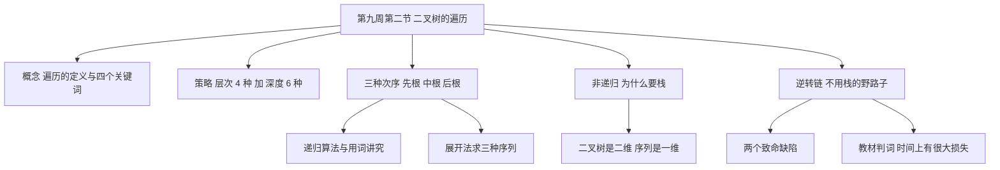
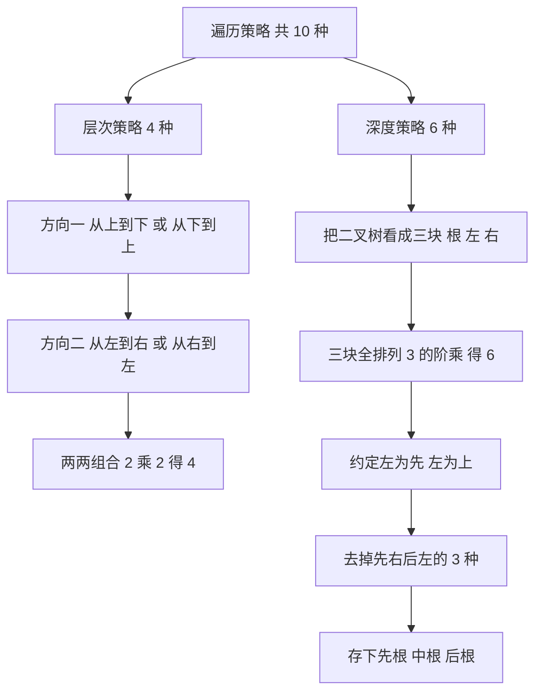
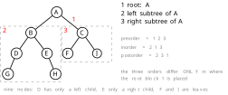
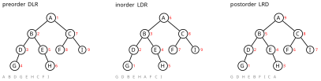
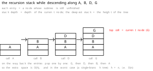
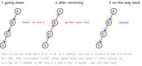

# 数据结构 · 第九周第二节 · 二叉树的遍历与「逆转链」 · 详细版讲义

> **来源说明**：本讲义依据课堂录音的本地转写整理，并与严蔚敏《数据结构（C语言版）》第 6 章对照校订而成，属**讲授稿性质的整理稿**。全篇以**第一人称**写成——写作者就是讲授者本人，课堂上的追问、点评都以「我」的口吻呈现。
>
> - **转写来源**：两份连续的 ASR 导出文字——`二叉树遍历课程讲解_导出原文.txt`（约 0.97 万字）与`二叉树遍历逆转链方法讲解_导出原文.txt`（约 0.15 万字），合计约 1.12 万字。**两份是同一次课的前后两段**：前一份最后一句是「刚才写的那个递归的算法，你跑到高级语言里面去怎么样，**它没法运行**」，后一份开口第一句就是「**为什么呢？**」——这是在接着解释「为什么递归算法在某些语言里跑不起来」。所以**合成一份讲义**，不做拆分。
> - **这一节的主线**：复习上节三条性质 → 遍历的定义（四个关键词）→ 访问与遍历的区别 → 两大类策略（层次 4 种＋深度 6 种＝10 种）→ 「左为先、左为上」的文化来源 → 先根／中根／后根三种次序与递归算法 → 展开法求三种序列 → 为什么非要研究非递归 → 栈为什么必需 → **逆转链**（不用栈的野路子）与它的两个致命缺陷。
> - **这一节的边界**：课末我说到「逆转链」这条路子并把它否掉了，转写在这一段之后**截断**（最后一句是「而且你这个处理过程也要花时间啊……实际上我们」）。所以**层次遍历的队列实现、线索二叉树、以及栈式非递归遍历的完整代码**都不在本讲义内。教材 6.3.1 给了两个中序非递归算法（算法 6.2、6.3），课上没有逐行讲，我把它们放在附录 D 里备查，并标明「教材内容、课上未展开」。
> - **教材对照范围**：**6.3.1 遍历二叉树**（遍历的定义、"根／左／右"三个基本单元、$DLR$ 等 6 种方案、先／中／后序的操作定义、算法 6.1 的递归实现、表达式树的前缀／中缀／后缀、算法 6.2 与 6.3 的非递归中序、遍历的时间与空间复杂度）。**6.3.2 线索二叉树**属于下一节，本节只在「逆转链」那段里侧面碰到它的思想。
> - **一处必须点名的巧合**：教材 6.3.1 结尾有一句话——「遍历时也可采用二叉树的其他存储结构……采用带标志域的二叉链表作存储结构，并**在遍历过程中利用指针域暂存遍历路径，也可省略栈的空间，但这样做将使时间上有很大损失**」。**这句话说的正是我课上讲的「逆转链」**：思路被教材承认，代价也被教材点明。区别在于教材只说「时间上有很大损失」，我课上还多说了两条更要命的——**破坏共享性**和**中途出错不可恢复**。见第十七节。
> - **编号说明**：我沿用的章节号比严蔚敏教材**大 1**——我的「第 7 章 树和二叉树」＝教材**第 6 章**。标注教材出处时一律用教材真实章节号。
> - **时间说明**：本节课为**文字模式**（无音视频轨、无关键帧），各节时间戳是按**字数折算的伪时间**（约 200 字／分钟），非音频真实时间，只作讲义内部单调递增的定位坐标；全课伪时间长约 1 小时。
> - **示意图说明**：正文里的数据结构示意图**全部是独立的 SVG 图片文件**，存放在 `数据结构/插图/`（文件名 `w92_01` ～ `w92_04`），正文用 `` 直接嵌入。SVG 是矢量图，**不依赖插件、不需要联网**，在 Obsidian 阅读视图、导出 PDF、以及任何 Markdown 查看器里都能直接显示，放大不糊。图的 TeX 源码保存在 `_讲义插图/figlib_w92.py`，要改图取出来重渲即可（源码必须纯 ASCII、坐标不得嵌套括号、`\foreach` 体内算式要整体加括号——这三条是 TikZJax 的硬约束，违反了整页都不渲染）。
> - **一处必须交代的还原缺陷**：课上让大家现场练的那棵 **8 结点树**，学生口答的序列在转写里被打散了（「中根是 A 不是 B，然后 G 然后 D 然后 A 然后 E，C 的话……」），**这棵树的形状我无法从转写唯一还原**。所以正文的展开法演示**另画了一棵 9 结点的树**（形状、三种序列都逐一算过），并在「待核实内容」里记了这一条。你们手上如果有课件原图，请对一下。
> - **关联阅读**：[数据结构 第九周第一节 树与二叉树 详细版讲义](数据结构%20第九周第一节%20树与二叉树%20详细版讲义.md)（上一节，二叉树的性质与存储结构，本节复习的那三条结论就出自那里）、[数据结构 第五周第二节 栈的应用与递归 详细版讲义](数据结构%20第五周第二节%20栈的应用与递归%20详细版讲义.md)（本节后半段反复用到的"栈"和"递归"两套基本功）、[数据结构 第六周第一节 队列 详细版讲义](数据结构%20第六周第一节%20队列%20详细版讲义.md)（层次遍历要用队列，属下一节）。

## 开场导读

这一节只讲一件事：**遍历**。

它是上一节课末我预告过的「最重要的操作」。为什么最重要？因为**二叉树的其他几乎所有操作，底子都是遍历**——求结点数、求深度、找双亲、判相等、复制一棵树、销毁一棵树，全是「按某种次序把每个结点走一遍，边走边做」。所以遍历不是「又一种操作」，它是**树的操作系统**。

我开场先做了两件事。**第一件是交代课程事务**：平台每一章都开了单元，里面有选择题、填空题，平时成绩从那里来；图上那部分（排序、检索）还没挂上去，大家先自己做。**第二件是复习**上一节那三条最容易搞混的结论——**任意二叉树都有 $n_0=n_2+1$**（不需要是完全二叉树）、**完全二叉树前 $H-1$ 层必满、不满只在最后一层且从左到右**、**内部结点（有孩子的结点）的最大编号是 $\lfloor n/2\rfloor$、超过它的全是叶子**。我特意说了一句「**你别死记硬背，随便画一棵二叉树嘛**」——这三条都是**画一棵小树就能验**的，验一遍比背十遍管用。

然后进正题。遍历的定义我抠得很细，四个词一个个过：**给定的**数据结构（谈遍历得先说清是什么结构）、**系统的**（有规律、有规则，不是东一榔头西一锤子）、**访问**（对元素做某种操作）、**仅一次**（公平性）。这里有个**用词的讲究**，是本节第一个考点，也是我课上专门说「要扣分」的地方：

> **访问是针对元素（结点）的，遍历是针对结构（整棵树）的。**
> 所以先序遍历的正确说法是「**访问根结点、遍历左子树、遍历右子树**」——**左、右那两处绝不能写成"访问"**。

接着我告诉大家一个很多人不知道的事实：**遍历策略一共 10 种，不是 3 种**。按层次走有 **4 种**（从上到下／从下到上，各配从左到右／从右到左）；按深度走有 **6 种**（根、左、右三个部分的全排列 $3!=6$）。只是**中国人（其实全世界都是）约定"左为先、左为上"**，6 种里就去掉了一半，剩下 3 种，才是教科书上那三种。我为了说明「左为尊」这个约定从哪儿来，讲了小半节课的酒桌座次——**上位为尊、左为尊**，皇帝坐皇后左边。这段听着像闲话，但它是在回答一个真问题：**为什么偏偏是"先左后右"？** 答案是**约定俗成**，不是数学必然。

三种次序讲完，我落到本节最实在的一段：**为什么非要研究非递归**。理由很直白——**递归不"靠谱"**：不是所有程序设计语言都支持自己调用自己，有些语言（我课上提到 FORTRAN 那一类）干脆不支持；而且递归一深就要吃栈。于是引出**栈**：二叉树是二维结构，遍历要把它压成一维序列，**你回退的时候得知道"我从哪儿来"**，这个"来路"就得存在栈里。**那能不能不用栈？** 这才有了课末那条野路子——**逆转链**：下降的时候把指向孩子的指针反过来指向双亲，回来的时候沿链上溯、再改回去，栈就省掉了。我把它的原理讲清楚之后，**当堂把它否了**：它有**两个致命缺陷**——**破坏共享性**（好比有人在共享的小说上勾勾画画，别人就没法读了）、**中途出错不可恢复**（勾画到一半断电，原文再也回不去）；再加上**指针一会儿指孩子一会儿指双亲、必须加标记**、**可读性差**、**费时间**。所以我给它的判词是：**没有实际应用价值，不提倡**。

这一节信息量不算大，但**两处最容易丢分**：**「访问」与「遍历」的用词**，以及**三种序列的展开法**。其余（10 种策略、酒桌座次、逆转链）是**理解性内容**——考得浅，但它们是后面讲线索二叉树、讲非递归算法、讲表达式树的地基。

## 总览知识地图

这一节两条线：**「遍历是什么」**和**「不用栈行不行」**。拆成 2 张图。

**图 1 · 全课主线**



**图 2 · 10 种遍历策略是怎么数出来的**



## 正文

### 一、先复习：上节那三条结论，画一棵小树就能验 `00:00-00:04`

开讲之前我先把上一节的三条结论过了一遍，因为**这一节要用它们**，而且它们**最容易搞混**。

**第一条：任意一棵二叉树都有 $n_0=n_2+1$。**

> 大家一定要注意，这个二叉树的话呢，我前面讲的那个，一个是完**全**二叉树的性质，一个是什么呢？一个是**任意**二叉树的性质，**你别搞混了**。对于**任意一棵二叉树**，都有 $n_0=n_2+1$——**这个不需要是完全二叉树，随便哪个二叉树都行**。

我课上紧接着说了一句方法上的话，这句话请你们记住：

> 你也**不要去牢记、死记硬背**——你**随便画一棵二叉树嘛**，对不对？画一个二叉树，你看这个 $n_0$ 等于几啊？

**"随便画一棵"** 这四个字，是应对所有度数关系题的通法。我现场就画了一棵来验：

```
        ○          ← 度为 2
       / \
      ○   ○        ← 左：度为 0（叶）；右：度为 1（只有一个孩子）
           \
            ○      ← 度为 0（叶）
```

数一数：**度为 2 的结点 1 个**（$n_2=1$），**度为 0 的结点 2 个**（$n_0=2$），$n_0=2=1+1=n_2+1$ ✓。**四笔就画完，一眼就验完。**

**第二条：完全二叉树的结构性质。**

> 那么我们说完全二叉树，它的性质非常好，就是怎么样？**高度为 $H$ 的话，它前面的 $H-1$ 层一定是一棵满二叉树**。那么**不满存在什么呢？存在最后一层**。那么并且**从左到右进行存放**。

这三句话是连在一起的，缺一句都不完整：

1. **上面 $H-1$ 层全满**；
2. **不满只在最后一层**；
3. **最后一层从左到右连续填、中间不跳号**。

**第二条是本节的伏笔**——因为「**从左到右**」这四个字，就是**层次遍历**的定义（第六节会回到这里）。

**第三条：内部结点的最大编号。**

> 然后我们就能知道，有一个性质就是**内结点**——就是说**有孩子结点的这些个结点**，**它的编号最大的一个是 $\lfloor n/2\rfloor$**。

> 那么这个性质的话**非常重要**，我们后面讲的**归并**（转写如此，应为**后续章节的算法分析**）的时候还会用到。那么**一旦超过 $\lfloor n/2\rfloor$ 那些个结点，都是叶结点**。

$$
\boxed{\;\text{最后一个非叶结点编号}=\left\lfloor\frac{n}{2}\right\rfloor,\qquad
\text{编号}>\left\lfloor\frac{n}{2}\right\rfloor\text{ 的全是叶子}\;}
$$

**三条结论的共同点**：它们都能用「**画一棵小树**」或「**代一个小 $n$**」当场验掉。**这就是我让你们做的动作**——不是背，是**验**。

**本节要点**

- **$n_0=n_2+1$ 对任意二叉树成立**，不需要完全二叉树；
- 完全二叉树：**前 $H-1$ 层全满 + 不满只在最后一层 + 从左到右连续**（第三句是层次遍历的定义）；
- **最后一个非叶结点编号 $=\lfloor n/2\rfloor$**，**超过它的全是叶子**；
- 三条都**画一棵小树就能验**——不要死记硬背。

### 二、遍历为什么重要：一个对任何结构都能谈的运算 `00:04-00:07`

进入正题。我开口先给了一句"定性"：

> 这节课我们开始讲**遍历二叉树**。我们说**遍历这个操作，实际上对我们计算机信息处理来说，是非常重要的一个运算**。

"重要"在哪儿？我先说它的**普适性**：

> **面试**（转写如此，应为**事实上**）的话呢，实际上我们对**线性表、对树、对图、对什么森林，都可以谈遍历**。像这样的操作，**对任何结构都可以谈**。

**遍历是唯一一个"跨结构通用"的运算**——线性表能谈、树能谈、图能谈、森林能谈。这一点很特别：**插入、删除、查找，每种结构的做法都不一样，甚至名字都不一样**；但**遍历对谁都能说**，而且说的是同一件事——**把结构里的每个元素都过一遍**。

**那为什么线性结构的遍历不用单讲，树的遍历要单讲？** 我给了理由：

> 只不过因为在**线性结构**当中啊，这个**遍历的运算非常简单**，我们**直接单独把它拎出来**（转写颠倒，应为"**就不单独把它拎出来**"）。但是到了**树结构**，我们面临**非线性结构**，那这个问题就**稍微复杂一些**了。

**对比一下就很清楚**：

| | 线性结构 | 树结构 |
|---|---|---|
| 一个元素有几个"后继" | **1 个** | **最多 2 个**（二叉树） |
| 走法有几条 | **只有一条** | **每到一个结点都要选方向** |
| 遍历要不要"设计次序" | **不要**，从头走到尾 | **要**，必须事先定规则 |
| 会不会"回退" | **不会** | **会**——而且回退要记住"从哪儿来" |

看最后一行：**回退**。这就是本节后半段那一大堆东西（栈、逆转链）的根源。

然后我把遍历**提升到"处理过程"的高度**：

> 遍历实际上谈的就是**对我们整个一个结构，我们做一个一体化的处理过程**。就**每个结点都要给他处理到**，然后最终**形成一个信息**（转写如此，应为"**一个序列**"）的**这样一个过程**。

「**一体化**」这个词用得好：**遍历不是一个"动作"，是一整套"走法 + 处理"的组合**。所以它才需要单独定义、单独设计算法。

我课上还给了一个很实在的说法，把遍历和**"拿到信息"**挂上了钩：

> 那么这个过程的话呢，到了**非线性结构就有一定的难度**，所以我们这里面拿出来讲。

**难度在哪儿？** 一句话：**非线性结构里，"下一个"不是唯一的**。线性表里你说"下一个"，指的就是 `next`；树里你说"下一个"，**得先问"按哪种次序"**。**这就是遍历在树上变成一门学问的全部原因。**

**本节要点**

- 遍历是**唯一跨结构通用**的运算：线性表、树、图、森林都能谈。
- 线性结构的遍历**简单到不必单列**（只有一条路、没有分叉、不用回退）；树的遍历**必须设计次序**，所以成了专门课题。
- 遍历是**"一体化处理过程"**：把结构里每个结点都处理到，最终产生**一个序列**。
- 树的遍历难在**"下一个"不唯一**，以及**回退要记住来路**——后者直接引出栈（第十三节）。

### 三、遍历的定义：四个词逐个抠 `00:07-00:13`

我给的定义是标准的：

> 对于**给定的数据结构**，**系统地访问**该结构中的**每个结点**，并且**每个结点仅可以访问一次**的操作过程，我们就称为**遍历**。

这个定义有四段，我课上**一段一段拆开讲**，因为每一段都藏着考点。

#### 3.1 「给定的数据结构」——得先说清是什么结构

> 首先，**对于给定的数据结构**，啥意思呢？**这个数据结构是你给我的是给定的**。因为我们刚才说了，你可以对树谈遍历，对森林谈遍历，对图谈遍历，**线性表也谈遍历**。那**到底是对哪种数据结构谈遍历呢**？**每一种数据结构它具体的遍历方法是不一样的**。所以我们是**对于给定的数据结构**——**你要告诉我是什么样的逻辑结构**。

这一段的意思是：**"遍历"这个词不带方法，方法是由结构决定的。** 你只说"遍历这棵树"，等于什么也没说——**必须先说"按先序"还是"按层次"**。

这一点在考试里很实在：题干如果说「写出该二叉树的遍历序列」，**这题是不完整的**，一定有前后文限定是哪种次序。

#### 3.2 「系统的」——有规律，不是东一榔头西一锤子

> 再一个就是**系统的**。所谓的系统的，就是**有规律的、有规则的，不是杂乱无章的**，**按照一定的次序**。也就是说我们来进行做这件事儿——不能杂乱无章地**东一榔头西一锤子**那么做。所以**有规律、有规则**。

「**东一榔头西一锤子**」这个说法很传神：**你也可以把每个结点都"碰"一遍，但那是乱撞，不是遍历**。遍历要求的是**可复现的、确定的次序**——**同一棵树、同一种规则，走出来的序列必须完全一样**。

这条要求背后其实是一个工程约束：**遍历序列要能当"数据"用**。比如我们要把一棵树存成文件、再读回来重建，靠的就是"某种遍历序列 + 空标记"（教材算法 6.4 的 `CreateBiTree` 就是按先序序列建树）。**如果次序不确定，存下来的东西就重建不回去。**

#### 3.3 「访问」——对元素做某种操作

> 第三个词，**访问**。访问指的是啥呢？**访问实际上指的就是对元素进行的某种操作**——**是一个操作**。只不过这个操作比较重要，所以我们用了**"访问"**这个词儿。

这里我讲了很长一段"用词的讲究"，因为它解释了**为什么偏偏用"访问"这么文雅的词**：

> 我们现实生活中，你想啊，比如说根据语境不同、**因人而异，我们用词就不一样**。比如说，你某天，你的**高中同学**过来，**拜访你**；或者你一个**老乡**来找你玩，那你就领着他**在榆中校区逛了一圈**。旁人问你，你说「我带我老乡在榆中校区逛一下」。

> 那同样是"逛"，人不一样怎么样？比如说曾经——应该是前三届了——有一个**吉林大学的王书记**，也来榆中校区**逛了逛**。第二天**兰大的主页上面挂的新闻是啥呢**？「**王书记在榆中校区视察工作**」。

**同样是在校园里走一圈，老乡来了叫"逛"，书记来了叫"视察"。** 我课上把这个对比一路推下去：

> 所以**访问这个词儿也是一样**。比如说你**出国留学**，那人家**领导**出国叫啥？**不叫出差，叫"访问"**。为啥？因为它是一种**比较重要的活动**——他有可能**签订了一个条约**，有可能**参观了某个工厂**，有可能**进行了一场谈判**，有可能**做了一个比较重要的报告**。**你看，因人而异，人家叫"访问"。**

**结论**：

> 所以总之啊，**这个"访问"指的就是对元素的某种操作**。那我们这种操作呢，在我们计算机当中**应该说比较重要**。

**为什么重要？** 因为**遍历的"信息产出"全在"访问"这一步**。走法只是"路"，**"访问"才是"摘果子"**。所以我要求你们把 `Visit` 当成**一个参数**来理解——**同一套走法，换一个 `Visit`，就是另一个功能**（输出、累加、判相等、建树……）。这一点教材说得清楚：

> 算法 6.1 给出了先序遍历二叉树基本操作的递归算法在二叉链表上的实现……**最简单的 `Visit` 函数**是 `PrintElement`（输出元素 $e$ 的值）。

#### 3.4 为什么教科书都用「输出结点信息」代替「访问」

这里有个很重要的说明，解释了**为什么书上例题全是"打印"**：

> 但是因为我们还是**模型问题**啊，**模型问题这个"访问"啊，这个动作就不好具体化了**。所以**大部分的教科书**，这个"访问"都干嘛呢？**用"输出结点信息"来进行替代**。

> 那你想一下，我把这个结点信息**打印输出**，是不是一种操作？**是的**。那么当然你也可以有很多别的操作——比如说**修改结点信息**，比如说我们后面的**线索化**等等之类的那些个操作都行。我们**统一用输出结点的信息来进行替代**，简单点——**因为我们谈模型问题嘛**。

**这段话解释了一个常见的困惑**：为什么教材上所有遍历例题都是 `printf`？不是因为遍历只能打印，而是因为**"打印"是最容易写、最容易验的一种 `Visit`**。**"访问"是一个占位符**，具体做什么由你填。

| 你想做的事 | 对应的 `Visit` |
|---|---|
| 输出序列（教材默认） | `printf(T->data)` |
| 统计结点数 | `count++` |
| 求和 | `sum += T->data` |
| 找最大值 | `if (T->data > max) max = T->data;` |
| 判两棵树是否相同 | 逐点比较 |
| 复制一棵树 | 边遍历边建新结点 |
| **线索化**（下一节） | 填空指针、填标志位 |

**同一套走法，七种用途**——这就是"`Visit` 是参数"的意义。

#### 3.5 最后一个词：「仅访问一次」

> 第二一个就是**我们对每个结点仅访问一次**。**为啥只访问一次呢**？这个体现了什么？体现了**公平性**。就**我对于这个结点当中的每个对象，他们的地位是平等的**，所以每个结点**做且仅做一次**。

「**公平性**」这个说法很轻，但它其实是**定义的技术核心**：

- **漏掉某个结点** ⇒ 不是遍历（不"系统"）；
- **某个结点访问两次** ⇒ 也不是遍历（不"仅一次"）。

**为什么要较这个真？** 因为**访问可能有副作用**。如果 `Visit` 是"给计数器加一"，访问两次结果就错了；如果是"修改结点"，访问两次可能改两遍。所以**"仅一次"不是修辞，是正确性条件**。教材的定义也是这么写的：

> 即如何按某条搜索路径巡访树中每个结点，使得**每个结点均被访问一次，而且仅被访问一次**。

**本节要点**

- 定义四段：**给定结构**（方法由结构定）、**系统的**（有规律、可复现）、**访问**（对元素做某种操作）、**仅一次**（公平性／正确性）。
- **用词讲究**：老乡来了叫「逛」，书记来了叫「视察」，领导出国叫「访问」——**重要的操作才配叫"访问"**。
- **教科书用"输出结点信息"代替"访问"**，是因为谈模型问题时"访问"没法具体化；**"访问"是占位符，`Visit` 才是真动作**——同一套走法换 `Visit`，就是另一种功能。
- **"仅一次"是正确性条件**，不是修辞：`Visit` 有副作用（计数、修改），重复访问就会错。

### 四、「访问」与「遍历」：一个针对元素，一个针对结构 `00:13-00:16`

上一节把两个词分开讲了，这一节把它们**对立起来**——因为这是本节第一个**会扣分**的地方。

我课上说得非常重：

> 那我们要**稍微强调一点**：**访问是一个动作**，它是**针对某个元素**来谈的，或者说**针对某个结点**来谈的。但是我们的**遍历**，它是**针对结构**来谈的。

为什么？我给的理由很朴素：

> 因为你是针对一个结构——比如说我拿到一棵二叉树、拿到一棵树，那么这棵树里面**就不可能只有一个结点**，它是**有结构的**，**结点多于一个**。那所以我们拿到一棵二叉树，我们谈什么呢？谈**遍历**。

> 这个结构里面**有可能有多个元素**，那我们对**每个元素都进行访问一次**，那么就会**形成一个序列**——形成一个**操作的序列**。所以**遍历实际上是对结构来谈的**。

于是这条对照就成立了：

| | **访问** | **遍历** |
|---|---|---|
| 对象 | **一个元素（结点）** | **一个结构（整棵树）** |
| 是不是动作 | **是**，一次具体操作 | **是过程**，一系列访问的**统称** |
| 结果 | 对那个元素做了什么 | **一个序列** |
| 能说"访问左子树"吗 | **不能** | **只能说"遍历左子树"** |

我把最后一行单独拎出来，因为它就是**扣分点**：

> 所以**遍历实际上是是一个运算过程的统称**——我们拿到一个结构，对这个结构整体地处理一下。那么整体处理我们会**形成一个序列**，就是对这里面的每个元素都访问一次，从而形成**一个输出序列**。

> 所以**遍历是针对结构来谈的**，而**访问是针对元素来谈的**。**遍历一定会形成一个序列**。

**为什么"访问左子树"是错的？** 我课上把道理讲透了：

> 注意，这个说法**有讲究**的，看到没有？**根结点是"访问"**，为什么根结点是"访问"？**因为根结点只有一个结点**，那我们是**访问**——访问是一个动作嘛。而**对于左子树，它是一个结构**啊，我们需要谈什么呢？**遍历**——因为**遍历是针对一个结构来谈的**。

**一个结点 = 一个元素 = 只能"访问"；一棵子树 = 一个结构 = 只能"遍历"。** 层次分明。

然后是我的"威胁"：

> 所以说，**如果期末考试问到说先序遍历的遍历方法是啥**，有的同学瞎来——「**遍历根结点、访问左子树、访问右子树**」。**我要扣分的啊！我要扣分的！再次强调这个说法。**

**正确的说法只有一种**：

$$
\text{先序遍历}=\textbf{访问根结点}\;+\;\textbf{遍历左子树}\;+\;\textbf{遍历右子树}
$$

$$
\text{中序遍历}=\textbf{遍历左子树}\;+\;\textbf{访问根结点}\;+\;\textbf{遍历右子树}
$$

$$
\text{后序遍历}=\textbf{遍历左子树}\;+\;\textbf{遍历右子树}\;+\;\textbf{访问根结点}
$$

**看这三个式子的用词**：`访问` 只出现在**根结点**那一处，`遍历` 出现两次（左、右子树）。**一个字都不能换。**

我课上还补了一句更本质的说明：

> 实际上它**内涵不一样**——网络（转写如此，应为"**根**"）这里的结点，主要是**访问**；**右子树也是遍历**，**不能说成访问**。

**为什么这个区别这么要紧？** 因为**它反映的是"递归的层次"**：`Visit(p)` 是**终止动作**，`Traverse(T)` 是**递归展开**。你写「访问左子树」，等于**把一次递归调用降格成了一个动作**——**逻辑上就塌了一层**。考试扣分是因为**你暴露了没理解递归结构**，不是因为抠字眼。

**本节要点**

- **访问**针对**元素（单个结点）**，**遍历**针对**结构（整棵树）**；**遍历是访问的统称，结果是一个序列**。
- **「访问左子树」是错的**，只能说「**遍历左子树**」——**左、右子树是结构，不是元素**。
- 三种次序的规范表述：**只有根结点用"访问"，左右子树一律用"遍历"**。
- 这个区别的实质是**递归层次**：`Visit` 是终止动作，`Traverse` 是递归展开——**把递归调用降格成动作，逻辑就塌了一层**。

### 五、两大类策略：层次 4 种、深度 6 种，一共 10 种 `00:16-00:20`

定义讲完，我问了一个问题：**既然要"按一定次序"，那有哪些次序？**

> 好了，那接下来我们再来看一下：二叉树我们刚才说遍历的话，**按照某种次序**——那他**有哪些遍历次序**呢？就我们**按照什么规则来进行访问**呢？

我把答案分成**两大类**，而且**先把总数报出来**，因为大部分人只知道 3 种：

> 实际上**遍历的策略，总共是两大类，总共是 10 种遍历策略**。其中**层次是有 4 种**，我们的**深度实际上是有 6 种**。只不过大部分教科书重点就谈了**这三种**——那当然咱们也是，**这三种的话，我们也就只谈这三种**。

**10 种：层次 4 + 深度 6。** 这就是本节第二个"反常识"的点。

#### 5.1 层次策略：4 种，靠"两个方向"数出来

> 我们说实际上给你一棵二叉树，你会发现前面我们讲的它有**明显的层次性**——**根结点是第一层，然后孩子是第二层，依次类推**。所以既然它有层次性，那**第一种遍历的策略就是层次策略**。

层次的走法是"**一层一层过**"。而"层"这个字里其实含了**两个方向**：

> 层次策略的话呢，**按照我们的书写规则**，我们干什么呢？我们可以**从上到下**——先写第一行，**第一层先处理第一层，再处理第二层、第三层**。那另外**同一层当中，我们又有两个方向**，比如**从左到右**。

我拿那棵树举例说明"从左到右"是什么意思：

> 从左到右，就**先从你左边的**，你就**先处理 $B$ 再处理 $I$**（转写如此，具体结点按图），然后**先处理 $C$，再处理 $G$、再处理 $H$**——**同一层当中的**。

然后我把"另一个方向"摆出来：

> 那你既然有**从左到右**，那我也**可以从右到左**——**咱们老祖宗写字不就从右到左吗？毛笔字，从右到左**。

> 那你可以**从上到下**，我也可以**从下到上**。那从下到上，然后从左到右；然后从下到上，从右到左——**这都非常简单了**。**你两个方向，上下、左右，所以组合起来有四种。**

$$
\underbrace{\{\text{上}\to\text{下},\ \text{下}\to\text{上}\}}_{\text{层间方向}}\times
\underbrace{\{\text{左}\to\text{右},\ \text{右}\to\text{左}\}}_{\text{层内方向}}
\;=\;4\ \text{种}
$$

**"老祖宗从右到左写字"** 这句闲话其实是在提醒：**方向的选择是约定，不是必然**。我们习惯"从左到右"，只是因为现在的书写习惯如此——**换个约定，序列就完全反了**。

#### 5.2 深度策略：6 种，从递归定义里数出来

第二大类，也是本课真正要讲的那一类：

> 第二大类呢，我们是**深度策略**。深度策略是因为我们**根据二叉树的定义**——我们二叉树的定义是不是**递归定义**？那么我们二叉树实际上，根据它的递归定义，它**明显地有三个部分：根结点、左子树、右子树**。

> 那我把它**抽象成三个部分**，我们就可以怎么样？我们**先根结点**，然后**再处理它的左子树**，然后再**处理它的右子树**。

**"三块"** 是深度策略的全部秘密。我课上用"往下纵深"来形容它：

> 那你看，所以这个策略叫啥呢？**深度策略**。就可以看到，**每次我拿到一棵新的左子树，我就可以往下纵深方向延伸一次**——**往纵深方向行，不断地推进**。所以这个叫什么？**深度策略**。

**为什么三块能生出 6 种？** 因为**三块的全排列是 $3!=6$**：

$$
P_3=3\times2\times1=6 .
$$

把"根"记作 $D$（Data）、"遍历左子树"记作 $L$、"遍历右子树"记作 $R$，六种就是：

$$
DLR,\quad LDR,\quad LRD,\quad DRL,\quad RDL,\quad RLD .
$$

教材的原话完全一样：

> 假如以 $L$、$D$、$R$ 分别表示**遍历左子树、访问根结点和遍历右子树**，则可有 $DLR$、$LDR$、$LRD$、$DRL$、$RDL$、$RLD$ **这 6 种遍历二叉树的方案**。若**限定先左后右**，则只有前 3 种情况，分别称之为**先（根）序遍历、中（根）序遍历和后（根）序遍历**。

**注意教材这里用 $D$ 而不是 $V$**——$D$ 是 Data（数据），提醒你**根结点要做的是"访问"（取其数据），不是"遍历"**。这跟上一节那个用词讲究是同一件事。

**为什么去掉后 3 种？** 我课上给的理由只有一句话：

> 这 3 个部分的话呢，我们就可以**排列组合**一下，有这 **6 种**次序。那根据我们**中国人，或者说应该全世界都是**，干什么呢？**左为先，左为上**。那么我们规定**先处理左子树、再处理右子树**的话，就**只剩下 3 种**遍历策略。

**"中国人，或者说全世界都是"** ——这句话很关键：**"先左后右"不是中国特产，是人类书写的通例**。**所以它是一条约定，而不是一条定理。** 这一点后面还会用到（层次策略那 4 种也是约定）。

**本节要点**

- 遍历策略**总共 10 种**：**层次 4 种 + 深度 6 种**；教科书只讲其中 3 种。
- **层次策略**＝层间方向（上→下／下→上）× 层内方向（左→右／右→左）＝**4 种**；「老祖宗从右到左写字」说明**方向是约定**。
- **深度策略**＝把二叉树看成**根／左子树／右子树**三块，**全排列 $3!=6$**：$DLR,LDR,LRD,DRL,RDL,RLD$。
- 教材用 $D$（Data）而非 $V$：**根要做的是"访问"，不是"遍历"**——与第四节的用词讲究同源。
- 约定**左为先、左为上**（人类书写通例，非中国特产），6 种去掉一半，**只剩先根、中根、后根**。

### 六、为什么「左为先、左为上」：酒桌上的规矩 `00:20-00:24`

上一节我留了一句话没解释：**为什么偏偏规定"先左后右"？** 我课上花了小半节回答它，因为**这个问题不回答，"三种次序"就永远是硬背的**。

> 那为什么**左为先、左为上**呢？这个实际上**又有生活的来源**啊，有生活当中的来源。

我举的场景是**吃席的座次**：

> 大家想一下，比如说大家有的同学，酒桌上面——我们**中国有酒文化**。比如说你在农村**吃席**，**四四方方的这个桌子**，来了一个**长者**，你为了表示尊敬，**把他让到哪个位置合适啊**？**哪个位置是最尊的**？

> 现在有 4 个选项——这是 4 条长凳子，你把它放到哪个位置合适？**最上面这就是尊者，上位为尊嘛**，对不对？**上位为尊**。

**第一步结论：上位为尊。**

然后我把问题**逼进一步**，这就是这一段的精彩处：

> 那么问题是，**这上首这一条长凳上摆着两个人呢**？这一个位置、这一个位置，**问你 1 和 2，哪一个更尊**？

> 你有没有看**连续剧**？看电视剧的话，比如说那个**皇帝、皇后**坐在座位上，那个**金銮宝殿**上，你有没有观察一下**皇帝坐在哪**呢？**皇帝在哪边**？我们应该是哪个位置是尊呢？

我的答案是**从皇后那边推出来的**，这个推理我课上讲得很细：

> **这个位置更尊，为啥？** 因为**皇后坐在这儿**——你想一下，**1、2 并排坐，对于皇后来说，2 号位置，她的左边是谁？她的左边是皇帝**。

> 所以我们**左为尊、左为上**，**就这么来的**。

**注意这个推理链**：皇帝必须比皇后尊 ⇒ 皇帝的位置定下来 ⇒ **从皇后的视角看，皇帝在她的"左边"** ⇒ 所以**左为尊**。**"左"这个字是站在"次尊者"的视角说的**——这一点很多人没想过。

我接着把它落到日常：

> 你别说——人家来一个**辈分比你高的**，你赶紧**让他坐到这儿**；你给他坐到这儿啊，**那一看就不懂规矩**，不懂规矩啊。

**"不懂规矩"** 这四个字说明：**座次是有强约束的社会规则，违反会被识别为失礼**。我说这个，是想让你们体会**"约定"的力量**——它不需要论证，但**违反了就出局**。

然后我给了两个"升级版"的场景，因为它们展示了**规则怎么在约束变化时被修补**：

**场景一：圆桌怎么办？**

> 那说到这儿呢，我们中国酒文化——你比如说，但有人说**现在不对呀，现在是圆桌，圆桌咋办**？来了一个尊者，**你让他坐哪儿**？

> 如果说**这是门**，你让他坐哪儿？**坐正对着门的那个位置**。为什么呀？因为**门这边是比较危险的**，并且是**上菜的地方**。所以**对着门的位置是尊位**。

**"上位为尊"在圆桌上失效了**（圆桌没有"上"），于是规则换成**"面门为尊"**。**规则变了，但"要有一个最尊位置"这个需求没变**——这就是**约定**的本质。

**场景二：敬酒的杯子该多高？**

> 还有一个，比如说你去**敬酒**，有好多同学就不懂啊——**你明明是怀着敬意去敬人家酒**，结果你把这个酒**给高高抬起**。你**应该要干啥**？这个**酒杯高度一定不能高于**你去敬酒的那个人。

> 往往很多人还会专门**手托着他的杯子**，自己再去敬——**明白吧**？这都有**文化底蕴**在里面的。

**"杯沿不能高于对方"** ——这又是一个**不需要解释、但违反就是失礼**的约定。

**这三段合起来在讲什么？** 我课上给了收束：

> 所以**左为先**——那左为先的话，所以我们怎么样？**因为根节点先处理**，所以我们这个叫**先根**。然后**根节点在中间处理**，所以叫**中根**。那么**根节点最后处理**，我们叫做**后根**。

**座次讲完了，三种次序的名字也就出来了。** 我这一段的目的不是教吃席，而是让你们理解：**"先左后右"是一条社会约定被搬进了数据结构**。所以——

- 它**不是**数学必然（右为先同样能定义出一套自洽的遍历）；
- 但**一旦采纳，就必须全程一致**（教材、考题、代码都用先左后右）；
- **理解了它是约定，你就不会再问"凭什么"**。

**本节要点**

- **上位为尊**（四方桌）；两人并排时**左为尊**——因为**皇帝坐在皇后的左边**，所以"左"是**站在次尊者视角**说的。
- 圆桌上"上位"失效 ⇒ 规则改成**面门为尊**（门是危险的、上菜的地方）；**敬酒杯沿不能高于对方**。
- 这些例子的用处：说明**"先左后右"是社会约定，不是数学必然**——**约定不需要论证，但必须全程一致**。
- 由此得名：**根先处理叫先根，根中间处理叫中根，根最后处理叫后根**。

### 七、先根、中根、后根：名字是怎么来的 `00:24-00:26`

座次讲完，我把三种次序的名字交代清楚。我先说**这套名字不是唯一的**：

> 我们说二叉树的遍历规则呀，**并不只有这 3 种**——大家一定要注意。很多教科书**重点就谈了这 3 种**，但是你**一定要反应过来**：实际上**是不止这三种的**。

然后我给了一张"**别名表**"，这张表在考试里很实用，因为**同一个东西在不同书上叫法不同**：

| 次序 | 本课叫法 | 常见别名 | 根的位置 |
|---|---|---|---|
| $DLR$ | **先根**遍历 | 先序、前序、前根、**先序遍历** | **最先** |
| $LDR$ | **中根**遍历 | 中序、**对称序**、内序、中序 | **中间** |
| $LRD$ | **后根**遍历 | 后序、后根 | **最后** |

我课上专门点了中序的别名多，因为**它用得最多**：

> **中序遍历**的话呢，我们说因为**中国**——因为我们也叫**中根遍历**的话呢，它是**广泛使用的一种次序**。所以**应用的场合多了，所以它的教材（叫法）也就很多**：比如说有叫**对称序**的，有叫**中序**的，有叫**内序**的，等等等等。

**为什么中序又叫"对称序"？** 因为 $LDR$ 的访问顺序**关于根对称**——**根的左边全在它前面访问，根的右边全在它后面访问**。这个"对称"的含义下一节会看到它的用处（二叉排序树的中序序列是递增的，靠的就是这个对称性）。

**命名的一句话总结**（我课上就是这么讲的）：

> **根节点先处理，叫先根；根节点在中间处理，叫中根；根节点最后处理，叫后根。**

**"根"这个字放在名字里，标的是"根被访问的时机"**——不是"从根开始"的意思。这一点容易误会：**后序遍历也是从根出发的**，只是**根最后才访问**。

**本节要点**

- 三种次序的名字标的是**"根被访问的时机"**：先根（最先）、中根（中间）、后根（最后）；**三者都从根出发**。
- **别名**：中序＝**对称序**＝内序（因为它关于根对称）；先序＝前序＝前根；后序＝后根。
- **遍历规则不止 3 种**（共 10 种），只是教科书重点讲这 3 种。

### 八、先序遍历：定义、用辞与递归算法 `00:26-00:31`

先看**先根（先序）遍历**的定义。教材的写法是：

> 若二叉树为空，则**空操作**；否则
> (1) **访问根结点**；
> (2) **先序遍历左子树**；
> (3) **先序遍历右子树**。

我课上的说法：

> 首先**先根遍历**。先根遍历的话呢，**二叉树为非空的，那我们就处理**；当然对于**空的**，我们说你**没有对象，那就不用做任何动作**。如果说**非空**，那我就**先访问这个结点，然后遍历左子树，然后遍历右子树**。

**注意我这句话的用词**：`访问`这个结点、`遍历`左子树、`遍历`右子树——**和上一节讲的规范完全一致**。这一节我不再重复"要扣分"，但你们写作业时请照着写。

#### 8.1 先拿一棵树来：这一节反复用的 $T$

下面这棵树是本节的"主角"，请记住它——**先序、中序、后序、栈、逆转链，全都拿它当例子**：



> **图注（二叉树 $T$ 与它的"三块"分解）**：全树 9 个结点。$A$ 是根；$A$ 的左子树以 $B$ 为根（$B$ 的左孩子 $D$、右孩子 $E$；$D$ 只有左孩子 $G$、$E$ 只有右孩子 $H$）；$A$ 的右子树以 $C$ 为根（左 $F$、右 $I$）。图中三个虚线框就是把树按递归定义拆成的**三块**：**①根 $A$、②左子树、③右子树**。三种次序的差别**只在这三块的排列**：先序 $=①②③$、中序 $=②①③$、后序 $=②③①$——**"左为先"已经写进这三个式子里了**（$②$ 永远在 $③$ 前面）。

#### 8.2 递归算法：基本项可以省略

> 那因为你这是一个**递归的**，所以我们把这个程序**写成递归的是最自然不过**。

复一下递归函数设计的两件事：

> 我们前面说过，递归函数设计的时候，你主要需要关注**两个方面**：第一个方面是**基本项**，第二个方面是**递归项**（转写作"诱导向"）。那么**基本项**指的是啥？指的是**这个数据集最小的情况下**。

然后我**现场拆了代码**，这段很有教学价值：

> 那这个地方，我说这个 `if (T != NULL)`——**这是什么项**？……这是**递归项**。**最小规模的基本项应该是啥？应该是 `T == NULL`。**

> 那问题是，**按理来说两种情况，我们用 `case` 语句，对吧？`if-else`**。但问题是 **`T == NULL` 的时候，我们说啥都不做**——**啥都不做，我们就不需要处理了嘛**。因为**你都没有对象，都不需要有动作**。所以我们这个**基本项直接省略、不用写了，啥都不做**。

**这就是为什么标准答案只有一句 `if (T)`**：

```c
Status PreOrderTraverse(BiTree T, Status (* Visit)(TElemType e)) {
    if (T) {
        if (Visit(T->data))                       /* ① 访问根结点 */
            if (PreOrderTraverse(T->lchild, Visit))   /* ② 遍历左子树 */
                if (PreOrderTraverse(T->rchild, Visit)) /* ③ 遍历右子树 */
                    return OK;
        return ERROR;
    } else return OK;      /* 空树：空操作（基本项，什么也不做） */
}
```

**三个细节，我课上没逐字念，但都值得说**：

1. **`if (T)` 就是"非空才处理"**，`else return OK` 就是"空了就什么也不做"——**`else` 分支是唯一能省的那一半**，因为**没有对象就没有动作**。
2. **`Visit` 是函数指针**——这就是第三节讲的"`Visit` 是占位符"在代码里的样子。
3. **三层嵌套 `if`** 而不是 `if (...) {...}` 顺序写，是教材的风格（**短路求值**：任何一步失败就 return ERROR）。

**我课上讲"没有对象怎么办"，用了一个特别好的比方**——它解释了"为什么空树还得进一次"：

> 这就好比，我们说：**我让你去给某个教室跟学生谈个话**，结果你**推开那个教室门，结果没人**。没人咋办？**没人的话，那我就不喊了**，对不对？**没有对象嘛**——**我们的操作要有对象，我们的运算要有对象**。没有对象怎么办？**我就回来，啥都不做**。

> 但是怎么样？**这个门你还得推开一下**！为啥？**因为你不推开那个门，你咋知道教室里没人呢**？所以要注意：**你还得下来，下来了之后才能知道它是空的**，然后就该**返回**了。

**"门还得推开"** 这句话，对应到代码就是：**`if (T)` 这个判断本身必须执行**——你不能"预知"它是空的就不来。**递归到空子树，是必须走的一步。**

#### 8.3 先序序列：$A\,B\,D\,G\,E\,H\,C\,F\,I$

按"访问根 → 遍历左 → 遍历右"走一遍（我课上是在图上边走边报的）：

$$
\text{先序}\;T=\underbrace{A}_{\text{根}},\;\underbrace{B,D,G,E,H}_{\text{左子树}},\;\underbrace{C,F,I}_{\text{右子树}}
$$

**左子树那一段**自己也是先序：$B$（根）、$D,G$（左子树）、$E,H$（右子树）。**再往里**：$D,G$ 是"$D$（根）+ $G$（左）+ 空（右）"。

$$
\boxed{\;\text{先序}=A\;B\;D\;G\;E\;H\;C\;F\;I\;}
$$

**验算的小技巧**：先序序列的**第一个一定是根**，而且**任意一棵子树的先序序列，第一个就是那棵子树的根**。所以看到 $A\,B\,D\,G\,E\,H\,C\,F\,I$，你立刻能读出"$A$ 是根，$B$ 是左子树的根，$C$ 是右子树的根"——这就是**由先序 + 中序重建二叉树**的依据（下一节的内容）。

**本节要点**

- **先序**：空则空操作；否则 **①访问根 ②先序遍历左子树 ③先序遍历右子树**（教材 6.3.1）。
- **递归算法**的核心：`if (T)` 是递归项，**`T == NULL` 是基本项，因为"没有对象就没有动作"，所以直接省略**——这就是标准答案只有一句 `if (T)` 的原因。
- **"门还得推开"**：空子树也要递归进去一次才能知道它是空的，**这个判断本身不能省**。
- **先序序列 $=A\,B\,D\,G\,E\,H\,C\,F\,I$**；**先序的第一个永远是根**，任意子树的先序第一个是那棵子树的根——这是"由序列重建树"的依据。

### 九、中序遍历：别名、对称之美与「第一个是谁」 `00:31-00:37`

中序（中根）遍历的定义：

> 若二叉树为空，则空操作；否则
> (1) **中序遍历左子树**；
> (2) **访问根结点**；
> (3) **中序遍历右子树**。

> 那它递推算法很简单：**先遍历左子树，再访问根结点，再遍历右子树**。

#### 9.1 「对称」这两个字，我讲了很久

中序又叫**对称序**，为什么？我课上从"对称"这个审美讲起，讲了一长段，看似跑题，其实是在**建立"为什么这个次序用得最多"的直觉**：

> **中序遍历**……我们也叫**中根遍历**，它是**广泛使用的一种次序**。那我们现实生活中应用非常多，比如说**男婚女嫁对称**，对不对？**古时候讲啥？门当户对**。

> 然后接下来你看现实生活中的，你比如说**凡是人身上的，有两个的，都是对称的**——比如咱们**两只手、两只脚、两叶的肺、两只耳朵**，看都是对称的。所以**对称怎么样？中国建筑也以对称为美。**

**"以对称为美"** 这四个字，我一路推到了**二进制**：

> 那然后怎么样？我们实际上说**二进制呀，实际上是什么呢？中国人发明的**——**莱布尼兹**在他的专门的著作当中就写：**伏羲在推演八卦的时候，他借用了那个思想**。

> 那你想一下，**我们一个字节不是 7 个二进制位、不是 9 个，是 8 个二进制位，咋来的**？就是**伏羲的这个八卦**、中国八卦的一个思想。然后中国还有**阴阳两极**的思想。

**这段的考点价值**：它给了你一个记忆钩子——**中序＝对称序＝阴阳对称**。但更重要的是下面这个建筑例子，它把"对称"讲成了**具体的空间布局**：

> 我们的建筑大多数**以对称为美**。凡是很讲究一点的人家，比如我们原来的**皇宫**，或者一个**大户人家**，他的建筑会怎么做呢？他的**建筑分布非常有规律**：**中间正对着的是正厅**，然后**左右两边有稍微矮一点的两个房子**，这两个房子叫什么？叫**耳房**。

> 那这种叫什么？在中国**风水学**上面有讲究，叫「**二鬼抬轿**」。

**"二鬼抬轿"** 这个说法很有意思：**中间高、两边低**，正是**中序遍历里"根在中间"的那个形状**——只不过建筑上是空间对称，遍历上是**时间上的对称**（左边访问完、访问根、再右边）。

我把这段的落点说清楚：**中序之所以"对称"，是因为根被放在正中间**。$LDR$ 这个次序里，**根的左边全部先访问、右边全部后访问**——**关于根完全对称**。

#### 9.2 「第一个访问的一定是谁？」

讲完定义，我**当场提问**，这个问题是本节最实用的一问：

> 那好，我问一下大家：**拿到这棵二叉树的话，它第一个访问的一定是谁**？

我先让同学回答，然后给答案：

> 所以我们一定是 **$K$**（指最左下的结点），对吧？**沿着左孩子一路下来**。所以**第一个访问的肯定是 $K$**（本例即 $G$）。

**结论**：

> **中序遍历的第一个结点，是"从根出发，一路沿左孩子走到底"的那个结点。**

**对上面的树 $T$**：$A\to B\to D\to G$，$G$ 没有左孩子，**所以中序第一个是 $G$** ✓。

**这个结论的用处**：它是**判断"某个序列是不是中序序列"**的最快方法——**第一个必须是全树最左下的结点**。反过来，**最后一个**是"一路沿右孩子走到底"的那个结点（本例是 $I$）。

**为什么？** 因为 $LDR$ 里 $L$ 在最前面，而"最左下的结点"就是**递归地取左子树的最左下**——一路到底。

#### 9.3 中序序列：$G\,D\,B\,E\,H\,A\,F\,C\,I$

$$
\text{中序}\;T=\underbrace{G,D,B,E,H}_{\text{左子树的中序}},\;\underbrace{A}_{\text{根}},\;\underbrace{F,C,I}_{\text{右子树的中序}}
$$

**再拆一层**：左子树（根 $B$）的中序 $=G,D$（$D$ 子树的中序）$+\,B\,$（根）$+\,E,H$（$E$ 子树的中序）。

$$
\boxed{\;\text{中序}=G\;D\;B\;E\;H\;A\;F\;C\;I\;}
$$

**验算**：中序里 **$A$ 一定在中间**——它**左边正好 5 个**（左子树的 5 个结点）、**右边 3 个**（右子树的 3 个）。这就是"对称"的可检验含义：**根的左右两段就是它两棵子树的全部结点**。

**本节要点**

- **中序**：空则空操作；否则 **①中序遍历左子树 ②访问根结点 ③中序遍历右子树**；别名 **对称序**（根在正中间，左右关于根对称）。
- 「对称」的记忆钩子：人身两两对称、**建筑以对称为美（正厅＋两间"耳房"＝"二鬼抬轿"）**、阴阳两仪、八卦与 8 位字节。
- **中序第一个结点＝一路沿左孩子走到底的那个**（本例 $G$）；**最后一个＝一路沿右孩子走到底**（本例 $I$）——这是判断"是不是中序序列"的最快办法。
- **中序序列 $=G\,D\,B\,E\,H\,A\,F\,C\,I$**；**根 $A$ 左边恰好是左子树的 5 个结点、右边是右子树的 3 个**，这就是"对称"的可检验含义。

### 十、后序遍历：把根留到最后 `00:37-00:40`

后序（后根）遍历的定义：

> 若二叉树为空，则空操作；否则
> (1) **后序遍历左子树**；
> (2) **后序遍历右子树**；
> (3) **访问根结点**。

> 那接下来呢，我们也是一样，**后根遍历**。

**后序序列：**

$$
\text{后序}\;T=\underbrace{G,D,H,E,B}_{\text{左子树的后序}},\;\underbrace{F,I,C}_{\text{右子树的后序}},\;\underbrace{A}_{\text{根}}
$$

$$
\boxed{\;\text{后序}=G\;D\;H\;E\;B\;F\;I\;C\;A\;}
$$

**注意三个特点**（这三点考试常用）：

1. **后序的最后一个永远是根**（与先序的"第一个是根"对称）；
2. **后序的第一个是"最左下的叶子"**（本例 $G$，和中序第一个相同）；
3. **后序里，任何一个结点都在它的所有子孙之后**——**根最后**，所以**求"树的深度""释放整棵树"这类自底向上的操作都用后序**。

第 3 点我课上没展开，但它是后序存在的**全部理由**：**销毁一棵树必须先销毁孩子、再销毁自己**（否则孩子没指针指向了，内存泄漏）；**求深度必须先知道两棵子树的深度、才能算自己的**。**凡是"先要孩子结果、后要自己结果"的操作，都用后序。**

**三种序列放在一起对照一次**（同一棵树 $T$）：

| 次序 | 三块的排列 | 序列 | 特点 |
|---|---|---|---|
| **先序** $DLR$ | ①根 ②左 ③右 | $A\,B\,D\,G\,E\,H\,C\,F\,I$ | **第一个是根** |
| **中序** $LDR$ | ②左 ①根 ③右 | $G\,D\,B\,E\,H\,A\,F\,C\,I$ | **根在中间；第一个是最左下** |
| **后序** $LRD$ | ②左 ③右 ①根 | $G\,D\,H\,E\,B\,F\,I\,C\,A$ | **最后一个是根；第一个是最左下叶子** |

**三张序列一起看，能读出两条规律**：

- **根的位置**：先序在**最前**、中序在**中间**、后序在**最后**——这就是"先根／中根／后根"的字面意思。
- **左右子树的相对次序不变**：三种序列里，**左子树的结点永远在右子树之前**（因为都遵守"左为先"）。**所以三种序列的"骨架"是同一个，只是根被搬到了三个位置。**

第 2 条是本节最该记住的一句话，因为它**解释了为什么"由两种序列能唯一确定一棵树"**：**骨架相同 + 根的位置已知 ⇒ 能切分**。

**本节要点**

- **后序**：空则空操作；否则 **①后序遍历左子树 ②后序遍历右子树 ③访问根结点**；**后序序列 $=G\,D\,H\,E\,B\,F\,I\,C\,A$**。
- 三个特点：**最后一个是根**、**第一个是最左下的叶子**、**任何结点都在其子孙之后**。
- **后序的用途**：凡"先要孩子结果、后要自己结果"的操作（**求深度、释放整棵树、求结点数**）都用后序。
- **三种序列骨架相同，只是根被搬到三个位置**——这是"由两种序列唯一确定一棵树"的依据。

### 十一、展开法：三种序列怎么快速写出来 `00:40-00:44`

三种次序讲完，我教了一个**手算方法**，因为考试不会给你时间慢慢递归：

> 那接下来，我们也是一样。你**如果开始不熟悉，拿到它的遍历序列怎么得到**？**你把它分成三部分**，对不对？**先左再根再右**。

> 那么对于**左子树**，它又是怎么样？**左、根和右**。**这样子就很清晰了。**

**这个方法叫"展开法"**（我课上叫"分成三部分"），三步：

1. **把树拆成三块**：根、左子树、右子树；
2. **按次序把三块排成一排**（先序 $123$、中序 $213$、后序 $231$）；
3. **对每一块（只要它还是一棵子树）重复第 1、2 步**，直到**全是叶子**为止。

下面这张图就是同一棵树在三种次序下的**访问次序编号**——你对着它把数字念一遍，就是序列：



> **图注（同一棵树的三种访问次序）**：三张图画的是**同一棵树**，**红字是该结点被访问的次序**。**先序**（左）：$A$ 第一个被访问（1），然后一头扎进左子树，$G$ 是 4，最后才轮到右子树的 $C\,F\,I$。**中序**（中）：$G$ 是 1（最左下），$A$ 排在第 6——**正好在左子树 5 个结点之后、右子树 3 个结点之前**。**后序**（右）：$G$ 还是 1，但**根 $A$ 变成第 9（最后）**。**三种次序里"左总在右前面"这一点始终没变**，变的只是**根被挪到了第 1／第 6／第 9 位**。

#### 11.1 展开法的两个加速技巧

我课上讲的"分成三部分"是**基础版**。考试时还有两个提速技巧，我把它们补上：

**技巧一：先序"一路向左"。** 先序序列可以这样读：**从根出发，能往左就往左，走到底之后再回头处理右子树**。对树 $T$：$A\to B\to D\to G$（一路向左走完），回退，$G$ 的右空 → 回 $D$ 的右空 → 回 $B$ 处理右子树 $E\to H$ → 回 $A$，处理右子树 $C\to F$，再 $I$。**得到 $A\,B\,D\,G\,E\,H\,C\,F\,I$** ✓。

**技巧二：中序"投影法"。** 把树**从上往下拍扁**——**每个结点垂直投影到一条水平线上，投影的左右次序就是中序序列**。为什么成立？因为**中序就是"从左到右"的水平次序**。对树 $T$ 投影：$G$（最左）、$D$、$B$、$E$、$H$、$A$、$F$、$C$、$I$ ✓ —— **和算出来的一模一样，而且几乎是抄下来的**。

**技巧二是本节最省时间的一招**，我强烈建议你们在考场上用它验算：**中序序列 = 树的水平投影**。

#### 11.2 随堂那道题

课上我让大家现场做了一棵 8 结点的树（先序是 $A\,B\,D\,G\,C\,E\,F\,H$），然后点名回答：

> 好，那接下来我们就要怎么样？我们接下来**先根和中根，自己练习一下，快速地**。先根和中根，等会儿叫我同学回答。

> 「先段（先序）的话是 $A\,B\,D\,G\,C\,E\,F\,H$，中根呢？中根是……」

后面同学的口答在转写里被 ASR 打散了（「中根是 $A$ 不是 $B$，然后 $G$ 然后 $D$ 然后 $A$ 然后 $E$，$C$ 的话……」），**我无法从转写还原那棵树的形状**，所以这道随堂题的具体答案我**没有写**——列进了「待核实内容」。**你们手上有课件原图的话，请自己对着算一遍**，方法就是上面那两条技巧。

**本节要点**

- **展开法**：拆三块 → 按次序排 → 对每棵子树重复，直到叶子；**先序 $123$、中序 $213$、后序 $231$**。
- **提速技巧一（先序）**：**能往左就往左**，走到底再回头处理右子树。
- **提速技巧二（中序）**：**投影法**——**中序序列＝树从上往下的水平投影**，几乎可以直接抄。这是考场上最快的验算办法。
- **三种序列的骨架相同**（左总在右前），只有根的位置在变（第 1／第 6／第 9）。
- 随堂那棵 8 结点树的形状转写还原不了，**答案未写**，已列「待核实内容」。

### 十二、递归为什么「不靠谱」：为什么非要研究非递归 `00:44-00:48`

三种次序和递归算法都有了，那**为什么还要研究非递归**？我课上给了理由，而且这个理由**不是"效率"**，是**"能不能跑"**。

> 接下来**后根（此处转写指"非递归"那一摊）**……**为什么要研究这个问题**？我们前面讲过，对不对？**递归的话，凡是涉及到引用调用、都需要有一个栈**——有一个栈的话，**这个递归调用自己调用自己**……

先把话摆正：**递归本身就要用栈**，只是那个栈是**系统替你管的**（叫**递归工作栈**）。所以问题不是"要不要栈"，而是"**栈由谁来管**"。

然后我讲了一段很生动的比喻，解释**为什么有些语言干脆不支持递归**：

> 我们说**所有的程序设计语言，对于引用调用别人，他都支持**——对不对？但是**有的语言对于自己引用自己、自己调用自己，也就是说递归这种程序，他总觉得不靠谱，所以他不支持**。

> 比如说**化学语言**（转写作"化学语言"，应为 **FORTRAN 一类早期科学计算语言**），就好比我们说的现实生活中的一个人，**说话总是说"我以前咋咋咋""我以前说啥"**——那你就**自圆其说**？对不对？**你自圆其说，我们觉得他这个人不咋靠谱**。

**"一个人总说'我以前如何如何'"** ——这个比喻说的是：**递归是一种"自指"**，而**自指在直觉上就让人不放心**。所以早期语言干脆**不支持**它。

**但更深一层的问题是"深度"**：

> 所以递归怎么样呢？也就是说**刚才写的那个递归的算法，你跑到（某些）高级语言里面去，怎么样？它没法运行**。

"没法运行"有**两种可能**，我课上只点了第一种，我把两种都列出来：

1. **语言不支持递归**（早期 FORTRAN、某些嵌入式 C 编译器禁递归）——**语法层面就不让你写**；
2. **支持递归，但栈会溢出**——递归深度等于**树的高度**，最坏情况（单支树）**深度 = $n$**，$n$ 大了就 **stack overflow**。

**所以"研究非递归"的真实动机是**：**把"系统替你管栈"改成"你自己管栈"**——你自己管，就能**控制栈的大小、控制栈的位置（堆上分配）、控制失败时的行为**。

这就是**教材为什么要给算法 6.2 和 6.3 两个中序非递归版本**的原因：

> 仿照递归算法执行过程中递归工作栈的状态变化状况，可直接写出相应的非递归算法。

**"仿照递归工作栈的状态变化"** ——这七个字是**写非递归算法的通用方法**：**先想清楚递归时栈里存了什么、什么时候进出，然后自己用栈把这个过程重演一遍**。

**本节要点**

- **递归本身就要用栈**（系统替你管的**递归工作栈**）；"非递归"不是"不用栈"，而是**"栈由谁管"**。
- 研究非递归的两个真实动机：**① 有些语言不支持递归**（自指"不靠谱"）；**② 递归深度＝树高，最坏 $=n$，会栈溢出**。
- **写非递归的通用方法**：**仿照递归工作栈的状态变化**——先搞清"栈里存什么、何时进出"，再自己重演（教材 6.3.1 原话）。

### 十三、栈：二维结构压成一维序列的必需品 `00:48-00:51`

进入本节后半段的正题。第一句就把"为什么要栈"讲透了：

> 为什么呢？那这样，咱们现在实际上**我们二叉树它是一个二维的一个结构**，对吧？然后你**遍历实际上是得到一个一维的序列**。**那你直接做不了**——**直接做不了，怎么样呢？**

> 那你**递归的话，所以要借助于啥？要借助于栈**。把那个**保存的结点**、**遇到的信息、返回的信息，我们要先保存上**——因为**你还要回退**，那**用栈来进行**。

**这段话里有三个关键判断，我逐个拆**：

**判断一：二叉树是二维的，遍历序列是一维的。**

- **二维**指的不是"平面图形"，而是**每个结点有两个方向可走**（左、右）。所以"走到某个结点"之后，**选择不唯一**。
- **一维序列**指遍历的**输出**：$A\,B\,D\,G\,E\,H\,C\,F\,I$ —— **一个接一个，线性排列**。
- **所以遍历的本质是"降维"**：**把二维的分叉结构压成一维的线性序列**。

**判断二：直接做不了，因为"回退"需要记住来路。**

你从 $A$ 走到 $B$，再走到 $D$，再走到 $G$。$G$ 是叶子，**处理完 $G$ 要回哪儿？** 回 $D$。**"回 $D$"这件事，$G$ 自己不知道**——$G$ 的指针只有 `lchild` 和 `rchild` 两个，**都是空的，没有"父指针"**（这正是上一节第四十九节讲的**二叉链表没有 parent 域**的后果）。

**所以"来路"必须存在别的地方。** 存在哪儿？**栈**。

**判断三：栈里存的是"还没做完的事"。**

我在递归里存的是**每一层的"当前结点 + 我做到第几步了"**（教材说得更细：工作记录含**递归调用的语句编号**和**指向根结点的指针**两项）。用算法 6.1 的写法，**存的就是每一层的 `T`**——因为"做到第几步"可以由代码位置隐含。

下面这张图就是**下降过程中栈的变化**：



> **图注（递归下降时栈的变化）**：四个快照对应 `PreOrder` 递归到 $A\to B\to D\to G$ 的过程。**栈里存的是"还没做完的结点"**：调用 $A$ 时压 $A$，进入左子树时压 $B$、再压 $D$、再压 $G$。**栈顶就是当前结点**。$G$ 是叶子，它的左右子树都空，**于是开始出栈**：$G$ 出、$D$ 出、$B$ 出、$A$ 出——每出一个，就"回到"那一层继续做右子树。**栈的最大深度＝树的高度**（本例 4），这就是教材说的"**所需辅助空间为遍历过程中栈的最大容量，即树的深度，最坏情况下为 $n$**"。

**这张图解释了三件事**：

1. **为什么空间复杂度是 $O(h)$**（$h$ 是树高）——**栈深就是树高**；最坏（单支树）$h=n$，所以**最坏 $O(n)$**。
2. **为什么先序"一路向左"写得出来**——因为**压栈的顺序就是向左的顺序**。
3. **为什么回退不用额外信息**——**出栈就是把"回到哪儿"取出来**。

我课上那句"**把那个保存的结点、遇到的信息、返回的信息，我们要先保存上——因为你还要回退**"，说的就是这张图。

**本节要点**

- **二叉树是二维的（每个结点两个方向），遍历序列是一维的**——**遍历的本质是"降维"**，直接做不了。
- **回退必须知道"从哪儿来"**，而二叉链表**没有 parent 域**（上一节讲过），**所以来路必须存到栈里**。
- **栈里存的是"还没做完的结点"**（教材：工作记录＝**语句编号 + 指向根结点的指针**）；**栈顶＝当前结点**。
- **栈的最大深度＝树高**，所以**空间 $O(h)$，最坏 $O(n)$**（教材 6.3.1 原话）。

### 十四、逆转链：把指向孩子的指针反过来 `00:51-00:55`

上一节说"栈是必需品"。那**能不能不用栈**？这就是课末那条野路子：

> 那我**能不能不用栈呢**？把这个空间省掉——**这里面的"逆转链"**。那么省掉它是咋做的呢？

**先看原理，我课上是一边比划一边讲的**：

> 它是这样做的：比如说我这个 $A$、$B$、$C$……那我**当前处理到 $B$**，对吧？是 $P$ 指向它。那你 **$B$ 从哪儿来的，你肯定知道**——它的**前一个（双亲）**，你也肯定知道；那 **$B$ 的后一个（孩子）**，肯定也知道。**那好吧，这样子咋做呢？**

> 我这样做：**我在处理 $B$ 的时候，下来了之后**——你这个**为了要保证回去吗，回去咋办**？**我把这个链条反过来，把这个链条反向指向他的父亲节点。**

> 那怎么样？**处理到 $C$ 的时候，我把 $C$ 原来指向儿子，现在不指向儿子了，变成指向父亲节点。**

**"原来指向儿子，现在指向父亲"** ——这就是**逆转链**的全部：**把"下行链"改造成"上行链"**。

我把它整理成三步（课上讲得比较散，这一步是我按他的意思补的）：

1. **下降之前**：把当前结点（比如 $B$）那条"**指向孩子**"的指针，**改成指回它的双亲**（$A$）；
2. **下降到底**（走到叶子，比如 $G$）：此时链已经**逐段反转**，**从下往上沿着这条链走，就能一级一级回到根**；
3. **返回途中**：每回到一个结点，**把它改回去**（恢复成"指向孩子"）。

我课上最后一句总结得很清楚：

> 那么他这个**逆转链的方法，目标就是为了节省那个栈的空间**。你**在下降的时候，把那个指向孩子结点的（指针）改成指向双亲结点**——目标就是为了**等会儿我还要回来**，回来我就**把那个栈空间省掉了**。

下面这张图就是它的三步：



> **图注（逆转链的三步）**：**①下降**：链正常指向孩子（$A\to B\to D\to G$），**但不压栈**。**②反转**：走到底之后，**同样的指针域被反过来指**（$G\to D\to B\to A$，红色），于是**沿着这条链就能一级级回到根**——**栈省掉了**。**③返回时改回**：每回到一个结点就把它恢复成"指向孩子"（蓝色）。**代价在最后一行**：**同一个指针域，下去时指孩子、上来时指双亲**——**它到底指谁？必须靠标记位区分**。这正是我课上说的「你的指针一会儿指向 $D$、一会儿指向孩子，**你到底指向谁呀**？**你还得有标记**」。（这个"用标记位区分指针含义"的做法，就是下一节**线索二叉树**的 `ltag`／`rtag`。）

**注意图里那个"标记位"，它在下一节会变成主角**——教材 6.3.2 的线索二叉树，**每个结点加两个 `tag`**，就是干这件事的。**所以"逆转链"虽然被否了，它的副产品（标记位）留下来了。** 这一点我课上没点明，但它是这条野路子唯一的正面遗产。

**本节要点**

- **逆转链的目标：省掉栈的 $O(h)$ 空间**。
- **三步**：**下降时把"指向孩子"的指针改成"指向双亲"** → **走到底后沿这条上行链一级级退回** → **返回途中逐个改回**。
- **代价**：**同一指针域含义二义**（下去指孩子、上来指双亲），**必须加标记位**——这个标记位就是下一节**线索二叉树 `ltag/rtag`** 的来源。
- 课上原话：**「你到底指向谁呀？你还得有标记。」**

### 十五、逆转链的两个致命缺陷 `00:55-00:58`

原理讲完，我**当堂把它否了**，而且否得很干脆：

> 但是**我们说，这种方法不提倡大家使用，它没有什么实际应用价值**。为什么呢？**它有两个致命的缺陷。**

#### 15.1 缺陷一：破坏共享性

> 第一个缺陷就是什么呢？就是**它会破坏共享性**。

我用了一个**特别贴切的比方**，这个比方你们听完就不会忘：

> 我们知道，比如说**网上有一篇小说**，对不对？那这篇小说**很多个人都可以共享地去阅读**同一篇小说。那如果**有这样一个人，他的阅读习惯非常不好**——他在阅读这个小说的时候，**他进行勾勾画画**：比如说这个地方用词不合适，他把它**删掉**；那个地方他觉得位置不合适，把它**往前提一提**。

> 那你想一下，他**在勾勾画画的过程当中，那别人还能阅读吗**？**就不能阅读**，对吧？**只能你独享**。

**"在共享的小说上勾勾画画"** ——这就是逆转链干的事：

| | 正常的遍历 | 逆转链的遍历 |
|---|---|---|
| 对树做了什么 | **只读**（`Visit` 不改指针） | **改指针**（下降时反转、返回时改回） |
| 中途别的程序能不能用这棵树 | **能**（结构没变） | **不能**（链是反的，别人一读就错） |
| 能不能并发 | **能**（多读） | **不能**（写操作） |

**"共享性"在数据结构里是一个很硬的概念**：**同一份结构被多处引用时，任何"为了自己方便而临时改结构"的做法都会破坏它**。逆转链就是典型——**它为了省一个栈，把公共的树改成了私有的临时状态**。

这一点在工程上后果很严重：**如果你遍历到一半，别的线程/别的函数也要访问这棵树，它读到的是一棵"指针反向"的树**——**轻则结果错，重则直接崩**。

#### 15.2 缺陷二：中途出错不可恢复

> 第二个问题就是什么呢？**你在勾勾画画的过程当中**——当然你阅读习惯不好，但是你把整篇文章**阅读完了之后，你又把它写回去、又改回原样，这个没问题**。但问题是，**如果说你在勾勾画画的中间出错了咋办**？

> 比如说**断电了**。那你想，你把那个小说**已经改得乱七八糟**了，然后**断电了**怎么样？**你又改不回去了吧**？**改不回去。**

**"断电"** 这个例子是**异常安全的原型**：**逆转链的正确性依赖于"改回"这一步一定能执行**。而"一定能执行"这个前提**并不成立**：

- **断电 / 进程被杀** ⇒ 改不回去；
- **遍历中途 return / 抛异常** ⇒ 改不回去；
- **`Visit` 里出错提前返回**（教材 6.1 的 `return ERROR` 就是这条路径！）⇒ **改不回去**。

第 3 条尤其值得注意：**教材的 `PreOrderTraverse` 在 `Visit` 失败时会 `return ERROR`**——**这是一个"非正常退出"的合法路径**。逆转链遇到这条路径，**树就留在"反向"状态**，**再也恢复不了**。

**对比一下栈方案**：

| | 栈方案 | 逆转链 |
|---|---|---|
| 中途异常退出 | **树没被改过，完好无损** | **树停在"反向"状态，报废** |
| 恢复责任 | 无需恢复 | **全靠"改回"这一步** |

**这就是我课上说的"致命"**：**一个算法如果"必须完整跑完才正确"，那它就不能用在有异常的现实系统里。**

#### 15.3 还有三条"次要"的毛病

除了两个致命的，我课上还点了三条：

> 而且你为了表明（标记）——那你想，**你的指针一会儿指向 $D$、一会儿指向孩子，你到底指向谁呀**？**你还得有标记**。**标记也不是特简单**。**这个实现的过程，那个算法的阅读性怎么样？就很差。**

> 而且你这个**处理过程也要花时间**啊。**花时间**——实际上我们……

把这三条列出来：

1. **必须加标记位**：指针含义二义，得额外存 `tag`——**多了空间，还没省多少**；
2. **可读性差**：一个指针域两种含义，**看代码的人得在脑子里维护"现在是下去还是上来"的状态**；
3. **费时间**：**每下降一次要写一次指针、每返回一次再写一次**——**遍历本来 $O(n)$ 的读操作，变成了两倍写操作**。而写内存比读内存贵得多（缓存、写屏障）。

第 3 条正好对上教材那句"**时间上有很大损失**"。

**本节要点**

- **两个致命缺陷**：
  1. **破坏共享性**——好比**在共享的小说上勾勾画画**，别人就没法读了（**只读的遍历变成了写操作**）；
  2. **中途出错不可恢复**——**勾画到一半断电/异常退出，原文改不回去**；教材算法 6.1 里 `Visit` 失败就 `return ERROR`，**这正是合法但非正常的退出路径**。
- **三条次要毛病**：**必须加标记位**、**可读性差**、**费时间**（读变写、写两遍）。
- **判词**：**"没有实际应用价值，不提倡"**——**一个算法如果"必须完整跑完才正确"，就不能用在有异常的现实系统里**。

### 十六、教材对这一招的判词 `00:58-01:00`

这一节做**教材对照**，因为**教材里确实写了这件事**，而且写得很有意思。

教材 6.3.1 的最后一段（讲完时间复杂度之后）：

> 遍历时也可采用二叉树的**其他存储结构**，如**带标志域的三叉链表**（参见算法 6.13），此时因**存储结构中已存有遍历所需足够信息**，则**遍历过程中不需另设栈**；也可和 8.5 节将讨论的**遍历广义表的算法**相类似，采用**带标志域的二叉链表**作存储结构，并**在遍历过程中利用指针域暂存遍历路径**，也可**省略栈的空间**，**但这样做将使时间上有很大损失**。

**这句话跟我课上讲的是同一件事**，逐条对上：

| 教材说的 | 我课上说的 | 对不对得上 |
|---|---|---|
| **带标志域**的二叉链表 | **"你还得有标记"** | ✓ 完全一致 |
| **利用指针域暂存遍历路径** | **"把指向孩子的指针反过来指向双亲"** | ✓ 同一件事 |
| **省略栈的空间** | **"目标就是为了节省那个栈的空间"** | ✓ 完全一致 |
| **但这样做将使时间上有很大损失** | **"而且你这个处理过程也要花时间"** | ✓ 一致 |
| —— | **破坏共享性** | ✗ 教材**没提** |
| —— | **中途出错不可恢复** | ✗ 教材**没提** |

**这张表说明两件事**：

1. **我的课和教材不矛盾**——思路、手段、代价（时间）都对得上；
2. **我比教材多说两条**：**共享性**和**异常安全**。这两条是**工程视角**，教材那种"从算法本身评价"的写法不会讲。**这不是教材错，是视角不同**——教材关心"算法对不对、快不快"，我关心"你敢不敢把它放到真实系统里"。

**教材另外还给了一个"正解"**，就是我课上没细讲的那条路：

> 如**带标志域的三叉链表**（算法 6.13），此时因**存储结构中已存有遍历所需足够信息**，则**遍历过程中不需另设栈**。

**"三叉链表"** ——上一节第四十九节讲过：**每个结点多一个 `parent` 指针**。**有了 `parent`，回退就不用栈了**（直接 `p = p->parent`）。**这才是"不用栈"的干净解法**：**不用改结构、不用标记位、不怕异常**——**代价只是每个结点多一个指针**。

**所以"不用栈"有两条路，我课上只讲了坏的那条**：

| 方案 | 怎么回退 | 空间代价 | 破坏共享性 | 异常安全 |
|---|---|---|---|---|
| **栈**（默认） | 栈里存来路 | $O(h)$ | **不破坏** | **安全** |
| **逆转链**（我课上讲的） | 把指针反向 | $O(1)$ | **破坏** | **不安全** |
| **三叉链表**（教材推荐） | `p->parent` | 每结点 +1 指针（$O(n)$ 总量） | **不破坏** | **安全** |

**看第三行**：**三叉链表用"每个结点多一个指针"换来了"不用栈 + 不破坏 + 异常安全"**。这跟上一节我讲的"三叉链表实际少用"**不矛盾**——**平时确实少用（因为多一个指针不划算），但"要在无栈条件下遍历"这个特定需求下，它是最优解**。**存储结构跟着运算走**，又一次印证。

**本节要点**

- 教材 6.3.1 末段**确实写了"逆转链"这类做法**：**带标志域的二叉链表 + 利用指针域暂存遍历路径 + 省略栈空间**，判词是「**但这样做将使时间上有很大损失**」。
- **我的课与教材一致**（标志域、省栈、费时间）；**我多说了两条**：**破坏共享性**、**中途出错不可恢复**——这是**工程视角**，教材不从这个角度评价。
- 教材给的**正解是"带标志域的三叉链表"**：**有 `parent` 就不用栈**，**不改结构、不怕异常**，代价是**每结点多一个指针**。
- **"不用栈"有三条路**：栈（$O(h)$，安全）、逆转链（$O(1)$，破坏共享、不安全）、三叉链表（+1 指针，安全）——**存储结构跟着运算走**。

## 结课：把这一节课串起来

这一节只有一条主线，但从"定义"一路走到了"否定一个算法"。

**第一段：遍历是什么。** 我把定义拆成四个词——**给定的结构**（方法由结构定）、**系统的**（有序、可复现）、**访问**（对元素的一个操作）、**仅一次**（公平性、正确性）。然后立了本节第一个规矩：**访问的对象是元素，遍历的对象是结构**。所以「**访问**根结点、**遍历**左子树、**遍历**右子树」——**一个字都不能换**，写成"访问左子树"要扣分。

**第二段：有多少种走法。** 我说了一个大部分人不知道的数：**10 种**。**层次 4 种**（上下 × 左右）＋**深度 6 种**（根／左／右的全排列）。因为**约定"左为先、左为上"**，6 种剩 3 种，才是书上那三种。为了说明"左为尊"是**社会约定而非数学必然**，我讲了酒桌座次——**上位为尊、左为尊（皇帝在皇后左边）、圆桌面门为尊、敬酒杯沿不能高过对方**。

**第三段：三种次序。** 名字标的是**根被访问的时机**——先根、中根、后根，**三者都从根出发**。递归算法只有一句话的差别，**用词必须规范**；**基本项（空树）可以省略**，因为"没有对象就没有动作"——但我强调**门还得推开**：**空子树也要递归进去一次才知道它是空的**。

**第四段：怎么手算。** **展开法**：拆三块 → 按次序排 → 递归下去。再给两个提速技巧：**先序"能往左就往左"**、**中序"投影法"（中序序列＝树的水平投影）**。这一节所有序列我都算过、验过：

$$
\begin{aligned}
\text{先序}&=A\,B\,D\,G\,E\,H\,C\,F\,I\\
\text{中序}&=G\,D\,B\,E\,H\,A\,F\,C\,I\\
\text{后序}&=G\,D\,H\,E\,B\,F\,I\,C\,A
\end{aligned}
$$

**三张序列摆在一起**，你能看出本节最该记住的一句话：**骨架相同，只是根被搬到了第 1／第 6／第 9 位**。

**第五段：为什么不用栈不行。** 因为**递归本身就在用栈**，而**有些语言不支持递归**（自指"不靠谱"），**就算支持，深度＝树高，最坏 $=n$，会溢出**。而**栈为什么必需**？因为**二叉树是二维的、遍历序列是一维的**，**降维的过程要回退，回退要知道来路**，而**二叉链表没有 `parent` 域**——**来路只能存在栈里**。

**第六段：不用栈行不行。** 于是有了**逆转链**：**下降时把"指向孩子"的指针反转成"指向双亲"，走到底后沿链退回，返回时再改回**。它的**唯一优点是省掉 $O(h)$ 的栈**。然后我**当堂把它否了**，理由是**两个致命缺陷**：**破坏共享性**（在共享的小说上勾勾画画，别人就没法读）、**中途出错不可恢复**（勾画到一半断电，原文回不去）；外加**必须加标记位**、**可读性差**、**费时间**。判词是**没有实际应用价值，不提倡**。

**最后落到教材**：教材 6.3.1 末段确实承认了这个思路（**带标志域的二叉链表 + 利用指针域暂存路径 + 省略栈空间**），判词是「**但这样做将使时间上有很大损失**」——**跟我课上一致，只是没提共享性和异常安全**。而教材给的**正解是"带标志域的三叉链表"**：**有 `parent` 就不用栈**，安全、不破坏结构，代价是**每结点多一个指针**。

**一条留给你们的判断**：这一节我讲了**三条"不用栈"的路**——**栈（默认）、逆转链（野路子）、三叉链表（教材正解）**。三条路的取舍只看一件事：**你更在意空间，还是更在意"这棵树还能被别人用"**。**逆转链输的不是效率，是它把公共结构改成了私有临时状态**——**这在任何有并发、有异常的系统里都是不可接受的**。数据结构课讲到这里，已经不只是"算法对不对"，而是"**你敢不敢把它放进真实系统**"。

## 待核实内容

以下 4 条是我整理这份讲义时**无法从转写或现有电子版教材确证**的，列出供核对：

1. **随堂那棵 8 结点树的形状与三种序列**（第十一节）。转写里学生口答被 ASR 打散成「中根是 $A$ 不是 $B$，然后 $G$ 然后 $D$ 然后 $A$ 然后 $E$，$C$ 的话……」——**这棵树的形状我无法唯一还原**，所以正文的展开法演示**改用另画的一棵 9 结点树 $T$**（三种序列都是我逐一算过、并用投影法交叉验证的），随堂题的答案则**没有写**。请以课件原图为准。
2. **「化学语言」这个词**（第十二节）。转写是「比如说化学语言对不对花群语言」，我按上下文理解为**早期不支持递归的科学计算语言（FORTRAN 一类）**，正文已标注「转写作……」。原话究竟指哪门语言，请以录音为准。
3. **「归一」「面试」「网络这的结点」「充分便利」「变利」等转写讹误**。这些是 ASR 对"**后续算法分析**""**事实上**""**根**""**中根遍历**""**遍历**"等词的错识，我已按上下文分别还原并在正文标注「转写如此，应为……」。**若原话另有含义，请以录音为准。**
4. **层次策略那 4 种的具体名称**（第五节）。转写只说了"上下 × 左右"两条轴和"老祖宗从右到左写字"，**没有给出 4 种的正式名称**（如"先上后下、从左到右"这类叫法在教材里没有统一术语）。正文用"层间方向 × 层内方向"的组合来表述，**不臆造术语**。

另外有两处**转写本身不完整**，已在正文标出：

- **两份转写都在句子中间截断**：前一份最后一句「你跑到高级语言里面去怎么样，它没法运行」；后一份最后一句「而且你这个处理过程也要花时间啊……实际上我们」。所以**栈式非递归的完整代码、层次遍历、线索二叉树**都不在本节——**教材 6.3.1 的两个中序非递归算法我放在附录 D**，并标明"教材内容、课上未展开"。
- **第十四节那三步"逆转链"的操作**，课上讲得比较散（"把这个链条反过来指向他的父亲节点""原来指向儿子，现在不指向儿子了"），**具体改的是哪个指针域，转写没有说清**。正文按"把指向孩子的链改成指回双亲、返回时改回"的原则表述，**并在图注里点明"同一指针域含义二义、必须加标记位"**——这一点与教材"带标志域的二叉链表"完全对得上，可以作为交叉印证。

## 附录 A：课堂内容与教材对照表

教材指严蔚敏《数据结构（C语言版）》（清华大学出版社）。**注意：我的章节号比教材大 1**——我的「第 7 章 树和二叉树」＝教材**第 6 章**。

| 本讲义节次 | 内容 | 教材出处 | 口径差异／说明 |
|---|---|---|---|
| 一 | 复习 $n_0=n_2+1$、完全二叉树性质、$\lfloor n/2\rfloor$ | **6.2.2 性质 3、4、5** | 一致；我用"画一棵小树"来验，教材用归纳／夹逼证明 |
| 二 | 遍历的普适性、为什么树要单讲 | **6.3.1** 开头 | 一致（教材："遍历对线性结构来说，是一个容易解决的问题。而对二叉树则不然……"） |
| 三 | 遍历定义四段（给定／系统／访问／仅一次） | **6.3.1** | 教材一句带过；我**逐词拆开讲**，还讲了"逛／视察／访问"的用词层次——**教材无** |
| 三 | 用"输出结点信息"代替"访问" | **6.3.1**（`PrintElement`） | 一致；我补了"`Visit` 是占位符"的七种用途表 |
| 四 | **访问 vs 遍历**（元素 vs 结构） | 教材**未明说** | **本课重点**；教材只用 $L,D,R$ 隐含了这个区别 |
| 五 | **10 种策略**（层次 4＋深度 6） | **6.3.1** 只给 6 种与 3 种 | **教材没有"层次 4 种"这一层**；我按"上下 × 左右"组合补出 |
| 五 | $DLR$、$LDR$、$LRD$ 等 6 种方案 | **6.3.1** 原文 | **完全一致**（教材用 $L,D,R$，我用同一记号） |
| 六 | 左为先／左为上的文化来源 | 教材**无** | **课堂插入**（酒桌座次、皇帝皇后、圆桌、敬酒） |
| 七 | 先根／中根／后根命名、中序别名 | **6.3.1** | 一致；教材称"先（根）序""中（根）序""后（根）序"，别名"对称序"教材未列 |
| 八 | 先序定义、递归算法 6.1 | **6.3.1 算法 6.1** | 一致；我补了"基本项为何省略""门还得推开"的解释 |
| 九 | 中序定义、对称之美、"第一个是谁" | **6.3.1** | 定义一致；对称的审美与建筑（耳房、二鬼抬轿）、八卦与 8 位字节——**教材无** |
| 十 | 后序定义、三种序列对照 | **6.3.1** | 一致；我补了"后序用于自底向上操作"的用途说明 |
| 十一 | 展开法、投影法、随堂练习 | 教材**无**（教材用图 6.10 的虚线箭头示意递归执行过程） | **方法为本课自编**；投影法是我补的提速技巧 |
| 十二 | 为什么要非递归（语言不支持／栈溢出） | **6.3.1** 末段（引出算法 6.2、6.3） | 一致；"自指不靠谱"的比喻**教材无** |
| 十三 | 栈为什么必需（二维→一维、无 parent 域） | **6.3.1**（工作记录、空间 $O(h)$） | 一致；教材"辅助空间为栈的最大容量，即树的深度，最坏为 $n$" |
| 十四 | **逆转链**原理三步 | **6.3.1 末段**（"利用指针域暂存遍历路径"） | **同一件事**；教材一句带过，我讲了三步并画了图 |
| 十五 | 两个致命缺陷（共享性、异常安全） | 教材**只提"时间上有很大损失"** | **我多两条**，属工程视角 |
| 十六 | 教材的正解：带标志域的三叉链表 | **6.3.1 末段 + 算法 6.13** | 一致；我补了"三条不用栈的路"的对照表 |
| 附录 D | 中序非递归算法 6.2、6.3 | **6.3.1 算法 6.2、6.3** | **教材内容，课上未展开** |

**关于"10 种策略"这个说法的说明**：教材只讲 **6 种**（$DLR$ 等）再缩到 **3 种**，**没有"层次 4 种"这一层**。我课上把层次方向也算进"策略"里，得到 **10 种**。**这两种数法不矛盾**——**教材数的是"深度优先的排列"，我数的是"所有能定义遍历的规则"**。考试若问"遍历方案有几种"，**按教材答 6 种（限定先左后右则 3 种）**；若问"有哪些遍历策略"，**层次 4 ＋深度 6 的说法也成立**。附录里我把这个差别标出来，免得到时候对不上。

## 附录 B：核心公式与算法清单

### B.1 三种深度优先遍历

| 次序 | 记号 | 三块的排列 | 操作定义（**用词必须规范**） | 本节树 $T$ 的序列 |
|---|---|---|---|---|
| **先序**（先根） | $DLR$ | ①根 ②左 ③右 | **访问根结点；遍历左子树；遍历右子树** | $A\,B\,D\,G\,E\,H\,C\,F\,I$ |
| **中序**（中根） | $LDR$ | ②左 ①根 ③右 | **遍历左子树；访问根结点；遍历右子树** | $G\,D\,B\,E\,H\,A\,F\,C\,I$ |
| **后序**（后根） | $LRD$ | ②左 ③右 ①根 | **遍历左子树；遍历右子树；访问根结点** | $G\,D\,H\,E\,B\,F\,I\,C\,A$ |

### B.2 遍历策略的计数

$$
\text{层次策略}=2\times2=4,\qquad
\text{深度策略}=3!=6,\qquad
\text{合计}=4+6=10 .
$$

限定"先左后右"后，深度策略只剩 **3 种**（$DLR,LDR,LRD$）。

### B.3 序列的三个"锚点"

| 锚点 | 先序 | 中序 | 后序 |
|---|---|---|---|
| **根在哪** | **第 1 个** | **中间** | **最后 1 个** |
| **第一个是谁** | 根 | **一路沿左孩子走到底** | **最左下的叶子** |
| **最后一个是谁** | 最右下的叶子 | **一路沿右孩子走到底** | **根** |

### B.4 递归算法的骨架（教材算法 6.1）

```c
Status PreOrderTraverse(BiTree T, Status (* Visit)(TElemType e)) {
    if (T) {
        if (Visit(T->data))                            /* 访问根结点 */
            if (PreOrderTraverse(T->lchild, Visit))     /* 遍历左子树 */
                if (PreOrderTraverse(T->rchild, Visit)) /* 遍历右子树 */
                    return OK;
        return ERROR;
    } else return OK;        /* 空树：空操作（基本项，可省略不写） */
}
```

**三个要点**：`if (T)` 是**递归项**、`T == NULL` 是**基本项**（因为没对象就没动作，故省略）；`Visit` 是**函数指针**（占位符）；三层 `if` 依赖**短路求值**（任一步失败即 `return ERROR`）。

### B.5 复杂度

$$
\text{时间}\;O(n)\quad(\text{每结点访问一次}),\qquad
\text{空间}\;O(h)\quad(\text{栈深}=\text{树高};\ \text{最坏}\;h=n\Rightarrow O(n)).
$$

### B.6 三条"不用栈"的路

| 方案 | 回退机制 | 额外空间 | 破坏共享性 | 异常安全 | 评价 |
|---|---|---|---|---|---|
| **栈** | 栈里存来路 | $O(h)$ | 否 | **安全** | **默认方案** |
| **逆转链** | 把指针反向 | $O(1)$ | **是** | **不安全** | **不提倡**（本课结论） |
| **三叉链表** | `p->parent` | 每结点 +1 指针 | 否 | **安全** | **教材正解** |

## 附录 C：符号与术语速查

### C.1 符号

| 符号 | 含义 | 备注 |
|---|---|---|
| $D$ | **访问根结点**（Data） | 教材用 $D$ 而非 $V$：**根要做的是"访问"** |
| $L$ | **遍历左子树** | 注意是"遍历"，不是"访问" |
| $R$ | **遍历右子树** | 同上 |
| $DLR$／$LDR$／$LRD$ | 先序／中序／后序 | 另三种 $DRL,RDL,RLD$ 因"右为先"被约定排除 |
| $h$ | 树的高度（深度） | **栈的最大深度** |
| $n$ | 结点数 | 时间 $O(n)$ |
| $T$ | 二叉树的根指针 | 本节的例子树也叫 $T$ |

### C.2 术语

| 术语 | 含义 | 易错点 |
|---|---|---|
| **遍历** | 对**给定结构**系统地访问每个结点**且仅一次** | **对象是结构**；结果是一个**序列** |
| **访问** | 对**一个元素（结点）**做的某种操作 | **对象是元素**；**不能说"访问左子树"** |
| **先序／先根** | 根最先访问（$DLR$） | 也叫前序、前根 |
| **中序／中根** | 根在中间访问（$LDR$） | 又叫**对称序**、内序 |
| **后序／后根** | 根最后访问（$LRD$） | 三者**都从根出发** |
| **层次遍历** | 按层从上到下、同层从左到右 | 用**队列**，不是栈（下一节） |
| **递归工作栈** | 系统为递归调用自动维护的栈 | **栈深＝树高** |
| **逆转链** | 下降时把"指向孩子"的指针改为"指向双亲"，返回时改回 | **破坏共享性、异常不安全**；需**标记位** |
| **标记位（tag）** | 区分指针域"指孩子"还是"指双亲"的标志 | 下一节**线索二叉树**的 `ltag/rtag` |
| **共享性** | 同一结构可被多处只读引用 | **任何"临时改结构"的算法都会破坏它** |
| **展开法** | 拆三块 → 按次序排 → 递归下去 | 手算序列的标准方法 |
| **投影法** | 中序序列＝树从上往下的水平投影 | 本课补充的**验算**技巧 |

### C.3 一句话对照（本课最容易混的三组）

| 容易混的 | 正确说法 |
|---|---|
| "访问左子树" | **"遍历左子树"**（左子树是结构） |
| "先序遍历有 3 种" | **遍历策略共 10 种**；限定先左后右后，深度优先剩 **3 种** |
| "非递归就是不用栈" | **非递归是"自己管栈"**；不用栈要靠 **三叉链表**（或逆转链，但不提倡） |

## 附录 D：教材给的两个中序非递归算法（教材内容，课上未展开）

课上讲到"要借助栈"就转去讲逆转链了，**没有逐行讲栈式非递归的代码**。这里把教材 6.3.1 的两个版本抄录备查，并标明**它们不是课上内容**。

**算法 6.2（栈里存"根指针 + 空指针作标记"）**

```c
Status InOrderTraverse(BiTree T, Status (*Visit)(TElemType e)) {
    InitStack(S); Push(S, T);            /* 根指针进栈 */
    while (!StackEmpty(S)) {
        while (GetTop(S, p) && p) Push(S, p->lchild);   /* 向左走到尽头 */
        Pop(S, p);                                     /* 空指针退栈 */
        if (!StackEmpty(S)) {                          /* 访问结点，向右一步 */
            Pop(S, p);
            if (!Visit(p->data)) return ERROR;
            Push(S, p->rchild);
        }
    }
    return OK;
}
```

**算法 6.3（更简洁：`p` 兼作游标，只在需要时压栈）**

```c
Status InOrderTraverse(BiTree T, Status (*Visit)(TElemType e)) {
    InitStack(S); p = T;
    while (p || !StackEmpty(S)) {
        if (p) { Push(S, p); p = p->lchild; }   /* 根指针进栈，遍历左子树 */
        else {                                  /* 根指针退栈，访问根结点，遍历右子树 */
            Pop(S, p);
            if (!Visit(p->data)) return ERROR;
            p = p->rchild;
        }
    }
    return OK;
}
```

**两个版本的关系**：**算法 6.2 把"从左子树返回"和"从右子树返回"用空指针作了区分**（所以栈里要多压一个空指针当标记）；**算法 6.3 用 `p` 是否为 `NULL` 来判断**，于是**不需要那个空指针标记**——**更短、更好读，是通常推荐背的那一个**。

**和本课的关系**：这两个算法就是"**自己管栈**"的样板——**栈里存的是"还没做完的结点"**（第十三节那张图），**`while (p || !StackEmpty(S))` 的意思是"手上还有活，或者栈里还有没做完的活"**。**把这两句记住，非递归就通了。**

