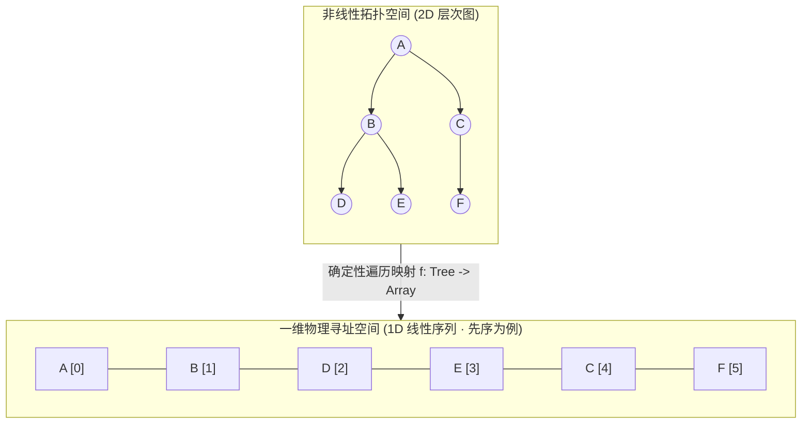
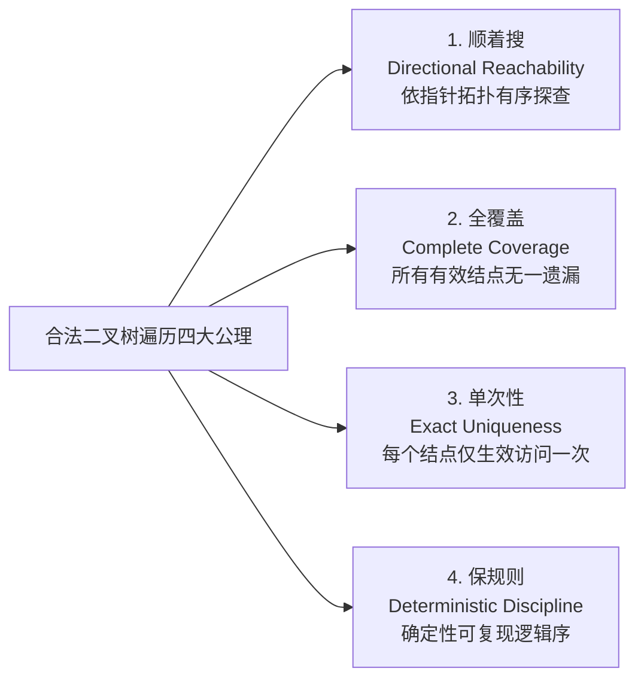
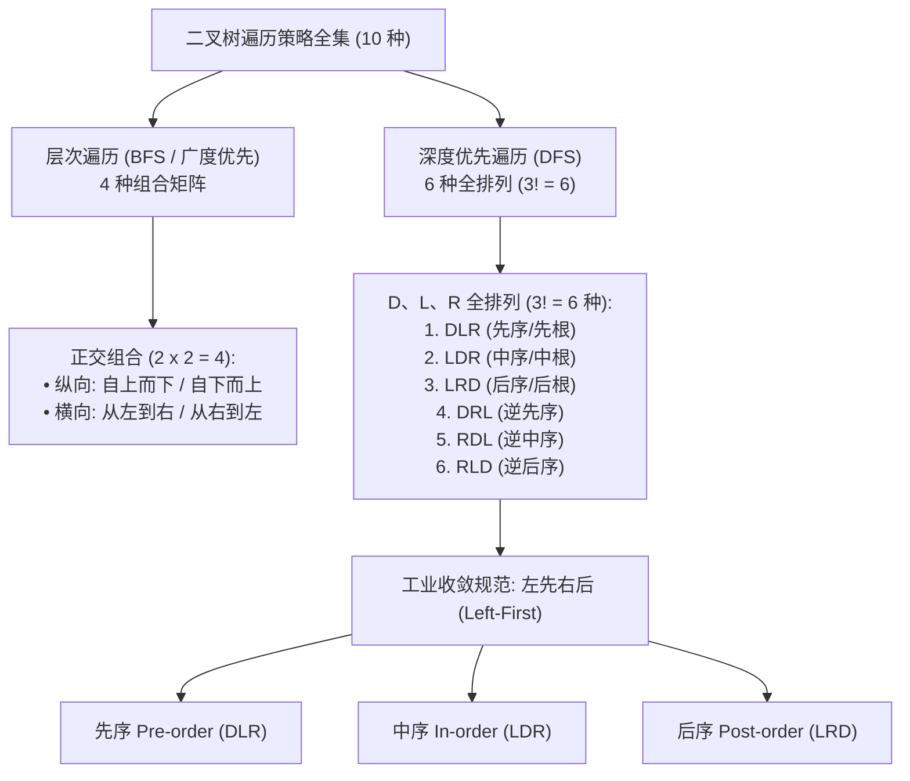
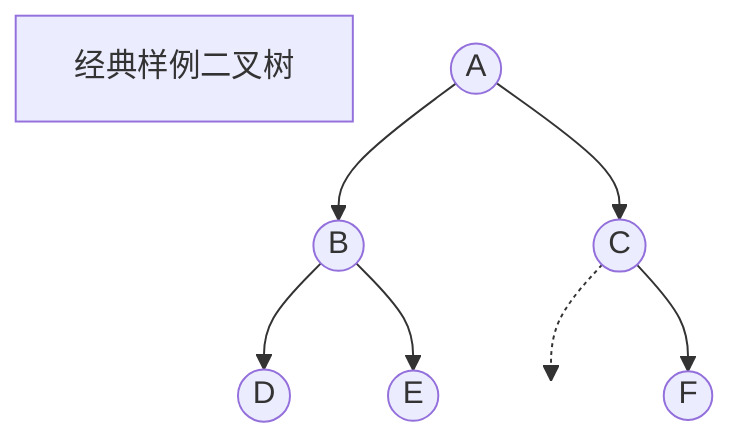
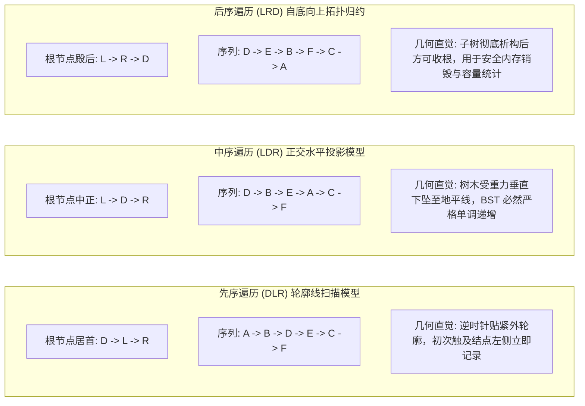
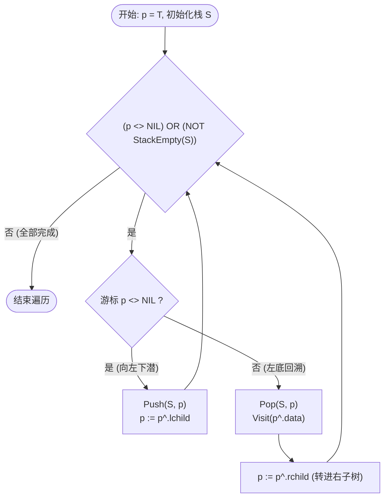
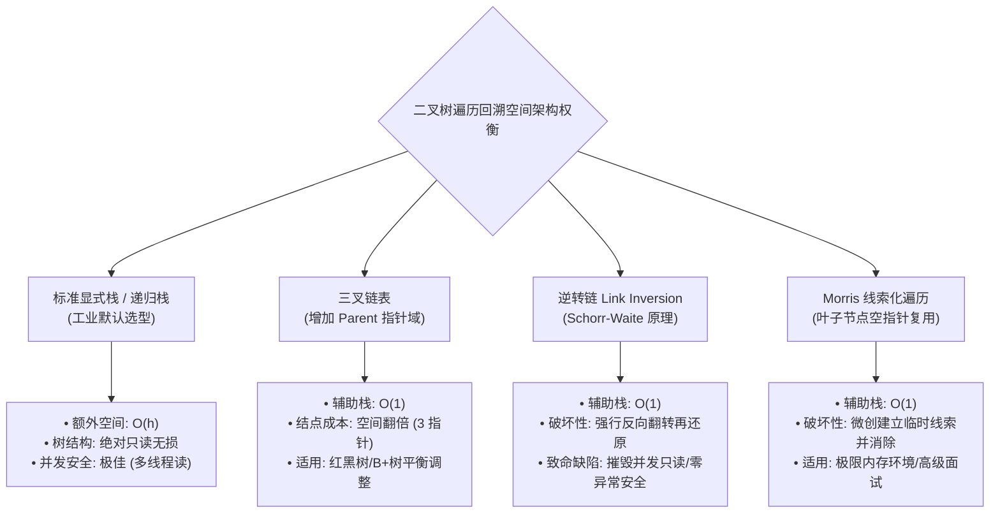
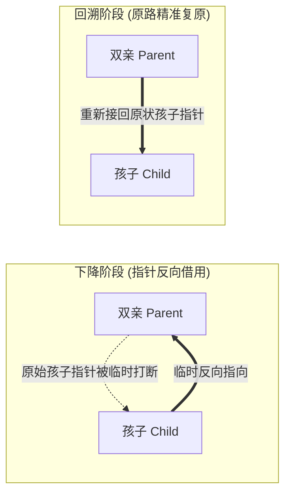
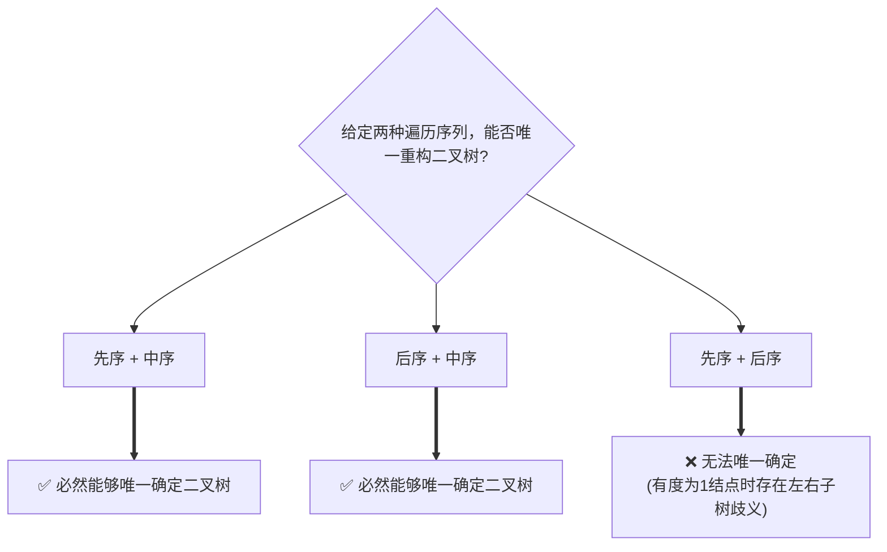

# 数据结构精要讲义 · 第 09 讲：二叉树的遍历体系、非递归实现与空间优化权衡

> **课程模块**：树与二叉树（Tree & Binary Tree）  
> **先修依赖**：第 01 讲（算法复杂度与空间模型）、第 03 讲第二节（算法描述语言 PDL 规范）、第 04 讲（栈的先进后出特性与调用栈机制）、第 08 讲（树与二叉树的逻辑表示与物理存储）  
> **后续进阶**：第 10 讲（线索二叉树构造与遍历）、第 11 讲（树与森林的转换）、第 13 讲（图的深度优先与广度优先搜索）  
> **算法表述规范**：全篇算法严格服从课程标准 **PDL（Program Description Language，Wirth 算法描述语言）伪代码规范**。  
> **讲义定位**：面向工业级软件工程与系统能力培养、408 计算机学科专业基础综合高分攻坚的深度专业讲义。

---

## 模块导读与学习目标矩阵

二叉树是一种典型的非线性数据结构。现实世界中绝大多数计算任务（如语法分析树、文件系统索引、表达式求值、决策树）本质上都以树形结构组织。然而，现代计算机的主存体系（Von Neumann 体系结构）在物理与逻辑寻址上是严格的一维线性空间。

**二叉树遍历（Binary Tree Traversal）的本质，正是建立非线性树形拓扑向一维线性序列的确定性映射。** 它是整个树论乃至图论算法的“心跳中枢”——无论是二叉搜索树的范围查询、堆的重平衡、二叉树的序列化与反序列化，还是表达式树的求值，其核心机制全都是遍历。



### 核心能力考核矩阵

| 认知维度 | 核心掌握目标 | 工业/考研对应落地场景 |
| :--- | :--- | :--- |
| **概念精确辨析** | 掌握遍历与访问的本质分界，理解遍历公理化的四大特征 | 技术面试基础、概念设计准则 |
| **组合数学分类** | 掌握 10 种遍历策略的分类体系（4 种 BFS + 6 种 DFS） | 算法设计空间全景认知 |
| **算法实现与推导** | 熟练编写三大深度遍历（先/中/后序）的递归与显式栈非递归 PDL 算法 | 核心手写算法、期末与考研标准答题 |
| **内存与调用栈** | 深刻理解运行时工作栈（Stack Frame）生命周期与空间复杂度 $O(h)$ | 系统崩溃排查、嵌入式/低内存优化 |
| **工程架构权衡** | 透彻分析显式栈、三叉链表、逆转链（Link Inversion）与 Morris 遍历的技术得失 | 生产级系统选型、异常安全与并发安全设计 |

---

## 第一部分：二叉树遍历的形式化定义与公理特征

### 1.1 核心概念精确界定：“访问”（Visit）vs “遍历”（Traverse）

在日常工程交流与考试审题中，许多工程师和学生经常混淆“访问”与“遍历”。两者的边界必须严格公理化界定：

* **访问（Visit）**：针对树中**单一结点（Node）**所施加的具体操作。该操作具有业务语义，例如打印结点数据（`WRITE`）、修改键值、累加统计指标、将数据持久化写入磁盘或网络发包等。
* **遍历（Traverse）**：针对**整棵二叉树（Tree Structure）**所执行的全局组织性、路径规划性操作。遍历负责决定以何种精确的次序依次触达树中的每一个结点，使得每一个结点都能恰好被“访问”一次。

在 PDL 算法描述语言中，遍历过程（`PROCEDURE`）充当拓扑调度器，访问过程（`Visit`）充当动作执行器：

```pascal
{ 遍历过程充当调度器 (Scheduler)，Visit 过程充当动作执行器 (Executor) }
PROCEDURE InOrderTraverse(T : BiTree; PROCEDURE Visit(e : TElemType));
```

### 1.2 遍历公理化的四大基石



1. **顺着搜（Directional Reachability）**：从根结点（Root）出发，依据二叉树既有的指针拓扑关系（左孩子 `lchild`、右孩子 `rchild`）进行有限步可达的图搜索，不得依赖物理连续外力跳跃访问。
2. **全覆盖（Complete Coverage）**：整棵二叉树中存在的每一个有效结点，必须无一遗漏地包含在最终的访问序列中。
3. **单次性（Exact Uniqueness）**：在一次完整的遍历生命周期内，每个结点被执行“访问（Visit）”操作的次数**严格为 1 次**。即使搜索路径为了回溯曾多次途经某结点，其“业务生效访问”也必须且只能触发一次。
4. **保规则（Deterministic Discipline）**：结点的访问次序必须严格服从预先约定的逻辑拓扑规则（如“根左右”或“左根右”），具有确定性与可复现性。

---

## 第二部分：遍历策略的形式化全景与分类数学体系

对于一棵非空二叉树，如何系统性地穷举所有可能的遍历策略？从拓扑学与图遍历的视角看，遍历策略严格划分为两大门类，共计 **10 种基础策略**。



### 2.1 层次遍历（Breadth-First Search, BFS）：4 种空间组合

层次遍历按照二叉树的拓扑层次（深度）进行横向层级扫描。它由两个正交维度的笛卡尔积构成：

* **纵向推进维度（2 种）**：自上而下（从根到叶） 或 自下而上（从叶到根）。
* **横向推进维度（2 种）**：从左到右（先左后右） 或 从右到左（先右后左）。

**组合总数**：$2 \times 2 = 4$ 种策略。  
*工程标准*：绝大多数工业场景下，“自上而下、从左到右”为标准默认规范，通常借助**先进先出队列（FIFO Queue）**实现。

### 2.2 深度优先遍历（Depth-First Search, DFS）：6 种全排列

深度优先遍历严格沿着单一分支纵深推进到底，再进行回溯。二叉树由三个核心拓扑要素构成：
* **$D$（Data / Degree 0 Root）**：访问根结点。
* **$L$（Left Subtree）**：遍历根结点的左子树。
* **$R$（Right Subtree）**：遍历根结点的右子树。

由于二叉树严格区分子树的左右方位，访问这三者的先后次序由组合数学中的全排列决定：
$$P(3, 3) = 3! = 3 \times 2 \times 1 = 6 \text{ 种}$$

这 6 种遍历排列及其形式化定义如下：

1. **$DLR$**：根 $\to$ 左 $\to$ 右（**先序 / 先根遍历 Pre-order**）
2. **$LDR$**：左 $\to$ 根 $\to$ 右（**中序 / 中根遍历 In-order**）
3. **$LRD$**：左 $\to$ 右 $\to$ 根（**后序 / 后根遍历 Post-order**）
4. **$DRL$**：根 $\to$ 右 $\to$ 左（逆先序）
5. **$RDL$**：右 $\to$ 根 $\to$ 左（逆中序）
6. **$RLD$**：右 $\to$ 左 $\to$ 根（逆后序）

### 2.3 工业标准收敛：“左为先、左为上”的工程约定

为什么全球主流教材与工业标准库（C++ STL、Java Collections、Linux Kernel）都只保留 **先序（$DLR$）、中序（$LDR$）、后序（$LRD$）** 这三种深度遍历？

这源于计算机科学中根深蒂固的约定——**“先左后右（Left-First Convention）”**。在数学书写习惯、西方自然语言阅读顺序（自左向右）以及笛卡尔平面直角坐标系中，正向推进均服从左先右后。

一旦锁定“$L$ 严格出现在 $R$ 之前”这一定序约束，原本 6 种排列中便只有 3 种合法解。这 3 种解根据 **根结点 $D$ 所处的时间切片位置** 命名：
* $D$ 在最前：**先序（Pre-order / DLR）**
* $D$ 在居中：**中序（In-order / LDR）**
* $D$ 在最后：**后序（Post-order / LRD）**

---

## 第三部分：三大深度遍历的几何直觉与速算模型

在理论分析或笔试推演中，逐行追踪递归函数极易出错。掌握以下三大几何直觉模型，可在数秒内直观推导出任何复杂二叉树的三种序列。





### 3.1 三大序列特性对比表

| 维度指标 | 先序遍历（Pre-order / DLR） | 中序遍历（In-order / LDR） | 后序遍历（Post-order / LRD） |
| :--- | :--- | :--- | :--- |
| **根结点位置** | 序列**第 1 位** | 位于序列**中间**（将左右子树完美切分） | 序列**最后 1 位** |
| **典型应用场景** | 树的克隆复制、前缀表达式求值、目录大纲生成 | 二叉搜索树有序输出、中缀表达式求值 | 树内存销毁析构、后缀表达式求值、目录容量统计 |
| **核心算法思想** | 自顶向下的展开与推演 | 左右平衡的对称投射 | 自底向上的拓扑归约与汇聚 |

---

## 第四部分：递归遍历的数学证明与运行时工作栈推演

### 4.1 二叉链表的 PDL 类型定义

依据课程 PDL 规范，使用 `RECORD` 和指针类型 `^` 定义二叉链表结点与树指针：

```pascal
TYPE
    TElemType = char;
    
    BiTree = ^BiTNode;                      { 二叉树指针类型 }
    BiTNode = RECORD
        data   : TElemType;                 { 数据域 }
        lchild : BiTree;                    { 左孩子指针域 }
        rchild : BiTree;                    { 右孩子指针域 }
    END;
```

### 4.2 递归算法的 PDL 形式化实现

递归遍历的逻辑具有极致的结构对称美。只需调整 `Visit` 调用的位置，即可在三种深度遍历次序间自由切换：

```pascal
{ 默认访问过程：输出结点字符 }
PROCEDURE PrintElement(e : TElemType);
BEGIN
    WRITE(e, ' ');
END;

{ 1. 先序遍历递归算法 (DLR) }
PROCEDURE PreOrderTraverse(T : BiTree);
BEGIN
    IF T <> NIL THEN
    BEGIN
        Visit(T^.data);                     { 1. 访问根结点 }
        PreOrderTraverse(T^.lchild);        { 2. 遍历左子树 }
        PreOrderTraverse(T^.rchild);        { 3. 遍历右子树 }
    END;
END;

{ 2. 中序遍历递归算法 (LDR) }
PROCEDURE InOrderTraverse(T : BiTree);
BEGIN
    IF T <> NIL THEN
    BEGIN
        InOrderTraverse(T^.lchild);         { 1. 遍历左子树 }
        Visit(T^.data);                     { 2. 访问根结点 }
        InOrderTraverse(T^.rchild);         { 3. 遍历右子树 }
    END;
END;

{ 3. 后序遍历递归算法 (LRD) }
PROCEDURE PostOrderTraverse(T : BiTree);
BEGIN
    IF T <> NIL THEN
    BEGIN
        PostOrderTraverse(T^.lchild);       { 1. 遍历左子树 }
        PostOrderTraverse(T^.rchild);       { 2. 遍历右子树 }
        Visit(T^.data);                     { 3. 访问根结点 }
    END;
END;
```

### 4.3 递归工作栈（Call Stack Frame）深度推演与空间定理

**“为什么递归代码看起来根本没有使用栈，却能实现回溯？”**

答案是：**递归隐式借用了操作系统与 CPU 提供的进程调用栈（Call Stack / Activation Record）**。每一次过程调用，系统都会自动压入一个活动记录（包括形参 `T`、局部变量、返回地址）。当子过程执行完毕后，系统自动弹出栈帧并跳转回原返回地址。

#### 空间复杂度定理与证明

> **定理**：若二叉树包含 $n$ 个结点，其高度为 $h$，则递归遍历的时间复杂度为严格的 $O(n)$，空间复杂度严格为 $O(h)$。

* **证明**：
  1. **时间开销**：每个结点仅被调用入栈常数次（入栈、出栈各 1 次，常数条指令），总时间开销 $T(n) = 2T(n/2) + O(1) \implies O(n)$。
  2. **空间开销**：调用栈的最大并发存活帧数取决于树的最大深度。
     - **最佳情况（完全平衡二叉树）**：高度 $h = \lfloor \log_2 n \rfloor + 1$，此时栈空间开销为最优的 $O(\log n)$。
     - **最差情况（完全退化为单支树）**：高度 $h = n$，此时二叉树退化为单链表，调用栈深度暴涨至 $n$，空间复杂度退化为 $O(n)$。

#### 工业生产警示：栈溢出崩溃（Stack Overflow）

在生产环境中，操作系统的默认栈空间十分有限（Linux 默认通常为 8MB，Windows 默认通常为 1MB，嵌入式 RTOS 甚至只有几十 KB）。若处理海量数据或面临恶意构造的极端退化树（$n = 10^5$），递归深度的急剧暴增将导致进程被系统直接以 `SIGSEGV`（Segmentation Fault）强制杀死！因此，**工业级底层库（如编译器抽象语法树遍历、数据库执行引擎）必须彻底消除递归，转向显式栈非递归实现**。

---

## 第五部分：非递归遍历的系统演进与显式栈设计

消除递归的本质，是**由开发者在堆内存中手动分配栈对象（Explicit Stack），替代脆弱且不可控的系统调用栈**。

二叉链表的一大结构性短板在于：每个结点只有指向子结点的单向指针，**缺乏指向父结点的回溯指针**。当我们从根节点一路向左狂奔到底后，如果不借助栈来保存沿途祖先节点的地址，我们将永远无法回到根结点与右子树！



### 5.1 显式顺序栈的 PDL 规范定义

```pascal
CONST
    MAX_STACK_SIZE = 1024;

TYPE
    SqStack = RECORD
        data : ARRAY [0 .. MAX_STACK_SIZE - 1] OF BiTree;
        top  : integer;                     { 栈顶指针：空栈时为 -1 }
    END;

{ 栈基本操作 }
PROCEDURE InitStack(VAR S : SqStack);
BEGIN
    S.top := -1;
END;

FUNCTION StackEmpty(S : SqStack) : boolean;
BEGIN
    StackEmpty := (S.top = -1);
END;

PROCEDURE Push(VAR S : SqStack; p : BiTree);
BEGIN
    IF S.top < MAX_STACK_SIZE - 1 THEN
    BEGIN
        S.top := S.top + 1;
        S.data[S.top] := p;
    END;
END;

PROCEDURE Pop(VAR S : SqStack; VAR p : BiTree);
BEGIN
    IF NOT StackEmpty(S) THEN
    BEGIN
        p := S.data[S.top];
        S.top := S.top - 1;
    END;
END;

PROCEDURE GetTop(S : SqStack; VAR p : BiTree);
BEGIN
    IF NOT StackEmpty(S) THEN
        p := S.data[S.top];
END;
```

### 5.2 算法 6.2 深度拆解：双阶段进栈与空指针状态标记法 (PDL)

算法 6.2 的设计哲学是：在栈中不仅存储有效结点的指针，还主动压入 `NIL` 空指针作为**“左子树遍历完毕”的状态标记哨兵**。

```pascal
{ 严蔚敏教材算法 6.2：利用 NIL 空指针作为回溯标记 }
PROCEDURE InOrderTraverse_Alg62(T : BiTree);
VAR
    S : SqStack;
    p : BiTree;
BEGIN
    InitStack(S);
    Push(S, T);                             { 初始时将根指针进栈 }

    WHILE NOT StackEmpty(S) DO
    BEGIN
        GetTop(S, p);
        { 内层循环：沿着左分支一路进栈，直至最左侧叶子的空孩子进栈 }
        WHILE p <> NIL DO
        BEGIN
            Push(S, p^.lchild);
            GetTop(S, p);
        END;
        Pop(S, p);                          { 弹出最底部的 NIL 空指针标记 }

        IF NOT StackEmpty(S) THEN
        BEGIN
            Pop(S, p);                      { 弹出真正需要访问的根结点 }
            Visit(p^.data);
            Push(S, p^.rchild);             { 将右孩子入栈 (无论是否为空) }
        END;
    END;
END;
```

### 5.3 算法 6.3 经典游标设计：职责完全解耦的高性能模式 (PDL)

算法 6.3 是目前工业界与算法竞赛中最推崇的标杆写法。它将**游标指针 `p`（负责向前侦察与下潜）**与**显式栈 `S`（负责暂存历史与准备回溯）**彻底解耦。

```pascal
{ 严蔚敏教材算法 6.3 / 工业级经典中序遍历：游标驱动模型 }
PROCEDURE InOrderTraverse_Alg63(T : BiTree);
VAR
    S : SqStack;
    p : BiTree;                             { 游标指针 }
BEGIN
    InitStack(S);
    p := T;                                 { 游标 p 从树根出发 }

    { 循环推进不变量：当前正在处理结点 p，或者栈中尚有未竟回溯任务 }
    WHILE (p <> NIL) OR (NOT StackEmpty(S)) DO
    BEGIN
        IF p <> NIL THEN
        BEGIN
            { 阶段 1：向左下潜 —— 根指针暂存入栈，抢占式深入左子树 }
            Push(S, p);
            p := p^.lchild;
        END
        ELSE
        BEGIN
            { 阶段 2：回溯出栈 —— 左子树已触底，弹出待决根结点并访问 }
            Pop(S, p);
            Visit(p^.data);

            { 阶段 3：转进右子树 —— 游标转向右孩子，准备开启新一轮左下潜 }
            p := p^.rchild;
        END;
    END;
END;
```

#### 运行追踪跟踪表（Trace Table）
以树 `A (左B[左D,右E], 右C[右F])` 执行算法 6.3 为例：

| 循环轮次 | 当前游标 `p` | 栈内元素（栈底 $\to$ 栈顶） | 动作触发分支 | 访问输出序列 |
| :---: | :---: | :---: | :---: | :---: |
| 0 | A | [] | 初始状态 | 空 |
| 1 | A | [A] | `p <> NIL`，压 A，`p:=B` | - |
| 2 | B | [A, B] | `p <> NIL`，压 B，`p:=D` | - |
| 3 | D | [A, B, D] | `p <> NIL`，压 D，`p:=NIL` | - |
| 4 | NIL | [A, B] | `p = NIL`，弹 D 访问，`p:=D^.rchild(NIL)` | **D** |
| 5 | NIL | [A] | `p = NIL`，弹 B 访问，`p:=B^.rchild(E)` | **D B** |
| 6 | E | [A, E] | `p <> NIL`，压 E，`p:=NIL` | **D B** |
| 7 | NIL | [A] | `p = NIL`，弹 E 访问，`p:=E^.rchild(NIL)` | **D B E** |
| 8 | NIL | [] | `p = NIL`，弹 A 访问，`p:=A^.rchild(C)` | **D B E A** |
| 9 | C | [C] | `p <> NIL`，压 C，`p:=C^.lchild(NIL)` | **D B E A** |
| 10 | NIL | [] | `p = NIL`，弹 C 访问，`p:=C^.rchild(F)` | **D B E A C** |
| 11 | F | [F] | `p <> NIL`，压 F，`p:=NIL` | **D B E A C** |
| 12 | NIL | [] | `p = NIL`，弹 F 访问，`p:=NIL` | **D B E A C F** |
| 13 | NIL | [] | 两条件皆空，退出循环 | **完成** |

---

## 第六部分：非递归体系的横向拓展与层次遍历 (PDL)

### 6.1 非递归先序遍历：高效单栈贪心模型 (PDL)

先序遍历由于是“见根即访”，代码在算法 6.3 的基础上更加直接：

```pascal
PROCEDURE PreOrderTraverse_Iterative(T : BiTree);
VAR
    S : SqStack;
    p : BiTree;
BEGIN
    IF T = NIL THEN EXIT;

    InitStack(S);
    Push(S, T);

    WHILE NOT StackEmpty(S) DO
    BEGIN
        Pop(S, p);
        Visit(p^.data);                     { 出栈即访问 }

        { 核心技巧：栈是先进后出。为了先遍历左子树，必须先将右孩子压栈！ }
        IF p^.rchild <> NIL THEN Push(S, p^.rchild);
        IF p^.lchild <> NIL THEN Push(S, p^.lchild);
    END;
END;
```

### 6.2 非递归后序遍历：双指针 `prev` 回溯标记模型 (PDL)

后序遍历是三大深度非递归中最棘手的。因为根结点必须在左、右子树均访问完成后才能被访问。引入 `prev` 记录上一个刚刚完成访问的结点指针：

```pascal
PROCEDURE PostOrderTraverse_Iterative(T : BiTree);
VAR
    S    : SqStack;
    p    : BiTree;
    prev : BiTree;                          { 追踪前一个刚刚访问过的结点 }
BEGIN
    InitStack(S);
    p := T;
    prev := NIL;

    WHILE (p <> NIL) OR (NOT StackEmpty(S)) DO
    BEGIN
        IF p <> NIL THEN
        BEGIN
            Push(S, p);
            p := p^.lchild;                 { 一路向左下潜 }
        END
        ELSE
        BEGIN
            GetTop(S, p);                   { 查看栈顶元素，暂不出栈 }
            { 若右孩子存在且尚未被访问过，则优先深入右子树 }
            IF (p^.rchild <> NIL) AND (p^.rchild <> prev) THEN
                p := p^.rchild
            ELSE
            BEGIN
                { 右孩子为空或右孩子刚刚访问完毕：本结点可以安全出栈并访问 }
                Pop(S, p);
                Visit(p^.data);
                prev := p;                  { 更新历史访问指针 }
                p := NIL;                   { 强行置空，防止下一轮重复走左子树下潜 }
            END;
        END;
    END;
END;
```

### 6.3 层次遍历的 PDL 实现：基于循环队列的广度扫描

```pascal
CONST
    MAX_QUEUE_SIZE = 1024;

TYPE
    SqQueue = RECORD
        data  : ARRAY [0 .. MAX_QUEUE_SIZE - 1] OF BiTree;
        front : integer;
        rear  : integer;
    END;

PROCEDURE InitQueue(VAR Q : SqQueue);
BEGIN
    Q.front := 0;
    Q.rear := 0;
END;

FUNCTION QueueEmpty(Q : SqQueue) : boolean;
BEGIN
    QueueEmpty := (Q.front = Q.rear);
END;

PROCEDURE EnQueue(VAR Q : SqQueue; p : BiTree);
BEGIN
    IF (Q.rear + 1) MOD MAX_QUEUE_SIZE <> Q.front THEN
    BEGIN
        Q.data[Q.rear] := p;
        Q.rear := (Q.rear + 1) MOD MAX_QUEUE_SIZE;
    END;
END;

PROCEDURE DeQueue(VAR Q : SqQueue; VAR p : BiTree);
BEGIN
    IF NOT QueueEmpty(Q) THEN
    BEGIN
        p := Q.data[Q.front];
        Q.front := (Q.front + 1) MOD MAX_QUEUE_SIZE;
    END;
END;

PROCEDURE LevelOrderTraverse(T : BiTree);
VAR
    Q : SqQueue;
    p : BiTree;
BEGIN
    IF T = NIL THEN EXIT;

    InitQueue(Q);
    EnQueue(Q, T);

    WHILE NOT QueueEmpty(Q) DO
    BEGIN
        DeQueue(Q, p);
        Visit(p^.data);
        IF p^.lchild <> NIL THEN EnQueue(Q, p^.lchild);
        IF p^.rchild <> NIL THEN EnQueue(Q, p^.rchild);
    END;
END;
```

---

## 第七部分：空间极限压榨与工程权衡：逆转链与 Morris 遍历

所有基于栈的方案，无论递归还是非递归，最坏空间复杂度均为 $O(n)$，平均 $O(h)$。**我们能否打破这个限制，在完全不需要额外辅助栈空间（$O(1)$ 额外空间）的前提下完成树的遍历？**



### 7.1 逆转链思想溯源：Schorr-Waite 算法的投影

在早期内存极其匮乏的时代（如 1960~1970 年代，系统内存仅以 KB 计算），垃圾回收器（Garbage Collector）在遍历标记内存对象图时，根本没有多余的内存开辟一个调用栈！

Schorr 与 Waite（1967）提出了一种极其精巧的思想：**“既然没有空间存回溯地址，那就在向深层推进时，临时反转当前结点的指针，让它反向指向自己的父亲！”**



### 7.2 逆转链在现代软件工程中为何被“彻底否决”？

尽管逆转链在理论上达到了令人惊叹的 $O(1)$ 辅助空间，但现代工业级软件体系（Linux、Chromium、JVM、LLVM）**严格禁止在普通二叉树上使用逆转链**。其致命缺陷有四：

1. **彻底破坏内存共享性（Destroy Shared Concurrency）**：
   - 现代系统高度依赖多线程并发读。一棵二叉树可能被几十个线程同时并发检索。
   - 逆转链本质上是**以破坏树的物理结构为代价换取回溯路径**。遍历期间树被撕裂成双向扭曲链表，导致任何并发读线程发生空指针异常或内存乱飞直接 Crash！
2. **零异常安全性（Zero Exception Safety & Fragility）**：
   - 若遍历函数在指针反转的中途发生除零异常、内存总线错误、操作系统断电或线程被外部强制 Kill，整棵树将永久停留在被撕裂破坏的畸变状态，数据完全不可恢复。
3. **硬件缓存灾难（Cache Thrashing）**：
   - 每次下潜和回溯都涉及对节点内存指针的双向写回操作。这会强制使得 CPU L1/L2 Cache 行频繁失效（Cache Invalidation），实际运行速度反而远逊于数组顺序栈。
4. **必须依赖额外标记位（Tag Bit Overhead）**：
   - 从下层爬回双亲时，算法必须知道自己是从双亲的“左子树”爬回来的，还是从“右子树”爬回来的。因此每个节点必须强制开辟 2-bit 的 `tag` 标志域，空间消耗反而隐式转移到了节点自身结构中。

### 7.3 四大遍历架构方案全维度权衡决策矩阵

| 方案类别 | 代表算法 | 时间复杂度 | 额外空间复杂度 | 树结构可变性 | 并发只读安全 | 工业落地典型场景 |
| :--- | :--- | :---: | :---: | :--- | :--- | :--- |
| **标准显式栈** | 算法 6.3 / 递归 | $O(n)$ | $O(h)$ | **完全无损只读** | **绝佳（完全支持并发读）** | **通用工业级默认选型**（编译分析、数据库、STL） |
| **三叉链表** | 带 Parent 节点 | $O(n)$ | **$O(1)$ 栈空间**<br>*(节点增加指针空间)* | **完全无损只读** | **绝佳** | 复杂拓扑回溯（红黑树插入删除平衡调整、B+树） |
| **逆转链** | Link Inversion | $O(n)$ | $O(1)$ | **动态破坏且强行修复** | **灾难（完全无法并发）** | 极低内存裸机系统的全停顿（STW）垃圾回收标记 |
| **Morris 遍历** | 线索化探测 | $O(n)$ | **$O(1)$ 栈空间** | 临时借用空指针线索化，最终复原 | 弱（遍历期间只读被短暂破坏） | 内存极其敏感的嵌入式流式计算、高难度面试 |

---

## 第八部分：408 考研高频难点与大厂面试攻坚

### 8.1 经典推导定理：二叉树唯一性重构法则



#### 为什么中序序列不可或缺？
* 先序与后序只能确定结点的**祖先-后代血统关系**（谁是根，谁是子孙），但**无法区分左右子树界限**！
* 例如：先序为 `A B`，后序为 `B A`。对应的二叉树可能是“A 的左孩子为 B”，也可能是“A 的右孩子为 B”。
* **中序序列的作用**：根结点在中序序列中充当“正交分割点”，根结点的左侧元素 100% 属于左子树，右侧元素 100% 属于右子树。

### 8.2 考场秒杀推导模板（先序 + 中序重建）

* **题干**：
  - 先序序列：`[ A,  B, D, E,  C, F ]`
  - 中序序列：`[ D, B, E,  A,  C, F ]`
* **三步秒杀法**：
  1. **定位根结点**：看先序第 1 个元素 `A` 为整棵树的根。
  2. **分割左右子树**：在中序中定位 `A`，则：
     - `A` 左侧的 `[D, B, E]` 必然构成左子树（长度为 3）。
     - `A` 右侧的 `[C, F]` 必然构成右子树（长度为 2）。
  3. **切割先序序列**：
     - 先序中紧跟根结点的接下来 3 个元素 `[B, D, E]` 为左子树先序。
     - 剩余的最后 2 个元素 `[C, F]` 为右子树先序。
  4. 对子序列递归重复上述步骤，树的拓扑即刻还原！

---

## 讲义小结与课后思考题

### 知识全景回顾
1. **概念基石**：访问（Visit）是原子业务动作，遍历（Traverse）是全局拓扑调度；遍历必须满足顺着搜、全覆盖、单次性、保规则。
2. **策略分类**：由 4 种层次遍历（BFS）与 6 种深度遍历（DFS）构成 10 种策略，工业收敛至先序、中序、后序与标准层次遍历。
3. **算法实现**：递归调用栈隐式开销为 $O(h)$；算法 6.3 采用游标 `p` 与显式栈 `S` 彻底解耦，是工业级消除递归的标杆。
4. **系统权衡**：逆转链在空间压榨上追求极限，但因摧毁共享性、缺乏异常安全而在现代通用系统中被弃用；架构设计永远是空间、时间与安全性的妥协艺术。

### 课后深度研讨题
1. **[思维挑战]** 请尝试在算法 6.3 的框架下，将其改造为**仅使用一个栈即可求出二叉树所有根到叶子结点路径**的 PDL 算法。
2. **[系统分析]** 设某 Linux 服务器处理请求时需要频繁深度遍历一棵高度达 500,000 的极度倾斜语法树，若采用递归遍历，系统会发生什么现象？在不重构物理树的前提下，如何修改代码与系统配置彻底解决该问题？
3. **[Morris 遍历进阶]** 查阅资料学习 Morris 中序遍历算法，分析它是如何利用二叉树中所有空闲的空指针（`NIL` 域）建立临时线索，从而实现真正的“无损只读 $O(1)$ 辅助空间”遍历的？
