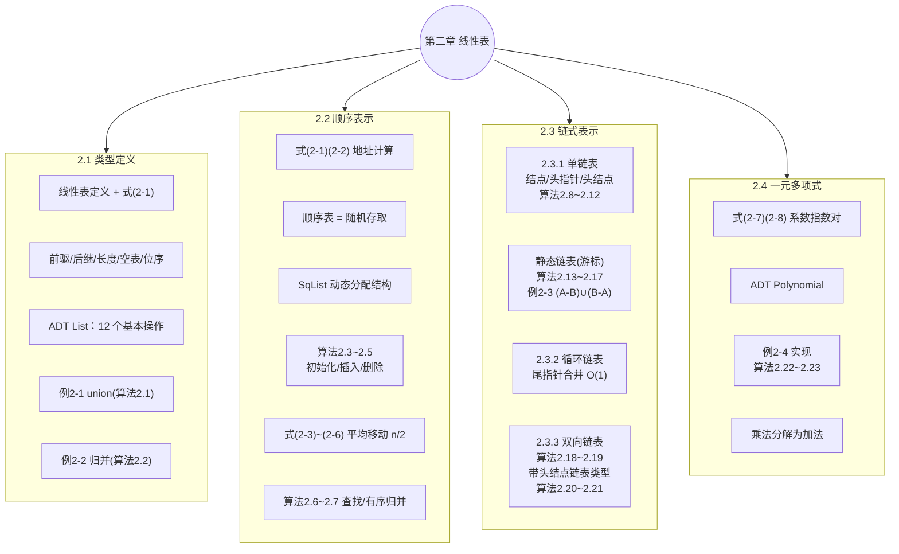
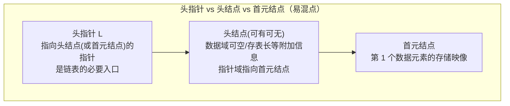
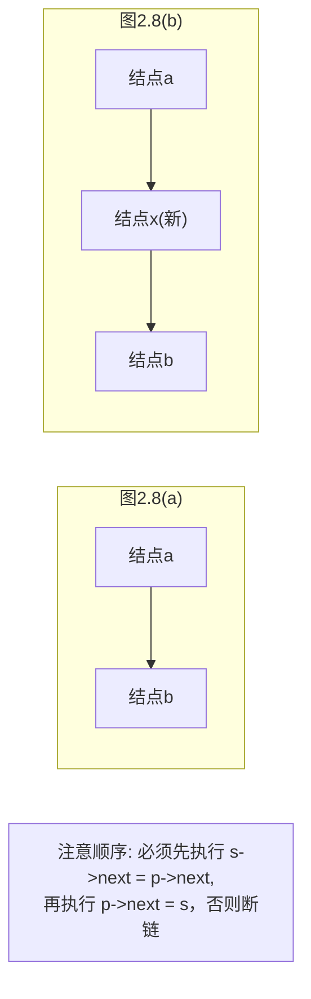

# 数据结构 · 第二章 线性表 · 详细版讲义

> **来源说明**：本讲义以严蔚敏、吴伟民《数据结构（C 语言版）》第二章（线性表，教材第 18–43 页）为唯一依据整理而成，属**学习笔记性质的详细整理稿**。全文按教材原文顺序展开：**凡属"定义"的内容均单独成块、编号并标注教材出处**（格式：定义 N ｜ 教材章节）；**教材中全部 4 道例题（例 2-1 ~ 例 2-4）与全部 23 个算法（算法 2.1 ~ 算法 2.23）均按序号逐题摘抄**。教材原文因排版产生的个别 OCR 残缺处已按教材标准内容校订，代码一律还原为规范的类 C 形式。

---

## 总览：本章知识地图



---

# 章引言：线性结构的特点（教材第 2 章开头）

> **定义 1（线性结构 ｜ 教材第 2 章引言）**：从第 2 章至第 4 章讨论**线性结构**。线性结构的特点是：在数据元素的**非空有限集**中，
> (1) 存在**惟一**的一个被称做"第一个"的数据元素；
> (2) 存在**惟一**的一个被称做"最后一个"的数据元素；
> (3) 除第一个之外，集合中的每个数据元素均**只有一个前驱**；
> (4) 除最后一个之外，集合中每个数据元素均**只有一个后继**。

---

# 一、2.1 线性表的类型定义

## 1.1 线性表的定义

> **定义 2（线性表 linear_list ｜ 教材 2.1）**：线性表（linear_list）是**最常用且最简单的一种数据结构**。简言之，一个线性表是 **n 个数据元素的有限序列**。至于每个数据元素的具体含义，在不同情况下各不相同：可以是一个数或一个符号，也可以是一页书，甚至其他更复杂的信息。

教材连给 3 个例子说明"元素可以多种多样"：

| 例 | 线性表 | 元素类型 |
|---|---|---|
| ① | (A, B, C, …, Z) 26 个英文字母表 | 单个字母字符 |
| ② | (6, 17, 28, 50, 92, 188) 某校 1978–1983 年计算机拥有量 | 整数 |
| ③ | 学生健康情况登记表（图 2.1） | 记录（由 6 个数据项组成） |

## 1.2 记录、数据项与文件

> **定义 3（记录 / 文件 ｜ 教材 2.1）**：在稍复杂的线性表中，一个数据元素可由**若干个数据项（item）**组成。在这种情况下，常把数据元素称为**记录（record）**，**含有大量记录的线性表又称文件（file）**。

教材图 2.1 学生健康情况登记表：每个学生的情况为一个**记录**，由**姓名、学号、性别、年龄、班级、健康状况** 6 个**数据项**组成。表中 4 行数据：王小林/790631/男/18/计91/健康；陈红/790632/女/20/计91/一般；刘建平/790633/男/21/计91/健康；张立立/790634/男/17/计91/神经衰弱。

## 1.3 序偶关系、前驱后继、长度、位序

综合 3 个例子：同一线性表中的元素**必定具有相同特性（属同一数据对象）**，相邻数据元素之间存在着**序偶关系**。若将线性表记为

$$(a_1, \cdots, a_{i-1},\, a_i,\, a_{i+1}, \cdots, a_n) \tag{2-1}$$

> **定义 4（直接前驱 / 直接后继 ｜ 教材 2.1，式 2-1）**：表中 $a_{i-1}$ 领先于 $a_i$，$a_i$ 领先于 $a_{i+1}$，称 $a_{i-1}$ 是 $a_i$ 的**直接前驱元素**，$a_{i+1}$ 是 $a_i$ 的**直接后继元素**。当 $i=1,2,\cdots,n-1$ 时，$a_i$ 有且仅有一个直接后继；当 $i=2,3,\cdots,n$ 时，$a_i$ 有且仅有一个直接前驱。

> **定义 5（表长 / 空表 / 位序 ｜ 教材 2.1）**：线性表中元素的个数 $n\ (n\ge 0)$ 定义为**线性表的长度**；$n=0$ 时称为**空表**。在非空表中每个数据元素都有一个确定的位置：$a_1$ 是第一个数据元素，$a_n$ 是最后一个，$a_i$ 是第 $i$ 个数据元素，称 $i$ 为数据元素 $a_i$ 在线性表中的**位序**。

> **性质（线性表的灵活性 ｜ 教材 2.1）**：线性表是一个相当灵活的数据结构，它的长度可根据需要**增长或缩短**，即对线性表的数据元素不仅可以**访问**，还可进行**插入和删除**等。

## 1.4 抽象数据类型线性表（ADT List）的定义

> **定义 6（ADT List ｜ 教材 2.1）**：抽象数据类型线性表的定义如下——
>
> ```
> ADT List {
>   数据对象：D = { ai | ai ∈ ElemSet, i = 1, 2, …, n, n ≥ 0 }
>   数据关系：R1 = { <ai-1, ai> | ai-1, ai ∈ D, i = 2, …, n }
>   基本操作：
>     InitList(&L)      操作结果：构造一个空的线性表 L
>     DestroyList(&L)   初始条件：L 已存在。操作结果：销毁线性表 L
>     ClearList(&L)     初始条件：L 已存在。操作结果：将 L 重置为空表
>     ListEmpty(L)      初始条件：L 已存在。操作结果：若 L 为空表返回 TRUE，否则返回 FALSE
>     ListLength(L)     初始条件：L 已存在。操作结果：返回 L 中数据元素个数
>     GetElem(L, i, &e)       初始条件：L 已存在，1 ≤ i ≤ ListLength(L)。
>                       操作结果：用 e 返回 L 中第 i 个数据元素的值
>     LocateElem(L, e, compare())  初始条件：L 已存在，compare() 是数据元素判定函数。
>                       操作结果：返回 L 中第 1 个与 e 满足关系 compare() 的数据元素的
>                       位序。若这样的数据元素不存在，则返回值为 0
>     PriorElem(L, cur_e, &pre_e)  初始条件：L 已存在。
>                       操作结果：若 cur_e 是 L 的数据元素且不是第一个，则用 pre_e 返回
>                       它的前驱，否则操作失败，pre_e 无定义
>     NextElem(L, cur_e, &next_e)  初始条件：L 已存在。
>                       操作结果：若 cur_e 是 L 的数据元素且不是最后一个，则用 next_e
>                       返回它的后继，否则操作失败，next_e 无定义
>     ListInsert(&L, i, e)    初始条件：L 已存在，1 ≤ i ≤ ListLength(L) + 1。
>                       操作结果：在 L 中第 i 个位置之前插入新的数据元素 e，L 的长度加 1
>     ListDelete(&L, i, &e)   初始条件：L 已存在且非空，1 ≤ i ≤ ListLength(L)。
>                       操作结果：删除 L 的第 i 个数据元素，并用 e 返回其值，L 的长度减 1
>     ListTraverse(L, visit())  初始条件：L 已存在。
>                       操作结果：依次对 L 的每个数据元素调用函数 visit()。一旦 visit()
>                       失败，则操作失败
> } ADT List
> ```

教材指出：对上述 ADT 还可进行更复杂的操作，例如**将两个或两个以上的线性表合并成一个线性表**、**把一个线性表拆开成两个或两个以上的线性表**、**重新复制一个线性表**等——下面两道例题正是"合并"的代表。

---

## 例 2-1（教材 2.1 ｜ 摘抄原文）

> **例 2-1**　假设利用两个线性表 LA 和 LB 分别表示两个集合 A 和 B（即线性表中的数据元素即为集合中的成员），现要求一个新的集合 A = A∪B。这就要求对线性表作如下操作：**扩大线性表 LA，将存在于线性表 LB 中而不存在于线性表 LA 中的数据元素插入到线性表 LA 中去**。只要从线性表 LB 中依次取得每个数据元素，并依值在线性表 LA 中进行查访，若不存在，则插入之。

### 算法 2.1 union

```c
void union(List &La, List Lb) {
    // 将所有在线性表 Lb 中但不在 La 中的数据元素插入到 La 中
    La_len = ListLength(La);
    Lb_len = ListLength(Lb);          // 求线性表的长度
    for (i = 1; i <= Lb_len; i++) {
        GetElem(Lb, i, e);            // 取 Lb 中第 i 个数据元素赋给 e
        if (!LocateElem(La, e, equal))
            ListInsert(La, ++La_len, e);   // La 中不存在和 e 相同的数据元素，则插入之
    }
} // union                                    —— 算法 2.1
```

> 📖 **教材注**：`++La_len` 表示参数 La_len 的值**先增 1，然后再传递给函数**；若 `++` 在参量名之后，则表示**先将参数传递给函数，然后参数的值再增 1**，以后均类同。

---

## 例 2-2（教材 2.1 ｜ 摘抄原文）

> **例 2-2**　已知线性表 LA 和 LB 中的数据元素**按值非递减有序**排列，现要求将 LA 和 LB **归并**为一个新的线性表 LC，且 LC 中的数据元素**仍按值非递减有序**排列。例如，设
> LA = (3, 5, 8, 11)　　LB = (2, 6, 8, 9, 11, 15, 20)　　则　　LC = (2, 3, 5, 6, 8, 8, 9, 11, 11, 15, 20)

从问题要求可知：LC 中的数据元素**或是 LA 中的**，**或是 LB 中的**——只要先设 LC 为空表，然后将 LA 或 LB 中的元素逐个插入到 LC 中即可。为使 LC 中元素按值非递减有序排列，可设**两个指针 i 和 j** 分别指向 LA 和 LB 中某个元素：若设 i 当前所指元素为 a、j 当前所指元素为 b，则当前应插入 LC 的元素 c 为

$$c = \begin{cases} a, & 当\ a \le b\ 时 \\ b, & 当\ a > b\ 时 \end{cases}$$

指针 i 和 j 的初值均为 1；在所指元素插入 LC 之后，在 LA 或 LB 中**顺序后移**。

### 算法 2.2 MergeList

```c
void MergeList(List La, List Lb, List &Lc) {
    // 已知线性表 La 和 Lb 中的数据元素按值非递减排列
    // 归并 La 和 Lb 得到新的线性表 Lc，Lc 的数据元素也按值非递减排列
    InitList(Lc);
    i = j = 1;  k = 0;
    La_len = ListLength(La);  Lb_len = ListLength(Lb);
    while ((i <= La_len) && (j <= Lb_len)) {   // La 和 Lb 均非空
        GetElem(La, i, ai);
        GetElem(Lb, j, bj);
        if (ai <= bj) { ListInsert(Lc, ++k, ai); ++i; }
        else          { ListInsert(Lc, ++k, bj); ++j; }
    }
    while (i <= La_len) { GetElem(La, i++, ai); ListInsert(Lc, ++k, ai); }
    while (j <= Lb_len) { GetElem(Lb, j++, bj); ListInsert(Lc, ++k, bj); }
} // MergeList                                  —— 算法 2.2
```

### 例 2-1 / 例 2-2 的时间复杂度分析（教材 2.1 末）

上述两个算法的时间复杂度**取决于抽象数据类型 List 定义中基本操作的执行时间**。假设 GetElem 和 ListInsert 的执行时间和表长无关、LocateElem 的执行时间和表长成正比，则：

| 算法 | 时间复杂度 | 说明 |
|---|---|---|
| 算法 2.1（union） | O(ListLength(LA) × ListLength(LB)) | 主要耗费在 LocateElem 的查找上 |
| 算法 2.2（MergeList） | O(ListLength(LA) + ListLength(LB)) | 虽含 3 个 while 循环，但对每组具体输入，**后两个 while 循环只执行一个循环体** |

算法 2.2 中只有当 i 和 j 均指向表中实际存在的数据元素时才能取得元素值并比较；当其中一个线性表的元素均已插入 LC 后，只需将另一个表的剩余元素依次插入即可。

---

# 二、2.2 线性表的顺序表示和实现

## 2.1 顺序存储结构的定义与地址公式

> **定义 7（顺序表示 ｜ 教材 2.2）**：线性表的**顺序表示**指的是用**一组地址连续的存储单元依次存储**线性表的数据元素。假设线性表的每个元素需占用 **l 个存储单元**，并以所占第一个单元的存储地址作为数据元素的存储位置，则第 i+1 个数据元素的存储位置 LOC(a_{i+1}) 和第 i 个数据元素的存储位置 LOC(a_i) 之间满足：
> $$LOC(a_{i+1}) = LOC(a_i) + l \tag{2-1}$$
> 一般来说，线性表的第 i 个数据元素 a_i 的存储位置为：
> $$LOC(a_i) = LOC(a_1) + (i-1) \times l \tag{2-2}$$
> 式中 LOC(a₁) 是第一个数据元素 a₁ 的存储位置，通常称做线性表的**起始位置**或**基地址**。

> **定义 8（顺序存储结构 / 顺序映像 / 顺序表 ｜ 教材 2.2）**：线性表的这种机内表示称做线性表的**顺序存储结构**或**顺序映像（sequential mapping）**；通常称这种存储结构的线性表为**顺序表**。它的特点是：为表中相邻的元素 a_i 和 a_{i+1} 赋以**相邻的存储位置** LOC(a_i) 和 LOC(a_{i+1})。换句话说，以元素在计算机内**"物理位置相邻"来表示线性表中数据元素之间的逻辑关系**。每一个数据元素的存储位置都和线性表的起始位置相差一个**与该元素位序成正比的常数**（图 2.2）。

> **定义 9（随机存取 ｜ 教材 2.2）**：由此，只要确定了存储线性表的起始位置，线性表中**任一数据元素都可随机存取**，所以线性表的顺序存储结构是一种**随机存取的存储结构**。

教材图 2.2（顺序存储结构示意图）：

| 数据元素位序 | 存储地址 | 内存状态 |
|---|---|---|
| a₁ | b | |
| a₂ | b+l | |
| … | … | |
| a_i | b+(i−1)l | |
| a_{i+1} | b+il | |
| … | … | |
| a_n | b+(n−1)l | |
| （空闲） | b+(maxlen−1)l | 空闲 |

由于高级程序设计语言中的**数组类型**也有随机存取的特性，因此通常都用**数组**来描述顺序存储结构。线性表长度可变且所需最大存储空间随问题不同而不同，故在 C 语言中用**动态分配的一维数组**描述。

## 2.2 顺序表的动态分配存储结构（教材 2.2）

```c
// ---------- 线性表的动态分配顺序存储结构 ----------
#define LIST_INIT_SIZE 100    // 线性表存储空间的初始分配量
#define LISTINCREMENT  10     // 线性表存储空间的分配增量
typedef struct {
    ElemType *elem;           // 存储空间基址
    int length;               // 当前长度
    int listsize;             // 当前分配的存储容量（以 sizeof(ElemType) 为单位）
} SqList;
```

> 📖 **教材说明（2.2）**：数组指针 elem 指示线性表的**基地址**，length 指示**当前长度**，listsize 指示**当前分配的存储空间大小**——一旦因插入元素而空间不足时，可进行**再分配**，即为顺序表增加一个大小为 LISTINCREMENT 个数据元素的空间。

### 算法 2.3 InitList_Sq（顺序表初始化）

> 顺序表的初始化操作就是为顺序表分配一个**预定义大小**的数组空间，并将线性表的**当前长度设为 0**。

```c
Status InitList_Sq(SqList &L) {
    // 构造一个空的线性表 L
    L.elem = (ElemType *)malloc(LIST_INIT_SIZE * sizeof(ElemType));
    if (!L.elem) exit(OVERFLOW);     // 存储分配失败
    L.length = 0;                    // 空表长度为 0
    L.listsize = LIST_INIT_SIZE;     // 初始存储容量
    return OK;
} // InitList_Sq                              —— 算法 2.3
```

在这种存储结构中，容易实现**随机存取第 i 个数据元素**等操作。特别注意：**C 语言中数组下标从 0 开始**，若 L 是 SqList 型顺序表，则表中**第 i 个数据元素是 L.elem[i−1]**。

## 2.3 顺序表上的插入与删除

> **插入操作的逻辑定义（教材 2.2）**：插入操作是指在线性表的第 i−1 个数据元素和第 i 个数据元素之间插入一个新的数据元素 b，使长度为 n 的线性表 (a₁, …, a_{i−1}, a_i, …, a_n) 变成长度为 n+1 的线性表 (a₁, …, a_{i−1}, **b**, a_i, …, a_n)——数据元素 a_{i−1} 和 a_i 之间的**逻辑关系发生了变化**。由于顺序存储结构中逻辑上相邻的数据元素在**物理位置上也相邻**，因此**除非 i = n+1，否则必须移动元素**才能反映这个逻辑关系的变化。

教材图 2.3（插入前后的状况）：在线性表第 4 和第 5 个元素之间插入值为 25 的数据元素，需将**第 5 个至第 8 个**数据元素依次**向后移动一个位置**（插入前 n=8，插入后 n=9）。

> 一般情况下，在第 i（1 ≤ i ≤ n）个元素之前插入一个元素时，需将第 **n 至第 i（共 n−i+1 个）**元素向后移动一个位置。

```c
Status ListInsert_Sq(SqList &L, int i, ElemType e) {
    // 在顺序线性表 L 中第 i 个位置之前插入新的元素 e
    // i 的合法值为 1 ≤ i ≤ ListLength_Sq(L) + 1
    if (i < 1 || i > L.length + 1) return ERROR;          // i 值不合法
    if (L.length >= L.listsize) {                         // 当前存储空间已满，增加分配
        newbase = (ElemType *)realloc(L.elem,
            (L.listsize + LISTINCREMENT) * sizeof(ElemType));
        if (!newbase) exit(OVERFLOW);                     // 存储分配失败
        L.elem = newbase;                                 // 新基址
        L.listsize += LISTINCREMENT;                      // 增加存储容量
    }
    q = &(L.elem[i - 1]);                                 // q 为插入位置
    for (p = &(L.elem[L.length - 1]); p >= q; --p)
        *(p + 1) = *p;                                    // 插入位置及之后的元素右移
    *q = e;                                               // 插入 e
    ++L.length;                                           // 表长增 1
    return OK;
} // ListInsert_Sq                                        —— 算法 2.4
```

> **删除操作的逻辑定义（教材 2.2）**：删除操作使长度为 n 的线性表 (a₁, …, a_{i−1}, a_i, a_{i+1}, …, a_n) 变成长度为 n−1 的线性表 (a₁, …, a_{i−1}, a_{i+1}, …, a_n)——数据元素 a_{i−1}、a_i 和 a_{i+1} 之间的逻辑关系发生变化，同样需要**移动元素**。

教材图 2.4（删除前后的状况）：删除第 4 个数据元素时，必须将**第 5 个至第 8 个**元素依次**向前移动一个位置**（删除前 n=8，删除后 n=7）。

> 一般情况下，删除第 i（1 ≤ i ≤ n）个元素时，需将第 **i+1 至第 n（共 n−i 个）**元素依次向前移动一个位置。

```c
Status ListDelete_Sq(SqList &L, int i, ElemType &e) {
    // 在顺序线性表 L 中删除第 i 个元素，并用 e 返回其值
    // i 的合法值为 1 ≤ i ≤ ListLength_Sq(L)
    if ((i < 1) || (i > L.length)) return ERROR;   // i 值不合法
    p = &(L.elem[i - 1]);                          // p 为被删除元素的位置
    e = *p;                                        // 被删除元素的值赋给 e
    q = L.elem + L.length - 1;                     // 表尾元素的位置
    for (++p; p <= q; ++p) *(p - 1) = *p;          // 被删除元素之后的元素左移
    --L.length;                                    // 表长减 1
    return OK;
} // ListDelete_Sq                                 —— 算法 2.5
```

## 2.4 移动元素的平均次数推导（教材 2.2，式 2-3 ~ 2-6）

从算法 2.4 和 2.5 可见：在顺序存储结构的线性表中插入或删除一个数据元素时，**时间主要耗费在移动元素上**（即"移动元素"为预估时间复杂度的**基本操作**），而**移动元素的个数取决于插入或删除元素的位置**。

> **推导（教材 2.2 ｜ 详细展开）**：
> 设 p_i 是**在第 i 个元素之前插入**一个元素的概率，则在长度为 n 的线性表中插入一个元素时所需移动元素次数的期望值（平均次数）为
> $$E_{ins} = \sum_{i=1}^{n+1} p_i (n - i + 1) \tag{2-3}$$
> 设 q_i 是删除第 i 个元素的概率，则删除一个元素时所需移动元素次数的期望值为
> $$E_{del} = \sum_{i=1}^{n} q_i (n - i) \tag{2-4}$$
> 不失一般性，可假定在线性表的**任何位置上插入或删除元素都是等概率**的，即 $p_i = \dfrac{1}{n+1}$，$q_i = \dfrac{1}{n}$。代入化简：
> - 插入时：共有 n+1 个可插入位置，各位置移动次数依次为 n, n−1, …, 1, 0，故
>   $$E_{ins} = \frac{1}{n+1}\sum_{i=1}^{n+1}(n-i+1) = \frac{1}{n+1} \cdot \frac{n(n+1)}{2} = \frac{n}{2} \tag{2-5}$$
> - 删除时：共有 n 个可删除位置，各位置移动次数依次为 n−1, n−2, …, 1, 0，故
>   $$E_{del} = \frac{1}{n}\sum_{i=1}^{n}(n-i) = \frac{1}{n} \cdot \frac{n(n-1)}{2} = \frac{n-1}{2} \tag{2-6}$$

> **结论（教材 2.2）**：由式 (2-5) 和 (2-6) 可见，在顺序存储结构的线性表中插入或删除一个数据元素，**平均约移动表中一半元素**。若表长为 n，则算法 ListInsert_Sq 和 ListDelete_Sq 的**时间复杂度为 O(n)**。

## 2.5 例 2-1、例 2-2 在顺序表中的实现（算法 2.6、2.7）

顺序表的"求表长"和"取第 i 个数据元素"的时间复杂度均为 **O(1)**；例 2-1、例 2-2 中的"插入"操作均在**表尾**进行，**不需要移动元素**。因此：

- **算法 2.1（union）在顺序表中的执行时间主要取决于查找函数 LocateElem**——令 e 和 L 中的数据元素逐个比较，即算法 2.6。基本操作是"进行两个元素之间的比较"：若 L 中存在和 e 相同的元素 a_i，则比较次数为 i（1 ≤ i ≤ L.length），否则为 L.length，故算法 2.6 的时间复杂度为 **O(L.length)**。由此，对顺序表 La 和 Lb 而言，**union 的时间复杂度为 O(La.length × Lb.length)**。

### 算法 2.6 LocateElem_Sq

```c
int LocateElem_Sq(SqList L, ElemType e, Status (*compare)(ElemType, ElemType)) {
    // 在顺序线性表 L 中查找第 1 个值与 e 满足 compare() 的元素的位序
    // 若找到，则返回其在 L 中的位序，否则返回 0
    i = 1;            // i 的初值为第 1 个元素的位序
    p = L.elem;       // p 的初值为第 1 个元素的存储位置
    while (i <= L.length && !(*compare)(*p++, e)) ++i;
    if (i <= L.length) return i;
    else return 0;
} // LocateElem_Sq                              —— 算法 2.6
```

- **"顺序表的合并"**：从算法 2.2 可直接写出形式上极其相似的算法 2.7。显然其基本操作为"元素赋值"，时间复杂度为 **O(La.length + Lb.length)**。

### 算法 2.7 MergeList_Sq

```c
void MergeList_Sq(SqList La, SqList Lb, SqList &Lc) {
    // 已知顺序线性表 La 和 Lb 的元素按值非递减排列
    // 归并 La 和 Lb 得到新的顺序线性表 Lc，Lc 的元素也按值非递减排列
    pa = La.elem;  pb = Lb.elem;
    Lc.listsize = Lc.length = La.length + Lb.length;
    pc = Lc.elem = (ElemType *)malloc(Lc.listsize * sizeof(ElemType));
    if (!Lc.elem) exit(OVERFLOW);             // 存储分配失败
    pa_last = La.elem + La.length - 1;
    pb_last = Lb.elem + Lb.length - 1;
    while (pa <= pa_last && pb <= pb_last) {  // 归并
        if (*pa <= *pb) *pc++ = *pa++;
        else            *pc++ = *pb++;
    }
    while (pa <= pa_last) *pc++ = *pa++;      // 插入 La 的剩余元素
    while (pb <= pb_last) *pc++ = *pb++;      // 插入 Lb 的剩余元素
} // MergeList_Sq                             —— 算法 2.7
```

> 📖 **教材分析（2.2 末）**：若对算法 2.7 中第一个循环的循环体作如下修改——以"开关语句"代替"条件语句"，分出元素比较的**第三种情况**（当 \*pa = \*pb 时只将两者之一插入 Lc）——则该算法完成的操作和算法 union 完全相同，**而时间复杂度却不同**。算法 2.7 之所以有线性时间复杂度，原因有二：
> ① 由于 La 和 Lb 中元素依值递增（同一集合中元素不等），则对 Lb 中每个元素**不需要在 La 中从表头至表尾进行全程搜索**；
> ② 由于用新表 Lc 表示"并集"，则**插入操作实际上是借助"复制"操作来完成的**（若将元素插入 La，为保持有序必须移动元素）。
>
> 为得到元素依值递增（或递减）的有序表，可利用教材 10.3 节讨论的**快速排序**，其时间复杂度为 **O(nlogn)**。由此可见：**若以线性表表示集合并进行集合的各种运算，应先对表中元素进行排序**。

---

# 三、2.3 线性表的链式表示和实现

> **本节引论（教材 2.3）**：顺序存储结构的特点是**逻辑关系上相邻的两个元素在物理位置上也相邻**，因此可随机存取任一元素、存储位置可用简单直观的公式表示；但这一特点也铸成了它的弱点：**做插入或删除操作时需移动大量元素**。链式存储结构**不要求逻辑上相邻的元素在物理位置上也相邻**，因此没有顺序存储结构的弱点，但**同时也失去了顺序表可随机存取的优点**。

## 3.1 线性链表（单链表）的定义

> **定义 10（链式存储结构 ｜ 教材 2.3.1）**：线性表的链式存储结构的特点是用**一组任意的存储单元**存储线性表的数据元素（这组存储单元**可以是连续的，也可以是不连续的**）。因此，为了表示每个数据元素 a_i 与其直接后继 a_{i+1} 之间的逻辑关系，对数据元素 a_i 来说，除了存储其本身的信息之外，还需存储一个**指示其直接后继的信息**（即直接后继的存储位置）。

> **定义 11（结点 / 数据域 / 指针域 / 指针（链） ｜ 教材 2.3.1）**：这两部分信息组成数据元素 a_i 的**存储映像**，称为**结点（node）**。它包括两个域：
> - 存储**数据元素信息**的域称为**数据域**；
> - 存储**直接后继存储位置**的域称为**指针域**；
> - 指针域中存储的信息称做**指针或链**。

> **定义 12（线性链表 / 单链表 ｜ 教材 2.3.1）**：n 个结点（a_i 的存储映像，1 ≤ i ≤ n）**链结**成一个链表，即为线性表 (a₁, a₂, …, a_n) 的**链式存储结构**。又由于此链表的每个结点中**只包含一个指针域**，故又称**线性链表或单链表**。

## 3.2 存储实例：教材图 2.5 / 图 2.6

教材图 2.5 给出线性表 **(ZHAO, QIAN, SUN, LI, ZHOU, WU, ZHENG, WANG)** 的线性链表存储结构（注意各结点在内存中的物理地址是**任意**的，靠指针串起来）：

| 存储地址 | 数据域 | 指针域 |
|---|---|---|
| 1 | LI | 43 |
| 7 | QIAN | 13 |
| 13 | SUN | 1 |
| 19 | WANG | NULL |
| 25 | WU | 37 |
| 31 | ZHAO | 7 |
| 37 | ZHENG | 19 |
| 43 | ZHOU | 25 |

头指针 H = 31，链的逻辑顺序为：


> **定义 13（头指针 ｜ 教材 2.3.1，图 2.5）**：**整个链表的存取必须从头指针开始进行**，头指针指示链表中**第一个结点**（即第一个数据元素的存储映像）的存储位置。同时，由于最后一个数据元素没有直接后继，则线性链表中**最后一个结点的指针为"空"（NULL）**。

> **定义 14（链式映像 / 非顺序映像 ｜ 教材 2.3.1）**：用线性链表表示线性表时，数据元素之间的逻辑关系是**由结点中的指针指示的**。换句话说，**指针为数据元素之间的逻辑关系的映像**；逻辑上相邻的两个数据元素其存储的物理位置**不要求紧邻**——由此，这种存储结构为**非顺序映像或链式映像**。

通常把链表画成**用箭头相链接的结点的序列**（图 2.6），因为使用链表时关心的只是它所表示的线性表中数据元素之间的**逻辑顺序**，而不是每个数据元素在存储器中的**实际位置**。

## 3.3 单链表的存储结构描述与头结点

> **单链表的 C 描述（教材 2.3.1）**：单链表可由**头指针惟一确定**，在 C 语言中可用"结构指针"来描述：
> ```c
> // ---------- 线性表的单链表存储结构 ----------
> typedef struct LNode {
>     ElemType data;          // 数据域
>     struct LNode *next;     // 指针域
> } LNode, *LinkList;
> ```

假设 L 是 LinkList 型的变量，则 **L 为单链表的头指针**，它指向表中第一个结点；若 L 为"空"（L = NULL），则所表示的线性表为"空"表，长度 n 为零。

> **定义 15（头结点 ｜ 教材 2.3.1，图 2.7）**：有时在单链表的**第一个结点之前**附设一个结点，称之为**头结点**。头结点的**数据域可以不存储任何信息**，也可存储如**线性表的长度**等类的附加信息；头结点的**指针域**存储指向**第一个结点**的指针（即第一个元素结点的存储位置）。此时单链表的**头指针指向头结点**；若线性表为空表，则**头结点的指针域为"空"**（图 2.7(a) 非空表、图 2.7(b) 空表）。



## 3.4 单链表是非随机存取的存储结构（算法 2.8）

> **逻辑要点（教材 2.3.1）**：在顺序存储结构中，逻辑上相邻的两个元素在物理位置上紧邻，每个元素的存储位置都可从起始位置**计算**得到；而在单链表中，**任何两个元素的存储位置之间没有固定的联系**，但每个元素的存储位置都**包含在其直接前驱结点的信息之中**。假设 p 是指向线性表中第 i 个数据元素（结点 a_i）的指针，则 **p->next 是指向第 i+1 个数据元素（结点 a_{i+1}）的指针**。换句话说，若 p->data = a_i，则 p->next->data = a_{i+1}。由此，在单链表中**取得第 i 个数据元素必须从头指针出发寻找**，因此，**单链表是非随机存取的存储结构**。

### 算法 2.8 GetElem_L（取第 i 个元素）

```c
Status GetElem_L(LinkList L, int i, ElemType &e) {
    // L 为带头结点的单链表的头指针
    // 当第 i 个元素存在时，其值赋给 e 并返回 OK，否则返回 ERROR
    p = L->next;  j = 1;        // 初始化，p 指向第一个结点，j 为计数器
    while (p && j < i) {        // 顺指针向后查找，直到 p 指向第 i 个元素或 p 为空
        p = p->next;  ++j;
    }
    if (!p || j > i) return ERROR;   // 第 i 个元素不存在
    e = p->data;                     // 取第 i 个元素
    return OK;
} // GetElem_L                                —— 算法 2.8
```

> 📖 **教材分析（2.3.1）**：算法 2.8 的**基本操作是比较 j 和 i 并后移指针 p**；while 循环体中的语句频度与被查元素在表中的位置有关：若 1 ≤ i ≤ n，则频度为 i−1，否则频度为 n。因此**算法 2.8 的时间复杂度为 O(n)**。

## 3.5 单链表上的插入与删除（图 2.8、图 2.9）

**插入**：在线性表的两个数据元素 a 和 b 之间插入数据元素 x，已知 p 为指向结点 a 的指针。先**生成一个数据域为 x 的结点**，再修改结点 a 的指针域令其指向结点 x，而结点 x 的指针域应指向结点 b，从而实现 a、b、x 三个元素之间逻辑关系的变化。设 s 为指向结点 x 的指针，指针修改语句为：

```c
s->next = p->next;  p->next = s;
```



**删除**：在线性表中删除元素 b 时，为在单链表中实现元素 a、b 和 c 之间逻辑关系的变化，**仅需修改结点 a 中的指针域**即可。设 p 为指向结点 a 的指针，修改指针的语句为：

```c
p->next = p->next->next;
```

可见，**在已知链表中元素插入或删除的确切位置的情况下，在单链表中插入或删除一个结点时，仅需修改指针而不需要移动元素**。

### 算法 2.9 ListInsert_L（单链表插入）

```c
Status ListInsert_L(LinkList &L, int i, ElemType e) {
    // 在带头结点的单链线性表 L 中第 i 个位置之前插入元素 e
    p = L;  j = 0;
    while (p && j < i - 1) { p = p->next; ++j; }      // 寻找第 i-1 个结点
    if (!p || j > i - 1) return ERROR;               // i 小于 1 或者大于表长加 1
    s = (LinkList)malloc(sizeof(LNode));             // 生成新结点
    s->data = e;  s->next = p->next;  p->next = s;   // 插入 L 中
    return OK;
} // ListInsert_L                              —— 算法 2.9
```

### 算法 2.10 ListDelete_L（单链表删除）

```c
Status ListDelete_L(LinkList &L, int i, ElemType &e) {
    // 在带头结点的单链线性表 L 中，删除第 i 个元素，并由 e 返回其值
    p = L;  j = 0;
    while (p->next && j < i - 1) { p = p->next; ++j; }   // 寻找第 i 个结点，并令 p 指向其前趋
    if (!(p->next) || j > i - 1) return ERROR;          // 删除位置不合理
    q = p->next;  p->next = q->next;                    // 删除并释放结点
    e = q->data;  free(q);
    return OK;
} // ListDelete_L                              —— 算法 2.10
```

> 📖 **教材分析（2.3.1）**：算法 2.9 和算法 2.10 的时间复杂度**均为 O(n)**——因为为在第 i 个结点之前插入新结点或删除第 i 个结点，都必须**首先找到第 i−1 个结点**（即需修改指针的结点），而寻找它的时间复杂度为 O(n)（同算法 2.8 的讨论）。

## 3.6 malloc/free 与"动态结构"

> **定义 16（malloc / free / 动态结构 ｜ 教材 2.3.1）**：假设 p 和 q 是 LinkList 型变量，执行 `p = (LinkList)malloc(sizeof(LNode))` 的作用是**由系统生成一个 LNode 型的结点**，同时将该结点的起始位置赋给指针变量 p；反之，执行 `free(q)` 的作用是**由系统回收一个 LNode 型的结点**，回收后的空间可以备作再次生成结点时用。因此，**单链表和顺序存储结构不同，它是一种动态结构**：整个可用存储空间可为多个链表共同享用，每个链表占用的空间**不需预先分配划定**，而是可以**由系统应需求即时生成**。

因此，**建立线性表的链式存储结构的过程就是一个动态生成链表的过程**——即从"空表"的初始状态起，依次建立各元素结点，并逐个插入链表。

### 算法 2.11 CreateList_L（从表尾到表头逆向建立单链表）

```c
void CreateList_L(LinkList &L, int n) {
    // 逆位序输入 n 个元素的值，建立带表头结点的单链线性表 L
    L = (LinkList)malloc(sizeof(LNode));
    L->next = NULL;                       // 先建立一个带头结点的单链表
    for (i = n; i > 0; --i) {
        p = (LinkList)malloc(sizeof(LNode));   // 生成新结点
        scanf(&p->data);                  // 输入元素值
        p->next = L->next;  L->next = p;  // 插入到表头
    }
} // CreateList_L                        —— 算法 2.11（时间复杂度 O(n)）
```

## 3.7 两个有序链表的归并（算法 2.12）

**问题（教材 2.3.1）**：假设头指针为 La 和 Lb 的单链表分别为线性表 LA 和 LB 的存储结构，现要归并 La 和 Lb 得到单链表 Lc。按例 2-2 算法 MergeList 的思想，需设立 **3 个指针 pa、pb 和 pc**：pa 和 pb 分别指向 La 表和 Lb 表中**当前待比较插入**的结点，pc 指向 Lc 表中**当前最后一个**结点。若 pa->data ≤ pb->data，则将 pa 所指结点链接到 pc 所指结点之后，否则将 pb 所指结点链接到 pc 所指结点之后。

指针初始状态：当 LA 和 LB 为非空表时，pa 和 pb 分别指向 La 和 Lb 表中第一个结点，否则为空；pc 指向空表 Lc 的头结点。由于链表的**长度是隐含的**，第一个循环执行的条件是 **pa 和 pb 皆非空**；当其中一个为空时，说明有一个表的元素已归并完，只需将另一个表的**剩余段链接**在 pc 所指结点之后即可。

```c
void MergeList_L(LinkList &La, LinkList &Lb, LinkList &Lc) {
    // 已知单链线性表 La 和 Lb 的元素按值非递减排列
    // 归并 La 和 Lb 得到新的单链线性表 Lc，Lc 的元素也按值非递减排列
    pa = La->next;  pb = Lb->next;
    Lc = pc = La;                      // 用 La 的头结点作为 Lc 的头结点
    while (pa && pb) {                 // 归并
        if (pa->data <= pb->data) { pc->next = pa; pc = pa; pa = pa->next; }
        else                      { pc->next = pb; pc = pb; pb = pb->next; }
    }
    pc->next = pa ? pa : pb;           // 插入剩余段
    free(Lb);                          // 释放 Lb 的头结点
} // MergeList_L                              —— 算法 2.12
```

> 📖 **教材分析（2.3.1）**：算法 2.12 的时间复杂度和算法 2.7 **相同**，但**空间复杂度不同**：归并两个链表为一个链表时，**不需要另建新表的结点空间**，而只需将原来两个链表中结点之间的关系**解除**、再重新按元素值非递减的关系将所有结点链接成一个链表即可。

## 3.8 静态链表

> **定义 17（静态链表 ｜ 教材 2.3.1）**：有时也可借用**一维数组**来描述线性链表。在如上描述的链表中，**数组的一个分量表示一个结点**，同时用**游标（指示器 cur）代替指针**指示结点在数组中的相对位置；数组的**第零分量可看成头结点**，其指针域（cur）指示链表的第一个结点。这种存储结构仍需预先分配一个较大的空间，但做插入和删除时**不需移动元素，仅需修改游标**，故仍具有链式存储结构的主要优点。为了和指针型描述的线性链表相区别，把这种用数组描述的链表起名叫**静态链表**。

```c
// ---------- 线性表的静态单链表存储结构 ----------
#define MAXSIZE 1000           // 链表的最大长度
typedef struct {
    ElemType data;             // 数据域
    int cur;                   // 游标：指示后继结点在数组中的相对位置
} component, SLinkList[MAXSIZE];
```

> 📖 **教材说明（2.3.1）**：这种描述方法便于在**不设"指针"类型**的高级程序设计语言中使用链表结构。假设 S 为 SLinkList 型变量：S[0].cur 指示第一个结点在数组中的位置；若设 i = S[0].cur，则 S[i].data 存储线性表的**第一个数据元素**，且 S[i].cur 指示第二个结点在数组中的位置。一般情况，若第 i 个分量表示链表的第 k 个结点，则 **S[i].cur 指示第 k+1 个结点的位置**。因此在静态链表中实现线性表的操作和动态链表相似：以整型游标 i 代替动态指针 p，`i = S[i].cur` 的操作实为**指针后移**（类似于 `p = p->next`）。

教材图 2.10 展示了静态链表（同图 2.6 的线性表 ZHAO…WANG）在**插入数据元素 "SHI"** 和**删除数据元素 "ZHENG"** 之后的状况。

### 算法 2.13 LocateElem_SL（静态链表定位）

```c
int LocateElem_SL(SLinkList S, ElemType e) {
    // 在静态单链线性表 L 中查找第 1 个值为 e 的元素
    // 若找到，则返回它在 L 中的位序，否则返回 0
    i = S[0].cur;                              // i 指示表中第一个结点
    while (i && S[i].data != e) i = S[i].cur;  // 在表中顺链查找
    return i;
} // LocateElem_SL                            —— 算法 2.13
```

## 例 2-3（教材 2.3.1 ｜ 摘抄原文）

> **例 2-3**　假设由终端输入集合元素，先建立表示集合 A 的静态链表 S，而后在**输入集合 B 的元素的同时查找 S 表**：若存在和 B 相同的元素，则**从 S 表中删除之**；否则**将此元素插入 S 表**。（即求 (A−B)∪(B−A)。）

为使算法清晰起见，先给出 3 个过程：① 将整个数组空间初始化成一个链表；② 从备用空间取得一个结点；③ 将空闲结点链结到备用链表上——分别如算法 2.14、2.15 和 2.16 所示。

> **定义 18（备用链表 ｜ 教材 2.3.1，例 2-3）**：将数组中**所有未被使用的以及被删除的分量**用游标链成**备用的链表**：每当进行插入时，便可从备用链表上取得第一个结点作为待插入的新结点；反之，在删除时将从链表中删除下来的结点**链接到备用链表上**。

### 算法 2.14 InitSpace_SL（备用空间初始化）

```c
void InitSpace_SL(SLinkList &space) {
    // 将一维数组 space 中各分量链成一个备用链表，space[0].cur 为头指针，"0"表示空指针
    for (i = 0; i < MAXSIZE - 1; ++i) space[i].cur = i + 1;
    space[MAXSIZE - 1].cur = 0;
} // InitSpace_SL                              —— 算法 2.14
```

### 算法 2.15 Malloc_SL（分配结点）

```c
int Malloc_SL(SLinkList &space) {
    // 若备用空间链表非空，则返回分配的结点下标，否则返回 0
    i = space[0].cur;                       // 取备用链表的第一个结点
    if (space[0].cur) space[0].cur = space[i].cur;
    return i;
} // Malloc_SL                                —— 算法 2.15
```

### 算法 2.16 Free_SL（回收结点）

```c
void Free_SL(SLinkList &space, int k) {
    // 将下标为 k 的空闲结点回收到备用链表
    space[k].cur = space[0].cur;  space[0].cur = k;
} // Free_SL                                   —— 算法 2.16
```

### 算法 2.17 difference（求 (A−B)∪(B−A)）

```c
void difference(SLinkList &space, int &S) {
    // 依次输入集合 A 和 B 的元素，在一维数组 space 中建立表示集合 (A-B)∪(B-A)
    // 的静态链表，S 为其头指针。假设备用空间足够大，space[0].cur 为其头指针
    InitSpace_SL(space);                  // 初始化备用空间
    S = Malloc_SL(space);                 // 生成 S 的头结点
    r = S;                                // r 指向 S 的当前最后结点
    scanf(m, n);                          // 输入 A 和 B 的元素个数
    for (j = 1; j <= m; ++j) {            // 建立集合 A 的链表
        i = Malloc_SL(space);             // 分配结点
        scanf(space[i].data);             // 输入 A 的元素值
        space[r].cur = i;  r = i;         // 插入到表尾
    }
    space[r].cur = 0;                     // 尾结点的指针为空
    for (j = 1; j <= n; ++j) {            // 依次输入 B 的元素，若不在当前表中，则插入，否则删除
        scanf(b);  p = S;  k = space[S].cur;   // k 指向集合 A 中第一个结点
        while (k != space[r].cur && space[k].data != b) {   // 在当前表中查找
            p = k;  k = space[k].cur;
        }
        if (k == space[r].cur) {          // 当前表中不存在该元素，插入在 r 所指结点之后，且 r 的位置不变
            i = Malloc_SL(space);
            space[i].data = b;
            space[i].cur = space[r].cur;
            space[r].cur = i;
        }
        else {                            // 该元素已在表中，删除之
            space[p].cur = space[k].cur;
            Free_SL(space, k);
            if (r == k) r = p;            // 若删除的是 r 所指结点，则需修改尾指针
        }
    }
} // difference                                —— 算法 2.17
```

> 📖 **教材分析（2.3.1）**：在算法 2.17 中，只有一个处于**双重循环**中的循环体（在集合 A 中查找依次输入的 b），其最大循环次数为：**外循环 n 次，内循环 m 次**，故**算法 2.17 的时间复杂度为 O(m × n)**。

**图 2.11 执行示意图**：假设集合 A = (c, b, e, g, f, d)，B = (a, b, n, f)。图 2.11(a) 所示为输入集合 A 的元素之后建成的链表 S 和备用空间链表的状况；图 2.11(b) 所示为逐个输入集合 B 的元素、在链表 S 中**依次插入 a、删除 b、插入 n、删除 f** 之后的状况。space[0].cur 为备用链表的头指针，r 的值为 7。（结果链表即 (A−B)∪(B−A) = (c, e, g, d, a, n)。）

## 3.9 循环链表（2.3.2）

> **定义 19（循环链表 circular linked list ｜ 教材 2.3.2）**：循环链表是另一种形式的链式存储结构，它的特点是：**表中最后一个结点的指针域指向头结点，整个链表形成一个环**。由此，**从表中任一结点出发均可找到表中其他结点**。图 2.12 所示为单链的循环链表（(a) 非空表、(b) 空表）；类似地，还可以有**多链的循环链表**。

> 📖 **教材说明（2.3.2）**：循环链表的操作和线性链表**基本一致**，**差别仅在于算法中的循环条件**：不是 p 或 p->next 是否为空，而是**它们是否等于头指针**。但有的时候，若在循环链表中**设立尾指针而不设头指针**（图 2.13(a)），可使某些操作简化：例如**将两个线性表合并成一个表**时，仅需将一个表的表尾和另一个表的表头相接。当线性表以仅设尾指针的循环链表作存储结构时，这个操作**仅需改变两个指针值即可，运算时间为 O(1)**（图 2.13(b) 合并后的表）。

## 3.10 双向链表（2.3.3）

> **引论（教材 2.3.3）**：单链表的结点中只有一个指示**直接后继**的指针域，从某个结点出发只能顺指针**往后**寻查其他结点；要寻查结点的**直接前趋**，则需从表头指针出发。换句话说，在单链表中，**NextElem 的执行时间为 O(1)，而 PriorElem 的执行时间为 O(n)**。为克服单链表这种**单向性**的缺点，可利用**双向链表（double linked list）**。

> **定义 20（双向链表 ｜ 教材 2.3.3）**：在双向链表的结点中**有两个指针域**：其一指向**直接后继**，另一指向**直接前趋**。在 C 语言中可描述如下：
> ```c
> // ---------- 线性表的双向链表存储结构 ----------
> typedef struct DuLNode {
>     ElemType data;              // 数据域
>     struct DuLNode *prior;      // 指向直接前趋
>     struct DuLNode *next;       // 指向直接后继
> } DuLNode, *DuLinkList;
> ```

和单链的循环表类似，**双向链表也可以有循环表**（图 2.14(c)），链表中存有**两个环**；图 2.14(b) 为只有一个表头结点的**空表**。

> **结构特性式（教材 2.3.3）**：在双向链表中，若 d 为指向表中某一结点的指针（即 d 为 DuLinkList 型变量），则显然有
> $$d \to next \to prior = d \to prior \to next = d$$
> **这个表示式恰当地反映了这种结构的特性**。

> 📖 **教材说明（2.3.3）**：有些操作如 ListLength、GetElem 和 LocateElem 等**仅需涉及一个方向的指针**，其算法描述和线性链表的操作相同；但**插入、删除时有很大的不同**——在双向链表中需**同时修改两个方向上的指针**。图 2.15 和图 2.16 分别显示了删除和插入结点时指针修改的情况，对应算法 2.19 和 2.18，**两者的时间复杂度均为 O(n)**。

### 算法 2.18 ListInsert_DuL（双向链表插入）

```c
Status ListInsert_DuL(DuLinkList &L, int i, ElemType e) {
    // 在带头结点的双链循环线性表 L 中第 i 个位置之前插入元素 e
    // i 的合法值为 1 ≤ i ≤ 表长+1
    if (!(p = GetElemP_DuL(L, i))) return ERROR;   // 在 L 中确定插入位置；p=NULL 即位置不合法
    if (!(s = (DuLinkList)malloc(sizeof(DuLNode)))) return ERROR;
    s->data = e;
    s->prior = p->prior;   p->prior->next = s;     // 修改两个方向的指针（顺序不能颠倒）
    s->next = p;           p->prior = s;
    return OK;
} // ListInsert_DuL                            —— 算法 2.18
```

### 算法 2.19 ListDelete_DuL（双向链表删除）

```c
Status ListDelete_DuL(DuLinkList &L, int i, ElemType &e) {
    // 删除带头结点的双链循环线性表 L 的第 i 个元素，i 的合法值为 1 ≤ i ≤ 表长
    if (!(p = GetElemP_DuL(L, i))) return ERROR;   // 在 L 中确定第 i 个元素的位置指针 p；p=NULL 即元素不存在
    e = p->data;
    p->prior->next = p->next;                      // 同时修改两个方向的指针
    p->next->prior = p->prior;
    free(p);
    return OK;
} // ListDelete_DuL                            —— 算法 2.19
```

## 3.11 从实际应用出发：带头结点的线性链表类型（2.3.3 末）

> **定义 21（带头结点的线性链表类型 ｜ 教材 2.3.3 末）**：由于链表在**空间的合理利用上**和**插入、删除时不需要移动**等的优点，在很多场合下它是线性表的**首选存储结构**；但它也存在缺点——如求线性表的长度时不如顺序存储结构。另一方面，由于在链表中结点之间的关系用**指针**来表示，数据元素在线性表中的**"位序"的概念已淡化**，而被数据元素在线性链表中的**"位置"所代替**。为此，从实际应用角度出发重新定义线性链表及其基本操作——带头结点的线性链表类型定义如下：
> ```c
> typedef struct LNode {        // 结点类型
>     ElemType data;
>     struct LNode *next;
> } *Link, *Position;
>
> typedef struct {              // 链表类型
>     Link head, tail;          // 分别指向线性链表中的头结点和最后一个结点
>     int len;                  // 指示线性链表中数据元素的个数
> } LinkList;
> ```
> 基本操作（教材原文）：MakeNode(&p, e)（分配值为 e 的结点）、FreeNode(&p)、InitList(&L)、DestroyList(&L)、ClearList(&L)、InsFirst(h, s)（将 s 所指结点插入在第一个结点之前）、DelFirst(h, &q)（删除第一个结点并以 q 返回）、Append(&L, s)（将 s 所指一串结点链接在最后结点之后并改变尾指针）、Remove(&L, &q)（删除尾结点并以 q 返回）、InsBefore(&L, &p, s)、InsAfter(&L, &p, s)（在 p 所指结点之前/之后插入并修改 p 指向新插入结点）、SetCurElem(&p, e)（更新 p 所指结点数据元素的值）、GetCurElem(p)、ListEmpty(L)、ListLength(L)、GetHead(L)、GetLast(L)、PriorPos(L, p)、NextPos(L, p)、LocatePos(L, i, &p)、LocateElem(L, e, compare())、ListTraverse(L, visit())。

> 📖 **教材分析（2.3.3 末）**：在上述基本操作中，除了 DestroyList、ClearList、Remove、InsBefore、PriorPos、LocatePos、LocateElem 和 ListTraverse 的**时间复杂度和表长成正比**之外，其他操作的时间复杂度**都和表长无关**；Append 操作的时间复杂度则**和插入的结点数成正比**。利用这些基本操作，容易实现诸如"在第 i 个元素之前插入元素""删除第 i 个元素""合并两个线性表"等操作——如算法 2.20 和 2.21。

### 算法 2.20 ListInsert_L（借助基本操作实现插入）

```c
Status ListInsert_L(LinkList &L, int i, ElemType e) {
    // 在带头结点的单链线性表 L 的第 i 个元素之前插入元素 e
    if (!LocatePos(L, i - 1, h)) return ERROR;   // i 值不合法
    if (!MakeNode(s, e)) return ERROR;          // 结点存储分配失败
    InsFirst(h, s);   // 对于从第 1 个结点开始的链表，第 i-1 个结点是它的头结点
    return OK;
} // ListInsert_L                              —— 算法 2.20
```

### 算法 2.21 MergeList_L（借助基本操作实现归并）

```c
Status MergeList_L(LinkList &La, LinkList &Lb, LinkList &Lc,
                   int (*compare)(ElemType, ElemType)) {
    // 已知单链线性表 La 和 Lb 的元素按值非递减排列
    // 归并 La 和 Lb 得到新的单链线性表 Lc，Lc 的元素也按值非递减排列
    if (!InitList(Lc)) return ERROR;            // 存储空间分配失败
    ha = GetHead(La);  hb = GetHead(Lb);        // ha 和 hb 分别指向 La 和 Lb 的头结点
    pa = NextPos(La, ha);  pb = NextPos(Lb, hb);// pa 和 pb 分别指向 La 和 Lb 中当前结点
    while (pa && pb) {                          // La 和 Lb 均非空
        a = GetCurElem(pa);  b = GetCurElem(pb);// a 和 b 为两表中当前比较元素
        if ((*compare)(a, b) <= 0) {            // a ≤ b
            DelFirst(ha, q);  Append(Lc, q);  pa = NextPos(La, ha);
        }
        else {                                  // a > b
            DelFirst(hb, q);  Append(Lc, q);  pb = NextPos(Lb, hb);
        }
    }
    if (pa) Append(Lc, pa);                     // 链接 La 中剩余结点
    else    Append(Lc, pb);                     // 链接 Lb 中剩余结点
    FreeNode(ha);  FreeNode(hb);                // 释放 La 和 Lb 的头结点
    return OK;
} // MergeList_L                              —— 算法 2.21
```

> 📖 教材注：算法 2.20 和算法 2.21 分别为**算法 2.9 和算法 2.12 的改写形式**，它们的时间复杂度和前面讨论相同。

---

# 四、2.4 一元多项式的表示及相加

## 4.1 问题的提出：顺序表示的缺陷

> **定义 22（一元多项式的线性表表示 ｜ 教材 2.4）**：符号多项式的操作已成为**表处理的典型用例**。在数学上，一个一元多项式 $P_n(x)$ 可按升幂写成：
> $$P_n(x) = p_0 + p_1 x + p_2 x^2 + \cdots + p_n x^n$$
> 它由 **n+1 个系数**惟一确定。因此，在计算机里它可用一个线性表 P 来表示：
> $$P = (p_0, p_1, p_2, \cdots, p_n)$$
> **每一项的指数 i 隐含在其系数 p_i 的序号里**。假设 $Q_m(x)$ 是一元 m 次多项式，同样可用线性表 Q 表示：Q = (q₀, q₁, q₂, …, q_m)。不失一般性，设 m < n，则两个多项式相加的结果 $R_n(x) = P_n(x) + Q_m(x)$ 可用线性表 R 表示：
> $$R = (p_0 + q_0,\ p_1 + q_1,\ p_2 + q_2,\ \cdots,\ p_m + q_m,\ p_{m+1},\ \cdots,\ p_n)$$

显然，对 P、Q、R 采用**顺序存储结构**，可使多项式相加的算法定义十分简洁——问题似乎已经解决了。**然而**：在通常的应用中，**多项式的次数可能很高且变化很大**，使得顺序存储结构的最大长度很难确定。特别是处理形如

$$S(x) = 1 + 3x^{10000} + 2x^{20000}$$

的多项式时，就要用一**长度为 20001** 的线性表来表示，而表中**仅有 3 个非零元素**——这种对内存空间的浪费是应当避免的；但如果只存储非零系数项，则显然**必须同时存储相应的指数**。

## 4.2 一般表示：（系数，指数）对

> **定义 23（一元多项式的有序表表示 ｜ 教材 2.4，式 2-7 / 2-8）**：一般情况下的一元 n 次多项式可写成
> $$P_n(x) = p_1 x^{e_1} + p_2 x^{e_2} + \cdots + p_m x^{e_m} \tag{2-7}$$
> 其中 p_i 是指数为 e_i 的项的**非零系数**，且满足 $0 \le e_1 < e_2 < \cdots < e_m = n$。若用一个**长度为 m 且每个元素有两个数据项（系数项和指数项）**的线性表
> $$\big((p_1, e_1),\ (p_2, e_2),\ \cdots,\ (p_m, e_m)\big) \tag{2-8}$$
> 便可**惟一确定**多项式 $P_n(x)$。

> 📖 **教材讨论（2.4）**：在最坏情况下，n+1 个系数（此时 m = n+1）都不为零，则这种表示比只存储每项系数的方案**要多存储一倍的数据**；但是对于 S(x) 类的多项式，这种表示将**大大节省空间**。对应于线性表的两种存储结构，式 (2-8) 定义的一元多项式也有两种存储表示方法：若只对多项式进行**"求值"等不改变多项式的系数和指数的运算**，则采用**类似于顺序表的顺序存储结构**即可；**否则应采用链式存储表示**。

## 4.3 ADT Polynomial 的定义（教材 2.4）

> **定义 24（ADT Polynomial ｜ 教材 2.4）**：
> ```
> ADT Polynomial {
>   数据对象：D = { ai | ai ∈ TermSet, i = 1, 2, …, m, m ≥ 0
>             （TermSet 中的每个元素包含一个表示系数的实数和表示指数的整数）}
>   数据关系：R1 = { <ai-1, ai> | ai-1, ai ∈ D，且 ai-1 中的指数值 < ai 中的指数值，
>             i = 2, …, n }
>   基本操作：
>     CreatPolyn(&P, m)       操作结果：输入 m 项的系数和指数，建立一元多项式 P
>     DestroyPolyn(&P)        初始条件：一元多项式 P 已存在。操作结果：销毁 P
>     PrintPolyn(P)           初始条件：P 已存在。操作结果：打印输出 P
>     PolynLength(P)          初始条件：P 已存在。操作结果：返回 P 中的项数
>     AddPolyn(&Pa, &Pb)      初始条件：Pa 和 Pb 已存在。
>                   操作结果：完成多项式相加运算，即 Pa = Pa + Pb，并销毁一元多项式 Pb
>     SubtractPolyn(&Pa, &Pb) 操作结果：完成多项式相减运算，即 Pa = Pa - Pb，并销毁 Pb
>     MultiplyPolyn(&Pa, &Pb) 操作结果：完成多项式相乘运算，即 Pa = Pa × Pb，并销毁 Pb
> } ADT Polynomial
> ```

实现上述定义的一元多项式，**显然应采用链式存储结构**。

**教材图 2.17**：两个线性链表分别表示一元多项式

$$A_{17}(x) = 7 + 3x + 9x^8 + 5x^{17} \qquad B_8(x) = 8x + 22x^7 - 9x^8$$

从图中可见，**每个结点表示多项式中的一项**（数据域 = (系数, 指数)）。

## 4.4 多项式相加的运算规则（教材 2.4）

> **运算规则（教材 2.4）**：对于两个一元多项式中**所有指数相同的项**，**对应系数相加**，若其和不为零，则构成"和多项式"中的一项；对于**所有指数不相同的项**，则分别**复抄**到"和多项式"中去。
>
> 按照 ADT Polynomial 中基本操作的定义，"和多项式"链表中的结点**无需另生成**，而应该**从两个多项式的链表中摘取**。其运算规则如下：假设指针 qa 和 qb 分别指向多项式 A 和多项式 B 中当前进行比较的某个结点，则**比较两个结点中的指数项**，有下列 **3 种情况**：
> ① qa 所指结点的**指数值 < qb** 所指结点的指数值：应**摘取 qa 所指结点**插入到"和多项式"链表中去；
> ② qa 所指结点的**指数值 > qb** 所指结点的指数值：应**摘取 qb 所指结点**插入到"和多项式"链表中去；
> ③ qa 所指结点的**指数值 = qb** 所指结点的指数值：将两个结点中的**系数相加**，若和数不为零，则**修改 qa 所指结点的系数值**，同时**释放 qb 所指结点**；反之（和为零），**从多项式 A 的链表中删除相应结点**，并释放 qa 和 qb 所指结点。

由图 2.17 的两个链表表示的多项式相加，得到的"和多项式"链表如图 2.18 所示（图中长方框表示**已被释放的结点**）——和多项式为 $7 + 11x + 22x^7 + 5x^{17}$。多项式相加的过程和**归并两个有序表**（算法 2.12）的过程极其类似，不同之处仅在于：后者在比较数据元素时只出现**两种**情况。

> **定义 25（有序链表 ｜ 教材 2.4）**：2.3 节末定义的线性链表类型适用于**一般的线性表**，而表示一元多项式的应该是**有序链表**。有序链表的基本操作定义与线性链表有**两处不同**：一是 **LocateElem 的职能不同**，二是需增加**按有序关系进行插入的操作 OrderInsert**，说明如下：
> ```c
> Status LocateElem(LinkList L, ElemType e, Position &q,
>                   int (*compare)(ElemType, ElemType));
> // 若有序链表 L 中存在与 e 满足判定函数 compare() 取值为 0 的元素，则 q 指示 L 中
> // 第一个值为 e 的结点的位置，并返回 TRUE；否则 q 指示第一个与 e 满足判定函数
> // compare() 取值 > 0 的元素的前驱的位置，并返回 FALSE
>
> Status OrderInsert(LinkList &L, ElemType e,
>                    int (*compare)(ElemType, ElemType));
> // 按有序判定函数 compare() 的约定，将值为 e 的结点插入到有序链表 L 的适当位置上
> ```

---

## 例 2-4（教材 2.4 ｜ 摘抄原文）

> **例 2-4**　抽象数据类型 Polynomial 的实现。

```c
typedef struct {          // 项的表示，多项式的项作为 LinkList 的数据元素
    float coef;           // 系数
    int expn;             // 指数
} term, ElemType;         // 两个类型名：term 用于本 ADT，ElemType 为 LinkList 的数据对象名

typedef LinkList polynomial;   // 用带表头结点的有序链表表示多项式
```

### 算法 2.22 CreatPolyn（输入 m 项建立有序链表）

```c
int cmp(term a, term b) {
    // 依 a 的指数值 <（或=）（或>）b 的指数值，分别返回 -1、0 和 +1
    ...
}

void CreatPolyn(polynomial &P, int m) {
    // 输入 m 项的系数和指数，建立表示一元多项式的有序链表 P
    InitList(P);
    h = GetHead(P);
    e.coef = 0.0;  e.expn = -1;
    SetCurElem(h, e);                       // 设置头结点的数据元素
    for (i = 1; i <= m; ++i) {              // 依次输入 m 个非零项
        scanf(e.coef, e.expn);
        if (!LocateElem(P, e, q, (*cmp)())) {   // 当前链表中不存在该指数项
            if (MakeNode(s, e)) InsFirst(q, s); // 生成结点并插入链表
        }
    }
} // CreatPolyn                              —— 算法 2.22
```

### 算法 2.23 AddPolyn（多项式相加）

```c
void AddPolyn(polynomial &Pa, polynomial &Pb) {
    // 多项式加法：Pa = Pa + Pb。利用两个多项式的结点构成"和多项式"
    ha = GetHead(Pa);  hb = GetHead(Pb);       // ha 和 hb 分别指向 Pa 和 Pb 的头结点
    qa = NextPos(Pa, ha);  qb = NextPos(Pb, hb); // qa 和 qb 分别指向 Pa 和 Pb 中当前结点
    while (qa && qb) {                         // qa 和 qb 均非空
        a = GetCurElem(qa);  b = GetCurElem(qb); // a 和 b 为两表中当前比较元素
        switch (*cmp(a, b)) {
            case -1:                       // 多项式 PA 中当前结点的指数值小
                ha = qa;  qa = NextPos(Pa, qa);  break;
            case 0:                        // 两者的指数值相等
                sum = a.coef + b.coef;
                if (sum != 0.0) {          // 修改多项式 PA 中当前结点的系数值
                    SetCurElem(qa, sum);  ha = qa;
                }
                else {                     // 删除多项式 PA 中当前结点
                    DelFirst(ha, qa);  FreeNode(qa);
                }
                DelFirst(hb, qb);  FreeNode(qb);   // 释放 Pb 中对应结点
                qb = NextPos(Pb, hb);  qa = NextPos(Pa, ha);  break;
            case 1:                        // 多项式 PB 中当前结点的指数值小
                DelFirst(hb, qb);  InsFirst(ha, qb);
                qb = NextPos(Pb, hb);  ha = NextPos(Pa, ha);  break;
        } // switch
    } // while
    if (!ListEmpty(Pb)) Append(Pa, qb);        // 链接 Pb 中剩余结点
    FreeNode(hb);                              // 释放 Pb 的头结点
} // AddPolyn                                —— 算法 2.23
```

### 多项式相乘：分解为加法（教材 2.4 末）

> **结论（教材 2.4 末）**：两个一元多项式相乘的算法，可以利用两个一元多项式**相加的算法**来实现，因为**乘法运算可以分解为一系列的加法运算**。假设 A(x) 和 B(x) 为式 (2-7) 的多项式，则
> $$M(x) = A(x) \times B(x) = A(x) \times \big[b_1 x^{e_1} + b_2 x^{e_2} + \cdots + b_m x^{e_m}\big] = \sum_{i=1}^{m} b_i A(x)\, x^{e_i}$$
> 其中，**每一项都是一个一元多项式**（即"逐项乘 + 逐次累加"）。

---

# 附录一：本章算法总清单（算法 2.1 ~ 2.23）

| 算法号 | 名称 | 所属节 | 存储结构 | 功能 | 时间复杂度 |
|---|---|---|---|---|---|
| 2.1 | union | 2.1（例2-1） | 抽象 ADT List | Lb 中不在 La 中的元素并入 La | O(ListLength(LA)×ListLength(LB)) |
| 2.2 | MergeList | 2.1（例2-2） | 抽象 ADT List | 归并两有序表为有序表 Lc | O(ListLength(LA)+ListLength(LB)) |
| 2.3 | InitList_Sq | 2.2 | 顺序表（动态分配） | 构造空顺序表 | O(1) |
| 2.4 | ListInsert_Sq | 2.2 | 顺序表 | 第 i 个位置之前插入 e | O(n)（平均移 n/2） |
| 2.5 | ListDelete_Sq | 2.2 | 顺序表 | 删除第 i 个元素并返回其值 | O(n)（平均移 (n−1)/2） |
| 2.6 | LocateElem_Sq | 2.2 | 顺序表 | 查找第 1 个满足 compare() 的位序 | O(L.length) |
| 2.7 | MergeList_Sq | 2.2 | 顺序表 | 归并两有序顺序表（另建新表） | O(La.length+Lb.length) |
| 2.8 | GetElem_L | 2.3.1 | 单链表（带头结点） | 取第 i 个元素 | O(n) |
| 2.9 | ListInsert_L | 2.3.1 | 单链表 | 第 i 个位置之前插入 e | O(n) |
| 2.10 | ListDelete_L | 2.3.1 | 单链表 | 删除第 i 个元素 | O(n) |
| 2.11 | CreateList_L | 2.3.1 | 单链表 | 逆位序输入建表（头插法） | O(n) |
| 2.12 | MergeList_L | 2.3.1 | 单链表 | 归并两有序链表（不另建结点） | 同 2.7，空间更省 |
| 2.13 | LocateElem_SL | 2.3.1 | 静态链表 | 查找第 1 个值为 e 的元素位序 | — |
| 2.14 | InitSpace_SL | 2.3.1（例2-3） | 静态链表 | 整个数组初始化成备用链表 | — |
| 2.15 | Malloc_SL | 2.3.1（例2-3） | 静态链表 | 从备用空间取得一个结点（返回下标） | — |
| 2.16 | Free_SL | 2.3.1（例2-3） | 静态链表 | 将下标 k 的空闲结点回收进备用链表 | — |
| 2.17 | difference | 2.3.1（例2-3） | 静态链表 | 求 (A−B)∪(B−A) | O(m × n) |
| 2.18 | ListInsert_DuL | 2.3.3 | 双向循环链表 | 第 i 个位置之前插入 e | O(n) |
| 2.19 | ListDelete_DuL | 2.3.3 | 双向循环链表 | 删除第 i 个元素 | O(n) |
| 2.20 | ListInsert_L（改写） | 2.3.3 末 | 带头结点链表类型 | 用 LocatePos+MakeNode+InsFirst 实现插入 | 同 2.9 |
| 2.21 | MergeList_L（改写） | 2.3.3 末 | 带头结点链表类型 | 用基本操作实现归并 | 同 2.12 |
| 2.22 | CreatPolyn | 2.4（例2-4） | 有序链表（多项式） | 输入 m 项建多项式有序链表 | — |
| 2.23 | AddPolyn | 2.4（例2-4） | 有序链表（多项式） | 多项式相加 Pa=Pa+Pb | — |

# 附录二：顺序存储 vs 链式存储对比（本章核心结论）

| 维度 | 顺序表（SqList） | 单链表（LinkList） |
|---|---|---|
| 存储单元 | 一组**地址连续**的存储单元 | **一组任意**的存储单元（可不连续） |
| 逻辑关系如何体现 | **物理位置相邻**表示逻辑关系 | **结点中的指针**表示逻辑关系 |
| 存取方式 | **随机存取**，LOC(a_i)=LOC(a₁)+(i−1)l | **非随机存取**，必须从头指针出发顺链寻找 |
| 取第 i 个元素 | O(1) | O(n) |
| 插入/删除 | 平均移动约一半元素，O(n) | 已知确切位置时**仅修改指针、不移动元素**（但找位置本身 O(n)） |
| 空间分配 | 静态/动态分配数组，**预先**划定量 | **动态结构**，系统即时生成/回收结点（malloc/free） |
| 优点 | 随机存取、求表长 O(1) | 空间合理利用、插入删除不移动元素 |
| 弱点 | 插入删除需**移动大量元素** | 失去随机存取优点、求表长不便、"位序"概念淡化（被"位置"取代） |

# 附录三：概念易混点清单（复习用）

1. **头指针 ≠ 头结点**：头指针是指向链表第一个结点（或头结点）的**指针**，是链表的必要入口（单链表可由头指针惟一确定）；头结点是在首元结点之前**附设的结点**，可有可无，其数据域可空或存表长等附加信息。**带头结点 vs 不带头结点**会影响插入/删除算法中寻找"第 i−1 个结点"的写法（算法 2.9/2.10 均以 `j=0` 从头结点起数）；
2. **位序 vs 位置**：顺序表讲**"位序"**（第 i 个元素 ↔ L.elem[i−1]，C 数组下标从 0 起）；链表类型重定义后，"位序"淡化、被**"位置"**（Position）取代；
3. **算法 2.2 的 c 取值分段**：a ≤ b 时取 a，a > b 时取 b（保证非递减，且两表元素相等时优先取 La 的）；
4. **单链表插入两语句的次序**：必须先 `s->next = p->next`，再 `p->next = s`——次序颠倒会丢失后半链；
5. **删除结点**：单链表删 b 只需改前驱指针 `p->next = p->next->next`，且要 `free(q)` 释放被删结点；
6. **静态链表**：用**游标 cur** 代替指针，`i = S[i].cur` 等价于 `p = p->next`；数组第 0 分量为头结点；"0" 表示空指针；空闲结点链成**备用链表**（算法 2.14~2.16 相当于自行实现 malloc/free）；
7. **循环链表**：判循环结束的条件是**指针是否回到头指针**，而非是否为空；**仅设尾指针**时两表合并只需改两个指针，O(1)；
8. **双向链表**：结构特性 `d->next->prior = d->prior->next = d`；插入/删除需**同时修改两个方向的指针**；NextElem O(1) 而 PriorElem 也可 O(1)（对比单链表 PriorElem O(n)）；
9. **归并的复杂度对比**：算法 2.7（顺序表）与 2.12（链表）时间复杂度相同，但 **2.12 不需另建新表结点空间**（利用 La 的头结点、释放 Lb 的头结点）；
10. **多项式存储选择**：只做"求值"等不改变系数/指数的运算可用顺序存储；需做相加等改变结构的运算应用链式有序表；多项式表示**要么存满系数数组（浪费 S(x) 类空间），要么存 (系数, 指数) 对的有序表**；
11. **多项式相加 3 种情况**：指数 qa<qb 摘 qa；qa>qb 摘 qb；qa=qb 系数相加（和非零改 qa 系数并释放 qb；和为零则从 A 表删结点并释放两结点）；
12. **union 与 MergeList 的区别**：union 基于集合运算需**查访判重**（O(m×n)）；MergeList 依赖**两表本身有序**故只需归并（O(m+n)）——"若以线性表表示集合并进行集合的各种运算，**应先对表中元素进行排序**"。

# 附录四：本章公式索引

| 编号 | 公式 | 含义 | 出处 |
|---|---|---|---|
| (2-1) 前式 | LOC(a_{i+1}) = LOC(a_i) + l | 相邻元素地址差 | 教材 2.2 |
| (2-2) | LOC(a_i) = LOC(a₁) + (i−1)×l | 第 i 个元素地址（随机存取的依据） | 教材 2.2 |
| (2-3) | E_ins = Σ p_i(n−i+1) | 插入平均移动次数（一般概率） | 教材 2.2 |
| (2-4) | E_del = Σ q_i(n−i) | 删除平均移动次数（一般概率） | 教材 2.2 |
| (2-5) | E_ins = n/2（等概率） | 插入平均移动一半元素 | 教材 2.2 |
| (2-6) | E_del = (n−1)/2（等概率） | 删除平均移动一半元素 | 教材 2.2 |
| (2-7) | P_n(x) = Σ p_i x^{e_i}, 0≤e₁<…<e_m=n | 一般一元多项式 | 教材 2.4 |
| (2-8) | ((p₁,e₁), …, (p_m,e_m)) | (系数，指数) 对的线性表表示 | 教材 2.4 |

# 附录五：学习自查清单

- [ ] 能默写线性结构 4 条特点（惟一首、惟一尾、单前驱、单后继）；
- [ ] 能写出 ADT List 的 12 个基本操作名并说出每个的"初始条件/操作结果"要点；
- [ ] 会推导式 (2-3)~(2-6)：为什么等概率下插入平均移 n/2、删除平均移 (n−1)/2；
- [ ] 会画单链表插入/删除（图 2.8/2.9）与双向链表插入/删除（图 2.16/2.15）的指针变化；
- [ ] 能不看书写出算法 2.8~2.11（取元素、插入、删除、建表）；
- [ ] 理解静态链表三个辅助算法（初始化备用空间 / 分配 / 回收）与 difference 的整体流程；
- [ ] 理解"多项式相乘分解为逐项乘再累加"的思想。

---

*整理时间：2026-09-13。依据教材 OCR 文本（含图 2.1~2.18、式 2-1~2-8、例 2-1~2-4、算法 2.1~2.23）。如发现讲义与教材不符之处，以教材原文为准。*
