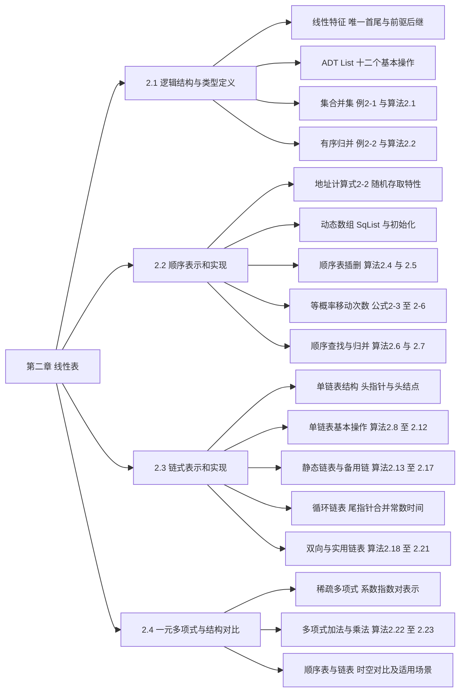

# 数据结构 · 第二章 线性表 · 详细版讲义

> **来源说明**：本讲义以严蔚敏、吴伟民《数据结构（C 语言版）》第二章（线性表，教材第 18–43 页）为主要依据整理而成。我将教材原文中的**全部 25 条核心定义与概念**、**全部 4 道例题（例 2-1 ~ 例 2-4）**与**全部 23 个算法（算法 2.1 ~ 算法 2.23）**按原序号完整保留，对因排版产生的个别公式编号和代码笔误做了校订，代码统一采用规范的类 C 形式并补充中文注释。本份讲义没有由 tikz 转换而来的 SVG 插图（共 0 张），正文无外部图片引用。

---

## 开场导读

从第二章开始，我们正式进入具体数据结构类型的学习，首先讨论的就是最基础、也最常用的**线性结构**——线性表。在第一章中，我曾提到数据结构包含逻辑结构、存储结构和数据的运算三个方面，这一章就是把这三个方面完整落地到“线性表”上：先看它在逻辑上有什么特征，再看如何用抽象数据类型把运算规范下来，最后落实到顺序存储和链式存储两种物理实现上。

在本章内容中，我会带着大家重点把握五条主线：第一，线性表的逻辑特征，即非空表中首尾元素与前驱后继的唯一性；第二，抽象数据类型 `ADT List` 的 12 个基本操作以及如何用它们组合出集合并集、有序表归并等复杂操作；第三，顺序表的随机存取机制以及插入、删除操作平均移动 $n/2$ 和 $(n-1)/2$ 个元素的定量推导；第四，单链表、静态链表、循环链表与双向链表的结构设计及指针操作规律，同时系统对比顺序表与单链表的时空开销和适用场景；第五，借助一元多项式的表示与相加，体会链表在实际符号处理中的应用价值。

---

## 总览：本章知识地图



---

## 正文

### 章引言：线性结构的特点（教材第 2 章开头）

> **定义 1（线性结构 ｜ 教材第 2 章引言）**：从第 2 章至第 4 章我们讨论**线性结构**。线性结构的特点是：在数据元素的**非空有限集**中，
> (1) 存在**惟一**的一个被称做“第一个”的数据元素；
> (2) 存在**惟一**的一个被称做“最后一个”的数据元素；
> (3) 除第一个之外，集合中的每个数据元素均**只有一个前驱**；
> (4) 除最后一个之外，集合中每个数据元素均**只有一个后继**。

这里我需要提前提醒一个边界细节：定义 1 是针对“非空有限集”概括线性结构的一般逻辑特征；而具体到下一节的“线性表”，允许元素个数 $n = 0$（即空表）。当 $n = 1$ 时，表中唯一的那个元素既是第一个又是最后一个元素，既没有前驱也没有后继；当 $n \ge 2$ 时，首元素无前驱、尾元素无后继，中间元素恰有一个直接前驱和一个直接后继。

---

### 一、2.1 线性表的类型定义

#### 1.1 线性表的定义

> **定义 2（线性表 `linear_list` ｜ 教材 2.1）**：线性表（`linear_list`）是**最常用且最简单的一种数据结构**。简言之，一个线性表是 **$n$ 个数据元素的有限序列**。至于每个数据元素的具体含义，在不同情况下各不相同：可以是一个数或一个符号，也可以是一页书，甚至其他更复杂的信息。

教材中给出 3 个不同复杂度的例子，帮助我们理解“元素可以多种多样”：

| 例 | 线性表 | 元素类型 |
|---|---|---|
| ① | $(A, B, C, \dots, Z)$ 26 个英文字母表 | 单个字母字符 |
| ② | $(6, 17, 28, 50, 92, 188)$ 某校 1978–1983 年计算机拥有量 | 整数 |
| ③ | 学生健康情况登记表（教材图 2.1） | 记录（由 6 个数据项组成） |

#### 1.2 记录、数据项与文件

> **定义 3（记录 / 文件 ｜ 教材 2.1）**：在稍复杂的线性表中，一个数据元素可由**若干个数据项（item）**组成。在这种情况下，常把数据元素称为**记录（record）**，**含有大量记录的线性表又称文件（file）**。

在教材图 2.1 的学生健康情况登记表中，每个学生的情况就是一个**记录**，由**姓名、学号、性别、年龄、班级、健康状况**这 6 个**数据项**组成。表中列出 4 行示例数据：王小林 / 790631 / 男 / 18 / 计 91 / 健康；陈红 / 790632 / 女 / 20 / 计 91 / 一般；刘建平 / 790633 / 男 / 21 / 计 91 / 健康；张立立 / 790634 / 男 / 17 / 计 91 / 神经衰弱。

#### 1.3 序偶关系、前驱后继、长度、位序

综合这 3 个例子可以看出，同一线性表中的元素**具有相同特性（属同一数据对象）**，相邻数据元素之间存在着**序偶关系**。若将线性表记为

$$(a_1, \cdots, a_{i-1},\, a_i,\, a_{i+1}, \cdots, a_n) \tag{2-1}$$

> **定义 4（直接前驱 / 直接后继 ｜ 教材 2.1，式 2-1）**：表中 $a_{i-1}$ 领先于 $a_i$，$a_i$ 领先于 $a_{i+1}$，称 $a_{i-1}$ 是 $a_i$ 的**直接前驱元素**，$a_{i+1}$ 是 $a_i$ 的**直接后继元素**。当 $i = 1, 2, \cdots, n-1$ 时，$a_i$ 有且仅有一个直接后继；当 $i = 2, 3, \cdots, n$ 时，$a_i$ 有且仅有一个直接前驱。

> **定义 5（表长 / 空表 / 位序 ｜ 教材 2.1）**：线性表中元素的个数 $n\ (n \ge 0)$ 定义为**线性表的长度**；$n = 0$ 时称为**空表**。在非空表中每个数据元素都有一个确定的位置：$a_1$ 是第一个数据元素，$a_n$ 是最后一个，$a_i$ 是第 $i$ 个数据元素，称 $i$ 为数据元素 $a_i$ 在线性表中的**位序**。

> **性质（线性表的灵活性 ｜ 教材 2.1）**：线性表是一个相当灵活的数据结构，它的长度可根据需要**增长或缩短**，即对线性表的数据元素不仅可以**访问**，还可进行**插入和删除**等操作。

#### 1.4 抽象数据类型线性表（ADT List）的定义

> **定义 6（ADT List ｜ 教材 2.1）**：抽象数据类型线性表的定义如下——

```text
ADT List {
  数据对象：D = { a_i | a_i ∈ ElemSet, i = 1, 2, …, n, n ≥ 0 }
  数据关系：R1 = { <a_{i-1}, a_i> | a_{i-1}, a_i ∈ D, i = 2, …, n }
  基本操作：
    InitList(&L)
      操作结果：构造一个空的线性表 L
    DestroyList(&L)
      初始条件：线性表 L 已存在
      操作结果：销毁线性表 L
    ClearList(&L)
      初始条件：线性表 L 已存在
      操作结果：将 L 重置为空表
    ListEmpty(L)
      初始条件：线性表 L 已存在
      操作结果：若 L 为空表，则返回 TRUE，否则返回 FALSE
    ListLength(L)
      初始条件：线性表 L 已存在
      操作结果：返回 L 中数据元素个数
    GetElem(L, i, &e)
      初始条件：线性表 L 已存在，1 ≤ i ≤ ListLength(L)
      操作结果：用 e 返回 L 中第 i 个数据元素的值
    LocateElem(L, e, compare())
      初始条件：线性表 L 已存在，compare() 是数据元素判定函数
      操作结果：返回 L 中第 1 个与 e 满足关系 compare() 的数据元素的位序；
                若这样的数据元素不存在，则返回值为 0
    PriorElem(L, cur_e, &pre_e)
      初始条件：线性表 L 已存在
      操作结果：若 cur_e 是 L 的数据元素，且不是第一个，则用 pre_e 返回它的前驱；
                否则操作失败，pre_e 无定义
    NextElem(L, cur_e, &next_e)
      初始条件：线性表 L 已存在
      操作结果：若 cur_e 是 L 的数据元素，且不是最后一个，则用 next_e 返回它的后继；
                否则操作失败，next_e 无定义
    ListInsert(&L, i, e)
      初始条件：线性表 L 已存在，1 ≤ i ≤ ListLength(L) + 1
      操作结果：在 L 中第 i 个位置之前插入新的数据元素 e，L 的长度加 1
    ListDelete(&L, i, &e)
      初始条件：线性表 L 已存在且非空，1 ≤ i ≤ ListLength(L)
      操作结果：删除 L 的第 i 个数据元素，并用 e 返回其值，L 的长度减 1
    ListTraverse(L, visit())
      初始条件：线性表 L 已存在
      操作结果：依次对 L 的每个数据元素调用函数 visit()；一旦 visit() 失败，则操作失败
} ADT List
```

在这里我们需要注意 `ListInsert` 与 `ListDelete` 的合法范围差异：插入位置 $i$ 允许取到 $\text{ListLength}(L) + 1$（即在表尾之后追加），因此对空表也能在 $i = 1$ 处插入；而删除要求表非空且 $1 \le i \le \text{ListLength}(L)$。

基于上述 12 个基本操作，我们还可以组合出更复杂的操作，例如**将两个或两个以上的线性表合并成一个线性表**、**把一个线性表拆开成两个或两个以上的线性表**、**重新复制一个线性表**等。下面两道例题就是“合并”运算的典型代表。

#### 例 2-1（教材 2.1 ｜ 摘抄原文）

> **例 2-1**　假设利用两个线性表 $LA$ 和 $LB$ 分别表示两个集合 $A$ 和 $B$（即线性表中的数据元素即为集合中的成员），现要求一个新的集合 $A = A \cup B$。这就要求对线性表作如下操作：**扩大线性表 $LA$，将存在于线性表 $LB$ 中而不存在于线性表 $LA$ 中的数据元素插入到线性表 $LA$ 中去**。只要从线性表 $LB$ 中依次取得每个数据元素，并依值在线性表 $LA$ 中进行查访，若不存在，则插入之。

##### 算法 2.1 `union`

```c
void union(List &La, List Lb) {
    // 将所有在线性表 Lb 中但不在 La 中的数据元素插入到 La 中
    // 注：union 在 C/C++ 中为关键字，实际编译时需改名（如 UnionList）
    La_len = ListLength(La);
    Lb_len = ListLength(Lb);          // 求线性表 La 和 Lb 的长度
    for (i = 1; i <= Lb_len; i++) {
        GetElem(Lb, i, e);            // 取 Lb 中第 i 个数据元素赋给 e
        if (!LocateElem(La, e, equal))
            ListInsert(La, ++La_len, e);   // La 中不存在与 e 相同的元素，则插入表尾
    }
} // union                                    —— 算法 2.1
```

> **说明**：`++La_len` 表示参数 `La_len` 的值**先增 1，然后再传递给函数**；若 `++` 在变量名之后（如 `i++`），则表示**先将原值传递给函数，然后变量的值再增 1**，后面的算法也遵循这一 C 语言规则。

#### 例 2-2（教材 2.1 ｜ 摘抄原文）

> **例 2-2**　已知线性表 $LA$ 和 $LB$ 中的数据元素**按值非递减有序**排列，现要求将 $LA$ 和 $LB$ **归并**为一个新的线性表 $LC$，且 $LC$ 中的数据元素**仍按值非递减有序**排列。例如，设
> $$LA = (3, 5, 8, 11), \qquad LB = (2, 6, 8, 9, 11, 15, 20)$$
> 则
> $$LC = (2, 3, 5, 6, 8, 8, 9, 11, 11, 15, 20)$$

从问题要求可知：$LC$ 中的数据元素**或是 $LA$ 中的**，**或是 $LB$ 中的**——只要先设 $LC$ 为空表，然后将 $LA$ 或 $LB$ 中的元素逐个插入到 $LC$ 中即可。为使 $LC$ 中元素按值非递减有序排列，我们可设**两个游标（位置计数器） $i$ 和 $j$** 分别指向 $LA$ 和 $LB$ 中某个元素：若设 $i$ 当前所指元素为 $a$、$j$ 当前所指元素为 $b$，则当前应插入 $LC$ 的元素 $c$ 为

$$c = \begin{cases} a, & \text{当}\ a \le b\ \text{时} \\ b, & \text{当}\ a > b\ \text{时} \end{cases}$$

游标 $i$ 和 $j$ 的初值均为 $1$；在所指元素插入 $LC$ 之后，在 $LA$ 或 $LB$ 中**顺序后移**。

##### 算法 2.2 `MergeList`

```c
void MergeList(List La, List Lb, List &Lc) {
    // 已知线性表 La 和 Lb 中的数据元素按值非递减排列
    // 归并 La 和 Lb 得到新的线性表 Lc，Lc 的数据元素也按值非递减排列
    InitList(Lc);                             // 构造空的线性表 Lc
    i = j = 1;  k = 0;                        // i、j 分别指示 La、Lb 当前位序，k 记录 Lc 表长
    La_len = ListLength(La);  Lb_len = ListLength(Lb);
    while ((i <= La_len) && (j <= Lb_len)) {  // La 和 Lb 均非空时逐个比较
        GetElem(La, i, ai);
        GetElem(Lb, j, bj);
        if (ai <= bj) {                       // 取较小者 ai 插入 Lc 表尾并后移 i
            ListInsert(Lc, ++k, ai);
            ++i;
        }
        else {                                // 取较小者 bj 插入 Lc 表尾并后移 j
            ListInsert(Lc, ++k, bj);
            ++j;
        }
    }
    while (i <= La_len) {                     // 将 La 中剩余元素依次插入 Lc
        GetElem(La, i++, ai);
        ListInsert(Lc, ++k, ai);
    }
    while (j <= Lb_len) {                     // 将 Lb 中剩余元素依次插入 Lc
        GetElem(Lb, j++, bj);
        ListInsert(Lc, ++k, bj);
    }
} // MergeList                                  —— 算法 2.2
```

#### 例 2-1 / 例 2-2 的时间复杂度分析（教材 2.1 末）

上述两个算法的时间复杂度**取决于抽象数据类型 `List` 定义中基本操作的执行时间**。假如 `GetElem` 和 `ListInsert` 的执行时间和表长无关（例如顺序表在表尾插入），`LocateElem` 的执行时间和表长成正比，则：

| 算法 | 时间复杂度 | 说明 |
|---|---|---|
| 算法 2.1（`union`） | $O(\text{ListLength}(LA) \times \text{ListLength}(LB))$ | 主要耗费在 `LocateElem` 的逐个查找上；若计入 `La` 随插入增长，严格最坏规模为 $O(mn + n^2)$（$m=|LA|, n=|LB|$），教材按 $O(|LA| \times |LB|)$ 记 |
| 算法 2.2（`MergeList`） | $O(\text{ListLength}(LA) + \text{ListLength}(LB))$ | 虽含 3 个 `while` 循环，但对每组具体输入，**后两个 `while` 循环只执行其中之一** |

在算法 2.2 中，只有当 $i$ 和 $j$ 均指向表中实际存在的数据元素时才能取得元素值并比较；当其中一个线性表的元素均已插入 $LC$ 后，只需将另一个表的剩余元素依次插入即可。

#### 本节要点

- 线性表的逻辑特征是元素属于同一数据对象且构成有限序列：表长 $n \ge 0$，$n=0$ 为空表；在非空表中首尾元素唯一，其余元素恰有一个直接前驱和一个直接后继。
- 位序 $i$ 从 $1$ 开始计数，代表数据元素在线性表中的逻辑位置；复杂线性表中的元素称为记录，记录由多个数据项组成。
- `ADT List` 定义了 12 个基本操作，其中 `ListInsert` 的合法位置为 $1 \le i \le \text{ListLength}(L) + 1$，`ListDelete` 的合法位置为 $1 \le i \le \text{ListLength}(L)$。
- 基于抽象操作实现的算法 2.1（集合并集）和算法 2.2（有序归并），其最终效率高度依赖于底层存储结构对 `GetElem`、`LocateElem` 和 `ListInsert` 的实现代价。

---

### 二、2.2 线性表的顺序表示和实现

#### 2.1 顺序存储结构的定义与地址公式

> **定义 7（顺序表示 ｜ 教材 2.2）**：线性表的**顺序表示**指的是用**一组地址连续的存储单元依次存储**线性表的数据元素。假设线性表的每个元素需占用 **$l$ 个存储单元**，并以所占第一个单元的存储地址作为数据元素的存储位置，则第 $i+1$ 个数据元素的存储位置 $\text{LOC}(a_{i+1})$ 和第 $i$ 个数据元素的存储位置 $\text{LOC}(a_i)$ 之间满足：
> $$\text{LOC}(a_{i+1}) = \text{LOC}(a_i) + l$$
> 一般来说，线性表的第 $i$ 个数据元素 $a_i$ 的存储位置为：
> $$\text{LOC}(a_i) = \text{LOC}(a_1) + (i-1) \times l \tag{2-2}$$
> 式中 $\text{LOC}(a_1)$ 是第一个数据元素 $a_1$ 的存储位置，通常称做线性表的**起始位置**或**基地址**。

> **定义 8（顺序存储结构 / 顺序映像 / 顺序表 ｜ 教材 2.2）**：线性表的这种机内表示称做线性表的**顺序存储结构**或**顺序映像（sequential mapping）**；通常称这种存储结构的线性表为**顺序表**。它的特点是：为表中相邻的元素 $a_i$ 和 $a_{i+1}$ 赋以**相邻的存储位置** $\text{LOC}(a_i)$ 和 $\text{LOC}(a_{i+1})$。换句话说，以元素在计算机内**“物理位置相邻”来表示线性表中数据元素之间的逻辑关系**。每一个数据元素的存储位置都和线性表的起始位置相差一个**与该元素位序成正比的常数**（教材图 2.2）。

> **定义 9（随机存取 ｜ 教材 2.2）**：由此，只要确定了存储线性表的起始位置，线性表中**任一数据元素都可随机存取**（通过式 (2-2) 经一次乘法和加法直接算出地址，时间代价与表长无关），所以线性表的顺序存储结构是一种**随机存取的存储结构**。

教材图 2.2（顺序存储结构示意图）：

| 数据元素位序 | 存储地址 | 内存状态 |
|---|---|---|
| $a_1$ | $b$ | 已占用 |
| $a_2$ | $b+l$ | 已占用 |
| $\cdots$ | $\cdots$ | $\cdots$ |
| $a_i$ | $b+(i-1)l$ | 已占用 |
| $a_{i+1}$ | $b+il$ | 已占用 |
| $\cdots$ | $\cdots$ | $\cdots$ |
| $a_n$ | $b+(n-1)l$ | 已占用 |
| （空闲） | $b+(\text{maxlen}-1)l$ | 空闲预留 |

由于高级程序设计语言中的**数组类型**也具有随机存取的特性，因此通常都用**数组**来描述顺序存储结构。线性表长度可变且所需最大存储空间随问题不同而不同，故在 C 语言中用**动态分配的一维数组**来描述。

#### 2.2 顺序表的动态分配存储结构（教材 2.2）

```c
// ---------- 线性表的动态分配顺序存储结构 ----------
#define LIST_INIT_SIZE 100    // 线性表存储空间的初始分配量
#define LISTINCREMENT  10     // 线性表存储空间的分配增量
typedef struct {
    ElemType *elem;           // 存储空间基址（指向动态分配的连续数组）
    int length;               // 当前长度（表中实际元素个数）
    int listsize;             // 当前分配的存储容量（以 sizeof(ElemType) 为单位）
} SqList;
```

> **说明（教材 2.2）**：数组指针 `elem` 指示线性表的**基地址**，`length` 指示**当前长度**，`listsize` 指示**当前分配的存储空间大小**——一旦因插入元素而空间不足时，可通过 `realloc` 进行**再分配**，为顺序表增加一个大小为 `LISTINCREMENT` 个数据元素的空间。

##### 算法 2.3 `InitList_Sq`（顺序表初始化）

> 顺序表的初始化操作就是为顺序表分配一个**预定义大小**的数组空间，并将线性表的**当前长度设为 $0$**。

```c
Status InitList_Sq(SqList &L) {
    // 构造一个空的顺序线性表 L
    L.elem = (ElemType *)malloc(LIST_INIT_SIZE * sizeof(ElemType));
    if (!L.elem) exit(OVERFLOW);     // 存储分配失败，异常退出
    L.length = 0;                    // 空表长度为 0
    L.listsize = LIST_INIT_SIZE;     // 初始存储容量
    return OK;
} // InitList_Sq                              —— 算法 2.3
```

在这种存储结构中，容易实现**随机存取第 $i$ 个数据元素**等操作。我在这里特别提醒一个细节：**C 语言中数组下标从 $0$ 开始**，而线性表位序从 $1$ 开始，因此若 `L` 是 `SqList` 型顺序表，则表中**第 $i$ 个数据元素对应的数组元素是 `L.elem[i-1]`**。

#### 2.3 顺序表上的插入与删除

> **插入操作的逻辑定义（教材 2.2）**：插入操作是指在线性表的第 $i-1$ 个数据元素和第 $i$ 个数据元素之间插入一个新的数据元素 $b$，使长度为 $n$ 的线性表 $(a_1, \dots, a_{i-1}, a_i, \dots, a_n)$ 变成长度为 $n+1$ 的线性表 $(a_1, \dots, a_{i-1}, b, a_i, \dots, a_n)$——数据元素 $a_{i-1}$ 和 $a_i$ 之间的**逻辑关系发生了变化**。由于顺序存储结构中逻辑上相邻的数据元素在**物理位置上也相邻**，因此**除非 $i = n+1$（插在表尾之后），否则必须移动元素**才能反映这个逻辑关系的变化。

教材图 2.3（插入前后的状况）：在线性表第 4 和第 5 个元素之间插入值为 $25$ 的数据元素，需将**第 5 个至第 8 个**数据元素依次**向后移动一个位置**（插入前 $n=8$，插入后 $n=9$）。

> 一般情况下，在第 $i$（$1 \le i \le n$）个元素之前插入一个元素时，需将第 **$n$ 至第 $i$（共 $n-i+1$ 个）**元素从后向前依次向后移动一个位置（若从前向后移动会覆盖后续元素）。当 $i = n+1$ 时，移动 $0$ 个元素。

```c
Status ListInsert_Sq(SqList &L, int i, ElemType e) {
    // 在顺序线性表 L 中第 i 个位置之前插入新的元素 e
    // i 的合法值为 1 ≤ i ≤ ListLength_Sq(L) + 1
    if (i < 1 || i > L.length + 1) return ERROR;          // i 值不合法
    if (L.length >= L.listsize) {                         // 当前存储空间已满，增加分配
        newbase = (ElemType *)realloc(L.elem,
            (L.listsize + LISTINCREMENT) * sizeof(ElemType));
        if (!newbase) exit(OVERFLOW);                     // 存储分配失败
        L.elem = newbase;                                 // 更新新基址
        L.listsize += LISTINCREMENT;                      // 增加存储容量
    }
    q = &(L.elem[i - 1]);                                 // q 为待插入位置的地址
    for (p = &(L.elem[L.length - 1]); p >= q; --p)
        *(p + 1) = *p;                                    // 插入位置及之后的元素从后往前依次右移
    *q = e;                                               // 放入新元素 e
    ++L.length;                                           // 表长增 1
    return OK;
} // ListInsert_Sq                                        —— 算法 2.4
```

> **删除操作的逻辑定义（教材 2.2）**：删除操作使长度为 $n$ 的线性表 $(a_1, \dots, a_{i-1}, a_i, a_{i+1}, \dots, a_n)$ 变成长度为 $n-1$ 的线性表 $(a_1, \dots, a_{i-1}, a_{i+1}, \dots, a_n)$——数据元素 $a_{i-1}$、$a_i$ 和 $a_{i+1}$ 之间的逻辑关系发生变化，同样需要**移动元素**。

教材图 2.4（删除前后的状况）：删除第 4 个数据元素时，必须将**第 5 个至第 8 个**元素依次**向前移动一个位置**（删除前 $n=8$，删除后 $n=7$）。

> 一般情况下，删除第 $i$（$1 \le i \le n$）个元素时，需将第 **$i+1$ 至第 $n$（共 $n-i$ 个）**元素从前向后依次向前移动一个位置。当 $i = n$（删除表尾）时，移动 $0$ 个元素。

```c
Status ListDelete_Sq(SqList &L, int i, ElemType &e) {
    // 在顺序线性表 L 中删除第 i 个元素，并用 e 返回其值
    // i 的合法值为 1 ≤ i ≤ ListLength_Sq(L)
    if ((i < 1) || (i > L.length)) return ERROR;   // i 值不合法
    p = &(L.elem[i - 1]);                          // p 为被删除元素的位置
    e = *p;                                        // 被删除元素的值赋给 e
    q = L.elem + L.length - 1;                     // q 指向表尾元素的位置
    for (++p; p <= q; ++p) *(p - 1) = *p;          // 被删除元素之后的元素从前往后依次左移
    --L.length;                                    // 表长减 1
    return OK;
} // ListDelete_Sq                                 —— 算法 2.5
```

#### 2.4 移动元素的平均次数推导（教材 2.2，式 2-3 ~ 2-6）

从算法 2.4 和 2.5 可以看出：在顺序存储结构的线性表中插入或删除一个数据元素时，**时间主要耗费在移动元素上**（即“移动元素”为估算时间复杂度的**基本操作**），而**移动元素的个数取决于插入或删除元素的位置**。

> **推导（教材 2.2 ｜ 详细展开）**：
> 设 $p_i$ 是**在第 $i$ 个元素之前插入**一个元素的概率，则在长度为 $n$ 的线性表中插入一个元素时所需移动元素次数的期望值（平均次数）为
> $$E_{ins} = \sum_{i=1}^{n+1} p_i (n - i + 1) \tag{2-3}$$
> 设 $q_i$ 是删除第 $i$ 个元素的概率，则在非空线性表（$n \ge 1$）中删除一个元素时所需移动元素次数的期望值为
> $$E_{del} = \sum_{i=1}^{n} q_i (n - i) \tag{2-4}$$
> 不失一般性，我们可以假定在线性表的**任何合法位置上插入或删除元素都是等概率**的，即 $p_i = \dfrac{1}{n+1}$（共有 $n+1$ 个可插位置），$q_i = \dfrac{1}{n}$（共有 $n$ 个可删位置）。代入化简：
> - 插入时：各位置移动次数依次为 $n, n-1, \dots, 1, 0$，故
>   $$E_{ins} = \frac{1}{n+1}\sum_{i=1}^{n+1}(n-i+1) = \frac{1}{n+1} \cdot \frac{n(n+1)}{2} = \frac{n}{2} \tag{2-5}$$
> - 删除时：各位置移动次数依次为 $n-1, n-2, \dots, 1, 0$，故
>   $$E_{del} = \frac{1}{n}\sum_{i=1}^{n}(n-i) = \frac{1}{n} \cdot \frac{n(n-1)}{2} = \frac{n-1}{2} \tag{2-6}$$

> **结论（教材 2.2）**：由式 (2-5) 和 (2-6) 可见，在顺序存储结构的线性表中插入或删除一个数据元素，**平均约移动表中一半元素**。若表长为 $n$，则算法 `ListInsert_Sq` 和 `ListDelete_Sq` 的**时间复杂度为 $O(n)$**。

#### 2.5 例 2-1、例 2-2 在顺序表中的实现（算法 2.6、2.7）

顺序表的“求表长”和“取第 $i$ 个数据元素”的时间复杂度均为 **$O(1)$**；例 2-1、例 2-2 中的“插入”操作均在**表尾**进行，**不需要移动元素**。因此：

- **算法 2.1（`union`）在顺序表中的执行时间主要取决于查找函数 `LocateElem`**——令 `e` 和 `L` 中的数据元素逐个比较，即算法 2.6。基本操作是“进行两个元素之间的比较”：若 `L` 中存在和 `e` 满足判定关系的元素 $a_i$，则比较次数为 $i$（$1 \le i \le L.\text{length}$），否则为 $L.\text{length}$，故算法 2.6 的时间复杂度为 **$O(L.\text{length})$**。由此，教材中对顺序表 `La` 和 `Lb` 记 `union` 的时间复杂度为 **$O(La.\text{length} \times Lb.\text{length})$**。

##### 算法 2.6 `LocateElem_Sq`

```c
int LocateElem_Sq(SqList L, ElemType e, Status (*compare)(ElemType, ElemType)) {
    // 在顺序线性表 L 中查找第 1 个值与 e 满足 compare() 的元素的位序
    // 若找到，则返回其在 L 中的位序，否则返回 0
    i = 1;            // i 的初值为第 1 个元素的位序
    p = L.elem;       // p 的初值为第 1 个元素的存储位置
    while (i <= L.length && !(*compare)(*p++, e)) ++i;  // 顺序扫描并比较
    if (i <= L.length) return i;                        // 找到则返回位序 i
    else return 0;                                      // 未找到返回 0
} // LocateElem_Sq                              —— 算法 2.6
```

- **“顺序表的合并”**：从算法 2.2 可以直接写出形式上十分相近的算法 2.7。该算法中的基本操作为“元素赋值”，时间复杂度为 **$O(La.\text{length} + Lb.\text{length})$**。

##### 算法 2.7 `MergeList_Sq`

```c
void MergeList_Sq(SqList La, SqList Lb, SqList &Lc) {
    // 已知顺序线性表 La 和 Lb 的元素按值非递减排列
    // 归并 La 和 Lb 得到新的顺序线性表 Lc，Lc 的元素也按值非递减排列
    pa = La.elem;  pb = Lb.elem;
    Lc.listsize = Lc.length = La.length + Lb.length;
    pc = Lc.elem = (ElemType *)malloc(Lc.listsize * sizeof(ElemType));
    if (!Lc.elem) exit(OVERFLOW);             // 存储分配失败
    pa_last = La.elem + La.length - 1;        // 指向 La 表尾元素
    pb_last = Lb.elem + Lb.length - 1;        // 指向 Lb 表尾元素
    while (pa <= pa_last && pb <= pb_last) {  // 两表均未归并完时，取较小者复制进 Lc
        if (*pa <= *pb) *pc++ = *pa++;
        else            *pc++ = *pb++;
    }
    while (pa <= pa_last) *pc++ = *pa++;      // 复制 La 的剩余元素
    while (pb <= pb_last) *pc++ = *pb++;      // 复制 Lb 的剩余元素
} // MergeList_Sq                             —— 算法 2.7
```

> **分析（教材 2.2 末）**：若对算法 2.7 中第一个循环的循环体作如下修改——以“开关语句”代替“条件语句”，分出元素比较的**第三种情况**（当 `*pa == *pb` 时只将两者之一插入 `Lc`）——则该算法完成的操作和算法 `union` 相同，**而时间复杂度却不同**。算法 2.7 之所以能达到线性时间复杂度，原因有二：
> ① 由于 `La` 和 `Lb` 中元素依值递增（同一集合中元素不等），对 `Lb` 中每个元素**不需要在 `La` 中从表头至表尾进行全程搜索**；
> ② 由于用新表 `Lc` 表示“并集”，**插入操作实际上是借助“复制”操作来完成的**（若直接将元素插入 `La`，为保持有序仍需移动元素）。
>
> 为得到元素依值递增（或递减）的有序表，可利用教材 10.3 节讨论的**快速排序**，其时间复杂度为 **$O(n \log n)$**。由此可见：**若以线性表表示集合并进行集合的各种运算，先对表中元素排序能显著提高后续集合运算的效率**。

#### 本节要点

- 顺序表以“物理位置相邻”表示“逻辑位置相邻”，地址公式 $\text{LOC}(a_i) = \text{LOC}(a_1) + (i-1)\times l$ 使它成为**随机存取**结构，按位序读取和求表长均为 $O(1)$。
- C 语言数组下标从 $0$ 开始，顺序表第 $i$ 个元素对应 `L.elem[i-1]`；动态顺序表 `SqList` 在空间不足时按 `LISTINCREMENT` 增量 `realloc` 扩容。
- 插入时需从后往前右移第 $n$ 至第 $i$ 个元素（共 $n-i+1$ 个），删除时需从前往后左移第 $i+1$ 至第 $n$ 个元素（共 $n-i$ 个）。
- 等概率假设下，顺序表插入平均移动 $n/2$ 个元素，删除平均移动 $(n-1)/2$ 个元素，时间复杂度均为 $O(n)$。

---

### 三、2.3 线性表的链式表示和实现

> **本节引论（教材 2.3）**：顺序存储结构的特点是**逻辑关系上相邻的两个元素在物理位置上也相邻**，因此可随机存取任一元素，存储位置可用简单直观的公式表示；但这一特点也带来了它的局限：**做插入或删除操作时需移动大量元素**。链式存储结构**不要求逻辑上相邻的元素在物理位置上也相邻**，因此没有顺序存储结构的这一缺点，但**同时也失去了顺序表可随机存取的优点**。

#### 3.1 线性链表（单链表）的定义

> **定义 10（链式存储结构 ｜ 教材 2.3.1）**：线性表的链式存储结构的特点是用**一组任意的存储单元**存储线性表的数据元素（这组存储单元**可以是连续的，也可以是不连续的**）。因此，为了表示每个数据元素 $a_i$ 与其直接后继 $a_{i+1}$ 之间的逻辑关系，对数据元素 $a_i$ 来说，除了存储其本身的信息之外，还需存储一个**指示其直接后继的信息**（即直接后继的存储位置）。

> **定义 11（结点 / 数据域 / 指针域 / 指针（链） ｜ 教材 2.3.1）**：这两部分信息组成数据元素 $a_i$ 的**存储映像**，称为**结点（node）**。它包括两个域：
> - 存储**数据元素信息**的域称为**数据域**；
> - 存储**直接后继存储位置**的域称为**指针域**；
> - 指针域中存储的信息称做**指针或链**。

> **定义 12（线性链表 / 单链表 ｜ 教材 2.3.1）**：$n$ 个结点（$a_i$ 的存储映像，$1 \le i \le n$）**链结**成一个链表，即为线性表 $(a_1, a_2, \dots, a_n)$ 的**链式存储结构**。又由于此链表的每个结点中**只包含一个指针域**，故又称**线性链表或单链表**。

#### 3.2 存储实例：教材图 2.5 / 图 2.6

教材图 2.5 给出线性表 **(ZHAO, QIAN, SUN, LI, ZHOU, WU, ZHENG, WANG)** 的线性链表存储结构（各结点在内存中的物理地址是**任意**的，靠指针串起来）：

| 存储地址 | 数据域 | 指针域 |
|---|---|---|
| 1 | LI | 43 |
| 7 | QIAN | 13 |
| 13 | SUN | 1 |
| 19 | WANG | `NULL` |
| 25 | WU | 37 |
| 31 | ZHAO | 7 |
| 37 | ZHENG | 19 |
| 43 | ZHOU | 25 |

头指针 $H = 31$，顺着指针域展开的逻辑顺序如下：

1. 头指针 $H = 31$：指向第 1 个结点（存储地址 `31`）。
2. 地址 `31`：数据域 `ZHAO`，指针域 `7`。
3. 地址 `7`：数据域 `QIAN`，指针域 `13`。
4. 地址 `13`：数据域 `SUN`，指针域 `1`。
5. 地址 `1`：数据域 `LI`，指针域 `43`。
6. 地址 `43`：数据域 `ZHOU`，指针域 `25`。
7. 地址 `25`：数据域 `WU`，指针域 `37`。
8. 地址 `37`：数据域 `ZHENG`，指针域 `19`。
9. 地址 `19`：数据域 `WANG`，指针域 `NULL`（表示最后一个结点没有后继，链表结束）。

> **定义 13（头指针 ｜ 教材 2.3.1，图 2.5）**：**整个链表的存取必须从头指针开始进行**，头指针指示链表中**第一个结点**（即第一个数据元素的存储映像）的存储位置。同时，由于最后一个数据元素没有直接后继，则线性链表中**最后一个结点的指针为“空”（`NULL`）**。

> **定义 14（链式映像 / 非顺序映像 ｜ 教材 2.3.1）**：用线性链表表示线性表时，数据元素之间的逻辑关系是**由结点中的指针指示的**。换句话说，**指针为数据元素之间的逻辑关系的映像**；逻辑上相邻的两个数据元素其存储的物理位置**不要求紧邻**——由此，这种存储结构称为**非顺序映像或链式映像**。

通常我们把链表画成**用箭头相链接的结点的序列**（教材图 2.6），因为使用链表时关心的只是它所表示的线性表中数据元素之间的**逻辑顺序**，而不是每个数据元素在存储器中的**实际物理地址**。

#### 3.3 单链表的存储结构描述与头结点

> **单链表的 C 描述（教材 2.3.1）**：单链表可由**头指针惟一确定**，在 C 语言中可用“结构指针”来描述：

```c
// ---------- 线性表的单链表存储结构 ----------
typedef struct LNode {
    ElemType data;          // 数据域：存储数据元素本身
    struct LNode *next;     // 指针域：指向直接后继结点
} LNode, *LinkList;
```

假设 `L` 是 `LinkList` 型的变量，则 **`L` 为单链表的头指针**，它指向表中第一个结点；若 `L` 为“空”（`L == NULL`），则所表示的线性表为“空”表，长度 $n = 0$。

> **定义 15（头结点 ｜ 教材 2.3.1，图 2.7）**：有时在单链表的**第一个结点之前**附设一个结点，称之为**头结点**。头结点的**数据域可以不存储任何信息**，也可存储如**线性表的长度**等类的附加信息；头结点的**指针域**存储指向**第一个结点**的指针（即第一个元素结点的存储位置）。此时单链表的**头指针指向头结点**；若线性表为空表，则**头结点的指针域为“空”**（教材图 2.7(a) 非空表、图 2.7(b) 空表）。

为了避免把这三个概念混为一谈，我将它们的区别整理如下：

| 概念 | 性质与必要性 | 存储内容 / 指向 | 作用 |
|---|---|---|---|
| **头指针 `L`** | 指针变量，链表的**必要入口**（不可缺少） | 指向头结点（带头结点时）或首元结点（不带头结点时）；无头结点且空表时为 `NULL` | 唯一确定一个单链表，所有存取从它出发 |
| **头结点** | 链表结点，**可有可无**（附设在首元结点之前） | 数据域可空，也可存表长等附加信息；指针域指向首元结点（空表时为 `NULL`） | 统一空表与非空表、首元与后续位置的操作 |
| **首元结点** | 链表结点（非空表时存在） | 数据域存第 1 个数据元素 $a_1$；指针域指向第 2 个结点（或 `NULL`） | 第 1 个数据元素的存储映像 |

#### 3.4 单链表是非随机存取的存储结构（算法 2.8）

> **逻辑要点（教材 2.3.1）**：在顺序存储结构中，逻辑上相邻的两个元素在物理位置上紧邻，每个元素的存储位置都可从起始位置**计算**得到；而在单链表中，**任何两个元素的存储位置之间没有固定的联系**，但每个元素的存储位置都**包含在其直接前驱结点的信息之中**。假设 `p` 是指向线性表中第 $i$ 个数据元素（结点 $a_i$）的指针，则 **`p->next` 是指向第 $i+1$ 个数据元素（结点 $a_{i+1}$）的指针**。换句话说，若 `p->data == a_i`，则 `p->next->data == a_{i+1}`。由此，在单链表中**取得第 $i$ 个数据元素必须从头指针出发顺链寻找**，因此，**单链表是非随机存取的存储结构**。

##### 算法 2.8 `GetElem_L`（取第 $i$ 个元素）

```c
Status GetElem_L(LinkList L, int i, ElemType &e) {
    // L 为带头结点的单链表的头指针
    // 当第 i 个元素存在时，其值赋给 e 并返回 OK，否则返回 ERROR
    p = L->next;  j = 1;        // 初始化，p 指向首元结点，j 为当前位序计数器
    while (p && j < i) {        // 顺指针向后查找，直到 p 指向第 i 个元素或 p 为空
        p = p->next;  ++j;
    }
    if (!p || j > i) return ERROR;   // 第 i 个元素不存在（i > 表长 或 i < 1）
    e = p->data;                     // 取出第 i 个元素的值
    return OK;
} // GetElem_L                                —— 算法 2.8
```

> **分析（教材 2.3.1）**：算法 2.8 的**基本操作是比较 `j` 和 `i` 并后移指针 `p`**；`while` 循环体中的语句频度与被查元素在表中的位置有关：若 $1 \le i \le n$，则频度为 $i-1$，否则频度为 $n$。因此**算法 2.8 的时间复杂度为 $O(n)$**。

#### 3.5 单链表上的插入与删除（教材图 2.8、图 2.9）

**插入**：在线性表的两个数据元素 $a$ 和 $b$ 之间插入数据元素 $x$，已知 `p` 为指向结点 $a$ 的指针。先**生成一个数据域为 $x$ 的结点**（设 `s` 为指向结点 $x$ 的指针），再修改指针完成接链：

```c
s->next = p->next;  // 1. 新结点 s 先接上原后继结点 b
p->next = s;        // 2. 前驱结点 a 再改指新结点 s（两步顺序不能颠倒）
```

具体指针变化过程（对应教材图 2.8）如下：

1. **插入前（图 2.8(a)）**：指针 `p` 指向结点 $a$，`p->next` 指向结点 $b$，逻辑顺序为 $a$ 后接 $b$。
2. **第 1 步修改指针**：执行 `s->next = p->next;`，使新结点 $x$ 的指针域指向结点 $b$。
3. **第 2 步修改指针**：执行 `p->next = s;`，使结点 $a$ 的指针域改指新结点 $x$，插入后逻辑顺序变为 $a$、$x$、$b$（图 2.8(b)）。
4. **关键注意**：上述两步顺序不可颠倒；若先执行 `p->next = s;`，会覆盖原本指向 $b$ 的地址，导致结点 $b$ 及之后的链表丢失（断链）。

**删除**：在线性表中删除元素 $b$ 时，为在单链表中实现元素 $a$、$b$ 和 $c$ 之间逻辑关系的变化，**仅需修改结点 $a$ 中的指针域**即可。设 `p` 为指向结点 $a$ 的指针，指针摘链的逻辑为：

```c
p->next = p->next->next;  // 仅演示指针摘链逻辑；实际实现需先用 q = p->next 保存被删结点，摘链后执行 free(q) 释放空间
```

可见，**在已知链表中元素插入或删除的确切位置（即已知前驱结点指针）的情况下，在单链表中插入或删除一个结点时，仅需修改指针而不需要移动元素**。

##### 算法 2.9 `ListInsert_L`（单链表插入）

```c
Status ListInsert_L(LinkList &L, int i, ElemType e) {
    // 在带头结点的单链线性表 L 中第 i 个位置之前插入元素 e
    p = L;  j = 0;                                    // p 从头结点开始，对应位序 0
    while (p && j < i - 1) { p = p->next; ++j; }      // 寻找第 i-1 个结点（待插位置的前驱）
    if (!p || j > i - 1) return ERROR;               // i 小于 1 或者大于表长加 1
    s = (LinkList)malloc(sizeof(LNode));             // 申请生成新结点
    s->data = e;                                     // 存入元素值
    s->next = p->next;  p->next = s;                 // 先连后继再连前驱，插入 L 中
    return OK;
} // ListInsert_L                              —— 算法 2.9
```

##### 算法 2.10 `ListDelete_L`（单链表删除）

```c
Status ListDelete_L(LinkList &L, int i, ElemType &e) {
    // 在带头结点的单链线性表 L 中，删除第 i 个元素，并由 e 返回其值
    p = L;  j = 0;                                        // p 从头结点开始
    while (p->next && j < i - 1) { p = p->next; ++j; }   // 寻找第 i 个结点的直接前驱 p
    if (!(p->next) || j > i - 1) return ERROR;           // 删除位置不合理（i < 1 或 i > 表长）
    q = p->next;  p->next = q->next;                     // 保存被删结点 q 并将其从链上摘除
    e = q->data;  free(q);                               // 取出数据域并释放结点空间
    return OK;
} // ListDelete_L                              —— 算法 2.10
```

> **分析（教材 2.3.1）**：算法 2.9 和算法 2.10 的时间复杂度**均为 $O(n)$**——因为为了在第 $i$ 个结点之前插入新结点或删除第 $i$ 个结点，都必须**首先从头找到第 $i-1$ 个结点**（即需修改指针的结点），而寻找它的时间复杂度为 $O(n)$（与算法 2.8 的讨论相同）。

#### 3.6 `malloc`/`free` 与“动态结构”

> **定义 16（`malloc` / `free` / 动态结构 ｜ 教材 2.3.1）**：假设 `p` 和 `q` 是 `LinkList` 型变量，执行 `p = (LinkList)malloc(sizeof(LNode))` 的作用是**由系统生成一个 `LNode` 型的结点**，同时将该结点的起始位置赋给指针变量 `p`；反之，执行 `free(q)` 的作用是**由系统回收一个 `LNode` 型的结点**，回收后的空间可以备作再次生成结点时用。因此，**单链表和顺序存储结构不同，它是一种动态结构**：整个可用存储空间可为多个链表共同享用，每个链表占用的空间**不需预先分配划定**，而是可以**由系统应需求即时生成**。

因此，**建立线性表的链式存储结构的过程就是一个动态生成链表的过程**——即从“空表”的初始状态起，依次建立各元素结点，并逐个插入链表。

##### 算法 2.11 `CreateList_L`（从表尾到表头逆向建立单链表）

```c
void CreateList_L(LinkList &L, int n) {
    // 逆位序输入 n 个元素的值，建立带表头结点的单链线性表 L（头插法）
    L = (LinkList)malloc(sizeof(LNode));  // 建立头结点
    L->next = NULL;                       // 初始化为空表
    for (i = n; i > 0; --i) {
        p = (LinkList)malloc(sizeof(LNode));   // 生成新结点
        scanf(&p->data);                  // 输入元素值（类 C 简化写法）
        p->next = L->next;  L->next = p;  // 插入到头结点之后（表头位置）
    }
} // CreateList_L                        —— 算法 2.11（时间复杂度 O(n)）
```

#### 3.7 两个有序链表的归并（算法 2.12）

**问题（教材 2.3.1）**：假设头指针为 `La` 和 `Lb` 的单链表分别为线性表 $LA$ 和 $LB$ 的存储结构，现要归并 `La` 和 `Lb` 得到单链表 `Lc`。按例 2-2 算法 `MergeList` 的思想，需设立 **3 个指针 `pa`、`pb` 和 `pc`**：`pa` 和 `pb` 分别指向 `La` 表和 `Lb` 表中**当前待比较插入**的结点，`pc` 指向 `Lc` 表中**当前最后一个**结点。若 `pa->data <= pb->data`，则将 `pa` 所指结点链接到 `pc` 所指结点之后，否则将 `pb` 所指结点链接到 `pc` 所指结点之后。

指针初始状态：当 $LA$ 和 $LB$ 为非空表时，`pa` 和 `pb` 分别指向 `La` 和 `Lb` 表中第一个结点，否则为空；`pc` 指向空表 `Lc` 的头结点。由于链表的**长度是隐含的**，第一个循环执行的条件是 **`pa` 和 `pb` 皆非空**；当其中一个为空时，说明有一个表的元素已归并完，只需将另一个表的**剩余段链接**在 `pc` 所指结点之后即可。

```c
void MergeList_L(LinkList &La, LinkList &Lb, LinkList &Lc) {
    // 已知单链线性表 La 和 Lb 的元素按值非递减排列
    // 归并 La 和 Lb 得到新的单链线性表 Lc，Lc 的元素也按值非递减排列
    pa = La->next;  pb = Lb->next;     // 分别指向 La、Lb 的首元结点
    Lc = pc = La;                      // 复用 La 的头结点作为 Lc 的头结点
    while (pa && pb) {                 // 两表均未结束时，按非递减序摘链连接
        if (pa->data <= pb->data) {
            pc->next = pa;  pc = pa;  pa = pa->next;
        }
        else {
            pc->next = pb;  pc = pb;  pb = pb->next;
        }
    }
    pc->next = pa ? pa : pb;           // 将非空表的剩余结点段直接挂接在 pc 之后
    free(Lb);                          // 释放 Lb 的头结点
} // MergeList_L                              —— 算法 2.12
```

> **分析（教材 2.3.1）**：算法 2.12 的时间复杂度和算法 2.7 **相同**，均为 $O(m + n)$，但**空间复杂度不同**（前者为 $O(1)$ 辅助空间，后者为 $O(m+n)$）：归并两个链表为一个链表时，**不需要另建新表的结点空间**，而只需将原来两个链表中结点之间的关系**解除**、再重新按元素值非递减的关系将所有结点链接成一个链表即可。

#### 3.8 静态链表

> **定义 17（静态链表 ｜ 教材 2.3.1）**：有时也可借用**一维数组**来描述线性链表。在这种链表中，**数组的一个分量表示一个结点**，同时用**游标（指示器 `cur`）代替指针**指示结点在数组中的相对位置；数组的**第零分量可看成头结点**，其指针域（`cur`）指示链表的第一个结点。这种存储结构仍需预先分配一个较大的空间，但做插入和删除时**不需移动元素，仅需修改游标**，故仍具有链式存储结构的主要优点。为了和指针型描述的线性链表相区别，把这种用数组描述的链表起名叫**静态链表**。

```c
// ---------- 线性表的静态单链表存储结构 ----------
#define MAXSIZE 1000           // 链表的最大长度
typedef struct {
    ElemType data;             // 数据域
    int cur;                   // 游标：指示后继结点在数组中的相对下标位置（0 表示空指针）
} component, SLinkList[MAXSIZE];
```

> **说明（教材 2.3.1）**：这种描述方法便于在**不设“指针”类型**的高级程序设计语言中使用链表结构。假设 `S` 为 `SLinkList` 型变量：`S[0].cur` 指示第一个结点在数组中的位置；若设 `i = S[0].cur`，则 `S[i].data` 存储线性表的**第一个数据元素**，且 `S[i].cur` 指示第二个结点在数组中的位置。一般情况，若第 `i` 个分量表示链表的第 $k$ 个结点，则 **`S[i].cur` 指示第 $k+1$ 个结点的位置**。因此在静态链表中实现线性表的操作和动态链表相似：以整型游标 `i` 代替动态指针 `p`，`i = S[i].cur` 的操作实为**指针后移**（类似于 `p = p->next`）。

教材图 2.10 展示了静态链表（同图 2.6 的线性表 ZHAO…WANG）在**插入数据元素 `"SHI"`** 和**删除数据元素 `"ZHENG"`** 之后的状况。

##### 算法 2.13 `LocateElem_SL`（静态链表定位）

```c
int LocateElem_SL(SLinkList S, ElemType e) {
    // 在静态单链线性表 S 中查找第 1 个值为 e 的元素
    // 注：教材注释此处写"返回位序"，但实际返回的是该结点在数组中的下标（游标位置）i，未找到返回 0
    i = S[0].cur;                              // i 指示表中第一个结点
    while (i && S[i].data != e) i = S[i].cur;  // 在表中顺游标链查找
    return i;                                  // 返回找到结点的数组下标（或 0）
} // LocateElem_SL                            —— 算法 2.13
```

#### 例 2-3（教材 2.3.1 ｜ 摘抄原文）

> **例 2-3**　假设由终端输入集合元素，先建立表示集合 $A$ 的静态链表 `S`，而后在**输入集合 $B$ 的元素的同时查找 `S` 表**：若存在和 $B$ 相同的元素，则**从 `S` 表中删除之**；否则**将此元素插入 `S` 表**。（即求 $(A-B) \cup (B-A)$。）

为使算法清晰起见，先给出 3 个过程：① 将整个数组空间初始化成一个链表；② 从备用空间取得一个结点；③ 将空闲结点链结到备用链表上——分别如算法 2.14、2.15 和 2.16 所示。

> **定义 18（备用链表 ｜ 教材 2.3.1，例 2-3）**：将数组中**所有未被使用的以及被删除的分量**用游标链成**备用的链表**：每当进行插入时，便可从备用链表上取得第一个结点作为待插入的新结点；反之，在删除时将从链表中删除下来的结点**链接到备用链表上**。

##### 算法 2.14 `InitSpace_SL`（备用空间初始化）

```c
void InitSpace_SL(SLinkList &space) {
    // 将一维数组 space 中各分量链成一个备用链表，space[0].cur 为头指针，"0"表示空指针
    for (i = 0; i < MAXSIZE - 1; ++i) space[i].cur = i + 1;  // 相邻分量依次串链
    space[MAXSIZE - 1].cur = 0;                              // 最后一个分量游标置空
} // InitSpace_SL                              —— 算法 2.14
```

##### 算法 2.15 `Malloc_SL`（分配结点）

```c
int Malloc_SL(SLinkList &space) {
    // 若备用空间链表非空，则返回分配的结点下标，否则返回 0
    i = space[0].cur;                             // 取备用链表的第一个空闲结点下标
    if (space[0].cur) space[0].cur = space[i].cur;// 备用链表头指针后移
    return i;
} // Malloc_SL                                —— 算法 2.15
```

##### 算法 2.16 `Free_SL`（回收结点）

```c
void Free_SL(SLinkList &space, int k) {
    // 将下标为 k 的空闲结点回收到备用链表表头
    space[k].cur = space[0].cur;  // 原备用表首结点接在 k 之后
    space[0].cur = k;             // 备用链表头指针指向 k
} // Free_SL                                   —— 算法 2.16
```

##### 算法 2.17 `difference`（求 $(A-B) \cup (B-A)$）

```c
void difference(SLinkList &space, int &S) {
    // 依次输入集合 A 和 B 的元素，在一维数组 space 中建立表示集合 (A-B)∪(B-A)
    // 的静态链表，S 为其头结点下标。假设备用空间足够大，space[0].cur 为备用链头指针
    InitSpace_SL(space);                  // 初始化备用空间
    S = Malloc_SL(space);                 // 生成集合链表 S 的头结点
    r = S;                                // r 始终指向集合 A 当前的最后一个结点
    scanf(m, n);                          // 输入集合 A 和 B 的元素个数
    for (j = 1; j <= m; ++j) {            // 建立集合 A 的链表
        i = Malloc_SL(space);             // 从备用链表分配结点
        scanf(space[i].data);             // 输入 A 的元素值
        space[r].cur = i;  r = i;         // 尾插法插入到表尾，并更新尾指针 r
    }
    space[r].cur = 0;                     // 集合 A 尾结点的游标置空
    for (j = 1; j <= n; ++j) {            // 依次输入 B 的元素，若不在当前表中，则插入，否则删除
        scanf(b);  p = S;  k = space[S].cur;   // k 指向链表中第一个元素，p 为其前驱
        // 只遍历到原集合 A 尾结点 r 之后的位置 space[r].cur（假设集合 B 自身无重复元素）
        while (k != space[r].cur && space[k].data != b) {
            p = k;  k = space[k].cur;
        }
        if (k == space[r].cur) {          // 当前表中不存在该元素，插入在 r 所指结点之后，且 r 不变
            i = Malloc_SL(space);
            space[i].data = b;
            space[i].cur = space[r].cur;
            space[r].cur = i;
        }
        else {                            // 该元素已在表中，将其删除并回收结点
            space[p].cur = space[k].cur;
            Free_SL(space, k);
            if (r == k) r = p;            // 若删除的是 r 所指结点，则回退尾指针 r
        }
    }
} // difference                                —— 算法 2.17
```

> **分析（教材 2.3.1）**：在算法 2.17 中，只有一个处于**双重循环**中的循环体（在集合 $A$ 中查找依次输入的 $b$），其最大循环次数为：**外循环 $n$ 次，内循环至多 $m$ 次**，故**算法 2.17 的时间复杂度为 $O(m \times n)$**。

**教材图 2.11 执行示意图**：假设集合 $A = (c, b, e, g, f, d)$，$B = (a, b, n, f)$。图 2.11(a) 为输入集合 $A$ 的元素之后建成的链表 `S` 和备用空间链表的状况；图 2.11(b) 为逐个输入集合 $B$ 的元素、在链表 `S` 中**依次插入 `a`、删除 `b`、插入 `n`、删除 `f`** 之后的状况。`space[0].cur` 为备用链表的头指针，`r` 的值为 7。（最终结果链表即 $(A-B)\cup(B-A) = (c, e, g, d, a, n)$。）

#### 3.9 循环链表（教材 2.3.2）

> **定义 19（循环链表 `circular linked list` ｜ 教材 2.3.2）**：循环链表是另一种形式的链式存储结构，它的特点是：**表中最后一个结点的指针域指向头结点，整个链表形成一个环**。由此，**从表中任一结点出发均可找到表中其他结点**。教材图 2.12 所示为单链的循环链表（(a) 非空表、(b) 空表，空表时头结点的 `next` 指向自身）；类似地，还可以有**多重链的循环链表**。

> **说明（教材 2.3.2）**：循环链表的操作和线性链表**基本一致**，**差别仅在于算法中的循环判断条件**：不是看 `p` 或 `p->next` 是否为空（`NULL`），而是看**它们是否等于头指针 `L`**。有的时候，若在循环链表中**设立尾指针而不设头指针**（教材图 2.13(a)），可使某些操作简化：例如**将两个线性表合并成一个表**时，仅需将一个表的表尾和另一个表的表头相接。当线性表以仅设尾指针（记为 `Ra`、`Rb`）的循环链表作存储结构时，合并操作**仅需改变两个指针值即可（外加释放多余头结点），运算时间为 $O(1)$**（教材图 2.13(b)）。

#### 3.10 双向链表（教材 2.3.3）

> **引论（教材 2.3.3）**：单链表的结点中只有一个指示**直接后继**的指针域，从某个结点出发只能顺指针**往后**寻查其他结点；要寻查结点的**直接前驱**，则需从表头指针出发。换句话说，在单链表中，**`NextElem` 的执行时间为 $O(1)$，而 `PriorElem` 的执行时间为 $O(n)$**。为克服单链表这种**单向性**的缺点，可利用**双向链表（double linked list）**。

> **定义 20（双向链表 ｜ 教材 2.3.3）**：在双向链表的结点中**有两个指针域**：其一指向**直接后继**，另一指向**直接前驱**。在 C 语言中可描述如下：

```c
// ---------- 线性表的双向链表存储结构 ----------
typedef struct DuLNode {
    ElemType data;              // 数据域
    struct DuLNode *prior;      // 指针域：指向直接前驱
    struct DuLNode *next;       // 指针域：指向直接后继
} DuLNode, *DuLinkList;
```

和单链的循环表类似，**双向链表也可以有循环表**（教材图 2.14(c)），链表中存有**两个环**；教材图 2.14(b) 为只有一个表头结点的**空表**（头结点的 `prior` 和 `next` 均指向自身）。

> **结构特性式（教材 2.3.3）**：在双向循环链表中，若 `d` 为指向表中某一结点的指针（即 `d` 为 `DuLinkList` 型变量），则有
> $$d \to \text{next} \to \text{prior} = d \to \text{prior} \to \text{next} = d$$
> **这个表达式恰当地反映了这种结构的对称特性**。

> **说明（教材 2.3.3）**：有些操作如 `ListLength`、`GetElem` 和 `LocateElem` 等**仅需涉及一个方向的指针**，其算法描述和单链表的操作相同；但**插入、删除时有较大不同**——在双向链表中需**同时修改两个方向上的指针**。教材图 2.15 和图 2.16 分别显示了删除和插入结点时指针修改的情况，对应算法 2.19 和 2.18，**两者的时间复杂度均为 $O(n)$**（主要耗费在按位序查找定位结点 `GetElemP_DuL(L, i)` 上）。

##### 算法 2.18 `ListInsert_DuL`（双向链表插入）

```c
Status ListInsert_DuL(DuLinkList &L, int i, ElemType e) {
    // 在带头结点的双链循环线性表 L 中第 i 个位置之前插入元素 e
    // i 的合法值为 1 ≤ i ≤ 表长 + 1
    if (!(p = GetElemP_DuL(L, i))) return ERROR;   // 定位第 i 个结点；p=NULL 即位置不合法
    if (!(s = (DuLinkList)malloc(sizeof(DuLNode)))) return ERROR;  // 分配新结点
    s->data = e;                                   // 写入数据域
    s->prior = p->prior;   p->prior->next = s;     // 先接好新结点与前驱之间的双向指针
    s->next = p;           p->prior = s;           // 再接好新结点与 p 之间的双向指针（顺序不可乱）
    return OK;
} // ListInsert_DuL                            —— 算法 2.18
```

##### 算法 2.19 `ListDelete_DuL`（双向链表删除）

```c
Status ListDelete_DuL(DuLinkList &L, int i, ElemType &e) {
    // 删除带头结点的双链循环线性表 L 的第 i 个元素，i 的合法值为 1 ≤ i ≤ 表长
    if (!(p = GetElemP_DuL(L, i))) return ERROR;   // 定位第 i 个结点 p；p=NULL 即元素不存在
    e = p->data;                                   // 保存被删元素值
    p->prior->next = p->next;                      // 修改前驱结点的后继指针
    p->next->prior = p->prior;                     // 修改后继结点的前驱指针
    free(p);                                       // 释放被删结点
    return OK;
} // ListDelete_DuL                            —— 算法 2.19
```

#### 3.11 从实际应用出发：带头结点的线性链表类型（教材 2.3.3 末）

> **定义 21（带头结点的线性链表类型 ｜ 教材 2.3.3 末）**：由于链表在**空间的合理利用上**和**插入、删除时不需要移动元素**等方面的优点，在很多场合下它是线性表的常用存储结构；但它也存在缺点——如求线性表的长度时不如顺序存储结构方便。另一方面，由于在链表中结点之间的关系用**指针**来表示，数据元素在线性表中的**“位序”的概念已淡化**，而被数据元素在线性链表中的**“位置”所代替**。为此，从实际应用角度出发重新定义带头结点的线性链表及其基本操作：

```c
typedef struct LNode {        // 结点类型
    ElemType data;            // 数据域
    struct LNode *next;       // 指针域
} *Link, *Position;

typedef struct {              // 链表类型（增设尾指针与表长字段）
    Link head, tail;          // 分别指向线性链表中的头结点和最后一个结点
    int len;                  // 指示线性链表中数据元素的个数
} LinkList;
```

该类型包含 22 个基本操作：`MakeNode(&p, e)`（分配值为 `e` 的结点）、`FreeNode(&p)`、`InitList(&L)`、`DestroyList(&L)`、`ClearList(&L)`、`InsFirst(h, s)`（将 `s` 所指结点插入在第一个结点之前）、`DelFirst(h, &q)`（删除第一个结点并以 `q` 返回）、`Append(&L, s)`（将 `s` 所指一串结点链接在最后结点之后并改变尾指针）、`Remove(&L, &q)`（删除尾结点并以 `q` 返回）、`InsBefore(&L, &p, s)`、`InsAfter(&L, &p, s)`（在 `p` 所指结点之前/之后插入并修改 `p` 指向新插入结点）、`SetCurElem(&p, e)`（更新 `p` 所指结点数据元素的值）、`GetCurElem(p)`、`ListEmpty(L)`、`ListLength(L)`、`GetHead(L)`、`GetLast(L)`、`PriorPos(L, p)`、`NextPos(L, p)`、`LocatePos(L, i, &p)`、`LocateElem(L, e, compare())`、`ListTraverse(L, visit())`。

> **分析（教材 2.3.3 末）**：在上述基本操作中，除了 `DestroyList`、`ClearList`、`Remove`、`InsBefore`、`PriorPos`、`LocatePos`、`LocateElem` 和 `ListTraverse` 的**时间复杂度和表长成正比**（$O(n)$）之外，其他操作的时间复杂度**都和表长无关**（$O(1)$）；`Append` 操作的时间复杂度则**和插入的结点数成正比**。利用这些基本操作，容易实现诸如“在第 $i$ 个元素之前插入元素”“合并两个线性表”等操作——如算法 2.20 和 2.21。

##### 算法 2.20 `ListInsert_L`（借助基本操作实现插入）

```c
Status ListInsert_L(LinkList &L, int i, ElemType e) {
    // 在带头结点的单链线性表 L 的第 i 个元素之前插入元素 e
    if (!LocatePos(L, i - 1, h)) return ERROR;   // i 值不合法（i=1 时应定位到头结点）
    if (!MakeNode(s, e)) return ERROR;           // 结点存储分配失败
    InsFirst(h, s);   // 对于从第 i 个结点开始的链表，第 i-1 个结点 h 是它的头结点
                      // 注：若涉及表尾插入或空表插入，实际实现还应同步更新 L.tail 和 L.len
    return OK;
} // ListInsert_L                              —— 算法 2.20
```

##### 算法 2.21 `MergeList_L`（借助基本操作实现归并）

```c
Status MergeList_L(LinkList &La, LinkList &Lb, LinkList &Lc,
                   int (*compare)(ElemType, ElemType)) {
    // 已知单链线性表 La 和 Lb 的元素按值非递减排列
    // 归并 La 和 Lb 得到新的单链线性表 Lc，Lc 的元素也按值非递减排列
    if (!InitList(Lc)) return ERROR;             // 初始化空链表 Lc 失败
    ha = GetHead(La);  hb = GetHead(Lb);         // ha 和 hb 分别指向 La 和 Lb 的头结点
    pa = NextPos(La, ha);  pb = NextPos(Lb, hb); // pa 和 pb 分别指向 La 和 Lb 中当前结点
    while (pa && pb) {                           // La 和 Lb 均非空时循环比较
        a = GetCurElem(pa);  b = GetCurElem(pb); // 取出当前比较元素值
        if ((*compare)(a, b) <= 0) {             // a ≤ b：摘下 La 首结点追加到 Lc
            DelFirst(ha, q);  Append(Lc, q);  pa = NextPos(La, ha);
        }
        else {                                   // a > b：摘下 Lb 首结点追加到 Lc
            DelFirst(hb, q);  Append(Lc, q);  pb = NextPos(Lb, hb);
        }
    }
    if (pa) Append(Lc, pa);                      // 将 La 剩余结点串接至 Lc 尾部
    else    Append(Lc, pb);                      // 将 Lb 剩余结点串接至 Lc 尾部
    FreeNode(ha);  FreeNode(hb);                 // 释放 La 和 Lb 的头结点
    return OK;
} // MergeList_L                              —— 算法 2.21
```

> **说明**：算法 2.20 和算法 2.21 分别为**算法 2.9 和算法 2.12 的改写形式**，它们的时间复杂度和前面讨论相同。

#### 3.12 顺序表与单链表的时空对比及适用场景

学完顺序表和链表两种存储结构后，我把它们在时间和空间上的核心差异以及实际选型原则集中梳理一下：

1. **时间复杂度对比**：
   - **按位序存取（`GetElem`）**：顺序表通过首地址和位序直接计算存储位置，为 $O(1)$；单链表必须从头指针出发顺链查找，为 $O(n)$。
   - **按值查找（`LocateElem`）**：在表无序时两者都需要顺序扫描，均为 $O(n)$；但若表有序，顺序表可利用随机存取特性配合折半查找将时间复杂度降至 $O(\log n)$，单链表无法直接折半。
   - **插入与删除**：顺序表在一般位置插入/删除需移动大量元素（平均 $n/2$ 与 $(n-1)/2$ 次），时间复杂度为 $O(n)$（仅在表尾插入/删除为 $O(1)$）；单链表若**已给出待操作结点的前驱指针**，只需修改指针为 $O(1)$，但若**只给出位序 $i$**，仍需 $O(n)$ 时间去查找第 $i-1$ 个结点。
   - **求表长**：顺序表直接读取 `L.length` 为 $O(1)$；普通单链表需遍历统计为 $O(n)$（除非像 3.11 节那样专门增设 `len` 字段）。
2. **空间效率与存储密度对比**：
   - **存储密度**（结点中数据元素本身所占存储量与整个结点结构所占存储量之比）：顺序表无需额外存储指针域，存储密度为 $1$；单链表每个结点都要附带指针域，存储密度小于 $1$。当数据元素本身很小（如单个 `char` 或 `int`）时，指针域带来的额外空间占比会比较明显。
   - **空间分配方式**：顺序表需预先估计并分配一段连续空间，可能造成空闲容量浪费，或扩容时产生 `realloc` 复制开销；单链表按需动态申请与释放单个结点，不要求整块连续内存，空间利用率更灵活。
3. **两者的适用场景**：
   - **优先选用顺序表**：① 线性表的最大长度事先较容易估计，或长度基本稳定；② 业务中以按位序随机访问、有序二分查找为主，插入和删除较少（或集中在表尾）；③ 单个元素占空间很小，希望获得高存储密度和更好的缓存局部性。
   - **优先选用单链表**：① 线性表长度变化幅度大、难以预先估算最大规模；② 需要频繁在表头或已知位置附近执行插入、删除或链表合并/拆分操作，且不希望发生整段元素搬移；③ 按位序随机访问的需求很少，主要以顺序遍历或基于位置指针的操作为主。

#### 本节要点

- 单链表用任意存储单元存储元素，靠结点中的 `next` 指针反映逻辑关系，失去随机存取特性（`GetElem_L` 为 $O(n)$），但在已知前驱指针时插删只需 $O(1)$ 改指针。
- 头指针是链表的必要入口，头结点则是附设在首元结点之前的可选辅助结点；插入时必须先接新结点的 `next`，再改前驱的 `next`，以防断链。
- 静态链表用一维数组和整型游标 `cur` 模拟指针，并通过备用链表自行实现结点分配（`Malloc_SL`）与回收（`Free_SL`）。
- 循环链表判尾条件为是否回到头指针，仅设尾指针可在 $O(1)$ 时间内完成两表连接；双向链表通过 `prior` 和 `next` 使 `PriorElem` 也达到 $O(1)$，插删需同时修改两个方向的指针。
- 选择存储结构需在访问模式、插删频率、长度稳定性与存储密度之间权衡。

---

### 四、2.4 一元多项式的表示及相加

#### 4.1 问题的提出：顺序表示的缺陷

> **定义 22（一元多项式的线性表表示 ｜ 教材 2.4）**：符号多项式的操作已成为**表处理的典型用例**。在数学上，一个一元多项式 $P_n(x)$ 可按升幂写成：
> $$P_n(x) = p_0 + p_1 x + p_2 x^2 + \cdots + p_n x^n$$
> 它由 **$n+1$ 个系数**惟一确定。因此，在计算机里它可用一个线性表 $P$ 来表示：
> $$P = (p_0, p_1, p_2, \cdots, p_n)$$
> **每一项的指数 $i$ 隐含在其系数 $p_i$ 的序号里**。假设 $Q_m(x)$ 是一元 $m$ 次多项式，同样可用线性表 $Q$ 表示：$Q = (q_0, q_1, q_2, \dots, q_m)$。不失一般性，设 $m < n$，则两个多项式相加的结果 $R_n(x) = P_n(x) + Q_m(x)$ 可用线性表 $R$ 表示：
> $$R = (p_0 + q_0,\ p_1 + q_1,\ p_2 + q_2,\ \cdots,\ p_m + q_m,\ p_{m+1},\ \cdots,\ p_n)$$

对 $P$、$Q$、$R$ 采用**顺序存储结构**，固然能使多项式相加的算法定义十分简洁。但是，在通常的应用中，**多项式的次数可能很高且变化很大**，使得顺序存储结构的最大长度很难确定。特别是处理形如

$$S(x) = 1 + 3x^{10000} + 2x^{20000}$$

的多项式时，就要用一个**长度为 $20001$** 的线性表来表示，而表中**仅有 3 个非零元素**——这种对内存空间的浪费是应当避免的；但如果只存储非零系数项，就**必须同时存储相应的指数**。

#### 4.2 一般表示：（系数，指数）对

> **定义 23（一元多项式的有序表表示 ｜ 教材 2.4，式 2-7 / 2-8）**：一般情况下的一元 $n$ 次多项式可写成
> $$P_n(x) = p_1 x^{e_1} + p_2 x^{e_2} + \cdots + p_m x^{e_m} \tag{2-7}$$
> 其中 $p_i$ 是指数为 $e_i$ 的项的**非零系数**，且满足 $0 \le e_1 < e_2 < \cdots < e_m = n$。若用一个**长度为 $m$ 且每个元素有两个数据项（系数项和指数项）**的线性表
> $$\big((p_1, e_1),\ (p_2, e_2),\ \cdots,\ (p_m, e_m)\big) \tag{2-8}$$
> 便可**惟一确定**多项式 $P_n(x)$。

> **讨论（教材 2.4）**：在最坏情况下，$n+1$ 个系数（此时 $m = n+1$）都不为零，则这种表示比只存储每项系数的方案**要多存储一倍的数据**；但是对于 $S(x)$ 这类稀疏多项式，这种表示将**大大节省空间**。对应于线性表的两种存储结构，式 (2-8) 定义的一元多项式也有两种存储表示方法：若只对多项式进行**“求值”等不改变多项式的系数和指数的运算**，则采用**类似于顺序表的顺序存储结构**即可；**否则（需要频繁加减并增删项时）应采用链式存储表示**。

#### 4.3 `ADT Polynomial` 的定义（教材 2.4）

> **定义 24（`ADT Polynomial` ｜ 教材 2.4）**：

```text
ADT Polynomial {
  数据对象：D = { a_i | a_i ∈ TermSet, i = 1, 2, …, m, m ≥ 0
            （TermSet 中的每个元素包含一个表示系数的实数和表示指数的整数） }
  数据关系：R1 = { <a_{i-1}, a_i> | a_{i-1}, a_i ∈ D，且 a_{i-1} 中的指数值 < a_i 中的指数值，
            i = 2, …, m }
  基本操作：
    CreatPolyn(&P, m)
      操作结果：输入 m 项的系数和指数，建立一元多项式 P
    DestroyPolyn(&P)
      初始条件：一元多项式 P 已存在
      操作结果：销毁一元多项式 P
    PrintPolyn(P)
      初始条件：一元多项式 P 已存在
      操作结果：打印输出一元多项式 P
    PolynLength(P)
      初始条件：一元多项式 P 已存在
      操作结果：返回一元多项式 P 中的项数
    AddPolyn(&Pa, &Pb)
      初始条件：一元多项式 Pa 和 Pb 已存在
      操作结果：完成多项式相加运算，即 Pa = Pa + Pb，并销毁一元多项式 Pb
    SubtractPolyn(&Pa, &Pb)
      初始条件：一元多项式 Pa 和 Pb 已存在
      操作结果：完成多项式相减运算，即 Pa = Pa - Pb，并销毁一元多项式 Pb
    MultiplyPolyn(&Pa, &Pb)
      初始条件：一元多项式 Pa 和 Pb 已存在
      操作结果：完成多项式相乘运算，即 Pa = Pa × Pb，并销毁一元多项式 Pb
} ADT Polynomial
```

（注：部分教材印本中此处 `R1` 的上界误印为 `i = 2, …, n`，按前文 $D$ 中共 $m$ 项的约定，此处校订为 `m`。）

实现上述定义的一元多项式，适宜采用链式存储结构。例如教材图 2.17 用两个线性链表分别表示一元多项式：

$$A_{17}(x) = 7 + 3x + 9x^8 + 5x^{17}, \qquad B_8(x) = 8x + 22x^7 - 9x^8$$

从图中可见，**每个结点表示多项式中的一项**（数据域为 `(系数, 指数)`）。

#### 4.4 多项式相加的运算规则（教材 2.4）

> **运算规则（教材 2.4）**：对于两个一元多项式中**所有指数相同的项**，**对应系数相加**，若其和不为零，则构成“和多项式”中的一项；对于**所有指数不相同的项**，则分别**复抄**到“和多项式”中去。
>
> 按照 `ADT Polynomial` 中基本操作的定义，“和多项式”链表中的结点**无需另生成**，而应该**从两个多项式的链表中摘取**。其运算规则如下：假设指针 `qa` 和 `qb` 分别指向多项式 $A$ 和多项式 $B$ 中当前进行比较的某个结点，则**比较两个结点中的指数项**，有下列 **3 种情况**：
> ① `qa` 所指结点的**指数值 $<$ `qb`** 所指结点的指数值：应**摘取 `qa` 所指结点**保留在“和多项式”链表中；
> ② `qa` 所指结点的**指数值 $>$ `qb`** 所指结点的指数值：应**摘取 `qb` 所指结点**插入到“和多项式”链表中去；
> ③ `qa` 所指结点的**指数值 $=$ `qb`** 所指结点的指数值：将两个结点中的**系数相加**，若和数不为零，则**修改 `qa` 所指结点的系数值**，同时**释放 `qb` 所指结点**；反之（和为零），**从多项式 $A$ 的链表中删除相应结点**，并释放 `qa` 和 `qb` 所指结点。

由教材图 2.17 的两个链表表示的多项式相加，得到的“和多项式”链表如图 2.18 所示（图中长方框表示**已被释放的结点**，对应 $9x^8$ 与 $-9x^8$ 抵消）——和多项式为 $7 + 11x + 22x^7 + 5x^{17}$。多项式相加的过程和**归并两个有序表**（算法 2.12）的过程非常相似，不同之处仅在于：后者在比较数据元素时只出现**两种**情况（不合并同值项）。

> **定义 25（有序链表 ｜ 教材 2.4）**：2.3 节末定义的线性链表类型适用于**一般的线性表**，而表示一元多项式的应该是**有序链表**。有序链表的基本操作定义与一般线性链表有**两处不同**：一是 **`LocateElem` 的职能不同**，二是需增加**按有序关系进行插入的操作 `OrderInsert`**，说明如下：

```c
Status LocateElem(LinkList L, ElemType e, Position &q,
                  int (*compare)(ElemType, ElemType));
// 若有序链表 L 中存在与 e 满足判定函数 compare() 取值为 0 的元素，则 q 指示 L 中
// 第一个值为 e 的结点的位置，并返回 TRUE；否则 q 指示第一个与 e 满足判定函数
// compare() 取值 > 0 的元素的前驱的位置，并返回 FALSE

Status OrderInsert(LinkList &L, ElemType e,
                   int (*compare)(ElemType, ElemType));
// 按有序判定函数 compare() 的约定，将值为 e 的结点插入到有序链表 L 的适当位置上
```

#### 例 2-4（教材 2.4 ｜ 摘抄原文）

> **例 2-4**　抽象数据类型 `Polynomial` 的实现。

```c
typedef struct {          // 项的表示，多项式的项作为 LinkList 的数据元素
    float coef;           // 系数
    int expn;             // 指数
} term, ElemType;         // 两个类型名：term 用于本 ADT，ElemType 为 LinkList 的数据对象名

typedef LinkList polynomial;   // 用带表头结点的有序链表表示多项式
```

##### 算法 2.22 `CreatPolyn`（输入 $m$ 项建立有序链表）

```c
int cmp(term a, term b) {
    // 依 a 的指数值 <（或 =）（或 >）b 的指数值，分别返回 -1、0 和 +1
    if (a.expn < b.expn) return -1;
    else if (a.expn == b.expn) return 0;
    else return 1;
}

void CreatPolyn(polynomial &P, int m) {
    // 输入 m 项的系数和指数，建立表示一元多项式的有序链表 P
    InitList(P);
    h = GetHead(P);
    e.coef = 0.0;  e.expn = -1;
    SetCurElem(h, e);                       // 设置头结点的数据元素（指数设为 -1 作为标记）
    for (i = 1; i <= m; ++i) {              // 依次输入 m 个非零项
        scanf(e.coef, e.expn);              // 输入该项的系数和指数（类 C 简化写法）
        // 注：教材原版误印为 (*cmp)()，C 语言中传递函数指针应写为 cmp
        if (!LocateElem(P, e, q, cmp)) {    // 当前链表中不存在该指数项，q 为插入前驱位置
            if (MakeNode(s, e)) InsFirst(q, s); // 生成新结点并插入到 q 之后
        }
    }
} // CreatPolyn                              —— 算法 2.22
```

##### 算法 2.23 `AddPolyn`（多项式相加）

```c
void AddPolyn(polynomial &Pa, polynomial &Pb) {
    // 多项式加法：Pa = Pa + Pb。复用两个多项式的结点构成"和多项式"
    ha = GetHead(Pa);  hb = GetHead(Pb);         // ha 和 hb 分别指向 Pa 和 Pb 的头结点
    qa = NextPos(Pa, ha);  qb = NextPos(Pb, hb); // qa 和 qb 分别指向 Pa 和 Pb 中当前结点
    while (qa && qb) {                           // qa 和 qb 均非空时逐项比较
        a = GetCurElem(qa);  b = GetCurElem(qb); // 取出当前比较的两项
        // 注：教材原版误印为 *cmp(a, b)，实际 cmp 返回 int，不应解引用
        switch (cmp(a, b)) {
            case -1:                             // 多项式 Pa 中当前结点的指数值小，保留 qa 并后移
                ha = qa;  qa = NextPos(Pa, qa);  break;
            case 0:                              // 两者的指数值相等，系数相加
                sum = a.coef + b.coef;
                if (sum != 0.0) {                // 和不为零：更新 Pa 中当前结点的系数值
                    // 注：教材原版简写为 SetCurElem(qa, sum)，严谨写法应传入 term 类型
                    a.coef = sum;  SetCurElem(qa, a);
                    ha = qa;
                }
                else {                           // 和为零：从 Pa 中删除并释放当前结点
                    DelFirst(ha, qa);  FreeNode(qa);
                }
                DelFirst(hb, qb);  FreeNode(qb); // 无论和是否为零，均删除并释放 Pb 中对应结点
                qb = NextPos(Pb, hb);  qa = NextPos(Pa, ha);  break;
            case 1:                              // 多项式 Pb 中当前结点的指数值小，摘下 qb 插到 qa 之前
                DelFirst(hb, qb);  InsFirst(ha, qb);
                qb = NextPos(Pb, hb);  ha = NextPos(Pa, ha);  break;
        } // switch
    } // while
    if (!ListEmpty(Pb)) Append(Pa, qb);          // 将 Pb 中剩余结点挂接到 Pa 尾部
    FreeNode(hb);                                // 释放 Pb 的头结点
} // AddPolyn                                —— 算法 2.23
```

##### 多项式相乘：分解为加法（教材 2.4 末）

> **结论（教材 2.4 末）**：两个一元多项式相乘的算法，可以利用两个一元多项式**相加的算法**来实现，因为**乘法运算可以分解为一系列的加法运算**。假设 $A(x)$ 按式 (2-7) 表示，而 $B(x)$ 有 $m$ 个非零项 $b_1 x^{f_1} + b_2 x^{f_2} + \cdots + b_m x^{f_m}$，则
> $$M(x) = A(x) \times B(x) = A(x) \times \big[b_1 x^{f_1} + b_2 x^{f_2} + \cdots + b_m x^{f_m}\big] = \sum_{i=1}^{m} b_i A(x)\, x^{f_i}$$
> 其中，**每一项 $b_i A(x) x^{f_i}$ 都是一个一元多项式**（即“逐项乘 + 逐次累加”）。

#### 本节要点

- 稀疏多项式若按指数下标顺序存放全部系数会造成大量零元素空间浪费，应改用按指数递增排列的 `(系数, 指数)` 对有序表。
- 只做求值等不改变项数的运算时，`(系数, 指数)` 对可用顺序存储；若需频繁加减增删项，应采用带头结点的链式有序表。
- 多项式相加 `AddPolyn` 在有序链表归并的基础上增加了“同指数合并且和为零时抵消删结点”的第三分支，不额外新建结点。
- 多项式相乘可以拆解为 $B(x)$ 的每一项分别乘以 $A(x)$，再反复调用多项式加法累加得到。

---

## 结课

第二章线性表的内容到这里就全部梳理完了。回顾整章的推进路径，我们先从逻辑层面把“线性结构”和“线性表”的定义确定下来，明确了除首尾元素外每个元素都有唯一直接前驱和唯一直接后继这一核心约束，并用抽象数据类型 `ADT List` 把 12 个基本操作的边界条件与语义规范清楚。

接着，我们把同一个逻辑结构放进了两种截然不同的物理表示里。顺序表凭借一段连续内存和地址公式 $\text{LOC}(a_i) = \text{LOC}(a_1) + (i-1)\times l$，换来了 $O(1)$ 的随机存取能力，但在中间位置插入和删除时，平均要搬移约一半的元素——$n/2$ 与 $(n-1)/2$ 这两个数字正是顺序表插删代价的定量体现。

为了避开大量元素移动，我们引入了链式存储，以“每个结点额外带指针域”换取了已知位置下 $O(1)$ 改链的灵活性，代价则是失去了按位序直接定位的能力。由此衍生出的静态链表、循环链表和双向链表，本质上都是在围绕指针数量、成环方式与宿主语言限制做工程权衡。

最后一元多项式的表示与相加，把线性表的有序归并思路和链表结点摘取复用的技巧结合到了一起，也为我们演示了“根据运算特征选择存储结构”的基本方法。

把这一章学扎实之后，后续进入第三章“栈和队列”时就会轻松许多——栈和队列在逻辑上依然属于线性结构，只是对插入和删除的位置加上了操作受限的约束。建议大家课后先对照附录中的对比表与易混点清单，把几个核心手写算法（尤其是 `ListInsert_Sq`、`ListDelete_Sq`、`ListInsert_L`、`ListDelete_L` 与 `MergeList_L`）再独立推导一遍。

---

## 待核实内容

1. **课堂取舍与板书示例**：本讲义目前仅依据教材第二章原文整理，尚无外部课堂转写稿对照；其中静态链表 `difference`、实用链表类型（3.11 节）以及一元多项式在课堂上是否详讲或略讲，需结合实际授课安排进一步核实。
2. **算法 2.1（`union`）的复杂度口径**：教材按 $O(\text{ListLength}(LA) \times \text{ListLength}(LB))$ 表述，但循环中每次向 `La` 尾部插入都会使 `La` 长度增加，若 $|LB|$ 远大于 $|LA|$，总比较次数最坏为 $O(mn + n^2)$；需核实课程考核时按教材简化记法还是严格分析记法。
3. **教材原版中的几处写法瑕疵**：教材原文在 `LocateElem_SL` 注释写“返回位序”（实为数组下标）、`ADT Polynomial` 的 `R1` 上界印作 `n`（应为 `m`）、算法 2.22 印作 `(*cmp)()`、算法 2.23 印作 `*cmp(a, b)` 与 `SetCurElem(qa, sum)`；本讲义已按 C 语法与逻辑校订并加注，需核对授课或试卷是否沿用教材原印写法。
4. **教材原图具体数值核对**：本份讲义不含由 tikz 转换的 SVG 原图，教材图 2.10（静态链表插入 `"SHI"`、删除 `"ZHENG"` 后的数组下标分布）和图 2.11（`r = 7` 对应的各分量下标与游标值）的细节需对照教材纸质插图复核。

---

## 附录

### 附录 A：本章算法总清单与公式索引

#### 1. 本章算法总清单（算法 2.1 ~ 2.23）

| 算法号 | 名称 | 所属节 | 存储结构 | 功能 | 时间复杂度 |
|---|---|---|---|---|---|
| 2.1 | `union` | 2.1（例 2-1） | 抽象 `ADT List` | 将 `Lb` 中不在 `La` 的元素并入 `La` | $O(\text{ListLength}(LA)\times\text{ListLength}(LB))$ |
| 2.2 | `MergeList` | 2.1（例 2-2） | 抽象 `ADT List` | 归并两有序表为有序表 `Lc` | $O(\text{ListLength}(LA)+\text{ListLength}(LB))$ |
| 2.3 | `InitList_Sq` | 2.2 | 顺序表（动态分配） | 构造空顺序表 | $O(1)$ |
| 2.4 | `ListInsert_Sq` | 2.2 | 顺序表 | 第 $i$ 个位置之前插入 `e` | $O(n)$（平均移 $n/2$） |
| 2.5 | `ListDelete_Sq` | 2.2 | 顺序表 | 删除第 $i$ 个元素并返回其值 | $O(n)$（平均移 $(n-1)/2$） |
| 2.6 | `LocateElem_Sq` | 2.2 | 顺序表 | 查找第 1 个满足 `compare()` 的位序 | $O(L.\text{length})$ |
| 2.7 | `MergeList_Sq` | 2.2 | 顺序表 | 归并两有序顺序表（另建新表） | $O(La.\text{length}+Lb.\text{length})$ |
| 2.8 | `GetElem_L` | 2.3.1 | 单链表（带头结点） | 取第 $i$ 个元素 | $O(n)$ |
| 2.9 | `ListInsert_L` | 2.3.1 | 单链表 | 第 $i$ 个位置之前插入 `e` | $O(n)$ |
| 2.10 | `ListDelete_L` | 2.3.1 | 单链表 | 删除第 $i$ 个元素 | $O(n)$ |
| 2.11 | `CreateList_L` | 2.3.1 | 单链表 | 逆位序输入建表（头插法） | $O(n)$ |
| 2.12 | `MergeList_L` | 2.3.1 | 单链表 | 归并两有序链表（不另建结点） | $O(m+n)$，辅助空间 $O(1)$ |
| 2.13 | `LocateElem_SL` | 2.3.1 | 静态链表 | 查找第 1 个值为 `e` 的结点下标 | $O(n)$ |
| 2.14 | `InitSpace_SL` | 2.3.1（例 2-3） | 静态链表 | 整个数组初始化成备用链表 | $O(\text{MAXSIZE})$ |
| 2.15 | `Malloc_SL` | 2.3.1（例 2-3） | 静态链表 | 从备用空间取得一个结点（返回下标） | $O(1)$ |
| 2.16 | `Free_SL` | 2.3.1（例 2-3） | 静态链表 | 将下标 $k$ 的空闲结点回收进备用链表 | $O(1)$ |
| 2.17 | `difference` | 2.3.1（例 2-3） | 静态链表 | 求 $(A-B)\cup(B-A)$ | $O(m \times n)$ |
| 2.18 | `ListInsert_DuL` | 2.3.3 | 双向循环链表 | 第 $i$ 个位置之前插入 `e` | $O(n)$ |
| 2.19 | `ListDelete_DuL` | 2.3.3 | 双向循环链表 | 删除第 $i$ 个元素 | $O(n)$ |
| 2.20 | `ListInsert_L`（改写） | 2.3.3 末 | 带头结点链表类型 | 用 `LocatePos` + `MakeNode` + `InsFirst` 实现插入 | $O(n)$ |
| 2.21 | `MergeList_L`（改写） | 2.3.3 末 | 带头结点链表类型 | 用基本操作实现归并 | $O(m+n)$ |
| 2.22 | `CreatPolyn` | 2.4（例 2-4） | 有序链表（多项式） | 输入 $m$ 项建多项式有序链表 | $O(m^2)$ |
| 2.23 | `AddPolyn` | 2.4（例 2-4） | 有序链表（多项式） | 多项式相加 $Pa = Pa + Pb$ | $O(m+n)$ |

#### 2. 本章公式索引

| 编号 | 公式 | 含义 | 出处 |
|---|---|---|---|
| (2-1) | $(a_1, \dots, a_{i-1}, a_i, a_{i+1}, \dots, a_n)$ | 线性表的序偶表示 | 教材 2.1 |
| (2-2) 前推式 | $\text{LOC}(a_{i+1}) = \text{LOC}(a_i) + l$ | 相邻元素存储地址递推关系 | 教材 2.2 |
| (2-2) | $\text{LOC}(a_i) = \text{LOC}(a_1) + (i-1)\times l$ | 第 $i$ 个元素地址（随机存取的依据） | 教材 2.2 |
| (2-3) | $E_{ins} = \sum_{i=1}^{n+1} p_i(n-i+1)$ | 插入平均移动次数（一般概率） | 教材 2.2 |
| (2-4) | $E_{del} = \sum_{i=1}^{n} q_i(n-i)$ | 删除平均移动次数（一般概率） | 教材 2.2 |
| (2-5) | $E_{ins} = \dfrac{n}{2}$ | 等概率下插入平均移动一半元素 | 教材 2.2 |
| (2-6) | $E_{del} = \dfrac{n-1}{2}$ | 等概率下删除平均移动一半元素 | 教材 2.2 |
| (2-7) | $P_n(x) = \sum_{i=1}^m p_i x^{e_i},\ 0 \le e_1 < \dots < e_m = n$ | 一般一元多项式非零项展开 | 教材 2.4 |
| (2-8) | $((p_1, e_1), \dots, (p_m, e_m))$ | （系数，指数）对的有序线性表表示 | 教材 2.4 |

---

### 附录 B：顺序存储与链式存储对比及适用场景

| 比较维度 | 顺序表（`SqList`） | 单链表（`LinkList`） |
|---|---|---|
| 存储单元 | 一组**地址连续**的存储单元 | **一组任意**的存储单元（可连续也可不连续） |
| 逻辑关系体现 | **物理位置相邻**表示逻辑相邻 | **结点中的指针**指示直接后继 |
| 存取方式 | **随机存取**，公式 (2-2) 直接定位 | **非随机存取**，必须从头指针顺链查找 |
| 按位序取元素 | $O(1)$ | $O(n)$ |
| 按值查找 | 无序 $O(n)$；有序可折半达 $O(\log n)$ | 无序/有序顺序扫描均 $O(n)$ |
| 插入与删除 | 平均移动 $n/2$ 与 $(n-1)/2$ 个元素，为 $O(n)$（表尾操作 $O(1)$） | 已知前驱位置时仅改指针 $O(1)$；按位序找位置仍需 $O(n)$ |
| 求表长 | $O(1)$（直接读 `length`） | 普通单链表 $O(n)$（另存 `len` 时为 $O(1)$） |
| 空间分配 | 静态或动态预先分配连续块，易有空闲浪费或扩容拷贝 | 按需 `malloc`/`free` 单个结点，空间利用灵活 |
| 存储密度 | 等于 $1$（无指针域额外开销） | 小于 $1$（每个结点多一个指针域） |
| 典型适用场景 | 表长可预估且较稳定；以按位序随机读取、二分查找为主，少插删 | 表长动态变化大；频繁在表头或已知位置插删、合并，少随机按位访问 |

---

### 附录 C：概念易混点清单与学习自查清单

#### 1. 概念易混点清单（复习用）

1. **头指针 $\ne$ 头结点**：头指针是指向链表第一个结点（或头结点）的**指针**，是链表的必要入口（单链表可由头指针惟一确定）；头结点是在首元结点之前**附设的结点**，可有可无，其数据域可空或存表长等附加信息。**带头结点与不带头结点**会影响插入/删除算法中寻找“第 $i-1$ 个结点”的写法（算法 2.9/2.10 均以 `j = 0` 从头结点起数）。
2. **位序 vs 位置**：顺序表讲**“位序”**（第 $i$ 个元素对应 `L.elem[i-1]`，C 数组下标从 $0$ 起）；链表类型重定义后，“位序”淡化、被**“位置”**（`Position`）取代；静态链表中 `LocateElem_SL` 返回的是数组下标，不要与逻辑位序混淆。
3. **算法 2.2 的 $c$ 取值分段**：$a \le b$ 时取 $a$，$a > b$ 时取 $b$（保证非递减，且两表元素相等时优先取 `La` 的元素）。
4. **单链表插入两语句的次序**：必须先 `s->next = p->next`，再 `p->next = s`——次序颠倒会丢失后半链。
5. **删除结点**：单链表删 $b$ 需改前驱指针，且必须先保存 `q = p->next` 并在改链后执行 `free(q)` 释放被删结点，避免内存泄漏。
6. **静态链表**：用**游标 `cur`** 代替指针，`i = S[i].cur` 等价于 `p = p->next`；数组第 0 分量为头结点；`0` 表示空指针；空闲结点链成**备用链表**（算法 2.14~2.16 相当于自行实现 `malloc`/`free`）。
7. **循环链表**：判循环结束的条件是**指针是否回到头指针**，而非是否为空；**仅设尾指针**时两表合并只需改两个指针，时间为 $O(1)$。
8. **双向链表**：结构特性为 `d->next->prior == d->prior->next == d`；插入/删除需**同时修改两个方向的指针**；`NextElem` 和 `PriorElem` 均可做到 $O(1)$（对比单链表 `PriorElem` 为 $O(n)$）。
9. **归并的复杂度对比**：算法 2.7（顺序表）与 2.12（链表）时间复杂度同为 $O(m+n)$，但 **2.12 不需另建新表结点空间**（复用 `La` 的头结点、释放 `Lb` 的头结点）。
10. **多项式存储选择**：只做“求值”等不改变系数和指数的运算可用顺序存储；需做相加等改变结构的运算应用链式有序表；多项式表示若用满系数数组会浪费稀疏项空间，应存 `(系数, 指数)` 对的有序表。
11. **多项式相加 3 种情况**：指数 `qa < qb` 摘 `qa`；`qa > qb` 摘 `qb`；`qa == qb` 系数相加（和非零改 `qa` 系数并释放 `qb`；和为零则从 $A$ 表删结点并释放两结点）。
12. **`union` 与 `MergeList` 的区别**：`union` 基于无序集合运算需**查访判重**（$O(m\times n)$）；`MergeList` 依赖**两表本身有序**故只需双指针归并（$O(m+n)$）——“若以线性表表示集合并进行集合的各种运算，应先对表中元素进行排序”。

#### 2. 学习自查清单

- [ ] 能写出线性结构 4 条逻辑特点，并说清 $n=0$ 空表与 $n=1$ 单元素表的边界；
- [ ] 能写出 `ADT List` 的 12 个基本操作名并说出每个操作的“初始条件 / 操作结果”要点；
- [ ] 会推导式 (2-3)~(2-6)：为什么等概率下顺序表插入平均移 $n/2$、删除平均移 $(n-1)/2$；
- [ ] 能说清顺序表与单链表在按位存取、按值查找、插删、存储密度上的对比及各自适用场景；
- [ ] 会画单链表插入/删除与双向链表插入/删除的指针变化；
- [ ] 能不看书写出算法 2.4、2.5 与算法 2.8~2.11（顺序表插删及单链表取元素、插入、删除、建表）；
- [ ] 理解静态链表三个辅助算法（初始化备用空间 / 分配 / 回收）与 `difference` 的整体流程，以及多项式相乘分解为“逐项乘再累加”的思想。

---

*校订说明：依据严蔚敏、吴伟民《数据结构（C 语言版）》第二章（含教材图 2.1~2.18、式 2-1~2-8、例 2-1~2-4、算法 2.1~2.23）核对整理，正文含 0 张 SVG 图，保留 1 处全局知识地图 Mermaid 图。*
