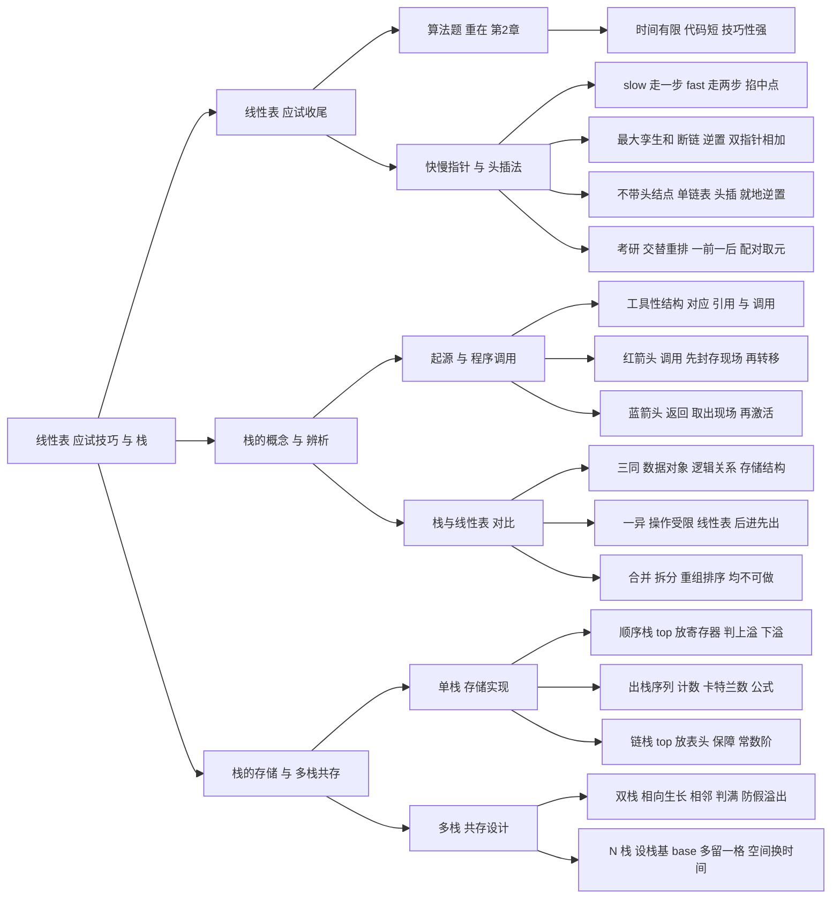
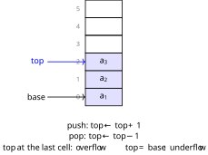
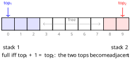
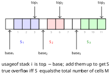
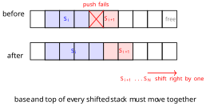

# 数据结构 · 第五周第一节 · 线性表的应试技巧与栈 · 详细版讲义

> **来源说明**：本讲义依据课堂录音的两份本地转写与逐段整理素材，并与严蔚敏《数据结构（C语言版）》对照校订而成，属**课堂讲授的整理稿**，用于课后复习与对照。
>
> - **转写来源（两份本地文件，均为课堂录音的 ASR 导出文字）**：① `数据结构线性表与栈讲解_导出原文(1).txt`（前半：线性表收尾的应试技巧，约 00:00–00:04:42）；② `栈相关教学内容讲解_导出原文(1).txt`（后半：栈与栈的存储，约 00:04:42–00:47:39）。两份合并后按 500–800 字切为 30 段，逐段整理为 30 份素材（`segment_000.md` ~ `segment_029.md`），本讲义以这 30 份素材为主，必要处回看原始转写。
> - **教材对照范围**：主要对照严蔚敏《数据结构（C语言版）》第 3 章 **3.1 栈**（3.1.1 抽象数据类型栈的定义、3.1.2 栈的表示和实现），用于校对栈的定义、LIFO、ADT 操作清单、顺序栈类型与语句语序；前半的链表内容对照 2.3.1、2.3.2。附录 A 另把 3.2 栈的应用举例、3.3 栈与递归的实现登记为知识地图补充（**我在本节课未展开讲**），并注明"多栈共存／假溢出"属**课堂扩展、教材 3.1 未涉及**。
> - **标注约定**：课堂举例一律标"（课堂举例）"；课堂未讲但教材里有的内容标"（教材补充：3.1.1）"这类出处；为使口头讲述更连贯而作的整理标"（讲义补充）"；能依据教材与上下文裁定的口误／误识，在正文用"（讲义校订：…）"当场说明，裁不掉的统一收入"待核实内容"（共 23 条）。
> - **记法说明**：我在课上口头使用"栈／栈底／栈基"；教材 3.1.2 中 **base 是"栈底指针"**、`top = base` 表空、`top` 指向栈顶元素的下一个位置；而我在本节课后半段讲的 **base 是"栈基"，落在栈底的前一个单元**。两者相差一格，读题时按语境分辨，不要混用。全文不写"节点"，统一写"结点"。
> - **时间说明**：本节课为**文字模式**（无音视频轨、无关键帧），各节时间戳是按**字数折算的伪时间**，非音频真实时间；它只是讲义内部单调递增的定位坐标，用于与 30 份分段素材对齐（课间休息 5 分钟在伪时间轴上已压缩）。
> - **编号说明**：我在课上沿用了自己旧课程体系的章节号，与严蔚敏教材章节号**不一致**：我口头提到的"第三章"＝链表（教材 2.3），"第 4 章"＝栈和队列（教材第 3 章，也就是本节课正式进入的内容）。这一对应关系详见"待核实内容"第 1 条。
> - **关联阅读**：[[数据结构 第四周第三节 链表的进阶与线性表的应用 详细版讲义]]（上一节，链表收尾与就地逆置作业）、[[数据结构 第四周第二节 单链表的插入与删除算法 详细版讲义]]、[[数据结构 第四周第一节 线性表的向量存储与顺序表插入算法 详细版讲义]]、[[数据结构 第二章 线性表 详细版讲义]]、[[数据结构 第一章 绪论 课堂讲义]]。
> - **示意图说明**：正文里嵌了 5 张**操作示意图**，原以 `tikz` 书写，现已转为 SVG 文件（`插图/w51_01.svg` 至 `w51_05.svg`）并以相对路径嵌入。图内标签统一采用英文字母、数字与数学记号，中文解释置于各图下方的「图注」中。

## 开场导读

这节课一头一尾，是"旧章收尾 + 新章开篇"的衔接点。

前半段只有四分多钟，篇幅较短但都是高频考点。一开场我先把问题点明：**算法题为什么集中出在第 2 章线性结构这里**？原因很实际——考场上时间有限，代码太长的题很难写完，而线性结构形式简单、又有做题技巧，是较为合适的出题载体。紧接着我连续过了三道同源的题目：不带头结点、长度为偶数、结点值全大于 0 的单链表求**最大孪生和**（第 $i$ 个结点的孪生结点是第 $n-i+1$ 个，用**快慢指针**定位中点，断开后把后半段**头插逆置**，再让两个指针同步相加取最大）；不带头结点单链表的**就地逆置**（头插法，作为本节作业）；以及一道考研真题——带头结点单链表按 $a_1, a_n, a_2, a_{n-1}, \dots$ **交替重排**，要求空间复杂度为 $O(1)$、时间尽可能高效（可达 $O(n)$）。这三道题的思路是一致的：凡是需要**一前一后配对访问**的链表题，都可以先用快慢指针定位中点。

后半节课进入栈。我先不急着下定义，而是先讲**为什么**需要它：栈和队列是计算机处理信息的两种**工具性数据结构**——厨师需要炊具、电工需要电箱、钳工需要钳子，没有它，很多问题在实现上会寸步难行。接着我用一条清晰的链条把抽象机制落地：从操作系统开机就在存储区里划出的一片专门区域，到"调用是红色箭头、返回是蓝色箭头"，再到那个关键追问——"**凭什么能够返回？**"；答案是"**先封存现场**"：把现场环境打包压进那片区域，返回时再取一个出来"激活"。至此，栈的物理形态、栈顶栈底、后进先出，都有了明确支撑。

再往后是本节课的辨析核心：**栈与线性表的同与异**。数据对象一样、逻辑关系一样、存储方式也可以一样，唯一不同的是**运算**：栈的运算是线性表运算的**子集**，而且这个子集**还要加以限制**。我顺带指出不少教科书"栈是限定插入删除在表尾的线性表"这一定义的局限性（字面上不能说错，但容易引发误解），改写成更准确的表述："**栈是操作受限的线性表**"。

最后四十分钟讨论存储结构。包括顺序栈、入栈与出栈算法、上溢与下溢；出栈序列问题与**卡特兰数** $C_n=\frac{1}{n+1}\binom{2n}{n}$，以及 $P_2=3 \Rightarrow P_3$ 有 $N-1$ 种取值的考研真题；链栈的栈顶指针应放在**表头**（放在表尾时删除需 $O(n)$）；最后是多栈共存：手机多任务 $\to$ **假溢出** $\to$ 两栈**相向生长** $\to$ $N$ 个栈用线性表统一管理 $top$ 与 $base$ $\to$ 0/1 元素**二义性** $\to$ 引入**栈基 $base$** $\to$ 判空 $top_i=base_i$、判满 $top_i=base_{i+1}$ $\to$ 最后一个栈的 $base_{N+1}$ 不存在 $\to$ **典型的空间换时间法**，让 $base$ 多留一个单元，换取所有判断的统一。课程最后我指出：$N>2$ 时在等量固定分配下会面临假溢出，编译器实现中需要专门处理——假溢出处理算法留到下一讲展开。

## 总览知识地图

这节课前半是线性表收尾，后半是栈与存储实现，先用一张全课知识地图总览主线，再将五个局部专题拆成表格与列表分述。

**全课知识地图**



**专题一 · 快慢指针：一条思路三道题**

1. **核心机制**：设置快慢双指针，`slow` 每次走一步，`fast` 每次走两步；当 `fast` 到达表尾时，`slow` 恰好落在链表中点。
2. **最大孪生和**：先用快慢指针找中点并断链，再对后半段做头插逆置，最后前后双指针同步后移并相加取最大值。
3. **就地逆置与交替重排**：不带头结点就地逆置采用头插法（不额外申请空间）；考研交替重排先用快慢指针定位中点、后半段头插逆置，再一前一后交替归并，思路一脉相承。

**专题二 · 栈的由来：一片区域、两个箭头**

1. **专用存储区**：操作系统开机时在存储区划出一片专门区域，结构上表现为一端固定、一端浮动，数据的存入与取出只在浮动端（栈顶 `top`）进行。
2. **调用过程（红色箭头）**：主调程序遇到调用指令时，先将当前现场环境封存压入该区域，再顺着入口地址转移控制权。
3. **返回过程（蓝色箭头）**：被调程序执行到末尾遇到返回盲点时，从该区域顶端取出一份现场环境并激活恢复，主调程序得以继续向下执行。

**专题三 · 栈与线性表：三同、一异**

| 对比维度 | 共同点／差异 | 具体说明 |
| --- | --- | --- |
| 数据对象 | 相同 | 均为具有相同属性的数据元素集合 |
| 逻辑关系 | 相同 | 元素之间均为一对一的线性关系 |
| 存储结构 | 相同 | 均可采用顺序（向量）存储或链式存储 |
| 运算集合 | 不同（核心差异） | 栈的运算是线性表运算的真子集且操作受限：只能在栈顶一端插删，元素按后进先出（LIFO）组织；合并、拆分、重组排序均不可做 |

**专题四 · 栈的存储：从单栈记录到 N 个栈**

1. **顺序栈**：由存储区与 `top` 指针构成一个记录，需防范栈满上溢与栈空下溢；`top` 指针在工程中常放入专用寄存器以保证高效。
2. **出栈序列计数**：固定入栈序列、自由交替出栈，合法序列总数为卡特兰数 $C_n=\frac{1}{n+1}\binom{2n}{n}$。
3. **链栈**：栈顶 `top` 必须放在表头，以保证入栈和出栈均为 $O(1)$；若放在表尾，删除时找前驱需 $O(n)$。
4. **双栈共存**：两栈共享数组并相向生长，以两栈顶指针相邻（$top_2 - 1 = top_1$）判满，避免假溢出。
5. **N 栈共存**：使用两条线性表分别管理 `top` 与 `base`，为 `base` 多留一个单元以空间换时间。

**专题五 · 多栈共存的判定条件一览**

| 项目 | 表达式／规则 | 说明 |
| --- | --- | --- |
| 空间划分 | $M$ 个单元分给 $N$ 个栈 | 均分基准为 $\lfloor M/N \rfloor$ |
| 栈基初值 | $base_i = \lfloor M/N \rfloor \times (i-1)\ (i=1,\dots,N)$，$base_{N+1}=M$ | 第 $i$ 个栈的栈底下标为 $base_i + 1$ |
| 判空条件 | $top_i = base_i$ | 栈顶回到栈基位置，说明该栈为空 |
| 判满条件 | $top_i = base_{i+1}\ (i=1,\dots,N)$ | 多留一个 $base_{N+1}=M$ 单元，典型空间换时间法，使第 $1$ 到第 $N$ 个栈判满统一 |
| 遗留问题 | $N>2$ 在等量划分下仍会假溢出 | 假溢出处理算法留待下一讲展开 |

## 正文

### 一、应试收尾（一）：为什么算法题重在第 2 章，以及快慢指针一类题 `00:00:00–00:03:09`

先明确一个应试结论：线性表这一章、线性结构这一章，是算法题考查的重点。原因很实际——因为考场上时间有限，如果考查太复杂、代码长度很长，很多同学在有限时间内根本写不完；而线性结构本身结构简单，同时又包含足够的做题技巧性。代码短写得完，结构简单便于判卷，技巧性强又能拉开区分度，这就是算法题集中出现在第 2 章的原因。

顺着这个思路，我把前面零散讲过的链表解题技巧归拢成几类，今天先收尾其中一类——**快慢指针**。上一节课的"找链表倒数第 $k$ 个结点"用的就是它，本节课第一道例题同样如此。

来看题目（课堂举例）：**有一个长度为 $n$ 的单链表，$n$ 是偶数，不带头结点，结点值都大于 0，要求出单链表中最大的孪生和。** 所谓孪生和，是指一个结点和它的孪生结点之和；对第 $i$ 个结点来说，它的孪生结点就是第 $n-i+1$ 个结点。写成数学配对关系就是：

$$i \longleftrightarrow n - i + 1$$

拿 6 个结点举例：$1,2,3,4,5,6$。1 号结点的孪生结点是 6 号结点，一头一尾；2 号配 5 号，3 号配 4 号。因此题目就是从 $1+6$、$2+5$、$3+4$ 里挑出最大的那个和：

$$\max_{1 \le i \le n/2}\ \big( a_i + a_{n-i+1} \big)$$

（**讲义补充**：$n$ 为偶数保证了前半段与后半段长度相等，配对不重复、不落单。）

问题随之而来——前半段的结点容易拿到，后半段的怎么办？单链表不能回溯，若从 1 号结点每次向后走到对应的尾侧结点，单次就要 $O(n)$，整体退化成 $O(n^2)$。

办法就是**把后半段反过来摆**。既然结点数为偶数，那就前一半保持原序不动，后一半做逆置。逆置成功之后，设一个 $P$ 指针指向表头，再设一个 $Q$ 指针指向逆置后的后半段首结点，只要没走到末尾，$P$、$Q$ 同步往后移动并比较两数之和，就能在一次线性扫描中取出最大值。这套双指针同步比较的前提，就是后半段已经被逆置过。

那怎么找到中点、怎么把后半段摘出来？这就靠**快慢指针**。设置两个指针一快一慢：慢指针 `slow` 每次走一步，快指针 `fast` 每次走两步。`slow` 依次经过 $1,2,3,\dots$，`fast` 跳着经过 $1,3,5,\dots$。当 `fast` 走到表尾（即 `fast->next == NULL` 或 `fast->next->next == NULL`）时，`slow` 恰好落在链表的中间结点；此时从 `slow` 处断开，`slow->next` 就是后半段的首结点，再把后半段用头插法（倒插法）逆置即可。

> **讲义校订**：我在课上口头举例时顺嘴说"`slow` 会指向 4 号结点"，但在 6 个结点的链表中，`fast` 走到 5 号（下一步越过 6 号到达表尾）时，`slow` 实际落在 3 号结点上（$n$ 为偶数时中点落在第 $n/2$ 个结点）；若落在 4 号，则后半段只剩 5、6 两个结点，与随后"4、5、6 号要逆置"的举例不一致。本讲义统一按"**`slow` 停在第 $n/2$ 个结点**"来写，详见"待核实内容"。

这里需要记住一个核心思路：**这是一类问题的通用解决框架**——凡是要"一头一尾配对访问"的链表题，都可以先用快慢指针定位中点。

接着来看作业：**不带头结点的单链表就地逆置**。前面讲链表（**编号说明**：我口头沿用的"第三章"指链表，对应教材 2.3.1，见文首编号说明与"待核实内容"）时布置过带表头结点的就地逆置，今天要写的是不带头结点的版本。其实核心动作是相同的，因为就地逆置的关键在于头插／倒插，与是否存在哑元头结点没有本质区别。"就地"意味着**不能申请额外的数组或链表存储空间**，只能靠指针原地重构（$O(1)$ 辅助空间）。

不带头结点的头插法怎么写？先定义一个 `new_head` 指针，初始置为 `NULL`；要逆置后面的结点时，用 `p` 指向当前待摘结点，用 `t` 暂存 `p->next` 防止断链，然后让 `p->next` 指向 `new_head`，再把 `new_head` 更新为 `p`，最后让 `p` 移到 `t`，如此循环。完整 C 代码见附录 B1。

**本节要点**

- 线性结构因结构简单、代码短且技巧性强，是考场算法题的高频考查章节。
- 快慢指针通过 `slow` 走一步、`fast` 走两步定位链表中点，是解决链表"首尾配对"类问题的通用前置手段。
- 最大孪生和与不带头结点就地逆置均依赖头插法重构链指针，辅助空间复杂度为 $O(1)$。

### 二、应试收尾（二）：头插法现场演示、考研交替重排，与"单链表讲完" `00:03:09–00:04:42`

先看头插法（倒插法）的指针推进过程（课堂举例）：如果待逆置部分是 $4 \to 5 \to 6$，先将 4 号摘下插到空表头前，`new_head` 指向 4；再把 5 号插到 4 号前面，`new_head` 变为 5 号结点；再把 6 号插到 5 号前面，`new_head` 变为 6 号结点。这种"逐个摘下并插到新表头之前"的动作，就是倒插法，也就是通常说的头插法。

在定位中点与逆置后半段的组合题目中，快慢指针的常见组织方式如下（课堂举例）：

| 指针 | 初值（带头结点） | 步长 | 角色 |
| --- | --- | --- | --- |
| `fast` | `head->next` | 每次走**两步** | 快速探到链表末尾 |
| `slow` | `head` | 每次走**一步** | 停在中间结点，其 `next` 为后半段起点 |

（**讲义校订**：表中的 `slow` 与 `fast` 用于定位链表中点，而不是在循环中直接做前插；定位到中点后，再另用工作指针从 `slow->next` 出发逐个摘下结点完成头插逆置。）

带头结点单链表逆置的通用写法是：设新表头辅助指针 $q$（初值为 `NULL`），工作指针 $p$ 从 `head->next` 出发；在 `while (p != NULL)` 循环里依次做四步——① 先记录后继 $t = p \to next$；② 断链重接 $p \to next = q$（相当于把当前结点挂到已逆置部分前面）；③ 更新已逆置部分的新头 $q = p$；④ 工作指针后移一格 $p = t$。循环结束后再令 `head->next = q` 即完成逆置。代码骨架见附录 B2。（课堂举例中曾提到"4 号结点"，与前文 $6 \to 5 \to 4$ 演示属不同示例，不影响步骤本身，见"待核实内容"。）

接着看这一部分的最后一道考研真题（课堂举例）：给定线性表 $a_1, a_2, \dots, a_n$，采用**带头结点的单链表**保存，要求**空间复杂度为 $O(1)$、时间复杂度尽可能高效**（最优可达 $O(n)$），将链表重新排列为：

$$a_1,\ a_n,\ a_2,\ a_{n-1},\ a_3,\ a_{n-2},\ \dots$$

（**讲义校订**：我在课上口头误说成了"时间复杂度 $O(1)$、空间复杂度 $O(1)$"，实际上遍历与重排 $n$ 个结点至少需要 $\Omega(n)$ 时间，真题要求的是空间复杂度 $O(1)$ 且时间复杂度为 $O(n)$，详见"待核实内容"。）

这种"一前一后、交替取元"的重排思路，和前面的最大孪生和完全一致：先用快慢指针找到中点并断开，再把后半段用头插法原地逆置，最后从前半段和逆置后的后半段交替取结点重连。

到这里，单链表的内容就全部结束了。线性表是线性结构的典型代表，把顺序表和链表研究透，线性结构这一大类的基本规律也就掌握了。接下来我们进入栈和队列。

**本节要点**

- 头插法逆置的核心循环顺序是：存后继 $t = p \to next$、改指针 $p \to next = q$、移新头 $q = p$、推工作指针 $p = t$。
- 带头结点版本需在循环结束后将 `head->next` 指向新的首结点 $q$。
- 交替重排问题（$a_1,a_n,a_2,a_{n-1},\dots$）通过"快慢找中点 + 后半段头插逆置 + 双指针交替合并"在 $O(n)$ 时间、$O(1)$ 空间内完成。

### 三、引入栈：工具性数据结构、"寸步难行"与一片专用存储区 `00:04:42–00:07:56`

既然线性表已经研究清楚了，为什么还要再引入栈和队列这两种线性结构呢？

第一个原因是**性质上的定位**。只要用计算机来处理信息，就不可避免地要用到栈和队列这两种**工具性数据结构**。就像厨师需要炊具、电工需要电箱、钳工需要钳子一样（课堂举例）：

| 角色 | 需要的"工具" |
| --- | --- |
| 厨师 | 炊具 |
| 电工 | 电箱 |
| 钳工 | 钳子 |
| 计算机（处理数据） | 栈、队列 |

没有这些工具性结构，计算机处理很多问题就会寸步难行。

第二个原因是**栈的来历**。在人类认识与解决问题时，普遍存在一种"继承机制"（这里指拿来主义，见"待核实内容"）：把已有的经验或已经被证明的定理直接拿来使用。比如做数学题时直接引用勾股定理，做物理题时依据牛顿第一定律，写文章或发言时引用经典论述来佐证当前观点（课堂举例）。这种"拿来主义"在计算机程序里体现为**引用或者调用**——而支撑计算机中子程序引用与调用机制的核心结构，正是**栈**。

从物理实现来看，无论是手机、笔记本还是大型计算机，只要一接通电源，操作系统就会在**存储区域里划分出一片专门的存储区**，用来让现场数据临时停留一会儿（课堂举例）。按存储层次来看，通常说的默认主存是**内存**（外存有硬盘、磁盘、光盘、磁带等；后文讨论栈指针效率时还会涉及内存—缓存—CPU 寄存器层次，两处均按课堂举例分列记录，见"待核实内容"）。

这片专用存储区有一个关键的几何与存取特征：**它的一端是固定的**（底部），**另一端是可以浮动的**；而且所有的信息存入和取出，都只能在浮动的这一端进行。就像一个水池子（课堂举例），池底固定不动，往里注水或从里取水，液面都在上方浮动。

这片区域在形态上非常接近我们刚刚学过的线性结构——**向量（顺序存储的线性表）**。因此我们可以借助向量来刻画栈的早期直觉定义：下限为常数、上限可变化（或反之）的一端固定的线性区域。

**本节要点**

- 栈和队列是计算机信息处理中不可或缺的工具性数据结构，支撑程序的引用与调用。
- 操作系统开机后会在内存中划出专用区域作为运行栈空间，存取均在浮动端进行。
- 在形态上，栈可看作一端固定、另一端浮动的受限线性存储区。

### 四、栈的定义、栈顶栈底，以及"你凭啥能撤回" `00:07:56–00:09:30`

接着把上一段的描述补全：栈就像是一个下限为常数、上限可变化的向量，或者反过来，上限是常数、下限可变化——合起来就是**一端变化、另一端固定不动**。栈在很多教材中也叫**堆栈**（stack），字面上就可以理解为把东西一层层堆叠起来的地方。

在术语上，**浮动的这一端**称为**栈顶（top）**，**固定不变的那一端**称为**栈底（bottom）**。就像一栋大楼，一楼底层是固定不动的 `bottom`，随着楼层往上升，最上面那一层就是不断变化的 `top`。（课堂口述中此处曾将栈顶与栈底的语序说颠倒，讲义已按语义理顺，见"待核实内容"。）

其实大家在日常使用电脑和手机时，几乎每天都在不知不觉地使用栈：

**例一：浏览器的"后退"**（课堂举例）。浏览网页时，你从第一个页面点开链接进入第二个页面，再点链接进入第三个页面……突然需要返回之前的页面时，点击浏览器的"后退"按钮，系统会一层一层按原路退回上一个网页。最后打开的网页，总是最先被退回。

**例二：Word 的撤销**（课堂举例）。在文档中连续编辑输入，中途发现误操作时按下 `Ctrl+Z` 撤销。为什么程序能记住你刚才每一步做了什么并一步步撤回？因为编辑历史就存放在一个栈里。有的早期版本或默认设置里，连续撤销次数存在上限（例如约 9 次，随软件版本与配置而异，见"待核实内容"），超过上限后最早的记录就会被丢弃。

这个日常例子同时点出了栈的两个核心特征：撤销历史是一条栈，所以只能按**后进先出**的顺序回退；而撤销步数有上限，又说明栈通常有固定容量，这也引出了后面的"上溢／下溢"问题。

而在计算机体系内部，栈最典型的应用场景就是**程序调用**。

**本节要点**

- 栈又称堆栈（stack），固定的一端为栈底（bottom），唯一允许存取的浮动端为栈顶（top）。
- 浏览器后退与编辑器的撤销（`Ctrl+Z`）本质上都利用了栈的后进先出特性。
- 有界栈容量有限，程序调用与返回是栈在计算机系统内部最核心的应用。

### 五、程序调用：红色箭头、蓝色箭头，与"你凭啥能回来" `00:09:30–00:12:44`

下面来看程序调用到底是怎么依靠栈跑起来的。假设有一段主程序 A，A 里面有调用 B 的语句；B 里面有调用 C 和调用 D 的语句（课堂举例）。

**调用方向（红色箭头）**：这个过程很直接。A 从第一条语句顺序往下执行，遇到调用 B 时，系统只需要根据 B 的入口地址"顺藤摸瓜"找到 B 在内存中的位置，把 CPU 的控制权转移给 B；B 往下执行遇到调用 C，同样顺藤摸瓜找到 C 的入口地址，把控制权交给 C。

**返回方向（蓝色箭头）**：问题出在返回这一步。控制权转交给 C 之后，C 一句句执行到了最后一条语句，接下来该怎么办？如果只转移控制权而不保存信息，计算机在这个位置就会出现"盲点"，不知道自己是从哪条路径进来的，也就无法自动回到 B 里调用 C 的下一条语句。

那么，**程序凭什么能够自动返回？** 这其实是计算机操作系统在后台完成的一件事。回到刚才说的开机划出的那片专用存储区，关键在于控制权转移之前多做了一步动作：

> A 执行到调用 B 时，先别急着把控制权交出去，**先封存现场**。

什么是**现场环境**（课堂举例）？就是程序 A 已经执行到当前位置所涉及的运行状态，包括变量的值、变量所在地址以及断点返回地址等。就像需要原样保留的现场一样，如果不封存保护起来，子程序一运行就把寄存器或变量覆盖了，回来之后就无法恢复执行。

**封存与恢复的动作顺序**（课堂举例）：
1. **入栈（封存）**：A 调用 B 前，将 A 的现场环境打包存入专用存储区（在板书上记为五角星，存入栈底位置），顶端指针上浮一格；接着 B 调用其他子程序前，将 B 的现场环境封存压在上面（记为菱形）；若后续再发生嵌套调用（例如再封存一层现场记为三角形），就继续往上叠放。
2. **出栈（恢复）**：当最内层子程序执行到末尾遇到返回盲点时，系统从存储区顶端**取出最上面的一份现场环境并激活**（按后进先出原则，先弹出最晚封存的三角形现场恢复执行，再弹出菱形现场恢复 B 的变量地址与断点继续执行，最后弹出五角星现场回到 A 执行剩余部分）。

> **讲义校订**：我在课上口头举例时曾先说取出 B 再说取出三角形 D；按栈的后进先出规则，若按"A（五角星）$\to$ B（菱形）$\to$ D（三角形）"顺序封存，则必须先弹出三角形、再弹出菱形 B、最后弹出五角星 A，讲义已按 LIFO 顺序理顺（详见"待核实内容"）。

> **讲义补充**：这一整段先用"专用存储区""封存现场""取出激活"来建立直觉，把术语对应上就是：这片专用存储区就是**栈**，"封存现场"就是**入栈（压栈）**，"取出并激活"就是**出栈（弹出）**，"往上浮动一个位置"就是 `top` 指针加 1。

**本节要点**

- 函数调用（红色箭头）只需入口地址即可转移控制权，函数返回（蓝色箭头）则必须依赖之前保存的断点与现场。
- 现场环境包含返回地址、局部变量值与地址等，教材 3.3 中称为"工作记录"或"活动记录"。
- 调用前先封存现场（入栈），返回时按后进先出顺序取出最顶层现场激活（出栈）。

### 六、客栈、弹夹、摞碗、火车车厢与青岛火车站：从"天天在用"到"找异找同" `00:12:44–00:15:59`

这片"让数据或现场环境临时待一会儿"的区域，为什么叫"栈"？在古代汉语里，"栈"原本指的是**客栈**（课堂举例）——供旅客临时歇脚、待一会儿再走的地方。操作系统帮程序维护的这片存储区，正起着类似"临时客栈"的作用。

除了程序调用，现实生活里到处都能看到栈的模型（课堂举例）：

1. **弹夹**：往弹夹里压子弹，压一发就整体往下退一格；发射时总是发射最上面的那一发。最后压进去的，最先打出去。
2. **一摞子碗**：食堂里刚洗出来的一摞碗，最后放上去的那个在最上面，下一位同学拿碗时顺手就会拿最上面那一个。
3. **火车车厢的更换**：铁轨上的列车中间某一节车厢坏了，旁边没有道路能直接把它横着吊出来，只能利用旁边的尽头式维修岔线，把后半段拉进去、换下坏车厢，再按顺序倒退挂回去。只能从一端一节节进出，不能从中间整体抽取。
4. **青岛火车站**：青岛火车站是尽头式车站，前面就是海，火车进站停靠后不能继续往前开，只能原样倒退着拉出站——先开进去的车头最后才能出来。

生活中的例子说清了，现在回到数据结构本身：**栈是一种线性结构，线性表也是一种线性结构，它俩究竟有什么区别、有什么联系？**

在学习或做科研时，比较两个事物往往用两招——**找异**与**找同**（课堂举例）。就像科研中识别一种新病毒，会拿新采集的样本和已知毒株比对结构，找出不同之处（找异）；而对于不同的病毒（如非典病毒与新冠病毒），又会去对比它们在结构或致病机理上的共性（找同）。现在对比栈与线性表，同样要抓住"数据结构"的根本定义：

> **数据结构＝给定的数据对象，以及在它上面定义的操作，共同构成的一个整体。**

**本节要点**

- "栈"取自客栈"临时停留"之意；弹夹、一摞碗、尽头式火车站都是后进先出的直观体现。
- 对比两种数据结构应从"数据结构 = 数据对象 + 操作集合"的基本定义出发，做到"找同"与"找异"。

### 七、栈与线性表：三处相同、一处不同，以及一次定义之争 `00:15:59–00:20:53`

按照"数据对象 + 操作集"的定义，我们来逐项对比栈与线性表：

**相同的第一处：数据对象。** 线性表 $a_1, a_2, \dots, a_n$ 是具有**相同属性**的数据元素集合；栈里存放的同样是同类数据元素。从数据对象来看，两者相同。

**相同的第二处：逻辑关系。** 线性表中元素一个接一个呈一对一的线性关系；栈里元素是一个压一个叠放起来的，同样是**线性关系**。

**相同的第三处：存储结构。** 两者都可以采用**顺序存储（向量）**或**链式存储（链表）**来实现。

**不同的一处：运算。** 这是栈和线性表的本质区别。回忆线性表的常见运算（课堂举例；按教材 2.1／3.1 常见分类整理如下）：

| 序 | 线性表运算 | 栈能否执行 | 课堂说明 |
| --- | --- | --- | --- |
| 1 | 统计元素个数（求表长） | **可以** | 可以数出当前栈内有多少元素 |
| 2 | 在第 $i$ 个位置插入或删除（$i$ 任意） | **受限** | 栈只能在**栈顶**这一端做插入和删除 |
| 3 | 合并 | **不行** | 两个 10 发容量的弹夹不能直接合并成一个 20 发弹夹使用 |
| 4 | 拆分 | **不行** | 不能把一个弹夹从中间一掰两半拆分给别人使用 |
| 5 | 重组（重新排序） | **不行** | 见下述"哑弹／臭蛋"说明 |

为什么插入和删除会受限？观察栈的工作方式：栈底固定不动，栈顶浮动。往里插入一个元素，栈顶指针往上浮动一格；删除一个元素，栈顶指针往回退一格。所以栈不是不能插入删除，而是**规定只能在栈顶这一端进行**。

因为新插入的元素总是在最顶上、最先被删除，所以栈的元素是按**后进先出**的原则来组织的：

$$\text{LIFO} \;=\; \text{last in first out}\;(\text{后进先出})$$

这是一个计算机领域的标准缩写，碰到 LIFO 就应当立刻想到栈。（转写中曾将英文误记为 "last input, first output"，按标准写法校订为 last in first out，见"待核实内容"。）

为什么说第 5 类"重组排序"也不行？再用弹夹举个例子（课堂举例）：老式子弹里偶尔有发射不出来的哑弹（俗称臭蛋）。假设我们在压弹时把哑弹做了标记并夹杂在好子弹中间一起压进弹夹，如果希望发射时"先把好的都打出去、坏的自动沉到底下"，在不把所有子弹全部退出来重新装填的情况下，栈本身是做不到的——因为每次只能从最上面取出一发。

由此得到本节课的核心结论：

$$\mathcal{O}_{\text{stack}} \subsetneq \mathcal{O}_{\text{list}} \quad\text{，且这个子集还要加以限制：只能在一端（栈顶）进行}$$

这里有必要辨析一下很多教科书上的常见定义。不少教材写法是："**栈是仅限定插入和删除操作在表尾进行的线性表**。"这句话字面上不能算错，但在教学上容易引起两个误解：

第一，**"言下之意"的误解**。说"限定插入和删除只在表尾进行"，字面上容易让人以为"除了插入删除之外，线性表的合并、拆分、重组等其他操作栈全都能做"——而实际上这些操作栈都做不了。

第二，**用一种数据结构定义另一种数据结构的问题**。线性表和栈本身是两种不同的抽象数据类型，直接用线性表来定义栈，在后续学习链式实现时容易让人把"表头／表尾"搞混。

> **教材补充（3.1.1）**：严蔚敏教材 3.1.1 的原文是"**栈（stack）是限定仅在表尾进行插入或删除操作的线性表。因此，对栈来说，表尾端有其特殊含义，称为栈顶（top），相应地，表头端称为栈底（bottom）**"，紧接着给出了空栈、$a_1$ 为栈底元素／$a_n$ 为栈顶元素、修改按**后进先出**原则进行等完整 ADT 规范。也就是说，教材本身并没有主张"除了插入删除外的其他操作都能做"，只是课堂上提醒大家不要对那句简短定义望文生义；同时教材是把逻辑顺序里的"表尾"定义为栈顶、把"表头"定义为栈底，这与后面单链表实现时将栈顶设在链表头部（物理表头）属于不同层面的命名（见第十一节）。

**本节要点**

- 栈与线性表在**数据对象、逻辑关系、存储结构**三方面相同，仅在**运算集**上不同。
- 栈的运算是线性表运算的真子集，且插入和删除被限制在栈顶一端执行，遵循 LIFO（后进先出）原则。
- 合并、拆分与任意重组均不属于栈的操作；理解教材"限定在表尾"定义时要注意其指逻辑上的栈顶，不可误以为其他线性表操作也适用。

### 八、修正定义"操作受限的线性表"，以及为什么把 top 放进寄存器 `00:20:53–00:24:09`

如果要在教学上把栈和线性表准确挂钩，建议记下面这个修正表述：

> **栈是操作受限的线性表。** 栈的运算是线性表运算的一个**子集**，并且这个子集**还要加以限制**（只能在一端进行）。

总结起来就是两句话：相同之处在于数据的逻辑关系一样、存储组织方式也可以一样；不同之处在于栈的运算——它是线性表运算的子集，并且这个子集还要加以限制。

再看栈的基本运算需求。就像古时候的客栈一样（课堂举例），核心需求其实就两个：客人入住与客人离开。对应到栈上，就是最基本的两个运算：

1. **入栈＝压栈（push）**：好比食堂里一摞带弹簧底座的餐盘（课堂举例），服务员往最上面放一个盘子，弹簧就被往下压一格，所以入栈也叫压栈。
2. **出栈＝弹出（pop）**：从最上面取走一个盘子，弹簧回弹一格，所以出栈也叫弹出。

至于很多教材里列出的其他操作，如取栈顶元素（`GetTop`）、判栈空（`StackEmpty`）、栈初始化（`InitStack`）等，在代码实现上往往就是一两条语句，因此课堂重点先讲清入栈和出栈。为什么栈这么强调精简与速度？因为栈直接服务于操作系统与程序调用，核心目标是**尽量高效**。

为了追求执行高效，计算机底层和系统级实现通常采用**向量（顺序存储）**来实现栈，并且非常关注 **`top` 指针的存放位置**。

回忆存储层次：内存之上还有高速缓存（Cache），再往上就是位于 **CPU 内部的寄存器**（课堂举例）。为了快速获取和管理栈顶位置，`top` 指针甚至不会优先放在普通内存里，而是尽量放在 **CPU 专用寄存器**中。虽然 CPU 里的寄存器数量有限（通常只有几十个），但把频繁读写的栈顶指针放进寄存器，能获得最快的访问速度；从数据类型上看，它本质上就是一个整型变量（或地址指针）。

同样出于效率考虑，对于栈初始化、判栈空这类只需一条赋值或比较语句的操作，在底层工程实现中往往直接内联写成一条语句，而不专门封装成函数，以免引入额外的函数调用开销。

最后落到顺序存储的数据描述上：既然栈是操作受限的线性表，顺序存储的思路就和前面顺序表一致——需要**一片连续的存储区域**，再配一个 **`top` 指针**（作用类似于顺序表里的表长 $n$，只是换了个名字）。

> **教材补充（3.1.2）**：严蔚敏教材给出的顺序栈类型定义是 `typedef struct { SElemType *base; SElemType *top; int stacksize; } SqStack;`——即"栈底指针 `base` ＋ 栈顶指针 `top` ＋ 当前容量 `stacksize`"三个字段。教材中同时规定：① 空栈标记是 `top == base`；② **非空栈中 `top` 始终指向栈顶元素的下一个空位置**，因此入栈写成 `*S.top++ = e`、出栈写成 `e = *--S.top`。此外教材还设置了 `STACK_INIT_SIZE` 与 `STACKINCREMENT` 两个常量，栈满时用 `realloc` 动态追加空间，而本节课堂先讲的是**静态数组下的栈满与上溢**。两种实现方式都成立，做题时按题目约定即可。

**本节要点**

- 准确记忆定义：**栈是操作受限的线性表**，核心操作是入栈（压栈 `push`）与出栈（弹出 `pop`）。
- 出于极致性能考虑，系统栈通常用顺序存储实现，并将 `top` 指针放在 CPU 专用寄存器中。
- 教材 3.1.2 的动态顺序栈采用 `base`、`top`、`stacksize` 三字段，且 `top` 指向栈顶元素的下一个位置。

### 九、顺序栈的入栈／出栈算法、上溢与下溢，以及卡特兰数 `00:24:09–00:27:19`

在计算机里，把"存储区 ＋ `top` 指针"组合在一起，就是一个记录（结构体）。在此基础上，入栈和出栈的逻辑非常直接：

**入栈（压栈）与上溢**。既然用向量（数组）来存，它就是静态结构，必然有一个最大容量上限 $max$。入栈前要先检查边界：若 $top = max$，说明栈已满，不能再压栈，此时若强行入栈就会发生**上溢**（overflow）——好比一盆水已经装到盆沿，再往里舀水就会从上面溢出来（课堂举例）。未满时，先让 `top` 上浮一格，再把新元素 $x$ 放入：

$$\text{上溢条件：}\ top = max \qquad\qquad \text{常规入栈：}\ top \leftarrow top + 1,\ \ S[top] \leftarrow x$$

**出栈（弹出）与下溢**。出栈时要先检查栈是否为空：若 $top = 0$，说明栈里已没有元素，此时再尝试出栈就会发生**下溢**（underflow）——好比水桶已经见底没水了，还用勺子去舀就会把桶底舀漏（课堂举例）。出栈的元素通常是要拿去使用的，因此未空时先用变量 $y$ 把当前栈顶元素取出来，再让 `top` 减 1：

$$\text{下溢条件：}\ top = 0 \qquad\qquad \text{常规出栈：}\ y \leftarrow S[top],\ \ top \leftarrow top - 1$$

顺序栈的基本算法说完，接着看一道经典考点：**假设有 3 个字符 $A$、$B$、$C$ 依次压栈，问 $A$、$B$、$C$ 的所有排列都是可能的出栈序列吗？**

**判定依据与反例。** $A$、$B$、$C$ 三个不同元素的全排列有 $3! = 6$ 种（课堂转写曾误识为 8 种，按 $3! = 6$ 校订，见"待核实内容"）。这 6 种并非全部可行。先看一个反例：有没有可能得到 **`CAB`** 这个出栈序列？

思考一下后进先出的约束：要让一个元素出栈，它当时必须处在栈顶。$C$ 第一个出栈，意味着 $A$ 和 $B$ 此时一定已经在栈里了，而且 $B$ 在 $A$ 的上面（因为入栈顺序是 $A \to B \to C$）。那么 $C$ 出栈之后，栈顶暴露出来的必然是 $B$，接下来只能先取到 $B$，而不可能越过 $B$ 直接取到 $A$。因此，**不可能存在 `CAB` 这样的出栈序列**（课堂转写中出现过 CED／CIB／CAD 等误识，按上述推理一律校订为 **`CAB`**，见"待核实内容"）。

**核心限制条件**：题目只对**入栈顺序**作了限制（必须按 $A, B, C$ 顺序进），对**出栈时机**没有限制，入栈与出栈可以交替进行。其余 5 种排列都是合法的，比如（课堂举例）：
- 全压后连弹：$A$ 入、$B$ 入、$C$ 入，然后 $C$ 出、$B$ 出、$A$ 出 $\Rightarrow$ **`CBA`**；
- 交替进行：$A$ 入后立刻出 $\Rightarrow A$；再 $B$ 入、$C$ 入，然后 $C$ 出、$B$ 出 $\Rightarrow$ **`ACB`**。

**通解公式：卡特兰数（Catalan Number）。** $n$ 个不同元素按固定顺序依次进栈，所有合法出栈序列的个数为卡特兰数：

$$C_n \;=\; \frac{1}{n+1}\binom{2n}{n} \;=\; \frac{1}{n+1}\cdot\frac{(2n)!}{n!\,n!}$$

考试中建议把前几项的数值记熟（课堂举例）：

| 元素个数 $n$ | 全排列总数 $n!$ | 合法出栈序列数 $C_n$ |
| --- | --- | --- |
| 1 | $1! = 1$ | **1 种** |
| 2 | $2! = 2$ | **2 种** |
| 3 | $3! = 6$ | **5 种** |
| 4 | $4! = 24$ | **14 种** |
| 5 | $5! = 120$ | 42 种（备考一般记到 $n=4$ 即可） |

**操作图 1 · 顺序栈的结构与入栈出栈**



> **图注（顺序栈结构与入栈出栈示意）**：图中自下而上绘制了下标 `0` 至 `5` 的 6 个连续存储单元，浅蓝底色的 `0`、`1`、`2` 号单元依次存放元素 $a_1$、$a_2$、$a_3$，上方 `3` 至 `5` 号单元为空闲区；左侧黑色箭头 `base` 指向底部单元 `0`，蓝色箭头 `top` 指向当前栈顶元素 $a_3$ 所在的 `2` 号单元；图下方标注了指针变化规则与溢出条件——入栈 `push` 时 `top` 加 1（`top <- top + 1`），出栈 `pop` 时 `top` 减 1（`top <- top - 1`），`top` 到达最后一格时发生上溢（`overflow`），`top = base` 对应下溢／栈空判定（`underflow`，图中按下标 0 起始将 `base` 与首元格对齐）。

**本节要点**

- 静态顺序栈按 1 起算下标时，`top == max` 为上溢（栈满），`top == 0` 为下溢（栈空）。
- 出栈序列问题的判定准则：入栈顺序固定、出栈时机自由；任何出栈序列中，每个元素之后所有比它先入栈的元素必须按入栈的逆序出栈。
- $n$ 个元素的合法出栈序列总数为卡特兰数 $C_n = \frac{1}{n+1}\binom{2n}{n}$，记住 $C_1=1, C_2=2, C_3=5, C_4=14$。

### 十、课间前的一道考研真题（$P_2 = 3 \Rightarrow P_3$ 有 $N-1$ 种取值），以及链式存储的提问 `00:27:19–00:30:30`

再来看一道典型的考研真题（课堂举例）：

> 某栈的**入栈序列是 $1, 2, 3, \dots, N$**（$N \ge 3$），**出栈序列是 $P_1, P_2, \dots, P_N$**。如果已知第二个出栈的元素 **$P_2 = 3$**，问第三个出栈的元素 **$P_3$ 有多少种可能的取值**？

先来做分类讨论。由于入栈顺序固定为 $1,2,3,\dots,N$，要让 $3$ 作为第二个元素出栈（$P_2 = 3$），在 $3$ 入栈时，$1$ 和 $2$ 必定都已经入过栈。此时只允许在 $3$ 之前出栈一个元素（即 $P_1$），因此 $P_1$ 只有三种可能（前两种为课上重点展开，第三种在 $N \ge 4$ 时成立，作补充完善）：

- **情形一（$P_1 = 1$，栈里剩 2）**：$1$ 入栈后立刻出栈（$P_1=1$），接着 $2, 3$ 入栈、$3$ 立刻出栈（$P_2=3$），此时栈里只剩 $2$。接下来的 $P_3$ 可以直接弹出栈顶的 $2$，也可以先让 $4, 5, \dots, N$ 中的任意一个先入后出，所以 $P_3 \in \{2, 4, 5, \dots, N\}$。
- **情形二（$P_1 = 2$，栈里剩 1）**：$1, 2$ 入栈后先弹出 $2$（$P_1=2$），再压入 $3$ 并立刻弹出 $3$（$P_2=3$），此时栈里只剩 $1$。接下来的 $P_3$ 可以直接弹出栈顶的 $1$，也可以先让 $4, 5, \dots, N$ 中任意一个入栈后立刻弹出，所以 $P_3 \in \{1, 4, 5, \dots, N\}$。
- **情形三（$P_1 = 4$，仅 $N \ge 4$ 时存在，讲义补充）**：$1, 2, 3, 4$ 依次入栈后先弹出 $4$（$P_1=4$），此时栈顶刚好是 $3$，于是可接着弹出 $3$（$P_2=3$），栈内剩 $[1, 2]$（$2$ 在栈顶）。接下来的 $P_3$ 可取 $2$ 或 $5, \dots, N$；若 $P_1 \ge 5$，弹出 $P_1$ 后栈顶是 $P_1 - 1 \ge 4$，无法让 $3$ 作为 $P_2$ 出栈，故不可能。

合并所有可能情形，得到的结果是：**除了 $3$ 本身已经被 $P_2$ 占走之外，$1, 2, 4, 5, \dots, N$ 全部都有可能取到**。因此：

$$P_3 \in \{\,1,\ 2,\ 4,\ 5,\ \dots,\ N\,\},\qquad P_3 \ne 3 \qquad\Longrightarrow\qquad \text{可能取值个数} = N - 1$$

（**讲义校订**：分段素材仅记录了"栈里剩 2"一种情形，原始转写补充了"栈里剩 1"的情形，讲义合并两处并补全 $P_1=4$ 的情形，与 $N-1$ 的结论完全自洽，见"待核实内容"。）

**接着进入新话题：栈的链式存储。** 需要说明的是，链式存储由于指针域占用了额外空间，存储密度低于 $100\%$，指针管理也相对繁琐，在实际系统底层中不如顺序栈常用。但作为逻辑结构的另一种表示，我们需要把链栈的设计原理搞清楚。

设想我们现在用单链表来实现一个栈（课堂举例）：链表有**表头**和**表尾**两端。现在提问：**栈顶指针（`top` 指针）应当放在表头，还是放在表尾？** 关键判据是必须保证栈的两个基本操作——入栈和出栈——都足够高效。（我点名请一位同学回答，得到的回答是"放在表尾"，下面一节我们来分析为什么不能放表尾。）

**本节要点**

- 解出栈序列取值范围问题时，应依据"压栈顺序固定"分析特定元素出栈前后的栈内残留情况并分类讨论。
- 当 $P_2 = 3$ 时，$P_1$ 只能为 $1, 2$（或 $N \ge 4$ 时的 $4$），合起来使 $P_3$ 有 $N-1$ 种可能取值。
- 链栈因存储密度低于 100% 且指针维护开销较大，系统底层较少使用，但其栈顶位置的选择是重要考点。

### 十一、链栈的栈顶必须放表头：$O(1)$ 与 $O(n)$ 的取舍，和一道结构一致性选择题 `00:30:30–00:33:44`

先给出结论：**单链栈的栈顶指针必须放在表头**，不能放在表尾。

**表尾为什么不行？** 如果把栈顶放在单链表的表尾，插入（入栈）时确实只要在表尾结点后面链入新结点并后移栈顶指针即可（若有尾指针则只需 $O(1)$）；但到了删除（出栈）这一步，要删掉表尾结点，就必须先拿到表尾结点的**前驱结点**，以便把前驱结点的 `next` 置空。单链表无法反向回溯，只能从表头一步步遍历到表尾的前一个结点，这需要 **$O(n)$ 的时间**。入栈和出栈是成对高频使用的操作，只要其中一个退化成 $O(n)$，整个设计就失效了。

**表头为什么行？** 如果把 `top` 指针放在表头：
- **入栈**：创建新结点，令新结点 `next` 指向当前 `top`，再将 `top` 指向新结点，只需修改表头指针，$O(1)$；
- **出栈**：取出 `top` 结点数据后，令 `top = top->next` 并释放原首结点，同样只修改表头指针，$O(1)$。

这就进一步解释了前面为什么提醒大家不要误读教材定义：教材逻辑定义里把"允许插删的一端"称为表尾（逻辑表尾＝栈顶），而在单链表的物理实现中，为了保证插删都是 $O(1)$，栈顶恰恰是放在**链表物理表头**这一端的。

**下面来看一道结构一致性选择题**（课堂举例）：**已知链表不带头结点，且栈的所有操作都在表头进行，问下列四种循环链表中哪一个最不适合作为链栈？**

| 选项 | 表头指针 | 表尾指针 | 方向 | 循环 |
| --- | --- | --- | --- | --- |
| A | 有 | 无 | 双向 | 循环 |
| B | 无 | 有 | 双向 | 循环 |
| C | 有 | 无 | 单向 | 循环 |
| D | 无 | 有 | 单向 | 循环 |

（注：第四项序号 D 按前三项顺次推得，见"待核实内容"。）

**答案是 C**。思考这道题时，必须抓住一个核心判据——**结构一致性**：你在表头完成入栈或出栈操作之后，剩下的链表仍然必须是一个完整合法的循环链表！

逐项分析：
- **A 和 B（双向循环链表）**：无论只给表头指针还是只给表尾指针，因为有双向指针，表头和表尾都可以 $O(1)$ 互访（例如 `head->prior` 就是尾结点，`tail->next` 就是头结点），插入和删除后修改首尾链接都是 $O(1)$。
- **D（单向循环链表，有表尾指针 `rear`）**：虽然没有显式的表头指针，但 `rear->next` 恰恰就是表头结点（栈顶）！在表头插删时，直接通过 `rear` 就能在 $O(1)$ 时间内同时修改尾结点的 `next` 域与首结点链接，保持循环结构一致。（**讲义补充**：此正面理由按教材 2.3.2 循环链表性质补齐，见"待核实内容"。）
- **C（单向循环链表，只有表头指针 `head`）**：要在表头插入新结点或删除原表头结点，为保持循环一致性，必须同步更新表尾结点的 `next` 域；但手头只有表头指针且链是单向的，每次都要从表头顺着链表走 $O(n)$ 步才能找到表尾结点，操作极不方便。因此选 **C**。

接下来转入本节课后半段的重头戏：**多栈共存的存储管理**。不管是编写操作系统还是编写编译器，只要面对多任务场景，都会碰到这个问题。就拿大家每天用的手机来说（课堂举例）：手机开机后，表面上只有你一个人在用，实际上后台的通信模块、移动网络流量服务以及各种应用同时在运行，操作系统面对的正是典型的**多任务并发场景**。

**操作图 2 · 链栈的栈顶必须放在表头**


> **图注（链栈结构与栈顶位置对比）**：图中左侧 `top` 指针与黑色箭头指向链表的表头结点 $a_3$，每个结点由左侧数据域与右侧指针域（黑点与向右箭头）组成，依次链接为 $a_3 \to a_2 \to a_1 \to \text{NULL}$；图下方标明将栈顶放在表头时入栈（`push`）与出栈（`pop`）的时间复杂度均为 $O(1)$，而若将栈顶放在表尾，每次需要遍历查找前驱时操作复杂度会退化为 $O(n)$（注：在单链表中即使有尾指针，表尾出栈仍需 $O(n)$ 遍历找前驱）。

**本节要点**

- 单链栈的栈顶必须放在物理表头，入栈与出栈均只涉及表头指针修改，时间复杂度均为 $O(1)$。
- 选择链式结构时需遵循**结构一致性**原则：操作前后链表必须保持原有的循环拓扑结构。
- 在不带头结点的循环链表中，只有表头指针的单向循环链表（C 项）无法在 $O(1)$ 内找到表尾更新链接，最不适合做链栈。

### 十二、多任务共享一片空间：假溢出与"相向生长" `00:33:44–00:37:03`

在手机的多任务场景下（课堂举例），比如你一边在聊微信、开着 QQ、浏览网页、听音乐，同时还在下象棋。每一个任务都需要一块栈空间来保存各自的调用现场。

由于手机操作系统开机时划出的可用工作存储区是共享的，如果多个任务共用这片存储区却管理不好，就会出现严重混乱：例如正下象棋时要弹出一个现场环境，结果取出了听音乐的现场环境，程序运行立刻出错。因此，操作系统和编译器必须妥善管理多栈共存。

按照**由简入难**的思路，我们先解决**两个栈共享一片存储空间**的问题，再推广到 $N$ 个栈。

假设总存储空间下标为 $1$ 到 $M$，需要放两个栈。在运行前，我们并不知道哪个任务占用内存多、哪个占得少，最朴素的分法就是**均分**（各占一半）。但如果栈 1 用来听音乐（调用深度浅、占用空间很少），栈 2 用来下象棋（搜索与调用层级很深、空间需求极大），很快栈 2 分到的那一半空间就会被用完，而栈 1 那一半还空着大量单元（课堂举例）。

此时栈 2 无法继续入栈，系统是否该报内存溢出？这就是一个核心概念——**假溢出**：

> **假溢出**：存储空间本身还有空闲，但由于管理方式或分配方式不当，导致元素无法入栈的现象，称为假溢出。

怎么解决两个栈之间的假溢出？打个比方（课堂举例）：假如有两位讲授者分别在两间教室上课，允许学生自由选听。结果有的教材讲得受欢迎，那间教室很快就坐满了；另一间教室还空着很多座位。为了把总座位充分利用起来，干脆把两间教室打通成一个大厅，让两位讲授者分别站在大厅的左右两端**面对面**开讲，学生各往自己那边坐——两边的队伍都**往中间生长**。

对应到数组 $1 \dots M$ 上，这就是**相向生长**（共享栈）：
- **栈 1** 的栈底固定在左端（小下标端），每入栈一个元素，栈顶指针向右（上）走一格：$top_1 \leftarrow top_1 + 1$；
- **栈 2** 的栈底固定在右端（大下标端），每入栈一个元素，栈顶指针向左（下）走一格：$top_2 \leftarrow top_2 - 1$。

$$top_1 \leftarrow top_1 + 1 \qquad\qquad top_2 \leftarrow top_2 - 1 \qquad\text{（两栈顶「都往中间走」）}$$

这样一来，两个栈的界限不再死板地切在 $M/2$ 处，只要总元素个数不超过 $M$，任何一方都可以向空闲的中间区域伸展，彻底消除了两栈之间的假溢出。

**本节要点**

- **假溢出**是指总存储空间尚有空闲，但因分配或管理方式固定死板导致局部栈无法入栈的现象。
- 解决两栈共享空间假溢出的经典方案是**相向生长**：栈 1 从左端向右长（$top_1+1$），栈 2 从右端向左长（$top_2-1$）。

### 十三、相向生长的方向、判满辨析、top 初值的两种约定，以及 $N > 2$ `00:37:03–00:40:10`

注意两个栈顶指针的移动方向：栈 1 入栈时 $top_1$ 加 1，栈 2 入栈时 $top_2$ 是**减 1**（不是加 1），两者相向而行。

来看一道配套的经典考研算法题（课堂举例）：

> 给定一个容量为 $1$ 到 $M$ 的数组，用来组织两个栈，$top(i)$ 为栈顶指针（$i=1$ 或 $2$）。要求只有当**全部 $M$ 个单元都占满时**才产生溢出（即不能产生假溢出）。请写出将元素 $x$ 压入第 $i$ 个栈的入栈算法，以及从第 $i$ 个栈弹出元素 $y$ 的出栈算法（注意是写两个带参数 $i$ 的通用算法，不是写四个分开的函数）。

**初值与判空。** 当存储单元下标从 $1$ 到 $M$ 时，两个栈都为空的初始状态是：

$$top_1 = 0,\qquad top_2 = M + 1 \qquad\text{（两栈都空时的初值）}$$

**判满辨析。** 两个栈都在往中间长，什么时候算栈满？有人容易误以为用 $top_1 + top_2 = M$ 来判断，这是错误的。正确的判据是：**当两个栈顶指针紧邻在一起时，说明中间已经没有空闲单元了，此时栈满**，即 $top_2 - 1 = top_1$（等价于 $top_1 + 1 = top_2$）：

$$top_2 - 1 = top_1 \quad\text{（相向生长时判满的正确判据）}$$

（**讲义补充**：为什么 $top_1 + top_2 = M$ 不对？因为 $top_1$ 增大而 $top_2$ 减小，两者的和并不代表已用空间总和。例如当 $M = 10$、$top_1 = 1$、$top_2 = 9$ 时，$top_1 + top_2 = 10 = M$，但中间 `2..8` 号共 7 个单元都是空的；反过来当 $top_1 = 1$、$top_2 = 2$ 时，两栈已经塞满 10 个单元，此时 $top_1 + top_2 = 3 \ne M$。真正的已用单元数是 $top_1 + (M + 1 - top_2)$，令它等于 $M$，化简后正好就是 $top_2 - top_1 = 1$，即 $top_2 - 1 = top_1$。）

**`top` 初值的两种约定。** 在做栈的题目时，经常遇到栈顶指针初值不同导致语句顺序相反的情况。当存储单元下标从 1 开始编号时，单栈初始化常见的两种约定如下（课堂举例）：

| 约定 | $top$ 初值 | $top$ 的语义 | 入栈语序 | 出栈语序 | 判空 |
| --- | --- | --- | --- | --- | --- |
| 约定 A | $0$ | 指向当前栈顶元素（空时在栈底之前） | **先** $top++$ **后**存入 | **先**取出 $y$ **后** $top--$ | $top = 0$ |
| 约定 B | $1$ | 始终指向"下一个可写入的空位" | **先**存入 **后** $top++$ | **先** $top--$ **后**取出 $y$ | $top = 1$ |

可以看到，两种约定的入栈和出栈语句顺序正好相反。看问题要辩证地看，做题时务必先看清题设对 `top` 初值与指向的约定。

**继续推广：从 2 个栈到 $N$ 个栈（$N > 2$）。** 俗话说"三人为众"，三个及以上的栈共享同一片长度为 $M$ 的存储区时，一维数组只有左右两个端点，无法再通过"相向生长"把所有栈都避开。在不知道各任务运行深度的情况下，起步只能先把 $M$ 个单元尽可能均分给 $N$ 个栈，即每栈分配 $\lfloor M/N \rfloor$ 个单元（下取整，总容量除以栈数，若有余数则留给边界处理）。

（**讲义校订**：我在课上口头曾一时把除数说反成 "$N \div M$ 下取整"，按后文公式 $base_i = \lfloor M/N \rfloor \times (i-1)$ 统一校订为 $\lfloor M/N \rfloor$，见"待核实内容"。）

**操作图 3 · 两栈共存：相向生长与判满**



> **图注（双栈共享空间：相向生长与判满）**：图中为下标 `0` 至 `9` 的 10 个横向连续存储单元，左侧浅蓝色 `0`、`1`、`2` 号单元属于 `stack 1`，右侧浅红色 `8`、`9` 号单元属于 `stack 2`；蓝色向下箭头 `top_1` 标注在左端（实际指针应随入栈右移至栈 1 最右占用格 `2`），红色向下箭头 `top_2` 标注在右端（实际指针随入栈左移至栈 2 最左占用格 `8`）；中间白色空单元上的灰色双向箭头 `free` 表示两栈共用的剩余空闲区；图下方写明判满条件 `full iff top_1 + 1 = top_2: the two tops become adjacent`，即两栈顶指针相邻时判满。

**本节要点**

- 两栈相向生长（下标 $1 \dots M$）的空栈初值为 $top_1 = 0$、$top_2 = M + 1$，判满条件为 $top_2 - 1 = top_1$（即 $top_1 + 1 = top_2$）。
- `top` 指针有"指向栈顶元素"（初值 0，先加后存）和"指向下一空位"（初值 1，先存后加）两种常见约定，两者出栈语句顺序相反。
- 当 $N > 2$ 时，一维数组无法靠两头相向生长解决，初始划分基准为每栈 $\lfloor M/N \rfloor$ 个单元。

### 十四、N 个栈的指针怎么统一管：线性表、0/1 二义性与栈基 base `00:40:10–00:44:59`

当 $N$ 个栈共用同一片存储区时，面临的第一个设计问题是：**这么多的栈顶和栈底指针怎么高效管理？**

我有 $S_1$ 到 $S_N$ 共 $N$ 个栈的栈底指针和栈顶指针。既然它们是具有相同属性的数据元素集合，按照前面的原则，同类事物的集合最适合用**线性表**来组织。如果不用线性表而硬定义 $N$ 个独立变量，那么在编写程序时 $N$ 的大小尚未确定，编码根本无处下手。

具体用线性表管时有两种方案（课堂举例）：
- **分开管理**：`bottom` 用一条线性表存放，`top` 用另一条线性表存放；
- **合并管理**：把第 $i$ 个栈的 `bottom` 和 `top` 这一对儿合起来作为一个复合元素，整条线性表共 $N$ 个元素，记为 $\mathrm{T}[i] = (\mathrm{bottom}[i],\ \mathrm{top}[i])$（见附录 B7）。

初步看来这两种组织方式都可以（不过下一节考虑判满边界时，还会看到分开管理的优势）。

紧接着面临第二个核心问题：**向量表示中的 0/1 元素二义性**。

按照向量的通用边界约定，设某段存储区间从下界 $L$ 到上界 $P$，向量合法时必然有 $L \le P$。如果让 `bottom` 指向栈底元素所在单元（第 1 个存储位置），`top` 指向当前栈顶元素所在单元：
- 当栈里**有 1 个元素**时，这个元素既是栈底又是栈顶，所以 $top_i = bottom_i$（即 $L = P$）；
- 可如果栈初始化时**有 0 个元素**，按区间边界也容易出现 $top_i = bottom_i$（$L = P$）。

这就产生了**0 个元素与 1 个元素的二义性**——仅靠 $top_i = bottom_i$，无法区分栈到底是空的还是有 1 个元素！

怎么解决？回忆单栈在下标 $1 \dots M$ 时的做法（课堂举例）：一栋大楼的一楼（下标 `1`）才是栈底，而初始化空栈时 `top` 设为 `0`——`0` 号位置其实落在一楼下面的**地基／地下室（`base`）**上。

把这个"一栋楼"比喻推广到 $N$ 个栈（课堂举例）：假设一栋大楼分给 $N$ 个公司，A 公司占 $1 \sim 5$ 层，B 公司占 $6 \sim 9$ 层，以此类推：
- **A 公司**：栈底是 1 层，它的地基（`base_1`）在 0 层；空栈时 `top_1 = 0 = base_1`，放到 5 层时 `top_1 = 5` 就占满了自己的空间。
- **B 公司**：栈底是 6 层，它的地板／天花板（即它的地基 `base_2`）正好落在 5 层——5 层在 A 公司看来是自己的顶层，而在 B 公司看来则是自己的起始基准 `base_2`！

于是我们引入**栈基（`base`）**这个关键定义：

$$base_i \;=\; \text{第 } i \text{ 个栈的栈底所对应的下标} \;-\; 1$$

引入栈基之后，判空条件改写为：

$$stack\; i\; \text{空} \iff top_i = base_i$$

这时 $top_i - base_i$ 恰好就是第 $i$ 个栈当前的元素个数：等于 $0$ 时栈空，等于 $1$ 时有 1 个元素，**0/1 元素二义性彻底消除**。

（注：口头上有时把 `top` 称为"最上面待取的第一个元素"、把 `bottom` 称为"最底下的最后一个元素"，实际索引含义以本节下标关系为准，见"待核实内容"。）

**操作图 4 · N 个栈共享一片空间：base 与 top 数组**



> **图注（N 个栈共享存储区：base 与 top 界定占用量）**：图中为下标 `0` 至 `11` 的 12 个横向存储单元，三个彩色区域分别表示三个栈的已占用部分——浅蓝色的 $S_1$（占 `1` 至 `3` 号单元）、浅红色的 $S_2$（占 `5` 至 `6` 号单元）与浅绿色的 $S_3$（占 `9` 至 `11` 号单元）；下方黑色向上箭头标出各栈的栈基 `base_1`（指向 `0`）、`base_2`（指向 `4`）与 `base_3`（指向 `8`），上方黑色向下箭头标出各栈的栈顶 `top_1`（指向 `3`）、`top_2`（指向 `6`）与 `top_3`（指向 `11`）；图下方说明第 $i$ 个栈的占用量为 $top_i - base_i$，全部占用量之和 $S = \sum (top_i - base_i)$ 等于总单元数 $M$ 时才是真溢出。

**本节要点**

- $N$ 个栈的指针属于同类事物集合，应使用线性表统一管理，避免预先定义固定数量变量的困境。
- 若栈底和栈顶在 1 个元素时重合，会与空栈发生 **0/1 元素二义性**。
- 引入落在栈底前一个单元的**栈基 `base`** 后，$top_i - base_i$ 直接表示元素个数，$top_i = base_i$ 唯一判定栈空，二义性消除。

### 十五、$N$ 个栈的完整设计：base 初始化、判满、$i=N$ 的麻烦、空间换时间，与假溢出 `00:44:59–00:47:39`

有了栈基 `base`，整个多栈共存方案就可以完整落地了。

**`base` 的初始化值。** 按均分原则，每栈基准容量为 $\lfloor M/N \rfloor$，第 $i$ 个栈的栈基下标为：

$$base_i \;=\; \left\lfloor \frac{M}{N} \right\rfloor \times (i-1) \qquad\text{，栈底下标} \;=\; base_i + 1$$

下取整这一步不能省——好比把 10 块钱均分给 3 个人，每人先拿 3 块，剩下 1 块钱的余数要留到后面统一兜底（课堂举例）。

**判满条件。** 观察上一个图就会发现：第 $i$ 个栈的栈顶指针不断往右涨，涨到哪一格算满？恰好是下一个栈（第 $i+1$ 个栈）的栈基位置！因为第 $i+1$ 个栈的栈底在 $base_{i+1} + 1$，那么 $base_{i+1}$ 这一格本身正是留给第 $i$ 个栈的最后一格。因此判满条件顺理成章地写成：

$$stack\; i\; \text{满} \iff top_i = base_{i+1} \qquad (i = 1,\dots,N)$$

**新的麻烦出现了：** 对于 $i = 1, 2, \dots, N-1$，$top_i = base_{i+1}$ 都成立；但对于**最后一个栈（$i = N$）**，我们原本只建了 $N$ 个栈基 $base_1 \dots base_N$，根本不存在 $base_{N+1}$！

如果硬区分这两种情况，判满就要写分支：

| 情形 | 判满条件 |
| --- | --- |
| $1 \le i \le N-1$ | $top_i = base_{i+1}$ |
| $i = N$ | $top_i = M$（总共 $M$ 个单元） |

为什么不希望在入栈时写这个 `if (i == N)` 分支？因为我们前面反复强调**栈的核心要求就是高效**——连 `top` 都要放进寄存器，如果每次入栈都要多做一次栈号分支判断，执行效率就会下降。

**解法：典型的空间换时间。** 既然缺一个 $base_{N+1}$，我们干脆让 `base` 数组多留一个单元（从 $N$ 个变成 $N+1$ 个），并把最后一个边界值置为总容量 $M$（$base_{N+1} = M$，同时顺便把 $\lfloor M/N \rfloor$ 除不尽的余数单元一并交给了第 $N$ 个栈）。牺牲这 1 个存储单元，换来 $1 \le i \le N$ 全部栈的判满公式完全统一：

$$\underbrace{\text{多一个 } base \text{ 单元}}_{+\;1\ \text{个存储单元}} \quad\Longrightarrow\quad \underbrace{\text{判空判满全部统一}}_{1 \le i \le N\ \text{同一套公式}}$$

这样一来，`top` 数组长度是 $N$（下标 $1 \dots N$），而 `base` 数组长度是 $N+1$（下标 $1 \dots N+1$），所以前面说的"合并管理"此时就不如**用两条长度不同的数组分开管理**更自然了。（**讲义校订**：关于 `base` 数组下标从 1 到 $N+1$ 与 $base_1 = 0$、$base_{N+1} = M$ 的数值对应关系，见"待核实内容"第 13 条。）

**最后的遗留问题：$N$ 个栈必然面临假溢出。** 栈空和栈满的判断问题都解决了，但还有一个结构性矛盾无法回避：当 $N > 2$ 时，只要采用预先等量分配，就一定会发生"某一个栈（如下象棋任务）迅速撑爆、而另一些栈（如听音乐任务）还有空闲"的**假溢出**。这并非代码错误，而是静态等量分配的必然结果。

因此，如果今后大家自己编写一个编译器或系统运行时库，光写普通的 `Push` 和 `Pop` 两个算法是不够的，还必须编写第三个核心算法——**假溢出处理算法**（例如将相邻有空闲的栈整体挪动一格腾出空间，或者重新动态划界）。具体的假溢出处理算法，我们留待下一节课继续讲解。今天这节课就到这里。

**本节要点**

- 多栈共存中，`base_i = floor(M/N) * (i-1)`（$1 \le i \le N$），且 $base_{N+1} = M$，既吸收了除法余数，又用**空间换时间**统一了所有栈的判满条件（$top_i = base_{i+1}$）。
- 因 `top` 管 $1 \dots N$ 而 `base` 管 $1 \dots N+1$，两者长度不同，工程上适合分开两条线性表存放。
- 当 $N > 2$ 且预先等量分配时，假溢出不可避免，完整的多栈管理除入栈、出栈外还必须实现假溢出处理算法。

## 结课：把整节课串起来

这节课完成了"旧章收尾"与"新章开篇"两项内容。前半段我们集中收尾了线性表的三道高频链表考题，先明确了第 2 章作为算法题主阵地的客观原因——考场时间有限、线性结构简单且代码短、技巧区分度高；随后把**快慢指针**确立为一类题的通用抓手：当单链表需要首尾配对访问而本身又无法反向回溯时，先用 `slow`（步长 1）和 `fast`（步长 2）定位中点，再把后半段用**头插法**原地逆置，最后双指针同步推进。最大孪生和、不带头结点单链表的就地逆置、以及带头结点单链表的 $O(n)$ 时间与 $O(1)$ 空间交替重排，全都是这一条思路的变体。

后半段正式开启栈的章节。栈的引入不是空降概念，而是从程序运行机制出发：它是计算机信息处理中基础的工具性数据结构；在硬件开机划出的专用存储区里，每次程序调用（红色箭头）在转移控制权前都必须**先封存现场**（将返回地址、变量值与地址压入存储区），被调程序结束遇到返回盲点时再从顶端**取出并激活**现场环境（蓝色箭头）。由此自然引出栈底固定、栈顶浮动与**后进先出（LIFO）**的行为规律，以及生活中弹夹、摞碗、尽头式火车站等一系列直观映射。

在概念辨析上，栈与线性表的**数据对象、逻辑关系、存储结构**三者相同，唯一不同的是**运算集**——栈的运算只是线性表运算的真子集，且进一步被限制在栈顶一端，合并、拆分与任意重组都不被允许。基于这层辨析，我们把栈准确定义为**操作受限的线性表**；并从操作系统追求高效率的动机出发，理解了为什么工程中常用顺序存储实现栈、把 `top` 指针放进 CPU 专用寄存器，以及为何将判空、初始化等简单操作直接内联书写。

随后层层深入存储实现与边界判定。单顺序栈由存储区与 `top` 构成，必须处理栈满上溢与栈空下溢；出栈序列的计数在"入栈序固定、出栈时机自由"的规则下由卡特兰数 $C_n = \frac{1}{n+1}\binom{2n}{n}$ 给出（$C_3=5$、`CAB` 不可能；$C_4=14$），而考研题 $P_2=3 \Rightarrow P_3$ 有 $N-1$ 种取值则是分类讨论栈内残留元素的直接应用。在链式表示中，单链栈的栈顶必须设在表头以保证入栈与出栈均为 $O(1)$；选择循环链表变体时则要坚守**结构一致性**，由此排除了只有表头指针的单向循环链表。

最后的多栈共存方案体现了由简入难与工程折中的思想：从两栈均分引发的**假溢出**出发，先用**相向生长**和两顶指针相邻（$top_2 - 1 = top_1$）解决双栈问题；推广到 $N$ 个栈时，先用线性表统一管理多组指针，再引入落在栈底前一格的**栈基 `base`** 消除 0/1 元素二义性，最后故意让 `base` 数组多留一个单元（$base_{N+1}=M$），以**空间换时间**统一了全部 $N$ 个栈的判空（$top_i = base_i$）与判满（$top_i = base_{i+1}$）条件，并将假溢出处理算法留作下一讲的衔接点。

**复习要点（可自测）**

- 算法题重在第 2 章的理由：考场时间有限、代码短，线性结构简单且有技巧性。
- **孪生结点**：第 $i$ 个结点的孪生是第 $n-i+1$ 个；$n$ 为偶数保证配对唯一。
- **快慢指针**：`slow` 走一步、`fast` 走两步，用于寻找链表中点（第 $n/2$ 个结点）。
- **最大孪生和**四步：快慢找中点 $\to$ 断链 $\to$ 后半段头插逆置 $\to$ $P$、$Q$ 同步相加取最大。
- **就地逆置**＝头插法：记录后继 $t$、改接 $p \to next$ 到新表头、更新新表头、`p` 后移；不带头结点时设 `new_head` 初值为 `NULL`，$O(1)$ 辅助空间。
- **交替重排**（考研真题）：带头结点，要求空间复杂度 $O(1)$、时间复杂度 $O(n)$，排成 $a_1,a_n,a_2,a_{n-1},\dots$。
- 栈是**工具性数据结构**，在计算机中支撑引用与程序调用。
- 操作系统划出专用存储区：一端固定（栈底 `bottom`）、一端浮动（栈顶 `top`），存取只在栈顶进行。
- 现场环境＝返回地址、变量值与地址；**先封存现场（入栈），再转移控制权**；返回时**取出并激活（出栈）**。
- 栈又称**堆栈（stack）**；组织原则为**后进先出 LIFO = last in first out**。
- 栈与线性表**三同**：数据对象、逻辑关系、存储结构均可相同。
- 栈与线性表**一异**：$\mathcal{O}_{\text{stack}} \subsetneq \mathcal{O}_{\text{list}}$ 且只能在栈顶操作；求表长可做，任意位置插删受限，**合并、拆分、重组不可做**；栈是**操作受限的线性表**。
- **入栈＝压栈（push）**、**出栈＝弹出（pop）**；其余辅助操作（判空、取栈顶等）通常只有一两条语句。
- 实现取向：追求高效 $\to$ 用向量实现；`top` 常放 CPU 专用寄存器（本质为整型变量／指针）。
- 顺序栈（1 起始下标）：常规入栈 $top \leftarrow top+1,\ S[top] \leftarrow x$；常规出栈 $y \leftarrow S[top],\ top \leftarrow top-1$；**上溢** $top=max$，**下溢** $top=0$。
- 出栈序列：入栈序固定、出栈时机自由、可交替进行；$n=3$ 的 $3! = 6$ 种排列中 **`CAB` 不可能**。
- **卡特兰数**：$C_n=\frac{1}{n+1}\binom{2n}{n}=\frac{(2n)!}{n!(n+1)!}$；$C_1=1$、$C_2=2$、$C_3=5$、$C_4=14$、$C_5=42$；备考记到 $n=4$。
- 考研真题：入栈 $1 \dots N$、$P_2=3 \Rightarrow P_3$ 可取除 3 外的全部值，共 **$N-1$** 种（综合 $P_1 = 1, 2, 4$ 三种情形）。
- 链栈：**`top` 必须放在表头**（放表尾时出栈找前驱需 $O(n)$）；不带头结点循环链表四选一最不适合的是 **C**（仅表头指针的单向循环链表），判据为**结构一致性**。
- **假溢出**：总存储空间尚有空闲，但因管理／分配方式不当导致元素无法入栈。
- 双栈**相向生长**：$top_1 \leftarrow top_1+1$、$top_2 \leftarrow top_2-1$；初值 $top_1=0$、$top_2=M+1$；**判满为 $top_2-1=top_1$（两栈顶相邻），而非 $top_1+top_2=M$**。
- **`top` 初值两种约定**：0（指向栈顶元素，先加后存）对 1（指向下一空位，先存后加），出栈语句顺序相反。
- $N > 2$ 均分：每栈基准 $\lfloor M/N \rfloor$ 个单元；用线性表管理 $N$ 组指针。
- 向量表示的 **0/1 元素二义性**：通过引入落在栈底前一格的**栈基 `base`** 消除。
- 多栈判定：$base_i=\lfloor M/N\rfloor(i-1)$（$i=1\dots N$）、$base_{N+1}=M$、栈底 $=base_i+1$、**判空 $top_i=base_i$**、**判满 $top_i=base_{i+1}$**。
- **空间换时间**：`base` 多设 1 个单元（长度 $N+1$），使所有栈判断统一；`top` 表（$1\dots N$）与 `base` 表（$1\dots N+1$）分开管理。
- 遗留：$N>2$ 静态等量分配下假溢出不可避免，完整实现需补充**假溢出处理算法**。

## 待核实内容

1. **章节编号"第三章"**：课上提到"第三章布置了带头结点单链表就地逆置作业"，随后在单链表结束时进入栈和队列（前节亦曾提过"第三章讲完，下节进入第 4 章"）。按课程衔接推断：旧编号"第三章"对应教材 2.3 节链表，"第 4 章"对应教材第 3 章栈和队列；因课堂未逐条对照两套编号，此处作为讲义映射说明保留。
2. **带头结点版就地逆置的讲授出处**：课上提到之前已布置或讲过带表头结点的逆置算法，本节及前几节讲义稿中未收录该版本的完整前置推导，具体在哪次课展开已无法核实。
3. **$3!$ 的口误**：课堂计算 $A,B,C$ 三元素全排列时，转写出现"3 的 3 次方 8 种"的口误／误识；按排列数 $3! = 6$ 校订并在上下文统一。
4. **"3 个呢？5 个，5 种组合"**：转写字面有"5 个 5 种"的口误，结合前项 $C_2=2$ 与卡特兰数 $C_3=5$ 校订为"3 个元素有 5 种"，并在表中补列 $C_5=42$ 供参考。
5. **出栈序列里的字母误识**：原始转写中出现的"CED""CIB""CAD"等字母序列，在输入仅含 $A,B,C$ 的条件下不可能出现 $E,I,D$；依据课上"C 在顶则 A、B 必在栈内，C 出后必先出 B"的完整论证，该不可能序列唯一指向 **`CAB`**（"CAD"即"CAB"误识），讲义已统一校订，并保留 `CBA` 与 `ACB` 两个正例。4 元素例中未念全的第二个合法序列不可考，未收录。
6. **快慢指针例子的落点**：课上口述 6 个结点时曾顺嘴说 `slow` 指向 4 号，但按每次走 1 步／2 步的轨迹（`1->2->3` 对 `1->3->5`），`slow` 应停在 3 号（第 $n/2$ 个结点），随后才能把 4、5、6 号作为后半段逆置。讲义正文与附录 B3 均已统一校订为停在第 $n/2$ 个结点。
7. **考研真题的年份与交替重排复杂度口误**：交替重排题转写中的年份数字含混，$P_2=3$ 题未说明具体年份；此外交替重排要求的是空间复杂度 $O(1)$、时间复杂度尽可能高效（$O(n)$），课上口头误说成了"时间复杂度 $O(1)$"，讲义已直接更正，真题年份统一写作"某一年考研真题"。
8. **$P_2=3$ 题的情形合并**：分段素材（segment_018）只记了"栈里剩 2"（$P_1=1$），原始转写补充了"栈里剩 1"（$P_1=2$），讲义进一步补入 $N \ge 4$ 时的 $P_1=4$ 情形，三者合并才能无遗漏地得到 $P_3 \in \{1,2,4,\dots,N\}$ 共 $N-1$ 种取值。
9. **课间后另一道残缺小题**：原始转写中课间前后还出现过一道残缺口述题片段（含"N 在下""入栈顺序先 N 再 1"等碎片），题干与结论均残缺且分段素材未收录，讲义未予强行补写。
10. **链栈选择题第四个选项的序号**：课堂逐项报出前三项序号，第四项（仅带表尾指针的单向循环链表）按上下文顺序编号为 D。
11. **选项 D 的正面理由**：课上直接排除了 C（操作不方便），未在现场展开 D 为何能做到 $O(1)$；讲义依据教材 2.3.2 循环链表性质在括号中补全说明。
12. **"top 与 base 不能合起来管"的表述修正**：转写中在 00:46:48 前后先出现"不能分开管理"、紧接着又说"不能合起来挂"，前后语序颠倒；结合随后明确规定 `top` 用 $1 \dots N$ 数组、`base` 用 $1 \dots N+1$ 数组的结论，统一校订为"不能合并成同一个数组，必须分开两条表管理"。
13. **多栈数组的下标口径**：课上口述"`top` 是 1 到 $N$，`base` 是 1 到 $N+1$"，而公式给出 $base_1 = \lfloor M/N \rfloor \times 0 = 0$，且需 $base_{N+1} = M$ 才能统一判满第 $N$ 个栈；故两表的**索引下标**分别为 $1\dots N$ 与 $1\dots N+1$，而 `base` 数组内**存储的单元位置值**从 0 开始到 $M$。
14. **均分的除数方向**：00:39 前后转写误为 "$N \div M$ 下取整"，与后文公式 $base_i = \lfloor M/N \rfloor (i-1)$ 矛盾，全文已统一校订为 $\lfloor M/N \rfloor$。
15. **"三级存储体系"的两处口述差异**：第三节提及"内存—外存／硬盘—磁盘／光盘／磁带"，第八节提及"内存—缓存—CPU 寄存器"；两处属于不同角度的层次划分，均按原意分列记录。
16. **Word 撤销次数 9 次**：课上举例提到 `Ctrl+Z` 约可按 9 次（转写曾误识为"LZ"），该数字随软件版本与历史栈配置而变，讲义仅作示例保留。
17. **"继承机制"的所指**：课上用"继承机制＝拿来主义"类比程序引用与调用，并非严格指面向对象程序设计中的类继承（inheritance），讲义仅按课堂类比语境保留。
18. **教材定义之争的对照说明**：课堂指出教材"限定在表尾"易让人误以为其他线性表操作也能对栈使用；教材 3.1.1 实则完整定义了栈顶／栈底与后进先出，并未主张其他操作可做，讲义已在第七节通过教材补充并列说明。
19. **假溢出处理算法**：本节课结尾明确要求编写三个算法（入栈、出栈、假溢出处理），但具体搬移或重分配算法未在课上展开，讲义不代拟具体代码，留待下讲补齐。
20. **第二节约法演示表与口述结点编号细节**：第二节课堂演示中，`slow`/`fast` 用于快慢定位中点，而倒插法本身使用 `p`/`q`/`t`，原整理表曾将 `slow` 的角色误标为"逐个摘下结点做前插"，本稿已校订；另外"4 号结点"与 6→5→4 示例属不同切面举例，不影响算法步骤。
21. **"交流中心"专名**：课上举例食堂餐盘弹簧时提及的"交流中心"，系校内场所习惯称呼，讲义未改写。
22. **弹夹类比细节**："哑弹／臭蛋"、"10 发弹夹"、"一掰两半"均属于课堂形象比喻，讲义按原意保留。
23. **结课与局部指针口头语**：第五节现场环境弹出顺序在课堂口述中曾出现 B（菱形）与 D（三角形）先后倒置，第十四节口述中曾将 `top` 称为"指向第一个元素"、`bottom` 称为"指向最后一个元素"（按自顶向下弹出的视角而言，而以入栈先后论则相反）；讲义已按 LIFO 语义与下标关系理顺。

## 附录 A：课堂内容与教材对照表

| 课堂内容（第五周第一节） | 教材出处 | 对照说明 |
| --- | --- | --- |
| 栈是限定仅在表尾进行插入或删除操作的线性表；表尾称**栈顶 top**、表头称**栈底 bottom** | 3.1.1 | 课堂辨析了这句定义的"言下之意"；教材紧接着给出空栈、$a_1$ 栈底元素／$a_n$ 栈顶元素、后进先出的完整表述，未主张其他操作可做 |
| 后进先出 LIFO（last in first out） | 3.1.1 | 教材原文"栈又称为后进先出（last in first out）的线性表（简称 LIFO 结构）"；转写中的 "last input, first output" 已按教材校订 |
| 栈的基本操作清单：InitStack／DestroyStack／ClearStack／StackEmpty／StackLength／GetTop／Push／Pop／StackTraverse | 3.1.1 | 课堂重点讲了"入栈＝压栈、出栈＝弹出"，并提及取栈顶、判栈空、初始化等只占一两条语句；完整 ADT 见教材与附录 B8 |
| 顺序栈类型 `SqStack{base, top, stacksize}`；`top = base` 表空；非空栈的 `top` 在栈顶元素的下一个位置 | 3.1.2 | 课堂先讲"存储区 ＋ `top` 指针"与静态数组的上溢／下溢；教材多一个容量字段，且入栈／出栈语序（`*S.top++ = e`／`e = *--S.top`）对应讲义中的"约定 B" |
| `STACK_INIT_SIZE`／`STACKINCREMENT` 动态扩容，栈满时 `realloc` | 3.1.2 | 课堂未讲；教材把上溢处理成动态扩容，与课堂讲的静态数组上溢处理并存，考试按题目约定作答 |
| 栈的链式表示（链栈）："由于栈的操作是线性表操作的特例，则链栈的操作易于实现" | 3.1.2、图 3.3 | 课堂从复杂度出发详细论证了"`top` 必须放表头"，与教材结论一致 |
| 栈的经典应用：数制转换、括号匹配检验、行编辑（退格符 #／退行符 @）、迷宫求解、表达式求值（算符优先法） | 3.2.1／3.2.2／3.2.3／3.2.4／3.2.5（算法 3.1~3.4） | **本节课未展开这五个应用**（仅在"调用／返回"处讲解了现场环境），此处列作知识地图补充，供下节课预习对照 |
| 递归与栈：调用前 3 件事（传参与返回地址、分配局部变量区、转移控制）、返回前 3 件事（保存结果、释放数据区、按返回地址转移）；递归工作栈、工作记录、**活动记录**、**当前环境指针** | 3.3 | 与课堂"封存现场—取出激活"的叙述**实质相同**：教材的"工作记录／活动记录"对应课堂的"现场环境"，"递归工作栈"对应那片专用存储区 |
| $n$ 阶 Hanoi 塔递归算法（算法 3.5）与递归层次示意 | 3.3、例 3-2 | 课堂未讲；作为"栈支撑递归"的经典示例登记于此 |
| 单链表就地逆置＝头插法 | 2.3.1 算法 2.11（`p->next = L->next; L->next = p;` 逆位序建表）、算法 2.9 | 课堂的"倒插法／头插法"与教材 2.11 的插到表头属于同一指针动作；做题时注意区分是否带头结点 |
| 循环链表"设尾指针不设头指针可简化操作" | 2.3.2、图 2.13 | 补充了链栈循环链表选择题中 D 选项同样可达到 $O(1)$ 的正面依据 |
| 线性表的运算分类（求表长、任意位置插删、合并、拆分、重组等） | 2.1／3.1.1 | 课堂提出线性表典型运算并逐项判定栈是否可行；讲义表格按课堂列举结合教材分类整理 |
| 多栈共存（$M$ 个单元、$N$ 个栈、$\lfloor M/N \rfloor$、`base` 数组、假溢出） | 教材 3.1 未涉及 | 属**课堂扩展内容**（考研常见题型），教材 3.1 无对应小节 |

## 附录 B：核心算法与代码清单

**B1. 不带头结点单链表的就地逆置（头插法／倒插法 · 本节作业）**

```c
/* 不带头结点单链表原地逆置：head 充当已逆置部分的新表头 */
LinkList Reverse_NoHead(LinkList head) {
    Node *p = head;          /* p 指向当前待摘下的结点 */
    Node *t;                 /* t 用于暂存 p 的后继，防止断链后丢失 */
    head = NULL;             /* 新表头初始置空 */
    while (p != NULL) {
        t = p->next;         /* 第一步：记录后继结点 */
        p->next = head;      /* 第二步：断链并头插到新表头之前 */
        head = p;            /* 第三步：新表头更新为当前结点 p */
        p = t;               /* 第四步：p 移向原链表的下一个结点 */
    }
    return head;             /* 返回逆置后的新首元指针 */
}
```

**B2. 带头结点单链表的就地逆置（头插法骨架）**

```c
/* 带头结点单链表原地逆置：L 为头指针，q 为已逆置部分新头 */
void Reverse_WithHead(LinkList L) {
    Node *p = L->next;       /* 工作指针从首元结点出发 */
    Node *q = NULL;          /* 已逆置部分的新头初始为空 */
    while (p != NULL) {
        Node *t = p->next;   /* 先保存当前结点的后继 */
        p->next = q;         /* 断链并插到新头 q 之前 */
        q = p;               /* 更新新头为 p */
        p = t;               /* 工作指针后移一格 */
    }
    L->next = q;             /* 头结点的 next 接回逆置后的新首元结点 */
}
```

**B3. 最大孪生和（快慢找中点 + 后半段逆置 + 双指针求和）**

```c
/* 前提：n 为偶数、不带头结点、各结点值均大于 0 */
int MaxTwinSum(Node *head) {
    if (head == NULL || head->next == NULL) return 0; /* 空表或不足两结点保护 */

    Node *slow = head, *fast = head;
    /* 第一步：快慢指针定位中点（n 为偶数时 slow 最终停在第 n/2 个结点） */
    while (fast->next != NULL && fast->next->next != NULL) {
        slow = slow->next;
        fast = fast->next->next;
    }

    /* 第二步：从中间断开，slow->next 即为后半段首结点 */
    Node *second = slow->next;
    slow->next = NULL;

    /* 第三步：对后半段做头插法就地逆置 */
    Node *r = NULL, *p = second;
    while (p != NULL) {
        Node *t = p->next;   /* 暂存后继 */
        p->next = r;         /* 头插到 r 前面 */
        r = p;               /* 更新后半段新头 */
        p = t;               /* 推进到下一结点 */
    }

    /* 第四步：前后双指针 P、Q 同步向后移动并相加取最大 */
    int best = 0;            /* 题设结点值均大于 0，初值可取 0 */
    Node *P = head, *Q = r;
    while (P != NULL && Q != NULL) {
        if (P->data + Q->data > best) {
            best = P->data + Q->data;
        }
        P = P->next;
        Q = Q->next;
    }
    return best;
}
```

**B4. 顺序栈：入栈与出栈（课堂 1 起始下标讲法）**

```c
/* 按课堂 1 起始下标约定：有效数据存放在 data[1..max]，max <= MAXSIZE；
   初始化时置 S->top = 0（0 号单元留空判下溢）。
   若改用 C 语言常规 0 起始下标，则判空为 top == -1，判满为 top == MAXSIZE - 1。 */
typedef struct {
    ElemType data[MAXSIZE + 1]; /* 存储区，下标 1..max 存放有效元素 */
    int top;                    /* 栈顶指针，空栈时为 0 */
    int max;                    /* 栈最大容量（不超过 MAXSIZE） */
} SqStack;

/* 入栈 = 压栈 */
void Push(SqStack *S, ElemType x) {
    if (S->top == S->max) {     /* 边界判断：top == max 时上溢（栈满） */
        printf("上溢");
        return;                 /* 栈满不能继续压栈 */
    }
    S->top = S->top + 1;        /* 栈顶指针先上浮一格 */
    S->data[S->top] = x;        /* 再将元素 x 写入新栈顶 */
}

/* 出栈 = 弹出 */
void Pop(SqStack *S, ElemType *y) {
    if (S->top == 0) {          /* 边界判断：top == 0 时下溢（栈空） */
        printf("下溢");
        return;
    }
    *y = S->data[S->top];       /* 先取出栈顶元素赋给 *y */
    S->top = S->top - 1;        /* 再将栈顶指针下移一格 */
}
```

> **教材对照（3.1.2）**：教材的类型定义与语句是 `typedef struct { SElemType *base; SElemType *top; int stacksize; } SqStack;`，`InitStack` 里 `S.top = S.base`（空栈标记），`GetTop` 写 `e = *(S.top - 1)`、`Pop` 写 `e = *--S.top`、`Push` 写 `*S.top++ = e`——即教材的 `top` 指向**栈顶元素的下一个位置**，语序与本节的"约定 B"一致；教材的 `Push` 还带 `realloc` 扩容（见正文"教材补充：3.1.2"）。

**B5. 双栈相向生长的入栈与出栈（考研作业 · 判据与动作对照）**

课堂给出了双栈方向（栈 1 自下往上 $top_1 \leftarrow top_1+1$；栈 2 自上往下 $top_2 \leftarrow top_2-1$）、初值（$top_1=0$、$top_2=M+1$）与判满式（两栈顶相邻 $top_2-1=top_1$），并要求用两个带参数 $i$ 的函数实现，整理成表如下：

| 情形 | 判栈空 | 入栈（压入 $x$，需先判满） | 出栈（弹出 $y$，需先判空） |
| --- | --- | --- | --- |
| $i = 1$（自下往上长） | $top_1 = 0$ | 判满后 $V[++top_1] \leftarrow x$ | 判空后 $y \leftarrow V[top_1--]$ |
| $i = 2$（自上往下长） | $top_2 = M+1$ | 判满后 $V[--top_2] \leftarrow x$ | 判空后 $y \leftarrow V[top_2++]$ |

两种情形共用**同一个判满式**，不需要按 $i$ 分类：

$$\text{栈满（真溢出）}\iff top_1 + 1 = top_2 \quad\text{（等价于 } top_2 - 1 = top_1\text{）}$$

注意 $top_1 + top_2 = M$ 是错误判据：以 $M=10$ 为例，当 $top_1=1$、$top_2=9$ 时满足 $top_1+top_2=10$，但 `2..8` 号单元均为空闲，并未栈满；而当 $top_1=1$、$top_2=2$ 时两栈已塞满，却有 $top_1+top_2=3 \ne 10$（**讲义补充**：此反例说明指针位置之和不等于元素总数，应比较 $top_1 + (M+1-top_2) = M$）。

**B6. 多栈共存的 `base`／`top` 数组**

```c
/* M 个存储单元 V[1..M] 分给 N 个栈：
   base[i] = (M / N) * (i - 1)   (i = 1..N)，且 base[N + 1] = M（吸收余数并统一边界）
   第 i 个栈的栈底 = base[i] + 1
   判空：top[i] == base[i]
   判满：top[i] == base[i + 1]   (i = 1..N 全部统一，典型的空间换时间) */

int Empty(int i) { return top[i] == base[i]; }          /* 判第 i 个栈是否为空 */
int Full(int i)  { return top[i] == base[i + 1]; }      /* 判第 i 个栈是否已满 */

void Push_i(int i, ElemType x) {
    if (Full(i)) {
        /* 此处调用假溢出处理算法（如调整其他栈空闲空间）；本节课未展开具体实现 */
        return;             /* 若处理后仍无空闲单元则直接返回，避免覆盖相邻栈 */
    }
    V[++top[i]] = x;        /* 未满则栈顶上浮并写入元素 x */
}

int Pop_i(int i, ElemType *y) {
    if (Empty(i)) {         /* 出栈前先判第 i 个栈是否为空 */
        return 0;           /* 栈空下溢，返回失败标记 */
    }
    *y = V[top[i]--];       /* 取出栈顶元素后将栈顶指针下移 */
    return 1;               /* 出栈成功 */
}
```

**B7. 指针表的分开管理与合并管理结构定义**

```c
/* 分开管理：使用两条长度不同的数组，适配 top[1..N] 与 base[1..N+1] */
typedef struct {
    int *topElem;    /* 栈顶数组 top[1..N] */
    int *baseElem;   /* 栈基数组 base[1..N+1]（多留一个单元以统一判满） */
    int length;      /* 栈的个数 N */
} SplitStackTable;

/* 合并管理：每个元素捆绑 bottom 与 top 两个数据域（仅适用于同长度配对） */
typedef struct {
    int bottom;      /* 栈底（或基准）位置 */
    int top;         /* 栈顶位置 */
} StackPair;

typedef struct {
    StackPair *elem; /* 线性表 T[1..N]，共 N 个元素 */
    int length;      /* 栈的个数 N */
} StackTable;
```

**B8. 教材 3.1.1 的栈抽象数据类型（供对照，课堂上未逐条展开）**

| 基本操作 | 功能说明 |
| --- | --- |
| `InitStack(&S)` | 构造一个空栈 $S$ |
| `DestroyStack(&S)` | 销毁已存在的栈 $S$ |
| `ClearStack(&S)` | 将 $S$ 清为空栈 |
| `StackEmpty(S)` | 若栈 $S$ 为空栈则返回 TRUE，否则返回 FALSE |
| `StackLength(S)` | 返回 $S$ 的元素个数，即栈的长度 |
| `GetTop(S, &e)` | 若 $S$ 非空，用 $e$ 返回 $S$ 的栈顶元素 |
| `Push(&S, e)` | 插入元素 $e$ 作为新的栈顶元素 |
| `Pop(&S, &e)` | 若 $S$ 非空，删除 $S$ 的栈顶元素并用 $e$ 返回其值 |
| `StackTraverse(S, visit())` | 从栈底到栈顶依次对每个元素调用 `visit()` |

数据对象与数据关系（教材 3.1.1 原文记号）：数据对象 $D=\{\,a_i \mid a_i \in ElemSet,\ i=1,2,\dots,n,\ n \geqslant 0\,\}$；数据关系 $R1=\{\,\langle a_{i-1}, a_i\rangle \mid a_{i-1}, a_i \in D,\ i=2,\dots,n\,\}$。

## 附录 C：符号与术语速查

| 符号／说法 | 含义 | 备注 |
| --- | --- | --- |
| 栈／堆栈（stack） | 栈的通用称呼；英文 stack | 仅限一端存取的线性结构 |
| `top` | 栈顶指针 | 浮动的一端；工程中常放 CPU 专用寄存器 |
| `bottom` | 栈底指针 | 固定的一端（教材 3.1.1／3.1.2 用 `bottom`／`base` 表示） |
| `base` | **栈基**：落在栈底前一个单元的位置 | 后半段多栈管理引入；教材 3.1.2 中 `base` 指栈底指针，语义差一格 |
| LIFO | 后进先出，last in first out | 栈的核心元素组织原则 |
| 入栈＝压栈（push）／出栈＝弹出（pop） | 栈的两个基本运算 | 类比餐盘压弹簧与回弹 |
| 上溢／下溢 | $top=max$ 还压栈／栈空还出栈 | 也称栈满溢出／栈空下溢（$top=0$） |
| 假溢出 | 总空间还有，因分配或管理方式不当导致无法入栈 | 静态等量分配下，$N>2$ 时无法靠相向生长消除，必然产生 |
| 相向生长 | 栈 1 往右／上长（$top_1+1$）、栈 2 往左／下长（$top_2-1$） | 解决两栈共享空间的假溢出 |
| 链栈 | 栈的链式存储；栈顶指针**必须放表头** | 放表尾时出栈找前驱需 $O(n)$ |
| 结构一致性 | 选择链栈循环变体时的判据：操作前后拓扑结构保持一致 | 选择题答案 C 的判定依据 |
| 结点 | 链式存储的基本单元（含数据域＋指针域） | 全文统一写"结点" |
| 孪生和 | 第 $i$ 个结点与其孪生结点（$i \leftrightarrow n-i+1$）之和 | 题设 $n$ 为偶数 |
| 快慢指针 | `slow` 走一步、`fast` 走两步找中点 | 首尾配对类链表题的通用前置步骤 |
| 就地逆置／头插法（倒插法） | 不额外开数组地原地颠倒链表顺序 | 不带头结点版为本节作业 |
| 交替重排 | 排成 $a_1,a_n,a_2,a_{n-1},\dots$，空间 $O(1)$、时间 $O(n)$ | 考研真题，思路同快慢指针配对 |
| 0/1 元素二义性 | 空栈与 1 元素栈在闭区间边界上重合 | 引入 `base` 后消除 |
| $M$／$N$ | $M$ 个总存储单元、$N$ 个栈 | $N>2$ 时不可用两头相向生长消除假溢出 |
| $\lfloor M/N \rfloor$ | 每栈均分的基准单元数，**下取整** | 除法余数留给末尾边界处理 |
| $base_i=\lfloor M/N\rfloor(i-1)$ | 第 $i$ 个栈的栈基（$i=1\dots N$） | 栈底 $=base_i+1$，$base_{N+1}=M$ |
| $top_i=base_i$ ／ $top_i=base_{i+1}$ | 多栈判空 ／ 判满 | $i=1\dots N$ 统一适用 |
| $C_n=\frac{1}{n+1}\binom{2n}{n}$ | 卡特兰数：$n$ 个不同元素依次进栈的合法出栈序列数 | $C_1=1,\ C_2=2,\ C_3=5,\ C_4=14$ |
| $O(1)$／$O(n)$ | 时间或空间复杂度记号 | 栈操作力求 $O(1)$ 高效 |
| `top` 初值 0 ／ 1 | 两种下标约定，入栈出栈语句顺序相反 | 读题需先确认初值与指针指向 |

**操作图 5 · 假溢出的就近处理：整段右移一格**



> **图注（假溢出的就近处理：整段右移一格）**：图分上下两排横向 10 格数组，上排 `before` 表示调整前——左侧蓝色 3 格为 $S_i$，紧邻其右的红色 2 格为 $S_{i+1}$，最右侧白色空单元标为 `free`，且 $S_{i+1}$ 首格上方画有红色叉号并标注 `push fails`，说明 $S_i$ 无紧邻空位而无法入栈；下排 `after` 表示调整后——通过红色右向箭头标注 `$S_{i+1}\dots S_N$ shift right by one`，将 $S_{i+1}$ 及其右侧各栈整体右移 1 格，为 $S_i$ 腾出 1 格（蓝色扩展至 4 格）；图底部说明 `base and top of every shifted stack must move together`，即所有右移的栈在搬移数据后都必须同步调整各自的 `base` 与 `top` 指针。
