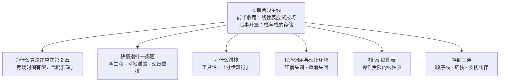
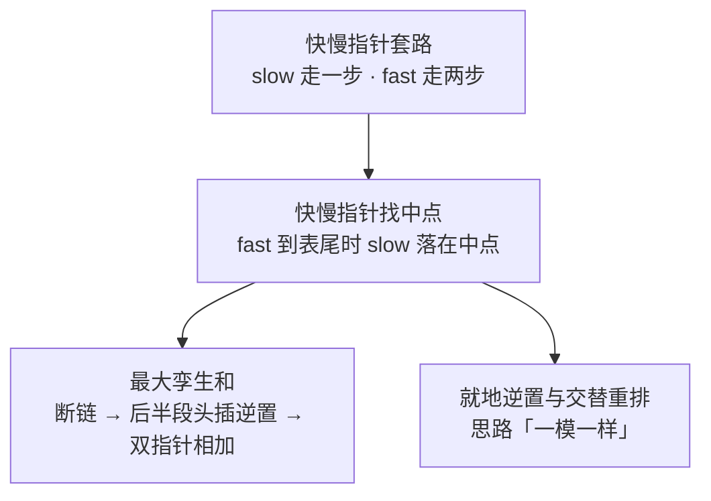
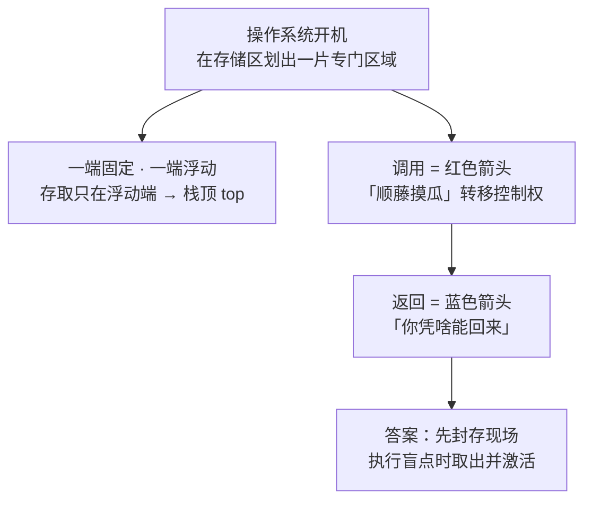
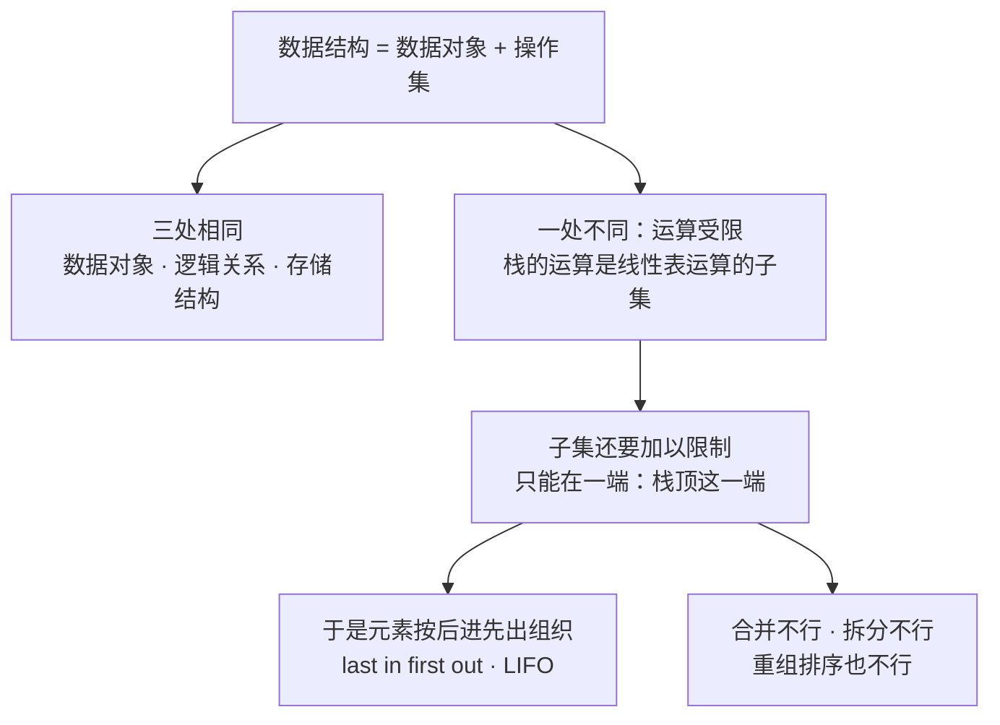
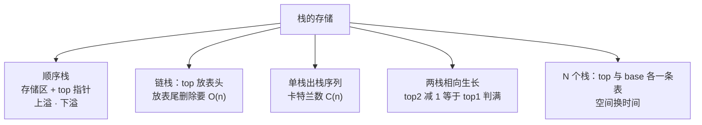
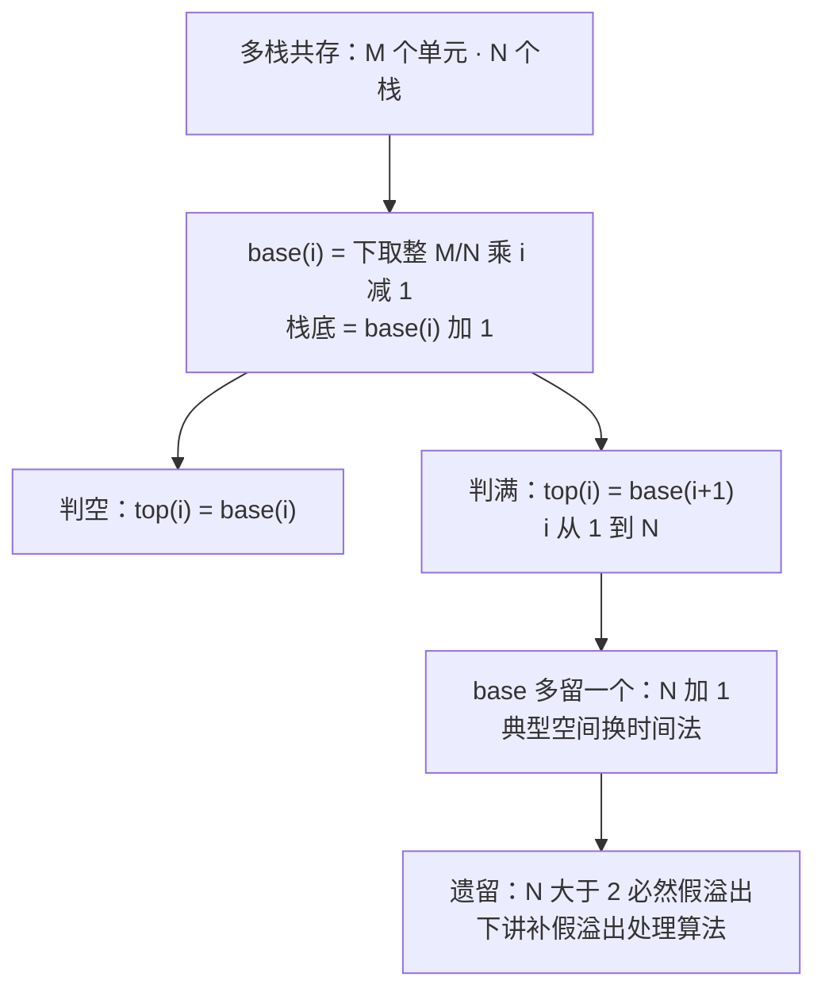

# 数据结构 · 第五周第一节 · 线性表的应试技巧与栈 · 详细版讲义

> **来源说明**：本讲义依据课堂录音的两份本地转写与逐段分析素材整理，并与严蔚敏《数据结构（C语言版）》对照校订而成，属**学习笔记性质的整理稿**，不是老师的官方逐字稿。
>
> - **转写来源（两份本地文件，均为课堂录音的 ASR 导出文字）**：① `数据结构线性表与栈讲解_导出原文(1).txt`（前半：线性表收尾的应试技巧，约 00:00–00:04:42）；② `栈相关教学内容讲解_导出原文(1).txt`（后半：栈与栈的存储，约 00:04:42–00:47:39）。两份合并后按 500–800 字切为 30 段，逐段分析产出 30 份素材（`segment_000.md` ~ `segment_029.md`），本讲义以这 30 份素材为主，必要处回看原始转写。
> - **教材对照范围**：主要对照严蔚敏《数据结构（C语言版）》第 3 章 **3.1 栈**（3.1.1 抽象数据类型栈的定义、3.1.2 栈的表示和实现），用于校对栈的定义、LIFO、ADT 操作清单、顺序栈类型与语句语序；前半的链表内容对照 2.3.1、2.3.2。附录 A 另把 3.2 栈的应用举例、3.3 栈与递归的实现登记为知识地图补充（**老师本节课未讲**），并注明"多栈共存／假溢出"属**课堂扩展、教材 3.1 未涉及**。
> - **标注约定**：课堂举例一律标"（转写举例）"；老师没讲、但教材里有的内容标"（教材补充：3.1.1）"这类出处；为把口述讲通而作的整理标"（讲义补充）"；能依据教材与上下文裁定的口误／误识，在正文用"（讲义校订：…）"当场说明，裁不掉的全部进"待核实内容"（共 23 条）。
> - **记法说明**：老师口头用"栈／栈底／栈基"；教材 3.1.2 中 **base 是"栈底指针"**、`top = base` 表空、top 指向栈顶元素的下一个位置；而老师本节课后半段讲的 **base 是"栈基"，落在栈底的前一个单元**。两者只差一格，读题时按语境分辨，不要混用。全文不写"节点"，统一写"结点"。
> - **时间说明**：本节课为**文字模式**（无音视频轨、无关键帧），各节时间戳是按**字数折算的伪时间**，非音频真实时间；它只是讲义内部单调递增的定位坐标，用于与 30 份分段素材对齐（课间休息 5 分钟在伪时间轴上被压缩掉了）。
> - **编号说明**：老师沿用自己旧课程体系的章节号，与严蔚敏教材章节号**不一致**：老师口中的"第三章"＝链表（教材 2.3），老师口中的"第 4 章"＝栈和队列（教材第 3 章，也就是本节课正式进入的内容）。该对应关系为本讲义的推断，详见"待核实内容"第 1 条。
> - **关联阅读**：[数据结构 第四周第三节 链表的进阶与线性表的应用 详细版讲义](数据结构%20第四周第三节%20链表的进阶与线性表的应用%20详细版讲义.md)（上一节，链表收尾与就地逆置作业）、[数据结构 第四周第二节 单链表的插入与删除算法 详细版讲义](数据结构%20第四周第二节%20单链表的插入与删除算法%20详细版讲义.md)、[数据结构 第四周第一节 线性表的向量存储与顺序表插入算法 详细版讲义](数据结构%20第四周第一节%20线性表的向量存储与顺序表插入算法%20详细版讲义.md)、[数据结构 第二章 线性表 详细版讲义](数据结构%20第二章%20线性表%20详细版讲义.md)、[数据结构 第一章 绪论 课堂讲义](数据结构%20第一章%20绪论%20课堂讲义.md)。
> - **示意图说明**：正文里嵌了 5 张**操作示意图**，用 `tikz` 代码块书写，在 Obsidian 中由 TikZJax 插件渲染成 SVG（阅读视图可见）。**图内标签一律用字母、数字、数学记号与英文短语（纯 ASCII），中文解释放在图下方的「图注」里**——这是 TikZJax 的硬限制：它的引擎用 `btoa()` 把 TeX 源码写进 WASM 文件系统，**源码里只要出现非 Latin-1 字符（汉字、全角标点）就会直接抛异常、连编译都不会开始**；而且它只随附 Computer Modern 字体、没有中文字体，汉字即使送进去也排不出来。5 张图均已在 Chromium + TikZJax 下实测渲染通过。

## 开场导读

这节课一头一尾，是"旧章收尾 + 新章开篇"的接缝处。

前半只有四分多钟，快得像下课前的加餐，但每一样都是考点。开头老师先把话挑明：**算法题为什么偏偏爱出在第 2 章线性结构这里**？答案很朴素——考场上时间有限，代码太长的题谁也写不出来，而线性结构结构简单、又藏着"技巧性"，是最划算的出题点。紧接着他一口气过了三道同源的题：不带头结点、长度为偶数、结点值全大于 0 的单链表求**最大孪生和**（第 $i$ 个结点的孪生结点是第 $n-i+1$ 个，用**快慢指针**掐中点，断开后把后半段**头插逆置**，再让两个指针同步相加取最大）；不带头结点单链表的**就地逆置**（头插法，作为作业）；以及一道考研真题——带头结点单链表按 $a_1, a_n, a_2, a_{n-1}, \dots$ **交替重排**，时间与空间都是 $O(1)$。老师一句"这个思路是一模一样的"把这三道题串成了同一类：凡是要**一前一后配对访问**的链表题，都上快慢指针。

后半节课进入栈。老师先不讲定义，先讲**为什么**要讲它：栈和队列是计算机处理信息的两种**工具性数据结构**——厨师得有炊具、电工得有电箱、钳工得有钳子，没有它，很多问题"寸步难行"。然后他用一条极生动的链子把抽象机制落地：从操作系统开机就在存储区里划出的一片专门区域，到"调用是红色箭头、返回是蓝色箭头"，再到那句直击灵魂的追问——"**你凭啥能回来？**"；答案是"**先封存现场**"：把现场环境打包压进那片区域，回来时再取一个出来"激活"。至此，栈的物理形态、栈顶栈底、后进先出，全都有了直觉。

再往后是本节课的辨析核心：**栈与线性表的同与异**。老师说得很直白——数据对象一样、逻辑关系一样、存储方式也可以一样，唯一不同的是**运算**：栈的运算是线性表运算的**子集**，而且这个子集**还要加以限制**。他顺手把不少教科书"栈是限定插入删除在表尾的线性表"这句定义批评了一通（"字面上不能说错，但问题很多"），改写成自己认可的版本："**栈是操作受限的线性表**"。

最后四十分钟是存储。顺序栈、入栈出栈算法、上溢与下溢；出栈序列问题与**卡特兰数** $C_n=\frac{1}{n+1}\binom{2n}{n}$，以及那道 $P_2=3 \Rightarrow P_3$ 有 $N-1$ 种取值的考研真题；链栈的栈顶指针必须放**表头**（放表尾删除要 $O(n)$）；最后压轴是多栈共存：手机多任务 → **假溢出** → 两栈**相向生长** → $N$ 个栈要用线性表统一管理 top 与 base → 0/1 元素**二义性** → 引入**栈基 base** → 判空 $top_i=base_i$、判满 $top_i=base_{i+1}$ → 最后一个栈的 $base_{N+1}$ 不存在 → **典型的空间换时间法**，让 base 多一个单元，换来所有判断统一。老师以"$N$ 个栈必然面临假溢出，编译器里一定躲不掉"作结，下课——假溢出处理算法，留到下一讲。

## 总览知识地图

这节课前半是旧章收尾、后半是新章开篇，塞进一张图会糊掉，所以拆成 6 张小图，每张只画一层意思。

**图 1 · 全课主线：前半收尾 + 后半开篇**



**图 2 · 快慢指针：一条套路三道题**



**图 3 · 栈的由来：一片区域、两个箭头**



**图 4 · 栈与线性表：三同、一异**



**图 5 · 栈的存储：从一个记录到 N 个栈**



**图 6 · 多栈共存的判定条件一览**



## 正文

### 一、应试收尾（一）：为什么算法题重在第 2 章，以及快慢指针一类题 `00:00:00–00:03:09`

录音一开口就是结论："**线性表这一章、线性结构这一章，都是重点的，这个出算法的重点会在这一章。**"紧接着老师给了理由，理由朴素得让人意外——因为**考场上时间有限**。他说："如果考太复杂、代码长度很长，那就很多人都写不出来。"而线性结构呢？**结构简单，但又有做题的技巧性在里面**。这一句就把"为什么算法题爱出在这里"讲透了：代码短，学生写得完；结构简单，判卷不费事；技巧性强，区分度又拉得开。

顺着这个思路，老师说把前面零散讲过的技巧"归拢成几类"，"这是其中的另外一类"——这一类的名字叫**快慢指针**。上一节课的"找链表倒数第 $k$ 个结点"用的就是它，本节课第一道题也是它。

题目老师是口述的（转写举例）：**有一个长度为 $n$ 的单链表，$n$ 是偶数，不带头结点，结点值都大于 0，让你求单链表中最大的孪生和。**什么叫孪生？**一个结点和它的孪生结点之和**叫孪生和；对第 $i$ 个结点来说，它的孪生结点就是第 $n-i+1$ 个。翻成数学语言就是这个配对关系：

$$i \longleftrightarrow n - i + 1$$

老师立刻拿 6 个结点举例：$1,2,3,4,5,6$，"1 号结点的孪生是谁呀？6 号结点，**一头一尾**"。所以题目就是从 $1+6$、$2+5$、$3+4$ 里挑出最大的那个和：

$$\max_{1 \le i \le n/2}\ \big( a_i + a_{n-i+1} \big)$$

（**讲义补充**：上式是把老师"1 号和 6 号相加、2 号和 5 号相加、3 号和 4 号相加，谁的和最大"这句口语写成公式；$n$ 为偶数保证了配对不重复、不落单。）

问题随之而来——**前半段的结点好拿，后半段的怎么办**？老师问得很直白："你从 1 号直接获取 6 号咋获取啊？"单链表不能回溯，从 1 号往后走就是 $O(n)$，"5 号也是一样，因为你链表**怎么不能回溯呀**？不能回溯，那咋整啊？咋整？"

办法就是"**把后一半反过来摆**"。老师说：既然是偶数个结点，那就**前一半保序不动、后一半给它逆置**。逆置成功之后，"这儿有一个 $P$ 指针指向表头，这儿有一个 $Q$ 指针"（指向逆置后的后半段首结点），"只要没走到最后，$P$、$Q$ 同步地往后挪，看它的和"就行了。这套双指针同步比较，前提是**后半段已经被逆置过**，否则 $Q$ 根本够不着尾侧的结点——这就是"先逆置、再双指针"的动机。

那怎么找到中点、怎么把后半段摘出来？这就是**快慢指针**。老师给的描述是：设置两个指针，一快一慢；**慢指针 slow 每次走一步**，**快指针 fast 每次走两个结点**。他自己画的那张图是：slow 老老实实走 $1,2,3,\dots$，fast 跳着走 $1,3,5,7,\dots$。"你想一想，当 fast 走到表尾的时候，这个 slow 呢，就是指向链表的**中间结点**"；指向中间之后，"把它断开，slow 的下一个就是**后半段的首结点**"，后面这些结点统统"逆置——倒插法、头插法"。

> **讲义校订**：老师在这段口述里说"slow 会指向 4 号结点"，可 $fast$ 走到 6 号时 slow 实际落在 3 号结点上（$n$ 为偶数时中点落在第 $n/2$ 个结点），而且这样一来后半段就只剩 5、6 两个，与他随后举的"4、5、6 号要逆置"自相矛盾（转写举例：老师当时的例子是 6 个结点、后半段 3 个）。所以本讲义统一按"**slow 停在中点，即第 $n/2$ 个结点**"来写，具体落点见"待核实内容"。

这里老师拔高了一句，我觉得是本节课最该记下来的一句："**这是一大类问题的解决思路了。**"——凡是要"一头一尾配着看"的链表题，都上快慢指针。

然后顺势布置作业：**不带头结点的单链表就地逆置**。老师先解释"第三章布置给大家一个作业，是啥呢？就让大家就地逆置"（**编号说明**：老师旧编号的"第三章"＝链表，对应教材 2.3.1，见文首编号说明与"待核实内容"），"**但那个是带表头结点的**"，带表头的版本课堂已经讲过；今天要写的是不带头的那一版。他先给了一句定心丸："**不带头实际上也一样嘛**"——因为就地逆置的核心动作是头插／倒插，跟有没有一个真实的头结点没关系。口诀还是那句老话：**"就地"就是不能有额外的存储空间**。

不带头结点的头插法怎么写？老师现场口述了骨架：先用一个 `new_head`，**刚开始等于空**；要逆置 4、5、6 号的话，"我用一个 $p$ 指向他，用一个 $t$ 指向他的下一个"，然后**断开**这儿，让 4 号结点的 `next` 指向 `head`，再让 `head` 等于 $t$，再让 $p$ 等于 $t$，如此循环。整段他连问了三遍"**咋逆置啊？咋逆置啊？咋逆置？**"——同一问句说三遍，是在标记这正是本作业的难点。完整伪代码见附录 B1。

### 二、应试收尾（二）：头插法现场演示、考研交替重排，与"单链表讲完" `00:03:09–00:04:42`

本段开头还停在上一段的演示中间："我把 5 号怎么样插到 4 号的前面，倒着插"——5 号插到 4 号前面，`head` 就变成 5 号结点；再把 6 号插到 5 号前面，`head` 放到 6 号上。老师顺势把这套动作命名了：**倒插法**，也就是我们说的头插法。

关于这套倒插法该怎么组织指针，老师给了一个很关键的口头框架（转写举例）：

| 指针 | 初值 | 步长 | 角色 |
| --- | --- | --- | --- |
| `fast` | `head->next` | 每次走**两步** | 快速探到链表末尾 |
| `slow` | `head` | 一次走**一步** | 逐个摘下结点做前插 |

——注意，`slow` 的初值是 `head` 而不是 `head->next`，这正是**带头结点**版本的差别所在。

然后他把带头结点单链表逆置的通用写法口述了一遍（转写举例）：定义一个新的表头指针 $q$ 当作"已逆置部分的新头"（初值空），$p$ 从 `head->next` 出发；`while (p != NULL)` 里做四件事——**先记录后继** $t = p \to next$；**断链** $p \to next = q$（老师的话是"把第一个结点给它打个封闭"）；**新的头变成 $p$ 指向的结点** $q = p$；**为下一次做准备，往后走一格** $p = t$。循环到 $p$ 为空，就倒置完了。骨架见附录 B2。（转写中"4 号结点"与前文 6→5→4 的演示不自洽，属另一张图或口误，不影响步骤本身，见"待核实内容"。）

接着是这半节课的最后一题，也是最正规的一题：**考研真题**。老师口述题面（转写举例）：给定线性表 $a_1, a_2, \dots, a_n$，采用**带头结点的单链表**，要求**时间复杂度 $O(1)$、空间复杂度 $O(1)$**，时间尽可能高效地重排，重排后的顺序是

$$a_1,\ a_n,\ a_2,\ a_{n-1},\ a_3,\ a_{n-2},\ \dots$$

老师管这叫"**一前一后，一前一后这么取**"，并给了判断：思路跟前面"一模一样"，还是**快慢两个指针**——"当你辗转过来之后，再不断地取元素就行了"。他反复强调"这个思路是一模一样的"。所以这道题和"孪生和"、和"逆置"，是同一条套路的三次出现：先掐住中点，再一前一后配对取元素。

最后是这一章的收口原话："**好了，那至此为止，咱们单链表就讲完了。**"老师顺势把线性表在整门课里的地位点明："我们说这个**线性表是线性结构的典型代表**……那也就意味着我把线性结构研究清楚了。"话音一落，话题就转向了栈和队列。

### 三、引入栈：工具性数据结构、"寸步难行"与一片专用存储区 `00:04:42–00:07:56`

新章的第一个问题，老师不是用定义开场，而是用一个设问："线性表研究清楚了，那**线性结构是不是整个这一大类也就研究清楚了**？对吧？那你这会儿又来怎么样两个线性结构呢？这样一个栈、一个队列啊，**为什么**呢？"

理由一，是**性质上的定位**。老师说，凡是用计算机来处理数据，"**没有计算机也就无所谓**；但是只要你用计算机来处理信息，那么就**必然**要用到栈和队列这两种**工具性的数据结构**"。它们在计算机信息处理里扮演的就是**工具**的角色。他给了三组工具隐喻（转写举例）：

| 角色 | 需要的"工具" |
| --- | --- |
| 厨师 | 炊具 |
| 电工 | 电箱 |
| 钳工 | 钳子 |
| 计算机（处理数据） | 栈、队列 |

然后是那句加重语气的话（转写举例）："也就是说没有它怎么样？我们很多问题的处理就会怎么样？**寸步难行**啊，就是寸步难行啊。"——同一句说两遍，说明在他看来这不是修辞，是刚需。

理由二，是栈的**来历**。老师先铺了一层"人类普遍存在**继承机制**"：所谓继承机制就是**拿来主义**——把已有的、前人的经验，或者**已经被证明的那些定理**，拿来为我所用。现实里到处都是例证（转写举例）：做数学题到某一步**根据勾股定理**；做物理题**依据牛顿第一定律**；听报告或听人讲话，往往**引用大家的言论**——"毛泽东说咋咋咋，什么列宁说咋咋咋"，"**他的观点拿来佐证我的观点，我直接拿来用**"。那"这种现实生活中的拿来主义，在计算机当中也应该有"。而在计算机里，"这个继承机制实际上说白了就是**引用或者调用**……你引用或者调用的自然是那个数据处理的思想……**那么在计算机当中实际上就是我们的栈**"。

到这里只是比喻，栈还缺一个物理形象。老师接着给的是**现场环境**：无论是手机、笔记本还是大型机，"只要一接通电源"，操作系统就会**在存储区域里面划分出这样的一片专门的存储区**，"拿来让数据临时待一会儿"。他顺着这个口播把**三级存储体系**过了一遍（转写举例）：最上面是**内存**（最快的），接下来是**外存、硬盘**，再下面是**磁盘、光盘、磁带**；如果不特别说明是哪一级，默认说的是**内存**——"只要你的计算机一开机，操作系统就在内存存储区域里面划分了这样的一个特定的存储区域"。（**讲义补充**：这里老师提到的存储层次与下一段的"内存—缓存—CPU 寄存器"并不一致，两处都按老师原话分列记录，不作合并，见"待核实内容"。）

这片区域有个**关键特征**，也就是栈最早的直觉定义：**它的一端是固定的**（底下那一端），**另外一端是可以浮动的**；而且"**所有的信息，存入和取出都只能在浮动的这一端进行**"。老师用水池子做了类比（转写举例）："池子底下是不能动的，你要往里注入水，就往上面，就在一端进行操作。"

最后他抛了一个让学生眼睛一亮的问题："大家看到这个玩意儿会不会觉得很眼熟呢？这个东西长得特别像啥？——**我们上一课刚讲的那个结构，向量**。"对，所以我们**用向量（线性表）来定义栈**。定义的完整表述落在下一段，但也就是这一句：**下限为常数、上限可变化（或反之）的一端固定的向量**。

### 四、栈的定义、栈顶栈底，以及"你凭啥能撤回" `00:07:56–00:09:30`

老师把上一段没说完的定义接着说完（转写举例）："再是一个**下限为常数、上限可变化的向量**；或者反之——那就是**上限是常数、下限可变化**。"两句话合起来就是一句话：**一端变化，另一端固定不动。** 顺手还解释了"栈"为什么也叫**堆栈**（stack）——"我的一堆堆的东西，堆起来叫堆栈"（转写举例，谐音趣解）。

然后是术语。**浮动的这一端**叫**栈顶（top）**，**不能变化的那一端**叫**栈底（bottom）**。老师用一栋楼来记 bottom："bottom 啊，栈底啊，标志我们底层第一层，对吧？**一栋楼的底层是一层**。"（转写中此句有一处语音识别顺序混乱，把"可变化的那一段为栈顶"说到了栈底那一句前面；本讲义按语义理顺，见"待核实内容"。）

定义说完，老师立刻换了个调子——他不讲了，开始问："我们说的栈啊，**这种数据结构了，你们天天都在用**啊……你现实生活中啊，**你几乎天天都离不开它**，你实际上都在不知不觉地使用它。"并且给了答题的提示："想一下，就**一边变化、一边不动**。"

**例一：浏览器的"后退"**（转写举例）。"你去浏览网页，一级一级怎么样？它每一个网页出来会有个链接，你一点链接又进一个新的网页；一点那个网页上的一个链接，又进一个新的网页。"结果点到一个网银页面要操作了——"咋办？**退出来，赶紧退出来**"，"退、后——**退后退的这个过程就是啥？咱们又在用栈**"。注意这里的关键：不是"前进"，是"退后"，一层一层退回到上一个网页；**最后进去的那个，最先被退出来**。

**例二：Word 的撤销**（转写举例）。"你在那敲敲敲敲敲敲，到中途发现不对头，删除啊，或者说，撤回键啊。**撤回——你凭啥能够撤回呢？大家有没有想过啊？**"老师随后给了一个可观察的量化答案："我们好像 Word 文档**最多可以撤回几次操作**呀？大家有没有观察过、试过没有？好像是 **9 次**吧？感觉 **Ctrl+Z** 可以按 9 次……**超过这个，就没有了**啊。"然后点破："**这个实际上就是栈在起作用啊**。"（转写中"感觉 LZ"按语义校订为 Ctrl+Z；"9 次"这一具体步数随 Word 版本而异，讲义按老师口述保留，见"待核实内容"。）

这个例子的教学价值在于它同时点出了栈的**两个特征**：撤销历史是一条**栈**，所以只能按后进先出的顺序往回退；而撤销步数有**上限**，又说明这条栈**有固定容量**，装不下的旧记录就丢了——这正是后面"上溢／下溢"的日常版本。

最后老师抛出了本节课后半段的总线索："那么**栈体现在我们计算机当中最最典型的就是程序调用**。"

### 五、程序调用：红色箭头、蓝色箭头，与"你凭啥能回来" `00:09:30–00:12:44`

这一段老师讲得最兴奋，是全课最有画面感的部分。

他先搭了个调用关系（转写举例）：有一段程序 A，A 里面有一个调用 B；B 里面有一个调用 C 的，还有一个调用 D 的；C 在哪儿？"就在这儿。"

**调用方向＝红色箭头**，老师认为它很简单。为什么？因为"我资源调用嘛，我**只需要知道那个资源在哪儿**，我把控制权来**顺藤摸瓜**，我就过去了"。具体过程是：A 顺序执行（"先执行第一条语句，再执行，一直往下执行"），执行到调用 B 这一句，系统去找 B 这个程序在哪儿，找到它的入口地址，就把**控制权**转移过去；B 往下执行，看到调用 C，顺藤摸瓜找到 C 的入口地址，再把控制权交给 C。

**返回方向＝蓝色箭头**，老师在这里把语速放慢，一连追问：

> "那问题是，转交给 C 了之后，不断地往下执行，**执行完了之后，执行到最后一条语句，咋办啊**？执行完了咋整？计算机在这个地方怎么样？出现**盲点**，不知道该咋办。"
>
> "那问题是，以我们的调用执行完了之后，**它会回来，他会回来，自动回来。凭啥他能够自动回来呢？大家有没有想过这个问题。**"
>
> "但问题是，这是一个蓝色的箭头啊。**你凭啥能回来呢？你凭啥能回来啊？凭啥？**"

这一串设问就是整节课的枢纽——它把"栈"从一个生活比喻，推到了一个必须回答的工程问题。老师的答案是：**"这个实际上就是我们计算机操作系统这个大管家在后台默默地做的一件事儿。"**

具体怎么做？他回到上一段那片"开机就划出来的存储空间**："你的机子一开，它就划分出一段存储空间来。" 然后是关键的那个动作顺序——

> "A 一旦执行，执行到这个调用 B……他要将控制权转移。**但是，慢着，我们先别急着控制权转移。先控制权转移之前，先干嘛呢？先封存现场。**"

**"现场环境"是什么**？老师给了定义（转写举例）：就是程序 A 已经执行的、前面这些语句所涉及的东西——"它涉及到的比如说变量啊，什么调用之后它的值怎么样"，"这些个变量在哪儿、那些个就是**变量地址**等等之类的，都是它的现场环境"。为什么要封存？他用了一个很生活化的类比（转写举例）："**这就跟我们报现场一样吧**，对不对？发生命案了咋办？**现场封起来啊，不准别人破坏**，对不对？那这里面也是一样。"——离开的时候现场必须被原样保存，否则回来就没法复原。

**封存的动作**是"打个包，发送到哪儿？放到这个存储区域里面"，而且每封存一次，"**这个地方怎么样？自然就往上浮动一个位置**"。老师在板书上用三个形状标记三层现场（口述板书，无画面）：**五角星＝程序 A 的现场环境**（第一次封存），**菱形＝程序 B 的现场环境**（第二次），**三角形＝程序 D 的现场环境**（第三次）。

**返回的动作**是"取"。出现执行盲点时，"去现场环境怎么样？**取一个出来**。取一个出来怎么样？**这个地方的现场环境就激活了**。激活了怎么样？这个 B 里面原来的那些个变量地址什么的就都有了……他就可以又顺序地执行下去"。再往后是 D 的三角形被取出、恢复、继续执行；最后 A 的剩余部分跑完。

> **讲义补充**：这一整段老师一直用"存储区域""现场环境"在说事，**一个"栈"字都没有出现**。但把它和前面的术语一对照，映射关系是严丝合缝的：这片"存储区域"就是**栈**，"封存现场"就是**入栈（压栈）**，"取一个出来、激活"就是**出栈（弹出）**，"往上浮动一个位置"就是 `top` 指针加一。讲义在这里把术语显式对上口，后面的"栈顶／栈底""后进先出"才不是凭空出现的。

### 六、客栈、弹夹、摞碗、火车车厢与青岛火车站：从"天天在用"到"找异找同" `00:12:44–00:15:59`

收尾一句之后，老师给这片存储区域找了个名字的解释（转写举例）：这片区域可以看成"**数据或者是现场环境临时待一会儿**"的地方；那"栈"在中国古代**原本**的含义是啥？**客栈**。客栈就是"客人临时待一会儿的地方"。所以"操作系统这个大管家，实际上在帮我们维护这样一片存储区域"。

电脑里的事说完了，老师说"那现实中也有好多例子啊"，一口气给了四个：

**弹夹**（转写举例）："往下怎么样？最上面呢，再摁一个子弹，它就往下走一格；如果要发射，怎么样？**发射最上面的一个子弹**。"压进去从上面进，出来也从上面出。

**一摞子碗**（转写举例）："等会儿大家去吃牛肉面，从这一摞子碗上面怎么样？最上面顺顺手就拿一个、拿出来用……最后洗出来的那个碗会怎么样？**会被最先使用**。"

**火车车厢的更换**（转写举例）："这一节火车车厢坏了咋更换呀？火车在铁轨上的，旁边又没有道路，又不能把它弄出来，那咋整啊？"办法是：铁轨旁有一个**维修场地**，先把这一截子拉进去，再顺着这边拉出去，剩下的一节对接进来连成一片，再倒着拉出去。强调的是"**不能整体取出、只能一节节进出**"。

**青岛火车站**（转写举例）："大家不知道有没有去到过青岛？**青岛火车站很有意思**……那个火车再往前开怎么样？那就开到海里去了。所以所有的火车进站之后，怎么样？**原样再倒退着拉出来，倒退着拉出来**。你可以去观察一下。"

四个例子讲完，老师话锋一转，正式进入本节课的辨析主题："我们说呢，**栈是一种线性结构；那线性表怎么样？也是一种线性结构。那它俩有啥区别，有啥联系呢？**"

他给了一个研究者的类比来组织这个对比（转写举例）：以后读研、读硕读博的同学要**搞科研**，"搞科研实际上就一句话——**搞科研，实际上科研工作者都在干啥呢？都在找异**"。什么叫找异？前几年的新冠肺炎：研究人员来了一个新患者，采集标本，看他的病毒"跟最开始的那个新冠病毒，**结构是不是一样**"？"如果是一样，这个就是原先本来就有的新冠病毒；如果不一样，**我就可以声称我发现了一种新的新冠毒株**。"

"还有**找同**呢？比如说我们前几年的新冠肺炎，还有更早一些，20 多年前有个啥——**非典**。非典是一种病毒，新冠肺炎是另外一种病毒。那这俩玩意儿有啥**相同的地方**呀？"

落到课上："那这个地方也是一样。**栈是一种线性结构，线性表是另外一种数据结构**，我们来看一下他们有什么不一样的地方、有什么一样的地方。"至于怎么比，老师给了一条方法论——"**万变不离其宗嘛**，宗就是啥概念？**数据结构**啊。我们要从数据结构的概念入手啊"——

> **数据结构＝给定的数据对象，和它上面定义的操作，共同构成的一个整体。**

### 七、栈与线性表：三处相同、一处不同，以及一次定义之争 `00:15:59–00:20:53`

老师按"数据对象 + 操作集"这一定义式，一半一半地比。

**相同的第一处：数据对象。** 线性表是 $a_1, a_2, \dots, a_n$，"这 $n$ 个数据元素是具有**相同属性**的一个集合"；栈里装的也都是同类事物——"大家都是同类事物的集合"。所以"从这个角度来看，**他们数据对象是一样的**"。

**相同的第二处：逻辑关系。** 线性表 $a_1, a_2$ 一个一个罗列出**线性关系**；栈呢？"是不是也是**一个压一个、一个摞子**呀，一个接一个"——"**大家都是线性关系**"。

**相同的第三处：存储结构。**"大家都可以用什么呢？**向量和链接方式**（链式存储），可以一样。"

**不同的一处：运算。** 这才是本节课真正要辨的东西。老师先过一遍线性表的**八大类运算**（转写举例；他当场只逐条列了前几类，各类名称按上下文与教材 2.1／3.1 的常用分类整理）：

| 序 | 线性表运算 | 栈做不做得了 | 老师的说法 |
| --- | --- | --- | --- |
| 1 | 统计元素个数（求表长） | **可以** | "数一数你这里面有几个，行不行？第一个操作是可以的" |
| 2 | 在第 $i$ 个位置插入或删除（$i$ 任意） | **受限** | 栈"只能在栈顶的这一端做插入和删除" |
| 3 | 合并 | **不行** | "你一个弹夹只有 10 发子弹，我能不能说把你两个弹夹合并起来，20 发子弹，那不是更好用吗？行不行？不行" |
| 4 | 拆分 | **不行** | "咱俩正在跟敌人火拼……我把我的弹夹**一掰两半**，给你一点儿，行不行？不行" |
| 5 | 重组（重新排序） | **不行** | 臭蛋的故事，见下 |

第二类为什么受限？老师指着栈的工作示意图说：栈"这边不动，这边要浮动"，"**这个栈顶怎么才能浮动呢？**……我往里面插入一个元素，你的栈指针不就**往上浮一个位置**吗？那我要元素减少呢？删除一个元素，这个栈顶指针就是**往回走一格**"。所以插入删除本身栈是能做的，**但只能在栈顶这一端**——"尽管都可以做插入删除操作，但是……**他的操作是受限制的**，规定只能在栈顶这一个"。

这立刻引出了栈的组织原则（转写举例）："因为**新插入的元素是最先被删除的**，所以栈的数据元素是按照**后进先出**的原则来组织的。"他用前面的例子印证：一摞子碗"最先叠上去的，往往是最后拿出来的……很少有人说我**掏底**，先把底下那个拿出来"；弹夹"**最后压进去的子弹最先弹出来**、发射出来"。于是正式记下这个术语：

$$\text{LIFO} \;=\; \text{last in first out}\;(\text{后进先出})$$

老师还特别叮嘱它的地位："这个是计算机里面的**专用名词缩写**啊。你以后只要碰到 LIFO，你要反应过来，它指的就是栈。"（转写把英文听成"last input, first output"，按标准写法校订为 last in first out，见"待核实内容"。）

第五类"重组"老师是用**臭蛋**讲出来的（转写举例）：老式弹夹里有一种子弹"发射不出来"，"卡壳了叫啥？叫**臭蛋**"。设想我在压入之前把臭蛋做个标记，然后一个一个压进去；发射时希望"**先把好的发射出去，坏的让它自动落到底下**"——行不行？不行。"你要这样做，**只能把它所有的都拿出来，重新排列一下，再压进去**，才能实现这个操作。"这就是**重组／排序**，栈做不到。

于是有了本节课最该记住的一句总结（老师在原话里连说了两遍"还要做限制"）：

$$\mathcal{O}_{\text{stack}} \subsetneq \mathcal{O}_{\text{list}} \quad\text{，且这个子集还要加以限制：只能在一端（栈顶）进行}$$

这段最后，老师做了一件在课堂上很少见的事——**批评教科书的定义**。他说："很多教科书啊，是用**线性表**这个模型来定义**栈**这个模型的……**书上**是咋说的啊？他说，栈是啥？**仅限定插入和删除操作在表尾进行的线性表**。"

然后是他给出的反对理由，两条，都很硬：

第一条是**"言下之意"问题**。"这个定义，实际上我也不能说你错，但是他**问题很多**啊……按照书上很多教科书上面的定义，栈是限定插入和删除只在表尾进行的线性表。那你想一下，**言下之意就是说：别的操作都可以，就只有插入和删除操作咱们有一些限制**。那实际情况怎么样？**根本不是**——线性表的**拆分、合并、重组**这些操作，你再怎么样都做不了。"

第二条更根本，是**用一种数据结构定义另一种数据结构**："线性表是一种数据结构，栈是另一种数据结构。**你用线性表来定义栈，实际上是会出问题的。**"

> **教材补充（3.1.1）**：严蔚敏教材 3.1.1 的原文是"**栈（stack）是限定仅在表尾进行插入或删除操作的线性表。因此，对栈来说，表尾端有其特殊含义，称为栈顶（top），相应地，表头端称为栈底（bottom）**"，紧接着给出空栈、$a_1$ 为栈底元素／$a_n$ 为栈顶元素、修改按**后进先出**原则进行等一整套说明。也就是说：教材并没有声称"除插入删除外的其他操作都能做"——**这是老师对这句措辞的读法**，老师批的是这个"言下之意"，不是教材的实际主张。另一处细节值得注意：教材管"表尾"叫**栈顶**、管"表头"叫**栈底**，所以"限定在表尾"＝限定在**栈顶**；老师说"他这个定义讲的是表头啊，谁说的表尾啊"，指的是后面链式实现时栈顶实际落在**表头**这件事——两处说的是同一件事的两种落点（见第十一节）。

### 八、修正定义"操作受限的线性表"，以及为什么把 top 放进寄存器 `00:20:53–00:24:09`

批评完，老师给了自己认可的版本（转写举例）：

> "如果你非要把线性表和栈挂钩起来，你可以这样来定义：**栈是操作受限的线性表。** 操作受限的线性表。操作限定在哪儿？哎，它的栈的运算啊，它是线性表运算的一个**子集**，并且这个子集**还要加以限制**。"

然后用"两句话"把异同收束（转写举例）：**相同**在数据的逻辑关系一样、存储组织方式也可以一样；**不一样**在栈的运算——是线性表运算的子集，并且这个子集还要加以限制（"**还要加以限制，还要加以限制**"，连说两遍）。

接着转入**栈的运算需求**。老师又是从生活需求起手（转写举例）："就像**古时候的客栈**一样啊，就两个需求，对不对？**客人来了可以入住**，**客人离开**。"于是两个最基本的运算：

**入栈＝压栈（push）**。为什么叫"压"？老师用了盘子与弹簧的类比（转写举例）：去食堂吃饭，"一摞子盘子，底下是个啥？底下是个**弹簧**……服务员往上面放一个盘子，那个盘子怎么样？一压，那个弹簧怎么样？**往下压一格**。所以我们入栈也叫做**压栈**"。

**出栈＝弹出（pop）**。"反过来离开呢？离开叫啥？叫**出栈**啊。出栈也叫啥？也叫**弹出**……你把那个盘子最上面的取掉一个，**弹簧回弹一格**。"

至于"很多书上面还讲一些其他的杂七杂八的操作，比如说**取栈顶元素**啊，比如说**判栈空**啊，什么**栈初始化**呀"——老师的处理是："我们说这些个操作怎么样？**无非就是几条语句**，对不对？那这几条语句我就不详讲了啊，咱把这个主要的讲一下就可以了。"**为什么只讲入栈和出栈**？他给了理由（转写举例）："因为实际上，**栈在操作系统里面就有这个玩意儿**，它实际上他的目标就是——**尽量高效**。"

**于是讲到实现。** 老师的顺序是先讲"为什么要高效"再讲"怎么实现"（转写举例）："那栈呢，为了使得这个栈尽量执行起来高效，所以往往计算机当中，那个栈的实现**都是用向量实现**。"然后他做了一件很"工程"的事——**top 指针放哪儿**？

他先复习存储层次（转写举例）："刚才说这个存储器是三级存储结构——**内存**之上，比它更快的**还有一级**……（学生答：缓存）**缓存，缓存啊，寄存器**，寄存器实际上在哪儿？在 **CPU** 里面。"接着给出关键的一句：

> "所以这个栈指针怎么样？为了**快速地获取、管理**，它**不会放到内存当中**——它甚至不放到内存当中，我给你放到哪儿？**放到寄存器里面**。所以这个栈啊，它操作的过程当中呢，最最重要的是干嘛？**就要高效，速度快。** 所以我一般用**专用的这种寄存器**来存储栈顶位置值。"

他还解释了寄存器有多金贵（转写举例）："寄存器大家知道，我们计算机里面它**非常的稀有**，对吧？**你一个计算机只有几十个寄存器**啊。"当然它逻辑上仍然是个普通变量："那当然，实际它实际上就是个**整型变量**，对不对。"

由此还带出一条**工程上的反对意见**（转写举例）："那你那个栈初始化、判栈空啊，那个操作**就一条赋值语句的事儿**，你还专门怎么样？还什么**模块化**，专门编一个函数来实现啊？**一般往往我们可能不这么做，直接一条语句直接就写了。**"——因为函数调用本身有开销，而栈的操作要的是极致效率。

**最后落到顺序存储的描述。**"因为它是受限的线性表……所以**顺（序）表的存储都可以**，你这个什么向量啊，还有链表都可以。那我们看一下**向量存储方式**……这个实际上就是我们前面**线性表**（讲）一样了：我有一部分**存储区域**，对吧，然后有**一个 top 指针**，对吧？这个 top 指针跟我们线性表的那个啥，**那个 $n$ 是一样的效果**，取个别名而已，非常简单啊。"

> **教材补充（3.1.2）**：教材给出的顺序栈类型是 `typedef struct { SElemType *base; SElemType *top; int stacksize; } SqStack;`——即"存储区指针 base ＋ 栈顶指针 top ＋ 当前容量 stacksize"三件套，比老师口述的"存储区 ＋ top"多了一个**容量**字段。教材还明确了两件事：① 空栈标记是 `top = base`（**不是** `top = 0`，教材说得很直接——"鉴于 C 语言中数组的下标约定从 0 开始，则当以 C 作描述语言时，如此设定会带来很大不便"）；② **非空栈中 `top` 始终在栈顶元素的下一个位置上**，所以教材的入栈写成 `*S.top++ = e`、出栈写成 `e = *--S.top`，都是"先动指针、后（先）取元素"这一种语序。教材还设了 `STACK_INIT_SIZE` 与 `STACKINCREMENT` 两个常量，栈满时用 `realloc` **追加**空间——也就是说，教材这套顺序栈把"上溢"变成了"扩容"，而老师本节课讲的是**静态数组的栈满与上溢**。两种设计都成立，考试按题目约定走。

### 九、顺序栈的入栈／出栈算法、上溢与下溢，以及卡特兰数 `00:24:09–00:27:19`

有了"存储区 ＋ top"的骨架，算法就很直接了。老师先补一句形态描述（转写举例）："这是我们计算机当中怎么描述了呢？**它就是一个记录**，对不对？"——存储区与 top 指针合起来是一个记录／结构体。

**入栈（压栈）**。"入栈的话，栈顶指针在干嘛？**往上浮动一个位置**。常规情况，把 $x$ 怎么样送入到栈里面就可以了。"边界条件从哪来？老师点出根源（转写举例）："我们说既然是**向量存储**，那是啥？就是**数组**嘛……那就是啥**静态结构**，静态结构就涉及到啥——**溢出问题**。静态结构它一定是有一个容量，就**有栈满的问题**啊。所以我们的边界条件很简单：**$top$ 等于 $max$**，而不能再压栈了。"

**上溢**。老师用盆解释了名字（转写举例）："计算机当中的溢出有两种。这种溢出叫做啥？**上溢**。上溢就是说，就好像你有一盆水，往里不断地加水，你再舀一瓢，那个**水从上面溢出来**了。"把入栈算法写成式子就是：

$$\text{上溢条件：}\ top = max \qquad\qquad \text{常规入栈：}\ top \leftarrow top + 1,\ \ S[top] \leftarrow x$$

**出栈（弹出）与下溢**。老师接着说"出栈的过程要注意**栈空**。栈空这个叫啥？也叫做**下溢**"——还是那个桶的比喻（转写举例）："你这个桶里面已经没水了，你还要拿那个勺子不停地舀啊舀啊，你就把这个底给**舀漏**了……那就**从下溢出**啊。"出栈的语序老师讲得很细（转写举例）：从栈里弹出一个数据元素，"**往往是要用的**"，所以通常要**用一个 $y$ 变量把这个栈顶的元素送出来**——"因为我在里面就可能要做一些操作"——"然后 **top 减一**"。为什么非要先取出来？他给了个很生动的比方（转写举例）："就要像**枪膛里面一个子弹已经到枪膛了，马上发射**，发射出来我是要用的，所以把它返回过来。"至于前提："然后啊，**注意栈空啊，没元素你肯定不能取**。"

$$\text{下溢条件：}\ top = 0 \qquad\qquad \text{常规出栈：}\ y \leftarrow S[top],\ \ top \leftarrow top - 1$$

到这里顺序栈就讲完了，老师随即转出一道**典型题**："你们去做题的话，比如说有 3 个字符，按这个顺序压栈，问你 $A$、$B$、$C$ 的**所有排列**都是可能的出栈序列吗？"（转写中此处出现的具体字母序列如"CED""CIB"均系语音误识，$A,B,C$ 三个元素里不可能出现 $E$、$I$，一律按老师随后的论证唯一指向的 **CBA** 校订，见"待核实内容"。）

**判定依据与一个反例。** 老师先算候选空间："$A$、$B$、$C$ 三个元素，它的排列组合有几种？**$3!$，6 种**。那这 6 种是不是都有可能是它的出栈顺序呢？"（转写作"8 种"，与 $3!=6$ 不符，讲义按 $3! = 6$ 校订，见"待核实内容"。）答案是不是，并给了理由（转写举例）：

> "有没有可能 **CBA** 这种序列？你觉得可能吗？想好，**先进后出、后进先出**。……因为**你的栈要出栈就意味着啥？意味着你这个元素肯定在最顶上**。**C 在最顶上你才能出栈。那 C 在最顶上，意味着 A、B 都在里面**……所以 C 出栈，然后**必然要取到 B**，你不可能接下来轮到 A。所以**不可能有 CBA 这样的序列**。"

**关键的限定条件**老师也说得很清楚（转写举例）："不是所有排列组合都行，对吧？因为我们只对他的——**压栈的顺序做了限制，但（出栈）的时间没做限制**，你可以交替地进行。"这是整道题的灵魂：**入栈顺序固定，出栈时机自由，交替进行**。他随即给了两个正例（转写举例）：

- 全压后连弹：$A$ 压、$B$ 压、$C$ 压，然后 $C$ 弹、$B$ 弹、$A$ 弹 ⇒ **CBA**；
- 交替进行：$A$ 压进去**立马出栈** ⇒ $A$ 出；再压 $B$、压 $C$，然后 $C$ 出、再 $B$ 出 ⇒ **ACB**。

**最后给出通解：卡特兰数。** 老师直接公布了答案（转写举例）：

> "$N$ 个不同的元素依次进栈，可能的出栈序列的个数，叫做**卡特兰数**。$C_n = \dfrac{1}{n+1}\binom{2n}{n}$。这是啥？$\dfrac{1}{n+1}$ 乘 $\binom{2n}{n}$，$\binom{2n}{n}$ 是排列组合、$2n$ 选 $n$，$\binom{2n}{n} = \dfrac{(2n)!}{n! \cdot n!}$。"

$$C_n \;=\; \frac{1}{n+1}\binom{2n}{n} \;=\; \frac{1}{n+1}\cdot\frac{(2n)!}{n!\,n!}$$

随后是必须背下来的几个数（转写举例）：

| 元素个数 $n$ | 排列组合总数 | 实际可实现的出栈序列数 $C_n$ |
| --- | --- | --- |
| 2 | $2! = 2$ | **2 种** |
| 3 | $3! = 6$ | **5 种** |
| 4 | $4! = 24$ | **14 种**（老师强调"本来应该是 24 个，但是它只有 14 种"） |
| 5 | $5! = 120$ | 42 种（老师未展开，只说"不用讲那么多"） |

**记法校订**：老师此处口述"**3 个呢？5 个，5 种组合**"，按上下文与 $C_3=5$ 应为"**3 个元素有 5 种**"（转写作"5 个 5 种"，见"待核实内容"）。老师的备考口径很明确：**"考试最多记到 4 有多少就行了。"**（$C_1=1,\ C_2=2,\ C_3=5,\ C_4=14$。）

**操作图 1 · 顺序栈的结构与入栈出栈**

```tikz
\begin{document}
\begin{tikzpicture}[scale=0.95]
  \foreach \i in {0,1,2}{\draw[fill=blue!12,thick] (0,\i*0.72) rectangle ++(1.5,0.72);}
  \foreach \i in {3,4,5}{\draw[thick] (0,\i*0.72) rectangle ++(1.5,0.72);}
  \node[font=\small] at (0.75,0.36) {$a_1$};
  \node[font=\small] at (0.75,1.08) {$a_2$};
  \node[font=\small] at (0.75,1.80) {$a_3$};
  \foreach \i in {0,1,2,3,4,5}{\node[font=\scriptsize,gray] at (-0.30,\i*0.72+0.36) {\i};}
  \draw[->,thick,blue] (-1.55,1.80) -- (0.00,1.80);
  \node[left,blue,font=\small] at (-1.60,1.80) {top};
  \draw[->,thick] (-1.55,0.36) -- (0.00,0.36);
  \node[left,font=\small] at (-1.60,0.36) {base};
  \node[below,font=\small] at (0.75,-0.55) {push: $top \leftarrow top+1$};
  \node[below,font=\small] at (0.75,-1.00) {pop: $top \leftarrow top-1$};
  \node[below,font=\small] at (0.75,-1.45) {$top$ at the last cell: overflow \qquad $top=base$: underflow};
\end{tikzpicture}
\end{document}
```

图注：顺序栈：base 指向栈底、top 指向栈顶；入栈 top 加 1、出栈 top 减 1；top 顶到最后一格是上溢，top 落回 base 是下溢。


### 十、课间前的一道考研真题（$P_2 = 3 \Rightarrow P_3$ 有 $N-1$ 种取值），以及链式存储的提问 `00:27:19–00:30:30`

老师先口头过了一道小题（转写举例）：初始状态为空，$1$、$2$、$3$ 作为输入序列，输出长度为 3，问可能的出栈序列有几个——指向 $C_3=5$。他一边翻题册一边说"还有这个问题……还有这个问题"，并未逐题展开。

然后他把今天唯一一道**完整念出题面**的考研真题摆了出来（转写举例）：

> "这个比较难，是**某一年的考研题目**：栈的**入栈序列是 $1,2,3$ 一直到 $N$**，**出栈序列是 $P_1, P_2$ 一直到 $P_N$**。假设 **$P_2$**，也就是第 2 位的出栈值是 **3**，问你**第三个出栈的那个 $P_3$ 有可能的取值个数**有哪些？"

老师布置作业似的一句——"**我们休息 5 分钟，大家顺便做一下啊。**"——题面在这里断开，答案在课间之后。

**课间之后的解答**（据分段素材与原始转写合并整理）。设 $P_2=3$，也就是 3 是第二个出栈的元素。因为入栈顺序固定为 $1,2,3,\dots,N$，3 压在 1、2 之上，所以 3 出栈时 1 与 2 中**必有一个还留在栈里**，而谁先出、谁留着都可以——老师分两种情形讲：

- **情形一（栈里剩 2）**：$P_1 = 1$（1 一入立马出），随后 2、3 依次入栈、3 立马出（$P_2=3$），此时"**这个 2 还在里面**"。接下来的 $P_3$ 可以是 2（就近弹），也可以是 $4,5,6,7$——"啥时候进去啊？咱也不知道"，因为 $4$ 以后任何一个都可以"一进去立马出"。
- **情形二（栈里剩 1）**：$P_1 = 2$（1、2 都入栈后先弹 2），再压 3、弹 3（$P_2=3$），此时栈里剩 1。接下来的 $P_3$ 可以是 1，也可以是 $4,5,6,7$。

合并两种情形，结论就是老师的原话（转写举例）："**所以你看，总结出来就是啥。这个 $P_3$ 呀，除了不可能是 3，其他的都有可能。所以它可能的取值个数是 $N-1$。**"

$$P_3 \in \{\,1,\ 2,\ 4,\ 5,\ \dots,\ N\,\},\qquad P_3 \ne 3 \qquad\Longrightarrow\qquad \text{可能取值个数} = N - 1$$

老师补了一句方法论上的收口："这个 $P_3$ 是这样做的啊，还有很多类似的其他的，**你自己去分析**啊。"——不甩通法，只示范分类讨论。

> **讲义校订**：分段素材只记录了"栈里剩 2"这一种情形（据此得 $P_3 \in \{2,4,\dots,N\}$，只有 $N-2$ 个），而原始转写在课间休息后还有"栈里剩 1"的情形。两处合并才与老师自己给出的 $N-1$ 一致，讲义按合并结果写；具体见"待核实内容"。

**课间之后进入新话题：栈的链式存储。** 老师先给了一句"使用率"的实话（转写举例）："当然链式存储，因为它的存储密度**没到百分之百**……而且它的**管理比较费劲**。所以呢，这种表示方式**一般实际当中很少采用**。"然后把链表的定义又拉出来复习一遍（转写举例）：由**结点**组成、一堆指针把这些结点连起来的线性表（Linked list），"**每一个结点都是一个记录，包含两部分**"。

紧接着是本节课第三个课堂提问（转写举例）："假设这是一个线性表……我要把它**实现成栈**。现在问题来了：我们这是一个线性表／链表，这是**表头**，这边呢是**表尾**。我现在问你：**栈指针（top 指针）放在哪合适？** 我们关键是要怎么样使得两个操作高效，**哪两个？入栈和出栈**。"老师还点名了课代表回答，得到的回答是"放在表尾"，答案在下一段揭晓。

### 十一、链栈的栈顶必须放表头：$O(1)$ 与 $O(n)$ 的取舍，和一道结构一致性选择题 `00:30:30–00:33:44`

**先给结论**：老师一开口就否定表尾——"**放在表头旁边**，对不对啊"。

**表尾为什么不行？**（转写举例）"我们说栈，它是限定——不管插入还是删除，**都在栈顶进行**。如果你把栈顶放到这儿，**要插入元素**，怎么样？方便插入？是在它后面再**链一个新的结点**，修改一下栈顶就行了，对不对？**但问题是插入容易，那你想一下删除嘞。** 我要删除这个元素咋办？**要获取它的前一个结点，它的前驱咋办？** 哎，我要从这儿**花 $O(n)$ 的时间**啊。所以，我们的栈顶要放在哪儿呀？**不能放在这儿。**"

因果链很清楚：栈顶在表尾 ⇒ 出栈删的正是表尾结点 ⇒ 单链表删结点必须先拿到**前驱** ⇒ 前驱只能从表头一路走到表尾 ⇒ $O(n)$。而栈的入栈和出栈是**成对出现**的快操作，一个 $O(n)$ 就把整个设计拖垮了。

**表头为什么行？**（转写举例）"我们如果用链表来实现，这里（栈顶）放在这儿。你想一下，栈放在这儿，我要 3 这个元素**出栈**怎么样？**一修改链（top 指针）**。如果**入栈**呢？就从这儿进一个。**都很方便是吧？**"——两个动作都只动**表头**这**一处**指针，$O(1)$。

所以结论是：**链式栈的栈顶（top）指针必须放在表头**，这样入栈、出栈都只改表头一处指针，都是 $O(1)$；若放在表尾，插入方便但删除要 $O(n)$。

这里老师又回头补了一刀教材（转写举例）："很多书上、教科书上面的定义是啥？他说……**只在表尾进行的线性表**。**他这个定义讲的是表头啊，谁说的表尾啊？** ……所以我说**线性表和栈是两个不同的东西**，你挂起钩来有好处，但是……**但是往往会出问题啊，所以你要小心一点**。我这就不是只（在）表尾啊，**插入、删除主要就（靠）表头的那一种**。"

**接下来是一道四选一的题**（转写举例）：**链表不带头结点，所有操作都在表头进行，问下列哪一个最不适合作为链栈？** 老师口述的四个选项（转写举例；第四项的序号是按前三项都由老师明确报出序号推得）：

| 选项 | 表头指针 | 表尾指针 | 方向 | 循环 |
| --- | --- | --- | --- | --- |
| A | 有 | 无 | 双向 | 循环 |
| B | 无 | 有 | 双向 | 循环 |
| C | 有 | 无 | 单向 | 循环 |
| D | 无 | 有 | 单向 | 循环 |

**答案是 C**，而且老师给出的判据是一句可以独立成立的方法论（转写举例）："大家要注意，考虑这个问题啊，**一定要考虑结构一致性问题**。"并且老师在读选项时特意强调了另外两个约束（转写举例）："**没有头结点啊？没有表头**。然后**它得是啥？循环的**……一个双向，一个单向。**搞清楚啥是单向，啥是双向。**"

论证过程（转写举例）：双向的 A、B 都可以，"为什么？因为你双向的，取什么呢？**表头表尾都特别容易**"。单向的就麻烦了——"如果我把这个（栈顶）放在表头……所有的操作要在**栈顶**进行"，那么"**如果我只给你表头指针，然后我要删除这个结点的时候咋办？** 你要注意啊，你要怎么样**结构一致性**？**你把这个删完了之后，还得是循环链表**，对不对？你把这个删除，你要干嘛？**你要知道这个结点（的前驱）**……但现在如果只给你提供一个表头指针、一个没有尾指针的，就**很难获取**"。插入也一样："插入你在这儿插，然后怎么样，**还要修改这条链**；走到这儿还是一样，**要知道表尾的这个结点**。"

所以"**A、B 是可以的，但是 C 怎么样？操作很不方便啊，所以选 C**。"（**讲义补充**：老师在段内是用"选 C、C 操作很不方便"来表达排除逻辑，**D（单向 ＋ 尾指针）更合适的正面理由没有在本段说出**；按 2.3.2 循环链表的常识，设立尾指针而不设头指针可使某些操作简化，这一句属讲义补充，不是老师原话。）

**转场到存储问题。** 老师从选择题直接跳到了本节课最后的大题（转写举例）："弄一些惑人的事儿啊——**栈的存储问题**啊。这个呀，**未来你们如果说做一个比如说编译器，或者编一个操作系统吧，你们必然会面临这样一个问题**。"

而这个问题的**来源**是什么？老师先纠正一个常识（转写举例）："我们说一开机……比如说你的手机，大家想一下，**你的手机是单用户还是多用户**啊？你的手机是只有你在用，是不是只有你在用？**当然不是了**。你的手机怎么样？只要一开机，免不了就有获取流量的，什么**电信、移动**等等……所以你的手机看起来怎么样？**实际上不是你自己在用**。"结论是：**它都是多用户**，而"我们面临的呢？**多任务的场景**"——老师以设问收尾："**多任务的场景指的是啥？**"

**操作图 2 · 链栈的栈顶必须放在表头**

```tikz
\begin{document}
\begin{tikzpicture}[scale=0.95]
  \node[left,font=\small] at (-1.75,1.40) {top};
  \draw[->,thick] (-1.20,1.40) -- (-0.05,1.40);
  \foreach \i/\v in {0/{$a_3$},2.1/{$a_2$},4.2/{$a_1$}}{
    \draw[thick] (\i,1.00) rectangle ++(1.10,0.80);
    \draw[thick] (\i+1.10,1.00) rectangle ++(0.55,0.80);
    \fill (\i+1.375,1.40) circle (1.3pt);
    \node[font=\small] at (\i+0.55,1.40) {\v};
  }
  \draw[->,thick] (1.65,1.40) -- (2.10,1.40);
  \draw[->,thick] (3.75,1.40) -- (4.20,1.40);
  \draw[->,thick] (5.85,1.40) -- (6.45,1.40);
  \node[right,font=\scriptsize] at (6.50,1.40) {NULL};
  \node[below,font=\small] at (3.10,0.45) {push and pop both happen at the head: $O(1)$};
  \node[below,font=\small] at (3.10,-0.05) {put the top at the tail instead: every operation walks the list, $O(n)$};
\end{tikzpicture}
\end{document}
```

图注：链栈：栈顶必须放在表头——入栈、出栈都在表头做，代价都是 O(1)；若把栈顶放到表尾，每次操作都要遍历整条链，退化成 O(n)。


### 十二、多任务共享一片空间：假溢出与"相向生长" `00:33:44–00:37:03`

老师直接回答了自己的设问（转写举例）："比如说你开个手机对吧，**当前正在聊微信**，那边 **QQ 也聊着**，然后怎么样还**上网**，还在**听音乐**，甚至**还在下象棋**。"每一个任务都要用它自己的一块存储。

而存储从哪来？它还是第五节那片区域："**我们操作系统**……**手机操作系统一开机它会划分出一片存储区域来**。那大家都在这儿用这一片存储区域，那就涉及到**怎么管理**的问题。**如果你管得不好，那可是要出乱子的。**"他给了一个很直白的翻车场景（转写举例）："如果说我记在听音乐，又在下象棋，然后还在上网……结果怎么样？下象棋，下一步了，**他要取一个现场环境，结果一取出来——取出来听音乐的现场环境，那不乱套了吗**？"——这就是第五节那套"封存—取出"机制在多任务下的失效：**取出来的现场环境根本不是自己的**。所以"这个问题啊，是我们计算机啊，**凡是操作系统，或者编一个编译器，都要解决的问题**"。

**由简入难**。老师明说了推进顺序（转写举例）："那我们就**由简入难**。我们先简单（讲）**两个栈的共存问题**，然后怎么样，我们再解决 **$N$ 个**这样的（栈）的问题。"

**两个栈怎么分？**"存储空间总共是 **1 到 $M$**。那你想一下，我也不知道你这两个任务，**哪个任务会花的（内存）多，哪个任务花的少**。那我就干嘛？**均分**，对不对？**二一添作五，大家一人一半**。"于是有了栈 1、栈 2 各占一段、**各自栈底固定、从栈底往前伸长**的布局。

**矛盾立刻出现。** 老师给这段空间派了"业务"（转写举例）：**栈 1 是听音乐**的管理与调用的栈；**栈 2 是聊天／下象棋**的栈。为什么栈 2 涨得快？因为"下象棋的话，**有的人走一步看十步**，他就下得很快，对吧？而且下象棋**涉及到那个栈的调动，这个层级就很深了**，对吧？很深。"结果："那很快这一部分**分配的空间用完了**。**可是听音乐的（栈 1）怎么样呢**？"——听音乐占得少，"它占的空间又很少，**那这还有空间**"。

于是抛出本节课的一个核心术语（转写举例）：

> "那你想一下，那下象棋的这个空间满了咋办？你是不是要报（告诉）系统说**溢出了**呀？**那问题是，这种溢出怎么样？是真的还是假的呀？我还有空间呀！** 我还有分配出去的空间给你，**你没用**啊。"
>
> "所以引出一个话题叫啥？叫一个——**假溢出**。**存储空间还有，但由于管理方式或分配方式不当，而导致的元素无法入栈的现象，叫假溢出**。"
>
> "我身上内存还有，结果怎么样？因为存储空间还有，但因为管理方式不当，或者是分配方式不当，而导致的**元素无法入栈**的现象。**元素无法装入的现象。元素无法装入的现象。**"（同一句连说三遍）

**怎么解决？** 老师用的是**两个老师分教室**的例子（转写举例）："比如说这个老师上课，这个老师在上课，有两个老师上课……假设大家可以**自由听课**，哪个老师讲得好，你去听哪个老师的课。结果**这个教室很快就满了**，那另外一个老师讲得不太好，教室那边**还有好多空余**。为了充分利用这个空间啊，这是不应该出现的，那咋做呢？"

办法是让两个老师**面对面来上课**（转写举例）："有点像**古时候那个打擂、打擂台**，就是怎么样？**面对面来上课**。这个老师在这儿就好像**搭个戏台子**一样，咱们从这儿上课；这个老师从这边上课。然后怎么样呢？他们**来一个人往这儿走，来一个人往那边走**。"

老师把这一句提炼成了术语（转写举例）："**这个元素存入的时候，相向生长。就是都往中间走，都往中间走。**"

**两个栈各自怎么长？**（转写举例）"就这个栈 1，它的**底在这儿**。所以存入一个元素，怎么着？**栈 1 的 top（栈顶）指针会加 1**。"然后是另一头："然后这边呢，**从右往左生长**，对吧？新来一个元素，**栈 2 的这个 top 要往左边走一格**。"

$$top_1 \leftarrow top_1 + 1 \qquad\qquad top_2 \leftarrow top_2 - 1 \qquad\text{（两栈顶「都往中间走」）}$$

### 十三、相向生长的方向、判满辨析、top 初值的两种约定，以及 $N > 2$ `00:37:03–00:40:10`

**先纠正一个口头错误。** 老师一开口就自我修正（转写举例）："栈 2 的顶（指针）要干嘛？**是不是加 1？——不是加 1，是减 1**，对不对？**减 1**。"两个指针相向而行，这就是"相向生长"的全部含义。

**然后就是那道考研作业。** 老师口述题面（转写举例）：

> "给你这个**数组，容量是 1 到 $M$**，来组织**两个栈**，$top(i)$ 就是栈顶指针，$i$ 为 1 或者 2……当**全部 $M$ 个单元**、要求**全满的时候才产生溢出**。啥意思啊？就是**不能产生假溢出**嘛。"

要交的算法（转写举例）："然后要写出：**将数据元素 $x$ 压入第 $i$ 个栈的时候的算法**，以及**从第 $i$ 个栈弹出元素 $y$ 的算法**。也就是说让你写**两个算法**……**写两个，不是 4 个**，写两个算法。"其中 $i$ 是个参数，"$i=1$ 或 2"，"它会告诉你，是从 1 号栈入栈，还是从 2 号栈入栈"。

**初值与判空。**"那刚开始的时候，这个 $top_1$ 啊，初始化的时候是几？我们的空间是从 1 到 $M$，$top_1$ 初始的时候是几？**0 嘛**。那 $top_2$ 呢？初始的时候是几？**$M+1$**，对吧？$M+1$。"——这两个初值是用来判**栈空**的。

$$top_1 = 0,\qquad top_2 = M + 1 \qquad\text{（两栈都空时的初值）}$$

**判满：一次现场辨析。** 老师先抛了一个错误判据让全班判（转写举例）："那满点办啊？栈满了，咋办？用啥判断啊？问一下大家：**能不能用 $top_1 + top_2 = M$ 来判断**？"——答案是不能，而且老师难得地加重了语气："**所以课上不要走神，这个是相向生长。**"正确的判据是（转写举例）：

> "两栈是相向生长，什么情况下认为栈满了？……**当这两个栈顶指针就是相邻的时候，挨着了，就说明满了**呀。是不是这俩逐渐地往前走，然后**紧邻着**，就满了？那**紧邻怎么表示？是不是 $top_2$ 减 1 如果等于 $top_1$**？"

$$top_2 - 1 = top_1 \quad\text{（相向生长时判满的正确判据）}$$

老师的原话只给了结论（"这个是相向生长"、设问后否掉 $top_1+top_2=M$、给出相邻判据），**没有在课上展开反例推演**。（**讲义补充**：若要驳 $top_1+top_2=M$，只需举初态为例——$M$ 个单元刚分完时 $top_1=0$、$top_2=M+1$，此时 $top_1+top_2=M+1$ 而两栈其实都是空的；而两个栈恰好塞满时 $top_1+top_2=M+1$ 同样成立，两种状态被混为一谈，因此它无法区分"满"与"不满"。）

**一个钩子：top 初值其实有两种。** 老师在抛出"栈的初始化实际上有两种情况"之后，下一段才作答。**这里一并交代**（转写举例）：存储单元默认**从 1 开始编号**，那么"这个栈指针有可能初始化，让它**等于 0**；也有的会怎么样，栈指针初始化**等于 1**"，两种都能表示"栈是空的"，"**但这就对应怎么样？入栈和出栈会稍微有一些差别**"：

| 约定 | $top$ 初值 | $top$ 的语义 | 入栈语序 | 出栈语序 | 判空 |
| --- | --- | --- | --- | --- | --- |
| 约定 A | $0$ | 指向"空的位置"（栈底之前） | **先** $top++$ **后**存入 | **先**取出 $y$ **后** $top--$ | $top = 0$ |
| 约定 B | $1$ | 始终指向"下一个可写入的空位" | **先**存入 **后** $top++$ | **先** $top--$ **后**取出 $y$ | $top = 1$ |

老师对这两句顺序的强调是："这两个语句顺序也会相反啊，这个稍微细微的差别。"随后是他本节课的第二句方法论："**所以看问题怎么样，要辩证地看，对不对？你们注意好了。**"最后他让"你可以自己去刷题……**这个很简单的**。"

**再往前一步：从 2 个到 $N$ 个。** 老师先给了一个很中国的引子（转写举例）："我们说**中国的文字**，这个很有意思，对不对？**三人为众**吧，三个及以上就多了，对不对，所以就 $N$ 啊。"然后是同样的困境（转写举例）："我还是**不知道你有多少个任务**，这个 $N$ 我不知道……我也**不知道你哪个任务调度这个层级比较深**……那我只能干嘛？**均分**啊。$N$ 个任务，我把 **$M$ 个单元均分**，大家怎么样？大家都是 **$M \div N$，下取整**。当然**有可能有（余）钱**，对不对？比如说 **10 块钱 3 个人分**，或者**一块钱 3 个人一份儿**，他们总是怎么样？**会有多余**，不太可能正好。"

> **讲义校订**：这一段老师口述为"大家都是 $N \div M$，下取整"，与下一段给出的 $base_i=\lfloor M/N\rfloor \times (i-1)$ 不一致（分给 $N$ 个栈的是 $M$ 个单元，应是 $M \div N$）。讲义全文统一按 $\lfloor M/N \rfloor$ 记，见"待核实内容"。

老师在这里抛出本节课最后一个设问："那 $N$ 个栈，现在来了……**我们来设计它的共存，面临这个问题的时候，我们要考虑哪些问题**？……**首先，第一个问题就是啥？**"

**操作图 3 · 两栈共存：相向生长与判满**

```tikz
\begin{document}
\begin{tikzpicture}[scale=0.95]
  \foreach \i in {0,...,9}{\draw[thick] (\i*0.80,0) rectangle ++(0.80,0.80);}
  \foreach \i in {0,1,2}{\draw[fill=blue!12,thick] (\i*0.80,0) rectangle ++(0.80,0.80);}
  \foreach \i in {8,9}{\draw[fill=red!12,thick] (\i*0.80,0) rectangle ++(0.80,0.80);}
  \foreach \i in {0,...,9}{\node[font=\scriptsize,gray] at (\i*0.80+0.40,-0.26) {\i};}
  \node[below,font=\small] at (0.60,-0.85) {stack 1};
  \node[below,font=\small] at (7.40,-0.85) {stack 2};
  \draw[->,thick,blue] (0.40,1.45) -- (0.40,0.85);
  \node[above,blue,font=\scriptsize] at (0.40,1.48) {$top_1$};
  \draw[->,thick,red] (7.60,1.45) -- (7.60,0.85);
  \node[above,red,font=\scriptsize] at (7.60,1.48) {$top_2$};
  \draw[<->,gray] (2.60,0.40) -- (6.20,0.40);
  \node[above,gray,font=\scriptsize] at (4.40,0.45) {free};
  \node[below,font=\small] at (4.00,-1.35) {full iff $top_1+1=top_2$: the two tops become adjacent};
\end{tikzpicture}
\end{document}
```

图注：两栈共存（相向生长）：一片数组两端各放一个栈，各自向中间长；判满的条件是两个栈顶相邻，而不是各自顶到头。


### 十四、N 个栈的指针怎么统一管：线性表、0/1 二义性与栈基 base `00:40:10–00:44:59`

**第一个问题：$N$ 个栈指针怎么高效管理？** 老师先摊开手上的牌（转写举例）："我这儿有 $S_1$ 的 bottom、$S_1$ 的 top，一直到 $S_N$ 的 top，$N$ 个栈指针啊。"那么怎么管？他调出第六节那条方法论——"**它是不是属性相同？同类事物的集合，是不是？那同类事物的集合，我们可以用什么来进行组织啊？再三强调，什么？组织，线性表嘛**"。所以答案是：**用一个线性表把 $N$ 个栈指针管理起来**。

**不用线性表会怎样？** 老师把困境说透了（转写举例）："有的人说，我不想用线性表。那你想一下，这 $N$ 个栈指针就涉及到 **$N$ 个变量**，那你就需要**定义 $N$ 个变量**来管理。那这个 $N$ 怎么样？我们说**运行的时候不知道**，对不对；然后**你要运行起来，又必须先知道 $N$**。那所以啊，你就会面临**无处下手**的问题。"——这就是线性表这个"元素个数事先不定"的容器不可替代的地方。

**两种组织方式。**（转写举例）"那当然**栈底指针**呢？一样的，同类事物的集合啊。"于是有两条路：

- **分开管理**：`bottom` 用一条线性表存，`top` 用另一条；
- **合并管理**：把 `bottom` 和 `top` **这一对儿当成一个元素**——"$S_1$ 的 bottom、$S_1$ 的 top，合起来作为一个元素；$S_2$ 的 bottom、$S_2$ 的 top，合起来作为一个元素。总共这个线性表有 $N$ 个元素，每个元素又有两个要素组成。"

老师的结论很宽松："**这都可以啊，分开管理、合起来管理都行。**"（**讲义补充**：合并管理可以写成 $\mathrm{T}[i]=(\mathrm{bottom}[i],\ \mathrm{top}[i])$，$i=1,\dots,N$——这是对老师口述的直译，见附录 B7。）

**顺便把方向定下来。** 老师接着说（转写举例）："那接下来这个栈的话，我们说无非就是干嘛？入栈和出栈，对不对？那首先，我们考虑一下出栈要干嘛？**要考虑栈空的问题**……那这样子存储起来，**存储器……我也有一个 top 指针，我也有一个 bottom 指针**。**第 $i$ 个栈，它的 top 是指向它的第一个元素的，它的 bottom 是指向它的最后一个元素的**。"——$top$ 管着最上面那个（要频繁动的一端），$bottom$ 管着最下面那个（固定的一端）。

**问题来了。** 老师把话题切到向量："那我们说呢，这种情况我们是用**向量**来进行存储……**这就有一个问题**。"这个问题的名字他叫**0/1 元素二义性**。展开是这样（转写举例）：向量从下标 $L$ 到下标 $P$，"我们说**向量的定义**就有（这个）必然：$L$ 要**小于等于** $P$"。当第 $i$ 个栈用它来表示时，"**这个第 $i$ 个栈它初始化的时候**，一个元素都没有的时候，**$L$ 是等于 $P$ 的**"，也就是 $bottom_i = top_i$。老师随即用楼房比喻把 top 的初值与指向说活（转写举例）："比如这就是一层楼。楼层：第一层，第二层、第三层，一直到第 $N$ 层……那我们的这个楼，**栈底是几啊？栈底是 1**。……但是**我们对这样的一个栈在初始化的时候，这个 top 指针是等于 0**……你可以想象成——**我这个楼不是有地基吗**？刚开始这个 top 指向 0 的位置，也就是说，**这个 top 指针刚开始并不是指向我们的栈底，是指向我们的所谓的栈基（base）**。就是**跑到地基那去了**，而不是指向栈底，也就是第一层，明白吧。"

**"base"这个词的来历**老师也给了（转写举例）："大家想一想，**base 就是地下室**嘛。你指到地下室里去，base 啊。"

**把"一栋楼"换成"N 个公司"。** 老师接着把这个比喻升级成多栈版本（转写举例）："就**这一栋楼有好多层**。然后我假设 **A 这个公司是 1~5 层，B 这个公司是 6~9 层**，以此类推。"

- **A 公司**：这一段的**栈底是第一层**（1 号单元）；初始化时"**top 指针是 base**，指向 **0 号单元**，就是……**头底下去了，地基上去了**"；"当 top 走到 5 号的时候，就**占领**（占满）"这一段。
- **B 公司**：把第 6 层想成它的栈底，"**但是它的下一层——第 5 层**，你可以想象成这儿还有个啥，还有个**天花板或者地板**，对不对？就在下一层"——注意第 5 层明明是 A 公司的地界，但在 B 的视角里它就是 B 的"地板"。
- **C 公司**："它有一个栈基啊……**就指到那个水泥地儿上去了**。"

于是在这个垂直空间隐喻里：**楼层＝栈单元，栈底＝本公司的第一层，地基／地下室／水泥地／天花板＝base**。

**然后是本节课最关键的一个定义。**（转写举例）"**我们不用（原来那个）栈底（bottom）的概念，而引入什么呢？引入栈基的概念啊。** 所以所谓的**栈基**就是啥呢？就是**落在我们栈底前面一个单元的那个位置**。"

$$base_i \;=\; \text{第 } i \text{ 个栈的栈底所对应的下标} \;-\; 1$$

**判空条件随之改写。**（转写举例）"这样子的话，**栈空的时候怎么判断呢？那 $top_i$ 等于 $base_i$ 啊？$top_i$ 等于 $base_i$**，对不对？注意，等于 $base_i$，两个指针（以及）栈底都指向同一位置啊。"

$$stack\; i\; \text{空} \iff top_i = base_i$$

这个改写的价值一句话就能说清：**引入 base 之后，"0 个元素"和"1 个元素"终于有了不同的数值表示**（$top_i - base_i = 0$ 对 $top_i - base_i = 1$），二义性消失。

**操作图 4 · N 个栈共享一片空间：base 与 top 数组**

```tikz
\begin{document}
\begin{tikzpicture}[scale=0.95]
  \foreach \i in {0,...,11}{\draw[thick] (\i*0.62,0) rectangle ++(0.62,0.78);}
  \foreach \i in {1,2,3}{\draw[fill=blue!14,thick] (\i*0.62,0) rectangle ++(0.62,0.78);}
  \foreach \i in {5,6}{\draw[fill=red!14,thick] (\i*0.62,0) rectangle ++(0.62,0.78);}
  \foreach \i in {9,10,11}{\draw[fill=green!18,thick] (\i*0.62,0) rectangle ++(0.62,0.78);}
  \foreach \i in {0,...,11}{\node[font=\tiny,gray] at (\i*0.62+0.31,-0.22) {\i};}
  \node[below,font=\scriptsize,blue] at (1.24,-0.72) {$S_1$};
  \node[below,font=\scriptsize,red] at (3.41,-0.72) {$S_2$};
  \node[below,font=\scriptsize,green!55!black] at (6.20,-0.72) {$S_3$};
  \foreach \i/\x in {1/0, 2/4, 3/8}{
    \draw[->,thick] (\x*0.62+0.31,-1.50) -- (\x*0.62+0.31,-0.05);
    \node[below,font=\scriptsize] at (\x*0.62+0.31,-1.55) {$base_{\i}$};
  }
  \foreach \i/\x in {1/3, 2/6, 3/11}{
    \draw[->,thick] (\x*0.62+0.31,1.70) -- (\x*0.62+0.31,0.83);
    \node[above,font=\scriptsize] at (\x*0.62+0.31,1.73) {$top_{\i}$};
  }
  \node[below,font=\small] at (3.70,-2.35) {usage of stack $i$ is $top_i-base_i$; add them up to get $S$};
  \node[below,font=\small] at (3.70,-2.85) {true overflow iff $S$ equals the total number of cells $M$};
\end{tikzpicture}
\end{document}
```

图注：N 个栈共享一片空间：每个栈用一对 base 与 top 指针界定，第 i 个栈的占用量是 top_i 减 base_i；把所有栈的占用量相加得到 S，只有 S 等于总单元数 M 才是真溢出。


### 十五、$N$ 个栈的完整设计：base 初始化、判满、$i=N$ 的麻烦、空间换时间，与假溢出 `00:44:59–00:47:39`

**base 的初始化值**老师直接给了（转写举例）："那**栈基初始化**呢，就是（栈底比它）**落后一个单元**啊。$M \div N$ 啊，**下取整**，然后**乘上一个 $i-1$**，就 $i$ 号（栈）的栈基。"

$$base_i \;=\; \left\lfloor \frac{M}{N} \right\rfloor \times (i-1) \qquad\text{，栈底} \;=\; base_i + 1$$

（下取整这一步不能省——老师举的例子是"10 块钱 3 个人分""一块钱 3 个人一份儿"，总有零头；零头归谁管，靠这个下取整与多留的那一个 base 单元来安置。）

**判满：这次是统一的。**（转写举例）"那栈满咋判断啊？……**是不是 $top_i$ 等于 $base_{i+1}$**？是不是这样啊？**第 $i$ 个栈的栈顶在这儿，这个单元又是谁？又是下一个、第 $i+1$ 个栈的栈基嘛**，对吧？……我们不用栈底（bottom），我们用啥？用**栈基 base**。……那**二义性问题就解决了**，对不对啊？判满是这两个相等啊，$top_i$ 等于 $base_{i+1}$。"

$$stack\; i\; \text{满} \iff top_i = base_{i+1} \qquad (i = 1,\dots,N)$$

**但是——"我们解决了这个问题又会有新的问题"。**（转写举例）"大家想一下，我总共有 $N$ 个栈。那**第 $N$ 号栈、最后一个栈，你怎么判断它栈满呢**？$i = N$ 嘛，等于啥？等于 $base_{N+1}$？**我有第 $N+1$ 个栈基吗？有吗？** 你看一下 $base$ 是几啊？$N$ 加几啊？嗯，**没有**。那咋办？我咋解决？"

老师给出的方案是**分类两步**（转写举例）：

| 情形 | 判满条件 |
| --- | --- |
| $1 \le i \le N-1$ | $top_i = base_{i+1}$ |
| $i = N$ | $top_i = M$（总共 $M$ 个单元） |

**代价是什么？**（转写举例）"那也就是说这个又会带来一个问题是啥呢？……**你要元素进栈判断栈满，你得先做一步判断你要进哪个栈**。那你看这样子，我**每一个元素进栈，我都要做一个判断**。大家想一下这个效率怎么样？**低了对不对**。我们说了栈嘛，它就是**要高效**，对不对啊。甚至为了保存这个栈指针，我们把它放到**寄存器**里面，**越快越好**。那你这个做一次判断太费时间了，咋办？"

**解法：空间换时间。**（转写举例）"所以我们想一个解决的方案是啥？**空间换时间**……什么空间换时间？我们怎么样？**我们 base 不是 $N$ 个吗？我们让它多一个，它不是 $N$ 个，它有 $N+1$ 个，多一个什么呢？单元**。这样子**牺牲一个单元**，但是怎么样？**我们的所有的判断，哪都可以统一**。你看，**典型的空间换时间**，对不对？**典型的空间换时间法。**"

$$\underbrace{\text{多一个 base 单元}}_{+\;1\ \text{个存储单元}} \quad\Longrightarrow\quad \underbrace{\text{判空判满全部统一}}_{1 \le i \le N\ \text{同一套公式}}$$

**指针表怎么摆。**（转写举例）"所以我们前面讲过，**你这个 top 和 base 呀，就不能（合）起来管**……所以我们是**分开两个（表）来管它**啊：**top 是一个数组，1 到 $N$**；然后 **base 怎么样？1 到 $N+1$**。"

> **讲义校订**：老师口述"top 1 到 $N$、base 1 到 $N+1$"，若照字面理解则 $base_1 = 1$；但按 $base_i = \lfloor M/N \rfloor (i-1)$ 有 $base_1 = 0$，且判满 $top_N = base_{N+1}$ 要取到 $M$，只有 $base_{N+1}=M$ 才自洽。所以两个数组的**下标都是 $1$ 到 $N$／$1$ 到 $N+1$ 的编号体系，但 base 的取值从 0 开始**。讲义按公式记 $base_1=0$、…、$base_{N+1}=M$，见"待核实内容"。

至此老师的收束句是："**那栈满、栈空都解决了，对不对？**"然后是最后也是最无奈的一层——

**$N$ 个栈必然面临假溢出。**（转写举例）"那接下来还有一个啥问题？**$N$ 个栈必然面临什么啊？假溢出**……我们说怎么样？**必然会有**。我既有下象棋，又有听音乐。结果你如果**大家都一样的空间**，那下象棋怎么样？**不断地来一个、来一个、来一个，空间很快用完了**。空间很快用完了，咋整？**假溢出咋解决呢？假溢出咋解决？它是不可避免的。**"

老师在这里给假溢出下了一个**更精确的判词**：$N>2$ 时，只要各栈**预先等量分配**，就一定会出现"一个栈撑爆、另一个栈空着"的状态——**假溢出不是实现 bug，是等量固定分配的必然结果**。怎么解决？他没讲，只把要求抬高了（转写举例）：

> "所以，**你如果写一个编译器呀**，你一定怎么样？**你要写三个算法**。不像一般的栈——一般的栈你要写一个入栈算法、一个出栈算法，那个不简单，对不对？然后**还要写一个专门的什么呢？假溢出（处理）算法**。那假溢出这个算法怎么写呢？"

结课语（转写举例）："呃，我们这个……**我们这一讲就（下课）**。"——本节课在抛出假溢出处理算法这个待办之后结束，**算法本身没有展开**（讲义不代拟，见"待核实内容"）。

## 结课：把整节课串起来

这节课是"关门 ＋ 开门"的一节课。关门关得很急，用四分钟把线性表这一章最后的三道应试技巧收了尾：先讲清楚"**为什么算法题偏偏出在第 2 章**"——考场时间有限，代码短的题才写得完，而线性结构简单又有技巧性；再把快慢指针立成"**这一大类问题的解决思路**"：它先掐中点（slow 走一步、fast 走两步），后面所有花招都建立在"从前半段够不着后半段"这个单链表的先天缺陷上。最大孪生和用它——前半保序、后半头插逆置，然后两个指针同步相加取最大；交替重排用它——一前一后配对取元素；不带头结点的就地逆置虽然不用快慢指针，但动作同源，都是头插加改指针。老师一句"**至此为止，咱们单链表就讲完了**"，顺手把线性表封为"线性结构的典型代表"，然后转向栈和队列。

开门开得很稳。栈不是先给定义，而是先给**理由**：它是计算机处理信息的工具性数据结构，厨师有炊具、电工有电箱、钳工有钳子，没有它"**寸步难行**"；它在计算机里对应的是人类"**继承机制**"（拿来主义）的机器版本——**引用**、**调用**。然后是那半节课最有戏的一段：程序 A 调 B、B 调 C 与 D，**调用是红色箭头**（找到入口地址、转移控制权，"顺藤摸瓜"，很简单），**返回是蓝色箭头**，而老师连问三次"**你凭啥能回来？**"——答案是操作系统这个"大管家"在后台做的事：**先封存现场**（把变量值、变量地址打个包压进那片开机就划好的存储区，每封一次往上浮一格），回来时**取一个出来、激活现场**，B 就能接着顺序执行。这套"封存—取出"的物理形态，正是栈的原型；老师随后把"客栈""弹夹""摞碗""火车车厢""青岛火车站"一路排下来，用的都是同一个后进先出：最后进去的最先出来。

然后是辨析：**数据对象一样、逻辑关系一样、存储结构也可以一样**（"大家都是同类事物的集合""大家都是线性关系""都可以用向量和链接方式"），**唯一不同的是运算**。线性表能做的运算里，栈只做得了一部分，而且这一部分**还要加以限制**——只能在栈顶这一端；合并不行、拆分不行、连重组排序也不行（臭蛋的故事：想让坏蛋自动沉底，只能全部取出来重排再压回去）。于是有了那句要背下来的定义：**栈是操作受限的线性表，栈的运算是线性表运算的子集，且子集还要加以限制**；元素因此按**后进先出（LIFO）**组织。老师的落点也从定义转到实现动机上：栈在操作系统里就有，目标就是**尽量高效**——所以用向量实现、把 top 塞进 CPU 寄存器、连"判栈空"这种一条赋值语句的事都不专门包函数。

后半程是存储的层层加码。顺序栈是"存储区 ＋ top 指针"一个记录：入栈先上浮一格再送 $x$，出栈先用 $y$ 取出栈顶元素再让 top 减一；静态数组有容量，于是有**上溢**（$top=max$ 还想压，水从盆上溢出来）与**下溢**（栈空还舀，把桶底舀漏）；出栈序列问题的判据是"要出栈的元素必须在栈顶"，由此得出 $C$ 在顶时 A、B 必在里面、C 出后必先出 B，故 CBA 不可能；入栈顺序受限制而出栈时机不受限制、可以交替，最终由**卡特兰数** $C_n=\frac{1}{n+1}\binom{2n}{n}$ 给出通解，$C_3=5$、$C_4=14$，考试记到 4 就够。那道考研真题（$P_2=3 \Rightarrow P_3$ 有 $N-1$ 种取值）也是同一套"分类讨论"的手艺：3 出栈时 1、2 里必有一个还留着，两种情形都考虑，就得到"除 3 之外都有可能"。

链式部分老师给了一个纯粹的**复杂度判据**：链栈的栈顶必须放**表头**，因为放表尾虽然插入方便，但删除必须先拿前驱，要 $O(n)$；放表头则入栈出栈都只改表头一处指针，都是 $O(1)$。配套的选择题答案是 C，判据叫"**结构一致性**"——删掉栈顶后剩下的还得是同样的循环结构，只有表头指针的单向循环链表做不到。

最后是全课最见功力的**多栈共存**。手机多任务共用一片存储区域，管不好就会"下象棋取出听音乐的现场环境"；等量均分就会出现**假溢出**（空间还有，只是分配与管理方式不当）；两个栈用**相向生长**解决（面对面上课的两个老师，来一个人往这边走、来一个人往那边走），初值 $top_1=0$、$top_2=M+1$ 用于判空，判满**不是** $top_1+top_2=M$ 而是**两栈顶相邻** $top_2-1=top_1$。$N>2$ 时先把 $N$ 个栈指针用**一条线性表**统一管起来（分开管或合并成 $\mathrm{T}[i]=(bottom_i,top_i)$ 都行），但向量表示带来**0/1 元素二义性**——空栈与 1 元素栈的 $(L,P)$ 一样；解法是回到"底端不动、顶端浮动"这条定义，单栈的 top 初始化为 0，指向的不是栈底而是"**地基**"、是**栈基 base**，多栈则记 $base_i=\lfloor M/N\rfloor(i-1)$、栈底 $=base_i+1$、**判空 $top_i=base_i$、判满 $top_i=base_{i+1}$**。$i=N$ 时 $base_{N+1}$ 不存在的麻烦，让老师下决心**空间换时间**、让 base 多一个单元，换来所有判断统一，top 表管 1..N、base 表管 1..N+1。收尾时他抛下最后一件事：$N>2$ 必然假溢出，**写编译器躲不掉**，所以要写**三个**算法——入栈、出栈，外加一个**假溢出处理算法**。至此下课。

**复习要点（可自测）**

- 算法题爱出在第 2 章的理由：考场时间有限、代码要短，线性结构简单又有技巧性。
- **孪生结点**：第 $i$ 个结点的孪生是第 $n-i+1$ 个；$n$ 为偶数保证配对唯一。
- **快慢指针**：slow 走一步、fast 走两步；fast 到表尾时 slow 落在中点（第 $n/2$ 个结点）——"这是一大类问题的解决思路"。
- **最大孪生和**四步：快慢找中点 → 断开（slow 的 next 即后半段首结点）→ 后半段头插逆置 → $P$、$Q$ 同步相加取最大。
- **就地逆置**＝头插法：记录后继 $t$、断链、插到 head 前面、head 与 $p$ 同步后移；不带头结点只需多维护一个 `new_head`（初值空）。"就地"就是不能额外开空间。
- **交替重排**（考研真题）：带头结点、时间空间均 $O(1)$，排成 $a_1,a_n,a_2,a_{n-1},\dots$；思路"一模一样"——快慢指针加交替取元素。
- 栈是**工具性数据结构**（炊具／电箱／钳子），没有它"寸步难行"；在计算机里体现为引用与调用。
- 开机即在存储区划出**一片专用存储区**：一端固定（栈底 bottom）、一端浮动（栈顶 top），存取只在浮动端。
- 现场环境＝变量值与变量地址；**先封存现场，再转移控制权**；出现执行盲点时取出并激活。封存≈入栈，取出≈出栈，存储区域≈栈。
- 栈的别名**堆栈（stack）**；**后进先出 LIFO = last in first out**。
- 栈与线性表**三处相同**：数据对象（同为同类事物集合）、逻辑关系（线性关系）、存储结构（向量与链式都可）。
- 栈与线性表**一处不同**：$\mathcal{O}_{\text{stack}}\subsetneq\mathcal{O}_{\text{list}}$，且子集**还要加以限制**（只能栈顶一端）；求表长可以，任意位置插删受限，**合并、拆分、重组都不行**。定义：栈是**操作受限的线性表**。
- **入栈＝压栈（push）**、**出栈＝弹出（pop）**（盘子压弹簧／弹簧回弹）；次要运算（取栈顶元素、判栈空、栈初始化）"无非就是几条语句"。
- 实现取向：**尽量高效** → 用向量实现；三级存储 内存→缓存→CPU 寄存器；**top 放专用寄存器**（本质是整型变量）；不为一条语句专门编函数。
- 顺序栈 ＝ **存储区 ＋ top 指针**（一个记录）；常规入栈 $top\leftarrow top+1$、$S[top]\leftarrow x$；常规出栈 $y\leftarrow S[top]$、$top\leftarrow top-1$。
- **上溢**：$top=max$ 还压栈（盆里加水溢出来）；**下溢**：栈空还出栈（桶没水还舀，舀漏桶底）。出栈前必须判栈空。
- 出栈序列：判据是"要出栈的元素必须在栈顶"；只限制**入栈顺序**，**出栈时机自由、可以交替**；$n=3$ 的 $3! = 6$ 种排列里 **CBA 不可能**。
- **卡特兰数**：$C_n=\frac{1}{n+1}\binom{2n}{n}=\frac{(2n)!}{n!(n+1)!}$；$C_1=1$、$C_2=2$、$C_3=5$、$C_4=14$（$4!=24$ 但只有 14 种），$C_5=42$；考试记到 4。
- 考研题：入栈 $1..N$、$P_2=3$ ⇒ $P_3$ 可取除 3 外的一切值，共 **$N-1$** 种（需分"栈里剩 1"与"栈里剩 2"两种情形）。
- 链栈：**top 必须在表头**（放表尾插入 $O(1)$ 但删除要 $O(n)$）；不带头结点的栈，四个变体里**最不适合的是 C**（只有表头指针、无尾指针的单向循环链表），判据是**结构一致性**。
- **假溢出**：存储空间还有，但因管理／分配方式不当导致元素无法入栈。
- 双栈**相向生长**：$top_1\leftarrow top_1+1$、$top_2\leftarrow top_2-1$；初值 $top_1=0$、$top_2=M+1$；判空用初值，**判满是 $top_2-1=top_1$（两栈顶相邻），不是 $top_1+top_2=M$**。作业只写 2 个算法。
- **top 初值两种约定**：0（指向空位，先 $top++$ 后存入）对 1（指向下一空位，先存入后 $top++$），出栈语句顺序相反；"**看问题要辩证地看**"。
- $N>2$ 均分：每栈 $\lfloor M/N \rfloor$ 单元，下取整必有余数。
- $N$ 个栈指针属性相同 → 用**一条线性表**统一管理（分开管或 $\mathrm{T}[i]=(bottom_i,top_i)$ 合并管）；直接定义 $N$ 个变量会"无处下手"。
- 向量表示的 **0/1 元素二义性**：空栈与 1 元素栈都对应 $L=P$；解法是引入**栈基 base**（落在栈底前一个单元，词源"地下室／地基／水泥地"）。
- 多栈判定：$base_i=\lfloor M/N\rfloor(i-1)$、栈底 $=base_i+1$、**判空 $top_i=base_i$**、**判满 $top_i=base_{i+1}$**；$i=N$ 无 $base_{N+1}$ 是唯一的麻烦。
- 收尾解法：**空间换时间**，让 base 从 $N$ 个变成 $N+1$ 个，牺牲一个单元换判断统一；top 表 1..N、base 表 1..N+1 分开管。
- 遗留：$N>2$ **假溢出不可避免**，写编译器要写**三个**算法（入栈、出栈、假溢出处理）——第三个本节课未展开。

## 待核实内容

1. **章节编号"第三章"**：老师说"**第三章**布置给大家一个作业，是啥呢？就让大家就地逆置（带头结点的）"，又说单链表讲完后"接下来我们来看栈和队列"，而上一节课老师曾说"整个咱们这个**第三章**就讲完了……下节课我们就进入**第 4 章**"。按上下文推断：老师旧编号的"第三章"＝链表（教材 2.3.1），"第 4 章"＝栈和队列（教材第 3 章）；但老师从未在本节课把两套编号对照着说，故**编号对应关系为本讲义的推断**（见文首编号说明）。正文已按"（编号说明）"交代。
2. **带头结点版就地逆置在哪一节讲过**：老师说"但那个是带表头结点的"（即课堂已讲），本节与前几节讲义中未检索到一份完整的带头结点链表逆置算法，推测口头带过或在前几节之外，**无法核实**。
3. **$3!$ 的口误**：老师说"$A$、$B$、$C$ 三个元素，它的排列组合有几种？$3!$，**8 种**"，与 $3! = 6$ 矛盾（转写作"剥的三次方 8 种"）。整段论证按 6 种候选展开，讲义按 **$3!=6$** 校订。
4. **"3 个呢？5 个，5 种组合"**：字面像在数"5 个元素"，与 $C_3=5$ 自洽但与上下文（$C_2=2$ 紧接着说 3）不符。讲义按"**3 个元素有 5 种**"校订，并把 $C_5=42$ 作为老师未展开的一般项补在表中（讲义校订）。
5. **出栈序列里的字母**：老师原话中出现的具体序列（转写作"CED""CIB""C、B""CAD"）在 $A,B,C$ 三个元素下不可能出现 $E$、$I$，属语音误识；按老师随后的论证（C 在顶 ⇒ A、B 都在内 ⇒ C 出后必先出 B）一律校订为 **CBA**，并保留老师确证过的两个正例 CBA、ACB。4 个元素例子中"4321 和……"的第二个序列**不可考**，讲义未收录。
6. **快慢指针例子的落点**：老师说"$fast$ 走到表尾时，$slow$ 会指向 4 号结点"，但按 $n=6$ 计算 slow 应在 3 号结点；若取 4 号则后半段只剩 5、6 两个，与他随后"4、5、6 号要逆置"的举例矛盾。讲义统一按"**slow 停在中点（第 $n/2$ 个结点）**"表述（讲义校订）。
7. **考研真题的年份**：交替重排题老师说"应该是 2011 年以来的考研真题"（转写中年份数字含混）；$P_2=3$ 题老师说"是**某一年的**考研题目"，未指明年份与院校。**年份均无法核实**，讲义只写"某一年的考研真题"。
8. **$P_2=3$ 题的两种情形**：分段素材（segment_018）只记录了"栈里剩 2"一种情形，据此得 $P_3\in\{2,4,\dots,N\}$（$N-2$ 个）；而 `segments.json` 第 17 段的原始转写在课间休息后还有"栈里剩 1"的情形（"我里面剩一……$P_3$ 可以是一"）。两处合并才与老师自己给出的 $N-1$ 一致，讲义按合并结果写并注明出处；**老师课上是否还讲了第三种情形，无法排除**。
9. **课间后另一道小题的归属**：原始转写中在"最多三种"附近还有一道口述题（N 在下、N 在上、入栈顺序先 N 再一），题面与结论均不可考，且分段素材明确未收录，讲义**未纳入正文**。
10. **链栈选择题第四个选项的序号**：老师逐项报序号到第 3 项，第 4 项（只有表尾结点指针、没有表头指针的单向循环链表）的序号是**按上下文推得**的，非老师原话。
11. **选项 D 的正面理由**：老师只说"A、B 是可以的，但是 C 怎么样？操作很不方便啊，所以选 C"，**未说出 D（单向 ＋ 尾指针）为何更合适**；讲义括注中的补充理由已标"讲义补充"。
12. **"top 与 base 不能合起来管"的前后矛盾**：老师在 00:46:48 前后先说"不能分开管理"、紧接着又说"不能合起来挂"，转写前后矛盾；按上下文（随后明确 top 一张表、base 另一张表）统一为"**不能合并成一个数组来管，必须分开两张表**"（讲义校订）。
13. **多栈数组的下标口径**：老师口述"top 是 1 到 $N$，base 是 1 到 $N+1$"；但 $base_1 = \lfloor M/N \rfloor \times 0 = 0$，且判满需 $base_{N+1} = M$ 才自洽。讲义按公式记 $base_1 = 0$、…、$base_{N+1} = M$（讲义校订）。
14. **均分的除数方向**：老师在 00:39 前后口述"大家都是 $N \div M$，下取整"，而下一段给出的是 $base_i = M \div N$ 下取整 $\times (i-1)$。讲义全文统一按 $\lfloor M/N \rfloor$（讲义校订）。
15. **"三级存储体系"的两处不一致**：本节课先说"内存 → 外存／硬盘 → 磁盘、光盘、磁带"，后说"内存 → 缓存 → CPU 寄存器"；两处均按老师原话分列记录，未合并（教材 3.1.2 未讨论存储层次，无从校对）。
16. **Word 撤销的 9 次**：老师说"好像是 9 次吧？感觉 Ctrl+Z 可以按 9 次"，属**随版本而变**的观察值，讲义按口述保留并注明。
17. **"继承机制"这一说法的所指**：老师用"继承机制＝拿来主义"来引出栈，并在 00:06:19 前后把话接到"这个继承机制实际上说白了就是**引用或者调用**"。该词是否指面向对象的 inheritance，课上未澄清，讲义只按比喻使用。
18. **教材定义之争的落点**：老师批评"栈是限定插入删除在表尾的线性表"，理由之一是"言下之意是说别的操作都可以"。教材 3.1.1 并未如此主张，讲义在第七节以"（教材补充：3.1.1）"标出原文并说明差异；老师本人未见教材后续的完整表述，此处属**讲义依教材作出的裁决**。
19. **假溢出处理算法**：老师明确要求"写三个算法"（入栈、出栈、假溢出处理），但**本节课未讲其做法**，结课后即下课。讲义未代拟该算法（只把要求列入复习要点与结课），下讲待补。
20. **结课语**："我们这一个讲座就下课"按语义校订为"我们这一讲就（下课）／到这里"。
21. **"交流中心"**：老师讲压栈时说的"大家应该去过**交流中心**吃饭"，疑为校内某餐厅／学生服务中心的专名，讲义保留原称。
22. **"臭蛋"与弹夹细节**：老师明确"卡壳了叫臭蛋"是正确用词；"一个弹夹只有 10 发子弹""掰两半"是类比细节，讲义保留原样。
23. **带头结点逆置口述中的"4 号结点"**（00:21 前后）与前文 6→5→4 的演示不自洽，属另一张图或口误，不影响算法步骤（讲义已就地说明）。

## 附录 A：课堂内容与教材对照表

| 课堂内容（第五周第一节） | 教材出处 | 对照说明 |
| --- | --- | --- |
| 栈是限定仅在表尾进行插入或删除操作的线性表；表尾称**栈顶 top**、表头称**栈底 bottom** | 3.1.1 | 老师引用并批评了这一句的"言下之意"；教材紧接着给出空栈、$a_1$ 栈底元素／$a_n$ 栈顶元素、后进先出的完整表述，未主张其他操作可做 |
| 后进先出 LIFO（last in first out） | 3.1.1 | 教材原文"栈又称为后进先出（last in first out）的线性表（简称 LIFO 结构）"；老师口述的英文被转写为"last input, first output"，按教材校订 |
| 栈的基本操作清单：InitStack／DestroyStack／ClearStack／StackEmpty／StackLength／GetTop／Push／Pop／StackTraverse | 3.1.1 | 老师只口头点了"入栈＝压栈、出栈＝弹出"与"取栈顶元素、判栈空、栈初始化"三条，并说其余"无非就是几条语句"不展开；完整 ADT 见教材 |
| 顺序栈类型 `SqStack{base, top, stacksize}`；`top = base` 表空；非空栈的 top 在栈顶元素的下一个位置 | 3.1.2 | 老师口述为"存储区 ＋ top 指针（一个记录）"、讲静态数组的栈满与上溢；教材多一个容量字段，且入栈／出栈语序（`*S.top++ = e`／`e = *--S.top`）对应讲义中的"约定 B" |
| `STACK_INIT_SIZE`／`STACKINCREMENT` 动态扩容，栈满时 `realloc` | 3.1.2 | 老师本节课未讲；教材把上溢处理成扩容，与老师讲的静态数组上溢并存，考试按题目约定 |
| 栈的链式表示（链栈）："由于栈的操作是线性表操作的特例，则链栈的操作易于实现" | 3.1.2、图 3.3 | 老师从复杂度出发独立论证"top 必须放表头"，与教材这句不冲突但也不同路 |
| 栈的经典应用：数制转换、括号匹配检验、行编辑（退格符 #／退行符 @）、迷宫求解、表达式求值（算符优先法） | 3.2.1／3.2.2／3.2.3／3.2.4／3.2.5（算法 3.1~3.4） | **老师本节课未讲这五个例子**（只在"调用／返回"处用了现场环境）。此处仅作知识地图补充，供下节课回看 |
| 递归与栈：调用前 3 件事（传参与返回地址、分配局部变量区、转移控制）、返回前 3 件事（保存结果、释放数据区、按返回地址转移）；递归工作栈、工作记录、**活动记录**、**当前环境指针** | 3.3 | 与老师"封存现场—取出激活"的现场环境叙述**是同一件事的两种说法**：教材的"工作记录"≈老师的"现场环境"，教材的"递归工作栈"≈老师的那片存储区域 |
| $n$ 阶 Hanoi 塔递归算法（算法 3.5）与递归层次示意 | 3.3、例 3-2 | 老师未讲；作为"栈支撑递归"的经典例子登记于此 |
| 单链表就地逆置＝头插法 | 2.3.1 算法 2.11（`p->next = L->next; L->next = p;` 逆位序建表）、算法 2.9（插到表头同理） | 老师的"倒插法／头插法"与教材 2.11 的"插入到表头"是同一个指针动作；教材未单列"链表逆置"算法，作答时按题目是否带头结点调整 |
| 循环链表"设尾指针不设头指针可简化操作" | 2.3.2、图 2.13 | 老师在链栈选择题中未说出 D 更合适的正面理由；讲义括注的补充理由来自本节 |
| 线性表的运算分类（求表长、任意位置插删、合并、拆分、重组等） | 2.1／3.1.1 | 老师称线性表有"八大类运算"并逐条判定栈能否做；教材未按"八类"编号，讲义表格按老师口述加上下文整理 |
| 多栈共存（$M$ 个单元、$N$ 个栈、$\lfloor M/N \rfloor$、base 数组、假溢出） | 教材 3.1 未涉及 | 属**老师课堂的扩展内容**（考研常见题），教材无对应小节；讲义未标"教材补充" |

## 附录 B：核心算法与代码清单

**B1. 不带头结点单链表的就地逆置（老师口述 · 头插法／倒插法 · 本节作业）**

```c
/* 老师口述骨架：head 即他说的 new_head，最开始为空 */
LinkList Reverse_NoHead(LinkList head) {
    Node *p = head;          /* p 指向当前待摘下的结点（如 4 号） */
    Node *t;                 /* t 指向 p 的下一个 */
    head = NULL;             /* new_head 初始为空：已逆置部分的新表头 */
    while (p != NULL) {
        t = p->next;         /* 先用 t 记住他的下一个 */
        p->next = head;      /* 断开这儿：让 p 的 next 指向 head */
        head = p;            /* 新的头就变成了 p 指向的结点 */
        p = t;               /* p 再往后走一格 */
    }
    return head;             /* 返回逆置后的新头指针 */
}
```

（对应老师口述四步："断开这儿"→"让 4 号结点的下一个指向 head"→"head 让它等于 $t$"→"$p$ 让它等于 $t$"；最后一句的指向为讲义按循环语义整理，见"待核实内容"。）

**B2. 带头结点单链表的就地逆置（老师口述骨架）**

```c
/* 老师口述：q = 新表头；p 从 head 的 next 出发 */
void Reverse_WithHead(LinkList L) {
    Node *p = L->next;       /* 慢指针，一次走一步 */
    Node *q = NULL;          /* 新表头（已逆置部分） */
    while (p != NULL) {
        Node *t = p->next;   /* 先记录下它的 next */
        p->next = q;         /* 打个封闭：断链并接上新头 */
        q = p;               /* 新的头就变成了 p 指向的结点 */
        p = t;               /* 为下一次做准备，再往后走一格 */
    }
    L->next = q;             /* 头结点的 next 指向新的首结点
                              （讲义补充：老师口述止于循环，此句为收尾必需） */
}
```

**B3. 最大孪生和（按老师口述的四步整理 · 语句为讲义补全）**

```c
/* 前提：n 为偶数、不带头结点、各结点值均大于 0 */
int MaxTwinSum(Node *head, int n) {
    Node *slow = head, *fast = head;
    /* 第一步：快慢指针掐中点 */
    while (fast != NULL && fast->next != NULL) {
        slow = slow->next;
        fast = fast->next->next;
    }
    /* 第二步：断开，slow 的 next 即后半段首结点 */
    Node *second = slow->next;
    slow->next = NULL;
    /* 第三步：对后半段做头插逆置 */
    Node *r = NULL, *p = second;
    while (p != NULL) {
        Node *t = p->next;
        p->next = r;
        r = p;
        p = t;
    }
    /* 第四步：P、Q 同步相加取最大 */
    int best = 0;                      /* 结点值均大于 0，可从 0 起（讲义整理） */
    Node *P = head, *Q = r;
    while (P != NULL && Q != NULL) {
        if (P->data + Q->data > best) best = P->data + Q->data;
        P = P->next; Q = Q->next;
    }
    return best;
}
```

（老师课上给出的是步骤与口诀，语句级写法为本讲义按其口述整理；"n 为偶数"这一前提由题目给定，算法不再判奇偶。）

**B4. 顺序栈：入栈与出栈（老师课堂讲法）**

```c
typedef struct {
    ElemType data[MAXSIZE];   /* 存储区 */
    int top;                  /* 栈顶指针 */
    int max;                   /* 容量（老师口述的 max 边界） */
} SqStack;                    /* 「它就是一个记录」 */

/* 入栈 = 压栈 */
void Push(SqStack *S, ElemType x) {
    if (S->top == S->max) {        /* 边界情况：top == max，栈满 */
        printf("上溢"); return;    /* 不能再压栈 */
    }
    S->top = S->top + 1;           /* 栈顶指针往上浮动一个位置 */
    S->data[S->top] = x;           /* 把 x 送入栈中 */
}

/* 出栈 = 弹出 */
void Pop(SqStack *S, ElemType *y) {
    if (S->top == 0) {             /* 注意栈空 */
        printf("下溢"); return;
    }
    *y = S->data[S->top];          /* 把栈顶元素送出来，存入 y（弹出的往往是要用的） */
    S->top = S->top - 1;           /* top 减一 */
}
```

> **教材对照（3.1.2）**：教材的类型定义与语句是 `typedef struct { SElemType *base; SElemType *top; int stacksize; } SqStack;`，`InitStack` 里 `S.top = S.base`（空栈标记），`GetTop` 写 `e = *(S.top - 1)`、`Pop` 写 `e = *--S.top`、`Push` 写 `*S.top++ = e`——即教材的 `top` 指向**栈顶元素的下一个位置**，语序与本节的"约定 B"一致；教材的 `Push` 还带 `realloc` 扩容（见正文"教材补充：3.1.2"）。

**B5. 双栈相向生长的入栈与出栈（考研作业 · 判据与动作对照）**

老师课上口述的只有**方向**（栈 1 自下往上、$top_1\leftarrow top_1+1$；栈 2 自上往下、$top_2\leftarrow top_2-1$）、**初值**（$top_1=0$、$top_2=M+1$）与**判满式**（两栈顶相邻，$top_2-1=top_1$），并强调"写两个算法，不是 4 个"。把口述落成可交卷的写法如下（**讲义整理**）：

| 情形 | 判栈空 | 入栈（压入 $x$，需先判满） | 出栈（弹出 $y$，需先判空） |
| --- | --- | --- | --- |
| $i = 1$（自下往上长） | $top_1 = 0$ | 判满后 $V[++top_1] \leftarrow x$ | 判空后 $y \leftarrow V[top_1--]$ |
| $i = 2$（自上往下长） | $top_2 = M+1$ | 判满后 $V[--top_2] \leftarrow x$ | 判空后 $y \leftarrow V[top_2++]$ |

两种情形共用**同一个判满式**，不需要按 $i$ 分类——这正是"相向生长"的设计意图：

$$\text{栈满（真溢出）}\iff top_1 + 1 = top_2 \quad\text{（等价于老师口述的 } top_2 - 1 = top_1\text{）}$$

注意老师明确否掉的是 $top_1 + top_2 = M$：刚分完空间时（$top_1=0$、$top_2=M+1$）两栈都空，而两个栈恰好塞满时 $top_1+top_2=M+1$ 也成立——两种状态被混为一谈，所以它无法区分"满"与"不满"（**讲义补充**：此反例为讲义补出，课上老师只给结论）。

**B6. 多栈共存的 base／top 数组（按老师口述整理 · 讲义补全语句）**

```c
/* M 个存储单元 V[1..M] 分给 N 个栈；每栈 floor(M/N) 个单元
   base[i] = floor(M/N) * (i-1)   i = 1..N+1     （base[1] = 0, base[N+1] = M）
   栈 i 的栈底 = base[i] + 1
   判空：top[i] == base[i]
   判满：top[i] == base[i+1]        i = 1..N      （base 多留一个，判据统一） */

int Empty(int i)      { return top[i] == base[i]; }
int Full (int i)      { return top[i] == base[i + 1]; }   /* i = 1..N 同一套 */
void Push_i(int i, ElemType x) {
    if (Full(i)) { /* 假溢出处理：把别处的空闲单元调过来（算法本节课未讲） */ }
    V[++top[i]] = x;
}
```

**B7. 合并管理的线性表（老师口述"bottom 与 top 合成一个元素"的直译）**

```c
/* 分开管理：两条线性表 */
typedef struct {
    int *topElem;    /* 线性表 top[1..N] */
    int *baseElem;   /* 线性表 base[1..N+1] */
    int length;
} SplitStackTable;

/* 合并管理：每个元素含 bottom 与 top 两个数据域 */
typedef struct {
    int bottom;      /* 栈底指针（本节课后半段指"栈底所对应的下标"） */
    int top;         /* 栈顶指针 */
} StackPair;

typedef struct {
    StackPair *elem; /* 线性表 T[1..N]，共 N 个元素 */
    int length;
} StackTable;
```

**B8. 教材 3.1.1 的栈抽象数据类型（供对照，课堂上未逐条讲）**

```txt
ADT Stack
基本操作：
    InitStack(&S)      // 构造一个空栈 S
    DestroyStack(&S)   // 栈 S 被销毁
    ClearStack(&S)     // 将 S 清为空栈
    StackEmpty(S)      // 若栈 S 为空栈, 则返回 TRUE, 否则 FALSE
    StackLength(S)     // 返回 S 的元素个数, 即栈的长度
    GetTop(S, &e)      // 用 e 返回 S 的栈顶元素（S 存在且非空）
    Push(&S, e)        // 插入元素 e 为新的栈顶元素
    Pop(&S, &e)        // 删除 S 的栈顶元素, 并用 e 返回其值（S 存在且非空）
    StackTraverse(S, visit())  // 从栈底到栈顶依次访问（visit 失败则操作失效）
ADT
```

数据对象与数据关系（教材 3.1.1 原文记号）：数据对象 $D=\{\,a_1 \mid a_1 \in ElemSet,\ i=1,2,\dots,n,\ n \geqslant 0\,\}$；数据关系 $R1=\{\,\langle a_{i-1}, a_i\rangle \mid a_{i-1}, a_i \in D,\ i=2,\dots,n\,\}$。

## 附录 C：符号与术语速查

| 符号／说法 | 含义 | 备注 |
| --- | --- | --- |
| 栈／堆栈（stack） | 老师说的"栈"；英文 stack，谐音趣解为"堆起来的一堆东西" | 口语统一写"栈" |
| top | 栈顶指针 | 浮动的那一端；实际工程中常放 CPU 专用寄存器 |
| bottom | 栈底指针 | 固定的那一端（教材 3.1.1／3.1.2 用 bottom／base 表示） |
| base | **栈基**：落在栈底前一个单元的位置 | 老师后半段引入；教材 3.1.2 中 base 另指"栈底指针"，语义差一格 |
| LIFO | 后进先出，last in first out | 碰到它就想到栈 |
| 入栈＝压栈（push）／出栈＝弹出（pop） | 栈的两个基本运算 | 盘子压弹簧／弹簧回弹 |
| 上溢／下溢 | $top=max$ 还压栈／栈空还出栈 | 也叫栈满／栈空（$top=0$） |
| 假溢出 | 存储空间还有，因管理或分配方式不当导致元素无法入栈 | $N>2$ 的等量分配下不可避免 |
| 相向生长 | 栈 1 往上长（$top_1+1$）、栈 2 往左／下长（$top_2-1$），两栈顶"都往中间走" | 解决两栈的假溢出 |
| 链栈 | 栈的链式存储；栈顶指针**必须放表头** | 放表尾：插入 $O(1)$、删除 $O(n)$ |
| 结构一致性 | 选择链栈变体时的判据：操作前后结构要保持一致 | 本节课选择题的答案 C |
| 结点 | 链式存储的结点（含数据域＋指针域） | 全文不写"节点" |
| 孪生和 | 结点与其孪生结点（$i \leftrightarrow n-i+1$）的值之和 | 题设 $n$ 为偶数 |
| 快慢指针 | slow 走一步、fast 走两步，用来找中点 | "这一大类问题的解决思路" |
| 就地逆置／头插法（倒插法） | 不额外开空间地把链表顺序颠倒 | 不带头结点版是本节作业 |
| 交替重排 | 排成 $a_1,a_n,a_2,a_{n-1},\dots$，时间空间均 $O(1)$ | 考研真题，思路与快慢指针相同 |
| 0/1 元素二义性 | 空栈与 1 元素栈在 $(L,P)$ 上表示相同 | 引入 base 后消除 |
| $M$／$N$ | $M$ 个存储单元、$N$ 个栈 | $N>2$ 才必然假溢出 |
| $\lfloor M/N \rfloor$ | 每栈分到的单元数，**下取整** | 老师强调这一步不能省 |
| $base_i=\lfloor M/N\rfloor(i-1)$ | 第 $i$ 个栈的栈基 | 栈底 $=base_i+1$ |
| $top_i=base_i$ ／ $top_i=base_{i+1}$ | 判空 ／ 判满 | $i=1..N$ 统一；$base_{N+1}=M$ |
| $C_n=\frac{1}{n+1}\binom{2n}{n}$ | 卡特兰数：$n$ 个不同元素依次进栈的出栈序列个数 | $C_1=1,\ C_2=2,\ C_3=5,\ C_4=14$ |
| $O(1)$／$O(n)$ | 复杂度记号 | 栈的操作要求"越快越好" |
| top 初值 0 ／ 1 | 两种约定，入栈出栈语句顺序相反 | "看问题要辩证地看" |

**操作图 5 · 假溢出的就近处理：整段右移一格**

```tikz
\begin{document}
\begin{tikzpicture}[scale=0.95]
  \node[left,font=\small] at (-0.25,2.15) {before};
  \foreach \i in {0,...,9}{\draw[thick] (\i*0.68,1.50) rectangle ++(0.68,0.80);}
  \foreach \i in {1,2,3}{\draw[fill=blue!14,thick] (\i*0.68,1.50) rectangle ++(0.68,0.80);}
  \foreach \i in {4,5}{\draw[fill=red!14,thick] (\i*0.68,1.50) rectangle ++(0.68,0.80);}
  \node[font=\scriptsize,blue] at (1.70,1.90) {$S_i$};
  \node[font=\scriptsize,red] at (3.74,1.90) {$S_{i+1}$};
  \node[font=\scriptsize,gray] at (6.50,1.90) {free};
  \draw[red,thick] (2.72,1.50) -- (3.40,2.30);
  \draw[red,thick] (2.72,2.30) -- (3.40,1.50);
  \node[above,red,font=\scriptsize] at (3.06,2.32) {push fails};

  \node[left,font=\small] at (-0.25,0.20) {after};
  \foreach \i in {0,...,9}{\draw[thick] (\i*0.68,0.00) rectangle ++(0.68,0.80);}
  \foreach \i in {1,2,3,4}{\draw[fill=blue!14,thick] (\i*0.68,0.00) rectangle ++(0.68,0.80);}
  \foreach \i in {5,6}{\draw[fill=red!14,thick] (\i*0.68,0.00) rectangle ++(0.68,0.80);}
  \node[font=\scriptsize,blue] at (2.04,0.40) {$S_i$};
  \node[font=\scriptsize,red] at (4.42,0.40) {$S_{i+1}$};
  \draw[->,thick,red] (5.44,-0.62) -- (6.80,-0.62);
  \node[below,red,font=\scriptsize] at (6.10,-0.66) {$S_{i+1}\ldots S_N$ shift right by one};
  \node[below,font=\small] at (3.40,-1.60) {base and top of every shifted stack must move together};
\end{tikzpicture}
\end{document}
```

图注：假溢出的就近处理：第 i 个栈满了可右边还有空位——把右边那些栈整体右移一格，腾出紧邻的一个单元；搬完必须同步改这些栈的 base 与 top。

