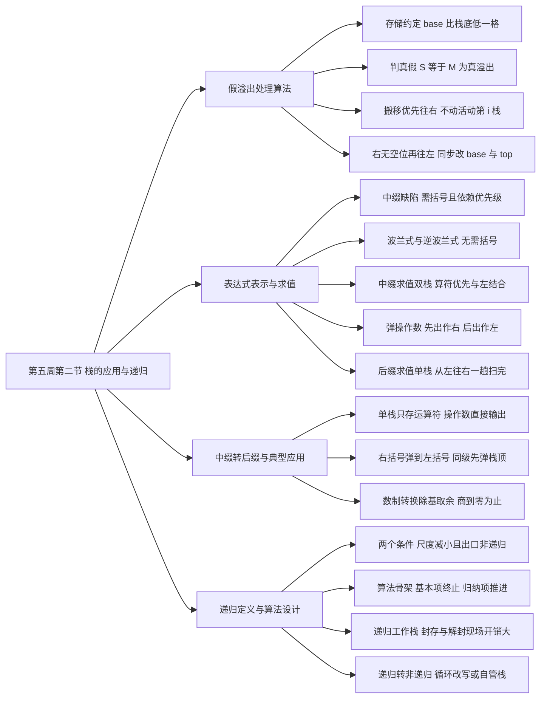
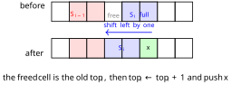
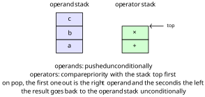
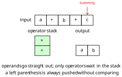
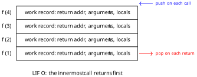
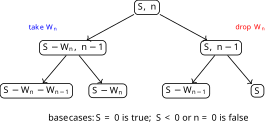

# 数据结构 · 第五周第二节 · 栈的应用与递归 · 详细版讲义

> **来源说明**：本讲义依据本节课课堂讲授记录整理，并与严蔚敏《数据结构（C语言版）》对照校订而成，供课后复习与查漏补缺。
>
> - **素材来源**：课堂讲授由两段记录合并切分为 32 份分段素材（`segment_000.md` ~ `segment_031.md`），本讲义以分段素材为主，必要处回看原始记录。
> - **教材对照范围**：以严蔚敏《数据结构（C语言版）》第 3 章 **3.2 栈的应用举例**（数制转换、括号匹配检验、行编辑程序、迷宫求解、表达式求值）与 **3.3 栈与递归的实现** 为主要对照，用于校对术语、算法写法与"递归"的标准表述；复杂度部分对照 1.4.3、1.4.4。**其中假溢出处理算法、前缀/后缀记法、递归定义的两个条件、基本项与归纳项、简化背包问题、迭代与递归的对比在教材中没有对应小节**，属课堂扩展，附录 A 已逐条注明。
> - **标注约定**：课堂举例标"（课堂举例）"；课上未展开、但教材中有的内容标"（教材补充：3.2.5）"这类出处；为把口述讲通而作的整理标"（讲义补充）"；能依据教材与上下文裁定的口误或误识，在正文用"（讲义校订：…）"说明，尚存歧义的部分全部写入"待核实内容"。
> - **记法说明**：我在课上使用"栈／栈底／栈基"这套记法；教材 3.1.2 中 **base 是"栈底指针"**、`top = base` 表空，而本讲义中 **base 是"栈基"，落在栈底的前一个单元**（这也是第 $i$ 个栈占用量写作 $top_i - base_i$ 而不用 $+1$ 的原因）。两者相差一格，读题时按语境分辨。
> - **时间说明**：本节课为文字整理模式，各节时间戳是按字数折算的伪时间，非音频真实时间，仅作讲义内部单调递增的定位坐标（课间休息 5 分钟在伪时间轴上已压缩）。
> - **编号说明**：我在课上沿用旧课程体系的章节号，与严蔚敏教材章节号不一致：课上所说的"第三章"对应链表（教材 2.3）、"第 4 章"对应栈和队列（教材第 3 章，即第五周第一、二节的内容），详见"待核实内容"。
> - **关联阅读**：[[数据结构 第五周第一节 线性表的应试技巧与栈 详细版讲义]]（上一节，栈的定义、顺序栈、链栈、多栈共存与假溢出的由来）、[[数据结构 第四周第三节 链表的进阶与线性表的应用 详细版讲义]]、[[数据结构 第二章 线性表 详细版讲义]]。
> - **示意图说明**：正文嵌有 5 张操作示意图（已渲染为 SVG 图片存于 `插图/w52_01.svg` 至 `w52_05.svg`），图内标签采用字母、数字、数学记号与英文短语，每张图下方均配有中文图注说明。

## 开场导读

这节课是「栈」这个专题的下半场，主题分两块：**前半是栈的应用**——把上一节留下的假溢出处理算法补完，再展开「表达式怎么表示、怎么求值」；**后半是递归**——从斐波那契的兔子问题讲到递归定义的两个条件、基本项与归纳项，最后与迭代和递归转非递归的做法作一次对比。

开场时我先提出一条贯穿全课的主线：「**凡是涉及到调用，都要用到栈这种线性结构。**」这句话在今天的内容里会出现三次——讲中缀表达式为什么要借用括号时出现一次，讲递归保存现场时再出现一次，到了最后讨论「为什么要自己管栈」时，它就是解决问题的思路本身。

> **开课通知（课堂事务，压缩记录）**：成绩按百分制计算——**实验 40 分 + 理论 60 分**；理论 60 分拆成**试卷 30 + 作业 15 + 考勤／学习通签到 9 + 笔记互评 6**（$40+30+15+9+6=100$，最多相差一两个百分点）。其中**笔记互评共 6 个档**，高档可能给到 $100$、$98$、$99$、$97$，但**最低一档不到 85 分，可能给到 60 分或七十几分**；同时也提供替代方案——由任课教师或助教直接批改，为此已发起**匿名投票**征询意见，**少数服从多数**。（各档具体分数线见「待核实内容」。）

前半的算法部分承接上一节的问题：$N>2$ 时均分存储区容易出现假溢出，做系统开发或编译器时避不开，所以需要写三个算法，本节把第三个补全。假溢出之所以「假」，是因为**存储空间明明还有**——所以这件事**不能推给程序员或用户，必须由系统（编译器、操作系统）来解决**。处理的基本原则是「**就近**」：从邻居栈借用单元。至于往哪边借，我先请大家思考，再给出结论——**优先从右边找**。理由不是右边搬移次数更少（往左往右逐个搬移差距不大），而是**往右边找不涉及当前正在操作的第 $i$ 个栈**。打个比方：走路时被绊一下通常摔得不重，跑步时被绊一下就容易摔伤——第 $i$ 个栈正处于活动状态，尽量不要去动它。

判真假的那一步也讲得很细，尤其是解释「为什么占用单元数 $top_i - base_i$ 不用加 1」：向量里元素个数是 $P-L+1$，而这里的 $L$ 对应的不是栈底本身，是**比栈底落后一个单元的栈基 base**，那个 $+1$ 已经被 base 提前减掉了。

接下来进入「栈的应用」。最基础的语句是赋值语句，而赋值语句离开栈就无法处理。我先从一句形如 $A\div B^C+\dots$ 的表达式讲起，结合「**流行的未必是最好的**」这一判断（如 Windows 针对性病毒多、Dvorak 键盘比 QWERTY 提速 5%～25%），引出中缀表示法的缺陷与波兰式、逆波兰式。核心操作规则很明确：中缀求值用**两个栈**，后缀求值只用**一个操作数栈**；中缀转后缀也只用一个栈，且那个栈**只存运算符**。同时要特别注意一个易错点——$A+B-C$ 里，**加号必须先弹**。

后半是递归。我讲递归基于两个原因：一是计算机里有一整类程序设计叫**递归型程序设计**，本章作业就会考查；二是**树、二叉树等结构的定义本身就是递归定义**。定义很简洁——「**问题的定义中又运用了它自身**」。生活中的例子是「先有鸡还是先有蛋」，学术里的例子是**他引与自引用**。随后依次梳理递归定义的两个条件、**基本项**与**归纳项**、递归算法的一般结构、反例 `bad` 为什么从 $n=1$ 起都会陷入死循环（「没有哪个值是特殊的」），以及简化背包问题的三类基本项。最后我如实指出：**操作系统不喜欢递归**，因为每次调用都要**封存现场**、返回时还要**解封**，存在时空双重开销；但因为递归写起来简洁，人们仍常使用它，需要高效时则可通过循环改写或自己接管工作栈来转为非递归。

## 总览知识地图

下面先用一张全景图概括全课主线，再将各专题流程拆成文字清单与对照表，方便逐块复习。

**全课知识地图**



**专题一 · 假溢出处理算法流程（先判真假，再谈搬移）**

1. 触发条件：第 $i$ 个栈已满，需要压入新元素 $x$，但怀疑整个存储区仍有空余。
2. 统计总占用量：$S = \sum_{k=1}^{N}(top_k - base_k)$。
3. 判真假：若 $S = M$，则为**真溢出**，直接停机 `exit(0)`；若 $S \ne M$，则为假溢出，由系统搬移。
4. 优先向右查找：从第 $i+1$ 到第 $N$ 个栈寻找未满的栈 $j$；若找到，将第 $i+1$ 至 $j$ 个栈的元素整体右移一位，并同步将这批栈的 `base` 与 `top` 加 1。
5. 兜底向左查找：若右边没找到，则从第 $i-1$ 到第 $1$ 个栈寻找未满的栈 $j$；将第 $j+1$ 至 $i$ 个栈的元素整体左移一位，并同步将这批栈的 `base` 与 `top` 减 1，腾出原 $top_i$ 位置。
6. 完成入栈：执行 $top_i \leftarrow top_i + 1$，将 $x$ 压入。

**专题二 · 同一条算式的三种表示法**

| 表示法 | 运算符位置 | 核心特点与缺陷 |
| --- | --- | --- |
| **中缀表达式** | 写在两个操作数中间 | 缺陷一：括号不是运算符却必须出现；缺陷二：优先级规则无法回避 |
| **前缀（波兰式）** | 写在两个操作数前面 | 由波兰逻辑学家 Lukasiewicz 提出；无括号，但从左向右扫描时需等待并回头取操作数 |
| **后缀（逆波兰式）** | 写在两个操作数后面 | 计算机从左往右一趟扫描即可求值；只需单栈，没有任何辅助符号 |

**专题三 · 中缀求值流程（两个栈，各管一摊）**

1. 从左往右扫描中缀表达式（配合操作数栈与运算符栈）。
2. 遇到**操作数**：无条件压入操作数栈。
3. 遇到**运算符**：进运算符栈前先与栈顶比较优先级——若自己优先级更高（或栈空、栈顶为左括号），则直接进栈暂不计算；若优先级更低或同级，则循环弹出栈顶运算符进行计算（先弹出的作右操作数，后弹出的作左操作数），结果无条件压回操作数栈，再将当前运算符进栈。
4. 遇到**结束符**：将栈内剩余运算符依次弹出并算完，操作数栈里剩下的唯一元素即为表达式结果。

**专题四 · 中缀转后缀流程（一个只存运算符的栈）**

1. 从左往右扫描中缀表达式，另备一个结果序列保存输出。
2. 读到**操作数**：直接输出到结果序列，不进栈。
3. 读到**左括号**：无条件进栈。
4. 读到**右括号**：不进栈，依次弹出栈顶运算符并输出，直到遇到匹配的左括号为止，匹配到的左括号只出栈不输出。
5. 读到**运算符**：与栈顶比较优先级——若比栈顶更高（或栈空、栈顶为左括号）直接进栈；若低于或等于栈顶，则弹出所有优先级不低于它的运算符依次输出，再将自己进栈。
6. 扫描结束：将栈里剩余运算符依次出栈并输出。

**专题五 · 递归的骨架（两个条件、两类项）**

| 组成部分 | 含义 | 对应位置 |
| --- | --- | --- |
| **条件一** | 被定义项在定义中的应用必须具有更小的尺度 | 保证规模不断缩小 |
| **条件二** | 最后在最小尺度上是非递归的，必须能走出递归 | 保证有穷次后终止 |
| **基本项** | 最小规模下的解，即递归出口 | `if` 条件成立时执行 |
| **归纳项** | 由已找到的小规模结论求更大规模结论 | `else` 分支中执行 |

**专题六 · 递归与迭代对比（同一道题的两份写法）**

| 对比维度 | 递归写法（如递归求 $n!$） | 迭代写法（如循环求 $n!$） |
| --- | --- | --- |
| **控制流与引用** | 自己调用自己，控制权向外转移后再收回 | 在自身函数内部控制，通过循环更替变量，不转移控制权 |
| **运行现场开销** | 调用前封存现场，返回时解封，存在时空双重开销 | 无额外函数调用栈帧开销 |
| **互相转换关系** | 迭代改写为递归总是可行；递归改写为非递归有两种做法：部分伪递归可直接改写为简单循环，一般递归则可通过自己维护工作栈转为非递归 | — |

## 正文

### 一、开场引入与一条贯穿主线 `00:00:00–00:01:36`

（课务已压缩在上文「开课通知」中，此处只记课堂内容。）

我们先明确一条贯穿本节课的主线：「**凡是涉及到调用，都要用到栈这种线性结构。**」后面讲中缀表达式的括号、讲递归的现场环境以及讨论自管工作栈时，都会反复回到这一判断。

交代完成绩与笔记互评通知（见上文「开课通知」）后，我们正式进入课程内容。

### 二、承接上一节：栈与线性表，以及「假溢出」的由来 `00:01:36–00:04:48`

先回顾上一节栈与线性表的关系。有些教材将栈定义为「**只允许在表尾进行插入和删除的线性表**」，我认为这一表述不够恰当，问题就出在「**限定只在表尾**」上：一旦采用链式存储，若限定只在表尾进行插入或删除，就可能需要遍历整条链表（关于这一表述的完整上下文，见「待核实内容」）。

因此我们按如下口径区分栈与线性表：**两者同为线性结构，逻辑结构一致，存储结构也可以相同；区别在于栈的运算是线性表运算的子集，并且加以限制——只能在端点进行。**

接下来看多栈共享存储空间引发的问题。计算机和手机运行多个任务时需要频繁调度；事先无法预知哪个任务需要更多内存、哪个任务的函数调用层级更深，**操作系统通常只能先均分空间**。当某个任务的调用深度较大时，分配给它的那块空间就会先用完。

对于单栈而言，空间满后再压栈直接报错即可；但在多栈共存的情况下，就会出现所谓的**假溢出**：

> **假溢出**：存储空间整体仍有空余，但因管理不当或存取方式不当，导致当前栈的元素无法入栈的现象。

（关于「导致元素无法……」的具体措辞，详见「待核实内容」。）这里有一个定位上的关键判断：这种假溢出**不应由程序员或用户解决，而应由系统（编译器、操作系统）解决**。因此上一节提到多栈共享时要写三个算法，本节需要把第三个（假溢出处理算法）补齐。

回顾上一节的存储记号约定：为了消除二义性，我们不用栈底本身，而引入**栈基 `base`**，「**栈基就是比栈底低一个单元**」。判定条件非常统一：

$$top_i = base_i \quad\Longleftrightarrow\quad \text{栈空}, \qquad\qquad top_i = base_{i+1} \quad\Longleftrightarrow\quad \text{栈满}$$

全系统共有 $N+1$ 个 `base`，最后一个 $base_{N+1}$ 指向整个存储区末尾之后（即 $M$），这是**用空间换时间**的典型设计。

现在第 $i$ 个栈满了，但相邻位置还有空间，我们可以向左找空位，也可以向右找空位。**问题来了：在左右两个方向之间，应该优先向左边找，还是优先向右边找？**

### 三、假溢出（一）：为什么优先从右边搬 `00:04:48–00:06:26`

先明确基本原则——**就近原则**，即尽量减少被搬动的元素个数。向右借位就是把右侧栈的元素整体往右搬移一格，腾出空间供新元素入栈；向左借位则是把左侧相关段整体往左搬移一格。单论逐个搬移的操作次数，左右两边差距不大，所以有同学认为两边差不多，也有同学提出不同角度的猜测，但都没有抓住根本原因。

**优先从右边找是对的，根本原因在于：往右边找，不涉及当前正在操作的第 $i$ 个栈。** 第 $i$ 个栈此时处于**活动状态**，正在被使用。往右边搬移时，移动的是第 $i+1$ 个栈及之后的相邻元素，第 $i$ 个栈本身保持不动，这样更安全，也不容易出错。

反过来，如果往左边借位，就必须把处于活动状态的第 $i$ 个栈的数据整体往左搬动，对正在运行的对象执行搬移往往伴随更高风险。打个比方：走路时被同学伸脚绊一下，通常摔得不重；跑步时被绊一下，就很容易摔伤。因此，**我们优先从右边寻找空余空间**。

### 四、假溢出（二）：先判真假，再谈搬移 `00:06:26–00:09:40`

处理假溢出时，**首先要判断这个栈是不是真的已经溢出了**——这是最容易被遗漏的关键一步。

判断方法是将 $N$ 个栈当前各自占用的单元数求和：第 $i$ 个栈占用的单元数为「栈顶指针所指位置 − 栈基位置」，总占用单元数 $S$（大写，取 sum 之意）为：

$$S = \sum_{i=1}^{N}\left(top_i - base_i\right)$$

真溢出的判据为：

$$S = M \;\Longrightarrow\; \text{真溢出}\;\Longrightarrow\; \text{停机 } \texttt{exit(0)}\text{，不再操作}$$

（**讲义补充**：这一判据可以自行验算。当 $N$ 个栈都填满时，$top_i = base_{i+1}$，于是

$$S=\sum_{i=1}^{N}\left(base_{i+1}-base_i\right)=base_{N+1}-base_1=M-0=M,$$

这是一个望远镜求和，正好等于存储区总单元数 $M$；其中 $base_1=0$、$base_{N+1}=M$ 沿用上一节的下标口径，逻辑上是自洽的。）

这里顺便说明**为什么占用量 $top_i - base_i$ 不用加 1**：对于一般向量，若下标从 $L$ 到 $P$，因为 $L$ 位置本身也占一个单元，元素个数是 $P-L+1$（例如下标 1、2 都有元素，个数为 $2-1+1=2$）。而在我们的栈设计中，对应的起点不是栈底本身，而是**比栈底落后一个单元的 $base_i$**。向量公式里「多加的 1」与「`base` 比栈底少 1」刚好抵消，因此 $top_i - base_i$ 就是真实占用单元数，无需再加 1。

描述算法有四种常用形式：**自然语言、具体程序设计语言、伪代码、流程图**。这里我们用自然语言来描述，但自然语言也必须逻辑清晰。当 $S = M$ 时，系统只能执行 `exit(0)` 停机。

而当 $S \ne M$ 时，说明属于「**局部满、全局不满**」的假溢出，**不能停机，必须由操作系统解决**。

**向右搬移的做法**：从第 $i+1$ 个栈到第 $N$ 个栈顺序查找，找到第一个**未满**的栈 $j$（$i+1 \le j \le N$）。找到之后，将第 $i+1$ 至第 $j$ 个栈的这一整段元素（从 $base_{i+1}+1$ 到 $top_j$，由高地址向低地址）**依次向右移动一个位置**（讲义校订：按前文「不移动活动中的第 $i$ 个栈」的原则，右移的是右侧邻居栈 $i+1 \dots j$，而非第 $i$ 个栈自身），这样 $top_i + 1$ 处就空出了一个单元。随后更新第 $i$ 个栈的栈顶指针并压入新元素 $x$：

$$top_i \leftarrow top_i + 1$$

（注：部分记录曾将上式误记为 `top_i <- base_i + 1 + 1`，该写法仅在单元素栈下成立，见「待核实内容」。）

**需要特别提醒的是「搬元素不等于完成搬移」**：搬动一整段元素后，**必须同步修改被移动各栈的栈基 `base` 和栈顶指针 `top`**。向右搬移时，第 $i+1$ 至第 $j$ 个栈整体右移了一格，它们的 `base` 与 `top` 都应**加 1**（$base_{j+1}$ 不变）。若只搬元素不更新指针，后续访问就会错位。（讲义校订：课上先只提及修改栈顶指针，后文左移时补全为修改栈基与栈顶指针；由于整段连续元素均已偏移，两个指针必须同步修改。）

完成上述动作后转第 7 步。如果右边一直找不到未满的栈，再采取兜底方案——向左边搜索。

### 五、假溢出（三）：从左邻搬，与收尾 `00:09:40–00:11:18`

从第 $i-1$ 个栈向左找到未满的栈 $j$（$1 \le j \le i-1$）后，动作是对称的：将第 $j+1$ 至第 $i$ 个栈的这一整段元素（从 $base_{j+1}+1$ 到 $top_i$，由低地址向高地址）**整体向左移动一个位置**。（讲义补充：记录中提及起点 $base_{j+1}+1$ 与 $top_i$ 的对应关系，但 $j$ 与 $i$ 的具体间隔视实际空栈位置而定，见「待核实内容」。）

**整段左移一格后，腾出来的空位正好就是原来的 $top_i$ 所在单元。** 同样地，必须同步修改被搬移各栈（第 $j+1$ 至第 $i$ 个栈）的**栈基 `base` 与栈顶指针 `top`**——此时它们均向左移动了一格，因此各自的 `base` 与 `top` 都要**减 1**。

收尾动作与右移一致：先将 $top_i$（因左移已减 1）加 1 指向腾出的空位，再将待入栈元素 $x$ 存入即可。

至此，多栈共存的判空、判满、空间组织与假溢出处理问题全部解决。

**操作图 1 · 假溢出兜底：从左邻借，整段左移一格**



> **图注（假溢出左邻搬移示意图）**：上方 `before` 为搬移前状态，红色区块 $S_{i-1}$ 表示左侧邻栈，中间白色 `free` 格表示其右侧尚有空闲单元，蓝色区块 $S_i\text{ full}$ 表示当前已满的第 $i$ 个栈；中间蓝色左向箭头 `shift left by one` 表示将 $S_i$（及中间相邻元素）整体左移一格；下方 `after` 为搬移后状态，$S_i$ 左移占用原 `free` 格，腾出原 $top_i$ 位置（绿色格），随后执行 $top_i \leftarrow top_i + 1$ 并将新元素 $x$ 压入该格。

### 六、栈的应用（一）：从最简单的一句赋值语句说起 `00:11:18–00:12:50`

讲完多栈管理，接下来我们进入「栈的应用」。

在计算机程序设计中，**凡是涉及到引用、调用，都离不开栈**。在各类语句（条件语句、逻辑判断、循环等）中，**最基础的是赋值语句**——把右边表达式的值计算出来，再赋给左边的变量。看似简单的赋值语句，计算机离开栈同样无法完成计算。

以一条 C 语言赋值表达式为例（课堂举例）：形如 $A$ 除以 $B$ 的 $C$ 次方再加上另一项的算式，给定各变量初值（记录中 $A$、$B$、$C$ 均为 2，末尾项存疑），请一位同学按规则口算结果。

结果与部分同学的直觉不一致。原因在于：**计算机是严格按既定规则一步一步执行操作的**。如果计算结果不符合人的日常心算习惯，就需要以计算机的优先级与结合性规则为准——即课本里规定的先乘方、再乘除、后加减。（该题完整原式与作答数值在记录中存在残缺，见「待核实内容」，此处不臆造数值。）

由此引出一个重要的认知：**流行的未必是最好的。** 生活中常用的**中缀表示法**（把运算符写在两个操作数中间）虽然流行，但从计算机处理的角度看并非最优。例如 Windows 操作系统虽然普及度高，但市面上大量病毒都针对其内存与系统管理漏洞；下一节我们再看键盘与表达式表示法的例子。

### 七、「流行的未必是最好的」：Dvorak 键盘、中缀的缺陷与两种波兰记法 `00:12:50–00:16:05`

再看一个常见例子：键盘布局。我们现在普遍使用的 **QWERTY 键盘**以第一行前六个字母命名，它沿袭早期机械打字机的防卡键习惯，左手负担较重。1932 年学者提出了 **Dvorak 键盘**（关于其国籍口误见「待核实内容」），据统计在输入同等文本时，**Dvorak 键盘可使输入速度提高约 5%～25%，错误率也降低相近幅度**。之所以未能普及，主要还是「习惯成自然」，难以改变既有用法。

回到表达式表示法，中缀表示法同样存在「流行但不优」的问题。例如计算 $A\times B - C$，如果想先算 $B - C$，中缀式就**只能借助括号这类辅助符号**。要把 $B - C$ 先算出来并保存起来供后续使用，这就是**引用与调用**，也就必然要用到栈。

按理说，一个算术表达式中原本只应该出现两类字符：**操作数**与**运算符**。而中缀表示法存在两条明显缺陷：

| 序号 | 中缀表示法的缺陷 | 具体说明 |
| --- | --- | --- |
| 1 | **括号不是运算符，却必须出现** | 左括号、右括号本身不是运算操作，只是人类为了改变运算顺序而引入的辅助手段（小括号、中括号、花括号） |
| 2 | **运算优先级无法回避** | 必须预先规定并不断判断各运算符之间的高低次序 |

于是有了更纯粹的替代方案——**波兰式（前缀表示法）**，由波兰逻辑学家 **Lukasiewicz** 提出，可用于逻辑表达式、算术表达式和代数表达式。它**把运算符写在两个操作数前面**，表达式中没有括号，只包含运算符和操作数两类符号。从左往右扫描时，例如遇到加号需要两个操作数但尚未读到，继续扫到乘号仍需等待，直到读到 $A$、$B$ 才可做乘法，再读到 $C$ 后与前面结果相加。（具体前缀式样例见「待核实内容」。）

在此基础上进一步改进得到**逆波兰式（后缀表示法）**。为什么要改进？**因为计算机扫描表达式通常是从左往右进行。** 把**运算符写在两个操作数的后面**，那么每当扫描到一个运算符时，它所需的两个操作数已经在前面出现过了，可以直接进行计算，并且**表达式中没有任何括号等辅助符号**。

> **教材补充：3.2.2**。上面是从「表示法纯粹性」角度分析中缀表达式的括号；严蔚敏教材 3.2.2 则从**括号匹配的检验**说明括号处理同样依赖栈。教材用「**期待的急迫程度**」来描述：每读入一个左括号，就压入一个更急迫的期待（栈中原有期待的急迫度随之降低一级）；读入右括号时，只能消解栈顶最急迫的那个期待，否则就是匹配不合法；算法开始和结束时栈都应为空。

### 八、中缀求值（一）：优先级、左结合，与两个栈 `00:16:05–00:19:19`

现在讨论：如果直接给定一个中缀表达式，计算机应当如何求值？大家可以把自己想象成一台只按固定指令动作的计算机，一步步推演。

先不考虑括号，仅看四则与幂运算的优先级序列（由高到低）：

$$\text{幂}\;(\wedge) \;>\; \text{乘、除}\;(\times,\ \div) \;>\; \text{加、减}\;(+,\ -) \;>\; \text{表达式结束符}$$

这里把**表达式结束符**（课上口头称为分号）设为最低优先级，作为判断表达式结束的哨兵界限符（注：结束符是界限符，并非二元运算符）。

> **讲义校订**：课上所说的「**分号**」与教材 3.2.5 中的**表达式结束符 `#`** 作用一致——教材将 `#` 虚设在表达式最左端并与末尾的 `#` 构成一对界限符，使其优先级低于所有算术运算符。下文统一按「表达式结束符（分号 / `#`）」表述。**教材补充：3.2.5**。

仅有优先级还不够。遇到 $A+B-C$ 这样优先级相同的运算符时怎么办？规则是：**二元算术运算符均采用左结合**。当扫描到 $B$ 时，左边是加号、右边是减号，两者同级，应先计算左边的加法，再算减法。

> **教材补充：3.2.5（算符优先法与表 3.1）**：教材 3.2.5 采用**算符优先法**求解中缀表达式，通过算符间优先关系表（比较栈顶算符 $\theta_1$ 与当前读入算符 $\theta_2$ 的关系 `<`、`=`、`>`）驱动求值：
> - **四则运算符优先级与左结合**：`+ - * /` 之间先乘除后加减；同级时（如 $\theta_1 = \theta_2$ 或同属 `+ -`、同属 `* /`），令 $\theta_1 > \theta_2$（即栈内先算），从而实现左结合。
> - **括号与界限符 `#` 的规则**：任何算符遇到栈外的 `(` 均满足 `<`（即 `(` 直接入栈）；入栈后栈内的 `(` 优先级最低，遇到栈外的 `+ - * / (` 均满足 `<`，遇到匹配的 `)` 则满足 `=` 并脱去括号；栈底 `#` 遇到算符或 `(` 均满足 `<`，遇到末尾 `#` 则满足 `=` 并结束求值（教材 3.2.5 未含幂 `^`，本讲义按课堂扩展补充 `^` 高于乘除）。

接下来看**为什么中缀求值必须用栈**。从左往右扫描以 $A\div B$ 开头的中缀式：读到 $A$ 时不能算；读到除号时不能算；读到 $B$ 时仍然不敢直接算——**因为后面可能紧跟着更高优先级的运算符（比如幂运算）**。既然暂时不能算而后面又要用到它，就必须先保存起来。

因为表达式中有**操作数**和**运算符**两类元素，所以我们设置**两个栈**：**操作数栈**与**运算符栈**。

扫描处理规则如下：
1. **遇到操作数**：无条件直接压入操作数栈。
2. **遇到运算符**：若运算符栈为空（或栈顶为左括号 / 结束符），直接压入；否则必须先与栈顶运算符比较优先级——如果自己优先级更高，说明后面可能还有更优先的运算，先直接进栈暂不算；直到遇到优先级更低（或同级）的运算符、或是遇到结束符时，才可以放心地先计算栈顶运算。

以课堂板书表达式的求值次序为例：先算 $B^C$，再算 $A\div B^C$，第三步做乘法，第四步做加法。

### 九、中缀求值（二）：弹栈次序与「五个动作」 `00:19:19–00:22:33`

当扫描到的运算符（如 `+`）比运算符栈顶（如 `^`）优先级低时，当前运算符暂留在栈外，先执行栈顶运算符的归约计算。

**弹栈运算的次序**至关重要：对于二元运算，从运算符栈弹出 1 个运算符，从操作数栈弹出 2 个操作数，**先弹出的作右操作数，后弹出的作左操作数**。例如计算 $B^C$ 时，$C$ 先弹出放在右边，$B$ 后弹出放在左边，千万不能颠倒。

$$\underbrace{\text{先弹出的}}_{\text{作右操作数}} \qquad \underbrace{\text{后弹出的}}_{\text{作左操作数}}$$

算出的结果本身又是一个操作数，因为后续还要继续引用，所以**无条件压回操作数栈**，不需要比较优先级。

按照这一流程逐步推进，本例的中间结果依次为（因原始记录对末项常数的口述存在出入，见「待核实内容」，此处按扫描序列记为 $1$）：

$$T_1 = B^C, \qquad T_2 = A \div T_1, \qquad T_3 = D \times 1, \qquad T_4 = T_2 + T_3$$

具体过程如流水线般展开：`+` 与栈顶 `^` 比较，幂优先级更高，弹出 `^`、$C$、$B$ 算出 $T_1$ 并压栈；`+` 再与新栈顶 `/` 比较，除号优先级更高，弹出 `/`、$T_1$、$A$ 算出 $T_2$ 并压栈；此时运算符栈空（或仅余底部的 `#`），`+` 压入运算符栈。继续扫描遇到操作数直接进栈；遇到 `×` 时，因 `+` 优先级低于 `×`，`×` 直接进栈；遇到表达式结束符时，`×` 优先级更高，弹出算出 $T_3$ 并压栈；再处理栈内的 `+`，先弹出 $T_3$ 作右操作数、后弹出 $T_2$ 作左操作数，算出 $T_4 = T_2 + T_3$（讲义校订：原整理稿曾误写作 $T_3 + T_2$，与先弹作右、后弹作左的次序相反，已按左操作数在前改正）并压栈。最后遇到结束符完成求值，将结果赋给目标变量，完成赋值语句闭环。

整个过程可以拆解为**五个基本动作**（每次即一步操作或一次栈存取）：① 计算 $B^C$ 并压栈；② $A$ 除以 $T_1$ 时从栈中引用它；③ 中间结果 $T_2$ 入栈；④ 中间结果 $T_3$ 入栈；⑤ 后续加法再次从栈中引用 $T_2$ 与 $T_3$。

**操作图 2 · 中缀求值的两个栈**



> **图注（中缀求值双栈结构图）**：左侧蓝色堆叠框为操作数栈 `operand stack`（自底向上依次存有操作数 $a$、$b$、$c$），右侧绿色堆叠框为运算符栈 `operator stack`（自底向上依次存有运算符 $+$、$\times$），绿色栈右上方的左向箭头 `top` 指向当前栈顶运算符 $\times$；图下方四行英文标注分别说明：操作数无条件压栈、运算符入栈前先与栈顶比较优先级、弹栈运算时先弹出者作右操作数而后弹出者作左操作数、计算结果无条件压回操作数栈。


### 十、后缀求值：一个操作数栈就够了 `00:22:33–00:24:11`

中缀表达式符合人的书写与心算习惯，但也正因此带来括号和优先级问题。换成**后缀表达式**，求值规则就简练很多：

| 读到 | 动作 |
| --- | --- |
| **操作数** | 直接压入操作数栈 |
| **双目运算符** | 弹出两个操作数（**先弹出的放在右边，后弹出的放在左边**），计算后将结果无条件压回栈中 |
| **扫完 / 遇到结束符** | 栈中剩下的唯一一个数即为表达式的值 |

也就是说，**后缀表达式求值不需要两个栈，只需要一个操作数栈**，从左往右一趟扫描即可完成，不必判断优先级。

**完整算例**（栈内容自栈底向栈顶书写）：

$$\texttt{1}\ \texttt{2}\ \texttt{+}\ \texttt{8}\ \texttt{2}\ \texttt{-}\ \texttt{3}\ \texttt{/}\ \texttt{*}$$

| 步 | 读到 | 动作 | 栈（底 → 顶） | 结果 |
| --- | --- | --- | --- | --- |
| 1 | `1` | 操作数进栈 | $1$ | — |
| 2 | `2` | 操作数进栈 | $1,\ 2$ | — |
| 3 | `+` | 弹 2（右）、弹 1（左） | $3$ | $1+2=3$ |
| 4 | `8` | 操作数进栈 | $3,\ 8$ | — |
| 5 | `2` | 操作数进栈 | $3,\ 8,\ 2$ | — |
| 6 | `-` | 弹 2（右）、弹 8（左） | $3,\ 6$ | $8-2=6$ |
| 7 | `3` | 操作数进栈 | $3,\ 6,\ 3$ | — |
| 8 | `/` | 弹 3（右）、弹 6（左） | $3,\ 2$ | $6\div 3=2$ |
| 9 | `*` | 弹 2（右）、弹 3（左） | $6$ | $3\times 2=6$ |
| 10 | 扫完 | 栈中剩一个数 | $6$ | **最终结果 6** |

> **讲义校订**：原始记录在第 6 步与第 7 步之间存在模糊——只讲了一次「压入下一个操作数」，分段素材却把栈里残留的 $6$ 误记为字面压入的 $6$。按「只压入一个操作数且应为 $3$」来读，与后文三处报数（`/` 处弹出 $3$、$6$，`*` 处弹出 $2$、$3$，结尾最终结果 $6$）完全自洽；若多压入一个 $6$，末尾栈里会剩两个 $6$。原始记录歧义处已登记在「待核实内容」。

### 十一、中缀转后缀（一）：算法骨架 `00:24:11–00:25:48`

后缀表达式对计算机很友好，但日常书写仍习惯使用中缀表达式。那么**如何把中缀表达式转换成后缀表达式**？

先看两个关键观察：
1. **所有操作数的相对顺序在转换前后保持不变**；
2. **转换过程本质上把括号去掉，并按计算顺序重排运算符**。

因此，中缀转后缀同样**只需要一个栈**，但**这个栈不存操作数，而是专门用来暂存运算符**；另外再准备一个结果序列存放输出的后缀表达式。

因为操作数顺序不变，所以读到操作数时直接输出即可。各类符号的详细处理规则如下：

| 读到 | 动作 |
| --- | --- |
| **操作数** | **直接输出**到结果序列，不进栈 |
| **左括号 `(`** | **无条件进栈** |
| **右括号 `)`** | **不进栈**；从栈中依次弹出运算符加入结果序列，直到遇到匹配的左括号为止，**该左括号只出栈、不输出**，一对括号至此抵消 |
| **运算符** | 若栈为空或栈顶是左括号，**直接进栈**；若**当前运算符优先级高于栈顶**，**直接进栈**；若**当前运算符优先级低于或等于栈顶**，则**循环弹出栈顶中所有优先级高于或等于当前运算符的元素**（遇左括号或栈空即停）依次加入结果序列，然后再把当前运算符压入栈 |
| **扫描结束** | 将栈中剩余的运算符**依次出栈**并加入结果序列 |

以 `(A + B ...` 开头为例追踪前几步：遇到 `(` 无条件进栈；遇到 $A$ 直接输出；遇到 `+`（栈顶是 `(`）直接进栈；遇到 $B$ 直接输出；遇到 `)` 则弹出 `+` 输出并将 `(` 弹出消去。

> **讲义补充**：课上在说明「优先级低或同级就弹栈」时，曾顺带提及求值时的「弹出先算」作为直观类比。两者判断方向相似，但**转换是输出运算符到后缀序列，求值是直接弹出两个操作数计算**，不要混淆（求值见第八、九节）。

**操作图 3 · 中缀转后缀：一个只存运算符的栈**



> **图注（中缀转后缀示意图）**：顶部 `input` 行为输入的中缀序列（依次为 $a$、$+$、$b$、$*$、$c$），红色向下箭头 `scanning` 指示当前正在扫描到字符 $c$；左下绿色堆叠框为只保存运算符的 `operator stack`（栈底为 $+$、栈顶为 $\times$），右下 `output` 行为已输出的后缀序列方框（依次为 $a$、$b$）；下方两行英文标注分别说明：操作数直接输出而仅运算符在栈中等待，以及左括号不经比较无条件进栈。

### 十二、中缀转后缀（二）：实操演示与「扫到 F」那道题 `00:25:48–00:27:26`

下面在含嵌套括号的算式上完整走一遍上述算法（原始记录中部分符号被语音误识，此处按标准术语还原）：

遇 `(` 无条件进栈 → 遇 `)` 不进栈，弹出直至左括号消去 → 遇 `×` 时栈空直接进栈 → 遇 `(` 无条件进栈 → 遇 $C$ 直接输出 → 遇 `×` 时栈顶为 `(` 直接进栈 → 后续操作数直接输出 → 遇 `+`、`×` 及配对 `)` 时依次将相应运算符弹出输出。

括号处理时有一个容易丢分的细节需要注意：**一个右括号只弹出到与它匹配的那一个左括号为止**——**匹配的左括号只出栈、不输出**，它下方的符号一个也不许多弹。

整个表达式扫描完毕后，再**把栈中剩余的运算符依次弹出并输出**，即得到完整的后缀表达式。

这里给大家留一道思考题（第一题，第二题因转写截断缺失，见「待核实内容」）：

> 「在将中缀表达式转换为后缀（逆波兰）表达式的过程中，请问：**扫描到 $F$ 的时候，栈中的元素依次是多少？**」

> **素材接缝提示**：分段素材 `segment_017.md` 开头标有「递归教学内容」，但该段实际仍在讲中缀转后缀，属于切分命名错位，内容本身连续（已登记在「待核实内容」）。

### 十三、中缀转后缀（三）：分析法，与「运算符栈最多 5 个」 `00:27:26–00:32:15`

除了按栈规则逐字符推演，做选择题或手算验证时，还可以用一种更快的**分析法**。

**分析法**的做法是：先按算术优先级把整式拆成若干大块，每块**先写出各部分的后缀形式，运算符放到该块的最后**。以算式 $A\div B + (C\times D - 1\times F)\div 7$（课堂举例）为例：

| 步骤 | 拆法 | 后缀写法 |
| --- | --- | --- |
| ① 整式 = 两大部分相加 | $A\div B$ ＋ 其余 | 两部分后缀写完，**最后再写加号** |
| ② 左半 | $A\div B$ | `A B ÷` |
| ③ 右半 = 括号里的式子再除以 $7$ | 括号里先算，除号放最后 | `… 7 ÷` |
| ④ 括号里 = 两部分相减 | $C\times D$ − $1\times F$ | **减号放最后** |
| ⑤ 最小块 | $C\times D$ ／ $1\times F$ | `C D ×` ／ `1 F ×` |
| ⑥ 合起来 | — | `A B ÷ C D × 1 F × − 7 ÷ +` |

为了确保无误，做题时建议**分析法与栈算法互相验算**。再沿着栈扫描过程复核一次常见动作：
- 除号在栈里遇到加号时，因除号优先级更高，会立即弹出输出；
- 加号优先级低，会在栈底停留到最后才输出；
- 左括号必须等到匹配的右括号才能弹出；
- 乘号遇到左括号栈顶时直接进栈；
- 当后面遇到减号时，才会把上面优先级更高的乘号弹出输出（注意是**扫到减号时**弹乘号，不是扫到乘号时就弹）。

在课堂讲评的另一道选择题中，由于碰到右括号时括号内的待算部分尚未完成或有特定选项限制，最终选择了选项 B（题干选项详情见「待核实内容」）。

**再看一道核心练习题：运算符栈里最多能有几个元素。** 注意审题口径——题目问的是**运算符栈**内的最大元素个数（课上曾纠正课件将该栈误标为操作数栈的问题）。

按照课堂枚举过程：操作数 $A$ 直接输出，随后 `-`、`*`、`(`、`(`、`+`（由于上面刚有 `(` 压着，`+` 直接进栈而不弹栈）先后入栈。因此在**扫到 $D$ 的时刻**，运算符栈内同时存有 5 个元素（自栈底向栈顶为 `-`、`*`、`(`、`(`、`+`）：

$$\boxed{\text{运算符栈内元素个数的最大值} = 5}$$

（注：原始记录对本例完整表达式的两次口述存在片段不一致，见「待核实内容」。）

接着分析扫到 $D$ 之后栈元素个数的变化规律：

| $D$ 之后遇到 | 栈操作说明 | 栈中个数变化 |
| --- | --- | --- |
| **右括号 `)`** | 右括号不进栈，弹出 `+` 与匹配的 `(`（减少 2 个），随后 `/` 进栈（增加 1 个） | $5-2+1=\mathbf{4}$ |
| **减号 `-`**（扫到 $F$） | 除号 `/` 优先级高于减号 `-`（讲义校订：原稿误作「同级左结合」，已更正为高优先级先弹出），`/` 弹出遇到 `(` 停止，再把 `-` 压入 | $4-1+1=\mathbf{4}$ |
| **再来一个减号**（$F$ 之后） | 若前面括号已消解或存在多个不低于 `-` 的运算符连续弹出，再压入新 `-`，栈中元素会进一步减少 | 视弹出个数净减少（如减至 2 个） |

规律很清晰：遇到右括号消解括号及其内部运算符时栈规模净减少；遇到优先级不高于栈顶的运算符时，若只弹出 1 个栈顶再压入自身则个数不变，连续弹出多个则净减少。

### 十四、重点强调的易错点：A+B-C `00:32:15–00:33:51`

算例讲完，这里单独拎出一个极易出错的表达式：**$A+B-C$**。

不少同学第一反应是：「后面是不是先算，或者等一等？」**这是不对的，一定要注意。**

正确的处理是：**加号和减号处于同一优先级，遵循左结合规则**。当扫到减号 `-` 时，加号 `+` 已经在栈内，**加号必须先弹出运算（或输出到后缀序列），然后减号才能进栈**。此时栈里不再留有加号，而是换成减号。

> **教材补充：3.2.5**。教材表 3.1 由运算规则「从左算到右」规定：**当 $\theta_1=\theta_2$ 时令 $\theta_1>\theta_2$**（同级时栈内算符优先）。因此 $A+B-C$ 转为后缀表达式时输出为 $A\ B\ +\ C\ -$，求值时也是加号先归约，课堂规则与教材规则完全一致。

课后请大家重点完成两道练习：一道是运算符栈元素个数统计与表达式转换练习；另一道则是巩固「操作数先弹出的放在右边、后弹出的放在左边」的求值练习。

接下来，我们转向本节课的第二个核心专题——**递归**。

### 十五、转入递归：为什么要把它单独拎出来讲 `00:33:51–00:37:07`

为什么要把递归单独拎出来讲？原因有两条：

1. **会写递归型程序设计**：计算机中有一类专门的程序设计方法叫**递归型程序设计**，这一章的作业就会考查递归写法；
2. **为后续递归定义的数据结构打基础**：后面要学的**树、二叉树、广义表**等数据结构，其本身就是用递归方式定义的。

为了引出递归方程的结构，先看经典的**兔子繁殖问题**（1202 年斐波那契提出）：
- 每对成熟兔子每月繁殖一对后代；
- 兔子出生后第二个月成熟；
- 假设兔子不死亡（课上口语称「老兔不动情」，即限定数学前提以保证规律确定）；
- 问：1 月底引入一对刚出生的兔子，到年底（第 12 个月）共有多少对？

对照这个问题写出递归方程：

$$f(n) = f(n-1) + f(n-2)$$

（**讲义校订**：课上只口述了方程的左右骨架，下标与初值按上述四条规则推得为 $f(1)=f(2)=1$；教材 3.3 式 (3-2) 写作 $Fib(0)=0,\ Fib(1)=1$，两者只是下标平移的关系，并不矛盾，做题时看清起始月约定即可。）

观察这个方程的结构：**左边是规模为 $N$ 的被定义项，右边又出现了形式相同、但规模更小的问题**（$N-1$ 和 $N-2$）。要求规模 $N$ 的解，必先求得先前规模为 $N-1$ 和 $N-2$ 的解——这就是课上所说的**反过来递推（讲义统一表述为「反向递推」）：用先前算出的小规模的值来定义更大规模的值**。

递归函数在数学上已经形成了独立分支**递归函数论**；在程序设计语言构造中，递归思想也极其重要，写出的程序往往简洁且逻辑清晰。下面给出正式定义：

> **递归过程（procedure）**：**问题的定义中又运用了它自身**的过程，称为递归过程。
>
> **递归函数（function）**：**一个函数的（函数体）定义中就运用了它自身**，称为递归函数。简称递归，有时也称递推。

回到开场那句话：**递归涉及到自己调用自己，而凡是涉及到引用（调用），在实现上都必须使用栈来保存调用现场。**

> **教材补充：3.3**。教材 3.3 给出了函数调用与递归工作栈的完整机制：调用前系统完成 3 件事——（1）传递实参与返回地址；（2）为被调函数局部变量分配存储区；（3）控制转移到被调函数入口。返回前完成 3 件事——（1）保存计算结果；（2）释放数据区；（3）按返回地址返回调用点。多个函数嵌套或递归调用遵循「**后调用先返回**」原则，系统为此设立**递归工作栈**，每层压入一条**工作记录**（含实参、局部变量与返回地址）；栈顶的工作记录称为**活动记录**，指示它的指针称为**当前环境指针**。这正是后文所说的「封存现场」与「解封现场」。

### 十六、递归的两张生活面孔：先有鸡还是先有蛋，他引与自引用 `00:37:07–00:38:47`

除了数学上的阶乘与斐波那契数列，日常生活中也能看到「自引用」的影子：

1. **先有鸡还是先有蛋**：问鸡蛋哪来的，归因于鸡；问鸡哪来的，归因于蛋——两者互为定义、互为前提，却没有终止的基点。
2. **参考文献中的他引与自引用**：

| 引用方式 | 含义 | 评价特点 |
| --- | --- | --- |
| **他引** | 引用别人的研究成果（如引用前人学者的经典观点或牛顿的定律） | 客观佐证，学术评价通常统计**他引次数**来衡量认可度 |
| **自引用** | 用自己以前的工作（如一年前、十年前的旧方案）来论证或改进当前问题 | 若只有自引，在论证上容易流于主观；在程序设计语言里，**所有语言都支持他引（调用其他函数），但有极少数语言不支持自引用（递归）** |

（关于「不支持自引用的是哪一种语言」，原始记录语音失真无法辨认，不作臆断，详见「待核实内容」。）

### 十七、递归的两种形式，与递归定义的两个条件 `00:38:47–00:40:22`

递归有两种调用形式：
1. **直接递归**：过程 $P$ 在自己的内部直接调用 $P$；
2. **间接递归**：过程 $P$ 调用过程 $Q$，过程 $Q$ 又调用回过程 $P$（绕了个弯，本质仍是 $P$ 间接调用自身）。教材 3.3 的定义与此一致：「一个直接调用自己或通过一系列的调用语句间接地调用自己的函数，称做递归函数。」

必须明确一条原则：**递归不是循环定义，递归定义必须有出口**——它必须一步比一步简化，且最终在有限步内能够终结。

以阶乘为例：$n! = n\cdot(n-1)! = \cdots$，一路下探到 $n=0$ 时，必须给出一个确切的数值 $0! = 1$。这个最简单的情况就是**递归的出口**，出口本身不能再用递归来定义。

$$n! = n\cdot(n-1)! = n(n-1)\cdot(n-2)! = \cdots \qquad\text{下探到 } n=0,\; 0! = 1$$

由此归纳出**递归定义必须满足的两个条件**：

1. **被定义项在定义中的应用具有更小的尺度**：即求解规模为 $n$ 的问题时，只能用规模严格更小的 $n-1$、$n-2$ 等子问题来定义，不能用相同或更大规模来定义；
2. **最后在最小尺度上是非递归的**：即必须有递归出口（规模存在下界），能够直接得出结果并退出递归。（**讲义校订**：原始转写此处曾漏掉「非」字误作「是递归的」，按前文「出口本身不能用递归来定义」补正。）

据此，设计递归算法要抓好两个核心部分：
- **基本项**：列出最小规模下被定义函数的确切值，规定递归的终止条件（例如阶乘中 $n=0$ 或 $n=1$ 时的值）；
- **归纳项**：规定如何由已知小规模的结论求出大规模结论。

### 十八、基本项与归纳项：递归算法的一般结构 `00:40:22–00:41:59`

**归纳项**回答的是「大规模问题如何利用小规模问题的解来解决」，必须把具体的递推关系写出来（好比由一个小诱因一步步推向最终结果，必须有明确的推进规则）。

于是，几乎所有单分支递归算法都可以写成一个标准骨架：

$$\text{if（问题参数构成的条件成立）}\ \text{then 执行基本项；}\qquad \textbf{else}\ \text{执行归纳项}$$

接着我们看一道课堂练习，分析一个**不好的递归算法设计**。在看代码之前，先说明作业中常用的一条伪代码记号约定（类 Pascal 风格）：**如果函数名写在赋值号左边且后面不带括号和参数，它代表一个用于带回返回值的变量；如果写在右边且带括号和参数，则表示递归函数调用**。

本题函数名为 `bad`，返回类型为整型 `int`，基本项为 `if (n == 0) bad = 1;`（在 C 语言中写为 `return 1;`）。

**操作图 4 · 递归的工作栈：每层一个工作记录**



> **图注（递归工作栈示意图）**：中间竖向堆叠的四个方框表示递归调用的工作栈，左侧从下到上标注调用层次 $f(1)$ 至 $f(4)$，每个方框内的 `work record: return addr, arguments, locals` 表示该层的工作记录（包含返回地址、实在参数与局部变量）；右上方的蓝色左向箭头 `push on each call` 表示每次进入递归调用时向栈顶压入一条工作记录，右下方的红色右向箭头 `pop on each return` 表示每次返回时弹出工作记录并恢复现场；底部文字 `LIFO: the innermost call returns first` 说明栈遵循后进先出原则，最内层的调用最先返回。


### 十九、反例 bad：没有哪个值是特殊的 `00:41:59–00:45:10`

先把「函数名在左还是在右」这条伪代码规则讲清楚，因为后面作业会用到：
- **写在左边（不带括号与参数）**：表示一个用于带回返回值的变量；
- **写在右边（带有括号与参数）**：表示一次函数递归调用。

另外注意，C 语言中的整数除法 `/` 是**整除**（向下取整）。按课堂口述整理出反例 `bad`（为保证在 C 语言中可编译运行，下面代码将伪代码中「给函数名赋值返回」改写为标准 `return` 语句）：

```c
/* 反例：递归实参未严格减小，导致非零正整数陷入死循环 */
int bad(int n) {
    if (n == 0)
        return 1;                  /* 基本项：等价于伪代码 bad = 1 */
    else
        return n * bad(n / 3 + 1); /* 归纳项：C 整除 n/3，实参未变小 */
}
```

**为什么这个递归算法设计不好？** 我们把具体数值代入验证，就会发现当 $n=1$ 时它陷入了死循环。有同学可能会问：是不是只有 $n=1$ 比较特殊，而 $n=2$、$n=3$、$n=4$ 等其他值可以正常算出？我们逐个代入看看：

| 传入 $n$ | $n\div 3$（整除） | 再 $+1$ | 递归到 | 结果 |
| --- | --- | --- | --- | --- |
| $n=1$ | $0$ | $1$ | `bad(1)` | **自己调自己，永不返回** |
| $n=2$ | $0$ | $1$ | `bad(1)` | 落入上面的死循环 |
| $n=4$ | $1$ | $2$ | `bad(2)` → 再退到 `bad(1)` | 死循环 |

可以看到，对于所有正整数 $n \ge 1$，都有 $1 \le \lfloor n/3 \rfloor + 1 \le n$，最终都会退化到 `bad(1)` 而无法退出。**没有哪个值是特殊的：只要进入死循环，所有正整数都算不出来，只有 $n=0$ 能返回结果。**

问题根源很明确：归纳项中的实参 $n\div 3+1$ **没有严格变小**，违反了递归定义的第一个条件（被定义项在定义中的应用必须具有更小的尺度）。

按照一般结构写出**正确的阶乘递归版本**，只需让归纳项的实参严格变小：

```c
/* 正例：求 n 的阶乘，归纳项实参严格减小至基本项 n == 0 */
int f(int n) {
    if (n == 0)
        return 1;            /* 基本项：递归出口，直接返回 1 */
    else
        return n * f(n - 1); /* 归纳项：规模严格减小为 n - 1 */
}
```

这里再对照强调一次作业里的伪代码记号：如果用类 Pascal 写法（如 `f = n * f(n - 1)`），赋值号左边的 `f` 不带括号，作用类似于在函数体里声明一个专门的返回值变量（如 `result` 或 `sum`）把结果带回去；右边的 `f(n - 1)` 带有括号与参数，才是递归调用。

最后提示大家注意**递归的时间复杂度**（具体数值在原记录中未展开，见「待核实内容」）。

> **讲义补充（时间与空间复杂度）**：**阶乘递归**每层只调用一次 `f(n - 1)` 并做一次乘法，调用深度为 $n$ 层，故时间复杂度 $T(n)=T(n-1)+O(1)=O(n)$，**递归工作栈的空间复杂度**同为 $O(n)$（**教材补充：1.4.4**，每层占一个工作记录）。如果将类似结构改写成每层调用两次 `f(n - 1)`，则 $T(n)=2T(n-1)+O(1)=O(2^n)$，属于**指数阶**（**教材补充：1.4.3**）。**斐波那契**递归 $Fib(n)=Fib(n-1)+Fib(n-2)$ 同样是指数级：特征方程 $x^2=x+1$ 的正实根为 $\varphi=\frac{1+\sqrt5}{2}\approx 1.618$，因此 $T(n)=O(\varphi^{\,n})$，空间复杂度为 $O(n)$。

接下来看另一个经典例子——**汉诺塔（Hanoi 塔）**。汉诺塔属于**一般过程**，因为它只关注搬动盘子的步骤，通常不需要返回值；如果想知道每一步搬哪个盘子，在过程体中直接打印输出即可。

### 二十、一般过程与函数过程：汉诺塔与简化背包问题 `00:45:10–00:48:19`

由此我们把递归子程序分成两类：**函数过程**与**一般过程**。

| 对比项 | 函数过程（function） | 一般过程（procedure） |
| --- | --- | --- |
| 有无返回值 | **有** | **没有** |
| 返回值写法 | C 中用 `return`（伪代码中左侧不带括号的函数名作变量带回） | 返回类型为 `void`，不带返回值 |
| 典型例子 | 阶乘、简化背包问题 | **汉诺塔** |

> **教材补充：3.3，算法 3.5**。课上对汉诺塔只作了「一般过程」的定性，下面按教材补全规则与代码：有三个塔座 $X,Y,Z$，每次只移一个圆盘，且大盘不能压在小盘上。将塔座 $X$ 上 $n$ 个圆盘借助 $Y$ 移到 $Z$ 的递归算法如下：

```c
/* 教材算法 3.5：n 阶 Hanoi 塔（一般过程，无返回值） */
void hanoi(int n, char x, char y, char z) {
    /* 将塔座 x 上按直径由小到大、自上而下编号为 1 至 n 的 n 个圆盘 */
    /* 按规则搬到塔座 z 上，y 可用作辅助塔座 */
    if (n == 1)
        move(x, 1, z);            /* 基本项：将编号为 1 的圆盘从 x 移到 z */
    else {
        hanoi(n - 1, x, z, y);    /* 将 x 上编号 1 至 n-1 的圆盘移到 y，z 作辅助 */
        move(x, n, z);            /* 将编号为 n 的圆盘从 x 移到 z */
        hanoi(n - 1, y, x, z);    /* 将 y 上编号 1 至 n-1 的圆盘移到 z，x 作辅助 */
    }
}
```

这一算法同样满足「更小的尺度」：将 $n-1$ 个圆盘从一个塔座移到另一个塔座，与原问题特征相同而规模小 1。**移动次数与复杂度**：设搬动 $n$ 个圆盘的总移动次数为 $T(n)$，由代码可见递推关系 $T(1)=1$、$T(n)=2T(n-1)+1$（$n>1$），解得总移动次数为 **$2^n - 1$**，因此时间复杂度为 $O(2^n)$，递归工作栈最大深度为 $n$，空间复杂度为 $O(n)$。

下面再看**简化背包问题**（课堂举例）。题面如下：设背包总容量（重量）为 $S$，现有 $N$ 件物品，重量分别为 $W_1, W_2, \dots, W_N$。问能否从这 $N$ 件物品中选出若干件放入背包，使所选物品重量之和**恰好等于 $S$**？若存在符合要求的选择则返回 `TRUE`，否则返回 `FALSE`。

这个问题只需要两个参数：$S$ 与 $N$，返回类型为布尔型。

当满足**常规情况**时，进入归纳项考察：

$$\text{常规情况}\iff S > 0 \quad\textbf{且}\quad N \ge 1$$

即背包还有剩余容量（$S>0$）且还有物品可考察（$N\ge 1$）。针对第 $N$ 件物品 $W_N$，只有两种选择：

| 分支 | $S$ 变成 | $N$ 变成 | 规模是否减小 |
| --- | --- | --- | --- |
| **要 $W_N$**（放入背包） | $S - W_N$ | $N - 1$ | 容量减少、待考察物品少 1 件，规模减小 |
| **不要 $W_N$**（不放） | $S$ **不变** | $N - 1$ | 容量虽不变，但已考察过 $W_N$，待考察物品少 1 件，规模同样减小 |

要注意第二条分支：**规模减小靠的不是 $S$ 变小，而是 $N$ 减 1**。两个分支都会让 $N$ 严格减 1，因此递归一定能终止。

常规情况不满足时，对应递归的**基本项**（边界条件），共分三类：

| 序号 | 基本项（边界条件） | 返回值 | 语义说明 |
| --- | --- | --- | --- |
| ① | $S = 0$ | **TRUE** | 剩余容量正好用尽，找到合法解 |
| ② | $S < 0$ | **FALSE** | 放入最后一件后超出容量（容量不够） |
| ③ | $S > 0$ 且 $N < 1$ | **FALSE** | 所有物品都考察完仍未装满（容量过大） |

**操作图 5 · 简化背包问题的二叉决策树**



> **图注（简化背包问题二叉决策树）**：根结点圆角框 $(S, n)$ 表示初始状态（剩余容量 $S$、待考察前 $n$ 件物品）；每层向下的两条有向边对应对第 $n$ 件物品的二选一决策——左侧蓝色标注 `take W_n` 表示选取 $W_n$，状态转移为 $(S - W_n, n - 1)$；右侧红色标注 `drop W_n` 表示放弃 $W_n$，状态转移为 $(S, n - 1)$；第三层四个结点简略展示了继续决策后的剩余容量（分别为 $S - W_n - W_{n-1}$、$S - W_n$、$S - W_{n-1}$ 与 $S$）；底部英文标注 `base cases: S = 0 is true; S < 0 or n = 0 is false` 给出递归终止的三类基本情况。

### 二十一、栈的另两个应用，与递归的代价 `00:48:19–00:49:37`

接着把简化背包的归纳项收尾：第 ②、③ 种边界情况返回 `FALSE`；在常规情况下，只要「要 $W_N$」调用 `Pack(S - W[N], N - 1)` 返回 `TRUE`，**或者**「不要 $W_N$」调用 `Pack(S, N - 1)` 返回 `TRUE`，原问题就返回 `TRUE`（两分支为逻辑「或」关系，原文疑误见「待核实内容」）。

再补充栈的两个经典应用作为提醒：

**数制转换**：大家对十进制转其他进制的「除基取余、逆序排列」都很熟悉。但要特别注意一个手算与编程的差异：**小学手算往往除到商小于基数（如二进制商到 1）就停，但在计算机程序里必须一直除到商为 0 为止，否则会把最高位漏掉。**

> **教材补充：3.2.1，算法 3.1**。数制转换的原理为 $N = (N \operatorname{div} d) \times d + N \operatorname{mod} d$。例如 $(1348)_{10} = (2504)_8$：依次得余数 $4$（商 $168$）、$0$（商 $21$）、$5$（商 $2$）、$2$（商 $0$）。由于余数是从低位到高位产生的，而输出需要从高位到低位，恰好符合栈后进先出的特性：

```c
/* 教材算法 3.1：十进制非负整数转八进制输出 */
void conversion(void) {
    SqStack S;          /* 定义顺序栈 S */
    int N;              /* 待转换的非负十进制整数 */
    SElemType e;        /* 接收出栈余数的临时变量 */
    InitStack(&S);      /* 构造空栈 */
    scanf("%d", &N);    /* 输入十进制整数（注意取地址符 &） */
    while (N) {         /* 商必须除到 0 为止，避免丢失最高位 */
        Push(&S, N % 8);
        N = N / 8;
    }
    while (!StackEmpty(S)) {
        Pop(&S, &e);
        printf("%d", e); /* 逆序出栈打印各位 */
    }
}
```

代码中 `while (N)` 正对应「商到 0 为止」的要求。此外，对于**迷宫求解**问题（课上仅点名），**教材补充：3.2.4** 采用穷举探索思路，利用栈保存从入口到当前位置的简单路径，走不通时出栈回退并换方向探索。

最后谈谈**递归的代价**。递归程序写起来简洁，贴合人的思维方式，**但操作系统并不喜欢递归程序**：执行规模 $N$ 的问题而递归调用 $N-1$ 时，**调用之前必须先封存现场**，返回之后**还要解封现场**。现场环境占用了内存**空间**，封存与解封消耗了运行**时间**，因此**递归在时间和空间两方面都存在较大开销**。可即便如此，人们在工程和算法设计中仍舍不得放弃它。

### 二十二、迭代与递归，以及递归转非递归 `00:49:37–00:50:53`

为什么人们仍愿意使用递归？原因很直接：**写起来简单、逻辑清晰。**

前面第十六节提到语言对自引用的支持差异：绝大多数语言都支持自引用（递归），但历史上曾有极少数语言认为自引用不够安全而不支持（具体语言名在原始记录中失真无法辨认，不作臆断，见「待核实内容」）。

为了既解决效率问题（或在不支持递归的环境下运行），就引出了**递归转非递归（消除递归）的两种做法**：

1. **直接改写为循环（迭代）**：适用于尾递归、单向线性递推（如阶乘、斐波那契循环求解）等结构简单的**「伪递归」算法**。它不需要额外的工作栈，只需在函数内部用循环更新变量即可，空间开销常可降至 $O(1)$；
2. **自己维护工作栈模拟递归**：即把原来由操作系统和编译器替我们管理运行环境的那只栈「接管过来自己管」（如树遍历、汉诺塔、双向分支递归等难以直接化为简单循环的情况），显式用栈保存各层参数、局部变量与返回状态。

下面对比**迭代**与**递归**：迭代（iterate）的词源是「替换、更替」。对比同一个问题的两种实现（如求 $n!$ 的递归写法与循环写法），核心区别在于**控制权是否转移**：

| 对比维度 | 迭代（iterate） | 递归（recursion） |
| --- | --- | --- |
| 词源含义 | 替换、更替 | 自己调用自己（自引用） |
| 控制权归属 | **在自己函数内部控制**，不转移控制权 | **控制权要向外转移**，调用后再收回 |
| 现场开销 | 无额外调用栈帧开销 | 调用前封存现场、返回时解封，时空开销大 |
| 工程评价 | **一般优先推荐循环迭代** | 写法简洁、思路清晰，但运行时空效率较低（**教材补充：1.4.3**） |

关于两者的**互相转换限度**：**迭代改成递归总是可以的**；而**递归改成迭代（非递归）**时，若不借助显式栈，**大部分伪递归可以改写为简单循环，但少数一般递归不能直接化为简单循环**；若采用自己维护工作栈的做法，则所有递归都能改写为非递归程序（具体写法将在后续章节展开）。

$$\text{迭代} \xrightarrow{\ \text{总是可以}\ } \text{递归}\qquad\qquad \text{递归} \xrightarrow{\ \text{伪递归多可直接改循环；一般递归可用自管栈转为非递归}\ } \text{非递归}$$

今天这节课就到这里，下课。

## 结课：把整节课串起来

这节课是「栈」专题的下半场，我们把多栈存储的收尾问题——假溢出处理算法补全，然后系统梳理了栈在表达式求值与转换中的应用，并完整建立了递归与非递归转换的知识框架。

前半部分从多栈共存的困境切入。虽然存储空间总体还有空余，但当前第 $i$ 个栈已满，假溢出不能推给用户，必须由系统按照**就近原则**解决。关键判断在于**优先向右边寻找未满的栈**：因为第 $i$ 个栈正处于活动状态，向右借位移动的是第 $i+1$ 至 $j$ 个邻居栈，不涉及当前活动栈的搬动（就像走路被绊与跑步被绊的区别）。操作前先通过 $S=\sum_{i=1}^{N}(top_i-base_i)$ 判真假，$S=M$ 才是真溢出停机 `exit(0)`；$S\ne M$ 则先右移、右无空位再左移，且**搬移一整段后必须同步修改被移动各栈的 `base` 与 `top`**。

紧接着进入栈的应用。从最基础的赋值语句出发，结合中缀表示法「需要括号、依赖优先级」的两条缺陷，引出波兰式与更适合计算机从左往右扫描的逆波兰式（后缀表示法）。在算法实现上要分清三套机制：**中缀求值用两个栈**（算符优先与左结合，先弹出的作右操作数、后弹出的作左操作数）；**后缀求值只需一个操作数栈**，一趟扫描即可完成；**中缀转后缀只需一个只存运算符的栈**，操作数直接输出，左括号进栈、右括号弹出到匹配左括号为止（左括号只出栈不输出），尤其要注意 $A+B-C$ 中同级左结合时加号必须先弹。

后半部分转向递归。从斐波那契兔子问题引出递归方程与反向递推的概念，明确递归过程与递归函数的定义，指出**只要涉及调用，就必须通过递归工作栈保存参数、局部变量与返回地址**。随后确立了递归定义的两个条件——**更小的尺度**与**最小尺度上非递归（有出口）**，拆解了算法骨架（基本项与归纳项），并通过反例 `bad` 说明：只要违反尺度减小原则陷入死循环，所有正整数都算不出结果。随后结合汉诺塔（一般过程，移动次数 $2^n - 1$）与简化背包问题（三类基本项、两分支规模均因 $N$ 减 1 而收敛）巩固设计方法。

最后我们客观分析了递归的效率代价：**调用前封存现场、返回时解封现场**带来了时空双重开销。为了兼顾性能或在受限环境中运行，需要掌握**递归转非递归的两种做法**：对于伪递归（如尾递归、简单递推）可以直接改写为循环迭代；对于复杂的一般递归，则可以通过自己维护工作栈来模拟系统的运行环境。

**复习要点（可自测）**

- 本节主线：**假溢出处理算法**（承接上节）+ **栈的应用（表达式表示、求值与转换）** + **递归与非递归转换**。
- 假溢出定义：**存储空间总体仍有空余**，但因管理不当或存取方式不当导致当前栈元素无法入栈；**必须由系统解决**。
- 就近搬移**优先从右边找**：因为不涉及处于活动状态的第 $i$ 个栈（搬移第 $i+1 \dots j$ 栈）；右无空位再从左边找（搬移第 $j+1 \dots i$ 栈）。
- 判真假：$S=\sum_{i=1}^{N}(top_i-base_i)$；**$S=M$ 为真溢出**（`exit(0)`）；$S\ne M$ 为假溢出。由于 `base` 比栈底落后一格，占用量不用再加 1。
- 搬移同步改指针：右移时被移动各栈（$i+1\dots j$）的 `base` 与 `top` **加 1**；左移时被移动各栈（$j+1\dots i$）的 `base` 与 `top` **减 1**，腾出原 $top_i$ 位置后再执行 $top_i \leftarrow top_i + 1$ 压入 $x$。
- 栈与线性表：**同**为线性结构、逻辑结构一致；**异**在栈的运算是线性表运算的子集且限定只能在端点进行。
- 常用判定：判空 $top_i=base_i$、判满 $top_i=base_{i+1}$、栈底为 $base_i+1$。
- 中缀表示法两条缺陷：**括号不是运算符却必须出现**；**优先级规则无法回避**。**后缀（逆波兰式）**把运算符写在操作数后面，无辅助符号，适合计算机从左向右扫描。
- 优先级序列（高 → 低）：**幂 > 乘除 > 加减 > 表达式结束符（分号 / 教材 `#`）**；二元算术运算符**左结合**（同级时栈内算符优先）。
- **中缀求值（算符优先法，两个栈）**：操作数无条件进操作数栈；运算符与栈顶比较优先级，栈顶优先级不低于它则循环弹出归约，**先弹出的作右操作数、后弹出的作左操作数**，结果无条件压回操作数栈。
- **后缀求值（一个操作数栈）**：操作数进栈，遇到双目运算符弹出两个数（先右后左）计算后压回，扫完栈中唯一元素即为结果。
- **中缀转后缀（一个只存运算符的栈）**：操作数直接输出；`(` 无条件进栈；`)` 不进栈，弹出并输出直至匹配的 `(`（`(` 只出栈不输出）；运算符优先级高于栈顶才进栈，否则循环弹出所有优先级不低于它的运算符输出后再进栈；扫完后栈中剩余依次出栈输出。
- 易错点：**$A+B-C$ 中加号必须先弹出**（同级左结合），后缀结果为 $A\ B\ +\ C\ -$。
- 递归定义两条件：① **被定义项在定义中的应用具有更小的尺度**；② **最后在最小尺度上是非递归的**（有出口）。
- 递归算法骨架：`if` 条件成立执行**基本项**，`else` 执行**归纳项**。反例 `bad(n/3+1)` 实参未严格减小，导致正整数全部陷入死循环。
- **一般过程 vs 函数过程**：前者无返回值（如**汉诺塔**，移动次数 **$2^n - 1$**，时间 $O(2^n)$，栈空间 $O(n)$）；后者有返回值（如阶乘、**简化背包**）。
- 简化背包：参数 $(S, N)$，常规条件 $S>0$ 且 $N\ge 1$；要 $W_N \to (S-W_N, N-1)$，不要 $W_N \to (S, N-1)$；基本项为 $S=0\to\text{TRUE}$，$S<0$ 或 $S>0\text{ 且 }N<1\to\text{FALSE}$。
- 数制转换：计算机编程中**必须除到商为 0 为止**（`while (N)`），否则丢失最高位。
- 递归工作栈与**递归转非递归的两种做法**：每次递归调用需封存与解封现场（实参、局部变量、返回地址），时空开销大；转为非递归可采用①**直接改写为循环迭代**（适用于部分伪递归），或②**自己维护工作栈模拟递归**（适用于一般递归）。

## 待核实内容

1. **笔记互评各档的具体分数线**：课上说明共 6 档，高档可能为 $100$／$98$／$99$／$97$；但第一、二、三档的分数在原始记录中残缺（误识为「是的」「57 分」「94 分 14A」），只能确定「共 6 档」「最低档不到 85 分」，讲义未臆造完整分档表。
2. **「5.5 个学分」「有的教材」「你后面可做局了」**：段 000 开场闲聊的三处残句，语义无法还原，讲义未采用。
3. **段 000「凡是涉及到……调用」**：原始记录此处含混，可能为「函数调用」或「递归调用」。讲义按后文（seg 006「凡是涉及到引用、调用」、seg 022「凡是涉及到引用」）统一表述为**引用／调用**。
4. **批评教科书栈定义时的完整理由**：seg 001「我们一看链式结构，我们的表头啊……一个在定啊」为残句。结合上下文可推断是在论证「一旦落到链式存储，在表尾插入／删除需要遍历整链」，但此为讲义推断。
5. **假溢出定义中「导致元素无法……」的落点**：seg 001 原始记录为「无法中合」，疑为「无法综合／容纳／重合」。讲义按本节算法语义写作「**导致元素无法入栈**」。
6. **$S=M$ 中 $M$ 的口径**：本节未重新定义 $M$，沿用上一节（$M$ 个存储单元）。讲义补充的望远镜求和验证依赖 $base_1=0$、$base_{N+1}=M$ 口径；若取 $base_1=1$ 口径，等式需相应平移。
7. **假溢出处理算法第 4、5、7 步的完整文字**：课上仅提及「转第四步」「转第五步」「转第 7 步」，且说明「第四步还没写出来」，第 7 步处原始记录字词不明。附录 B1 的步骤文字按上下文补全；同时段内出现的「$top_i \leftarrow base_i + 1 + 1$」疑似口误或误识（仅对单元素栈成立，通用写法应为 $top_i \leftarrow top_i + 1$）。
8. **左移时「$base_{j+1}+1$」中 $j$ 与 $i$ 的对应关系**：seg 006 出现 $base_{j+1}+1$，但 $j$ 与栈 $i$ 的间隔关系在原始记录中未确定。讲义保留「整段左移一位 → 腾出原 $top_i$ 位置」这一可确定结论。
9. **搬移后是否同时改 `base` 与 `top`**：seg 005（右移）只提及「栈顶指针都要加一」，seg 006（左移）明确指出「还要修改栈基、栈顶指针」。讲义按逻辑统一为「**`base` 与 `top` 同步修改**」。
10. **赋值语句例题的原式与取值**：全课各段均未完整口述该题中缀原式。首次口述为「$A$ 除以 $B$ 的 $C$ 次方，加 $B\times 1$」，二次口述为「加 $B\times D$」，而 seg 011~013 的逐符号扫描序列与 $T_3=D\times 1$ 又指向另一读法；取值处原始记录为「$A$、$B$ 和 $C$ 都是 2……这 73」（末尾疑为「$D$ 是 3」）。讲义按逐符号扫描序列给出 $T_1 \dots T_4$，不写死完整原式。
11. **课堂作答该题的具体数值**：原始记录作「4343」「坐下 13 行」等，暂无法还原，讲义未收录。
12. **Dvorak 键盘的三处细节**：（a）课上口述发明者为「德国的一位学者」，与史实（August Dvorak，美国学者）不符，讲义标存疑；（b）「速度提高 5%～25%」「错误率降低相近幅度」的具体统计出处未给；（c）原始记录中「错误率」一度被误识为「木马率」，讲义按语义校为**错误率**。
13. **波兰式例子的具体形式**：seg 009「扫到加号 → 扫到乘号 → A、B 做乘法 → 再找到 C → 相加」这段口述，对应的前缀式最可能是 $+\;\times\;A\;B\;C$，但记录不足以定论，讲义只保留扫描读法。
14. **中缀表达式的完整原式（用于 $T_1 \dots T_4$ 与后缀算例）**：可确定的只有逐符号扫描序列与各中间结果，完整字母与运算符搭配始终未完整口述，讲义不臆造。
15. **后缀算例中 `-` 之后压入的操作数是 3 还是 6**：seg 014 此处只讲了一次「压入下一个操作数」，分段素材将栈中残留的 $6$ 也记成了一次字面压入。按「只压入一个且为 $3$」读法，与后文三处报数（`/` 处弹 3、6，`*` 处弹 2、3，最终结果 6）自洽，故讲义采用 $\texttt{1 2 + 8 2 - 3 / *}$，原始记录歧义保留于此。
16. **seg 012「加号的优先级比根号还高」**：比较对象不明，可能为与**结束符**比较（故 `+` 可算），或是与**乘号**比较时的口误。讲义按上下文采用「结束符触发结算」叙述。
17. **seg 015 转换判据与求值判据混讲**：「比较栈里外……只要更高我们就弹出来，因为它要做运算了」属**求值**语境，与**转换**语境形式相似而操作不同，讲义已分节并加「（讲义补充）」说明。
18. **运算符栈「最多 5 个」的位置与栈内容**：结论 5 与位置「扫到 $D$」明确给出，但 seg 018 与 seg 019 两次列举的符号扫描顺序互不一致，无法确认完整原式；且 seg 020 述及 $D$ 之后遇到 `-` 的动作时，讲义已将原稿误写的「减号与除号同级」校订为「除号优先级高于减号」。
19. **「扫描到 $F$ 时栈中元素依次是多少」思考题**：题干保留，但所依据的完整中缀表达式始终未完整出现，亦无参考答案；「还有第二个问题」被记录截断，第二题内容缺失。
20. **选择题答案 B 的选项内容**：课上只提及「所以是选 B」，四个选项内容未读出，无法核实。
21. **斐波那契兔子题的细节**：（a）「年底」是否曾口误为「年初」（按原题应为年底）；（b）课上只口述了递归方程骨架，右端下标与初值 $f(1)=f(2)=1$ 是按四条规则推得的；（c）seg 021 未出现「反向递推」字样，讲义按 seg 022 的「反过来递推」归并统一。
22. **「不支持自引用的程序设计语言」具体所指**：seg 023 与 seg 031 两处语音均严重失真（误识为「光学语言」「用风险语言」），无法确定具体语言名，讲义不作臆断。
23. **「计算机科学的实践论」**：seg 022 中口头给出该说法（「说白了就是编程序」），术语是否为原话存疑，讲义按记录保留并加括注。
24. **seg 027「两次调用 $N - 1$」与递归复杂度**：该句残缺，可能指「只调用一次 $f(n-1)$」（时间 $O(n)$），也可能指调用两次（时间 $O(2^n)$）；递归定义条件二「最后在最小尺度上是非递归的」在原始记录中亦疑似漏掉「非」字（已校订）。讲义的复杂度结论均标「（讲义补充）」。
25. **「基地班」**：seg 020「你们基地班的时候我觉得就一定要做了」，所指不明（疑为某班型／基础课／机试），讲义保留原词并标存疑。
26. **旧章节编号「这一章」**：seg 021、027 提及「这一章的作业有递归」，按旧编号应指栈与队列章节，与教材章节号不一致；两套编号的对应关系属讲义推断。
27. **两处记录接缝**：（a）`segment_017.md` 开头文件名标记错位为「数据结构递归教学内容」，实际仍在讲中缀转后缀；（b）课间休息 5 分钟在伪时间轴上被压缩，导致 `00:27:26` 前后衔接紧凑。
28. **结课语**：seg 031「早一下课」按语义校订为「就（到这里）下课」。
29. **seg 019「厨房」**：被判为「不能进栈」的那一项在记录中误识为「厨房」（疑为「除法」），语义未明，讲义未采用。
30. **简化背包归纳项「又返回为真」**：seg 029 结尾「又返回为真」中的「又」疑为「或」的误识，两个分支应为逻辑或（`||`）关系，讲义按逻辑或整理。

## 附录 A：课堂内容与教材对照表

| 课堂内容（第五周第二节） | 教材出处 | 对照说明 |
| --- | --- | --- |
| 教科书「栈是只允许在表尾插入和删除的线性表」不恰当 | 3.1.1 | 课上指出问题落在「限定只在表尾」；教材 3.1.1 本身未主张其他操作可做，具体差异已在上一节说明 |
| 栈与线性表：同（线性结构／逻辑结构一致／存储结构也可一样），异（栈的运算是线性表运算的**子集**且还要加以限制） | 3.1.1 | 课上复述结论，与教材一致；「子集还要加以限制」为课堂概括 |
| 栈基 base（比栈底落后一单元）、判空 $top_i=base_i$、判满 $top_i=base_{i+1}$、base 多一个单元是空间换时间 | 3.1.2 | **教材 3.1 未涉及多栈共存与 base 数组**；属课堂扩展（承上一节）。注意教材 3.1.2 的 base 另指「栈底指针」，语义差一格（见文首记法说明） |
| **假溢出**的定义与「$N$ 栈共存、均分导致假溢出不可避免」 | 教材 3.1、3.2 均未涉及 | **课堂扩展内容**，教材无对应小节；讲义未标「教材补充」 |
| **假溢出处理算法**：先统计 $S$ 判真假 → 就近搬移 → 优先从右 → 整段移一位并同步改 base 与 top → $top(i)+1$ 压入 $x$ | 教材 3.1、3.2 均未涉及 | 同上，**纯课堂内容**；本节以自然语言描述，附录 B 给出讲义补全版 |
| 算法描述的四种形式（自然语言／程序设计语言／伪代码／流程图） | 1.4.1 | 教材 1.4.1 给出算法的五条特性（**有穷性**、确定性、可行性、输入、输出），未列「描述形式」；其中**有穷性**（执行有穷步后结束）正是「必须能终结、必须有出口」的理论依据 |
| 赋值语句是最基本的语句；凡是涉及引用、调用都离不开栈 | 3.2、3.3 | 教材 3.3 把「调用函数与被调用函数之间的链接及信息交换需通过栈来进行」写成正式结论，与课上表述完全对应 |
| **中缀表示法**把运算符写在两个操作数中间 | 3.2.5 | 教材称「算术表达式求值」，用**算符优先法**；教材**未从「表示法优劣」角度评价中缀**，也**未讲前缀／后缀（逆波兰）记法**——本节三种记法的对比属课堂扩展 |
| 中缀的两条缺陷：括号不是运算符却必须出现；优先级无法表达 | 3.2.2（间接） | 教材不评价表示法优劣，但从另一角度说明**括号匹配也归栈管**（3.2.2「期待的急迫程度」），与「括号不纯粹」的批评互补 |
| 优先级序列：幂 > 乘除 > 加减 > **表达式结束符** | 3.2.5、表 3.1 | 教材优先级只到「先乘除后加减」三级，但把结束符 `#` 单列为**低于所有算术运算符**、并虚设在表达式最左边构成「一对括号」；课上所说的「分号」即此 `#`（已标讲义校订）。**教材 3.2.5 未涉及幂运算** |
| **所有二元运算符左结合** | 3.2.5、表 3.1 | 教材由运算规则 (2)「从左算到右」导出「当 $\theta_1=\theta_2$ 时令 $\theta_1>\theta_2$」，即左结合的正式表述，也是 $A+B-C$ 易错点的依据 |
| **中缀求值用两个栈**（操作数栈 + 运算符栈） | 3.2.5、算法 3.4 | 教材算法 3.4 用 `OPTR`（运算符栈）与 `OPND`（操作数栈）**两个工作栈**，与课堂一致；差异在括号处理——教材把 `(`、`)`、`#` 都当**算符**入 `OPTR`，课上口述「右括号不进栈、只触发弹栈」，是同一思想的另一种实现 |
| **先弹出的作右操作数，后弹出的作左操作数** | 3.2.5、算法 3.4 | 教材 `Pop(OPND, b); Pop(OPND, a); Push(OPND, Operate(a, theta, b));`——先弹的记作 $b$、后弹的记作 $a$，与课上口诀一致 |
| **后缀（逆波兰）表达式求值只需一个操作数栈**；前缀（波兰式） | **教材 3.2、3.3 均未涉及** | 属**课堂扩展**；Lukasiewicz 的波兰式与逆波兰式在教材中无对应内容，讲义不硬套教材出处 |
| **中缀转后缀**：一个只存运算符的栈 + 一个结果序列；操作数直接输出；左括号进栈、右括号不进栈只弹到匹配左括号、匹配到的左括号只出栈不输出；运算符比栈顶低或同级则弹栈；扫完剩余依次出栈 | **教材 3.2 未涉及转换** | 属**课堂扩展**。教材 3.2.5 讲的是**求值**（算符优先法），不是**转换**；两者不要混为一谈 |
| 括号匹配的「一个弹一个，不要多弹」 | 3.2.2 | 教材表述为「每读入一个括号，若是右括号，则或者使置于栈顶的最急迫的期待得以消解，或者是不合法的情况；若是左括号，则作为一个新的更急迫的期待压入栈中」；课上口诀是同一动作的通俗版 |
| 数制转换：**除以基数取商、记录余数**；口算商到 1 为止，**二进制必须商到 0**，否则丢最高位 | 3.2.1、算法 3.1 | 教材原文即 `while (N) { Push(S, N % 8); N = N / 8; }`；课上补的「商到 0」提醒与教材代码一致（**课上只点名，算法为讲义按教材补充**） |
| 迷宫问题 | 3.2.4、算法 3.3 | **课上只报了名字**；教材用「穷举求解 + 后进先出保存当前路径」展开，并要求所求路径为**简单路径** |
| 括号匹配的检验、行编辑程序（退格符 `#`／退行符 `@`） | 3.2.2、3.2.3 | **本节课未讲**；此处登记供对照回看 |
| 递归的两种形式（直接自调用／间接互调） | 3.3 | 教材原文：「一个**直接**调用自己或**通过一系列的调用语句间接**地调用自己的函数，称做递归函数」——与课上「拐了个弯」的说法一致 |
| **递归过程**＝问题的定义中运用了它自身；**递归函数**＝函数体定义中运用了它自身；简称递归，也叫递推 | 3.3 | 教材只给「递归函数」的定义，**未用「递归过程」这个词，也未提「递推」**；「递归过程／递推」为课堂表述 |
| 讲递归的两个目标：递归型程序设计（作业会考）；二叉树、树等结构的定义本身是递归定义 | 3.3 | 教材把递归的价值列为三条：① 很多数学函数是递归定义的（阶乘、Fibonacci、Ackermann）；② 有些数据结构（二叉树、广义表）因结构固有递归特性，其操作可递归描述；③ 有些问题本身无明显递归结构但递归求解更简单（八皇后、Hanoi 塔）。**课上讲的是前两条** |
| 斐波那契兔子繁殖问题（1202 年、成熟兔每月繁殖、出生后第二个月成熟、假定不死亡） | 3.3、式 (3-2) | 教材 3.3 **只有 $Fib(n)$ 的递归式**（$Fib(0)=0,\ Fib(1)=1$），**没有兔子故事**；故事与四条规则为课堂引入。初值口径 $f(1)=f(2)=1$ 与教材只是下标平移（讲义已标校订） |
| 递归方程的**结构性发现**（左边是被定义项、右边是规模更小的同类问题）、**反向递推＝用先前算出的值定义更大规模的值** | 教材 3.3 **无对应内容** | 属**课堂扩展**，是本节讲递归的核心观察 |
| 递归函数论是数学的独立分支；递归思想影响程序设计语言的构造；写起来简洁、逻辑清晰 | **教材 3.3 未涉及** | 课堂引申 |
| 「凡是涉及引用、调用都要用栈」 | 3.3 | 教材原文：「在高级语言编制的程序中，调用函数和被调用函数之间的链接及信息交换**需通过栈来进行**」；并列出调用前 3 件事（传实参与返回地址、分配局部变量区、转移控制）与返回前 3 件事（保存结果、释放数据区、按返回地址转移） |
| 递归的**两个条件**（被定义项在定义中的应用具有更小的尺度；最后在最小尺度上是非递归的）、**基本项**与**归纳项**、递归算法的一般结构 | **教材 3.3 未涉及**（3.3 用了「递归运行的层次」「工作记录」但未给这两个条件） | 属**课堂扩展**，是本节讲递归的核心内容。教材 3.3 强调「递归函数结构清晰，程序易读，而且它的**正确性容易得到证明**」——与课上「写起来简单」的判断同向 |
| 反例 `bad`（实参 $n\div 3+1$ 不变小、$n=1$ 死循环）；「没有哪个值是特殊的」 | 教材 3.3 未涉及（式 3-1 阶乘无此反例） | **课堂原创反例**；讲义附录 B 给出正例与反例对照 |
| 函数名写在左边不带括号 → 是变量（用来带回返回值）；写在右边带括号 → 是函数调用 | **教材 3.3 未涉及** | 课堂为作业交代的伪代码记号约定（对应 C 语言的 `return` 语义） |
| 简化背包问题（容量 $S$、$N$ 件 $W_1..W_N$、恰为 $S$、三类基本项） | **教材 3.3 未涉及** | 课堂原创例题；**教材 3.3 举的例子是阶乘、Fibonacci、Ackermann、八皇后、Hanoi 塔** |
| 汉诺塔是**一般过程**（不需要返回值）；移动次数 $2^n - 1$ | 3.3、例 3-2、算法 3.5 | 教材算法 3.5 的返回类型是 `void`，与课上「一般过程」的定性一致；课上只给定性，规则、代码与 $2^n - 1$ 次数见正文及附录 B |
| **操作系统不喜欢递归**：调用前封存现场、返回时解封 → 空间消耗 + 时间消耗 → 时空双低效；但人们舍不得 | 3.3（呼应） | 教材 3.3 未评价效率，但它描述的「每调用一次就在栈顶分配一个存储区、每退出一次就释放」「每层产生一个新的工作记录压栈」正是**空间开销**的机制；**时间开销为课堂论证**。「递归函数结构清晰、程序易读、正确性容易得到证明」是教材给出的保留理由 |
| **有一类程序设计语言不支持自引用**（递归写不了） | 教材 3.3 未涉及（3.3 说「利用**允许递归调用的语言**（例如 C 语言）进行程序设计时……**不需用户自己而由系统来管理递归工作栈**」） | **课上未清晰点名语言名，语音失真，讲义不作臆断**。教材那句「不需用户自己而由系统来管理递归工作栈」正是「把栈接管过来自己管」的反面说法 |
| 绕开递归的办法：**把原来替我们管运行环境的栈接管过来自己管** | 3.3（呼应） | 本节只作预告不展开；教材 3.3 的对应内容是递归工作栈的显式管理 |
| **递归转非递归的两种做法**与**迭代 vs 递归**：iterate ＝ 替换／更替；迭代在自己函数内部控制、递归要转移控制权；伪递归推荐改写成循环，一般递归可自管工作栈模拟 | **教材 3.3 未涉及**；**术语参考 1.4.3**（算法由控制结构〔顺序、分支、循环〕与原操作构成） | 属**课堂扩展**。**「伪递归」一词教材未使用**；教材 1.4.3 提供的是复杂度阶的判据（常量阶、线性阶、平方阶、对数阶、**指数阶 $O(2^n)$**），讲义用它来量化「递归低效」 |
| 阶乘递归的复杂度 | 1.4.3、1.4.4 | **课上只提醒「时间复杂度要注意」，未给数值**；讲义的 $O(n)$／$O(\varphi^n)$ 结论已标「（讲义补充）」 |

## 附录 B：核心算法与代码清单

**B1. 假溢出处理算法（自然语言描述；第 4／5／7 步按上下文补全）**

设第 $i$ 个栈发生假溢出，准备压入元素 $x$：
1. 统计当前总占用单元数：$S = \sum_{k=1}^{N}(top_k - base_k)$。
2. 若 $S = M$，说明存储区已无空位，属**真溢出** → 执行 `exit(0)` 停机。
3. 若 $S \ne M$，说明空间尚有空余，属**假溢出** → 不能停机，转第 4 步。
4. （优先向右找）从第 $i+1$ 个栈到第 $N$ 个栈查找未满的栈 $j$：找到则执行第 5 步；未找到则执行第 6 步。
5. （向右搬移）将第 $i+1$ 至第 $j$ 个栈（$base_{i+1}+1$ 至 $top_j$）的元素依次向右移动一个位置，腾出 $top_i + 1$ 位置；同步将第 $i+1 \dots j$ 个栈的**栈基 `base` 与栈顶指针 `top` 均加 1**（$base_{j+1}$ 不变）；转第 7 步。
6. （兜底向左找）从第 $i-1$ 个栈到第 $1$ 个栈查找未满的栈 $j$；将第 $j+1$ 至第 $i$ 个栈（$base_{j+1}+1$ 至 $top_i$）的元素整体向左移动一个位置，同步将第 $j+1 \dots i$ 个栈的**栈基 `base` 与栈顶指针 `top` 均减 1**，移完后腾出的空位正好是原 $top_i$ 所在单元；转第 7 步。
7. 执行 $top_i \leftarrow top_i + 1$，将元素 $x$ 存入该栈顶位置，结束。

配套的三条核心原则：

| 原则 | 说明 |
| --- | --- |
| **先判真假** | 先统计 $S$ 判断是否为真溢出；若空间还有，必须由系统解决而不能停机 |
| **优先从右边** | 往右边借位不涉及正在活动状态的第 $i$ 个栈，移动第 $i+1 \dots j$ 栈更安全 |
| **搬完同步改指针** | 搬移一整段后，必须同步修改被搬移各栈的 `base` 与 `top`，否则后续访问会错位 |

**B2. 栈空与栈满的判定（课堂回顾）**

```c
/* 前提：base 是「栈基」，比栈底低一个单元；base[1] = 0，base[N+1] = M */
int Empty(int i)  { return top[i] == base[i];      }   /* 判断第 i 个栈是否为空 */
int Full (int i)  { return top[i] == base[i + 1];  }   /* 判断第 i 个栈是否为满，i = 1..N 统一 */
int Bottom(int i) { return base[i] + 1;            }   /* 返回第 i 个栈的栈底下标 */

/* 统计当前总占用单元数 S（真溢出的判据是 S == M） */
int Used(void) {
    int S = 0;
    for (int i = 1; i <= N; i++)
        S += top[i] - base[i];
    return S;
}
```

**B3. 中缀表达式求值（算符优先法 · 两个栈）**

运算符优先级（课堂扩展含幂）：幂（`^`）> 乘除（`*`、`/`）> 加减（`+`、`-`）> 表达式结束符（分号 / `#`）；同级二元算术运算符左结合。

1. 置操作数栈 `OPND` 为空，向运算符栈 `OPTR` 栈底压入结束符 `#`（对应课堂的「分号」）。
2. 从左到右扫描中缀表达式（末尾带 `#`）：
   - **遇到操作数**：无条件压入 `OPND`；
   - **遇到左括号 `(`**：无条件压入 `OPTR`；
   - **遇到右括号 `)`**：循环弹出 `OPTR` 栈顶运算符并从 `OPND` 弹出两个操作数计算（先弹作右、后弹作左），结果压回 `OPND`，直到 `OPTR` 栈顶为匹配的 `(`，再弹出 `(` 脱去括号；
   - **遇到算术运算符 $\theta$**：若 `OPTR` 栈顶为 `#`、` (`，或 $\theta$ 优先级**高于**栈顶，则 $\theta$ 直接入 `OPTR`；否则**循环弹出**栈顶优先级不低于 $\theta$ 的运算符并归约计算，直至栈顶优先级低于 $\theta$（或遇到 `(`、`#`），再将 $\theta$ 压入 `OPTR`；
   - **遇到结束符 `#`**：循环弹出 `OPTR` 中剩余运算符并归约计算，直到栈底 `#` 与当前 `#` 相遇消去。
3. `OPND` 栈顶剩下的唯一元素即为表达式的值，将其赋值给目标变量。

课堂算例的中间结果记号：$T_1 = B^C$、$T_2 = A\div T_1$、$T_3 = D\times 1$、$T_4 = T_2 + T_3$。

> **教材补充：3.2.5，算法 3.4（算符优先法 C 语言骨架）**：

```c
/* 教材算法 3.4：算符优先法求解中缀算术表达式（以 '#' 为起止界限符） */
OperandType EvaluateExpression(void) {
    SqStack OPTR, OPND;
    SElemType c, theta, x;
    OperandType a, b;

    InitStack(&OPTR); Push(&OPTR, '#');   /* 运算符栈底压入表达式结束符 '#' */
    InitStack(&OPND);                     /* 初始化操作数栈 */
    c = getchar();
    while (c != '#' || GetTop(OPTR) != '#') {
        if (!In(c, OP)) {                 /* 不是运算符则作为操作数压入 OPND */
            Push(&OPND, c);
            c = getchar();
        } else {
            switch (Precede(GetTop(OPTR), c)) { /* 比较栈顶与当前算符的优先关系 */
                case '<':                 /* 栈顶算符优先级低，当前算符进栈 */
                    Push(&OPTR, c);
                    c = getchar();
                    break;
                case '=':                 /* 脱括号并接收下一字符 */
                    Pop(&OPTR, &x);
                    c = getchar();
                    break;
                case '>':                 /* 退栈并将运算结果压回 OPND */
                    Pop(&OPTR, &theta);
                    Pop(&OPND, &b);       /* 先弹出的作右操作数 */
                    Pop(&OPND, &a);       /* 后弹出的作左操作数 */
                    Push(&OPND, Operate(a, theta, b));
                    break;
            }
        }
    }
    return GetTop(OPND);                  /* 返回最终求值结果 */
}
```

**B4. 后缀（逆波兰）表达式求值（一个操作数栈）**

1. 置操作数栈为空。
2. 从左到右扫描后缀表达式：
   - **遇到操作数**：直接压入栈中；
   - **遇到双目运算符**：从栈顶弹出两个操作数（**先弹出的作右操作数，后弹出的作左操作数**），计算后将结果无条件压回栈中。
3. 扫描完毕后，栈里剩下的唯一数值即为表达式的值。

课堂算例（逐步过程见正文第十节）：

$$\texttt{1}\ \texttt{2}\ \texttt{+}\ \texttt{8}\ \texttt{2}\ \texttt{-}\ \texttt{3}\ \texttt{/}\ \texttt{*}\ \Longrightarrow\ 6$$

**B5. 中缀转后缀（一个只存运算符的栈 $S$ 与结果序列 $R$）**

1. 置运算符栈 $S$ 为空，结果序列 $R$ 为空。
2. 从左到右扫描中缀表达式：
   - **操作数**：直接输出到 $R$，不进栈（中缀与后缀的操作数相对顺序不变）；
   - **左括号 `(`**：无条件压入 $S$；
   - **右括号 `)`**：不进栈；弹出 $S$ 中的运算符依次加入 $R$，直到遇到匹配的左括号 `(` 为止，该左括号**只出栈、不输出**（一个右括号只抵消一个左括号，不要多弹）；
   - **运算符 $\theta$**：若 $S$ 为空或栈顶是左括号 `(`，则 $\theta$ 直接进 $S$；若 $\theta$ 优先级**高于**栈顶，则 $\theta$ 直接进 $S$；若 $\theta$ 优先级**低于或等于**栈顶，则循环弹出 $S$ 中所有优先级高于或等于 $\theta$ 的运算符（遇 `(` 或栈空即停）依次加入 $R$，再将 $\theta$ 压入 $S$。
3. 扫描结束：将 $S$ 中剩余运算符依次出栈并加入 $R$。
4. $R$ 即为最终的后缀表达式。

**B6. 递归定义的两个条件与一般结构**

1. **递归定义成立的两个条件**：
   - **条件一**：被定义项在定义中的应用具有更小的尺度（求解规模 $n$ 时只能用 $n-1$、$n-2$ 等更小规模来定义，不能相同或变大）；
   - **条件二**：最后在最小尺度上是非递归的（必须有递归出口，规模存在下界）。
2. **递归算法的一般结构**：
   - `if`（问题参数构成的基本条件成立）执行**基本项**（如 $f(0)=1$，规定终止条件）；
   - `else` 执行**归纳项**（如 $f(n)=n\times f(n-1)$，由小规模已知结论求大规模结论）。

**B7. 阶乘递归：反例与正例对照（课堂练习）**

```c
/* 反例 bad：递归实参 n/3+1 未严格减小，n >= 1 时全部陷入 bad(1) 死循环 */
int bad(int n) {
    if (n == 0)
        return 1;                  /* 基本项：等价于伪代码 bad = 1 */
    else
        return n * bad(n / 3 + 1); /* 归纳项：C 整除 n/3，实参没有变小 */
}

/* 正例 f：归纳项实参严格减小，满足「更小的尺度」条件 */
int f(int n) {
    if (n == 0)
        return 1;                  /* 基本项：递归出口 */
    else
        return n * f(n - 1);       /* 归纳项：规模严格降为 n - 1 */
}
```

作业伪代码记号补充：
- 伪代码中**函数名写在赋值号左边且不带括号参数**时表示返回值变量；**写在右边且带括号参数**时表示函数调用（上述 C 代码已统一按 `return` 改写）。
- C 语言中整数相除 `n / 3` 是**整除**，因此 `n = 1` 时 `1 / 3 + 1 == 1`。
- **没有哪个正整数值是特殊的**：一旦进入死循环，所有正整数都算不出结果，只有 `n == 0` 能正常返回。

**B8. 简化背包问题（课堂例题）**

```c
/* 容量 S；N 件物品 W[1..N]；判断能否选出若干件使重量和恰好为 S（TRUE=1, FALSE=0） */
int Pack(int S, int N) {
    /* 基本项（三类边界情况） */
    if (S == 0)         return 1;    /* ① 正好装满，返回 TRUE */
    if (S <  0)         return 0;    /* ② 容量不够（超重），返回 FALSE */
    if (S > 0 && N < 1) return 0;    /* ③ 物品全考察完仍未装满，返回 FALSE */
    /* 归纳项（常规情况：S > 0 且 N >= 1），考察第 N 件物品 W[N] */
    /* 要 W[N]：容量减 W[N]、件数减 1；不要 W[N]：容量不变、件数减 1 */
    return Pack(S - W[N], N - 1) || Pack(S, N - 1);
}
```

（**讲义说明**：两个分支之间为逻辑「或」关系，只要有一种选择能凑出剩余重量即返回真，见「待核实内容」第 30 条。）

**B9. 教材补充：数制转换（3.2.1，算法 3.1）与 n 阶 Hanoi 塔（3.3，算法 3.5）**

```c
/* 3.2.1 算法 3.1：十进制非负整数转八进制输出（必须除到商为 0 为止） */
void conversion(void) {
    SqStack S;          /* 顺序栈 S 存放余数 */
    int N;              /* 输入的非负十进制整数 */
    SElemType e;        /* 临时存放出栈的余数 */
    InitStack(&S);      /* 构造空栈 */
    scanf("%d", &N);    /* 输入 N（注意取地址符 &） */
    while (N) {         /* 商到 0 为止，避免丢失最高位 */
        Push(&S, N % 8);
        N = N / 8;
    }
    while (!StackEmpty(S)) {
        Pop(&S, &e);
        printf("%d", e); /* 逆序出栈打印 */
    }
}
```

```c
/* 3.3 算法 3.5：n 阶 Hanoi 塔（一般过程，void 无返回值；总移动次数为 2^n - 1） */
void hanoi(int n, char x, char y, char z) {
    /* 将塔座 x 上按直径由小到大、自上而下编号为 1 至 n 的 n 个圆盘 */
    /* 借助辅助塔座 y 按规则搬到塔座 z 上 */
    if (n == 1)
        move(x, 1, z);            /* 基本项：将编号为 1 的圆盘从 x 移到 z */
    else {
        hanoi(n - 1, x, z, y);    /* 将 x 上编号 1 至 n-1 的圆盘移到 y，z 作辅助 */
        move(x, n, z);            /* 将编号为 n 的圆盘从 x 移到 z */
        hanoi(n - 1, y, x, z);    /* 将 y 上编号 1 至 n-1 的圆盘移到 z，x 作辅助 */
    }
}
```

（若需要查看每一步搬运编号，在 `move` 函数中打印即可；对 $n$ 个圆盘共需移动 $2^n - 1$ 次。）

## 附录 C：符号与术语速查

| 符号／说法 | 含义 | 备注 |
| --- | --- | --- |
| 栈 | 后进先出的线性结构 | 原始记录中偶被误识为「站／赞」，讲义统一校为「栈」 |
| 栈顶 `top` | 浮动的那一端 | 判空／判满都要用到它 |
| 栈底 `bottom` | 固定的那一端 | 课堂口径：栈底 $= base_i + 1$ |
| **栈基 `base`** | **落在栈底的前一个单元** | 本节假溢出算法全按此口径；教材 3.1.2 的 `base` 另指「栈底指针」，**相差一格** |
| 判栈空／栈满 | $top_i = base_i$ ／ $top_i = base_{i+1}$ | $i = 1 \dots N$ 统一，无需分类 |
| 假溢出 | 存储空间整体还有，但因管理不当或存取方式不当导致当前栈元素无法入栈 | 「局部满、全局不满」；**由系统解决，不由程序员解决** |
| 真溢出 | $S = M$，一个空位都没有了 | 停机 `exit(0)` |
| 上溢／下溢 | 栈满还压栈 ／ 栈空还出栈 | 承上一节 |
| $M$ ／ $N$ | $M$ 个存储单元、$N$ 个栈 | $N>2$ 时均分存储区易发生假溢出 |
| $S$（求和量） | $S=\sum_{i=1}^{N}(top_i - base_i)$ | 写大写（sum）；**$S=M$ 才是真溢出** |
| 为什么不加 1 | 向量是 $P-L+1$；这里 $L$ 对应的是 `base`（已比栈底低一格），$- 1$ 与 $+1$ 抵消 | 常见追问点 |
| 就近搬移 | 从邻居栈借单元，涉及搬动的元素尽量少 | **优先从右边找** |
| 活动状态 | 第 $i$ 个栈此刻正在被操作 | 搬动活动中的栈类似跑步被绊，风险高 |
| 算法描述四形式 | 自然语言、程序设计语言、伪代码、流程图 | 本算法用**自然语言** |
| 中缀表达式 | 运算符写在两个操作数**中间** | 两条缺陷：括号不是运算符却必须出现；优先级无法回避 |
| 前缀表达式（波兰式） | 运算符写在操作数**前面**；Lukasiewicz 提出 | 无括号，但需等待并回头取操作数 |
| 后缀表达式（逆波兰式） | 运算符写在操作数**后面** | **适合计算机从左往右一趟扫描**；无任何辅助符号 |
| 操作数／运算符 | 表达式里本该只有这两类字符 | 括号属于辅助符号 |
| 操作数栈／运算符栈 | 中缀求值要两个栈（算符优先法） | 后缀求值**只要一个操作数栈**；中缀转后缀的栈**只存运算符** |
| 优先级序列 | 幂 > 乘除 > 加减 > **表达式结束符** | 课上口头称「分号」＝教材 3.2.5 的结束符 `#` |
| **左结合** | 二元算术运算符同级时，**栈里更早进来的先算** | 教材表 3.1：$\theta_1=\theta_2$ 时令 $\theta_1>\theta_2$；**$A+B-C$ 里加号必须先弹** |
| 先弹的作右、后弹的作左 | 双目运算归约的弹栈次序 | 顺序颠倒会导致减法、除法、幂运算出错 |
| 结束符（分号 / `#`） | 表达式结束的哨兵界限符，优先级最低 | 遇到它说明前面所有算术运算符都可结算 |
| 分析法 | 按优先级拆块，直接写出后缀 | 每块运算符放到最后；可与栈算法互相验算 |
| 递归 | **问题的定义中运用了它自身** | 简称递归，有时称递推 |
| 递归过程（procedure） | 问题的定义中运用了它自身的过程 | 课堂定义 |
| 递归函数（function） | 一个函数的（函数体）定义中运用了它自身 | 教材 3.3 亦用「递归函数」 |
| 被定义项 | 求问题规模为 $N$ 的那一项 | 递归方程的左边 |
| 递归方程 | 形如 $f(n)=f(n-1)+f(n-2)$ | 右边出现**同样形式但规模更小**的问题 |
| 反向递推 | **用先前算出的值来定义更大规模的值** | 课上口述「反过来递推」 |
| 递归函数论 | 数学的一个独立分支 | 递归的理论研究基础 |
| 自引用／他引 | 自己引用自己／引用别人的文章 | 科研评价看他引的统计量；极少数语言不支持自引用 |
| 递归的两种形式 | **直接自调用**（$P$ 调 $P$）／**间接互调**（$P$ 调 $Q$、$Q$ 调 $P$） | 教材 3.3：直接调用自己或通过一系列调用语句间接调用自己 |
| 递归定义的两个条件 | ① 被定义项在定义中的应用具有**更小的尺度**；② 最后在**最小尺度上是非递归的**（有出口） | 教材 3.3 未单列此两条 |
| 递归出口／基本项 | 最小规模下问题的解，规定终止条件（如 $0! = 1$，$f(0)=1$） | **出口本身不能用递归来定义** |
| 归纳项 | 由已找到的结论求未知结论的函数；规定递归如何进行下去 | **必须给出大规模用小规模求解的方案** |
| 递归算法的一般结构 | **if 条件成立 → 基本项；else → 归纳项** | 课堂标准骨架 |
| 阶乘 | $f(0)=1$；$f(n)=n\times f(n-1)$ | 课堂正例 |
| 汉诺塔 | **一般过程**（不需要返回值）；总移动次数 **$2^n - 1$** | 教材 3.3 算法 3.5 |
| 简化背包：$S$ | 背包容量（剩余重量） | 基本项：$S=0\to$ `TRUE`；$S<0\to$ `FALSE` |
| 简化背包：$N$ | 物品件数 | 基本项：$S>0$ 且 $N<1\to$ `FALSE` |
| 简化背包：$W_N$ | 第 $N$ 件物品的重量 | 要它 → $(S - W_N,\ N - 1)$；不要它 → $(S,\ N-1)$ |
| 背包的常规条件 | $S>0$ **且** $N\ge 1$ | 满足则走归纳项 |
| 迭代 `iterate` | 「替换／更替」；**在自己函数内部控制**，不转移控制权 | 通常优先采用循环迭代 |
| 伪递归 | 结构上形如递归、但可机械改写成循环的算法 | 推荐改写成循环 |
| 递归转非递归两种做法 | ① **直接改写为循环**（部分伪递归适用）；② **自己维护工作栈模拟递归**（一般递归适用） | 迭代 → 递归总是可行；借助自管栈则所有递归均可转非递归 |
| 封存现场／解封 | 递归调用前封存、返回时恢复 | 带来**空间 + 时间**双重开销；教材称**工作记录／活动记录／当前环境指针** |
| 数制转换 | 除以基数取商、记录余数、余数逆序输出 | **商到 1 为止**是手算习惯；**计算机里必须商到 0**，否则丢最高位 |
| 括号匹配 | 教材 3.2.2「期待的急迫程度」；口诀「一个弹一个，不要多弹」 | 登记供对照复习 |
| 结点 | 链式存储的结点 | 全文不写「节点」 |
