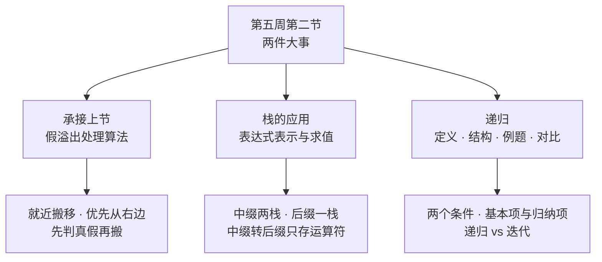
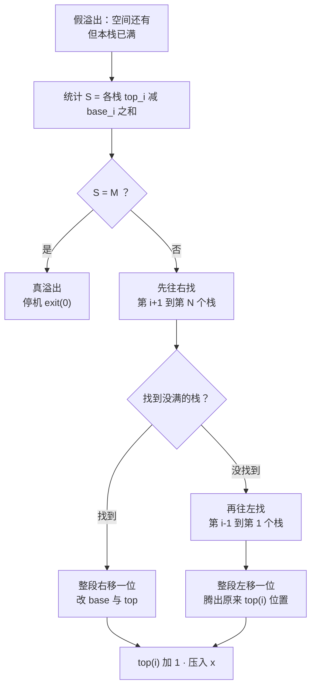
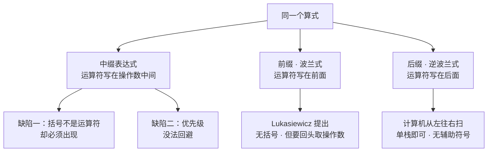
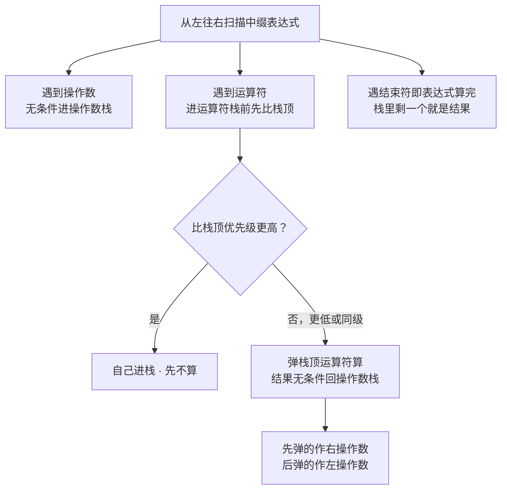
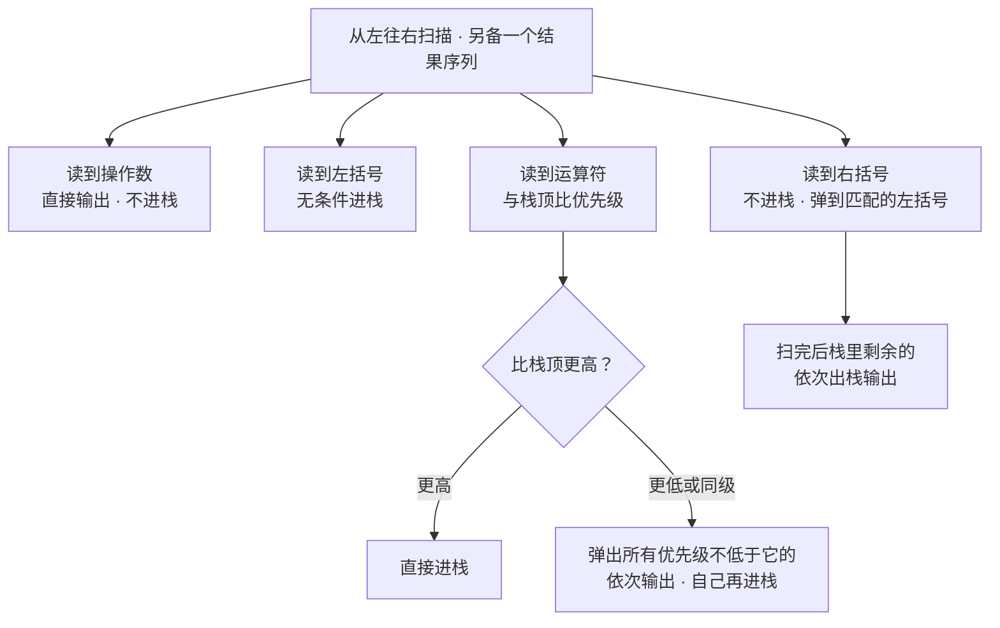
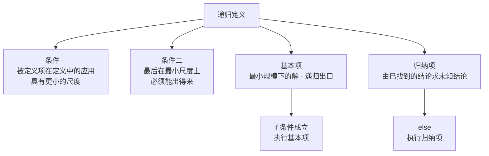
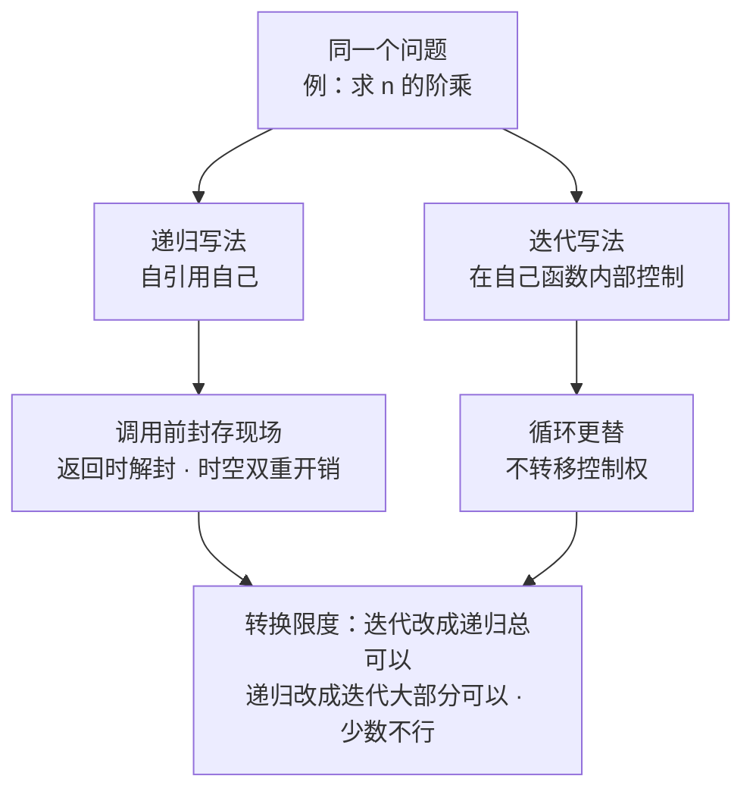

# 数据结构 · 第五周第二节 · 栈的应用与递归 · 详细版讲义

> **来源说明**：本讲义依据课堂录音的两份本地转写与逐段分析素材整理，并与严蔚敏《数据结构（C语言版）》对照校订而成，属**学习笔记性质的整理稿**，不是老师的官方逐字稿。
>
> - **转写来源（两份本地文件，均为课堂录音的 ASR 导出文字）**：① `栈相关课程教学内容_导出原文.txt`（前半：假溢出处理算法与栈的应用，约 00:00–00:29:02）；② `数据结构递归教学内容_导出原文.txt`（后半：表达式转换练习与递归，约 00:29:02–00:50:53）。两份合并后按 500–800 字切为 32 段，逐段分析产出 32 份素材（`segment_000.md` ~ `segment_031.md`），本讲义以这 32 份素材为主，必要处回看原始转写。
> - **教材对照范围**：严蔚敏《数据结构（C语言版）》第 3 章 **3.2 栈的应用举例**（数制转换、括号匹配检验、行编辑程序、迷宫求解、表达式求值）与 **3.3 栈与递归的实现**为主要对照，用于校对术语、算法写法与"递归"的标准表述；复杂度部分对照 1.4.3、1.4.4。**但本节课后半的假溢出处理算法、前缀/后缀记法、递归定义的两个条件、基本项与归纳项、简化背包问题、迭代与递归的对比，教材中没有对应小节**，属课堂扩展，附录 A 已逐条注明，讲义不为其硬套教材出处。
> - **标注约定**：课堂举例一律标"（转写举例）"；老师没讲、但教材里有的内容标"（教材补充：3.2.5）"这类出处；为把口述讲通而作的整理标"（讲义补充）"；能依据教材与上下文裁定的口误／误识，在正文用"（讲义校订：…）"当场说明，裁不掉的全部进"待核实内容"（共 29 条）。
> - **记法说明**：老师口头用"栈／栈底／栈基"；教材 3.1.2 中 **base 是"栈底指针"**、`top = base` 表空，而老师本节课讲的 **base 是"栈基"，落在栈底的前一个单元**（这也是第 i 个栈占用量写作 $top_i - base_i$ 而不用 $+1$ 的原因）。两者只差一格，读题时按语境分辨。
> - **时间说明**：本节课为**文字模式**（无音视频轨、无关键帧），各节时间戳是按**字数折算的伪时间**，非音频真实时间；它只是讲义内部单调递增的定位坐标，用于与 32 份分段素材对齐（课间休息 5 分钟在伪时间轴上被压缩掉了）。
> - **编号说明**：老师沿用自己旧课程体系的章节号，与严蔚敏教材章节号**不一致**：老师口中的"第三章"＝链表（教材 2.3）、"第 4 章"＝栈和队列（教材第 3 章，即第五周第一、二节的内容）。该对应关系为讲义的推断，详见"待核实内容"。
> - **关联阅读**：[数据结构 第五周第一节 线性表的应试技巧与栈 详细版讲义](数据结构%20第五周第一节%20线性表的应试技巧与栈%20详细版讲义.md)（上一节，栈的定义、顺序栈、链栈、多栈共存与假溢出的由来）、[数据结构 第四周第三节 链表的进阶与线性表的应用 详细版讲义](数据结构%20第四周第三节%20链表的进阶与线性表的应用%20详细版讲义.md)、[数据结构 第二章 线性表 详细版讲义](数据结构%20第二章%20线性表%20详细版讲义.md)。
> - **示意图说明**：正文里嵌了 5 张**操作示意图**，用 `tikz` 代码块书写，在 Obsidian 中由 TikZJax 插件渲染成 SVG（阅读视图可见）。**图内标签一律用字母、数字、数学记号与英文短语（纯 ASCII），中文解释放在图下方的「图注」里**——这是 TikZJax 的硬限制：它的引擎用 `btoa()` 把 TeX 源码写进 WASM 文件系统，**源码里只要出现非 Latin-1 字符（汉字、全角标点）就会直接抛异常、连编译都不会开始**；而且它只随附 Computer Modern 字体、没有中文字体，汉字即使送进去也排不出来。5 张图均已在 Chromium + TikZJax 下实测渲染通过。

## 开场导读

这节课是「栈」这个专题的下半场，主题分两块：**前半是栈的应用**——把上一节留下的假溢出处理算法补完，再一头扎进「表达式怎么表示、怎么求值」；**后半是递归**——从斐波那契的兔子讲到递归定义的两个条件、基本项与归纳项，最后和迭代做了一次彻底的对照。

开场老师先留了一句埋伏笔的话：「**我们首先说呢，凡是涉及到……调用啊，都要用到栈这种线性结构。**」这句话在今天的课里会响三次——讲中缀表达式为什么要借用括号时会响一次，讲递归时他会原封不动再说一次，而到了最后「为什么要自己管栈」时，它就是答案本身。

> **开课通知（课堂事务，压缩记录）**：成绩按百分制算——**实验 40 分 + 理论 60 分**；理论 60 分拆成**试卷 30 + 作业 15 + 考勤／学习通签到 9 + 笔记互评 6**（$40+30+15+9+6=100$，老师限定「最多也就差一两个百分点」）。其中**笔记互评共 6 个档**，老师重点提醒了风险：高档可能给到 $100$、$98$、$99$、$97$，但**最低一档不到 85 分，最坏可能给到 60 分或七十几分**；同时留了退出机制——也可以由老师／助教直接改（「我也可以让老师改，我这里有助教」），为此已发**匿名投票**征询意见，**少数服从多数**。（各档的具体分数线老师在原音里没讲清，见「待核实内容」。）

前半的算法部分是从一个很朴素的困境开始的。上一节留下的话是「$N>2$ 必然假溢出，写编译器躲不掉，所以要写**三个**算法」；这一节他就把第三个补上。假溢出之所以「假」，是因为**空间明明还有**——所以这件事**不能推给程序员或用户，必须由系统（编译器、操作系统）来解决**。处理的基本原则是「**就近**」：从邻居栈借一个单元。至于往哪边借，老师在这里停了一下，把问题抛给学生，然后自己给了那个本节课最生动的答案——**优先从右边找**。理由不是「右边代价小」（他说往左往右「一个一个也差不了多少」），而是「**右边不涉及当前正在操作的第 $i$ 个栈**」。他用的类比是现实里的：**走路时被同学伸出一只脚绊一下，摔得不严重；跑步时被绊一下，有可能摔得鼻青脸肿。**

判真假的那一步老师讲得很细，甚至专门停下来回答了一个「为什么这里不用加 1」的问题——因为向量里元素个数是 $P-L+1$，而这里的 $L$ 对应的不是栈底本身，是**比栈底落后一个单元的栈基 base**，那个「+1」早就被 base 提前减掉了。

然后话题一跳：「**好了，那第一节我们就讲完了。接下来我们来看第二节，栈的应用。**」最基础的语句是赋值语句，而赋值语句离开栈「**无能为力**」。他从一句形如 $A\div B^C+\dots$ 的表达式问起，一句「**流行的未必是最好的**」就把矛头指向了中缀表示法——Windows 漏洞多（「市面上 90% 的病毒都是针对 Windows 的」），Dvorak 键盘比 QWERTY 提速 5%～25%。然后是本节最硬的一段工程：中缀求值要**两个栈**，后缀求值只要**一个**；中缀转后缀也只要一个栈，但那个栈**只存运算符**。老师全程在提醒一个反直觉的易错点——$A+B-C$ 里，**加号必须先弹**。

后半是递归。理由有两条：一是计算机里有一整类程序设计叫**递归型程序设计**，这一章的作业就考它；二是**二叉树、树这些结构的定义本身就是递归定义**。定义给得很干净——「**问题的定义中又运用了它自身**」。生活里的对应物是「**先有鸡还是先有蛋**」；学术里的对应物是**他引与自引用**，以及科研评价里数他引次数的那套规矩。递归定义的两个条件、**基本项**与**归纳项**、递归算法的一般骨架、反例 `bad` 为什么从 $n=1$ 起就全完了（「**没有哪个值是特殊的**」），简化背包问题的三类基本项，最后是那个不太受欢迎的坦白——**操作系统不喜欢递归**，因为每次调用都要**封存现场**、返回时还要**解封**，时空双重开销；「**但是人们还舍不得舍弃它**」。

## 总览知识地图

内容跨两件大事，塞进一张图会糊掉，所以拆成 7 张小图，每张只画一层意思。

**图 1 · 全课主线：假溢出处理 + 栈的应用 + 递归**



**图 2 · 假溢出处理算法：先判真假，再谈搬移**



**图 3 · 同一条算式的三种表示法**



**图 4 · 中缀求值：两个栈，各管一摊**



**图 5 · 中缀转后缀：一个只存运算符的栈**



**图 6 · 递归的骨架：两个条件、两类项**



**图 7 · 递归与迭代：同一道题的两份写法**



## 正文

### 一、上课铃与一句埋伏笔的话 `00:00:00–00:01:36`

（课务已压缩在上文「开课通知」中，此处只记课堂内容。）

录音一开口是一句对上一句闲聊的确认，紧接着老师就正色了——「**我们首先说呢，凡是涉及到……调用啊，都要用到栈这种线性结构。**」注意他在这里用的是「调用」；后面讲中缀表达式的括号、讲递归的现场环境时，同一句判断会再出现两次，而今天这节课某种意义上就是在把这半句话填满。

然后是成绩与笔记互评的通知（见上文「开课通知」）。通知完，老师一句「**那接下来我们进入这一节课**」，把全场从行政模式切回教学模式。

### 二、承接上一节：栈与线性表，以及「假溢出」的由来 `00:01:36–00:04:48`

「**我们上节课说，栈和线性表两种数据结构**」——这句一出来，就知道这是主动复习而不是接话头。第一个要处理的是上一节留下的那个争议：很多教科书用线性表的模型来定义栈，说它是「**只允许在表尾进行插入和删除的线性表**」，老师的判词是「**不是特别恰当**」「**这个定义是有问题的**」，理由落在「**限定只在表尾**」这五个字上。他没有把话说完——转写在这里糊成「我们一看链式结构，我们的表头啊……一个在定啊」（见「待核实内容」），但上下文指向很清楚：一旦落到链式存储，「在表尾插入／删除」意味着每次都要遍历整条链表。

紧接着他把上一节的结论复述了一遍，这一条是全课的骨架，务必记牢：**栈与线性表同在「都是线性结构，逻辑结构一样，存储结构也可以一样」；异在「栈的运算是线性表运算的子集，而且这个子集还要加以限制——只能在端点进行」。**

然后是这一节真正的起点。老师从操作系统讲起：计算机、手机启动时都是靠若干个任务，任务之间要频繁调度；因为事先不知道哪个任务要更多内存、动态调用时哪个调用层级更深，**操作系统只能均分**。均分的结果就是——某个任务的栈调度特别深，分配给它的那块空间**很快就用完了**。

「**问题是那咋办？**」老师自己回答：「如果你是单栈，它简单，空间满了，再来一个应用调用栈，**直接报错就行了**。但现在多栈的情况怎么样？」于是有了那个词：

> **假溢出**：存储空间还有，但因为管理不当或者存取方式不当，导致元素无法入栈的现象。

它「假」在哪？「**因为我还有空间啊，空间还有**」——明明装得下别的栈的东西，偏我这个栈装不下。上一节给的定义原话更完整一点：「存储空间还有，但是因为你管理不当，或者是存取方式不当，导致元素无法……的现象」（「无法」后面的落点在原音里糊掉了，见「待核实内容」）。

**这里有一个定位上的关键判断**，也是本节算法的第一块基石：这种假溢出「**不应该是由程序员、由用户来解决，应该由系统来解决**」。老师把它推到未来：「**所以未来你们编一个编译器啊，或者操作系统，必然会有这样的一个（步骤）**。」这话反过来解释了上一节为什么要写「三个算法」——第三个不是可选项。

说完定位，他回顾了上一节的记号约定：因为存在「二义性」，所以不用栈底而用**栈基 base**，「**栈基就是比栈底低一个单元**」。于是判定条件极其干净：

$$top_i = base_i \quad\Longleftrightarrow\quad \text{栈空}, \qquad\qquad top_i = base_{i+1} \quad\Longleftrightarrow\quad \text{栈满}$$

老师顺带夸了一句这套设计：「我们的栈基多一个单元啊……有 $n+1$ 个 base，最后一个是指向最后一个单元格的……这是**典型的用空间来换时间**的效率啊，典型案例。」

最后他抛出处理原则并**停下来提问**：「它满了，但是旁边还有空间啊，那咋整呢？……我可以去左边找一找有没有空余的空间，或者你也可以从右边找。**现在问大家，有左右两个选择，我优先先考虑去左边找，还是去右边的？**」

### 三、假溢出（一）：为什么优先从右边搬 `00:04:48–00:06:26`

先确认原则：老师把它叫「**就近原则**」——「**就近原则就是涉及到的元素尽量少**」。往右找就是把右侧那些元素**整体往右搬一个位置**，空出一个位置，再把待入栈的元素压进去；往左找就把元素**往左搬一个位置**。他很坦率地承认单论搬移代价两边差不多：「**一个一个、一个一个，也差不了多少，差不多。**」

所以学生答「**无所谓，都一样，没区别**」（相当于「两边都行」）不算错，但没答到点子上。有一位同学给出了零散的说法（转写残缺，涉及「3:8」「$n+1$ 个 base」「右边找别人」），老师评价是「**不是特别正经**」。于是他自己把理由补上——

> 「**优先从右边找，答案是对的。但是光答这个问题不是很到位，本质的原因没有想明白：往右边找，为什么往右边找呢？**」

本质原因是这样的：**往右边找，不涉及当前正在对第 $i$ 个栈进行操作。** 也就是说，第 $i$ 个栈的数据此刻处于一种**活动状态**——它正在被使用。而往右边搬，动的是第 $i+1$ 个栈的元素，「**不涉及到第 $i$ 个栈的这些元素的移动，它会更高效、更好一些，不容易出错**」。

反过来说：「**如果你去左边走，第 $i$ 个栈的数据处于一种活动状态。那对于一个处于活动状态的东西啊，你来把它搬动，怎么样？往往是比较危险的。**」

然后是那个类比，全课最好记的一句：

> 「这个就好比我们现实生活中：**如果你在走路的情况下，你同学伸出一只脚来绊你一下，你可能摔得不是很严重是吧？但如果你在跑步的状态下，有同学伸出一脚来绊你一下，你有可能摔得鼻青脸肿。** 所以，一个东西正在运动的状态下，你要搬动——」

他用「往往会更危险一些」收束了论证，得出结论：「**所以我们优先从右边去找。**」

### 四、假溢出（二）：先判真假，再谈搬移 `00:06:26–00:09:40`

「如果要假溢出处理，**当然你首先要判断一下这个栈是不是真的已经溢出了**。」——这是整套算法里最容易被跳掉、也最要命的一步。

判断的办法是把 $N$ 个栈当前各自占用的单元数加起来：第 $i$ 个栈占的单元数就是「栈顶指针所指位置 − 栈基位置」，$N$ 个相加就是当前整个存储区被占用的单元总数。

$$S = \sum_{i=1}^{N}\left(top_i - base_i\right)$$

老师特意说这个 $S$ 要**大写**（「some 的 S」，取求和 sum 的意思）。判据是：

$$S = M \;\Longrightarrow\; \text{真溢出}\;\Longrightarrow\; \text{停机 } \texttt{exit(0)}\text{，啥也不干}$$

（**讲义补充**：老师只说了「若 $S=M$」这一句结论，没有验算。这个判据其实是可以自己确认的——把 $N$ 个栈都填满时 $top_i = base_{i+1}$，于是

$$S=\sum_{i=1}^{N}\left(base_{i+1}-base_i\right)=base_{N+1}-base_1=M-0=M,$$

是一个**望远镜求和**，正好等于存储区总单元数 $M$；而 $base_1=0$、$base_{N+1}=M$ 正是上一节定下的下标口径。所以「$S=M$ 判真溢出」是自洽的，不是巧合。）

**「为什么这里不用加 1」** 是老师主动停下来回答的一个追问，推理链很完整。向量里下标从 $L$ 编号到 $P$，元素个数是 $P-L+1$——因为 $L$ 那个位置本身也占一个单元（例：下标 1、2 都有元素，那就是 $2-1+1=2$）。而在栈里，对应 $L$ 的**不是栈底本身，是 $base_i$**，「**$base_i$ 本身就落后一个单位**」。所以向量公式里「多加的那 1」，在栈里已经由「base 比栈底落后一格」提前减掉了——**减一之后又加一，自动抵消**，因此 $top_i - base_i$ 正好就是真实占用量，不必再加 1。

接着交代描述工具：「我们要描述算法有四种形式——**第一种，自然语言；第二种，具体的程序设计语言；第三，伪代码；第四，流程图**。我们这里面用自然语言好了。」他还不忘补一句：「**自然语言也不是说随随便便的，你也得逻辑思路清晰**——做一个动作，没有做另外一个动作。」于是那句 `exit(0)` 就落在这里了：「`exit(0)`，怎么样，一个 0 就行了，对吧？`exit`，**啥都不干**。」

但 $S\ne M$ 的分支完全不同：「这是假的。**你不能直接给我停机，操作系统得给我解决。**」老师一句话点破了假溢出的本质——**局部满、全局不满**。接下来就是搬移环节。

**右边怎么搬**：从第 $i+1$ 个栈到第 $N$ 个栈去找一个**没满**的栈；找到之后，把第 $i$ 个栈里「从这儿到这儿」的那一整段元素**依次往右移一个位置**，空出来的位置就是把待入栈元素插进去的地方。栈顶的新值有两种等价写法：

$$top_i \leftarrow top_i + 1 \qquad \text{（老师口述的等价写法：}\; top_i \leftarrow base_i + 1 + 1\;\text{）}$$

**这一段里最强的一条提醒，是「搬元素 ≠ 完成搬移」**：

> 「搬动元素要注意啊：**我们不光要搬元素，你还要修改相应的栈顶指针。你别说人家元素搬走了、不通知人家，那完蛋了——那人家来访问不又乱套了？**」

而且受影响的**不止第 $i$ 个栈**：第 $i+1$ 个、第 $i+2$ 个……那些被「挤」到的栈，**栈顶指针都要加一**，「**要通知系统**」。（**讲义校订**：老师在本段只点了「栈顶指针」，而下一段讲左移时明确说「你还要修改**栈基、栈顶指针**」。既然被搬的是**一整段连续元素**，这一段的起点（base）与终点（top）同时都挪了一格，所以两个指针都必须同步改——讲义全文按「**base 与 top 同时改**」表述。）

搬完之后「**转第 7 步**」。而「如果右边实在是找不着了，那不得已还得从左边入手」——**双向搜索**，这是算法的兜底方向。

### 五、假溢出（三）：从左邻搬，与收尾 `00:09:40–00:11:18`

找到左边的空栈之后，动作是镜像的：把相邻的那一部分元素「**统统往左移一个位置**」。老师把被搬移段里那个最低地址的元素定位在 $base_{j+1}+1$，并说「**这个元素对应 $top(i)$**」——也就是说，**整段左移一格之后，空出来的正是当前 $top(i)$ 所在的那个位置**。（**讲义补充**：「$base_{j+1}+1$」里 $j$ 与 $i$ 的确切对应关系在原音里没有确定，见「待核实内容」；但「整段左移一位 → 腾出的是原来 $top(i)$ 那个格子」这一层是明确的，可以放心用。）

同步修改的规矩和右移一样：「**当然一样的，你还要修改栈基、栈顶指针**。」理由也说得很实在——搬的是一整段，「**因为你修改了栈基，它的地址跟着动了**」，不改就找不到搬过去的元素，下一次入栈也一定会覆盖错位置。

收尾的动作非常干净：**当前 $top(i)$ 那个位置空出来了，然后加 1，再把元素送进去就 OK 了。**

老师用四问给「第一节」作结——「怎么判断栈满？怎么判断栈空？怎么来管理栈里（的）组织？」，然后：「**至此为止，我们这个 $N$ 个栈共存的问题就讲完了。**」

**操作图 1 · 假溢出兜底：从左邻借，整段左移一格**

```tikz
\begin{document}
\begin{tikzpicture}[scale=0.95]
  \node[left,font=\small] at (-0.25,2.15) {before};
  \foreach \i in {0,...,7}{\draw[thick] (\i*0.72,1.50) rectangle ++(0.72,0.80);}
  \foreach \i in {1,2}{\draw[fill=red!14,thick] (\i*0.72,1.50) rectangle ++(0.72,0.80);}
  \foreach \i in {4,5}{\draw[fill=blue!14,thick] (\i*0.72,1.50) rectangle ++(0.72,0.80);}
  \node[above,font=\scriptsize,red] at (1.08,1.52) {$S_{i-1}$};
  \node[above,font=\scriptsize,blue] at (3.60,1.52) {$S_i$ full};
  \node[above,font=\scriptsize,gray] at (2.52,1.52) {free};

  \node[left,font=\small] at (-0.25,0.20) {after};
  \foreach \i in {0,...,7}{\draw[thick] (\i*0.72,0.00) rectangle ++(0.72,0.80);}
  \foreach \i in {1,2}{\draw[fill=red!14,thick] (\i*0.72,0.00) rectangle ++(0.72,0.80);}
  \foreach \i in {3,4}{\draw[fill=blue!14,thick] (\i*0.72,0.00) rectangle ++(0.72,0.80);}
  \draw[fill=green!20,thick] (5*0.72,0.00) rectangle ++(0.72,0.80);
  \node[font=\scriptsize,blue] at (2.88,0.40) {$S_i$};
  \node[font=\scriptsize] at (3.96,0.40) {$x$};
  \draw[->,thick,blue] (4.10,1.05) -- (2.20,1.05);
  \node[above,blue,font=\scriptsize] at (3.15,1.08) {shift left by one};
  \node[below,font=\small] at (2.60,-0.55) {the freed cell is the old $top_i$, then $top_i \leftarrow top_i+1$ and push $x$};
\end{tikzpicture}
\end{document}
```

图注：假溢出的兜底方向：右边实在找不到空位就从左邻借——把相邻的那一整段往左移一格，空出来的正好是原来的 top_i，然后 top_i 加 1 把元素压进去。


### 六、栈的应用（一）：从最简单的一句赋值语句说起 `00:11:18–00:12:50`

「**好了，那第一节我们就讲完了。接下来我们来看第二节，栈的应用。**」话题跳得很直接，中间没有过渡句，如实记下就好。

「实际当中有很多很多的例子。那么在计算机当中，**凡是涉及到引用、调用，都离不开栈**。」然后他挑了最基础的一句语句：**赋值语句**。「我们有一堆语句——什么条件语句、什么逻辑判断……**哪个语句是最简单的呀？赋值语句**。赋值语句说白了，就是右边算，右边有一个式子把它计算出来，结果**赋给一个变量**。」他的评语是「基本不能再基本的一个操作」，紧跟一句重锤：「**计算机离开栈，无能为力。**」

于是抛出例题（转写举例）：一句形如 $A$ 除以 $B$ 的 $C$ 次方、再加上另一项的表达式，$A$、$B$、$C$（及 $D$）的取值给定（转写中为 $A$、$B$、$C$ 都是 2，末尾疑为 $D$ 是 3），要求算出结果并**赋给**一个变量，「假设用 C 语言吧」。老师点名「**最后一排的同学，不要看手机**」回答。

结果不一致。老师的裁定是一句值得抄下来的话：「**计算机无非就是一步一步一个动作**……他说不对，没符合你的习惯；没符合你的习惯，**你就改变你的习惯**，好吗？老师从小就教育你……课本里就是先乘除、后加减。」注意他的因果方向：**不是老师算错，也不是学生算错，而是人的算术习惯要按计算机的规则来纠正。**（这道题的原式在多份转写里都没有被完整口述，字母与末项都有出入，见「待核实内容」；学生与老师的具体作答数值转写残缺，讲义不臆造。）

紧接着老师正色说出本节的总纲式判断：

> 「**我再说一句话：流行的未必是最好的。**」

第一个例子就近取材：「就拿这里来说，我们经常用的这个表达式的表达方法，是所谓的**中缀表示法**——把运算符写在两个操作数中间。这个方式很流行，大家都是这么说，**但他是不是最优的呢？我们说它不是啊**。我们可以举两个例子，说明一个问题。第一个例子就是大家在座的、可能还是很习惯用的 **Windows 操作系统**。Windows 很流行对不对？**可它好吗？据统计，市面上 90% 的病毒都是针对 Windows 的。**」

### 七、「流行的未必是最好的」：Dvorak 键盘、中缀的缺陷与两种波兰记法 `00:12:50–00:16:05`

Windows 的账还没算完：「**它为什么它的管理方式、它的内存的管理方式等等之类的，无一啊——所以就导致漏洞很多。**」流行不等于好，这一条立住了。

第二个例子更让人生气，是键盘。「咱们现在的键盘布局称为 **QWERTY 键盘**——它是以键盘第一行的那 6 个字母、以 **Q** 打头，所以叫 QWERTY。」它合乎早期英文打字机的习惯，所以普及了；但「**它实际上并不好。为啥？它左手负担很重**」，是「适合左撇子」的分法。**1932 年有一位学者（老师称是德国学者）发明了 Dvorak 键盘**，布局完全不同。效果是定量的：

> 「据统计，你输入同样的信息，**如果改成 Dvorak 键盘的话，你的输入速度大概提高 5%～25%，错误率差不多也降低这么多。**」

有同学问「那为啥不用啊？」老师的答案朴素得没法反驳：「**习惯成自然**……你要改很难。」他顺手又补了一个不太严格的类比（新冠肺炎很流行、流感也流行）。然后收回总纲：「**所以流行的未必是最好的。**」

**矛头正式转向中缀表示法。** 老师先立靶：「比如说 $A+B$，这个好说，对不对？那如果我要算这个 $A\times B - C$，**如果说你要先算 $B - C$，咋做？**」答案只有一个——**「就只能借助于辅助符号，这个括号」**。他随即给出过渡到栈的关键一步：

> 「我要把 $B$、$C$ 的值先算一下，**算完了要拿来为我所用**……这个只要为我所用啊，就是**引用、调用、应用**，就肯定涉及到栈。」

于是本段的追问落定：「**按理来说，我们一个表达式啊，那里面只应该出现两类字符**：**第一种，操作数**，你是对谁进行运算了；**第二种，运算符**，什么加减乘除。」

**中缀表示法的两条缺陷**，接着补完：

| # | 缺陷 | 老师的原话 |
| --- | --- | --- |
| 1 | **括号不是运算符，却必须出现** | 「**左括号、右括号是啥运算符啊？它根本就不是个运算符……它不应该出现在我们的表达式当中**」——它只能算人类为了表达复杂语义而引入的辅助手段（小括号、中括号、大括号／花括号） |
| 2 | **运算优先级无法表达** | 括号唯一的作用就是表达运算优先级，而这件事「**没办法避免的**」 |

有更优的替代，**波兰式（前缀表示法）**：「这个波兰式是波兰的一个逻辑学家叫 **Lukasiewicz**（老师音译「罗卡西里奇」）提出来的，用于逻辑表达式、算术表达式、代数表达式。」它的形态是「**把运算符写在两个操作数前面**」，好处是「**没有括号，很纯粹**」——里面只有运算符和操作数两种符号。老师当场读了一遍：从左往右扫，扫到加号，它需要两个操作数，可操作数还没出现；再往右扫到乘号，同样需要两个；扫到 $A$、$B$，**立刻做乘法**；再找到 $C$，两个操作数齐了，相加。（**讲义校订**：这串口述对应的具体前缀式形式，按上下文最可能是 $+\;\times\;A\;B\;C$，但原音不足以定论，见「待核实内容」。）

**然后是真正更优的那个——逆波兰式（后缀表示法）**。「逆波兰式呢，是在波兰式的基础之上**进行改进**的。**为什么要改进呢？因为我们的计算机扫描表达式是从左往右进行扫描的。**」所以它把**运算符写在操作数的后面**：「那么你想，**一旦找到乘号，它需要两个操作数，前面已经有了呀，已经出现了**——直接做乘法就行了。」最大的好处落在一句上：「**它里面没有任何的辅助符号。**」

> **教材补充：3.2.2**。老师这里批评「括号这个非运算符」是从**表示法**的角度说的；而严蔚敏教材是从**另一个角度**说明「括号这件事也归栈管」：3.2.2 括号匹配的检验用「**期待的急迫程度**」这个概念描述——读到左括号就压入一个更急迫的期待，栈里所有未消解的期待都降一级；读到右括号就消解栈顶那个最急迫的期待；算法开始和结束时栈都应为空。教材结论是「**这个处理过程恰与栈的特点相吻合**」。也就是说：中缀表示法因为要靠括号表达优先级而「不纯粹」，而**连括号带来的那个栈，也能被一个栈收拾干净**。

### 八、中缀求值（一）：优先级、左结合，与两个栈 `00:16:05–00:19:19`

「那中缀表达式的话，如果有一个中缀表达式，我们怎么来进行计算呢？**为了说明这个问题——栈的应用。**」老师的提问方式很特别：他不直接给算法，先请你把自己**想象成一台计算机**。「**那计算机就跟个小孩一样，他啥都不懂啊。你想一下，你怎么来实现这个表达式的运算？**」

先定规则。老师限定了范围：「**当然先不考虑复杂情况，比如有括号。**」然后是优先级序列，由高到低：

$$\text{幂}\;(\wedge) \;>\; \text{乘、除}\;(\times,\ \div) \;>\; \text{加、减}\;(+,\ -) \;>\; \text{表达式结束符}$$

关于最后一档他给了一个很有意思的理由：「分号怎么样？因为在表达式里面**遇到分号，就是这个表达式结束**嘛……**它也是一个二元运算符**（转写此句存疑），那么它是最低的优先级。」

> **讲义校订**：老师口述的「**分号**」就是教材 3.2.5 里的**表达式结束符 `#`**——教材把它虚设在表达式最左边，与真正的结束符构成「一对括号」，并在优先关系表里让它的优先级低于所有算术运算符。两者是同一个东西，讲义全文按「表达式结束符（老师称分号）」表述。**教材补充：3.2.5**。

光有优先级还不够。老师的第二问：「**比如说我 $A+B-C$，这两个运算符优先级一样的情况下咋办？**」答案是结合律：「**所有的二元运算符都是左结合的，就要用到结合律。**」他把结合律讲成了一个动作——「**我找到 $B$ 了，往左一看是加号，往右一看是减号。你俩平齐，我该咋办呀？先在左边，先把左边的（运算符）搬进来——所以先做左边的运算。**」（**教材补充：3.2.5**：教材表 3.1 用一条规则把这句口语写死了——「由规则 (2)，当 $\theta_1=\theta_2$ 时，令 $\theta_1>\theta_2$」。这就是左结合的正式表述，也是第九节那个 $A+B-C$ 易错点的全部依据。）

规则有了，接下来是**为什么必须要栈**。老师从左往右扫一个以 $A\div B$ 开头的中缀式：「**找到 $A$——我们肯定不能做计算**；再找到个除号——也不能做运算；然后找到 $B$——也不能算。**为啥？你想一下，我这个 $A\div B$，没准后面又来一个优先级更高的。**」他的结论句是全段的题眼：

> 「**那后面我们还要用它，所以肯定要保存起来。**」

于是**两个栈**登场：「我们刚才说了，表达式里面有两类——操作数和运算符……**那从左到右扫描计算机的话，我们需要两个栈啊。一个是操作数栈，一个是运算符栈**。两个栈，看好了。」

规则有三条，本节先记前两条：**凡是遇到操作数，无条件一律进操作数栈**（零判断）；**运算符要进运算符栈，若运算符栈为空就直接插进去**（老师类比「往一个空列表里插入一个新元素」）。第三条是**运算符入栈前要与栈顶运算符比较优先级**——因为「**我不敢运算，为啥？因为有可能这后面还有一个更高的**」。老师用一遍「看到 $C$ 时别着急，也许后面还有更高优先级的；看到 `^` 时我不敢运算；**直到看到加号，前面有一个幂，比我的优先级来得要高，这个时候才放心了，前面可以运算了**」，把「什么时候才能算」讲透了。板书上他列出的求值次序是四步：先算 $B^C$，再算 $A\div B^C$，第三步乘法，第四步加法。

### 九、中缀求值（二）：弹栈次序与「五个动作」 `00:19:19–00:22:33`

这一段是本节最需要背下来的操作细节，老师一句一句地掰开讲。

**加号与栈顶的 `^` 比较**：「一看怎么样，**幂的优先级比加号来得高**。所以这个时候**加号还在栈外面**……终于放心了，前面那个优先级高的，幂可以拿来做运算了。」

**弹栈三件套**：「可以做运算怎么办？这是二元运算。**我们操作数整个弹出来两个，运算符弹出来一个。**」然后是那句必须背的口诀：

> 「**我们要注意前提啊：这个操作数，先弹出来的放在右边，后弹出来的放在左边啊，我们有这个原则。** 也就是说，$C$ 放在右边，$B$ 后弹出来的放在左边，来进行运算，算 $B$ 的 $C$ 次方。**否则你就做反了，是吧？**」

$$\underbrace{\text{先弹出的}}_{\text{作右操作数}} \qquad \underbrace{\text{后弹出的}}_{\text{作左操作数}}$$

**算出来的结果本身又是一个操作数**——「这个操作数我后面要引用的，所以**无条件进栈**」，不比较优先级。

于是本例的中间结果依次成形：

$$T_1 = B^C, \qquad T_2 = A \div T_1, \qquad T_3 = D \times 1, \qquad T_4 = T_3 + T_2$$

（转写中 $T_3$ 的因子是 $1$ 还是别的，ASR 有「11」「5」等出入，见「待核实内容」。）

老师边做边口述顺序，读起来像一份脚本：`+` 与 `^` 比 → 算 $T_1$ 进栈；`+` 再与栈顶 `/` 比 →「**除号优先级更高，说明我还要先做除法**」→ 算 $T_2$ 进栈；「`/` 弹出来了，**这里面空了**——空了怎么样？**加法直接入栈**。这个时候，**这个加号才处理完了**」；接着左扫遇操作数无条件进栈、遇 `×` 时「`+` 比 `×` 优先级低，所以直接进栈」、遇表达式结束符时「`×` 的优先级更高，**那我放心了，乘号可以运算**」→ 算 $T_3$ 进栈；最后 $T_3$ 先弹出作右、$T_2$ 后弹出作左，$T_4 = T_3 + T_2$，**立马进操作数栈**。

「**然后怎么样？再碰到分号了，就可以认为结束了**……我们整个表达式这个值求出来了，就是 $T_4$。**把这个值再做一个赋值**——赋给我们的 $T_4$。」至此，「表达式求值 → 赋值给变量」这个最基础的语句闭环了。

**「五个动作」的小结**是本段最有价值的一段归纳。老师先报了一遍数：「**所以你看这个就有一系列的一个动作，这五个动作怎么样组成？5 个动作组成**」，然后逐条：① 算 $B^C$，这个值有了之后**放到栈里**；②「$A$ 除以它的时候，**要引用它，要应用它**」；③ $T_2$ 这个结果**也得入栈**；④ $D\times 1$ 这个结果**也得入栈**；⑤「**后面还要用它**」。

> 「**整个计算机的动作，就这 5 个动作。** 我们计算机的一个动作啊，你可以理解为：**它就做一步操作**，比如一步乘法、一步除法、一次数值运算。」

**操作图 2 · 中缀求值的两个栈**

```tikz
\begin{document}
\begin{tikzpicture}[scale=0.95]
  \node[above,font=\small] at (0.85,2.30) {operand stack};
  \foreach \i in {0,1,2}{\draw[fill=blue!12,thick] (0.15,\i*0.72) rectangle ++(1.40,0.72);}
  \node[font=\small] at (0.85,0.36) {$a$};
  \node[font=\small] at (0.85,1.08) {$b$};
  \node[font=\small] at (0.85,1.80) {$c$};

  \node[above,font=\small] at (4.35,2.30) {operator stack};
  \foreach \i in {0,1}{\draw[fill=green!18,thick] (3.65,\i*0.72) rectangle ++(1.40,0.72);}
  \node[font=\small] at (4.35,0.36) {$+$};
  \node[font=\small] at (4.35,1.08) {$\times$};
  \draw[->,thick] (5.85,1.44) -- (5.10,1.44);
  \node[right,font=\scriptsize] at (5.90,1.44) {top};

  \node[below,font=\small] at (2.60,-0.45) {operands: pushed unconditionally};
  \node[below,font=\small] at (2.60,-0.90) {operators: compare priority with the stack top first};
  \node[below,font=\small] at (2.60,-1.35) {on pop, the first one out is the right operand and the second is the left};
  \node[below,font=\small] at (2.60,-1.80) {the result goes back to the operand stack unconditionally};
\end{tikzpicture}
\end{document}
```

图注：中缀求值要两个栈：操作数栈与运算符栈。新运算符先与栈顶比优先级，栈顶更高就先弹栈顶算一步；弹操作数时先弹的作右操作数、后弹的作左操作数，结果无条件回到操作数栈。


### 十、后缀求值：一个操作数栈就够了 `00:22:33–00:24:11`

「好啦，我们中缀表达式是不是符合我们的演算习惯、计算习惯？」——**符合人的习惯，恰恰是它麻烦的根源**。「那么后缀表达式呢？」

规则只有三条，短到可以背：

| 读到 | 动作 |
| --- | --- |
| **操作数** | 「它是操作数，所以**直接进栈**」 |
| **双目运算符** | 「**弹出两个操作数**，**先弹出的放到右边，后弹出来的放到左边**……**别反了**」；算完「**无条件进栈**」 |
| **扫完 / 遇到结束符** | 栈里剩下的那一个数就是表达式的值 |

老师当场把这句话说透了：「**后缀表达式不需要两个栈，只需要一个栈，只需要一个操作数栈**……**重复这个操作，直到扫描完毕**。」

**完整算例**（老师逐步口述，栈内容按自栈底向栈顶写）：

$$\texttt{1}\ \texttt{2}\ \texttt{+}\ \texttt{8}\ \texttt{2}\ \texttt{-}\ \texttt{3}\ \texttt{/}\ \texttt{*}$$

| 步 | 读到 | 动作 | 栈（底 → 顶） | 结果 |
| --- | --- | --- | --- | --- |
| 1 | `1` | 操作数进栈 | $1$ | — |
| 2 | `2` | 操作数进栈 | $1,\ 2$ | — |
| 3 | `+` | 弹 2（右）、弹 1（左） | $3$ | $1+2=3$ |
| 4 | `8` | 操作数进栈 | $3,\ 8$ | — |
| 5 | `2` | 操作数进栈 | $3,\ 8,\ 2$ | — |
| 6 | `-` | 弹 2（右）、弹 8（左） | $3,\ 6$ | $8-2=6$ |
| 7 | `3` | 操作数进栈 | $3,\ 6,\ 3$ | — |
| 8 | `/` | 弹 3（右）、弹 6（左） | $3,\ 2$ | $6\div 3=2$ |
| 9 | `*` | 弹 2（右）、弹 3（左） | $6$ | $3\times 2=6$ |
| 10 | 扫完 | 栈中剩一个数 | $6$ | **最终结果 6** |

> **讲义校订**：原始转写在第 6 步与第 7 步之间糊掉了——老师在那儿只说了**一次**「找到（下一个操作数），直接进栈」，转写却把栈里**残留的那个 6** 也记成了一个被压入的字面 6。按「只压入一个操作数、且它必须是 3」来读，全过程与老师口述的三处报数（`/` 处「弹出 3、弹出 6」、`*` 处「弹出 2、弹出 3」、结尾「**最终结果是 6**」）完全自洽；反过来若把那个 6 当成字面量再压一次，末尾栈里会剩**两个** 6，与「最终结果是 6」矛盾。故上表按自洽读法给出。原始转写处仍有歧义，见「待核实内容」。

老师的评价是：「**直接一趟扫描就搞定了**……只需要一个**操作数栈**，**根本不需要**（考虑）什么（优先级）。」

### 十一、中缀转后缀（一）：算法骨架 `00:24:11–00:25:48`

「那问题是后缀表达式是不是可以用啊？**但是我们人类怎么样？不习惯呀。**」于是设问：「**中缀表达式是怎么来转换成后缀表达式的呢？**」他先给出两个观察，把转换的实质点破：

1. 「你去研究一下你就发现——**所有的操作数，它的相对顺序没有任何改变**」；
2. 「仔细怎么样？就是**把这个括号给它（去掉）了**」。

于是算法只需要**一个栈 + 一个结果序列**：「我们中缀（表达式）转换的时候，实际上也只需要一个栈。**但是这个栈不是用来放操作数的，用来放运算符的**……所以我们创建一个栈，就是**暂时保存这些运算符**就可以了。」外加「一个用于**存储最终后缀表达式结果的集合**」（即结果序列）。

**为什么操作数不进栈？** 因为「**中缀和后缀这个操作数的顺序是一模一样的**……所以你碰到它**直接输出**就行了」。三类 token 的处理规则如下（括号那一条老师讲得最细）：

| 读到 | 动作 |
| --- | --- |
| **操作数** | **直接输出**到结果序列，不进栈 |
| **左括号 `(`** | **无条件进栈** |
| **右括号 `)`** | **不进栈**。「它只是在栈外，然后我们从栈里面**弹出运算符，添加到结果集合当中**，直到遇到对应的左括号为止。**左括号一并弹出**——那么这一左一右就**相互抵消了**，这个时候就认为**这个括号处理完了**」 |
| **运算符** | 若栈顶是左括号或栈为空，**无条件进栈**；若**当前运算符的优先级更高**，**无条件进栈**；若**当前运算符的优先级低于或者等于栈顶运算符的优先级**，则「**弹出所有优先级高于或者等于当前运算符的（那个）运算符**，把它添加到结果集合当中」，然后自己进栈 |
| **扫描结束** | 栈里可能还有运算符，**依次出栈**加入结果序列 |

老师给这套算法找了个直觉锚点：「**你想一下啊，跟人做一样，手工做一样**。」然后开始演示：「首先来个**左括号**，**无条件进栈**——注意栈里面**只保存运算符**。接下来再来一个 $A$，**操作数直接输出**。接下来再来一个**加号**，是运算符，**直接进栈**。然后接下来碰到一个 $B$，直接输出。」（本段算例到此为止，右括号的处理留给下一段。）

> **讲义补充**：老师在「若优先级低或同级就弹栈」之后紧接着说了一句「这个跟我们那个中缀（求值）表达式类似，就是比较（栈）里外……的（优先级），**只要更高我们就弹出来，因为它要做运算了**」——这句话其实是**求值**时的判据（栈顶更高就先算），与**转换**时的判据形式相似但语境不同。讲义按转换语境表述，求值语境见第八、九节。

**操作图 3 · 中缀转后缀：一个只存运算符的栈**

```tikz
\begin{document}
\begin{tikzpicture}[scale=0.95]
  \node[left,font=\small] at (0.55,2.93) {input};
  \foreach \i/\v in {0/a,1/{+},2/b,3/{*},4/c}{
    \draw[thick] (0.70+\i*0.85,2.55) rectangle ++(0.85,0.75);
    \node[font=\small] at (0.70+\i*0.85+0.425,2.93) {\v};
  }
  \draw[->,thick,red] (0.70+4*0.85+0.425,3.90) -- (0.70+4*0.85+0.425,3.33);
  \node[above,red,font=\scriptsize] at (0.70+4*0.85+0.425,3.93) {scanning};

  \node[above,font=\small] at (1.25,1.85) {operator stack};
  \foreach \i in {0,1}{\draw[fill=green!18,thick] (0.70,\i*0.72+0.35) rectangle ++(1.10,0.72);}
  \node[font=\small] at (1.25,0.71) {$+$};
  \node[font=\small] at (1.25,1.43) {$\times$};

  \node[above,font=\small] at (4.15,1.85) {output};
  \foreach \i/\v in {0/a,1/b}{
    \draw[thick] (3.70+\i*0.85,0.35) rectangle ++(0.85,0.75);
    \node[font=\small] at (3.70+\i*0.85+0.425,0.73) {\v};
  }
  \node[below,font=\small] at (2.60,-0.15) {operands go straight out; only operators wait in the stack};
  \node[below,font=\small] at (2.60,-0.65) {a left parenthesis is always pushed without comparing};
\end{tikzpicture}
\end{document}
```

图注：中缀转后缀只需要一个栈，而且这个栈只存运算符：操作数直接进结果串，左括号无条件进栈；新运算符与栈顶比优先级，栈顶不低于它就弹出。


### 十二、中缀转后缀（二）：实操演示与「扫到 F」那道题 `00:25:48–00:27:26`

老师把上面这套算法在一个含括号的中缀式上走了一遍，按扫描顺序逐个报符号的去向（括号与运算符在原音里被严重误识为「陈号」「总奥」「六包」之类，讲义一律按术语归位）：

`(` → 无条件进栈 → `)` → 不进栈，「从栈里面**剩下的**直到遇到一个左括号也弹出，**就消融了**」 → `×` → 栈为空，直接进栈 → `(` → 无条件进栈 → $C$ → 直接输出 → `×` → 无条件进栈（「因为这边是左括号、右括号的优先级要低啊」）→ …… → 操作数 → 直接输出 → `+` → 进栈 → 操作数 → 直接输出 → `)` →「**加号、乘号这两个弹出来**」 → `)` → 再弹一遍。

老师在出栈节奏上特别叮嘱了一句，**这句话是括号处理题的判分点**：

> 「**要注意看到一个弹一个就可以了，不要弹这个**——因为这个对应的不是（这个左括号），对吧？」

也就是：右括号只负责触发「弹到匹配的左括号」，**匹配到的左括号只出栈、不输出**；它上面多余的符号一个也不许多弹。

收尾：「这个表达式处理完了。但是**里面**（栈里）**我们把剩下的这个运算符还要弹出来，还要弹出来**。至此为止，整个中缀转为后缀，**结果有了**。」

然后是两道思考题的第一道（转写只保留了题目，没保留答案）：

> 「在将中缀表达式转换为后缀（逆波兰）表达式的这个过程当中，问你：**扫描到 $F$ 的时候，栈中的元素依次是多少？**」

老师宣布：「**我们休息 5 分钟。这是第一个。还有第二个问题啊**——」话没说完，转写到这里换了一次文件。

> **转写素材的接缝提示**：`segment_017.md` 开头有一行标记 `===== 第二段转写开始（承接假溢出处理与表达式转换）=====`，其后接的文件名是「数据结构递归教学内容_导出原文」，而该段内容仍在讲**中缀转后缀**。这属于**素材文件命名与内容主题不一致**（转写源被切成两份时文件名错位），不是主题切换；讲义按内容连续处理，登记在「待核实内容」。

### 十三、中缀转后缀（三）：分析法，与「运算符栈最多 5 个」 `00:27:26–00:32:15`

休息回来，老师换了一条**更快的路**：「**表达式转换成后缀表达式啊，你可以大概分析一下就行了。**」

**分析法**的心法是「**快速地扫一眼**」：按算术优先级把整式看成几大块，每块**先写各部分的后缀、运算符一律放到最后**。他当场拆了一个整式（转写举例，形如 $A\div B + (C\times D - 1\times F)\div 7$）：

| 步骤 | 拆法 | 后缀写法 |
| --- | --- | --- |
| ① 整式 = 两大部分相加 | $A\div B$ ＋ 其余 | 两部分后缀写完，**最后再写加号** |
| ② 左半 | $A\div B$ | `A B ÷`（「A B 除嘛」） |
| ③ 右半 = 括号里的式子再除以 $7$ | 括号里先算，除号放最后 | `… 7 ÷` |
| ④ 括号里 = 两部分相减 | $C\times D$ − $1\times F$ | **减号放最后** |
| ⑤ 最小块 | $C\times D$ ／ $1\times F$ | `C D ×` ／ `1 F ×` |
| ⑥ 合起来 | — | `A B ÷ C D × 1 F × − 7 ÷ +` |

老师在括号这一层讲得很实在：「**你后缀表达式写出来是没有括号的**……括号你又可以看成两个部分嘛，第一部分减去一个第二部分，**那我先把减号肯定放在最后**，然后第一部分和第二部分……你一步一步来求。」

但他并没有就此收手——「**当然你也可以（再换个方法）。这样，为了万无一失，有两种方法，你验证一下。**」于是他改用上一节的算法，按扫描顺序逐个符号追踪「入栈还是输出」（老师口述的次序有回跳，中途自己纠正过一次「**说错了说错了**」）。追踪中的几条口头规矩很值得记：

- 除号「**在栈里面待不住**」，因为除号优先级比加号高，一碰到加号就「立马输出」；
- 加号「**在最后才能输出**」，所以扫到它之后就一直留在栈里；
- 左括号「**它也出不来呀，它得等右括号才能搞定**」；
- 乘号「**也得直接进栈，无条件进栈**」（他特意加重语气）；
- 减号优先级比乘号低，所以「**这个乘号会弹出来，它会先运算**」——注意是**扫到减号时**才把上面的乘号弹掉，不是扫到乘号时就弹。

补完右括号那一段之后，老师给出了那道选择题的答案——**「碰到右括号呢，就不能做（归约）操作，所以是选 B。」**（选项内容在原音里没有读出，见「待核实内容」。）

**然后是本节课最难的一道题，也就是老师「扫到 $D$」才给出答案的那道：运算符栈里最多能有几个元素。** 他先把题目口径点清楚——「**我们要注意，这个指的是运算符的最大个数**」，「这是运算符栈，**课件上他这个写的不太好，写成操作（数）栈**」（他当场纠正了课件的标注）。

他的枚举次序是：扫到 $A$（操作数）→ 输出；扫到乘号 → 进栈；扫到左括号 → 进栈；再来一个左括号 → 进栈；扫到加号 → 进栈（「**此时上面刚有左括号压着，所以不弹**」）。于是：

$$\boxed{\text{运算符栈内元素个数的最大值} = 5}$$

「**注意这儿有几个：1、2、3、4、5，5 个，这是最多的。为什么呢？**」位置是——「**最多的时候，是找到这个 $D$ 的时候、扫到 $D$ 的时候**」，栈里（自栈底向栈顶）是「**减号、乘号、左括号、左括号都在里面啊，还有这个加号**」。

老师接着把 $D$ 之后的三种情形也交代了，规律是「**同类符号归约时净效果为 −1**」：

| $D$ 之后遇到 | 老师口述的动作 | 栈中个数 |
| --- | --- | --- |
| **右括号** | 右括号本身不留在栈里；`(` 与它对应的 `+` 弹出消去，随后除号 `/` 进栈 | $5-2+1=\mathbf{4}$ |
| **减号**（扫到 $F$） | 减号与除号同级左结合，除号必须先弹出做运算，再把新减号压入 | $4-1+1=\mathbf{4}$ |
| **再来一个减号**（$F$ 之后） | 同级符号继续弹栈归约 | 「**弹出来的更多**，那里面就会**剩两个**」 |

他的态度是「**这个过程啊，你只要熟悉了之后就好分析了**」——也就是不必逐字推演，记「同级归约净减 1」这条就够。

### 十四、老师「再三强调」的易错点：A+B-C `00:32:15–00:33:51`

算例讲完，老师忽然拉了一下刹车，单独拎出一道题：

> 「**那要注意，尤其要注意这个 $A+B-C$。有很多同学一看 $A+B-C$——「你不应该后面的先做运算吗？」这个不对，这个不对，我再三强调啊。**」

正确的处理是：「**这个同级的情况下，加和减同级，我们认为这个加号已经在栈内了；加号要先做运算，所以这个加号要弹出来。**」落到实践上就是——「**在转换成后缀表达式的时候，注意这一点就行了。**」

为什么？他自己回答了：「我刚才说的是不是 $A+B-C$ 这种的？那找到这个减号咋办？**前面这个加号要先处理掉啊**……你想到这个减号的时候，这个加号已经要弹出来，要输出。所以加号在这个（栈）里面就没有什么呢，没有加号。**没有加号，接下来一定是这个减号进去。**」

老师的措辞很重：「**这一句话啊，这个地方很迷惑人，大家注意一下。**」

> **教材补充：3.2.5**。这个「很迷惑人」的点，教材用一条规则一句话就说完了：由运算规则 (2)「从左算到右」，表 3.1 规定**当 $\theta_1=\theta_2$ 时令 $\theta_1>\theta_2$**。翻译成栈的语言就是——**同优先级的运算符，栈里那个（更早进来的）要先算**，所以 $A+B-C$ 转换时输出顺序是 $A\ B\ +\ C\ -$，求值时加号先归约。老师的口诀与教材规则完全一致。

**两道练习**就在这里布置：第一道就是课堂正在分析的这类题（运算符栈计数／表达式求值），老师说「**这个很简单，你们就不做了啊……你们可以拍一下，自己回去做**」，但补了一句「**基地班的时候我觉得就一定要做了**」（「基地班」所指存疑）；另一道的口述内容本身就是做题提示——用栈处理操作数，「**先弹出来的放在后面（右边），后弹出来的放在左边**」。

然后老师话锋一转：「**好，接下来我们来看下一个。我们讲递归——为啥要讲递归呢？**」

### 十五、转入递归：为什么要把它单独拎出来讲 `00:33:51–00:37:07`

理由第一条是分量：「**咱们递归这种方法，对我们计算机科学、对计算方法来说，它的影响非常深远。**」因为「**我们的计算机现在专门有一类程序设计，叫做递归型程序设计**……它有特殊的方法和要求，所以**我们把它专门拎出来讲一下**」。他给了**两个目标**，说得很直白：

1. **会写递归型程序设计**——「**你们后面会有作业，这一章的作业就有这个递归的这种设计方法怎么写**……它写法跟具体的程序设计方法不一样。」
2. **为后面用递归定义的数据结构打基础**——「**我们后面什么二叉树啊、树等等，它的定义实际上是用了递归的定义**，所以我们要把它拎出来专门讲一下。」

「因为递归实际上就是**自己引用自己**」——这句话他在本节后面还会再展开一次。

**例子老师选了兔子。**「1202 年这个兔子繁殖啊，它是有这些规则的：**有每对成熟的兔子每月繁殖一对后代**；**兔子出生以后第二个月就成熟了**；但是要假设**老兔不动情**。」第三个假设他专门解释过为什么要有：「**因为数学问题是比较严谨的，这个假设就是划定规律**——你要在这个前提下统计，这个解才是这个样子，对不对？否则不符合这个前提条件。」问题则是：「**1 月底引入一对刚出生的（种）兔子，年底有多少对？**」

**「大家非常熟悉了」——然后就是本节的结构性发现。** 老师指着递归方程的形状说：「**左边可以认为是一个被定义项**……我们可以发现，被定义项是求问题规模为 $N$ 的这个问题。然后在左、右边的表达式里面又出现了什么呢？**出现了这个左边被定义项的这个样子，但是它是问题规模更小的问题**——因为是先前的问题、解决了的问题。」

$$f(n) = f(n-1) + f(n-2)$$

（**讲义校订**：老师在本段**只口述了方程的骨架**，右端的下标与初值并没有逐字说出；初值与写法是按他那四条规则推得的。$f(1)=f(2)=1$ 的初值口径与教材 3.3 式 (3-2) 的 $Fib(0)=0,\ Fib(1)=1$ 只是**下标平移**的关系，不是矛盾；考试按老师给的兔子题口径写。）

他顺着这个结构往下推了一层：「规模为 $N - 1$ 的问题，那你要求规模为 $N - 1$ 的问题呢？**又必然是先要求解了 $N - 2$ 这个规模的问题**啊。所以它是怎么样**反过来递推**的？说白了就是这个函数定义有个性质——**用早先的、先前算出来的值来定义新的值**。就是我们要求 $N$ 的结果，用早先计算出来的 $N - 2$ 这个规模的值，和早先的 $N - 1$ 这个规模的值，来定义更大规模的值。」

> **讲义校订**：转写里没有出现「反向递推」这四个字，老师说的是「**反过来递推**」。讲义按「**反向递推＝用先前算出的值定义更大规模的值**」这一含义统一表述。

然后他把递归抬到数学的高度：「我们说递归函数啊，实际上**这个理论研究已经非常深了，已经形成了数学当中的一个独立的分支，叫递归函数论**……**实际上计算机就是从数学学科发展起来的**，所以数学当中的这些方法，对我们影响也是非常深远的。」再往前推到语言：「**计算机科学的实践论——什么叫实践论呢？说白了就是编程序。编程序你会发现它跟递归函数密切相关。** 递归的这种思想，**影响了程序设计语言的构造**……你们用递归的这种想法来写程序，你会发现**特别简洁，而且逻辑思路特别清晰**。」

**正式的定义**随后落下，两句都要背：

> **递归过程（procedure）**：**问题的定义中又运用了它自身**的过程，称为递归过程。
>
> **递归函数（function）**：把「过程」换成「函数」——**一个函数的（函数体）定义当中就运用了它自身**。**简称递归，也叫递推。**

紧跟着的是实现层面的硬性要求，也是本节课开头那句话的正面回答：「我们说递归怎么样，因为涉及到所谓的**应用**嘛，**应用就是引用（调用）嘛。引用——那凡是涉及到引用，这个都要用栈这种结构，都要用栈来进行（保存调用现场）**啊。」

> **教材补充：3.3**。教材 3.3 把这句话写成了可执行的清单：调用一个函数之前，系统要完成 3 件事——（1）把所有的**实在参数、返回地址**等信息传递给被调用函数保存；（2）为被调用函数的**局部变量分配存储区**；（3）把**控制转移到**被调函数的入口。返回之前也要完成 3 件事——（1）保存被调函数的**计算结果**；（2）**释放**被调函数的数据区；（3）依照保存的返回地址把控制转移回调用函数。多个函数嵌套调用时按「**后调用先返回**」的原则，**上述信息传递和控制转移必须通过栈来实现**：每当调用一个函数就在栈顶分配一个存储区，每退出一个就释放它，**当前正运行的函数的数据区必在栈顶**。递归函数与嵌套调用类似，只是自己调自己，系统因此设立「**递归工作栈**」，每层的**工作记录**包含**所有实在参数、所有局部变量以及上一层的返回地址**；栈顶那条工作记录称为「**活动记录**」，指示它的栈顶指针称为「**当前环境指针**」。老师在第三十节说的「封存现场／解封现场」，与这套术语是同一件事的两种说法。

### 十六、递归的两张生活面孔：先有鸡还是先有蛋，他引与自引用 `00:37:07–00:38:47`

定义给完，老师说「我们举几个例子吧……比如阶乘，比如斐波那契数列，**这个都很简单，我就快讲快过**」，然后拐到生活里去——「**递归啊，日常生活中也有**。」

第一张面孔是那个老问题，而且他是用**追问链**把它拆成自引用的：

> 「你看到一只鸡蛋，然后你问：**这鸡蛋咋来的呀？是哪只鸡下的呀？** 那怎么样？去问那只鸡。那问题是，看到那只鸡怎么办？『**这鸡咋来的呢？是哪颗蛋孵出来的呀？**』那就去问那颗蛋……**所以先有鸡还是先有蛋，这个问题好像到现在也没解决。**」

蛋问鸡、鸡问蛋，**互为定义、互为前提，找不到基点**——这正是「问题的定义中运用了它自身」却没有出口的样子。

第二张面孔在学术界，而且它更贴近编程：**参考文献有两种引用**。

| 引用方式 | 含义 | 观感 |
| --- | --- | --- |
| **他引** | 引用别人的文章 | 「**这个是挺靠谱的**」——「什么大家、什么……有啥观点，毛泽东有啥观点，牛顿有啥观点」 |
| **自引用** | 引用自己以前的工作：「我一年前、两年前，我有另外一个工作也是解决这个问题；而现在这个问题的解决方案，是在原来那个方案的基础之上如何改进」 | 「**夸夸其谈**」 |

自引用的观感他讲得极其传神：「好比有个人说话天天怎么样，他挂在嘴边的是『**我咋说咋说**……**我一年前说了个啥啥啥，我十年前说了个啥啥啥**』——**用自己（以前）的观点来论证现在新的观点**。那你看，你感觉这个人在干嘛？**夸夸其谈**。」

**语言层面还有一层不对称**（这一层老师两段合起来说）：「**所有的程序设计语言啊，对于这种他引我们都支持**；但是这个自引用怎么样？**有的程序设计语言就不支持**。」（他在这一段**没有清晰点名是哪一种语言**，到第三十一节再讲这个话题时音频依然含糊，见「待核实内容」。）

最后落在科研评价上——「**一个人、一个科研能力的体现，就是他引的统计量。他引的统计量越多，说明他在学术界的表现越被人认可**。所以现在很多主要的这种研究奖项什么的，**都要统计这个他引的次数来佐证**——你看我的科研有多牛啊，就这个意思。」所以**自引用在科研评价上就不太好了**。

### 十七、递归的两种形式，与递归定义的两个条件 `00:38:47–00:40:22`

「递归有两种形式」，老师先给最直白的那个：「**一种就是特别直截了当——赤裸裸的，我就在这个过程 $P$ 当中直接调用 $P$。**」

第二种是「**拐了个弯儿**」：$P$ 里调 $Q$、$Q$ 里调 $P$ 这样绕回来。他的定性是：「**实际上说白了，还是 $P$ 自己调用 $P$ 嘛……只不过这个在形式上面好看一点。**」（**教材补充：3.3** 的说法与老师完全一致：「一个**直接**调用自己或**通过一系列的调用语句间接**地调用自己的函数，称做递归函数。」）

**接下来是本节最要紧的一条纪律**，老师是用否定句说出来的：

> 「我们要注意——**它不是循环定义啊。这个递归定义，它必须要有出口的。** 它必须**一步比一步来得更简单**，而且它**最终必须可以终结**。」

他用阶乘做示范：「我要求 $n$ 的阶乘，要先求 $n - 1$ 的阶乘……你不断地往下走，走到 $n=0$ 的时候，**它必须有一个确切的值，就是 1**。所以这个最简单的情况就是我们所谓的**递归的出口，它本身实际上不能用递归来进行定义**。」

$$n! = n\cdot(n-1)! = n(n-1)\cdot(n-2)! = \cdots \qquad\text{下探到 } n=0,\; 0! = 1$$

**由此归纳出递归定义的两个条件**（老师明说「一个递归定义它有两个条件」）：

1. **被定义项在定义中的应用具有更小的尺度**——「我要求问题规模为 $n$ 的，我用问题规模为 $n - 1$ 或者 $n - 2$ 等等来定义它……**你不能说一样大小的问题规模**」；
2. **最后在最小尺度上它是递归的**——「它要有递归出口，就是说**它能够出去**，递归只能论到有限的规模。」

**据此，递归算法设计要抓两个关键点。** 第一个是**基本项**：

> 「所谓的基本项，就是**我要列出一个或者几个被定义函数的值**，这个值规定**我最终的终止条件**。大白话来说，**基本项实际上就是最小规模下问题的解决方案**——比如说 $n$ 的阶乘，就是 $n=0$ 或者 $n=1$ 时候的解决方案。」

第二个叫**归纳项**，他在这里停住，把问题交给下一段。

### 十八、基本项与归纳项：递归算法的一般结构 `00:40:22–00:41:59`

**归纳项**的定义从形式说起：

> 「**归纳项就是列出如何由已经找到的结论来求得未知结论的函数**。也就是说，**归纳项就是规定你这个递归如何进行下去**。大白话来说，**归纳项就回答大规模的问题如何用小规模问题来解决**——这个解决方案你要**给我给出来**。」

为了把「由已知推向未知」这个直观含义讲活，老师插了一段时事类比（转写举例）：「现在网上是这样了……据统计，全国各种职业当中，**受网络诈骗最深的占比**是谁呢？……**学生和教师群体**。为啥？尤其是大学生——**高中生没啥钱**；大学生有学费，还有这些生活费……然后我们在**象牙塔**里面。然后很理想地出现（一个诱饵）……说的话很漂亮，所以**让你心动了**，然后就让你**不上当就上钩**。」类比点在于：被骗者就是从一个「小」的诱因被一路推到一个「大」的损失结果。

**然后是这一段最该抄下来的骨架**——递归算法的一般结构：

$$\text{if（问题参数构成的条件成立）}\ \text{then 执行基本项；}\qquad \textbf{else}\ \text{执行归纳项}$$

紧接着老师出了一道课堂练习：「**大家分析一下——这是一个不好的递归算法设计，你回答一下问题啊。**」在读题之前他先补了一条**伪代码／编程语言的记号约定**，说「**因为你们后面作业要用到**」：

> 「**要注意这个函数名啊，如果写在左边，这代表啥？代表的是一个变量。** ……放在左边这个玩意儿，而且**后面没有跟括号、跟参数**，那么它就是一个什么呢？**就是一个变量**啊——那么**函数名放在左边就是变量**。」

练习的题面信息：函数名叫 `bad`，返回值类型是整型（`int`），基本项是 `if (n == 0) y = 1;`。

**操作图 4 · 递归的工作栈：每层一个工作记录**

```tikz
\begin{document}
\begin{tikzpicture}[scale=0.95]
  \foreach \i/\lab in {0/{$f(1)$},1/{$f(2)$},2/{$f(3)$},3/{$f(4)$}}{
    \draw[thick] (0,\i*0.86) rectangle ++(7.60,0.86);
    \node[left,font=\small] at (-0.15,\i*0.86+0.43) {\lab};
    \node[font=\small] at (3.80,\i*0.86+0.43) {work record: return addr, arguments, locals};
  }
  \draw[->,thick,blue] (8.55,3.59) -- (7.70,3.59);
  \node[right,blue,font=\scriptsize] at (8.60,3.59) {push on each call};
  \draw[->,thick,red] (7.70,0.43) -- (8.55,0.43);
  \node[right,red,font=\scriptsize] at (8.60,0.43) {pop on each return};
  \node[below,font=\small] at (3.80,-0.55) {LIFO: the innermost call returns first};
\end{tikzpicture}
\end{document}
```

图注：递归的代价落在一个工作栈上：每进一层递归就压入一个工作记录（返址、参数、局部变量），每退一层就弹出并解封——这正是操作系统不喜欢递归的原因，时空双重开销。


### 十九、反例 bad：没有哪个值是特殊的 `00:41:59–00:45:10`

老师先把「函数名在左还是在右」这条讲透，因为作业要用。

**在左边（后面不带括号、不带参数）→ 它是一个变量。** 老师解释了它干什么用：「因为以后我们引用的时候，是**就把这个变量放到表达式里面**……所以这个变量就有值了嘛，意思是**通过这个变量把值带回去**，以后你就可以引用了。」

**在右边（后面加括号、括号里有参数）→ 它是函数调用。**「这个 `bad` 指的是啥？**函数调用啊。这个碰到它要自己调用自己，因为这里面有参数了嘛。**」

老师还顺手讲清了 C 语言里的**整除**：「$n$ 除以 3……这个是什么？**这就是整除**（C 语言中任何语言的整数除法）……再加上一。」

于是可以拼出这个反例的骨架（老师口述，语句按其说明整理）：

```c
int bad(int n) {
    if (n == 0) return 1;           /* 基本项：函数名当变量，把 1 带回去 */
    else if (n != 0)
        y = n * bad(n / 3 + 1);      /* 归纳项：左边 y 是变量；右边 bad( ) 带参数，是调用 */
}
```

「那现在问你：**为啥不好呢？分析一下**——**为啥这个递归算法设计不好？不好在哪？**」学生还没答，老师自己给了判断：「**当它 $n=1$ 的时候，实际上是死循环。**」

然后是本节最漂亮的一段论证。老师先替学生提出反驳：「**可能有同学会说，它就是特殊在 $n=1$，那 $n=2$、$n=3$，$n$ 取其他的值，那不都可以吗？**」然后逐个代入：

| 传入 $n$ | $n\div 3$（整除） | 再 $+1$ | 递归到 | 结果 |
| --- | --- | --- | --- | --- |
| $n=1$ | $0$ | $1$ | `bad(1)` | **自己调自己，永不返回** |
| $n=2$ | $0$ | $1$ | `bad(1)` | 落入上面那个死循环 |
| $n=4$ | $1$ | $2$ | `bad(2)` → 再退到 `bad(1)` | 死循环 |

结论是两句连着的重话：

> 「**所以，都会归根结底全部算不出来。没有说 $n=1$ 特别，其他的就可以怎么样了。实际上（任何 $n$）都算不出来——只有 $n=0$ 才有值。**」
>
> 「**没有哪个值是特殊的，没有哪个情况是特殊的。只要你进入死循环，所有的值都算不出来。**」

**毛病出在哪，一句话就够**：递归实参 $n\div 3+1$ **没有变小**——它甚至可能把 $n$ 变大。这正是第一个条件（被定义项在定义中的应用必须具有**更小的尺度**）被违反的样子。

**按一般结构写「正确版本」**，骨架完全一样，只是归纳项的实参严格变小：

```c
int f(int n) {
    if (n == 0) return 1;        /* 基本项：直接用函数名 f 作为一个变量，把 1 返回去 */
    else if (n != 0)
        return n * f(n - 1);     /* 归纳项：左边 f（不带括号参数）是变量；右边 f(n-1) 是调用 */
}
```

「**当它等于 0 的时候，直接用这个函数名称作为一个变量，把这个值返回去。**」归纳项那边他再叮嘱一次：「**千万不要有的同学这个地方后面括号 $n$——注意啊，这个左边不能带参数，表明它是变量；右边是调用，它里面带参数括号。**」

**函数过程怎么带回返回值**（作业要用，他讲了两遍）：「**就用它的函数名作为一个变量。**」并且给了个跨语言的对照：「说白了，实际上就是你声明一个变量……比如说什么别的语言，就是额外定义一个，比如说什么 `result` 呀、`sum` 之类的，然后返回去。**只不过这里面用的是函数名直接作为一个变量**——**没啥新鲜的**。」

他随后把话头引向下一段——「**大家要注意迭代（递推）怎么用**」——只留了一句复杂度提醒：「按照……这个问题也简单，我就不说了……**所以它的这个时间复杂度要注意**」（转写此处残缺，见「待核实内容」）。

> **讲义补充（对应老师那句「时间复杂度要注意」）**：这句话课上没给数值，补上结论备查。**阶乘递归**每层只调一次 $f(n-1)$、每层做一次乘法，调用深度 $n$ 层，故 $T(n)=T(n-1)+O(1)=O(n)$，**递归工作栈的空间**同为 $O(n)$（**教材补充：1.4.4**，每层一个工作记录，见 3.3）。同一个基本结构若写成 $f(n)$ 里**调两次** $f(n-1)$，则 $T(n)=2T(n-1)+O(1)=O(2^n)$，这就是**教材补充：1.4.3** 说的**指数阶**，不应用于求解。**斐波那契**递归 $Fib(n)=Fib(n-1)+Fib(n-2)$ 同理是指数级：其特征方程 $x^2=x+1$ 的实根为 $\varphi=\frac{1+\sqrt5}{2}\approx 1.618$，故 $T(n)=O(\varphi^{\,n})$——这正是「递归写起来简洁、代价是时空双开销」最直白的度量。

**汉诺塔**在这里第一次露面，而且定性很明确：

> 「**那汉诺塔是一个啥？一般过程。** 为啥？因为**我们就知道这个盘子咋办，你可能只需要一个不带返回值的函数**……**我们一般不需要这个结果啊**。如果你实在想知道什么时候第几步、搬哪个盘子，**你在这里面可以打印一下**。所以它是个**一般过程**啊。」

### 二十、一般过程与函数过程：汉诺塔与简化背包问题 `00:45:10–00:48:19`

段首是上一句的收尾：「**不是函数过程**……也就是它**不需要返回值**啊。」于是有了本节的一组二分：

| | 函数过程（function） | 一般过程（procedure） |
| --- | --- | --- |
| 有没有返回值 | **有** | **没有** |
| 返回值的写法 | 左侧的**函数名不带括号** → 它是个变量，用来把值带回去 | 不写 `return` |
| 典型例子 | 阶乘、简化背包问题 | **汉诺塔** |

> **教材补充：3.3，算法 3.5**。汉诺塔的规则（每次只移一个盘、大盘不能压小盘、三个塔座 $X,Y,Z$）与三步递归结构如下，老师课上只给了「它是一般过程」这个定性：

```c
void hanoi(int n, char x, char y, char z) {
    // 将塔座 x 上按直径由小到大且自上而下编号为 1 至 n 的 n 个圆盘
    // 按规则搬到塔座 z 上，y 可用作辅助塔座。
    if (n == 1)
        move(x, 1, z);        // 将编号为 1 的圆盘从 x 移到 z
    else {
        hanoi(n - 1, x, z, y);    // 将 x 上编号为 1 至 n-1 的圆盘移到 y，z 作辅助塔
        move(x, n, z);            // 将编号为 n 的圆盘从 x 移到 z
        hanoi(n - 1, y, x, z);    // 将 y 上编号为 1 至 n-1 的圆盘移到 z，x 作辅助塔
    }
}
```

注意它与「被定义项在定义中的应用具有更小的尺度」完全同构：**「如何将 $n - 1$ 个圆盘从一个塔座移至另一个塔座的问题是一个和原问题具有相同特征属性的问题，只是问题的规模小 1，因此可以用同样的方法求解」**（教材原话）。

**接着是简化背包问题。** 老师说得很轻松：「我相信你们可能有同学**专门做过那种复杂的背包例题**。这个非常简单。」

**题面**（转写举例）：设背包总容量（重量）为 $S$；现有 $N$ 件物品，重量分别为 $W_1$、$W_2$，一直到 $W_N$。**问**：能否从这 $N$ 件物品中选出若干件放入背包，使所选物品的重量之和**恰好为 $S$，不多也不少**？**存在符合要求的选择则返回 TRUE，否则返回 FALSE。**

**递归参数只有两个**：$S$ 与 $N$；返回类型是**布尔类型**。老师说「这两个参数就够用了」。

**常规情况（进入归纳项的条件）**是两条不等式：

$$\text{常规情况}\iff S > 0 \quad\textbf{且}\quad N \ge 1$$

「**$S>0$**——背包还有空间，我才解这个问题；**并且 $N\ge 1$**——物品的数目大于等于 1，就我还有物品，我才去考察这个问题。」

**考察对象是第 $N$ 件物品 $W_N$**，对它有**两种选择**，老师强调这两种选择都会让**规模减小**：

| 分支 | $S$ 变成 | $N$ 变成 | 老师的说法 |
| --- | --- | --- | --- |
| **要 $W_N$**（放进背包） | $S - W_N$ | $N - 1$ | 「我把 $W_N$ 要上之后……**规模减小了**；$S$ 重量减 $W_N$；原来考察 $N$ 件物品，现在**少一件**」 |
| **不要 $W_N$**（不放进背包） | $S$ **不变** | $N - 1$ | 「因为你 $W_N$ 没放进去，**重量不变**。但是……**这个问题规模还是能减小**，因为**我已经考察了 $W_N$ 了**嘛」 |

第二条分支是这一节的关键：**规模减小靠的不是 $S$ 变小，而是 $N$ 减一**。两个分支都让 $N$ 减一，所以递归一定终止。

**「常规情况实际上不一定满足」**——于是要给出另一半。老师的对应关系说得很清楚：「它实际上是递归的**归纳项**……**实际上边界情况对应到这个递归程序设计里面是啥？就是基本项啊。**」三类基本项（边界情况）与返回值如下：

| # | 基本项（边界条件） | 返回值 | 语义 |
| --- | --- | --- | --- |
| ① | $S = 0$ | **TRUE** | 剩余容量正好用尽，「**正好放进去了**」，是合法解 |
| ② | $S < 0$ | **FALSE** | 「**背包容量不够**」——例：「我容量只有 5 公斤，结果最后一件物品我选择『要』，然后把它放进去以后，**容量小于 0**」 |
| ③ | $S > 0$ 且 $N < 1$ | **FALSE** | 「**背包容量太大了**，把这 $N$ 件全扔进去，还不够它装（**装不满**）」 |

老师随后开始口述代码骨架：「所以 $S=0$，return true，对不对？**否则 $S<0$，或者是 $S>0$ 但是 $N<1$，这种情况下……**」句子在这一段末尾被截断，答案落在下一段。

**操作图 5 · 简化背包问题的二叉决策树**

```tikz
\begin{document}
\begin{tikzpicture}[scale=0.95]
  \node[draw,thick,rounded corners,font=\small] (root) at (0,2.30) {$S,\ n$};
  \node[draw,thick,rounded corners,font=\small] (l) at (-2.75,0.80) {$S-W_n,\ n-1$};
  \node[draw,thick,rounded corners,font=\small] (r) at (2.75,0.80) {$S,\ n-1$};
  \node[draw,thick,rounded corners,font=\small] (ll) at (-4.10,-0.80) {$S-W_n-W_{n-1}$};
  \node[draw,thick,rounded corners,font=\small] (lr) at (-1.45,-0.80) {$S-W_n$};
  \node[draw,thick,rounded corners,font=\small] (rl) at (1.45,-0.80) {$S-W_{n-1}$};
  \node[draw,thick,rounded corners,font=\small] (rr) at (4.10,-0.80) {$S$};
  \draw[->,thick] (root) -- (l);
  \draw[->,thick] (root) -- (r);
  \draw[->,thick] (l) -- (ll);
  \draw[->,thick] (l) -- (lr);
  \draw[->,thick] (r) -- (rl);
  \draw[->,thick] (r) -- (rr);
  \node[left,font=\scriptsize,blue] at (-3.15,1.55) {take $W_n$};
  \node[right,font=\scriptsize,red] at (3.15,1.55) {drop $W_n$};
  \node[below,font=\small] at (0,-1.55) {base cases: $S=0$ is true; $\;S<0$ or $n=0$ is false};
\end{tikzpicture}
\end{document}
```

图注：简化背包问题：规模为 n 的问题只做一次二选一——拿起第 n 件就把容量减掉 W_n、规模降到 n−1；放下第 n 件则容量不变、规模也降到 n−1。递归解就是这棵二叉决策树。


### 二十一、栈的另两个应用，与递归的代价 `00:48:19–00:49:37`

段首把背包的收尾补完：「**这个 FALSE（假）对不对？两种情况啊**」（即 ②③ 都返回 FALSE），然后是归纳项的口述：「接下来其他的情况……如果要（这件物品），**递归调用 $S - W[N]$、$N - 1$**……返回为真；那第二个情况是不要——**$S$（容量）不变，但是考察物品的件数减少一**，再自己调用自己好了。**这是简化的背包问题了啊。**」（「又返回为真」一句中「又」疑为「或」，即两个子问题**任一为真**即可，见「待核实内容」。）

**然后话题转到栈的另两个经典例子**，老师是点到即止，但提醒都很实在。

**数制转换**：「大家非常熟悉了，对不对？除以（基数）取商，然后（取余）、倒过来。但我们要注意，你小学的时候，这叫被除数、这个商，**上到 1 为止**；**但是你要在计算机二进制里面，这个地方要到 0 啊，否则你把那个最高的那个位丢了啊**。」——这就是为什么程序里是 `while (N)` 而不是 `while (N != 1)`。

> **教材补充：3.2.1，算法 3.1**。教材把这一段补全了。原理是

$$N = \left(N \operatorname{div} d\right) \times d + N \operatorname{mod} d$$

（`div` 为整除运算、`mod` 为求余运算）。例：$(1348)_{10} = (2504)_8$，过程为 $1348 \to 168$（余 4）、$168 \to 21$（余 0）、$21 \to 2$（余 5）、$2 \to 0$（余 2）——**从低位到高位**产生各位数位，而打印输出一般要**从高位到低位**，恰好相反。于是把各位数位顺序进栈，按出栈序列打印即可：

```txt
void conversion () {
    // 对于输入的任意一个非负十进制整数，打印输出与其等值的八进制数
    InitStack(S);    // 构造空栈
    scanf("%d", N);
    while (N) {
        Push(S, N % 8);
        N = N / 8;
    }
    while (!StackEmpty(S)) {
        Pop(S, e);
        printf("%d", e);
    }
} // conversion
```

`while (N)` 正是老师说的「**到 0 啊，否则你把那个最高的那个位丢了啊**」。教材对这一例的评语也值得记：栈操作的序列是**直线式的**（先一味入栈，再一味出栈）；「**栈的引入简化了程序设计的问题，划分了不同的关注层次，使思考范围缩小了。而用数组不仅掩盖了问题的本质，还要分散精力去考虑数组下标增减等细节问题**」。

**迷宫问题**老师只报了名字（「好了，迷宫问题。」）就走了。

> **教材补充：3.2.4**。求迷宫中从入口到出口的所有路径是经典问题，计算机通常用「穷举求解」：从入口出发顺某一方向探索，能走通就继续往前，不能走通就沿原路退回换方向。为保证在任何位置上都能沿原路退回，就需要用**后进先出的结构保存从入口到当前位置的路径**——「**因此，在求迷宫通路的算法中应用栈也就是自然而然的事了**」。教材用栈 $S$ 记录「当前路径」，栈顶存「当前路径上最后一个通道块」，于是「**纳入路径**」= 当前位置入栈，「**从当前路径上删除前一通道块**」= 出栈；并强调所求路径必须是**简单路径**（不重复经过同一通道块）。

**然后是本节课最重的一段坦白。**「可能有的人很喜欢设计递归程序，对吧？那看起来很简单啊，**跟我们的思路契合度也非常高**。**但是我们的操作系统可实在是不喜欢递归程序。**」理由是完整的四步：

> 「**为什么？因为你去执行 $N$ 的问题，你要去调用 $N - 1$ 这个（递归）的问题，调用之前要干嘛？封存现场。** 然后解决完了之后回来**还要解封**。那你想，这就涉及到一个现场环境啊——**你放到内存里面，涉及到了空间的消耗**；**另外一个，你解封和封装是不是也要时间啊**？**所以时空方面，递归的这种程序都是非常低效的。**」

话音刚落他又自己接了一句悬念：「那我们往往怎么样？**但是人们还舍不得舍弃它**，对不对？」

### 二十二、迭代与递归，以及「自己管栈」 `00:49:37–00:50:53`

答案先给出来了：「**因为它写起来实在简单啊。**」——这就是人们舍不得的理由。

然后他回到第十六节那个语言不对称的话题，把话说完：「所以就涉及到一个，**要为了高效**……就和前面说的呀，我们说**自引用**——自己引用自己啊。**所有的其他程序都支持，唯独有一个例外是什么呢？自引用是不行的。**」

**这一节有一处必须原样存疑**：老师在两处（第十六节末、第三十一节）都提到「**有一种程序设计语言就不支持自引用**」，但**具体是哪一种语言，语音严重失真、无法辨认**。讲义按素材要求**不臆断语言名**，只保留「有一类语言不支持自引用」这一层，并登记在「待核实内容」。老师给出的（通俗的）理由是：「**你编写的递归程序干嘛？他直接没法执行，他执行不了，因为他认为自引用不安全**。」类比仍是那句「**夸夸其谈自己的观点**都不行」。

**由此引出对高效的需求**，以及绕开递归的办法：

> 「那（这个）问题咋解决呢？就是**我们原来有一个栈，那个管家帮我们管的那个运行环境，他现在干嘛？现在你自己管起来**，哎，就这么办。**后面我们会再讲。**」

**最后是迭代与递归的定义对比**。老师先给词源——「那这个『**迭**』是干嘛的？**（iterate）替换／更替的意思**，所以迭代就是迭来替换（更替）的意思」，然后下判断：「**那么迭代这种方法实际上，循环迭代是比较好的。**」他举的例子是同一个问题的两份实现（板书上「**你看上面是递归，下面是迭代**」，例题疑为求 $n$ 的阶乘）。差别落在**控制权在哪里**：

| | 迭代（iterate） | 递归（recursion） |
| --- | --- | --- |
| 词源 | 替换／更替 | （自引用自己） |
| 执行位置 | **在自己函数内部控制**，不转移控制权 | **控制权要转移**（交出去再收回） |
| 现场开销 | 无 | 调用前封存现场、返回时解封，**时空双重开销** |
| 老师的评价 | 「**实际上循环迭代是比较好的**」 | 写起来简单、思路清晰，但效率更差（**教材补充：1.4.3** 的阶） |

**互相转换的限度**，他划得很清楚：「**我们很多，尤其是那些伪递归的（算法），那几个方法呢，我们往往推荐大家一样把它改写成循环这种方式来处理。** 就是**伪递归的算法，大部分能转换成迭代的形式，但是有的不行啊，有的不行；反过来是可以的**。」

$$\text{迭代} \xrightarrow{\ \text{总是可以}\ } \text{递归}\qquad\qquad \text{递归（伪递归）} \xrightarrow{\ \text{大部分可以，少数不行}\ } \text{迭代}$$

**「伪递归」**指的是结构上形如递归、但可以机械改写成循环的那一类算法（尾递归、简单自调用等），老师把它当作「应改写成循环」的主要对象。

下课：「**好，我们这节课（就到这里）下课。**」

## 结课：把整节课串起来

这节课是「栈」这个专题的下半场，也是老师自己切的「第二节」——上一节讲的是栈是什么、怎么存，这一节讲的是**栈能干什么**，以及一个和栈手拉手走进来的老朋友：**递归**。

前半的算法部分是从一个很朴素的困境开始的。上一节留下的话是「$N>2$ 必然假溢出，写编译器躲不掉，所以要写**三个**算法」；这一节他就把第三个补上。假溢出之所以「假」，是因为**空间明明还有**——空间还在别的栈的地盘上，所以这件事**不能推给程序员或用户，必须由系统（编译器、操作系统）来解决**。处理的基本原则是「**就近**」：从邻居栈借一个单元。至于往哪边借，老师停了一下把问题抛给学生，然后自己给了那个本节课最生动的答案——**优先从右边找**。理由不是「右边代价小」（他明说往左往右「一个一个也差不了多少」），而是「**右边不涉及当前正在操作的第 $i$ 个栈**」：第 $i$ 个栈此刻处于**活动状态**，搬动一个正在运动的东西是危险的——**走路被绊摔得不严重，跑步被绊摔得鼻青脸肿**。

判真假那一步老师讲得极细，还专门停下来回答了「为什么这里不用加 1」：向量里元素个数是 $P-L+1$，而这里对应 $L$ 的不是栈底本身，是**比栈底落后一个单元的栈基 base**，那个「+1」早就被 base 提前减掉了，**减一加一自动抵消**。判据是 $S=\sum_{i=1}^{N}(top_i-base_i)$，$S=M$ 才是真溢出，`exit(0)` 啥也不干；否则就是假溢出，**不能停机**——先从右邻搬，搬的是一整段元素，**搬完必须同步改各栈的 base 与 top**（否则「人家来访问不又乱套了」），右边找不到再从左邻搬，最后 $top(i)+1$ 压入 $x$。

然后话题一跳：「**好了，那第一节我们就讲完了。接下来我们来看第二节，栈的应用。**」最基础的语句是赋值语句，而赋值语句离开栈「**无能为力**」。他从一句形如 $A\div B^C+\dots$ 的表达式问起，学生算出的数和他按计算机规则算出的不一样，他的裁定是「**没符合你的习惯，你就改变你的习惯**」——**不是谁算错了，是人的习惯要按计算机的规则改**。一句「**流行的未必是最好的**」把矛头指向中缀表示法：Windows 很流行，可「**市面上 90% 的病毒都是针对 Windows 的**」；QWERTY 也很流行，可它**左手负担很重**，1932 年 Dvorak 键盘同信息输入**提速 5%～25%、错误率也降这么多**——不换的理由只是「**习惯成自然，你要改很难**」。

中缀表示法的两条缺陷被逐条点破：**括号根本不是运算符，却必须出现；优先级没法回避**。而**凡是要把算出来的中间结果「拿来为我所用」，就是引用、调用、应用，就肯定涉及到栈**——这是本节课开头那句「凡涉及调用都要用栈」的回响。解法是**波兰式**（Lukasiewicz 提出，运算符在前）与**逆波兰式**（运算符在后，**因为计算机是从左往右扫的**）。工程上：中缀求值要**两个栈**，规则是操作数无条件进操作数栈、运算符入栈前先与栈顶比优先级、**先弹出的作右操作数、后弹出的作左操作数**，结果无条件回栈；后缀求值**只要一个操作数栈**，一趟扫描搞定，「**根本不需要考虑优先级**」；中缀转后缀也只要一个栈，但那个栈**只存运算符**（操作数顺序中缀后缀一模一样，碰到就直接输出），右括号**不进栈**、只触发「弹到匹配的左括号为止」，左括号只出栈不输出（「**看到一个弹一个就可以了，不要弹这个**」）。全程老师压着一句易错点反复敲：**$A+B-C$ 里加号必须先弹**——因为同级左结合，栈里那个更早进来的要先算。

后半是递归。理由有两条：一是计算机里有一整类程序设计叫**递归型程序设计**，这一章的作业就考它；二是**二叉树、树这些结构的定义本身就是递归定义**。斐波那契兔子（1202 年、成熟兔每月繁殖、出生后第二个月成熟、老兔不动情）被用来**立结构**：左边是被定义项（规模 $N$），右边又出现同样的形式但**规模更小**——「**用先先前算出来的值来定义新的值**」，这就是**反向递推**。定义很干净：**问题的定义中运用了它自身**（过程）／**函数的函数体定义中运用了它自身**（函数），**简称递归，也叫递推**。而「**凡涉及引用（调用），都要用栈来保存调用现场**」——今天的第一句话，在这里兑现。

递归有两张生活面孔。**先有鸡还是先有蛋**：蛋问鸡、鸡问蛋，互为定义、互为前提，找不到基点。**他引与自引用**：引用别人的文章是「**挺靠谱的**」，拿自己一年前、十年前的旧观点论证今天的新观点，那是「**夸夸其谈**」；所以科研评价要看**他引的统计量**。他顺手抛出一条语言层面的不对称——**他引所有语言都支持，自引用有的语言就不支持**（具体是哪一种语言，原音含糊，存疑）。

规矩随之立起来。递归有**两种形式**（直接自调用／拐弯互调），但「**不是循环定义，必须要有出口**」，因为它得「**一步比一步来得更简单，最终可以终结**」——阶乘一路下探到 $n=0$，那里必须有**确切的值 1**。于是有**递归定义的两个条件**：**被定义项在定义中的应用具有更小的尺度**；**最后在最小尺度上它是递归的**（有出口）。据此，递归算法长成同一副骨架：**if 条件成立执行基本项，else 执行归纳项**——**基本项**是「最小规模下问题的解决方案」（规定终止条件），**归纳项**是「由已找到的结论求未知结论的函数」（必须把大规模怎么用小规模解的方案给出来）。于是有了作业级的记号约定：**函数名写在左边且后面不跟括号参数 → 它是个变量，用来把值带回去；写在右边带括号参数 → 它是函数调用**。反例 `bad` 的归纳项是 $n\times\mathrm{bad}(n\div 3+1)$，**实参没有变小**，于是 $n=1$ 死循环，$n=2\to1$、$n=4\to2\to1$ 全掉进去——结论是那句重话：**没有哪个值是特殊的，没有哪个情况是特殊的；只要你进入死循环，所有的值都算不出来，只有 $n=0$ 才有值。** 改成 $f(n)=n\times f(n-1)$ 才算守住第一个条件。

例题里最完整的是**简化背包问题**：容量 $S$、$N$ 件物品 $W_1..W_N$，问能否选若干件使重量和**恰好为 $S$**。常规条件 $S>0$ 且 $N\ge 1$；考察 $W_N$，**要**它则 $(S,N)\to(S-W_N,N-1)$，**不要**它则 $(S,N)\to(S,N-1)$——后者 $S$ 不变，但**规模照样减小，因为「我已经考察了 $W_N$ 了」**。三类基本项：$S=0\to$ **TRUE**、$S<0\to$ **FALSE**（容量不够）、$S>0$ 且 $N<1\to$ **FALSE**（装不满）。汉诺塔则是**一般过程**——不需要返回值，想知道第几步就在里面打印一下。

**收尾是本节课最诚实的一段。** 递归程序**看起来很简单、跟思路契合度非常高**，但「**我们的操作系统可实在是不喜欢递归程序**」：执行 $N$ 要调 $N - 1$，**调用之前要封存现场，回来还要解封**——现场环境放进内存是**空间**消耗，封装与解封本身是**时间**消耗，「**所以时空方面，递归的这种程序都是非常低效的**」。可「**但是人们还舍不得舍弃它**」，理由只有一句：**因为它写起来实在简单啊**。要同时又要高效，办法是把**原来那个替我们管运行环境的栈接管过来自己管**（「后面我们会再讲」）。最后划清界限：**迭代**的词根是「替换／更替」（iterate），它在**自己函数内部控制**、**不转移控制权**，而**递归要转移控制权**；**伪递归一律推荐改写成循环**，**递归改成迭代大部分可以、少数不行，迭代改成递归总是可以**。下课。

**复习要点（可自测）**

- 本节两件事：**假溢出处理算法**（承接上节）+ **栈的应用（表达式）**；后半是**递归**。
- 假溢出的定义：**存储空间还有**，但因管理不当或存取方式不当导致元素无法入栈。
- 假溢出**必须由系统（编译器／操作系统）解决，不能推给程序员或用户**。
- 就近搬移**优先从右边找**：因为不涉及**正在操作、处于活动状态的第 $i$ 个栈**；代价论两边差不多（走路被绊 vs 跑步被绊）。
- 判真假：$S=\sum_{i=1}^{N}(top_i-base_i)$；**$S=M$ 才是真溢出** → `exit(0)` 停机；$S\ne M$ 是假溢出 → **不能停机**，操作系统要解决。
- **为什么不用加 1**：向量是 $P-L+1$，而这里对应 $L$ 的是**比栈底落后一单元的栈基 base**，$- 1$ 与 $+1$ 抵消。
- 描述算法的**四种形式**：自然语言、程序设计语言、伪代码、流程图；本算法用**自然语言**（也不是随便写，逻辑要清晰）。
- 右搬：从第 $i+1$ 到第 $N$ 栈找**没满**的栈 → **整段右移一位** → **同步改各栈 base 与 top**（不通知就「乱套了」）→ 搬完转第 7 步；右找不到再从第 $i - 1$ 到第 1 栈找 → **整段左移一位** → 腾出的正是原来 $top(i)$ 那个位置。
- 收尾统一动作：**$top(i)+1$，把 $x$ 送进去**。
- 栈与线性表：**同**是线性结构、逻辑结构一致、存储结构也可一样；**异**在栈的运算是线性表运算的**子集**且**还要加以限制**（只能在端点）。
- 常用判定：**判空 $top_i=base_i$**、**判满 $top_i=base_{i+1}$**、**栈底 $=base_i+1$**、base 多一个单元是**空间换时间**。
- 赋值语句是最简单的语句，而**计算机离开栈无能为力**；**凡涉及引用、调用都离不开栈**。
- **「流行的未必是最好的」**：Windows（90% 病毒针对它）、QWERTY vs **Dvorak 1932**（提速 5%～25%、错误率降同等幅度）；不换只因**习惯成自然**。
- 中缀表示法两条缺陷：**括号不是运算符却必须出现**；**优先级无法表达**。想先算 $B - C$ 就得用括号，而「算出来的中间结果拿来为我所用」= 引用／调用 = **栈**。
- 表达式里只该有**两类字符：操作数、运算符**。
- **前缀（波兰式）**：Lukasiewicz 提出，**运算符写在操作数前面**，无括号，但要回头取操作数。**后缀（逆波兰式）**：**运算符写在操作数后面**，因为**计算机从左往右扫**，扫到运算符时操作数已就位；**里面没有任何辅助符号**。
- 优先级序列（高→低）：**幂 > 乘除 > 加减 > 表达式结束符（老师称「分号」，即教材 3.2.5 的 `#`）**。
- **所有二元运算符左结合**：找到 $B$，往左看 `+`、往右看 `-`，两边平齐 → **先做左边的运算**（教材表 3.1：$\theta_1=\theta_2$ 时令 $\theta_1>\theta_2$）。
- **中缀求值要两个栈**（操作数栈 + 运算符栈）：操作数**无条件**进操作数栈；运算符入栈前与栈顶比优先级，栈空或自己更高则直接进栈，否则弹栈顶先算；**先弹出的作右操作数，后弹出的作左操作数**（否则「你就做反了」）；算出的中间结果**无条件**进操作数栈；遇结束符收尾，最后**赋值给变量**。
- 「**五个动作**」：算 $B^C$ 进栈 → $A$ 除以它（要引用它）→ $T_2$ 进栈 → $D\times 1$ 进栈 → 后面还要用它。一个动作 = 一步运算。
- **后缀求值只要一个操作数栈**：操作数直接进栈；双目运算符弹两个（先弹右、后弹左）；结果无条件进栈；扫完栈里剩一个就是值。「**直接一趟扫描就搞定了，根本不需要（考虑）优先级**」。
- **中缀转后缀**：一个栈（**只存运算符**）+ 一个结果序列；操作数**直接输出**（顺序中缀后缀一模一样）；**左括号无条件进栈**；**右括号不进栈**，只触发弹栈直到匹配的左括号，**左括号只出栈不输出**（一个弹一个，不要多弹）；运算符**优先级更高才直接进栈**，**低于或等于栈顶**则弹出所有优先级不低于它的依次输出、自己再进栈；**扫完把栈里剩余的依次出栈**。
- 转换的两个观察：**操作数相对顺序完全不变**；**括号被消掉了**。**运算符一律放到最后**。
- **分析法**（快速手写法）：按优先级把整式拆块，每块先写后缀、运算符放最后；括号里的先算、括号本身不出现在后缀式里。做题时「**为了万无一失**」用分析与算法两种方法互相验证。
- **运算符栈内元素最多 5 个**，出现在**扫到 $D$** 那一刻，栈里是**减号、乘号、左括号、左括号、加号**。$D$ 之后：遇右括号（弹出 2 个、$/ $ 进 1 个）→ **4**；遇减号（$/$ 先弹、减号再进）→ **还是 4**；再遇减号 → 弹得更多，**只剩 2 个**。规律：**同类符号归约时净效果为 −1**。
- **易错点（老师「再三强调」）**：$A+B-C$ 里**加号必须先弹出**，不是「后面的先算」。
- 递归要单独讲的两个理由：**递归型程序设计**（这一章的作业就考）＋**二叉树、树等结构的定义本身就是递归定义**。
- 斐波那契兔子四条规则：成熟兔每月繁殖一对、**出生后第二个月成熟**、**老兔不动情**、1 月底引入一对问年底有多少对。$f(n)=f(n-1)+f(n-2)$。
- **反向递推 ＝ 用先前算出的值定义更大规模的值**；递归的理论已成数学的独立分支**递归函数论**。
- 定义：**递归过程**＝问题的定义中运用了它自身；**递归函数**＝函数体定义中运用了它自身；**简称递归，也叫递推**。
- **凡涉及引用（调用），都要用栈来保存调用现场**。
- 递归**两种形式**：**直接自调用**（过程 $P$ 里调 $P$）／**间接（拐弯）**（$P$ 调 $Q$、$Q$ 调 $P$）——本质都是自己用自己。
- **递归不是循环定义，必须有出口**；两个条件：① **被定义项在定义中的应用具有更小的尺度**；② **最后在最小尺度上是递归的**（有出口）。
- **基本项**＝最小规模下问题的解，规定终止条件（如 $f(0)=1$）；**归纳项**＝由已找到的结论求未知结论的函数，规定递归如何进行下去，**必须给出方案**。
- 一般结构：**if（问题参数构成的条件成立）执行基本项；else 执行归纳项**。
- 记号约定：**函数名写在左边、不带括号不带参数 → 是变量**（把值带回去）；**写在右边带括号参数 → 是函数调用**。C 语言里 $n\div 3$ 是**整除**。
- 反例 `bad`：$y = n\times\mathrm{bad}(n\div 3+1)$——**实参不变小**，$n=1$ 死循环，$2\to1$、$4\to2\to1$。**没有哪个值是特殊的；进入死循环后所有值都算不出来，只有 $n=0$ 才有值**。
- 函数过程 vs **一般过程**：前者**有返回值**、用函数名当变量带回；后者**不需要返回值**、不写 `return`（**汉诺塔**是典型）。
- 简化背包：容量 $S$、$N$ 件 $W_1..W_N$，选若干件使和**恰好为 $S$**，有解 TRUE 否则 FALSE。常规条件 **$S>0$ 且 $N\ge 1$**；**要 $W_N$** → $(S - W_N,\ N - 1)$；**不要 $W_N$** → $(S,\ N-1)$（$S$ 不变但规模仍减小）。三类基本项：**$S=0\to$ TRUE**、**$S<0\to$ FALSE**、**$S>0$ 且 $N<1\to$ FALSE**。
- 数制转换：**除以基数取商、记录余数**；口算**商到 1 为止**，**二进制必须商到 0 为止，否则丢掉最高位**。
- **操作系统不喜欢递归**：调用前**封存现场**、返回时**解封**——现场占**空间**、封装解封耗**时间**，**时空双重开销**。但**人们还舍不得舍弃它**，因为**写起来实在简单**。
- 绕开递归的办法：**把原来替我们管运行环境的那个栈接管过来自己管**（后面再讲）。
- **迭代**（iterate ＝ 替换／更替）：**在自己函数内部控制，不转移控制权**；**递归**：**控制权要转移**。**伪递归一律推荐改写成循环**；**递归→迭代大部分可以、少数不行；迭代→递归总是可以**。

## 待核实内容

1. **笔记互评各档的具体分数线**：老师说共 6 档，高档可能 $100$／$98$／$99$／$97$，「不能保证一定是 97」；但第一、二、三档的分数在原音里残缺（转写作「是的」「57 分」「94 分 14A」），**只能确定「共 6 档」「最低档不到 85 分」**。讲义未臆造完整分档表。
2. **「5.5 个学分」「李（年级）老师」「你后面可做局了」**：段 000 开场闲聊的三处残句，语义不可还原，讲义未采用。
3. **段 000「凡是涉及到……调用」**：原音含混，可能为「函数调用」或「递归调用」。讲义按后文（seg 006「凡是涉及到引用、调用」、seg 022「凡是涉及到引用」）统一表述为**引用／调用**。
4. **老师批评教科书栈定义时的完整理由**：seg 001「我们一看链式结构，我们的表头啊……一个在定啊」为残句。结合上下文可推测老师在论证「一旦落到链式存储，在表尾插入／删除要遍历整链」，但**此为讲义推断，不是转写原话**。讲义在正文如实标注了残句。
5. **假溢出定义中「导致元素无法……」的落点**：seg 001 原音为「无法中合」，疑为「无法综合／容纳／重合」。讲义按本节算法内容写为「**导致元素无法入栈**」，并在正文说明这是按上下文整理。
6. **$S=M$ 中 $M$ 的口径**：老师全段未重新定义 $M$，沿用上一节（$M$ 个存储单元）。讲义补的望远镜求和验证依赖上一节的下标口径 $base_1=0$、$base_{N+1}=M$；若上一节取 $base_1=1$ 口径，则等式需相应平移，讲义已注明依赖关系。
7. **假溢出处理算法第 4、5、7 步的完整文字**：老师说了「转第四步」「转第五步」「转第 7 步」，但明确说「**第四步我们还没出来**」，第 7 步处原音是「副词」、含义不明。附录 B 的算法是**按上下文补全的**（讲义补全），老师课上口述的原始文字不可考。
8. **左移时「$base_{j+1}+1$」中 $j$ 与 $i$ 的对应关系**：seg 006 出现 $base_{j+1}+1$，但 $j$ 是左邻还是右邻、与栈 $i$ 的关系在原音里没有确定（seg_005 存疑栏亦指出「$j+1$ 与栈 $i$ 的相邻关系无法确定」）。讲义只保留「**整段左移一位 → 腾出的是原来 $top(i)$ 那个位置**」这一层可确定结论。
9. **搬移后是否要同时改 base 与 top**：seg 005（右边）老师只说「栈顶指针都要加一」；seg 006（左边）才明确说「你还要修改栈基、栈顶指针」。讲义按后者统一为「**base 与 top 同时改**」，并已在正文用「（讲义校订）」说明。
10. **赋值语句例题的原式与取值**：全课**没有任何一段完整口述过这道题的中缀原式**。首次口述为「$A$ 除以 $B$ 的 $C$ 次方，加 $B\times 1$」，二次口述为「加 $B\times D$」；而 seg 011~013 的逐符号扫描序列与 $T_3=D\times 1$ 又指向另一读法；取值处原音为「$A$、$B$ 和 $C$ 都是 2……这 73」（末尾疑为「$D$ 是 3」）。讲义只按老师逐符号扫描的动作序列给出 $T_1..T_4$，**不写死完整原式**。
11. **学生与老师在这道题上的具体作答数值**：转写作「4343」「坐下 13 行」等，**完全不可考**，讲义未收录任何数值。
12. **Dvorak 键盘的三处细节**：（a）老师称发明者是「德国的一个学者叫德拉」，与史实（August Dvorak，出生于美国）不符，讲义保留老师原话并标存疑；（b）「输入速度提高 5%～25%」与「错误率差不多也降低这么多」的具体统计来源未给；（c）转写中「错误率」一度被识别为「木马率」，讲义按语义取**错误率**。
13. **波兰式例子的具体形式**：seg 009 的「扫到加号 → 扫到乘号 → A、B 做乘法 → 再找到 C → 相加」这串口述，对应的前缀式**最可能**是 $+\;\times\;A\;B\;C$，但原音不足以定论，讲义只保留读法未写死表达式。
14. **中缀表达式的完整原式（用于 $T_1..T_4$ 与后缀算例）**：可确定的只有逐符号扫描序列与各中间结果，字母（$A,B,C,D$、末项的 1）与运算符的完整搭配在多段转写中始终未完整口述，讲义不臆造。
15. **后缀算例中 `-` 之后压入的操作数是 3 还是 6**：seg 014 在此处只说了一次「找到（下一个操作数），直接进栈」，但分段素材把栈里**残留的 6** 也记成了一个被压入的字面 6。按「只压一个、且必须是 3」读，与老师三处报数（`/` 处「弹出 3、弹出 6」、`*` 处「弹出 2、弹出 3」、结尾「最终结果是 6」）自洽；讲义据此给出序列 $\texttt{1 2 + 8 2 - 3 / *}$ 并标「（讲义校订）」，但**原始转写仍有歧义**。另：若按分段素材重建，第 10 步 `*` 弹出的两个数与当时栈内容对不上。
16. **seg 012「加号的优先级比根号还高」**：比较对象不明，两种还原——(a) 与**结束符**比较（结束符最低故 `+` 可算）；(b) 与**乘号**比较（若为口误则应为「低」）。讲义按扫描上下文采用 (a) 所在的「结束符触发结算」叙述，未写死老师原话。
17. **seg 015 老师把转换判据与求值判据混讲**：「这个跟我们那个中缀（求值）表达式类似，就是比较（栈）里外……只要更高我们就弹出来，因为它要做运算了」——这句是**求值**语境（栈顶更高就先算），与**转换**语境形式相似但不同。讲义已分栏处理并加「（讲义补充）」说明。
18. **运算符栈「最多 5 个」的位置与栈内容**：结论 5 与位置「扫到 $D$」是老师明确给出的（seg 020「最多的时候，是找到这个 D 的时候」）；但 **seg 018 与 seg 019 老师两次列举的符号扫描顺序互不一致**（18 段先 $A$、除号、$B$、$C$、$D$……；19 段先 $A$、乘号、左括号、左括号、加号、$D$……），无法确认老师是在重走原式还是在举抽象例子。seg 020 点名栈内 5 个元素时原音残缺（存疑：减号、乘号、左括号、左括号、加号）。讲义按 seg 019/020 的口述写，**未据此补写完整原式**。
19. **「扫描到 $F$ 时栈中元素依次是多少」这道思考题**：题目保留了，但**题面所依据的完整中缀表达式在转写中始终没有完整出现**，老师也没给答案；**「还有第二个问题」被转写截断**，第二道题的内容完全缺失。讲义只登记了第一题的题干。
20. **选择题答案 B 的选项内容**：老师只说「所以是选 B」，**四个选项的内容在原音里没有读出**，无法核实。
21. **斐波那契兔子题的细节**：（a）「年底」也可能口误为「年初」（按原题应为年底）；（b）老师只口述了递归方程的**骨架**，右端下标与初值未逐字给出，讲义的 $f(n)=f(n-1)+f(n-2)$ 与 $f(1)=f(2)=1$ 是按四条规则推得（已标「讲义校订」）；（c）seg 021 未出现「反向递推」字样，讲义按 seg 022 的「反过来递推」归并为该术语。
22. **「不支持自引用的那种程序设计语言」到底指哪一种**：seg 023 与 seg 031 两处，语音均严重失真（转写作「光学语言」「用风险语言」）。素材明确标注**存疑**。可能指向某一门具体语言或某类函数式语言，但**无法确定，讲义绝不臆断语言名**。老师给出的理由「他认为自引用不安全」是通俗说法，亦无法核实。
23. **「计算机科学的实践论」**：seg 022 中老师口头给出这个定义（「说白了就是编程序」），术语本身是否为原话存疑，讲义按原话保留并加括注。
24. **seg 027「两次调用 $N - 1$」**：该句残缺，可能指「只调用一次 $f(n-1)$」（则阶乘递归为 $O(n)$），也可能确实指两次（则为 $O(2^n)$）。老师本段**未给具体复杂度**。讲义的复杂度结论已明确标「（讲义补充）」，并把两种情形都写出。
25. **「基地班」**：seg 020「你们基地班的时候我觉得就一定要做了」，所指不明（疑为某班型／基础课／机试），讲义保留原词并标存疑。
26. **第一章作业的「这一章」**：seg 021 老师说「你们后面会有作业，这一章的作业就有这个递归的这种设计方法怎么写」，seg 027 说「作业题就涉及到递归怎么写」。按老师旧编号，「这一章」应指栈与队列那一章，与教材章节号不一致；老师**从未在课上把两套编号对照着说**，对应关系属讲义推断（见文首编号说明）。
27. **两处转写接缝**：（a）`segment_017.md` 开头出现 `===== 第二段转写开始 =====` 标记后接文件名「数据结构递归教学内容_导出原文」，而该段内容仍在讲**中缀转后缀**——属转写源切分时文件名错位，不是主题切换；（b）课间休息 5 分钟在伪时间轴上被压缩掉，讲义时间戳因此在 `00:27:26` 前后连得特别紧。
28. **结课语**：seg 031「早一下课」按语义校订为「就（到这里）下课」（已标校订）。
29. **seg 019「厨房」**：被判为「不能进栈」的那一项，原音为「厨房」，疑为「除法」，语义未明，讲义未采用。

## 附录 A：课堂内容与教材对照表

| 课堂内容（第五周第二节） | 教材出处 | 对照说明 |
| --- | --- | --- |
| 教科书「栈是只允许在表尾插入和删除的线性表」不恰当 | 3.1.1 | 老师判定「有问题」，理由落在「限定只在表尾」；教材 3.1.1 本身未主张其他操作可做，讲义已在上一节说明差异，本节不重述 |
| 栈与线性表：同（线性结构／逻辑结构一致／存储结构也可一样），异（栈的运算是线性表运算的**子集**且还要加以限制） | 3.1.1 | 老师复述结论，与教材一致；「子集还要加以限制」是老师的口头概括 |
| 栈基 base（比栈底落后一单元）、判空 $top_i=base_i$、判满 $top_i=base_{i+1}$、base 多一个单元是空间换时间 | 3.1.2 | **教材 3.1 未涉及多栈共存与 base 数组**；属老师课堂扩展（承上一节）。注意教材 3.1.2 的 base 另指「栈底指针」，语义差一格（见文首记法说明） |
| **假溢出**的定义与「$N$ 栈共存、均分导致假溢出不可避免」 | 教材 3.1、3.2 均未涉及 | **老师课堂的扩展内容**（考研常见题），教材无对应小节；讲义未标「教材补充」 |
| **假溢出处理算法**：先统计 $S$ 判真假 → 就近搬移 → 优先从右 → 整段移一位并同步改 base 与 top → $top(i)+1$ 压入 $x$ | 教材 3.1、3.2 均未涉及 | 同上，**纯课堂内容**；本节以自然语言描述，附录 B 给出讲义补全版 |
| 算法描述的四种形式（自然语言／程序设计语言／伪代码／流程图） | 1.4.1 | 教材 1.4.1 给出算法的五条特性（**有穷性**、确定性、可行性、输入、输出），未列「描述形式」；其中**有穷性**（执行有穷步后结束）正是老师「必须能终结、必须有出口」的理论依据 |
| 赋值语句是最基本的语句；凡是涉及引用、调用都离不开栈 | 3.2、3.3 | 教材 3.3 把「调用函数与被调用函数之间的链接及信息交换需通过栈来进行」写成正式结论，与老师口述完全对应 |
| **中缀表示法**把运算符写在两个操作数中间 | 3.2.5 | 教材称「算术表达式求值」，用**算符优先法**；教材**未从「表示法优劣」角度评价中缀**，也**未讲前缀／后缀（逆波兰）记法**——本节三种记法的对比属老师课堂扩展 |
| 中缀的两条缺陷：括号不是运算符却必须出现；优先级无法表达 | 3.2.2（间接） | 教材不评价表示法优劣，但从另一角度说明**括号匹配也归栈管**（3.2.2「期待的急迫程度」），与老师「括号不纯粹」的批评互补 |
| 优先级序列：幂 > 乘除 > 加减 > **表达式结束符** | 3.2.5、表 3.1 | 教材优先级只到「先乘除后加减」三级，但把结束符 `#` 单列为**低于所有算术运算符**、并虚设在表达式最左边构成「一对括号」；老师口述的「分号」即此 `#`（已标讲义校订）。**教材 3.2.5 未涉及幂运算** |
| **所有二元运算符左结合** | 3.2.5、表 3.1 | 教材由运算规则 (2)「从左算到右」导出「当 $\theta_1=\theta_2$ 时令 $\theta_1>\theta_2$」，即左结合的正式表述，也是 $A+B-C$ 易错点的依据 |
| **中缀求值用两个栈**（操作数栈 + 运算符栈） | 3.2.5、算法 3.4 | 教材算法 3.4 用 `OPTR`（运算符栈）与 `OPND`（操作数栈）**两个工作栈**，与老师一致；差异在括号处理——教材把 `(`、`)`、`#` 都当**算符**入 `OPTR`，老师口述「右括号不进栈、只触发弹栈」，是同一思想的另一种实现 |
| **先弹出的作右操作数，后弹出的作左操作数** | 3.2.5、算法 3.4 | 教材 `Pop(OPND, b); Pop(OPND, a); Push(OPND, Operate(a, theta, b));`——先弹的记作 $b$、后弹的记作 $a$，与老师口诀逐字一致 |
| **后缀（逆波兰）表达式求值只需一个操作数栈**；前缀（波兰式） | **教材 3.2、3.3 均未涉及** | 属**老师课堂扩展**；Lukasiewicz 的波兰式与逆波兰式在教材中无对应内容，讲义不硬套教材出处 |
| **中缀转后缀**：一个只存运算符的栈 + 一个结果序列；操作数直接输出；左括号进栈、右括号不进栈只弹到匹配左括号、匹配到的左括号只出栈不输出；运算符比栈顶低或同级则弹栈；扫完剩余依次出栈 | **教材 3.2 未涉及转换** | 属**老师课堂扩展**。教材 3.2.5 讲的是**求值**（算符优先法），不是**转换**；两者不要混为一谈 |
| 括号匹配的「看到一个弹一个，不要弹这个」 | 3.2.2 | 教材表述为「每读入一个括号，若是右括号，则或者使置于栈顶的最急迫的期待得以消解，或者是不合法的情况；若是左括号，则作为一个新的更急迫的期待压入栈中」；老师口诀是同一动作的通俗版 |
| 数制转换：**除以基数取商、记录余数**；口算商到 1 为止，**二进制必须商到 0**，否则丢最高位 | 3.2.1、算法 3.1 | 教材原文即 `while (N) { Push(S, N % 8); N = N / 8; }`；老师补的「商到 0」提醒与教材代码完全一致（**老师课上只点名，算法为讲义按教材补充**） |
| 迷宫问题 | 3.2.4、算法 3.3 | **老师只报了名字就走了**；教材用「穷举求解 + 后进先出保存当前路径」展开，并要求所求路径为**简单路径** |
| 括号匹配的检验、行编辑程序（退格符 `#`／退行符 `@`） | 3.2.2、3.2.3 | **老师本节课完全未讲**；此处登记为知识地图补充，供复习时回看 |
| 递归的两种形式（直接自调用／间接互调） | 3.3 | 教材原文：「一个**直接**调用自己或**通过一系列的调用语句间接**地调用自己的函数，称做递归函数」——与老师「拐了个弯儿」的说法一致 |
| **递归过程**＝问题的定义中运用了它自身；**递归函数**＝函数体定义中运用了它自身；简称递归，也叫递推 | 3.3 | 教材只给「递归函数」的定义，**未用「递归过程」这个词，也未提「递推」**；「递归过程／递推」是老师的说法 |
| 讲递归的两个目标：递归型程序设计（作业会考）；二叉树、树等结构的定义本身是递归定义 | 3.3 | 教材把递归的价值列为三条：① 很多数学函数是递归定义的（阶乘、Fibonacci、Ackermann）；② 有些数据结构（二叉树、广义表）因结构固有递归特性，其操作可递归描述；③ 有些问题本身无明显递归结构但递归求解更简单（八皇后、Hanoi 塔）。**老师讲的是前两条**，第三条（八皇后／Hanoi）老师未提 |
| 斐波那契兔子繁殖问题（1202 年、成熟兔每月繁殖、出生后第二个月成熟、老兔不动情） | 3.3、式 (3-2) | 教材 3.3 **只有 $Fib(n)$ 的递归式**（$Fib(0)=0,\ Fib(1)=1$），**没有兔子故事**；故事与四条规则是老师的课堂引入。初值口径 $f(1)=f(2)=1$ 与教材只是下标平移（讲义已标校订） |
| 递归方程的**结构性发现**（左边是被定义项、右边是规模更小的同类问题）、**反向递推＝用先前算出的值定义更大规模的值** | 教材 3.3 **无对应内容** | 属**老师课堂扩展**，是本节讲递归的核心观察 |
| 递归函数论是数学的独立分支；递归思想影响程序设计语言的构造；写起来简洁、逻辑清晰 | **教材 3.3 未涉及** | 老师的课堂引申 |
| 「凡是涉及引用、调用都要用栈」 | 3.3 | 教材原文：「在高级语言编制的程序中，调用函数和被调用函数之间的链接及信息交换**需通过栈来进行**」；并列出调用前 3 件事（传实参与返回地址、分配局部变量区、转移控制）与返回前 3 件事（保存结果、释放数据区、按返回地址转移） |
| 递归的**两个条件**（被定义项在定义中的应用具有更小的尺度；最后在最小尺度上是递归的）、**基本项**与**归纳项**、递归算法的一般结构 | **教材 3.3 未涉及**（3.3 用了「递归运行的层次」「工作记录」但未给这两个条件） | 属**老师课堂扩展**，是本节讲递归的核心内容。教材 3.3 强调「递归函数结构清晰，程序易读，而且它的**正确性容易得到证明**」——与老师「写起来简单」的判断同向 |
| 反例 `bad`（实参 $n\div 3+1$ 不变小、$n=1$ 死循环）；「没有哪个值是特殊的」 | 教材 3.3 未涉及（式 3-1 阶乘无此反例） | **老师课堂原创的反例**；讲义附录 B 给出原样与改正版对照 |
| 函数名写在左边不带括号 → 是变量（用来带回返回值）；写在右边带括号 → 是函数调用 | **教材 3.3 未涉及** | 老师课堂为作业专门交代的记号约定（对应 C 语言的 `return` 语义） |
| 简化背包问题（容量 $S$、$N$ 件 $W_1..W_N$、恰为 $S$、三类基本项） | **教材 3.3 未涉及** | 老师课堂原创例题；**教材 3.3 举的例子是阶乘、Fibonacci、Ackermann、八皇后、Hanoi 塔** |
| 汉诺塔是**一般过程**（不需要返回值） | 3.3、例 3-2、算法 3.5 | 教材算法 3.5 的返回类型是 `void`，与老师「一般过程」的定性一致；老师课上只给定性，规则与代码见附录 B 的教材补充 |
| **操作系统不喜欢递归**：调用前封存现场、返回时解封 → 空间消耗 + 时间消耗 → 时空双低效；但人们舍不得 | 3.3（呼应） | 教材 3.3 未评价效率，但它描述的「每调用一次就在栈顶分配一个存储区、每退出一次就释放」「每层产生一个新的工作记录压栈」正是**空间开销**的机制；**时间开销的论证是老师的**。「递归函数结构清晰、程序易读、正确性容易得到证明」是教材给出的保留理由，与老师的「写起来实在简单」一致 |
| **有一类程序设计语言不支持自引用**（递归写不了） | 教材 3.3 未涉及（3.3 说「利用**允许递归调用的语言**（例如 C 语言）进行程序设计时……**不需用户自己而由系统来管理递归工作栈**」） | **老师课上未清晰点名是哪一种语言，语音失真，素材标注存疑，讲义不臆断语言名**。教材那句「不需用户自己而由系统来管理递归工作栈」正是老师第三十一节「把栈这个管家接管过来自己管」的反面说法 |
| 绕开递归的办法：**把原来替我们管运行环境的栈接管过来自己管** | 3.3（呼应） | 老师明说「**后面我们会再讲**」，本节不展开；教材 3.3 的对应内容是递归工作栈的显式管理（本节未讲） |
| **迭代 vs 递归**：iterate ＝ 替换／更替；迭代在自己函数内部控制、递归要转移控制权；伪递归推荐改写成循环；递归→迭代大部分可以、迭代→递归总是可以 | **教材 3.3 未涉及**；**术语参考 1.4.3**（算法由控制结构〔顺序、分支、循环〕与原操作构成） | 属**老师课堂扩展**。**「伪递归」一词教材未使用**；教材 1.4.3 提供的是复杂度阶的判据（常量阶、线性阶、平方阶、对数阶、**指数阶 $O(2^n)$**），讲义用它来量化「递归低效」 |
| 阶乘递归的复杂度 | 1.4.3、1.4.4 | **老师只说「它的这个时间复杂度要注意」，未给数值**；讲义的 $O(n)$／$O(\varphi^n)$ 结论已标「（讲义补充）」 |

## 附录 B：核心算法与代码清单

**B1. 假溢出处理算法（老师用「自然语言」描述；第 4／5／7 步的文字为讲义按上下文补全）**

```txt
假溢出处理（第 i 个栈发生假溢出，要压入元素 x）：
  1) 统计 S = 各栈当前占用单元数之和
         S = (top_1 - base_1) + (top_2 - base_2) + … + (top_N - base_N)
  2) 若 S = M，说明一个空位都没有了，是【真溢出】
         → 停机：exit(0)，啥也不干
  3) 若 S ≠ M，说明空间其实还有，是【假溢出】→ 不能停机，转第 4 步
  4) 从第 i+1 个栈到第 N 个栈，找一个【没满】的栈
         找到 → 执行第 5 步；没有找到 → 执行第 6 步
  5) （往右搬）把第 i 个栈里从 base_i 到 top_i 的这一整段元素
         【依次往右移一个位置】，腾出一个空位
         → 把要压入的元素 x 放进这个空位
         → 同步修改被挤到的各栈（第 i+1、i+2 … 个）的
            【栈基 base 与栈顶指针 top，都要加 1】
         → 转第 7 步
  6) （往左搬）从第 i-1 个栈到第 1 个栈，再找一个【没满】的栈
         → 把这一整段元素【统统往左移一个位置】
         → 同步修改被搬移各栈的【栈基 base 与栈顶指针 top】
         → 移完之后，【当前 top(i) 所在的那个位置就空出来了】
         → 执行第 7 步
  7) top(i) 加 1，把元素 x 送进去。结束。
```

配套的三条硬规矩（老师反复强调）：

| 规矩 | 老师的原话 |
| --- | --- |
| **先判真假** | 「当然你首先要判断一下这个栈是不是真的已经溢出了」——空间还有就别停机，**必须由系统解决** |
| **优先从右边** | 「往右边找，**不涉及当前正在对第 i 个栈进行操作**」；第 $i$ 个栈处于活动状态，搬它「往往是比较危险的」 |
| **搬完必须通知** | 「我们不光要搬元素，**你还要修改相应的栈顶指针**……人家元素搬走了，你不通知人家，那完蛋了」——而且**不止第 $i$ 个栈**，被挤到的各栈都要改 |

**B2. 栈空与栈满的判定（回顾 · 老师课堂反复用）**

```c
/* 前提：base 是「栈基」，比栈底低一个单元；base[1] = 0，base[N+1] = M */
int Empty(int i)  { return top[i] == base[i];      }   /* 栈空 */
int Full (int i)  { return top[i] == base[i + 1];  }   /* 栈满，i = 1..N 同一套 */
int Bottom(int i) { return base[i] + 1;            }   /* 栈底的下标 */

/* 统计当前总占用单元数 S（真溢出的判据是 S == M） */
int Used(void) {
    int S = 0;
    for (int i = 1; i <= N; i++) S += top[i] - base[i];
    return S;
}
```

**B3. 中缀表达式求值（老师口述规则 · 两个栈）**

```txt
中缀求值（老师口述，运算符优先级：幂 > 乘除 > 加减 > 表达式结束符；同优先级左结合）：
  1) 置操作数栈 OPND 为空，运算符栈 OPTR 栈底压入一个结束符
  2) 从左到右扫描中缀表达式：
     (a) 遇到【操作数】→ 无条件压入 OPND
     (b) 遇到【运算符】θ → 与 OPTR 栈顶运算符比较优先级：
           · OPTR 为空 / 栈顶是左括号 / θ 的优先级【更高】 → θ 直接进 OPTR
           · θ 的优先级【更低或同级】 → 先把栈顶运算符（以及其上更该先算的）
             弹出归约（步骤 c），再把 θ 压入 OPTR
     (c) 归约动作：弹出 1 个运算符 θ，弹出 2 个操作数
             ——【先弹出的作右操作数，后弹出的作左操作数】—— 计算后结果【无条件】压回 OPND
     (d) 遇到【右括号】→ 弹出运算符直到匹配的左括号为止；匹配到的左括号【只出栈、不输出】
  3) 扫描结束（遇到表达式结束符 / 分号）→ OPND 栈顶就是整个表达式的值
  4) 把这个值【赋值】给目标变量
```

老师给的中间结果记号（本例）：$T_1 = B^C$、$T_2 = A\div T_1$、$T_3 = D\times 1$、$T_4 = T_3 + T_2$。

**B4. 后缀（逆波兰）表达式求值（老师口述规则 · 一个栈）**

```txt
后缀求值：
  1) 置操作数栈为空
  2) 从左到右扫描后缀表达式：
     · 遇到【操作数】→ 直接压栈
     · 遇到【双目运算符】→ 从栈顶弹出两个操作数
         ——【先弹出的作右操作数，后弹出的作左操作数】——
         计算结果【无条件】压回栈
  3) 重复直到扫描完毕 → 栈里剩下的那一个数，就是表达式的值
```

老师的完整口述算例（栈内容自栈底向栈顶）与逐步结果见正文第十节；序列为

$$\texttt{1}\ \texttt{2}\ \texttt{+}\ \texttt{8}\ \texttt{2}\ \texttt{-}\ \texttt{3}\ \texttt{/}\ \texttt{*}\ \Longrightarrow\ 6$$

**B5. 中缀转后缀（老师口述算法 · 一个只存运算符的栈）**

```txt
中缀转后缀（栈 S 只保存运算符；另备一个结果序列 R）：
  1) S 置空，R 置空
  2) 从左到右扫描中缀表达式：
     · 【操作数】     → 直接【输出】到 R，不进栈
                        （理由：中缀与后缀的操作数顺序一模一样）
     · 【左括号 (】   → 无条件压入 S
     · 【右括号 )】   → 不进栈；弹出 S 中的运算符依次加入 R，
                        直到遇到【与之匹配的左括号】为止，
                        该左括号【只出栈、不输出】——"左一右相互抵消，括号处理完了"
                        （切记：一个弹一个，不要多弹）
     · 【运算符 θ】  → 若 S 为空或栈顶是左括号 → θ 直接进 S
                        若 θ 的优先级【高于】栈顶      → θ 直接进 S
                        若 θ 的优先级【低于或等于】栈顶 → 弹出 S 中所有优先级
                          高于或等于 θ 的运算符，依次加入 R；然后 θ 进 S
  3) 扫描结束 → 把 S 中剩余的运算符【依次出栈】加入 R
  4) R 即为后缀表达式
```

**B6. 递归定义的两个条件与一般结构（老师口述）**

```text
递归定义成立的两个条件：
  条件一  被定义项在定义中的应用具有更小的尺度
          （求规模 n 的问题，必须用规模 n-1、n-2 …… 来定义；不能说一样大小）
  条件二  最后在最小尺度上它是递归的（要有递归出口，规模有下界）

递归算法的一般结构：
  if（问题参数构成的条件成立）  then 执行【基本项】   // 最小规模下的解，规定终止条件
  else                          执行【归纳项】   // 由已找到的结论求未知结论，必须给出方案
```

老师给的两个抓手：**基本项**（例：$f(0)=1$；$n$ 的阶乘在 $n=0$ 或 $n=1$ 时的解）与**归纳项**（例：$f(n)=n\times f(n-1)$）。

**B7. 阶乘递归：反例与正例的对照（老师课堂练习）**

```c
/* 反例 bad —— 老师称之为「不好的递归算法设计」：
   递归实参 n/3+1 没有变小，n = 1 时 0+1 回到 1，自己调自己 → 死循环 */
int bad(int n) {
    if (n == 0) return 1;            /* 基本项：函数名当变量，把 1 带回去 */
    else if (n != 0)
        y = n * bad(n / 3 + 1);       /* 左边 y 是变量；右边 bad( ) 带参数，是调用 */
}

/* 正例 —— 归纳项的实参严格变小，守住「更小的尺度」 */
int f(int n) {
    if (n == 0) return 1;            /* 基本项：直接用函数名 f 作为一个变量，把 1 返回去 */
    else if (n != 0)
        return n * f(n - 1);          /* 左边 f（不带括号参数）是变量；右边 f(n-1) 是调用 */
}
```

老师的三句口头强调：

- **在左边、不带括号不带参数 → 是变量**（用来把值带回去供以后引用）；**在右边、带括号带参数 → 是函数调用**。
- C 语言里 $n \div 3$ 是**整除**，所以 $n=1$ 得 $0+1=1$。
- **没有哪个值是特殊的，没有哪个情况是特殊的**；只要进入死循环，**所有的值都算不出来**，只有 $n=0$ 才有值。

**B8. 简化背包问题（老师课堂例题）**

```c
/* 容量 S；N 件物品 W[1..N]；问能否选若干件使重量和【恰好】为 S */
bool Pack(int S, int N) {            /* 函数名按老师口述的「背包问题」整理 */
    /* —— 基本项（边界情况）—— */
    if (S == 0)        return TRUE;    /* ① 正好装满 */
    if (S <  0)        return FALSE;   /* ② 容量不够（例：容量只有 5 公斤，硬塞最后一件后 < 0） */
    if (S > 0 && N < 1) return FALSE;  /* ③ 容量太大，N 件全扔进去也装不满 */
    /* —— 归纳项（常规情况：S > 0 且 N >= 1），考察第 N 件物品 W[N] —— */
    /* 要 W[N]：     容量减 W[N]、件数减一 → 规模减小 */
    /* 不要 W[N]：   容量不变、件数减一   → 规模仍减小（已考察过 W[N]） */
    return Pack(S - W[N], N - 1) || Pack(S, N - 1);
}
```

（**讲义说明**：老师原话是「要（这件物品）……递归调用 $S - W[N]$、$N - 1$……返回为真」与「不要的时候 $S$ 不变，但是考察物品的件数减少一」，**两个子问题是逻辑「或」的关系**；转写中「又返回为真」的「又」疑为「或」（已标存疑）。上面最后一行把两个子问题合成一次返回，是按这个「或」关系整理的写法；`||` 的先后次序不影响正确性，因为两个分支都会终止。）

**B9. 教材补充：数制转换（3.2.1，算法 3.1）与 n 阶 Hanoi 塔（3.3，算法 3.5）**

```txt
/* 3.2.1 数制转换：除以基数取商、记录余数，商为 0 时停（老师强调「到 0 为止」，
   否则会丢掉最高位）；余数逆序出栈即为结果 */
void conversion () {
    InitStack(S);                // 构造空栈
    scanf("%d", N);
    while (N) { Push(S, N % 8); N = N / 8; }      // ← 就是老师说的「到 0 为止」
    while (!StackEmpty(S)) { Pop(S, e); printf("%d", e); }
} // conversion
```

```c
/* 3.3 算法 3.5：n 阶 Hanoi 塔。【一般过程】—— 返回类型 void，不需要返回值 */
void hanoi(int n, char x, char y, char z) {
    // 将塔座 x 上按直径由小到大且自上而下编号为 1 至 n 的 n 个圆盘
    // 按规则搬到塔座 z 上，y 可用作辅助塔座。
    if (n == 1)
        move(x, 1, z);            // 将编号为 1 的圆盘从 x 移到 z
    else {
        hanoi(n - 1, x, z, y);    // 将 x 上编号为 1 至 n-1 的圆盘移到 y，z 作辅助塔
        move(x, n, z);            // 将编号为 n 的圆盘从 x 移到 z
        hanoi(n - 1, y, x, z);    // 将 y 上编号为 1 至 n-1 的圆盘移到 z，x 作辅助塔
    }
}
```

（若想知道第几步、搬哪个盘子，在 `move` 里打印即可——这正是老师说的「**你在这里面可以打印一下**」。）

## 附录 C：符号与术语速查

| 符号／说法 | 含义 | 备注 |
| --- | --- | --- |
| 栈 | 后进先出的线性结构；口语统一写「栈」 | 老师口头被转写为「站／赞」，讲义一律校为「栈」 |
| 栈顶 top | 浮动的那一端 | 判空／判满都要用到它 |
| 栈底 bottom | 固定的那一端 | 老师口径：栈底 $= base_i + 1$ |
| **栈基 base** | **落在栈底的前一个单元** | 本节假溢出算法全按此口径；教材 3.1.2 的 base 另指「栈底指针」，**差一格** |
| 判栈空／栈满 | $top_i = base_i$ ／ $top_i = base_{i+1}$ | $i = 1..N$ 统一，无需分类 |
| 假溢出 | 存储空间还有，但因管理不当或存取方式不当导致元素无法入栈 | 「局部满、全局不满」；**由系统解决，不由程序员解决** |
| 真溢出 | $S = M$，一个空位都没有了 | 停机 `exit(0)` |
| 上溢／下溢 | 栈满还压栈 ／ 栈空还出栈 | 承上一节 |
| $M$ ／ $N$ | $M$ 个存储单元、$N$ 个栈 | $N>2$ 时均分必然假溢出 |
| $S$（求和量） | $S=\sum_{i=1}^{N}(top_i - base_i)$ | 老师强调写大写（sum）；**$S=M$ 才是真溢出** |
| 为什么不加 1 | 向量是 $P-L+1$；这里 $L$ 对应的是 base（已比栈底低一格），$- 1$ 与 $+1$ 抵消 | 本节最容易被追问的一处 |
| 就近搬移 | 从邻居栈借单元，涉及搬动的元素尽量少 | **优先从右边找** |
| 活动状态 | 第 $i$ 个栈此刻正在被操作 | 搬活动状态的东西 = 跑步被绊 → 鼻青脸肿 |
| 算法描述四形式 | 自然语言、程序设计语言、伪代码、流程图 | 本算法用**自然语言** |
| 中缀表达式 | 运算符写在两个操作数**中间** | 两条缺陷：括号不是运算符却必须出现；优先级无法表达 |
| 前缀表达式（波兰式） | 运算符写在操作数**前面**；Lukasiewicz 提出 | 无括号，但要回头取操作数 |
| 后缀表达式（逆波兰式） | 运算符写在操作数**后面** | **因为计算机从左往右扫**；无任何辅助符号 |
| 操作数／运算符 | 表达式里本该只有这两类字符 | 括号是外来物 |
| 操作数栈／运算符栈 | 中缀求值要两个栈 | 后缀求值**只要一个操作数栈**；中缀转后缀的栈**只存运算符** |
| 优先级序列 | 幂 > 乘除 > 加减 > **表达式结束符** | 老师口述的「分号」＝教材 3.2.5 的结束符 `#` |
| **左结合** | 所有二元运算符同级时，**栈里更早进来的先算** | 教材表 3.1：$\theta_1=\theta_2$ 时令 $\theta_1>\theta_2$；**$A+B-C$ 里加号必须先弹** |
| 先弹的作右、后弹的作左 | 双目运算归约的弹栈次序 | 老师原话：「**否则你就做反了**」 |
| 结束符（老师称「分号」） | 表达式结束的哨兵，优先级最低 | 遇到它说明前面所有更高优先级的都可以结算 |
| 分析法 | 快速扫一眼、按优先级拆块，直接写出后缀 | 「运算符一律放到最后」；与算法互相验算 |
| 递归 | **问题的定义中运用了它自身** | 简称递归，**也叫递推** |
| 递归过程（procedure） | 问题的定义中运用了它自身的过程 | 老师给的定义 |
| 递归函数（function） | 一个函数的（函数体）定义中运用了它自身 | 教材 3.3 亦用「递归函数」 |
| 被定义项 | 「求问题规模为 $N$ 的问题」那一项 | 递归方程的左边 |
| 递归方程 | 形如 $f(n)=f(n-1)+f(n-2)$ | 右边出现**同样形式但规模更小**的问题 |
| 反向递推 | **用先前算出的值来定义更大规模的值** | 转写中老师说的是「反过来递推」 |
| 递归函数论 | 数学的一个独立分支 | 递归的理论研究已很深 |
| 自引用／他引 | 自己引用自己／引用别人的文章 | 自引用的观感是「**夸夸其谈**」；科研评价看他引的统计量 |
| 递归的两种形式 | **直接自调用**（$P$ 调 $P$）／**间接（拐弯）**（$P$ 调 $Q$、$Q$ 调 $P$） | 教材 3.3：直接调用自己或通过一系列调用语句间接调用自己 |
| 递归定义的两个条件 | ① 被定义项在定义中的应用具有**更小的尺度**；② 最后在**最小尺度上是递归的**（有出口） | 教材 3.3 未涉及 |
| 递归出口／基本项 | 最小规模下问题的解，规定终止条件（如 $0! = 1$，$f(0)=1$） | **出口本身不能用递归来定义** |
| 归纳项 | 由已找到的结论求未知结论的函数；规定递归如何进行下去 | **必须把「大规模怎么用小规模解」的方案给出来** |
| 递归算法的一般结构 | **if 条件成立 → 基本项；else → 归纳项** | 老师给的骨架 |
| 阶乘 | $f(0)=1$；$f(n)=n\times f(n-1)$ | 老师正例 |
| 汉诺塔 | **一般过程**（不需要返回值） | 教材 3.3 算法 3.5 |
| 简化背包：$S$ | 背包容量（剩余重量） | 基本项：$S=0\to$ TRUE；$S<0\to$ FALSE |
| 简化背包：$N$ | 物品件数 | 基本项：$S>0$ 且 $N<1\to$ FALSE |
| 简化背包：$W_N$ | 第 $N$ 件物品的重量 | 要它 → $(S - W_N,\ N - 1)$；不要它 → $(S,\ N-1)$ |
| 背包的常规条件 | $S>0$ **且** $N\ge 1$ | 满足则走归纳项 |
| 迭代 iterate | 「**替换／更替**」；**在自己函数内部控制**，不转移控制权 | 老师认为「循环迭代是比较好的」 |
| 伪递归 | 结构上形如递归、但可机械改写成循环的算法 | 老师**推荐一律改写成循环** |
| 迭代 vs 递归的转换限度 | **迭代 → 递归总是可以**；**递归 → 迭代大部分可以、少数不行** | 老师课堂结论 |
| 封存现场／解封 | 递归调用前封存、返回时恢复 | 带来**空间 + 时间**双重开销；教材称**工作记录／活动记录／当前环境指针** |
| 数制转换 | 除以基数取商、记录余数、余数逆序输出 | **商到 1 为止**是手算习惯；**计算机里必须商到 0**，否则丢最高位 |
| 括号匹配 | 教材 3.2.2「期待的急迫程度」；老师口诀「一个弹一个，不要弹这个」 | 本节只作教材补充登记 |
| 结点 | 链式存储的结点 | 全文不写「节点」 |
