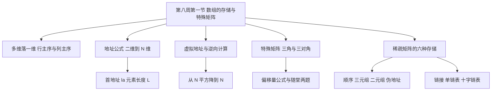
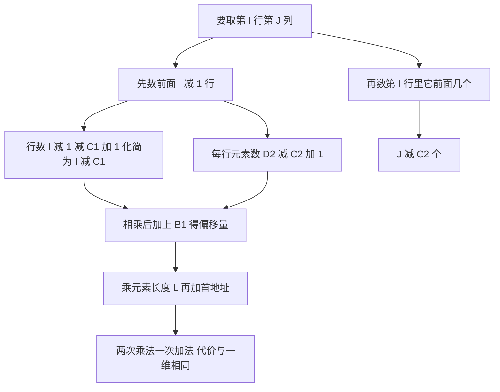
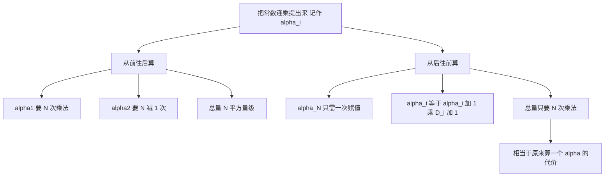
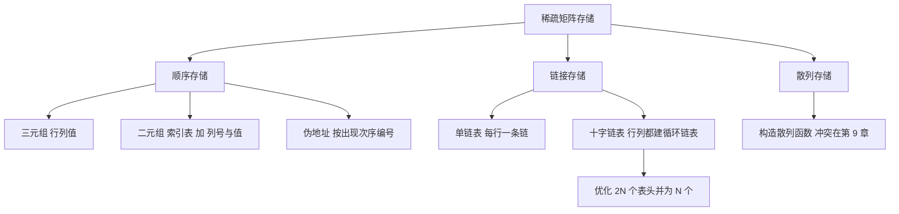

# 数据结构 · 第八周第一节 · 数组的存储与特殊矩阵 · 详细版讲义

> **来源说明**：本讲义依据课堂录音的本地转写整理，并与严蔚敏《数据结构（C语言版）》第 5 章对照校订而成，属**讲授稿性质的整理稿**。全篇以**第一人称**写成——写作者就是讲授者本人，课堂上的追问、点评都以「我」的口吻呈现。
>
> - **转写来源**：`数组与特殊矩阵存储讲解_导出原文.txt`（课堂录音 ASR 导出文字，约 2.34 万字，按 760 字左右切成 32 段）。
> - **这一节的主线**：多维空间怎么落进一维内存 → 二维／三维／$N$ 维的地址公式 → 虚拟地址与逆向计算 → 行主序下谁变化最快 → 数组的静态性 → 特殊矩阵（三角、三对角）的压缩公式 → 稀疏数组的定义 → 稀疏矩阵的六种存储（三元组、二元组、伪地址、单链表、十字链表、散列）。
> - **这一节的边界**：课末我说「**稀疏矩阵的运算下节课讲**」，所以**稀疏矩阵的转置（朴素转置与快速转置）、广义表的定义与存储、以及转入第 7 章树形结构**都不在本讲义内，属下一节课。
> - **教材对照范围**：第 5 章 **5.1 数组的定义**、**5.2 数组的顺序表示和实现**（行主序／列主序、地址公式、`Loc` 函数）、**5.3 矩阵的压缩存储**（对称矩阵、三角矩阵、对角矩阵、稀疏矩阵的三元组／十字链表／行逻辑链接）。**教材 5.3 用的是"对称矩阵按行优先压缩到一维数组"的统一口径，而我这一节是分类推三角与三对角公式；教材还有"行逻辑链接"这套结构，我课上没讲**——附录 A 已逐条标出差异。
> - **一处必须点名的笔误**：讲二元组的行起始位置时，王老师放在网上的那份材料写成了「第 $I$ 行由第 $I$ 行推」，正确应是「**第 $I$ 行 = 第 $I-1$ 行的起始位置 + 第 $I-1$ 行的非零元个数**」。我在课上专门指出了这一点（见正文第十九节）。
> - **下标口径**：本课程讲数组时，**下标可以是任意整数**（例如 $-5\sim10$、$-1\sim1$），不要与 C 语言「从 0 开始、只能非负」的习惯对号入座。但随堂那两道题明确说「存进 C 语言的一维数组」，**那时下标从 0 开始、偏移量要减 1**——这正是那两道题的陷阱。
> - **编号说明**：我沿用的章节号比严蔚敏教材**大 1**——我的「第 6 章 数组和广义表」＝教材**第 5 章**。标注教材出处时一律用教材真实章节号。
> - **时间说明**：本节课为**文字模式**（无音视频轨、无关键帧），各节时间戳是按**字数折算的伪时间**（约 200 字／分钟），非音频真实时间，只作讲义内部单调递增的定位坐标；全课伪时间长约 1 小时 57 分。
> - **关联阅读**：[数据结构 第七周第二节 KMP算法与数组的引入 详细版讲义](数据结构%20第七周第二节%20KMP算法与数组的引入%20详细版讲义.md)（上一节，数组的递归定义与行／列主序正是那一节的收尾）、[数据结构 第七周第一节 串 详细版讲义](数据结构%20第七周第一节%20串%20详细版讲义.md)、[数据结构 第二章 线性表 详细版讲义](数据结构%20第二章%20线性表%20详细版讲义.md)。

## 开场导读

上一节把**数组的递归定义**给完、把**行主序与列主序**点了名；这一节要回答两个更硬的问题——**多维数据凭什么能塞进一维内存**，以及**当数组「大面积雷同」时怎么把它压下去**。

开场我把矛盾摆得很直白：**空间问题往往本来就是多维的，而计算机是典型的一维结构**。这一堆多维数据往一维里怎么安排？我举了两个"只能按顺序说"的例子——像字典那样一个接一个编（**词典编辑序**），也像说话时**一口气只能蹦一个词**。于是有了**行主序**（先第一行、再第二行）与**列主序**（先第一列、再第二列）。语言的分布是：**C、C++、Java、Python、Basic 行主序**，而**第一门以计算见长的 Fortran 是列主序，MATLAB 也是列主序**；编译课讲地址时会按列主序推。为什么会有列主序，我给的是历史解释——**没有纸张的年代字写在竹签上，竖着写、卷起来才好管**。所以两种次序**各有成因、没有优劣**；我这门课**默认按行优先**。

然后是本节最硬的一段：**二维数组的地址公式**。设第一维 $C_1\sim D_1$、第二维 $C_2\sim D_2$、首地址 $la$、元素长 $L$，则

$$\mathrm{Loc}(I,J)=la+\big((I-C_1)\times(D_2-C_2+1)+(J-C_2)\big)\times L .$$

我特意点那句「**只做两次乘法、一次加法**」：代价和一维一样，所以**二维数组仍是随机存取结构**。三维、$N$ 维同理。

接着是我这一节**最想让你们带走的方法论**：把公式里那串纯常数的连乘（含 $L$）提出来，取名 $\alpha_i$，剩下的就是"下标减下限"乘上它；那个常数部分我叫**虚拟地址**。**编译器对数组只做两件事**：构造出地址访问公式、把虚拟地址算好放着。以后给一组下标，代进去就出地址。

精彩之处在**怎么算这串 $\alpha_i$**。从前往后：$\alpha_1$ 要 $N$ 次乘法、$\alpha_2$ 要 $N-1$ 次……加起来是 $N^2$ 量级，**运算量大得很**。于是我换方向——**从后往前算**：$\alpha_N$ 一次赋值、不用乘法；$\alpha_{i}=\alpha_{i+1}\times D_{i+1}$，**算完一圈总共只要 $N$ 次乘法**，相当于原来算一个 $\alpha$ 的代价。这里我搬出了「**横看成岭侧成峰，远近高低各不同**」，以及上一章讲一元多项式时的**秦九韶算法**——也是提公因子、从后往前算。我随手把它拔到方法论：**「软件分析与设计说明书」里"分析"两个字，说的就是你怎么看待这个问题。**

还有一条实用的观察：**行主序下最后面的维度变化最快，最先给的维度变化最慢**。我拿**年月日**打比方——日变 30 次，月才变一次；月变 12 次，年才变一次。

再说**数组是静态结构**：声明时每一维大小必须给定，编译系统才好在内存里划一片连续空间、把首地址返给你。**估小了怎么办**？只能重新声明、重新编译、换一片空间。我也承认"能变大"的做法存在（先扩行再扩列），但代价是**原来那套访问公式不适用了，得重新构造**。

然后是**为什么要省空间**。我算了一笔账：$100\times100$ 的矩阵就是 1 万个元素，每个浮点数 4 字节，**4 万字节就是 40 K**；而 **IBM 推出微机之前的大型机、Apple II 的内存才 64 K**——做科学计算别说运算，**装都装不下**。所以真正的数值计算要到 T 级内存的大型机或超算上做。我又用手机相机打比方：一张照片几兆、视频随随便便几个 G。

中间插了一段**必须强调的提醒**：**数组的下标可以是负数**（$-5\sim10$、$-1\sim1$）。**千万别和 C 语言对号入座**——C 从 0 开始，**相当于只能处理第一象限**；而空间问题凭什么只处理第一象限？用 C 处理任意空间，得先把空间平移到第一象限、算完再移回去，**非常费劲**。这也顺带说明：**C 不是为计算而生的语言**，数值计算用 Fortran，小型机上用 MATLAB。

接着进入**特殊矩阵**，动机就一句：**只存我们关注的那些元素**。三角矩阵我一步步推偏移量：前 $I-1$ 行是 $1+2+\cdots+(I-1)=\frac{(I-1)I}{2}$，第 $I$ 行内还有 $J-1$ 个，合起来 $\frac{(I-1)I}{2}+J-1$；上三角自己推，**按列存只要把 $I$ 和 $J$ 调个位置**。**三对角矩阵**的行规律是「第一行 2 个、第二行 3 个、其余每行 3 个」，前 $I-1$ 行共 $3(I-1)-1$ 个，行内 $J-I+1$ 个，化简成 $2I+J-3$。

随堂两道题是这个知识点的照妖镜。**第一道**：$12\times12$ 对称矩阵上三角按行优先存进 C 一维数组——**下标从 0 开始**，前五行 $12+11+10+9+8=50$，选 A（下标 50）。**第二道**：$10\times10$ 对称矩阵按列优先求 $M_{72}$ 的下标——**先用对称性 $M_{72}=M_{27}$**，前 6 列 $1+2+\cdots+6=21$，再加 1 得 22。我反复提醒：**从 0 还是从 1 开始，决定要不要减 1，读题要仔细**。

再往下是**稀疏数组**。定义是「与某个元素相比，不相等的元素很少」。两处我讲得很重：**其一**，"某元素"教科书里图省事一律写成 0，但**现实中它可能是一栋建筑、一个细胞、一本小说**——我们研究的是模型，不是那个数值；**其二**，"很少"是**相对概念**，用绝对值（不到 $1/3$、不到 $1/4$）是"一家之言"，用数量级也不成立（你拿 101 块、我拿 99 块，能说我远远少于你吗？）。两个现实例子：战场网格图上**军用目标远少于民用目标**；CT 片上**病变细胞远少于正常细胞**。最后给出**分界**：**共同点**是都出现大面积雷同元素；**不同点**是非零元分布**有无规律**——有规律是特殊矩阵，没规律是稀疏矩阵。

**存储方式**是本节重头：三大类**顺序、链接、散列**；顺序里分**三元组、二元组（索引表）、伪地址**，链接里分**单链表、十字链表**，并明确要求**重点掌握三元组与十字链表**。

**三元组**之所以叫三元，是因为要同时反映**数据值、行号、列号**。两种实现：**记录（结构体）组成一维数组**，或**二维数组**（第一维 $0\sim P$、第二维 $1\sim3$）。二维那种的第 0 行有妙用——**存整个矩阵的规模**。讲到这儿我预判了那个必然会有的质疑：「$5\times5$ 要 25 个单元，三元组 $7\times3=21$ 个单元，**哪里省了**？」回答是：**研究的是模型**——如果每个元素其实是一本小说，25 本变成 7 本，行列号只相当于小说里的两个汉字。**三元组的天生缺陷**是顺序存储的通病：**扛不住元素增减**，得大量移动甚至整体重构——我用战争里「弹药库被炸」和「民房里架起指挥所」打比方。中间一道考题：除三元组表外还要保存什么？答案是**矩阵行数、列数、非零元个数**，否则两个规模不同的矩阵看起来一模一样。

**二元组（索引表）**解决"行号重复存"的浪费：$1$ 万 $\times$ $1$ 万、某行 500 个非零元的矩阵，三元组要把行号存 500 次。于是**行号只存一次**，主表只留**列号与值**；位置公式是 $\mathrm{position}[I]=\mathrm{position}[I-1]+\mathrm{number}[I-1]$，**必须额外保存 number 数组**。这里我专门点了**王老师那份材料的笔误**。二元组优点是更省空间、检索更快，缺点是**管理更费劲**——三张表都要维护。

**伪地址**是"按出现次序编号"：稀缺元素按行优先排第几个，就存在第几个位置。省是省了，**但查找时得先算伪地址**，而且**行优先与列优先给出的编号完全不同**。

**链接存储**先讲**单链表**：每行一条链，$N$ 行 $N$ 条链；行号不用再存，只留列号与值。麻烦在**表头指针怎么管**——$N$ 个表头指针属性相同又有序，**抽象成一个线性表**，用数组（向量）管起来；这东西在 C 语言里就叫**指针数组**。软肋是：**顺着行查很舒服，问某列有多少非零元就得把整条链遍历一遍**。

所以有了**十字链表**：**行、列都建链**，节点数据域是行、列、值，另加**向下**与**向右**两个指针。这条最容易做错的规定我说了三遍——**行列建的都必须是带表头节点的循环链表，哪怕一行一个元素都没有，表头也必须有**。再往深一层是**优化**：$N\times N$ 要 $2N$ 个表头，可**行表头的向下指针全空、列表头的向右指针全空**，于是把两者**合并成同一个节点**，表头砍到 $N$ 个（$M\times N$ 取较大者），再用向量管起来串成循环链表。我打了个比方：**一个小孩两个大人陪，现在一个大人左手一个右手一个，就省出一个大人**。

最后是**散列存储**：以行列下标为参数构造散列函数，冲突留到第 9 章；优点是**存取某个非零元快**，缺点是**反查某行／列有几个非零元很费劲**，因为映射不是一一对应的。

课末的总体结论：**最常用的还是三元组与十字链表**；**稀疏矩阵的运算下节课讲**。

## 总览知识地图

这一节跨「地址公式 → 虚拟地址 → 特殊矩阵 → 稀疏矩阵存储」四段，塞进一张图会糊，所以拆成 5 张小图。

**图 1 · 全课主线**



**图 2 · 二维地址公式是怎么拼出来的**



**图 3 · 虚拟地址：从 N 平方到 N**



**图 4 · 特殊矩阵的偏移量**

```mermaid
flowchart TD
    A["特殊矩阵 只存关注的元素"] --> B["下三角 按行优先"]
    A --> C["上三角"]
    A --> D["三对角"]
    B --> B1["前 I 减 1 行 1 加到 I 减 1 得 (I 减 1) 乘 I 除 2"]
    B --> B2["行内 J 减 1 个"]
    B1 --> B3["偏移量 (I 减 1) I 除 2 加 J 减 1"]
    B2 --> B3
    C --> C1["自己推 或把 I 与 J 调位置"]
    D --> D1["首行 2 个 次行 3 个 其余每行 3 个"]
    D1 --> D2["前 I 减 1 行 3(I 减 1) 减 1 个 行内 J 减 I 加 1 个"]
    D2 --> D3["化简为 2I 加 J 减 3"]
```



**图 5 · 稀疏矩阵的存储谱系**



## 正文

### 一、这一节要解决什么：多维数据怎么塞进一维内存 `00:00-00:03`

上一节我们停在「数组是一个递归定义的模型」这句话上，也把行主序、列主序这两个名字点了一遍。这一节要把它们变成能算的东西。

先把矛盾说清楚：**我们要处理的空间问题，往往本来就是多维的**；而**计算机是典型的一维结构**——内存是一串编了号的单元，横平竖直地排下去。那多维的数据往这条一维的带子上怎么安排？这就是本节第一个问题。

我举了两个"只能按顺序来"的类比。第一个是**词典编辑序**：英文词典也好、汉语字典也好，都是一个词接着一个词往下排，**不可能在一个位置同时放两个字**。第二个更生活：**你说话的时候，一口气只能蹦出一个词**——不能同时把两个词从嘴里送出去。既然只能说一个，那**先说谁**？这就成了次序问题。（教材对应：5.2）

第二个问题紧接着：**存进去还得取出来**。存只是为了后期运算，取第 $I$ 行第 $J$ 列的元素，**你必须先知道它的地址**。所以这一节真正要交付的东西是**地址访问公式**——一旦有了公式，给一组下标就能算出地址，这才是"随机存取"的落地。

我提醒你们注意一件事：**一维数组本来就是随机存取结构**，给它一个下标、它给你算地址，任何位置的代价都一样。多维数组要想保持这个性质，就得靠公式把多维下标压成一个偏移量。这是本节的技术主线。

### 二、行主序与列主序：两种都不「更好」 `00:03-00:07`

**行主序**：拿二维矩阵来说，就是**先存第一行、存完第一行再存第二行**，一行之内从左到右。说白了就是**从上到下、从左到右**，跟我们现在的书写方式一模一样。

**列主序**：**先存第一列、再存第二列、再第三列**，列内从上到下。

关键在于我接下来说的那句：**行与列是平权的**。你先说 $X$ 还是先说 $Y$，没有天然的正确答案——正因为平权，才**两种都要有**。（教材对应：5.2）

那为什么现实里两种都存在、而且没有谁淘汰谁？我给的是**历史成因**的说法：**没有纸张的年代，字是写在竹签上的**。竹签一条一条立着，**列着写才好卷起来、才好管理**。所以列主序不是"落后的写法"，它是另一种同样优秀的编排方式。**没有哪个更优，只有各自的来路**。

顺带说一句：我们老祖宗的书写习惯是从右到左、从上到下，跟标准列主序还差一点（列主序是从左到右、从上到下），但**竖排这件事是一样的**。

（讲义补充）这里可以用一句话收束：**行主序与列主序的差别不在"对不对"，而在"先给谁"**；一旦选定了次序，地址公式就必须按那个次序推导——两者**不可混用**，这是后面所有偏移量计算的前提。

### 三、谁在用哪种，以及竹简上的竖写 `00:07-00:10`

我把语言口径交代得很具体（这是做题和写代码都要用的）：

- **行主序**：C、C++、Java、Python、Basic——**现在大部分语言都是行主序**。
- **列主序**：**Fortran**，以及 **MATLAB**。这两门恰恰是**以计算见长**的语言。

我还提了一句：你们后面学**编译系统**时，编译课讲地址会**按列主序**来推——所以同一道地址公式的题，**要先看清讲的是哪种语言、哪种次序**。

至于本课程：**接下来所有存储默认按行优先**，也就是**先存第一行、再第二行、再第三行**，从上到下、从左到右。（教材对应：5.2）

### 四、二维数组的地址公式：一步一步推 `00:10-00:14`

设定记号（这一步必须记牢，后面全靠它）：

- 第一维下标范围 $C_1 \sim D_1$；
- 第二维下标范围 $C_2 \sim D_2$；
- 数组的**首地址**记作 $la$（我口述说成"la"）；
- **每个元素占的长度**是 $L$。

首地址是怎么来的？**数组声明时每一维的大小是给定的**，编译系统据此**申请一块连续空间**，并把**首地址返回给你**——有了它，后期才能存取。（教材对应：5.2）

现在要求第 $I$ 行第 $J$ 列元素的地址。**分两步数**：

**第一步，数前面有多少个整行。** 前面是第 $C_1$ 行到第 $I-1$ 行，行数是 $(I-1)-C_1+1$，化简就是 $I-C_1$。每行有多少个元素？$D_2-C_2+1$ 个。所以前面这些行一共

$$(I-C_1)\times(D_2-C_2+1)$$

个元素。

**第二步，数第 $I$ 行里它前面有几个。** 从第 $C_2$ 列到第 $J-1$ 列，是 $(J-1)-C_2+1=J-C_2$ 个。

两块加起来，乘上元素长度 $L$，再加首地址：

$$\boxed{\;\mathrm{Loc}(I,J)=la+\big[(I-C_1)\times(D_2-C_2+1)+(J-C_2)\big]\times L\;}$$

我课上特意说「**这个公式大家要自己下来会推**」——考场上面对试卷，光背是不够的，**要能现场推出来**。

**操作图 1 · 二维地址公式的两步数法**

```tikz
\begin{document}
\begin{tikzpicture}[scale=0.92]
  \foreach \r in {1,2,3,4}{
    \foreach \c in {1,2,3,4,5}{
      \draw[thick] (\c*0.80,{(4-\r)*0.70}) rectangle ++(0.80,0.70);
    }
  }
  \foreach \r in {1,2}{
    \foreach \c in {1,2,3,4,5}{
      \draw[fill=blue!12,thick] (\c*0.80,{(4-\r)*0.70}) rectangle ++(0.80,0.70);
    }
  }
  \foreach \c in {1,2,3}{
    \draw[fill=green!20,thick] (\c*0.80,{(4-3)*0.70}) rectangle ++(0.80,0.70);
  }
  \draw[fill=red!25,thick] (4*0.80,{(4-3)*0.70}) rectangle ++(0.80,0.70);
  \node[font=\scriptsize] at (4*0.80+0.40,{(4-3)*0.70+0.35}) {$J$};
  \node[font=\scriptsize] at (1*0.80+0.40,{(4-3)*0.70+0.35}) {$I$};
  \foreach \c in {1,2,3,4,5}{
    \node[font=\tiny,gray] at (\c*0.80+0.40,{(4-1)*0.70+0.85}) {\c};
  }
  \foreach \r in {1,2,3,4}{
    \node[font=\tiny,gray] at (0.45,{(4-\r)*0.70+0.35}) {\r};
  }
  \node[below,font=\small] at (2.80,-0.30) {blue: $(I-C_1)\times(D_2-C_2+1)$ cells above};
  \node[below,font=\small] at (2.80,-0.80) {green: $(J-C_2)$ cells before it in row $I$};
  \node[below,font=\small] at (2.80,-1.30) {sum the two, multiply by $L$, add $la$};
\end{tikzpicture}
\end{document}
```

图注：二维地址公式的两步数法：取第 I 行第 J 列，先把上面 I−1 行整片数掉（蓝），再把本行前 J−1 个补上（绿），红格就是目标。两块相加即偏移量。


### 五、公式的化简，以及「代价一样」这一句 `00:14-00:18`

公式里那个「减 $1$ 又加 $1$」正好抵消，所以最终形态非常干净：

$$\mathrm{Loc}(I,J)=la+\big[(I-C_1)(D_2-C_2+1)+(J-C_2)\big]L$$

我要你们盯住的不是公式本身，而是它的**计算量**：给一组 $I$、$J$，**做两次乘法、一次加法**，就出地址。

为什么强调这个？因为"**随机存取结构**"的定义就是**访问任何一个元素，代价一样**。一维数组做一次乘法；二维数组做两次乘法——**都是常数次运算，代价同阶**。所以结论是：

> **二维数组仍然是随机存取结构。**

（讲义补充）严格说，这里的"代价一样"指的是**与元素个数无关的常数次算术运算**，而不是"两次乘法比一次快"。做题时若问"是否随机存取"，答"是"，理由就是**地址可由下标经常数次运算直接算出**。

### 六、从二维到三维，再到 N 维 `00:18-00:22`

三维就是把二维的式子再加一层：第一维大小、第二维大小、第三维大小依次连乘，**每个维度贡献一个因子**。写成通式，第 $N$ 维数组要给的是一组下标 $J_1, J_2, \dots, J_N$，各维范围是 $C_k \sim D_k$（$k=1..N$），首地址由 $C_1 \sim C_N$ 定位，元素长 $L$。

（教材对应：5.2 的 `Loc` 函数）教材把它写成**连乘再连加**的形式：

$$\mathrm{Loc}(J_1,\dots,J_N)=la+\Big(\sum_{i=1}^{N}(J_i-C_i)\prod_{k=i+1}^{N}(D_k-C_k+1)\Big)\times L$$

这个式子结构很规整：**每一个"下标减下限"，都要乘上它后面所有维度大小的连乘**，再全部加起来。直观理解就是——**越靠前的维度，它的"进位"越贵**（它一变，后面全部要重排）；越靠后的维度，它的"进位"越便宜（它一变只走一格）。

我明确说了：**这个地址公式大家不需要抄，书上有**。给这个公式的真正目的有两个，下一节就讲。

### 七、虚拟地址：把常数项拎出来 `00:22-00:25`

仔细看那个通式：里面既有**下标变量**（$J_i$），也有**纯常数**（各维大小 $D_k-C_k+1$ 和 $L$）。我把纯常数那一部分**提取出来、给它取个别名**：

$$\alpha_i=L\prod_{k=i+1}^{N}(D_k-C_k+1)$$

于是整个地址公式就能写成一项"常数"加一项"含下标的":

$$\mathrm{Loc}=la+\sum_{i=1}^{N}\alpha_i\,(J_i-C_i)$$

这个 $\alpha_i$ 的含义是：**第 $i$ 维每走一格，地址要跳过多少个单元**（以字节计）。而那个只由各维大小与 $L$ 决定的常数部分，我给它取了个名字——**虚拟地址**。

> **虚拟地址**：多维数组空间里，那一串只与各维上下限和元素长度有关的常量值。它是一块"基准"，任一元素的地址都相当于在这个基准上**按各维下标浮动一下**。

这个说法其实很传神：**你给一组下标，就相当于在基准上漂一下**——漂多少由下标决定，基准本身不动。（教材对应：5.2；教材未使用"虚拟地址"这个提法，属课堂命名）

### 八、编译器到底替我们做了什么 `00:25-00:29`

这一节我要你们记住一个重要事实：**编译器遇到数组，只做两件事**。

**第一件，把地址访问公式构造出来。** 也就是把上面那个 $la+\sum \alpha_i(J_i-C_i)$ 的骨架建好。

**第二件，把这个公式里的常数项——也就是虚拟地址——提前算出来放着。**

之后的事情就简单了：**用户给一组下标，代进去，立刻算出这个元素在哪**，于是实现"快速存取"。这就是数组能在 $O(1)$ 时间里随机访问的**工程实现机制**。

（讲义补充）这两步的分工很值得体会：**公式是"形状"，虚拟地址是"常数"**。形状对所有同类型数组都一样，常数则依赖具体声明的各维大小——所以编译器在**编译期**就把常数固化下来，运行期只剩下"代入下标"这一步。这正是一个**静态结构**能换来的效率。

### 九、从 N² 到 N：反过来算 `00:29-00:33`

问题出在**怎么把这 $N$ 个 $\alpha_i$ 都算出来**。设数组是 $N$ 维。

**从前往后算**：$\alpha_1$ 要连乘 $D_2\cdots D_N$ 再乘 $L$，一共 **$N$ 次乘法**；$\alpha_2$ 要连乘 $D_3\cdots D_N$ 再乘 $L$，**$N-1$ 次**；……一路下去，**总量是 $N+(N-1)+\cdots+1$，也就是 $N^2$ 量级**。

**运算量大不大？非常大。** 编译器每次编译都要做这一串连乘，代价不该是这个样子。

于是我换了个方向——**逆向思维，先算最后一个**：

- $\alpha_N$：后面没有任何维度了，所以 $\alpha_N=L$，**一次赋值，一次乘法都不用**。
- $\alpha_{N-1}$：它是 $\alpha_N$ 乘上第 $N$ 维的大小，即 $\alpha_{N-1}=\alpha_N\times D_N$，**一次乘法**。
- $\alpha_{N-2}=\alpha_{N-1}\times D_{N-1}$，**一次乘法**。
- ……

规律出来了：

$$\boxed{\;\alpha_i=\alpha_{i+1}\times D_{i+1}\;}\qquad(\text{其中 }\alpha_N=L)$$

于是**算完 $\alpha_1\sim\alpha_N$ 总共只需要 $N$ 次乘法**。

对比一下：原来从前往后算，**算出这一整串的代价，相当于现在算一个 $\alpha$ 的代价**。这就是我要你们体会的地方——**同一件事，换个顺序，效率差一个量级**。

（讲义补充）这个式子和"前缀积/后缀积"的经典技巧是同一个东西：**把重复的连乘保存下来复用**，而不是每次从头连乘。名字不重要，**"复用已算过的中间结果"这个念头才重要**。

### 十、横看成岭侧成峰：秦九韶与「换个角度看」 `00:33-00:36`

讲到这儿我停下来讲了点方法论，因为这段推导的价值不止于数组。

中国有句古话：「**横看成岭侧成峰，远近高低各不同**。」你看待一个问题，要**多角度地看，翻过来倒过去地看**——这样才能更充分地认识它。

我举了两个同构的例子：

**第一个，秦九韶算法。** 上一章讲一元多项式时我们算过：传统做法是从前往后一项一项算，**幂次每次都要重新乘**，计算量很大；秦九韶的做法是**提取公因子、从后往前算**，把 $a_nx^n+\cdots+a_1x+a_0$ 化成 $(\cdots((a_nx+a_{n-1})x+a_{n-2})\cdots)x+a_0$，**每层只做一次乘一次加**。这跟我们刚才把 $\alpha$ 从后往前算是**同一个思想**。

**第二个，"分析"这两个字。** 我说软件工程里那份文档的全称是「**软件分析与设计说明书**」，其中**"分析"就是"你如何来看待这个事物"**——拿到一个问题，你怎样更深入地看待它。**给这个地址公式的真正目的，一半是为了虚拟地址，另一半就是为了练这个"看待事物的角度"**。

（讲义补充）把这个方法论说得更硬一点：**计算的代价往往藏在顺序里**。同一个数学对象，换个求值顺序，乘法次数可以从 $O(N^2)$ 降到 $O(N)$。数组的 $\alpha_i$ 是这样，多项式的秦九韶是这样，后面矩阵乘法的 Strassen、快速幂、动态规划里的"记忆化"——**都是这一条**。

### 十一、最后一个维度变化最快：年月日 `00:36-00:39`

行主序还有一个非常好用的**观察**，你们做题时用它判断下标变化方向特别快。

**行主序下，最后面的那个维度变化最快；最先给的那个维度，变化最慢。**

我拿**年月日**打比方，它其实就是一个三维数组：

- **日**要变 30 次，**月**才变一次；
- **月**要变 12 次，**年**才变一次。

所以三个维度的"变化速度"是**日 > 月 > 年**——**最靠后的维度最活跃**。对应到行主序的数组：**最后一维是"个位"，第一维是"最高位"**。

（教材对应：5.2）这条观察的直接用途：判题时问"按行优先存储，哪个元素在前"，你只要**比较最后一维下标**即可；若最后一维相同，再往上比一维，依此类推——**就是从低位往高位比较**。

同理，**列主序**就是把这条规则反过来：**第一维（行）变化最快**。

### 十二、静态结构的代价：声明即定长 `00:39-00:43`

我反复强调过：**数组是静态存储结构**。含义是——

> **你在声明的时候，必须把数组每一个维度的大小都给编译系统**，编译系统才能**预先分配一片连续的存储空间**，并把首地址交给你。

这条性质带来了效率（地址可以在编译期固化），也带来了**限制**：**一旦声明，长度就定死了。**

那要是**数据量太大、我预估的尺寸太小**怎么办？只能：

1. **重新声明**一个更大的数组；
2. **编译器重新编译一遍**，在**新的位置**给你找一片连续空间。

原来的数据要不要搬、公式要不要重算，都得重来。所以我说「**数组往往是不能变化的**」。

不过我也承认，**话不能说太满**——"能变化"的做法确实存在：比如按「**先扩展行、再扩展列**」的方式安排元素，数组就可以**长大**。

但**有得必有失**：这样存放之后，**原来那套通行的地址访问公式就不适用了**，你得**按它的扩展趋势重新构造**一套公式。所以这是拿"公式的简洁与通用"换"长度的灵活"。

（讲义补充）这就是数据结构里那条永恒的天平：**静态 + 公式 → 快而省心，但不灵活；动态 → 灵活，但每次访问都要多算**。教材 5.2 只讲静态数组，动态扩展属于实现层的选择。

### 十三、为什么要省空间：40K、64K 与 T 级 `00:43-00:47`

这一段我讲得很有情绪，因为它直接解释了这一章后半部分存在的理由。

先算一笔账：声明一个 $100\times100$ 的矩阵，就是 **1 万个元素**。假设每个元素是一个浮点数、占 **4 个字节**，那么一共 **4 万字节，也就是 40 K**。

40 K 听起来不多。但我告诉你们：**IBM 推出微机之前的大型机、还有 Apple II，内存才 64 K**。你做科学计算，面对一个 40 K 的矩阵——**别说运算了，你装都装不下；装都装不下，谈何运算？**

所以真正做数值计算的人**不会在微机上做**，起码要有 **T 级**的内存量级，用大型机或者超算。

我又举了你们每天都在碰的例子：**手机随便拍一张照片就上亿像素、好几兆**，分辨率稍微提一提就是**几十兆**；拍个视频，**随随便便好几个 G 就没了**。存储容量的压力是实实在在的。

于是引出本节后半段的话题：**能不能省？** 如果数组里**出现大面积的雷同元素**、而**不同的元素比较少**，那**雷同的只存一份就够了**，我们只把那些不雷同的存起来——**空间就大量省下来了**。

（教材对应：5.3 引入段）教材也是从"存储量太大"切入压缩存储的，只是它没说 64 K 这段往事。

### 十四、下标可以是负数：别拿 C 语言对号入座 `00:47-00:50`

这里我必须专门停一下，因为每年都有同学在这里犯迷糊。

有些材料里会写「第一维从 $-5$ 到 $10$」「从 $-1$ 到 $1$」，于是有同学跑来问：**老师，数组的下标还能是负数吗？**

> **能。而且负数下标在数学上是完全正常的。**

我强调三点：

1. **我们讲数组时，下标只是一个整型数**——**千万不要以为它必须是正整数**，更不要和 C 语言对号入座。
2. **C 语言从 0 开始，只能表示非负下标**，这就意味着：**用 C 语言处理空间问题，你只相当于能处理"第一象限"**。
3. 而**谁规定了空间问题只能处理第一象限**？没有。如果你非要用 C 处理任意区间（比如 $-5\sim10$），那就得**先把这块空间平移到第一象限，算完再平移回去**——**非常费劲**。

顺着这个说下去：**C 语言当初并不是为计算而诞生的语言**。真正做数值计算，**大型机上用 Fortran，小型机上用 MATLAB**——这也是为什么这两门语言采用列主序（上一节讲过）。

（讲义补充）这段的考点其实是**地址公式的普适性**：公式里出现的 $C_1, C_2$ 可以是负数，$D_2-C_2+1$ 仍然是正常的元素个数——**公式本身对下标区间没有任何限制**。这正说明"数组"是一个**数学模型**，不是某门语言的具体实现。

### 十五、下三角矩阵的地址公式 `00:50-00:54`

进入**特殊数组（特殊矩阵）**。动机一句话：**只存我们关注的那些元素**，把雷同的常量省掉。

**三角矩阵**分两种：**上三角全是常量**（通常写作 0）、**只有下三角才有元素**；反之上三角有元素、下三角是常量的，叫**上三角矩阵**。

关键的一问不是"怎么存"，而是：

> **这样存了以后，还能不能随机存取？**

我把这一问**等价转换**了一下：**能不能随机存取，取决于能不能把地址访问公式写出来**。公式出来了，给下标就能算地址，随机存取自然成立；公式写不出，就退化成得顺序数。

那就推。设按**行优先**存下三角，取第 $I$ 行第 $J$ 列（$J \le I$）。**分两步数**：

**第一步，前面 $I-1$ 行的元素总数。** 下三角的第 1 行有 1 个、第 2 行有 2 个、……第 $I-1$ 行有 $I-1$ 个，所以

$$1+2+\cdots+(I-1)=\frac{(I-1)I}{2}.$$

**第二步，第 $I$ 行里它前面有几个。** 第 $I$ 行的元素从第 1 列排到第 $I$ 列，目标在第 $J$ 列，所以前面有 $J-1$ 个。

合起来，偏移量（相对基地址的元素个数）是

$$\boxed{\;\mathrm{off}(I,J)=\frac{(I-1)I}{2}+(J-1)\;}\qquad (J\le I)$$

（教材对应：5.3）教材对三角矩阵的处理是"**把二维压成一维，再用公式定位**"，思路完全一致；差异只在**它常写成"前 $I-1$ 行 + 行内 $J-1$"的分段式**，我这里直接化简成一个闭合式子。做题时两种写法等价。

我特别说了一句：**上三角矩阵你们自己去推**——方法一模一样。而**如果改成按列存，只需要把 $I$ 和 $J$ 调个位置**即可，因为行列在公式里是对称的。

（讲义补充）为什么三角矩阵能这么省？因为它有 $n(n+1)/2$ 个有效元素，而全矩阵有 $n^2$ 个——**省掉的正是一个上三角**。这个比例在 $n$ 大时接近一半，对大规模矩阵相当可观。

**操作图 2 · 下三角矩阵压缩到一维**

```tikz
\begin{document}
\begin{tikzpicture}[scale=0.92]
  \foreach \r in {1,2,3,4}{
    \foreach \c in {1,2,3,4}{
      \ifnum\c>\r
        \draw[gray!45,dashed] (\c*0.80,{(4-\r)*0.70}) rectangle ++(0.80,0.70);
      \else
        \draw[thick] (\c*0.80,{(4-\r)*0.70}) rectangle ++(0.80,0.70);
      \fi
    }
  }
  \node[font=\scriptsize] at (0.40,{(4-2)*0.70+0.35}) {rows};
  \foreach \r/\k in {1/1,2/3,3/6,4/10}{
    \foreach \c in {1,...,\r}{
      \node[font=\scriptsize] at (\c*0.80+0.40,{(4-\r)*0.70+0.35}) {\k};
      \pgfmathsetmacro{\k}{\k+1}
    }
  }
  \node[below,font=\small] at (2.00,-0.35) {dashed upper part is never stored};
  \node[below,font=\small] at (2.00,-0.85) {row 1 has 1, row 2 has 2, row 3 has 3, row 4 has 4};
  \node[below,font=\small] at (2.00,-1.35) {offset $=(I-1)I/2+(J-1)$, counting from 1};
\end{tikzpicture}
\end{document}
```

图注：下三角矩阵按下标压缩：上三角那半根本不存，只把下三角按行优先排成一条一维数组。第 I 行第 J 列的位置就是「前 I−1 行之和 + 行内第 J−1 个」。


### 十六、上三角矩阵与三对角矩阵 `00:54-00:58`

**上三角**：元素满足 $J \ge I$。按行优先存时，第 $I$ 行的第 $I$ 列到第 $n$ 列才有元素。前 $I-1$ 行的元素数是

$$\sum_{k=1}^{I-1}\big(n-k+1\big)=(I-1)n-\frac{(I-1)(I-2)}{2},$$

行内偏移是 $J-I$。把 $I$、$J$ 互换就能得到"按列存上三角"的式子——**不必另记一套**。

**三对角矩阵**（带状矩阵的一种）：**除主对角线外，上下各一条对角线**，共三条；这三条之外全是常量。它的行规律很特别：

- **第 1 行只有 2 个**元素（主对角 + 上方那条）；
- **第 2 行有 3 个**；
- **其余每一行都是 3 个**。

所以**前面 $I-1$ 行**的元素总数是

$$2+3(I-2)=3(I-1)-1 .$$

**第 $I$ 行内**，第 $I$ 行有效的列是 $J \in \{I-1, I, I+1\}$，它前面有 $(J-1)-(I-1)+1=J-I+1$ 个。

合起来

$$\mathrm{off}(I,J)=\big[3(I-1)-1\big]+(J-I+1)=2I+J-3 .$$

我要你们注意的一点是：**这个结果是化简出来的**，不是硬背的——`2I+J-3` 这个干净的形式，正是"前 $I-1$ 行 + 行内"两步相消之后的产物。（教材对应：5.3 对角矩阵／带状矩阵；教材给的是按行优先的通式，我这套化简与它等价）

（讲义补充）三对角的**判据**：元素 $a_{ij}$ 有效当且仅当 $|i-j|\le 1$。这个判据比背公式更可靠——**偏移量可以现场推，判据必须记牢**。

**操作图 3 · 三对角矩阵的三条对角线**

```tikz
\begin{document}
\begin{tikzpicture}[scale=0.92]
  \foreach \r in {1,2,3,4}{
    \foreach \c in {1,2,3,4}{
      \ifnum\c=\r
        \draw[fill=red!18,thick] (\c*0.80,{(4-\r)*0.70}) rectangle ++(0.80,0.70);
      \else
        \pgfmathparse{int(abs(\c-\r))}
        \ifnum\pgfmathresult=1
          \draw[fill=blue!14,thick] (\c*0.80,{(4-\r)*0.70}) rectangle ++(0.80,0.70);
        \else
          \draw[gray!45,dashed] (\c*0.80,{(4-\r)*0.70}) rectangle ++(0.80,0.70);
        \fi
      \fi
    }
  }
  \node[font=\scriptsize] at (0.40,{(4-1)*0.70+0.35}) {1};
  \node[font=\scriptsize] at (0.40,{(4-2)*0.70+0.35}) {2};
  \node[font=\scriptsize] at (0.40,{(4-3)*0.70+0.35}) {3};
  \node[font=\scriptsize] at (0.40,{(4-4)*0.70+0.35}) {4};
  \node[below,font=\small] at (2.00,-0.35) {red: main diagonal, blue: the two neighbours};
  \node[below,font=\small] at (2.00,-0.85) {row 1 keeps 2 cells, rows 2 and 3 keep 3, row 4 keeps 2};
  \node[below,font=\small] at (2.00,-1.35) {offset $=[3(I-1)-1]+(J-I+1)=2I+J-3$};
\end{tikzpicture}
\end{document}
```

图注：三对角矩阵只有三条对角线有元素：主对角线加上下各一条。按行优先压缩时，首行只有 2 个、第二行 3 个、其余每行 3 个，所以偏移化简成 2I+J−3。


### 十七、随堂两题：下标从 0 开始怎么算 `00:58-01:02`

这两道题是本节知识点的照妖镜，我把它们都过了一遍。

**第一题**：一个 $12\times12$ 阶的**对称矩阵**，把它的**上三角部分**（含主对角线）**按行优先**存到 **C 语言的一维数组**里，问 $M_{66}$ 存到哪个下标？

解题三步：

1. **C 语言 → 下标从 0 开始**，所以"偏移量为 $k$"就存在"下标 $k$"的位置（偏移量 $1$ 对应下标 $1$，偏移量 $2$ 对应下标 $2$）。这一步我在课上专门强调了：**偏移量与下标的对应关系取决于从 0 还是从 1 开始**。
2. **按行优先数它前面有多少个元素**。上三角的第 1 行有 12 个（$J\ge I$ 时第 1 行全有效），第 2 行 11 个，第 3 行 10 个，第 4 行 9 个，第 5 行 8 个。
3. 前五行合计：$12+11+10+9+8=50$。$M_{66}$ 是第 6 行的第 1 个元素，**前面正好 50 个**，所以它存在**下标 50**。

**答案：选 A（50）**。

**第二题**：$10\times10$ 的**对称矩阵**，元素也是存进 C 语言一维数组，问 $M_{72}$ 的下标。

这一题的陷阱有两层：

1. **先利用对称性**：$M_{72}=M_{27}$。这一步不做，你会按"第 7 行第 2 列"去数，方向就错了。
2. **它说按列优先**。按列优先存上三角，第 1 列 1 个、第 2 列 2 个、……所以 $M_{27}$ 前面是 $1+2+\cdots+6=21$ 个；而它在**第 2 行**，第 2 行里它前面还有 1 个（第 1 行那个）。所以前面共 $21+1=22$ 个。

**答案：下标 22**（从 0 开始）。

我反复叮嘱的那句话，请你们抄在题旁边：

> **从 0 还是从 1 开始，决定了偏移量要不要减 1。读题要仔细。**

（讲义补充）这类题的通用算法：**①先判矩阵类型（对称／三角／三对角）②再判存储次序（行优先／列优先）③再判起始下标（0 或 1）④最后数"前面有多少个元素"**。四步里任何一步错，答案就差一位到几十位。

### 十八、稀疏数组：那个「很少」怎么衡量 `01:02-01:08`

现在进入**稀疏数组**。定义是：

> **在一个数组（矩阵）中，与某个元素相比，不相同的元素很少的时候，就称它为稀疏数组（稀疏矩阵）。**

这个定义里有两个词必须掰开讲，我各花了一段。

**第一个词："某元素"。**

教科书里为了讨论方便，**无一例外地把这个"某元素"用 0 代替**——包括我们推荐的那两本教材。但你们**一定要记住**：

> **这个"某元素"在现实中到底是什么，我们并不知道。**

它**可能是一栋建筑、一个细胞、一个军用目标、一本小说、一个学生的档案**。我们研究的是**模型问题**，不是数值问题。所以教材写 0，只是为了**数学上比较方便**，**别真以为那个位置存的是一个整数**。

（讲义补充）这也是为什么"稀疏矩阵省不省空间"那个质疑（第十九节会讲）能被一句话驳倒——**如果元素是小说，25 本变 7 本，省得触目惊心**。

**第二个词："很少"。**

到底多少叫"很少"？我否掉了两种常见的量化方式：

- **用绝对比例**：有的书写"非零元占比小于 $1/3$"或"小于 $1/4$"。我说这是**一家之言，你姑且听之，千万不要当真**——凭什么 1/3 就是分界？
- **用数量级**：也不行。你拿 101 块钱、我拿 99 块钱，**能说我远远少于你吗**？数量级说明不了"远远"。

所以结论是：**"很少"是一个相对概念**，它依赖具体问题的规模与元素大小，**没法用一个圈定的数字钉死**。数学上要严格说"多小算小"，得有一整套理论（微积分那套极限与阶的体系），**没那么简单**。（教材对应：5.3 的定性描述）

两个现实例子我讲得很开：

**例子一，战场网格图。** 把城市用等间隔网格划分，**每一个格点是一栋建筑**。问：军用目标多还是民用目标多？**肯定是民用目标多**——民房、民防设施密密麻麻；而军用目标是机场、指挥中心、弹药库，**毕竟少数**。可打仗时要摧毁的**恰恰是这些少数的关键目标**。所以**只存军用目标**，空间大大节省，导弹按位置直接打过去，后期计算也更快。

**例子二，CT 片。** 一个病人拍一张 CT，片上**正常细胞远多于病变细胞**——如果病变细胞比正常细胞还多，这人早完了。所以打印时**只把病变细胞的位置打出来**，既省空间、**又省墨汁**。

（讲义补充）两个例子的共同结构是：**"雷同元素"占绝大多数，"我关心的元素"极少数且无规律**。这正是稀疏矩阵要处理的情形，也解释了它为什么必然走向"只存非零元 + 位置信息"的存储方式。

### 十九、稀疏矩阵与特殊矩阵的分界 `01:08-01:12`

这两个名字经常被混着用，我把**共同点**和**不同点**都摆出来了。

**共同点（一句话）：都出现了大面积的雷同元素，不雷同的比较稀少。**

我把"雷同"这件事说得更宽一点：**不一定是 0**。如果整个矩阵大面积是 10，只有少数元素不等于 10，**那也叫稀疏**——**雷同的那个值是谁不重要，重要的是"雷同"本身**。

**不同点（一句话）：那些稀少的元素，分布有没有规律。**

- **有规律 → 特殊矩阵**（上三角、下三角、三对角、对称）。规律意味着**位置可以用公式算出来**，于是能写出地址公式、能保持随机存取。
- **无规律 → 稀疏矩阵**。位置没法用公式描述，只能**把位置本身作为数据存起来**——这就是三元组要存行列号的根本原因。

（教材对应：5.3）教材把两类都归在"矩阵的压缩存储"之下，但**没有把"有无规律"作为分界明说**；这条分界是我课上给的判据，做题时很好用。

（讲义补充）这个分界还解释了**两种压缩路线为什么不同**：
- 特殊矩阵：**压缩的是"值"**（那些常量根本不存），位置靠公式还原 → **零额外空间开销**；
- 稀疏矩阵：**压缩的是"密度"**（只存少数元素），但**必须额外存位置** → **有额外开销**。

所以稀疏矩阵的存储方案之争，本质上就是**"位置信息怎么存最省"**之争——这正是后面六种方法的分水岭。

### 二十、三元组：为什么是三元，以及两种实现 `01:12-01:16`

先把**存储方式的家谱**交代清楚。稀疏矩阵的存储归纳起来**三大类**：

1. **顺序存储**——里面又有三种：**三元组**、**二元组（索引表）**、**伪地址**；
2. **链接存储**——两种：**单链表**、**十字链表**；
3. **散列（索引）存储**。

并且我把学习要求说得很明确：**重点掌握三元组与十字链表**。（教材对应：5.3 的三元组与十字链表；教材另有"行逻辑链接"，我课上没讲）

**为什么叫"三元"？** 因为我们只存稀少元素，但光存**数据值**不够——**你还得反映它在哪**。空间信息就是**行号和列号**。所以每个元素要有**三个数据项**：

| 分量 | 含义 |
| --- | --- |
| 行号 $i$ | 该元素在原矩阵中的行 |
| 列号 $j$ | 该元素在原矩阵中的列 |
| 值 $v$ | 元素本身的值 |

**三个分量 → "三元"**，这个名字就是这么来的。（教材对应：5.3）

**两种实现方式**：

**方式一：记录 + 一维数组。** 三个分量组成一个**记录**（在 C 语言里就是一个**结构体**），这些记录再组成一个**一维数组**。有 $T$ 个非零元，就有 $T$ 个记录。

```c
typedef struct {
    int i, j;      // 行号、列号
    ElemType e;    // 值
} Triple;

typedef struct {
    Triple data[MAXSIZE + 1];  // data[0] 可留作它用
    int mu, nu, tu;            // 行数、列数、非零元个数
} TSMatrix;
```

**方式二：二维数组。** 把稀少元素看成一张二维表：第一维 $0 \sim P$（$P$ 个非零元，外加一行），第二维 $1 \sim 3$（三列：行、列、值）。

（讲义补充）两种方式**存储的内容完全一样**，差别只在"结构与访问方式"：结构体数组**语义清晰、便于按字段访问**；二维数组**在早期语言里更省事，但字段含义要靠约定记住**。C 语言里现在一律推荐结构体。

### 二十一、三元的第 0 行，与「哪里省空间了」 `01:16-01:21`

**方式二的那个第 0 行，有个很妙的用途。**

二维数组的第一维是从 **0** 开始的——注意，**这里专门从 0 开始**，不是我们惯用的从 1 开始。为什么？因为**第 0 行要拿来做特殊用途**：

> **第 0 行存整个矩阵的信息：行数、列数、非零元个数。**

比如一个 $5\times5$、有 6 个非零元的矩阵，第 0 行就写「5, 5, 6」。从第 1 行开始，才逐个存非零元的「行、列、值」。

这样一来，**矩阵的规模信息和非零元表绑在一起**，不用另外再传参数。（教材对应：5.3 中 `TSMatrix` 的 `mu/nu/tu` 三个字段，作用与此相同）

讲到这儿，我主动替你们提出了那个必然会有的质疑：

> 「老师，你说稀疏矩阵是为了**省空间**。可一个 $5\times5$ 的矩阵，全存起来**才 25 个单元**；你这里面 **7 行 $\times$ 3 列 $=21$ 个单元**——**哪里省了？**」

这个质疑非常好，答案也是我这一节最想强调的一句话：

> **我们研究的是模型。**

分两层说：

**第一层，如果真是个"数值矩阵"、存的都是整数，那确实没必要用三元组。** 25 个单元 vs 21 个单元，省得可怜。**你完全可以直接存。**

**第二层，如果每个元素其实是"一大坨数据"呢？** 我说过它**可能是一本小说**。那么：不压缩要声明 **25 本小说的空间**；用三元组，**只需要 7 本小说的空间**。而前面那两个行列号**只是两个整型数**——**相当于小说里的两个汉字**。一部小说好几兆，两个汉字算什么？

**所以省的是"大对象"的空间，"位置信息"的代价是小常数。** 这就是我一直强调"研究模型"的含义——**别拿整型数的例子来否定压缩存储的价值**。

（讲义补充）顺便记一个考点：**三元组表已按行优先（再按列）排好序**，因此可以**按行号做二分查找**；总存储量是 $3P$ 个单元（$P$ 为非零元个数），若含第 0 行则是 $3(P+1)$。

还有一道考题也在这里：**除三元组表之外，还需要保存什么？**

> 答案：**矩阵的行数、列数、非零元个数**（选 A）。

理由：**如果不保存行列规模，两个大小不同的矩阵，它们的非零元表可能一模一样**——你就分不清它是 $5\times5$ 还是 $50\times50$ 了。

### 二十二、三元组的天生缺陷 `01:21-01:25`

三元组表是**顺序存储**，所以它继承了顺序存储的**天生缺陷**：

> **面对元素的增减，它会涉及大量元素的移动。**

我把这个缺陷用战争推进的例子讲透了：

- **删除**：本来这个位置有一个弹药库，我一发导弹过去把它干掉了——**这个位置从"我关注的元素"变成了"我不关注的元素"**，得从三元组表里删掉它，后面的元素全要往前挪。
- **插入**：对方也会应对——原来这里是民房，民房里又架起一个指挥所，**于是这个位置从"不关注"变成了"关注"**，得插进去，后面的元素全要往后挪。

严重的时候，**整个结构要重新构造**。所以三元组适合**静态的、不常变的**稀疏矩阵；一旦元素频繁增减，就得换链接存储——这正是后面单链表与十字链表存在的理由。

（教材对应：5.3）教材在讲三元组时也强调了"顺序存储不便于插入删除"，并由此引出十字链表。

### 二十三、二元组（索引表）：把行号只存一次 `01:25-01:29`

三元组有个隐蔽的浪费，我用地一个极端例子把它逼出来。

设想一个 $1$ 万 $\times$ $1$ 万的稀疏矩阵，其中**某一行有 500 个非零元**。用三元组存，这一行的 **500 个记录，每一个都要把行号存一遍**——**行号存了 500 次**。这显然浪费：**同一个行号，凭什么存 500 遍？**

> **能不能让行号只存一次？**

能。做法是**按行优先存储 + 建一张行索引表**：

- **行索引表**：只记**每一行的第一个非零元在表中的位置**（就像书的目录——第一章从第几页开始）；
- **主表**：每一行内部只存**列号**和**值**（行号由索引表"默认"给出）。

于是每个记录从"三元"变成"二元"（列号, 值）——**这就是"二元组"这个名字的来历**。它还有个别名叫**索引表示**。

（教材对应：5.3 的**行逻辑链接**顺序表，思想一致：`rpos[]` 数组记录每行第一个非零元的位置；教材把行号去掉的做法与我这里相同）

举个例子看清楚：假设矩阵第一行有一个非零元（$7$），第二行没有，第三行有两个，第四行有一个……

- 第 1 行首元素位置 $=1$（表从 1 号位置开始）；
- 第 2 行首元素位置 $=1+\text{第 1 行非零元个数}=1+1=2$；
- 第 3 行首元素位置 $=2+\text{第 2 行非零元个数}=2+0=2$（**第二行没有非零元，所以第 3 行还从 2 开始**）；
- 第 4 行首元素位置 $=2+\text{第 3 行非零元个数}=2+2=4$；
- 第 5 行 $=4+1=5$；……

这里有个**判断"某行有没有非零元"的技巧**：

> 若 $\mathrm{position}[I+1]-\mathrm{position}[I]=0$，说明第 $I$ 行**一个非零元都没有**——此时去找这一行的元素，属于**边界情况**，直接返回"不存在"。

**代价是：必须额外保存 `number` 数组（每行的非零元个数）。** 因为没有它，$\mathrm{position}$ 根本算不出来——这一点我在课上反复强调：**"这两个数组都要建"**。

### 二十四、二元组的位置公式与那处笔误 `01:29-01:36`

把上面那个递推写成公式：

$$\mathrm{position}[1]=1,\qquad \mathrm{position}[I]=\mathrm{position}[I-1]+\mathrm{number}[I-1]\quad(I>1).$$

**这里必须停一下，纠正一处笔误。** 王老师放在网上的那份材料，在这一步写成了「第 $I$ 行的起始位置 = 第 $I$ 行的起始位置 + 第 $I$ 行的非零元个数」——**这是笔误**。正确的是：

> **第 $I$ 行 = 第 $I-1$ 行的起始位置 + 第 $I-1$ 行的非零元个数。**

道理很直白：**第 $I$ 行紧接在第 $I-1$ 行后面**，所以它的起点 = 上一行的起点 + 上一行的长度。**用自己推自己，是循环定义，算不出来。** 我在课上专门点了这一处，你们看那份材料时别再被带偏。

**二元组怎么查一个元素？** 分三步（这也是一道常考的"算法步骤"题）：

1. **按行号 $I$ 去行索引表取 $\mathrm{position}[I]$**，得到本行第一个非零元的位置；
2. **先判本行有没有元素**：若 $\mathrm{position}[I+1]-\mathrm{position}[I]=0$，说明这一行全零，**直接返回不存在**（边界情况，别漏）；
3. **在本行内顺序查找列号 $J$**。因为主表已按列号排好序，**可以用二分**；找到就返回值，找不到说明该位置是零。

**优缺点**（考简答常考）：

| 方面 | 评价 |
| --- | --- |
| 空间 | **比三元组更省**（行号只存一次） |
| 检索速度 | **比三元组更快**（行内可用二分、行起点可直取） |
| 管理代价 | **更费劲**：主表、行索引表、`number` 表**三处都要维护**，插入删除时都可能要改 |

（教材对应：5.3 行逻辑链接顺序表）教材给的是 `rpos[]` + `data[]`（`data` 仍保留行号），**我这一版把行号彻底去掉、改由索引表承担**，所以是"二元"。这是课堂口径的差异，做题时按题目给的存储结构写即可。

### 二十五、伪地址表示 `01:36-01:40`

第三种顺序存储，我叫它**伪地址表示**（"伪"就是"假的"）。

**思路**：不存行列号，只按稀缺元素在原矩阵中**出现的相对次序**给它们编号——**第几个出现，就存在第几个位置**。

**例子**：原矩阵按行优先扫描，某个元素（值 $-4$）是第 $12$ 个出现的元素，于是它就存在**第 12 号位置**。只用一张"值"的表，**连列号都省了**。

**但这里有个大坑，我专门提醒**：

> **行优先与列优先给出的编号完全不同。**

同一个元素，按行优先可能是第 12 个，按列优先可能是第 44 个、第 8 个。**题目必须看清给的是哪种次序**，否则编号全错。

**代价在哪里？** 省是省了，**但查找时要先把伪地址算出来**。计算方法是：第 $I$ 行第 $J$ 列的元素，它前面有

$$\underbrace{(I-1)\times N}_{\text{前面 }I-1\text{ 行，每行 }N\text{ 个}}+\underbrace{(J-1)}_{\text{行内前面几个}}$$

个元素（$N$ 为列数），于是它的伪地址就是这个数加 1。

（讲义补充）伪地址的本质是"**用位置换空间**"：它把"行列号"这个二维信息**压成了一个一维序号**，代价是**每次访问都要重算这个序号**。所以它适合"**一次写入、很少访问**"的场合，不适合频繁随机访问。

（教材对应：5.3 未收录"伪地址"这一提法，属课堂扩展；它对应的是"用一维序号代替行列号"的一般思想）

### 二十六、单链表：每行一条链 `01:40-01:47`

顺序存储的通病是**扛不住元素增减**，要应对它就得换**链接存储**。

**单链表表示**（我口述叫"单列表"，即每行一条链）：

> **把矩阵的每一行的稀缺元素拉成一条链**，$N$ 行就 $N$ 条链。

每条链存什么？**行号不必再存了**（哪条链就是哪一行），所以只保留**列号**和**元素值**。

这里遇到一个管理问题：**$N$ 条链就有 $N$ 个表头指针，这 $N$ 个表头指针怎么管？**

我的推理是这样的（这一步是本节的思维亮点）：

1. $N$ 个表头指针**具有相同的属性**（都是指向同类节点的指针）；
2. 它们**按行号的次序排列**；
3. 所以它们**构成一个同类事物的集合**——**抽象成一个线性表**；
4. 线性表的存储可以用数组（向量），也可以用链表。**我这里用数组**。

于是：**用一个数组把这 $N$ 个表头指针管起来**。这东西在 C 语言里有个专门的名字，我问了全班，答案是：

> **指针数组**——一个数组，它的每个元素是一个指针。

（讲义补充）这就是"**线性表的思想解决管理工作**"的又一次应用：表头指针本身也是数据，也要被组织。教材 5.3 的十字链表正是用 `rhead[]`、`chead[]` 两个指针数组来做这件事。

**单链表的软肋**（这是它被十字链表取代的直接原因）：

- **顺行查很舒服**：给行号，沿那条链把 $I$ 提溜一转，**这一行的所有非零元都能取到**；
- **问列就惨了**：问"第 2 列有多少个非零元"，你**只能把全部 $N$ 条链都遍历一遍**，才能给出答案。

有人会说："那我每列也建一条链呗？"——**可那样再问"某一行有多少非零元"，又费劲了**。总之**它只能照顾好一个方向**。

### 二十七、十字链表：行列都建循环链表 `01:47-01:51`

既然"行要能查、列也要能查"，那就**两个方向都建链**——这就是**十字链表**。

> **每一行建一条链，每一列也建一条链。**

而且这里有个硬规定，我讲了三遍：

> **行列建的都必须是有表头节点的循环链表。**

我一提"循环链表"就提醒你们：**循环链表一定要有表头节点，别忘了**。这一点在后面做题时是**最易错的地方**：

> **哪怕某一行（或某一列）一个非零元都没有，它的表头节点也必须存在。**

有同学写作业时看到"第三列没有元素"，**干脆连表头都不画了**——错。**没有元素，起码也得有一个表头。**

**节点结构**：数据域是三个（**行、列、值**），指针域是**两个**：

| 域 | 含义 |
| --- | --- |
| `i` | 行号 |
| `j` | 列号 |
| `e` | 值 |
| `right` | 指向**同一行**的下一个非零元（向右） |
| `down` | 指向**同一列**的下一个非零元（向下） |

两个指针一横一竖，交叉起来就是"十字"——名字的来源。（教材对应：5.3 的 `OLNode`，字段名 `i/j/e/right/down` 与这里一致）

**表头节点**是另一类节点（教材叫 `OLink`），它的 `right` 指向该行第一个元素、`down` 指向该列第一个元素。

这样，**"某行有多少非零元"沿 `right` 走，"某列有多少非零元"沿 `down` 走**——两个方向都成了 $O(\text{该行/列元素个数})$。

### 二十八、十字链表：把 2N 个表头并成 N 个 `01:51-01:55`

标准十字链表有个开销：**$N\times N$ 的矩阵，需要 $2N$ 个表头节点**（$N$ 个行表头 + $N$ 个列表头）。这也是一笔不小的开销。能不能省？

我用的方法是**观察哪块空间在浪费**：

- **行表头**：它的 `right` 用上了（指向本行第一个元素），可它的 **`down` 一直是空的**；
- **列表头**：它的 `down` 用上了，可它的 **`right` 一直是空的**。

> **那就把行表头与列表头合并成同一个节点。**

一个表头节点同时充当"第 $i$ 行的行表头"和"第 $j$ 列的列表头"——**它的 `right` 用来串行，`down` 用来串列**，两个指针都不浪费。于是表头从 $2N$ 降到 **$N$ 个**；若矩阵是 $M\times N$，则取 $\max(M,N)$ 个。

我打了个比方：**原来是一个小孩、两个大人陪着玩；现在一个大人左手陪一个、右手陪另一个，就省出一个大人**。

最后一层：**这 $N$ 个表头又怎么管？** 还是老办法——它们属性相同、有序，**抽象成一个线性表**，**用向量（数组）管起来**；并且为了让"从任意一个表头出发都能绕回来"，**把这 $N$ 个表头也串成一个循环链表**。

（教材对应：5.3）教材的十字链表是**标准版（$2N$ 个表头，`rhead`/`chead` 两个指针数组）**；**"合并表头、砍到 $N$ 个"这一步属于课堂优化**，教材未展开，附录 A 已注明。

（讲义补充）这一步优化的收益要看规模：表头节点本身不大（两个指针 + 三个整型），但它省的是**与 $N$ 同阶**的量；对大规模稀疏矩阵，表头往往是"不可忽略的一部分"——这正是我在第二十二节说的"表头也是一笔开销"。

### 二十九、散列存储与一个提醒 `01:55-01:57`

最后一类是**散列（哈希）存储**：

> **构造一个函数，以行列下标为参数，把它映射到一个存储位置。**

它的优点是**存取某个非零元快**——给 $(i,j)$ 直接算出地址，一次就到。

但它有两个问题：

1. **冲突**：不同的 $(i,j)$ 可能映射到同一个单元，**多个元素竞争同一个位置**。冲突的解决办法我在课上没展开——**留到第 9 章（排序／查找）专门讲**。
2. **反查很费劲**：问你"第 $I$ 行有多少个非零元"，你得**把映射反过来**，而这个映射**不是一一对应的**，所以做不到，只能全表扫。

所以散列适合"**按坐标点查某个元素**"，不适合"**按行列统计**"。

**课末的总体结论**，请你们记住这一句：

> **稀疏矩阵的存储方法很多，但最常用的是三元组与十字链表——这两个必须掌握。**

至于**稀疏矩阵的运算**——尤其是**转置**——我在课末留了一句：「**下节课讲**」。

## 结课：把整节课串起来

- **矛盾与落点**：空间问题往往是**多维**的，计算机却是**一维**的；把多维压进一维，靠的是**按某种次序排**（词典编辑序——一个位置只放一个元素）。
- **两种次序**：**行主序**（先第一行再第二行，从上到下、从左到右）与**列主序**（先第一列再第二列）。**行列平权，没有优劣**；列主序的历史成因是**竹简竖写、便于卷起管理**。
- **语言口径**：**C、C++、Java、Python、Basic 行主序**；**Fortran、MATLAB 列主序**（这两门才是**以计算见长**的语言）；编译课讲地址按列主序。**本课程默认行优先**。
- **二维地址公式**：设第一维 $C_1\sim D_1$、第二维 $C_2\sim D_2$、首地址 $la$、元素长 $L$，
  $$\mathrm{Loc}(I,J)=la+\big[(I-C_1)(D_2-C_2+1)+(J-C_2)\big]L .$$
  **两次乘法、一次加法 → 代价与一维相同 → 仍是随机存取结构。**
- **$N$ 维通式**：$\mathrm{Loc}=la+\big(\sum_{i}(J_i-C_i)\prod_{k>i}(D_k-C_k+1)\big)L$；**越靠前的维度"进位"越贵**。
- **虚拟地址**：把只依赖各维大小与 $L$ 的常数部分提出来记作 $\alpha_i$，那个常数基准就是**虚拟地址**；任给一组下标就相当于在基准上**浮动一下**。
- **编译器的两件事**：① **构造地址访问公式**；② **把虚拟地址（常数项）提前算好**。以后代入下标即可快速定位。
- **从 $N^2$ 到 $N$**：从前往后算 $\alpha_1,\alpha_2,\dots$ 要 $N^2$ 量级乘法；**从后往前**用 $\alpha_i=\alpha_{i+1}\times D_{i+1}$（$\alpha_N=L$），**总共只要 $N$ 次乘法**——相当于原来算一个 $\alpha$ 的代价。
- **方法论**：「**横看成岭侧成峰，远近高低各不同**」；与**秦九韶算法**（提公因子、从后往前）同构；**「软件分析与设计说明书」里的"分析"，就是你怎么看待这个问题**。
- **谁变化最快**：**行主序下最后一维变化最快、第一维最慢**——像**年月日**（日变 30 次月变一次，月变 12 次年变一次）。
- **数组是静态结构**：声明时必须给定每一维大小，编译系统**预先分配连续空间并返回首地址**；**估小了只能重新声明、重新编译**；"能变大"的做法（先扩行再扩列）代价是**原公式失效、必须重构造**。
- **为什么省空间**：$100\times100=1$ 万个元素 $\times4$ 字节 $=$ **40 K**；而 **IBM 早期大型机、Apple II 只有 64 K**——**装都装不下，谈何运算**；科学计算要 **T 级**内存。手机照片几兆、视频几个 G。
- **下标可为负**：数组下标只是**整型数**，**别与 C 语言对号入座**；C 从 0 开始**只相当于只能处理第一象限**，处理任意空间要**平移再平移回来**。**C 不是为计算而生**，数值计算用 **Fortran**，小型机用 **MATLAB**。
- **三角矩阵**（按行优先、下三角）：$\mathrm{off}(I,J)=\dfrac{(I-1)I}{2}+(J-1)$；**上三角可自行推，按列存只要把 $I$ 与 $J$ 调位置**。
- **三对角矩阵**：行规律「首行 2 个、次行 3 个、其余每行 3 个」→ 前 $I-1$ 行 $3(I-1)-1$ 个，行内 $J-I+1$ 个 → $\mathrm{off}(I,J)=2I+J-3$；**判据是 $|i-j|\le1$**。
- **随堂两题**：$12\times12$ 对称矩阵上三角按行优先存 C 数组 → 前五行 $12+11+10+9+8=50$ → **下标 50（选 A）**；$10\times10$ 对称矩阵按列优先求 $M_{72}$ → 用对称性 $M_{72}=M_{27}$，前 6 列 $21$ 加 $1$ → **下标 22**。**从 0 还是从 1 开始，决定偏移量要不要减 1。**
- **稀疏数组**：「与某元素相比，不相同的元素很少」；**某元素教科书里写 0，现实中可能是一栋建筑、一个细胞、一本小说**；**「很少」是相对概念**，用绝对值（$<1/3$）是一家之言，用数量级也不成立（101 与 99）。
- **两个现实例子**：战场网格图上**军用目标远少于民用目标**；CT 片上**病变细胞远少于正常细胞**。
- **分界**：**共同点**是大面积雷同元素；**不同点**是非零元分布**有无规律**——有规律是特殊矩阵（**压缩值，位置靠公式**），无规律是稀疏矩阵（**压缩密度，位置必须额外存**）。
- **三大类、六种方法**：顺序（**三元组、二元组、伪地址**）、链接（**单链表、十字链表**）、散列。**重点掌握三元组与十字链表。**
- **三元组**：**行号、列号、值**三个分量；两种实现（**结构体数组** / **二维数组**）；二维那种**第 0 行存矩阵规模**（行数、列数、非零元个数）；**按行排好序 → 可按行号二分**；空间 $3P$。
- **「哪里省空间了」**：**研究的是模型**——元素若是小说，25 本变 7 本，**行列号只相当于两个汉字**。
- **考题**：除三元组表外还要保存**行数、列数、非零元个数**，否则不同规模的矩阵看起来一样。
- **三元组的缺陷**：**顺序存储扛不住增减**——弹药库被炸（删除）、民房里架指挥所（插入），要大量移动甚至重构。
- **二元组（索引表）**：**行号只存一次**（省掉重复存储），主表只留**列号与值**；$\mathrm{position}[I]=\mathrm{position}[I-1]+\mathrm{number}[I-1]$；**必须额外保存 `number` 数组**；**王老师那份材料的此处写成 $I$ 是笔误，正确是 $I-1$**。
- **二元组查法三步**：取 $\mathrm{position}[I]$ → 判 $\mathrm{position}[I+1]-\mathrm{position}[I]=0$ 即该行无元素（边界）→ 行内查列号（可二分）。**优点**：更省、更快；**缺点**：三张表都要维护。
- **伪地址**：按**出现次序**编号（第几个出现就存第几个位置）；**行优先与列优先编号完全不同**；地址要现算（前 $I-1$ 行 $\times N$ 加 $J-1$）。
- **单链表**：**每行一条链**，$N$ 行 $N$ 条链；只存**列号与值**；**表头指针用数组（指针数组）管理**；**缺点：查列要遍历全部**。
- **十字链表**：**行列都建链**；节点三元 + **`right`/`down`**；**行列都必须是有表头节点的循环链表，没元素也要有表头**。
- **十字链表的优化**：行表头的 `down`、列表头的 `right` 都空着 → **合并成一个节点**，表头 **$2N\to N$**（$M\times N$ 取 $\max$）；这 $N$ 个表头**再用向量管理并串成循环链表**。
- **散列**：以 $(i,j)$ 构造散列函数；**冲突留到第 9 章**；**存取快、反查慢**。
- **一句总结**：**最常用的是三元组与十字链表**；**稀疏矩阵的运算（转置）下节课讲**。

## 待核实内容

1. **「la」这个记号**：我口述首地址时读作"la"，转写里也出现「手臂直」「首低纸」「数地址」等误录。可确定的是**它指数组首地址**；不能确定的是**原始写法是 $la$ 还是 $Loc$**。讲义统一写作 $la$。
2. **二维公式的字母口径**：转写里第二维上限时而写成 $C_2$、时而写成 $D_2$（「从 $C_2$ 到 $C_2$」）。可确定的是**第二维区间是 $C_2\sim D_2$**；我按标准口径写成 $D_2-C_2+1$。
3. **「两次乘法」的确切指代**：我说「做一次乘法，再加做一次加法，再做一次乘法，两次乘法」。可确定的是**总计算量是常数次乘加**；不能确定的是我是否把「$(I-C_1)\times(D_2-C_2+1)$」与「$\times L$」之外还数了别的因子。讲义按**两次乘法一次加法**表述。
4. **$N$ 维通式的具体写法**：我全程口述，未写公式；转写里「连乘」「连加」两处符号的上下限均残缺。可确定的是**结构为"每个下标减下限 × 其后各维大小连乘，再加起来"**。公式由讲义按此重建，标「（讲义补充）」。
5. **$\alpha_i$ 的下标范围**：转写出现「从 $I+1$ 到 $N$ 为」与「$K$ 从 2 到 $N$」两种说法。可确定的是**$\alpha_i$ 依赖第 $i+1$ 到第 $N$ 维的大小**；边界写法存疑，讲义采用 $\alpha_i=L\prod_{k=i+1}^{N}(D_k-C_k+1)$。
6. **「虚拟地址」是否为教材术语**：教材 5.2 只给 `Loc` 函数，**未出现"虚拟地址"一词**。可确定的是**我指的是地址公式中的常数项**；不能确定的是这个中文名是否另有出处。讲义标为**课堂命名**。
7. **40 K 与 64 K 的具体机型**：转写为「IBM 在推出危机之前的大型机」「apple two」。可确定的是**我说的是早期机器内存只有 64 K**；具体型号（Apple II、以及 IBM 哪一款）**转写残缺，讲义只保留"早期大型机与 Apple II"这一层**。
8. **$100\times100$ 的字节数**：转写「4 个字节就相当于你需要 4 万个字节，4 万个字节就是多少？40K」。算式正确（$10^4\times4=40{,}000\approx40$ K）；但**"40K"取值按 $1000$ 还是 $1024$ 计**未说明，讲义按 $40$ K 量级表述。
9. **下三角公式的形态**：我口述为「$\frac{I-1}{2}\times I$」再「减一加一」抵消。可确定的是**结果为 $\frac{(I-1)I}{2}$**；教材写法可能为分段式，附录 A 已注明。
10. **三角矩阵的「按列存」**：我说「按列你就把 $I$ 和 $J$ 调个位置就可以了」。可确定的是**行列对称、互换即可**；但**上三角按列与下三角按行的公式是否逐字对应**，我未验算，讲义只给方法不给结论式。
11. **上三角按行优先的前 $I-1$ 行公式**：转写此处残缺（只有「第 $I$ 行 1 个元素，第二行两个元素，依次类到 $I-1$ 行」）。讲义按 $\sum_{k=1}^{I-1}(n-k+1)$ 补出，标「（讲义补充）」，**请与习题答案核对**。
12. **三对角矩阵「前 $I-1$ 行 $=3(I-1)-1$」**：我口述为「3 倍的 $I-1$ 还要减一」。可确定的是**首行比其余行少 1 个元素，故减 1**；转写「$3(I-1)-1$」与「$3I-4$」等价，讲义用前者以体现"首行少一个"的来历。
13. **三对角化简结果**：转写为「$2I+J-3$」，同时出现「$2I+T-3$」（$T$ 为 $J$ 的误录）。**取 $2I+J-3$**。
14. **随堂第一题的矩阵阶数**：转写「12×12 阶的对称矩阵」，同时出现「六六」即 $M_{66}$。可确定的是**前五行 $12+11+10+9+8=50$、答案 A（下标 50）**；但**"上三角部分"是否含主对角线**未明说，讲义按"含主对角线"处理（否则数值不同）。
15. **随堂第二题的阶数**：转写「10 乘以 10 上三角矩阵」，随后又提到"12"；可确定的是**按列优先、用对称性 $M_{72}=M_{27}$、前 6 列 21 加 1 得 22**。阶数（10 还是 12）**不影响该题的 22**，但影响题面，存疑。
16. **「数量级」的例子**：转写为「你拿 101 块钱，我拿 99 块钱」。可确定的是**用它说明"数量级不能代表远远小于"**；数字是否确为 101／99 存疑（也可能是 1001／999）。
17. **稀疏定义里的比例阈值**：转写提到「达到 1/3 < 1/3 或小于 1/4」，语义含混。可确定的是**我引用的是某些书的说法，并明确否定它**；具体数值与出处存疑。
18. **CT 片与"墨汁"**：转写「节省我们的墨汁点」。可确定的是**指打印/成像耗材**；"点"字疑为口误。
19. **三元组表的容量**：转写「存储空间需要 3P 的单元」。可确定的是**三元组是 3 个分量 × $P$ 个非零元**；若含第 0 行则应为 $3(P+1)$，我未说清，存疑。
20. **「二元组」这个名称**：教材 5.3 用的是**行逻辑链接顺序表（`rpos[]`）**，**未使用"二元组"一词**。可确定的是**我指的是"行索引表 + 列号与值"这套结构**；名称属课堂用法。
21. **王老师那份材料的笔误**：我在课上明确指出「他写的是 $I$，应该是 $I-1$」。可确定的是**正确公式为 $\mathrm{position}[I]=\mathrm{position}[I-1]+\mathrm{number}[I-1]$**；**我引用的原文我未见过**，转写只留下我的转述，故无法逐字核对。
22. **二元组示例的具体数值**：转写里「1、2、2、4、5」等起始位置数字与矩阵 $7$、$-4$、$5$ 的对应关系残缺。讲义只保留**递推逻辑**与"第二行没有非零元所以第 3 行仍从 2 开始"这一关键点，**不写死整张表**。
23. **伪地址的例子**：「$-4$ 是第 12 个元素」与「列优先 7 是 1 号、1 是 5 号、44 是第 8 个」三处数字，转写相互独立且残缺。可确定的是**伪地址依赖存储次序**；**具体编号不写死**。
24. **单链表节点是否存行号**：我说「行号不需要再存」。可确定的是**行号由"第几条链"隐含**；但**是否为每行设独立表头、还是共用头结点**未说清，讲义按"每行一条带头结点的链"处理。
25. **十字链表表头合并后的具体形态**：转写只描述"行表头与列表头是同一个节点""虚线框对应列表头"。可确定的是**合并后表头数为 $\max(M,N)$**；**具体指针指向细节（表头之间的循环链）转写不完整**，讲义按教材标准画法补足并标「（讲义补充）」。
26. **散列冲突的处理**：我说「第 9 章专门讲」。可确定的是**本章不展开**；讲义未补写任何冲突解决办法。
27. **课末的"下节课"**：我说「稀疏矩阵的运算下节课讲」。可确定的是**转置不在本节范围**；**广义表与第 7 章开篇也不在本节**——它们出现在另一份转写里，属后续课时。
28. **时间戳的伪时间性质**：本节为文字模式，无音视频轨；各节时间戳按**字数折算**（约 200 字／分钟）得到，**不是音频真实时间**，仅作内部定位坐标。

## 附录 A：课堂内容与教材对照表

| 课堂内容（第八周第一节） | 教材出处 | 对照说明 | 差异 |
| --- | --- | --- | --- |
| 空间问题多维、计算机一维；按词典编辑序排成一个序列 | 5.2 | 教材从"数组的顺序表示"切入，未讲"多维 vs 一维"这层矛盾 | 引入方式不同，结论一致 |
| 行主序、列主序；行列平权、无优劣 | 5.2 | 教材两种都讲，并给出各自的 `Loc` 公式 | 一致；教材未讲竹简历史成因 |
| C/C++/Java/Python/Basic 行主序；Fortran/MATLAB 列主序 | 5.2（间接） | 教材未列语言对照表 | **课堂扩展** |
| 二维地址公式 $\mathrm{Loc}=la+[(I-C_1)(D_2-C_2+1)+(J-C_2)]L$ | 5.2 | 教材 `Loc` 函数同构（教材多用 $b$ 表示首地址、$l$ 表示元素长度） | **记号不同、内容一致** |
| $N$ 维通式（连乘连加） | 5.2 | 教材给出 $N$ 维 `Loc` 通式 | 一致；具体写法为讲义重建 |
| **虚拟地址** α_i 的提法 | **教材 5.2 未使用该术语** | 教材把常数部分并入 `Loc` 的化简式，未单独命名 | **课堂命名** |
| 编译器做两件事：构造公式 + 预算虚拟地址 | **教材未涉及** | 属编译实现层内容 | **课堂扩展** |
| 从 $N^2$ 到 $N$：逆向计算 α（$\alpha_i=\alpha_{i+1}D_{i+1}$，$\alpha_N=L$） | **教材未涉及** | 教材未讨论 α 的求值顺序 | **课堂扩展**，附秦九韶类比 |
| 行主序下最后一维变化最快（年月日） | 5.2（可推出） | 教材未明说这条观察 | 课堂提炼；与教材公式相容 |
| 数组是静态结构；重新声明／重新编译；"能变大"的代价 | 5.2 | 教材强调静态分配，未讨论可变长方案 | 前半一致；可变长属**课堂扩展** |
| $100\times100\times4$ B $=40$ K；早期机器 64 K；科学计算需 T 级 | **教材未涉及** | 属动机铺陈 | **课堂扩展** |
| 下标可为负（$-5\sim10$）；C 只相当于第一象限 | **教材未涉及** | 教材公式允许任意整数下标，但未讨论 C 的局限 | 结论与教材公式相容；讨论属**课堂扩展** |
| 下三角按行优先：$\mathrm{off}=\frac{(I-1)I}{2}+(J-1)$ | 5.3 | 教材按"对称矩阵/三角矩阵压缩到一维"给统一式子 | **形式不同、等价** |
| 上三角矩阵、按列互换 $I/J$ | 5.3 | 教材有上三角的处理 | 一致 |
| 三对角：前 $I-1$ 行 $3(I-1)-1$，行内 $J-I+1$，$\mathrm{off}=2I+J-3$ | 5.3（对角矩阵） | 教材讨论带状/对角矩阵的压缩 | 一致；化简形式为课堂成果 |
| 随堂两题（对称矩阵 + C 数组下标从 0） | 5.3（呼应） | 教材有同类例题 | **课堂例题** |
| 稀疏数组定义；「某元素」现实中可能是大对象；「很少」是相对概念 | 5.3 | 教材定义为"非零元极少"的定性表述 | 一致；"大对象""相对概念"两层属**课堂扩展** |
| 军用目标/民用目标、CT 片两个类比 | **教材未涉及** | —— | **课堂扩展** |
| 稀疏矩阵与特殊矩阵的分界＝非零元分布有无规律 | **教材未明说** | 教材把两类都归入"矩阵的压缩存储" | **课堂提炼的判据** |
| 三大类六种方法（顺序三、链接二、散列一） | 5.3 | 教材有三元组、十字链表、行逻辑链接；散列未列 | 教材少"伪地址""二元组"两名与散列 |
| 三元组：行、列、值；结构体数组 / 二维数组；第 0 行存规模 | 5.3 | 教材 `TSMatrix` 用 `data[0]` 留空或存规模，字段 `mu/nu/tu` | 一致 |
| 三元组按行排序 → 可按行号二分；空间 $3P$ | 5.3（间接） | 教材强调按行有序 | 一致 |
| 三元组扛不住增减（弹药库／指挥所） | 5.3 | 教材明确指出顺序存储不便插删 | 一致；类比属课堂 |
| 考题：另需保存行数、列数、非零元个数 | 5.3 | 教材 `mu/nu/tu` 正是这三个 | 一致 |
| 二元组（行索引表 + 列号与值），行号只存一次 | 5.3 行逻辑链接（`rpos[]`） | 教材保留行号；我把行号彻底去掉 | **课堂口径差异**，做题按题给结构 |
| $\mathrm{position}[I]=\mathrm{position}[I-1]+\mathrm{number}[I-1]$；需 `number` 数组 | 5.3 `rpos` 递推 | 教材 `rpos[1]=1`、`rpos[row]=rpos[row-1]+num[row-1]` | 一致（王老师材料笔误已指出） |
| 伪地址表示（按出现次序编号） | **教材 5.3 未收录** | 教材无此提法 | **课堂扩展** |
| 单链表：每行一条链；行号不存；表头用指针数组 | 5.3（十字链表的多链表思想） | 教材讲多链表时用 `rhead[]` 等指针数组 | 思想一致；单链表版为课堂过渡 |
| 十字链表：节点三元 + `right`/`down`；行列皆带表头循环链表 | 5.3 | 教材 `OLNode{ i, j, e, right, down }` 与课堂完全一致 | 一致 |
| 「没元素也要有表头」 | 5.3（可推出） | 教材图示中空行/列也保留表头 | 一致；课堂三遍强调 |
| 表头 **$2N\to N$ 合并优化** | **教材为标准 $2N$ 表头版** | 教材用 `rhead`/`chead` 两组表头 | **课堂优化**，教材未展开 |
| 散列存储；冲突第 9 章讲 | **教材 5.3 未列为稀疏矩阵存储** | 教材把散列放在查找一章 | **课堂提示**，与教材编排相容 |
| 「稀疏矩阵的运算下节课讲」 | 5.3 有转置算法 | 教材 5.3 含快速转置 | 本节未讲，属**下一节课** |

## 附录 B：核心公式与算法清单

**B1. 二维数组地址公式**

$$\mathrm{Loc}(I,J)=la+\big[(I-C_1)(D_2-C_2+1)+(J-C_2)\big]\times L$$

- 来源：课堂口述推导（教材 5.2 同构，记号不同）
- 计算量：**两次乘法、一次加法** → 随机存取
- 易错点：$(D_2-C_2+1)$ 是**每行元素个数**，不是 $D_2-C_2$；$C_k$ 可为负

**B2. $N$ 维数组地址通式**

$$\mathrm{Loc}(J_1,\dots,J_N)=la+\Big(\sum_{i=1}^{N}(J_i-C_i)\prod_{k=i+1}^{N}(D_k-C_k+1)\Big)\times L$$

- 来源：课堂口述（教材 5.2 有通式，具体写法为讲义重建）
- 易错点：连乘从 $k=i+1$ 起（**不含第 $i$ 维自己**）；越靠前的维度因子越多

**B3. 虚拟地址与逆向求值**

$$\alpha_N=L,\qquad \alpha_i=\alpha_{i+1}\times D_{i+1}\ (i=N-1,\dots,1);\qquad \mathrm{Loc}=la+\sum_i \alpha_i(J_i-C_i)$$

- 来源：**课堂扩展**（教材未涉及 α 的求值顺序）
- 复杂度：正向 $O(N^2)$ → 逆向 $O(N)$
- 易错点：$\alpha_N=L$ 是**起点**；每一步乘的是**下一维**的大小 $D_{i+1}$

**B4. 下三角矩阵（按行优先）偏移量**

$$\mathrm{off}(I,J)=\frac{(I-1)I}{2}+(J-1),\qquad J\le I$$

- 来源：课堂推导（教材 5.3 同构）
- 易错点：这是**元素偏移量**，实际字节地址还要 $\times L$；按列存则交换 $I,J$

**B5. 三对角矩阵偏移量**

$$\mathrm{off}(I,J)=\big[3(I-1)-1\big]+(J-I+1)=2I+J-3,\qquad |I-J|\le 1$$

- 来源：课堂推导与化简（教材 5.3 带状矩阵）
- 易错点：**首行只有 2 个元素**，所以是 $3(I-1)-1$ 而不是 $3(I-1)$；无效位置（$|I-J|>1$）不入表

**B6. 二元组（索引表）位置递推**

```c
position[1] = 1;
for (i = 2; i <= m; ++i)
    position[i] = position[i-1] + number[i-1];
```

- 来源：课堂口述（教材 5.3 `rpos[]`）
- 易错点：**必须同时维护 `number[]`**；**王老师材料写成 $I$ 是笔误，应为 $I-1$**；某行无元素时 `position` 不前进

**B7. 二元组查元素三步**

```c
Status GetElem(RLSMatrix M, int i, int j, ElemType *e) {
    if (i < 1 || i > M.mu || j < 1 || j > M.nu) return ERROR;
    if (M.rpos[i+1] - M.rpos[i] == 0) return ERROR;      // 本行无非零元
    for (k = M.rpos[i]; k < M.rpos[i+1]; ++k)            // 行内找列号 j
        if (M.data[k].j == j) { *e = M.data[k].e; return OK; }
    return ERROR;                                        // 该位置为 0
}
```

- 来源：课堂口述的"三步"，代码为讲义按此补全
- 易错点：**漏掉"本行无元素"这条边界**是最常见的错；行内可用二分（已按列有序）

**B8. 伪地址计算（行优先）**

$$\mathrm{pos}(I,J)=(I-1)\times N+(J-1)+1$$

- 来源：**课堂扩展**（教材未收录）
- 易错点：**行优先与列优先给出的编号完全不同**；$N$ 是**列数**

## 附录 C：符号与术语速查

| 术语 | 记号／英文 | 含义 | 易混点 |
| --- | --- | --- | --- |
| 行主序 | row major | 先存第一行，再第二行 | 与"从上到下"一致 |
| 列主序 | column major | 先存第一列，再第二列 | Fortran／MATLAB 用 |
| 首地址 | $la$ | 数组所占连续空间的首字节地址 | 我口述读作"la" |
| 元素长度 | $L$ | 每个元素占的字节数 | 计算字节地址才用 |
| 偏移量 | offset | 相对首地址跳过的**元素个数** | 乘 $L$ 才是字节 |
| 虚拟地址 | $\alpha_i$ | 地址公式中的常数部分 | 教材无此术语 |
| 随机存取结构 | random access | 访问任一元素代价相同 | 判据是"常数次运算" |
| 静态结构 | static | 声明即定长，编译期分配 | 与"动态"对立 |
| 特殊矩阵 | special matrix | 非零元分布**有规律** | 压缩"值"，位置靠公式 |
| 稀疏矩阵 | sparse matrix | 非零元分布**无规律** | 压缩"密度"，位置须存 |
| 下三角矩阵 | lower triangular | $J\le I$ 才有元素 | 与上三角互换 $I,J$ |
| 三对角矩阵 | tridiagonal | $|I-J|\le1$ 才有元素 | 首行只有 2 个 |
| 三元组 | triple | (行, 列, 值) | 三种实现常混 |
| 二元组／索引表 | — | 行索引表 + (列, 值) | 教材叫"行逻辑链接" |
| 伪地址 | pseudo address | 按出现次序编号 | 依赖行/列优先 |
| 十字链表 | orthogonal list | 行列双向循环链表 | 带表头、空行也要表头 |
| 表头节点 | head node | 串起一行/一列的哨兵 | 合并后可一行一列共用 |
| 指针数组 | array of pointers | 每个元素都是指针的数组 | 用来管 $N$ 个表头 |

**易混概念辨析**

| 辨析项 | A | B | 分野 |
| --- | --- | --- | --- |
| 行主序 vs 列主序 | 行优先 | 列优先 | 只是"先给谁"的顺序，无优劣；但公式不可混用 |
| 偏移量 vs 字节地址 | 元素个数 | 字节数 | 字节地址 $=la+\mathrm{off}\times L$ |
| 虚拟地址 vs 首地址 | 常数项（各维大小的连乘 × $L$） | 数组起点 | 虚拟地址是"基准"，随维数增长；首地址只有一个 |
| 特殊矩阵 vs 稀疏矩阵 | 有规律 | 无规律 | 只看**非零元分布** |
| 三元组 vs 二元组 | (行, 列, 值) | 索引表 + (列, 值) | 二元组用索引表省掉重复行号，但多两张表 |
| 单链表 vs 十字链表 | 每行一条链 | 行列都建链 | 单链表只能照顾一个方向 |
| 十字链表 2N 表头 vs N 表头 | 标准版 | 合并优化版 | 行表头的 `down`、列表头的 `right` 本来空着 |
