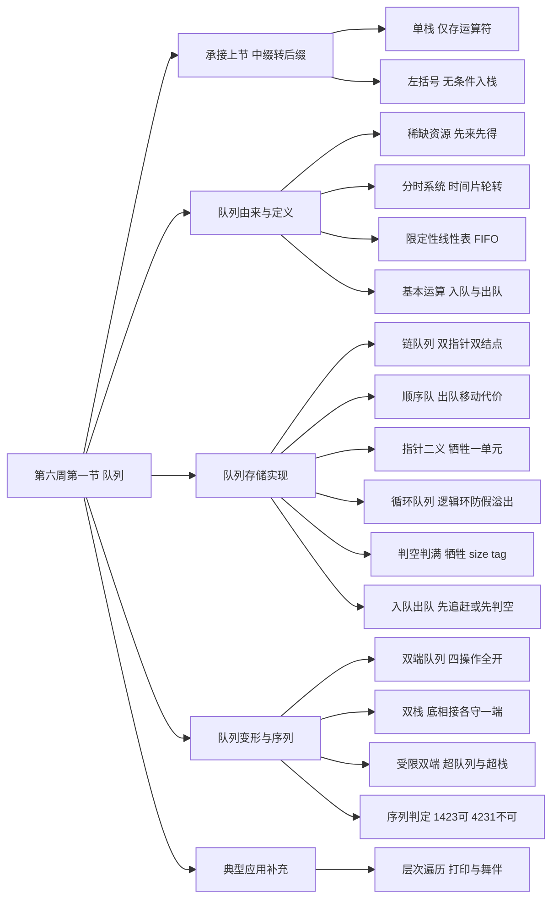
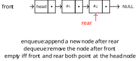
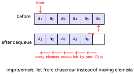
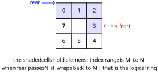
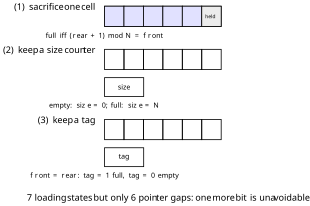
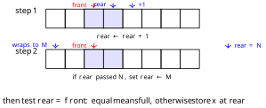
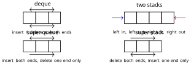
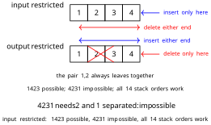

# 数据结构 · 第六周第一节 · 队列 · 详细版讲义

> **来源说明**：本讲义依据课堂录音的两份本地转写与逐段分析素材整理，并与严蔚敏《数据结构（C语言版）》第 3 章 3.4 节对照校订而成，属**课堂整理稿**，不是逐字实录的官方讲稿。
>
> - **转写来源（两份本地文件，均为课堂录音的 ASR 导出文字）**：① `20261010_103048_导出原文.txt`（前半：中缀转后缀收尾，以及队列的由来、定义、与线性表的异同、两类运算、链式存储、顺序存储、指针二义性、假溢出、循环队列与判满判空三法，约伪时间 00:00–01:16）；② `队列相关课程讲解_导出原文.txt`（后半：循环队列的入队与出队算法、与类 C／C++ 取模写法的比较、队列的四种变形、受限双端队列的出队序列分析，约伪时间 01:16–01:56）。**两段顺序的依据**：转写一末尾是我的一句「我们先休息几分钟，然后我们再讲入队和出队的算法」，转写二开头正是入队算法，两段直接衔接，无重叠。两份合并后按 760 字左右切成 38 段，其中 2 段是转写分隔标记，**36 段正文逐段分析产出 36 份素材**（`segment_001.md` ~ `segment_025.md`、`segment_027.md` ~ `segment_037.md`），本讲义以这 36 份素材为底稿，必要处回看原始转写。
> - **教材对照范围**：严蔚敏《数据结构（C语言版）》第 3 章 **3.4 队列**——3.4.1 抽象数据类型队列的定义（含双端队列、输入受限与输出受限的双端队列的说明）、3.4.2 链队列、3.4.3 循环队列——为主要对照，用于校对术语、算法写法与「判满判空」的标准表述；复杂度部分对照 1.4.3、1.4.4。**但本节课关于队列的引入（分时系统、时间片轮转、视觉暂留）、顺序队的两个主要问题（指针二义性与假溢出）、「超队列／超栈」这套变形命名、以及受限双端队列出队序列的分析方法，教材中没有对应小节**，属课堂扩展，附录 A 已逐条注明，讲义不为其硬套教材出处。
> - **标注约定**：课堂举例一律标「（转写举例）」；我在课上未讲、但教材里有的内容标「（教材补充：3.4.x）」；能对上教材的标「（教材对应：3.4.x）」；教材里没有、属课堂扩展的标「（课堂扩展）」；为把口述讲通而作的整理标「（讲义补充）」；能依据教材与上下文裁定的口误／误识，在正文用「（讲义校订：…）」当场说明，裁不掉的全部进「待核实内容」。
> - **术语口径**：本讲义统一使用**队头 front**、**队尾 rear**、**入队 EnQueue**、**出队 DeQueue**、**循环队列**、**假溢出**、**双端队列**、**双栈**、**超队列**、**超栈**、**输入受限双端队列**、**输出受限双端队列**。需要注意我课堂口述与教材命名的错位：我说的**超队列**（插入两端皆可、删除只限一端）对应教材的**输出受限的双端队列**；我说的**超栈**（删除两端皆可、插入只限一端）对应教材的**输入受限的双端队列**；我说的**双栈**（从哪端进就必须从哪端出）对应教材「两个栈底相邻接的栈」。正文第一次出现时都做了对照标注。
> - **front 指向的两种口径**：我口述的顺序队是**牺牲一个单元**的方案，约定 **front 指向队头元素的前一个位置**、rear 指向队尾元素本身；而教材 3.4.3 的循环队列约定 front 指向**队头元素本身**、rear 指向**队尾元素的下一个位置**。两者只差一格，读题时按语境分辨，讲义在相应小节都标了出处。
> - **时间说明**：本节课为**文字模式**（无音视频轨、无关键帧），各节时间戳是按**字数折算的伪时间**（约 200 字／分钟），非音频真实时间；它只是讲义内部单调递增的定位坐标，用于与 36 份分段素材对齐。全课伪时间长约 1 小时 56 分，其中 **01:16 处是两段转写的接缝**，也大致对应课间休息的位置。
> - **编号说明**：我在课上沿用自己旧课程体系的节次编号，与严蔚敏教材章节号**不一致**：我口中的「第三章」＝链表（教材 2.3）、「第 4 章」＝栈和队列（教材第 3 章）。本节课是队列专题，属我编号体系里「第 4 章」的后半。该对应关系为讲义的推断。
> - **关联阅读**：[[数据结构 第五周第二节 栈的应用与递归 详细版讲义]]（上一节，本节课开头的中缀转后缀正是那一节的收尾）、[[数据结构 第五周第一节 线性表的应试技巧与栈 详细版讲义]]、[[数据结构 第二章 线性表 详细版讲义]]。
> - **示意图说明**：正文里嵌了 7 张独立 SVG 示意图（`w61_01.svg` 到 `w61_07.svg`，放在 `插图/` 目录下，正文已用相对路径引用）。图内标签采用字母、数字、数学记号与英文短语，中文解释放在每张图下方的「图注」里。

## 开场导读

这节课的主题是**队列**。开头并不是一句「今天我们讲队列」，而是接着上一节课的话头往下说——我先给「中缀转后缀」补了一个收尾，才正式转入队列。

**前半部分是队列的来历与定义。** 我从一个很大的前提讲起：人要生活在这个世上就得消耗资源，而资源往往是有限的，**人的生命也是有限的**——所以稀缺资源的竞争需要一种比较文明的解决办法，那就是**排队，先来先得**。我顺手补了一句反证：如果人的生命无穷尽、永远不会终结，那早晚都能轮到自己，大家也就不用着急和争夺了。现实里的排队，我从购物结账数到生产流水线、飞机起降、火车运行调度，再落回计算机：队列是**工具性的数据结构**，凡涉及资源竞争排队都要用到，其中最常见的是**分时技术与并行技术**。

于是有了这节课里一段直观的「为什么」。一台服务器要同时服务 7 个用户，一台手机只有一个 CPU 却能同时听歌、聊天、下棋都不卡顿——我在课上当场提问，一位同学答「都分配一个内存」，我没顺着往下接，而是先报了两组数字：**PID 进程编号**、**一万三千多个任务**、**最多四核**。答案在**时间片轮转**里：CPU 把时间切成一个个小片，`0~1ms` 服务用户 1，一毫秒执行不完就把**现场封存扔进队列**，切到用户 2，第 `8ms` 再回来服务用户 1；而人感觉不到卡顿，是因为**CPU 速度很快**，快到超过了**人眼视网膜的视觉暂留**阈值——就像电影每秒超过 24 帧就会显得连续一样。我还交代了 Windows 的调度口径：**多级时间片轮转式**，最高等级 1ms、下一级 5ms、再下一级 100ms，等级越低时间片越大。

接着是定义。我给的是一个**向量口径**的定义：队列是**下限和上限都只能增加而不能减少的向量**。排队要有场地，所以我说「有的教材和讲法用线性表来定义队列**不够严谨**」，并用数据结构研究内容的三条——数据对象与逻辑关系、存储结构、操作集——把两者比了一遍：**同**在都是同类元素的集合、都是线性结构、存储结构也可以一样；**异**在操作集，线性表有 8 大类运算，队列只剩两类且**受限在两端**。中间的插曲很好记：线性表可以按身高重新排个队，队列则不行——一旦打乱顺序就破坏了先来先到。本课给出的严谨定义是：队列是**限定性线性表**，仅能进行插入和删除，且插入在一端、删除在另一端。

**中段是队列的存储实现。** 链式存储先被搁在一边：现实里的排队往往要开辟场地，而链队列**存储密度较低、管理相对麻烦**（医院拿号算个例外）。链队列的关键一问是**队头放表头还是表尾**——我请一位同学回答，答案是**队头放表头、队尾放表尾**，代价是必须**同时保存两个指针**，这正是我常讲的「**空间换时间**」。顺序存储则是最自然的方式，但很快就会遇到**一个主要缺陷**：要保持**结构一致性**，删除队头元素会让后面所有元素**依次往前挪一个位置**，一次删除就是 $O(n)$。我用春运买票作为类比——窗口卖完票，后面的人提着包一个个往前挪，而计算机里这 $N$ 个元素还得由单台计算机依次完成搬移，开销更大。

于是有了贯穿本课的**改进思路**：让**售票员走出来卖票**，指针不断往后移动，出队不再搬动元素。代价是只用一个指针就不知道队列里还有多少元素——所以需要 `front` 与 `rear` 两个指针；而两个指针又带来**指针二义性**（`front = rear` 到底是空还是有一个元素？我用 $0^\circ\text{C}$ 的水打比方：单看温度数值，说不清它是固态还是液态），解决的办法是**牺牲一个单元**，约定 **front 指向队头元素的前一个位置**。第二个常见问题是**假溢出**：空间明明还有，却报溢出——根源就在「上下限都只能增加不能减少」这条性质上。我的解法是**循环队列**，现实类比是排队的人碰到墙会**拐弯**，以及小时候那种掰成圆圈的葫芦形铁丝玩具：首尾相接，做一个**逻辑上的环**。

**循环队列最关键的一问是「队满和队空的条件到底相不相同」。** 我把这个问题抛给大家，并给出了根本理由：**入队时 rear 先做了一次「追赶动作」——先加 1，再去判断相等；出队是「一上来直接判断」**，所以不能把两者说成完全一样。我还把本课写法与类 C／C++ 教科书的 `(rear + 1) % N` 写法摆在一起比较：`mod` 不过是整除 $N$ 再求余，两者的 `if` 语句执行效率相同，但**本课的空间下标是用户可指定的 $M$ 到 $N$，适用范围更广**——如果题目给定队列空间下标是 $M$ 到 $N$，死记 `0` 到 $N-1$ 的取模公式就会遇到麻烦。判满判空的三条路我也一并讲清：**牺牲一个单元**、**加 `size` 变量**、**加 `tag` 标记**——根因是「装载情况有 7 种，两个指针的差值只有 6 种」，信息量差了一档，必须额外引入一个单元或变量。

**后半部分是队列的四种变形。** 我从自己读研究生时去广州火车站买票的经历讲起：五点多起床、坐车半小时、前面排了五六十号人，售票员大喇叭一喊「只剩 10 张票了」——那能不能**直接离开**？常规队列不允许，因为先来先服务，哪怕买不上票也只能排着；医院里 120 送来的**危重病人**同样插不进来。所以我依次讲了**双端队列**（两端都可插入删除）、**双栈**（从哪端进就必须从哪端出，要跟「两栈共存」区分开）、**超队列**（插入两端皆可、删除只限一端，对应危重病人先服务）、**超栈**（删除两端皆可、插入只限一端，严格不允许插队）。这几种变形在 408 考研里经常作为选择题考察。

于是最后一件事是把上一节**出栈序列**的旧账翻出来：4 个元素依次入栈，全部排列有 24 种，合法出栈顺序只有**卡特兰数** $\frac{1}{n+1}C_{2n}^{n}$ 种，$n=4$ 时是 **14 种**。然后把这套分析法搬到**受限双端队列**上：输入受限（插入只在一端）下 `1423` **可能**、`4231` **不可能**；输出受限（删除只在一端）下 `4231` 同样**不可能**，理由很清楚——**2 和 1 一旦相继插入且均尚未出队，出队时必须紧挨着出来**，中间夹不进 3、4（关于 `2413` 在允许与不允许交替出队两种口径下的区别，正文第二十七节专门做了厘清）。最后留了一道 5 个元素 `A B C D E` 的课堂练习，转写在此处进入课堂讨论杂音，答案没有留下来；文末还补充了教材常见的**队列三大应用**（层次遍历、打印缓冲区、舞伴问题），方便把理论和实践接上。

## 总览知识地图

全课内容跨「来历 · 定义 · 存储 · 算法 · 变形 · 应用」六块，我把整节课的主线收束成一张知识地图，其余六个专题用表格和列表逐层展开。

**图 1 · 全课知识地图：从队列的来历到队列的变形**



**知识要点 2 · 队列与线性表：同在三处，异在操作集**

| 比较维度 | 与线性表相同之处 | 与线性表不同之处 |
| --- | --- | --- |
| 数据对象 | 同类元素的集合（都参与同一份资源的竞争） | — |
| 逻辑关系 | 线性结构（一个接一个排列） | — |
| 存储结构 | 顺序存储或链式存储皆可 | — |
| 操作集 | — | 线性表有 8 大类运算；队列只有两类（入队与出队），且受限在两端（不提供重组、拆分） |

**知识要点 3 · 顺序队的两个问题如何逼出循环队列**

1. **顺序队（用向量直接存）**：若保持物理紧凑，删除队头元素会导致后面全部元素前移一位，时间复杂度为 $O(n)$。
2. **改进为双指针记账（让 `front` 追赶 `rear`）**：元素不再搬动，出队复杂度降为 $O(1)$，但引发两个新问题：
   - **新问题一：指针二义性**：`front = rear` 是空还是只剩一个元素无法区分；对策是**牺牲一个单元**，约定 `front` 指向队头元素的前一个位置。
   - **新问题二：假溢出**：空间还有空余却报溢出；对策是把向量首尾相接，构造成逻辑环，即**循环队列**（判满判空仍需额外手段）。

**知识要点 4 · `front = rear` 说不清空与满的三条出路**

| 方案 | 判空条件 | 判满条件 | 额外代价与特点 |
| --- | --- | --- | --- |
| 方案一：牺牲一个存储单元 | `front == rear` | `(rear + 1) % N == front`（或环状下一位置等于 `front`） | 最多存 $N-1$ 个元素，逻辑最简 |
| 方案二：增加 `size` 记录元素个数 | `size == 0`（且 `front == rear`） | `size == 容量` | 多一个整型变量，空间利用率 $100\%$ |
| 方案三：增加 `tag` 标记最近一次操作 | `front == rear && tag == 0`（出队置 `tag = 0`） | `front == rear && tag == 1`（入队置 `tag = 1`） | 多一个标志位，空间利用率 $100\%$ |

**知识要点 5 · 循环队列的入队与出队步骤（空间下标 $M$ 到 $N$）**

1. **入队 `EnQueue`（先追赶，再判断）**：
   1. 先做追赶动作：`rear = rear + 1`。
   2. 判断是否越界：若 `rear > N`（即 `rear == N + 1`），置 `rear = M` 拉出一个逻辑环；否则保持不变。
   3. 再判满：若 `rear == front`，说明队满，拒绝入队；否则把新元素 $x$ 存入 `rear` 位置。
2. **出队 `DeQueue`（先判空，再追赶）**：
   1. 先判空：若 `front == rear`，说明队空，拒绝出队。
   2. 否则做追赶动作：`front = front + 1`。
   3. 判断是否越界：若 `front > N`（即 `front == N + 1`），置 `front = M` 拉出一个逻辑环；否则保持不变。
   4. 取出当前 `front` 位置的元素赋给输出变量 $s$。

**知识要点 6 · 队列的四种变形与教材命名对照**

| 课堂名称 | 操作规则 | 教材对应名称（3.4.1） | 现实类比 |
| --- | --- | --- | --- |
| 双端队列（deque） | 两端都可插入，也可删除 | 双端队列 | 队尾买不到票可提前离开 |
| 双栈 | 从哪端进就必须从哪端出 | 两个栈底相邻接的栈 | — |
| 超队列 | 插入两端皆可，删除只限一端 | 输出受限的双端队列 | 急诊危重病人插到最前面优先服务 |
| 超栈 | 删除两端皆可，插入只限一端 | 输入受限的双端队列 | 严格不允许插队 |

**知识要点 7 · 受限双端队列的出队序列判定（1, 2, 3, 4 依次入队）**

1. **输入受限的双端队列（只在右端插入，两端都可删除）**：
   - 右端既能进又能出，等价于一个完整的栈，因此栈能输出的 14 种卡特兰序列它都能输出。
   - `1423` 可能：`1` 右进右出、`4` 右出、`2` 左出、`3` 任意端出。
   - `4231` 不可能：`4` 第一个出来时，`1, 2, 3` 按序留在队列里，`2` 被 `1` 和 `3` 夹在中间，两端都够不着。
2. **输出受限的双端队列（两端都可插入，只在右端删除）**：
   - 当先插入的两个元素 `1, 2` 同时留在队列中时，它们在队内相邻且后续插入只能加在两端，因此只要其中一个未提前出队，两者出队时必须紧挨着，中间夹不进别的元素。
   - `4231` 不可能：`4` 第一个出队意味着 `1, 2, 3, 4` 已全部入队，此时 `2` 和 `1` 之间被 `3` 隔开，无法实现。

## 正文

### 一、承接上节：中缀转后缀，一个只存运算符的栈 `00:00-00:03`

我先把表达式记法的优劣排个序：后缀表达式事实上更优，中缀表达式虽然是我们现在流行的书写方式，却并不是最好的表达方式。

> 「后缀表达式……它事实上更优。中缀表达式是我们现在流行的，但不是最好的表达方式。」（转写举例）

这句判断是承接上一节来的收束，也顺势引出本节第一个技术问题——中缀表达式到底怎么转换成后缀表达式？（讲义补充）「流行」与「更优」是两件事，需要分开看：中缀流行只是书写传统的结果，人从小写 $a+b$，习惯如此；而后缀更优，是站在「机器能不能一遍扫完就定序求值」这个角度说的。中缀的运算符夹在两个操作数中间，先后次序不能只看书写位置，必须叠加运算符优先级和括号两条额外规则才能消解歧义；后缀把运算符写在操作数之后，运算符出现的先后次序就是运算的先后次序，不再需要括号。我在课上没有展开这层论证，只给结论，把重点放在「怎么转换」上。

转换的关键结论，我一共总结了三条。

第一条，**只需要一个栈，而且这个栈只存运算符**。我的理由是「因为后缀和中缀表达式它这个操作数是一模一样的」。这里的「一模一样」不是指字符不变，而是指**操作数之间的相对先后次序不变**：中缀 $a+b*c$ 里的操作数依次是 $a, b, c$，它对应的后缀 $a\ b\ c\ *\ +$ 里操作数还是 $a, b, c$，前后关系不会颠倒。既然操作数只是按原顺序平移到输出串上，就不需要找地方「暂存」它们——扫到一个操作数，直接追加到后缀串尾部即可。（讲义补充）真正需要暂存的只有运算符，因为运算符的先后会变：中缀里 `+` 写在 `*` 前面，后缀里却要先写 `*`、后写 `+`。这种「先后颠倒」正是栈（后进先出）负责的事——把暂时还轮不到出场的运算符压在栈里候场，等它该出场时再弹出。所以判据很清楚：**次序不变的东西（操作数）直接输出，次序会变的东西（运算符）用栈候场**。我在课上讲这条时有一处口误，这里当场说明：

> 「所以这个栈里面只需要存操作数啊，只需要存运算符。」

前半句「存操作数」是脱口而出的口误，说完后我立刻改口为「只需要存运算符」，后半句才是正解。（讲义校订：栈里只存运算符，不存操作数；把操作数也压栈不但多占空间，还会破坏「栈顶是最近一个待定运算符」这个判断依据。）

第二条，**从左到右扫描，比较优先级**。规则浓缩成一句话：拿新来的运算符，和栈里（也就是左边）已有的运算符比优先级。若栈里那个（左边）运算符优先级比较高，说明它应当被优先运算，于是把它**弹出栈**；若栈里那个运算符优先级低，说明它还轮不到现在算，新来的这个运算符就**入栈**等待。这里的方向容易记反，要点是：比较的参照物始终是**栈顶那个「左边的」运算符**，而不是新来的那一位，即「左边高则弹出」，而不是「新来的高则弹出」。

第三条，**遇到左括号，无条件入栈**。我在课上强调得很明确：

> 「一到左括号，毫无疑问，全都要无条件入栈。」（讲义校订：「入栈」原文转写为「进站／侵占」，属同音误识。）

左括号不参与优先级比较，因为它不是运算符，而是一个「隔离屏障」。它一进栈，栈顶就成了屏障，后面扫描来的任何运算符都无法越过它去弹出括号外的内容；直到遇到与它配对的右括号，才把这一段清空。我在课上只说了「无条件」三个字，没展开解释原因，理由就在这里。

最后我用一句话收尾：

> 「那当然还有别的中缀转换成后缀的方法，我就不讲了啊。」（转写举例）

也就是说，本节采用的是「一个栈、只存运算符」这一种转换路线，其它路线课上不作展开。本讲义后续出现的算法与代码，都以这一条路线为准。

（课堂扩展）需要交代一句：严蔚敏教材第 3 章并没有把「中缀转后缀」单列成一个算法，教材 3.2.5 走的是「算符优先」的双栈路线，用两个栈直接求表达式的值。因此本节的转换算法标注为课堂扩展；而栈、队列这两个结构本身，教材在 3.1、3.4 两节都有正式定义。

把上面的三条规则写成类 C 代码，就是下面这段扫描流程。要注意，我在课堂上把操作数的直通、左括号的无条件入栈都讲了，但**没有讲遇到右括号怎么处理，也没有讲运算符同级时怎么办**，这两处由（讲义补充）补全。

```c
/* 将中缀表达式串 E 转为后缀表达式串 P（栈 S 只存运算符，不存操作数） */
void InToPostfix(const char *E, char *P) {
    SqStack S;
    InitStack(&S);                          /* 初始化运算符栈 */
    int i = 0, j = 0;                       /* i 遍历 E，j 写入 P */
    while (E[i] != '\0') {
        char t = E[i++];                    /* 依次读取每个记法单元 */
        if (IsOperand(t)) {
            P[j++] = t;                     /* 操作数次序不变，直接输出，不入栈 */
        } else if (t == '(') {
            Push(&S, t);                    /* 左括号无条件入栈，充当隔离屏障 */
        } else if (t == ')') {              /* （讲义补充）遇右括号连续弹栈直到左括号 */
            while (!StackEmpty(S) && GetTop(S) != '(') {
                Pop(&S, &P[j++]);           /* 弹出的运算符追加到 P 尾部 */
            }
            if (!StackEmpty(S)) {
                char dummy;
                Pop(&S, &dummy);            /* 弹出并丢弃配对的左括号 */
            }
        } else {                            /* t 是运算符 */
            /* （讲义补充：含相等优先级，左结合运算符同级也先弹出） */
            while (!StackEmpty(S) && GetTop(S) != '(' &&
                   Priority(GetTop(S)) >= Priority(t)) {
                Pop(&S, &P[j++]);
            }
            Push(&S, t);                    /* 当前运算符入栈候场 */
        }
    }
    while (!StackEmpty(S)) {                /* 扫描结束，弹出栈内剩余运算符 */
        Pop(&S, &P[j++]);
    }
    P[j] = '\0';                            /* 写入字符串结束符 */
}
```

**时间复杂度**：$O(n)$，$n$ 为表达式长度。整个转换对表达式只从左到右扫一遍，每个运算符至多进栈一次、出栈一次，每次进出都是常数时间操作，因此总时间与表达式长度成正比。
**空间复杂度**：$O(d)$，$d$ 为扫描过程中运算符栈的最大深度，与表达式的嵌套深度有关，最坏情况与 $n$ 同阶。

**关键易错点**

- 栈里**只压运算符，不能压操作数**——这正是我课上口误过、又当场更正的地方。
- 比较方向别记反：是「栈内（左边）运算符优先级**高**则弹出」，不是「新来的高则弹出」。
- 左括号入栈后充当**屏障**：栈顶为左括号时，任何运算符都不能弹出它；左括号只能在遇到配对的右括号时被弹出并丢弃。
- 相等优先级的处理我在课上未讲，实际实现中对于左结合运算符通常也弹出（讲义补充），否则会破坏后缀串中运算符的定序。
- 别把「弹出」只理解成「丢出栈」——弹出的运算符要**追加到后缀串尾部**才算完成一次输出。

三条规则对照成表如下，做题时照这张表逐条比对即可：

| 栈内（左边）运算符 | 新来的记法单元 | 动作 | 直觉解释 |
| --- | --- | --- | --- |
| 优先级较高 | 任意运算符 | 弹出栈内运算符并输出 | 左边的先算，先算完才轮到新来的 |
| 优先级较低 | 任意运算符 | 新运算符入栈 | 新来的后面才轮到，先在栈里等着 |
| — | 左括号 `(` | 无条件入栈 | 左括号不是运算符，不受优先级约束，充当屏障 |
| 任意（非左括号） | 右括号 `)` | 连续弹栈输出，直到栈顶为 `(`（讲义补充） | 括号内先算完，屏障随配对括号一并清除 |

这一节还隐含了一个对照：处理表达式时用的是**栈**（后进先出），而本节接下来要引入的新结构是**队列**（先来先得），两种结构对应两种完全不同的次序规则——前者用来表达「最近的优先」，后者用来表达「最早的优先」，后面各节会反复用到这个分界。

**本节要点**

- 中缀转后缀只需一个**仅存运算符**的栈，操作数相对次序不变直接输出。
- 比较优先级时以**栈内（左边）运算符**为参照：左边优先级更高（或同级）则弹出输出，否则新运算符入栈。
- 左括号 `(` 无条件入栈充当屏障，遇到右括号 `)` 时连续弹栈直至清除配对的 `(`。
- 整体只需一次线性扫描，时间复杂度 $O(n)$，空间复杂度 $O(d)$（最坏 $O(n)$）。

### 二、队列的由来：稀缺资源、有限生命，与「先来先得」 `00:03-00:05`

讲完表达式转换，我把话题一转，引出本节的第二个主角。承接上一节末尾「对于这种稀缺资源」的半句话，本段先把处理稀缺资源的思路铺完整。我的引入逻辑是一条环环相扣的推理链：人活在世上就要消耗资源，而资源往往有限，尤其是一些稀缺资源就更有限；既然资源有限、想要的人又多，需求者之间就会形成**竞争**；竞争如果不加约束就会退化为抢夺，所以往往要采用一种「比较文明的方式」来解决——这个方式就是**排队**，也就是所谓的**先来先得**。

> 「对于稀缺资源的竞争，那我们往往就要采用一种比较文明的方式来解决，就是啥？就是队列，就是所谓的排队嘛，先来先得嘛。」（转写举例）

这段话表面讲生活，实质讲的是**资源分配**。把它拆开，是一条五步链：存在一种被多人想要的资源 → 资源总量小于总需求 → 需求者之间形成竞争 → 竞争需要一条裁决规则 → 裁决规则就是按到达先后服务的排队。后面要讲的队列，本质上就是把最后这一步「先来先得」固化成一套可计算的数据结构。

这条链里容易被忽略、也很关键的一环，是我紧接着给出的**反证**——假设人的生命是无穷尽的：

> 「就像神仙一样，你永远不会死的话，那反正早晚会轮到我对吧？那大家也就不着急嘛。」（转写举例）

我用「神仙」这个比喻指出了排队机制成立的隐含前提：**等待必须是划算的**。一个人愿意排队，是因为他相信「我多等一会儿，最终能拿到」；而「最终能拿到」的前提，是「我还有时间等」。假如人的生命无穷尽，时间无限多，那么早晚都会轮到自己，也就无所谓争夺，排队自然没有必要。可现实并非如此，所以我马上用一句俗语把这个假设收住：「咱们说一寸光阴一寸金啊」（讲义校订：原文转写为「寸金寸光阴」，成语本作「一寸光阴一寸金」）——人的生命有限而且宝贵，等待是有成本的，资源就必须被尽快、公平地分配。

于是两个前提缺一不可，可以并成一张表：

| 前提 | 缺了它会怎样 | 课堂原话依据 |
| --- | --- | --- |
| 资源有限 | 人人可得，不需要排队 | 「尤其是对一些稀缺资源，它更有限」 |
| 生命／时间有限 | 慢慢等也无所谓，不需要争夺 | 「就像神仙一样……早晚会轮到我」 |

只有两者同时成立，才逼出「公平的排队机制」这个结论。（讲义补充）这一层在做笔记时值得记住：计算任务也有自己的「时效」——一个待处理的任务不能无限等下去，否则用户就会察觉到卡顿，这与「生命有限」在结构上是同构的，后面第三节讲「为什么感觉不到卡顿」时会直接用到。

排队机制在现实生活里到处都是，我在课上举了四类场景（转写举例）：一是大家购物时排着长队结账；二是生产流水线上的产品，一个接着一个从流水线下来；三是飞机的起降调度；四是火车的运行调度——这些都要用到队列这个模式。把这四个例子抽象成队列的术语，可以整理成下面这张对照表，其中「元素是谁」「哪一端先被服务」是（讲义补充）的整理：

| 现实场景 | 谁在排队（数据元素） | 队头方向（先被处理） | 队尾方向（后加入） |
| --- | --- | --- | --- |
| 购物结账排长队 | 顾客 | 排在最前面的顾客先结账 | 后来的顾客排到末尾 |
| 生产流水线的产品 | 待加工的产品 | 先到工位的产品先被加工 | 新送来的产品接在后面 |
| 飞机起降调度 | 等待起降的航班 | 先获得许可的航班先动 | 后续航班请求排在后面 |
| 火车运行调度 | 等待进站的列车 | 先安排的列车先进站 | 后到的车次排在后面 |

四类场景形不同而理相同：**多个请求、一份资源、按到达顺序服务**。这正是队列的语义——谁请求得早，谁就先得到服务。

接着我把镜头从现实搬到计算机。我说，计算机是一个**模拟学科**：现实生活中普遍存在的排队机制，计算机当中也需要有相应的结构来实现它。这句话包含两层意思：一是计算机里的很多机制，是先观察现实、再把现实的规律抽象成模型搬进机器里的，现实有排队，机器里就要有排队的模型；二是「模拟」不等于「照搬」——现实中的队伍可以插队、可以中途离开、可以开好几条窗口，而队列结构只保留「先来先得」这一条核心规则，是**简化、归纳之后的模拟**。

由模拟学科这层铺垫，我给出了队列的基本定位：计算机当中广泛采用一种数据组织模式，就是队列；**凡是涉及到资源的竞争排队，都要用到队列这种数据结构**，所以队列也是一种**工具性的数据结构**。

> 「凡是涉及到资源的竞争排队，那都要用到队列这种数据结构，所以它也是一种工具性的数据结构。」（转写举例）

所谓「工具性」，指这类结构本身并不承载具体的业务数据含义，而是**提供一种组织与管理数据的手段**。数组、链表、树可以表示「一份名单」「一棵目录」，是装着具体数据的容器；栈和队列则更多被当作**流程的控制结构**来用——栈表达「后进先出」的嵌套与回退，队列表达「先进先出」的排队与调度，是可以搬到任何场景里复用的通用零件。（教材对应：3.4.1）教材对队列的正式定义是「一种先进先出（FIFO）的线性表，只允许在表的一端进行插入，在另一端删除元素」，并记 $q=(a_1,a_2,\cdots,a_n)$，$a_1$ 为队头元素、$a_n$ 为队尾元素；我在本段反复说的「先来先得」，正是 FIFO 的通俗说法，只是此时还没有正式引入队头 front、队尾 rear 这两个名称。

最后我把视角落回计算机内部：队列在计算机中也很普遍，是一种基本的管理技术，「现在最明显的就是分时技术」，并且顺带点出了**并行技术**的名目。这里要留意，我在课上只是把分时技术和并行技术并列点了个名，**并行技术并没有展开讲**；后面的讲解主要围绕分时技术展开，具体怎么分时、为什么用户感觉不到卡顿，都是下一节的内容，本节到此只作引子。

**本节要点**

- 队列源自**资源有限**与**时间／生命有限**的双重约束，目的是对稀缺资源按「先来先得」进行公平分配。
- 队列是一种**工具性数据结构**，重在控制流程与服务次序，而非承载特定业务语义。
- 现实中的结账排队、流水线、航班与列车调度，抽象后都是「多请求争用同一资源、按到达次序服务」。
- 计算机中的典型应用引向**分时技术**（下文重点展开）与**并行技术**。

### 三、从分时系统看队列：一个 CPU 为什么要同时服务一万多个任务 `00:05-00:11`

上一段末尾我点到「计算机中最明显的例子就是分时技术」，本段接着这个话题往下说：分时技术和并行技术都要用计算机来落实，为把问题讲清楚，我选择以**分时技术**为例。仍然要强调，本段只在开头并列点了「并行技术」的名目，**没有关于并行的展开**；重点讲清的是分时。

我先摆出一个最小模型：摆在面前的是一台大型机，或者说一台服务器，现在有 7 个用户同时要使用它，可是**服务器只有一台**（转写举例）。资源只有一个，想用它的用户有 7 个，那该怎么办？我把问题直接抛给同学们——「你咋做呢？咋做啊？」我没有立刻给答案，先把「资源少、需求多」这个矛盾摆到台面上。

紧接着我指出这个情景并不是大型机独有的，我们的微机、大家手上的手机也是同一个道理。手机是一个**多任务系统**，多任务体现在哪里呢？比如你当前正在听歌，同时又聊天，同时又下棋（转写举例）。我让大家注意观察现象：下棋很顺畅，聊天也没有间断，听歌也没有卡住。于是追问一句「那为啥？」——为什么会这样？

我的提示是：想一想我们的计算机、我们的手机，**CPU 有几个**？答案只有一个（单核情形）。于是矛盾被推到尖锐处：聊天的程序、下棋的程序、听音乐的程序，按道理应该互相抢这唯一的 CPU，可你偏偏感觉不到卡顿，感觉就好像每个任务都有一台单独的 CPU 在为自己服务一样——但实际上只有一个服务器、只有一个 CPU。

> 「你只有一个 CPU，你为这多个任务服务，结果你感觉不到卡顿，感觉好像每个任务都有一个单独的 CPU 来为我服务一样，但实际上只有一个服务器，只有一个 CPU。」

我把「看起来每个任务都有一台自己的 CPU」明确指出是一种**错觉**：现象与事实之间存在落差，落差需要解释。这个问题我没有自己先回答，而是点了一位同学来回答。

> 「你们班的学生应该知道吧，找个同学回答一下，为啥你感觉不到卡顿呢？」（转写举例；「你们班」原文转写为「你们集体班」，疑为班级名称被识别有误，此处不作硬猜。）

那位同学答了一段话，转写里只留下了这句答话的尾句——「**都分配一个内存**」（转写举例；前半句没有被转写进来，此处只作照录，标注「存疑」）。我随即让他坐下，然后顺着思路继续往下讲。

顺着「任务到底有多少」这条线，我把现象**量化**了：我先抓住一个词追问——PID 是什么？随即自己给出答案，「PID 就是这个进程的编号」。每个任务来到计算机之后，都要由系统给它配发一个**进程编号**，也就是属于它的身份号码。这样的任务有多少呢？我给了一个具体的量级：**一万三千多个**，紧接着又用「这 1 万多个任务」回指同一批对象。然后我亮出这台计算机的硬件底数：当时的主流计算机「最多……四核」，所谓四核，也就是四个执行核心（讲义校订：原文「撑死了大大多分是啥」中「大大多分」不成词，按上下文应读作「最多」）。矛盾于是变得很悬殊：

| 项目 | 数量 |
| --- | --- |
| 需要被服务的单位（任务／进程） | 13000+ 个 |
| 能同时干活的执行单元（四核 = 四个核心） | 4 个 |
| 大致比例 | 约 1 : 3250 |

只有四个核心，却要为一万多个任务服务，我再一次追问那个问题：那你为什么感觉不到卡顿？

这一回我先给出**第一层答案**：基本原因在于，实际上这个 CPU 运行速度非常快。

> 「基本原因在于，实际上这个 CPU 太快太快了。」

这句话说得很克制，用的是「基本原因」四个字，把这件事先归到 CPU 的速度上。它还可以拆成两句来理解：（讲义补充）一是单次占用极短，CPU 每秒能执行数十亿个时钟周期，完成一次「换个服务对象」的动作只耗极短时间；二是切换频率高到超出人的感官分辨力，人对外界变化有分辨极限，变化一旦比这更快，人就感觉不到「间断」，只觉得它是连续的。这里需要划一条界：本段我**只讲到了「CPU 很快」这一层，并没有讲任务之间究竟怎么轮流上台**——轮转的具体规则是第四节的内容。

接下来，我用了本段后半程的篇幅打了一个比方——**电影**。我先连问几个问题引出话题：「大家知道电影咋来的呀？电影为啥有电影？」然后给出解释：电影本质上是一张张静止的画面，一秒钟内只要**超过 24 张**图像连续播放，人类的视觉就有「遗留效果」。

> 「上一张图片看完了，下一张图片来了，我的大脑里面还把上一张图片留下一部分印象；那么超过 24 张，一秒钟你就感觉不到卡顿。」

我把这种效果描述得很具体：上一张图片看完了，下一张图片来了之后，大脑里面还留着上一张图片的一部分印象；在这种印象还没散掉的时候去看第二张，两张就接上了。我把这件事总结成一句话——「实际上我们的视觉有停留效果」，规范的说法是**视觉暂留**（讲义校订／课堂扩展：「遗留效果」「停留效果」都是同一个生理现象的口语说法）。但停留效果是有极限的，我马上补了一个反例：如果一秒钟只放十张图片，那就不行，连不起来，形成不了顺滑的影片效果；**需要超过 24 张，才有连续的视觉效果**。

把计算机这一侧和电影这一侧并排看，这个类比的骨架如下：

| | 电影 | 本段中的计算机 |
| --- | --- | --- |
| 离散的单位 | 一张张静止的图像 | 一个个需要 CPU 服务的任务 |
| 快速连续呈现 | 每秒 24 张以上 | CPU 运算速度极快 |
| 感知端的极限 | 视觉暂留，太快就分不出张 | 人感觉不到卡顿 |
| 低于阈值会怎样 | 每秒 10 张，连不起来 | 本段未展开 |

需要说明，本段只把类比讲到「够快就感觉不到断续」这一层；「CPU 究竟以多快的节奏在各任务之间轮换」，本段还没有展开。本段结束在提问与类比上，正确的读法是：**矛盾已经摆明，第一层答案（CPU 很快）已经给出，机制（怎么轮流）尚未揭开**——那是下一节的重点。（课堂扩展）分时技术、进程编号 PID、四核、电影 24 帧与视觉暂留，都不属于严蔚敏教材第 3 章的内容，是课堂延伸；只有「多个请求争用同一资源、要靠排队机制分配」这层结论，与教材 3.4.1 队列的定义相呼应。

**本节要点**

- 操作系统中多任务（如上万个 PID 进程）远多于 CPU 核心数，「每个任务独占 CPU」是一种宏观错觉。
- 感觉不到卡顿的第一层原因在于 **CPU 处理速度极快**，单次切换开销极小。
- 用电影「每秒超过 24 帧」的**视觉暂留**现象类比：离散任务只要切换足够快，人眼与大脑就会感知为连续。
- 本节仅提出「CPU 很快」这一前提，具体的队列轮转规则留待下一节展开。

### 四、时间片轮转与视觉暂留：为什么感觉不到卡顿 `00:11-00:17`

承接上一节「四个核心服务一万多个任务而人不觉得卡」这个话题，我开始交代机器的执行端究竟是怎么做的。我先点明这四个核心的分工就是**分时**——把 CPU 的时间切成一个一个的小时间片，用来进行**轮转服务**。

> 「分时就是把这个 CPU 的时间切成一个一个的小的时间片，来进行轮转服务。」

这句话拆开有三层意思：（讲义补充）一是**切**，CPU 的连续时间被切成等长的小段，每一段叫一个**时间片**；二是**轮**，每一段分给一个排队等待的服务对象，一圈一圈地转，谁也不落下；三是**服务**，时间片内该对象独占执行权，用完就交还，换下一个。

接着我用一条时间轴把这套机制讲了一遍。我假设把 CPU 的时间切成「一毫秒一个时间片」，于是有了下面这张「绝对时间轴」（表格为讲义补充的整理，格值与去向均依课堂口述）：

| 绝对时间段 | 谁在被服务 | 到点后的两种去向 |
| --- | --- | --- |
| 0～1 ms | 用户 1 | 一毫秒内跑完 → 离开；没跑完 → 封存、入队列尾 |
| 1～2 ms | 用户 2 | 同上 |
| 2～3 ms | 用户 3 | 同上 |
| …… | …… | …… |
| 6～7 ms | 用户 7 | 同上 |
| 7～8 ms（转回队头） | 仍在队列里排着的用户 1 | 再分配一毫秒 |

我把每个时间片内的结局分成「跑完」和「没跑完」两类，这是整段的主干逻辑。第 0～1 毫秒这个 CPU 给「用户 1」服务，如果用户 1 的进程在这一毫秒之内运行结束了，那很好，它就走了（服务完成、退出）。可如果这个进程比较大、需要消耗比较多的 CPU，一毫秒搞不定怎么办？我的说法是把它**封存**，到 1ms 的时候扔进**队列**里去：

> 「一毫秒执行不完怎么办？把你扔到队列里面去，排着队，下一次轮到你再说。」

到了绝对的 CPU 第二毫秒，CPU 转为「用户 2」服务，同样给一毫秒；一毫秒能执行完很好，执行不完也同样扔进队列，排着队，下一次轮到再说。然后第三、第四……一直到第七，逐毫秒往下轮。等到**第八毫秒**，如果用户 1 还在队列里排着，就又轮到它，再给它分配一毫秒。我把这一整套总结为：所以它实际上是 CPU 的**轮转制**；我还强调，CPU 在进程之间进行切换时，速度非常快。

这里有一个需要点明的关键动作：**没跑完的进程不是被丢掉，而是被放回队列尾部重新排队**。（讲义补充）被换下 CPU 时，进程的运行现场（寄存器、程序计数器等）要先保存起来，下次轮到时再恢复；我用「封存」两个字概括的，就是这个「保存现场—挂起—重新排队」的过程，它的规范说法是**挂起**，归宿是回到**队尾**（入队 EnQueue）——而不是原地不动地等。两种结局一正一反，不能混淆：

| 情形 | 课堂给出的动作 | 含义 | 术语 |
| --- | --- | --- | --- |
| 进程在一毫秒内运行结束 | 「它就走了」 | 服务完成，进程退出系统 | 出队 DeQueue 后不再回队 |
| 进程较大、一毫秒搞不定 | 「封存，扔到队列里去，排着队」 | 未完成的进程被挂起，回队尾继续排 | 保存现场 → 重新入队 EnQueue |

一圈走完（用户 1～7 各拿一段）之后，转回队头继续下一轮，这就是**轮转（round robin）**的字面含义——谁先把活干完谁先走，没干完的下次再来；队列的先进先出保证了每个任务都不会被长期饿死，只要排到了，总能轮上。

紧接着我把机器端和人端连了起来。我再次接回上一节的生理学解释：我们人类视网膜有**视觉暂留**效果，所以这个分时切换你几乎感觉不到断续，听音乐不卡顿，聊天上网也很顺畅，下棋也不受影响。也就是说，**分时的时间片轮转 + CPU 切换足够快 + 人眼视觉暂留**，三者合起来才解释了「为什么感觉不到卡顿」。（讲义补充）从被服务对象的角度看，微观上每个进程都是「跑一下—被换下—排队—再跑一下」，宏观上却像同时在跑，这正是本讲强调的「微观轮流、宏观并行」。

讲完单一级别的时间片轮转，我马上把它升级，并给出一个大家熟悉的例子——**Windows**。

> 「Windows 系统叫所谓的多级时间片轮转式，它分为好几个等级；你 1ms 执行不完，有可能把你扔到更长的档位，这样子你的时间片就加大了，早晚你能执行完。」

我指出 Windows 采用的是**多级时间片轮转式**，把时间片分成好几个等级来轮转（讲义校订：原文转写「多级感转制」中的「感」是「轮」的同音误识，应为「多级轮转制」）。我举例说明这种分级：最高等级给 1 毫秒；第二等级给 5ms；等级越低，可能给 100ms。整理成表：

| 等级 | 时间片长度（课堂举例） | 特点 |
| --- | --- | --- |
| 最高等级 | 1 ms | 最短，响应最快 |
| 第二等级 | 5 ms | 稍长 |
| 更低等级 | 100 ms | 最长 |

这套机制的关键动作是：如果 1ms 执行不完，**有可能把任务放到更长的时间片档位**上去，这样时间片就加大了，于是「早晚你能执行完」——我在课上把这句话说了两遍，强调的就是这种「档位往下调、时间片加大、总归能跑完」的收敛性。（讲义补充）要注意，我此处只讲了「时间片加大」这一个方向；真实的调度器还会随着时间片加大而降低该进程的调度优先级，具体细节属操作系统课程范围，不在本节展开。

引子铺完，我把话头转到正题：「那队列的话呢？我们给一个定义吧。」我给出的是队列的**朴素定义**：

> 「队列实际上说白了，就是把数据元素按照排队的规则进行组织。」

这句话有三个要点：一是组织对象是**数据元素**，和线性表一样，队列装的是一批同类元素；二是组织依据是「**排队的规则**」，这是队列区别于其他结构的本质，其核心就是「先来后到」；三是它落成一种**组织结构**，不是临时约定，而是有固定形态的数据结构。（教材对应：3.4.1）教材对队列的正式定义是「一种先进先出的线性表，只允许在表的一端进行插入，在另一端删除元素」，允许插入的一端叫**队尾 rear**、允许删除的一端叫**队头 front**；我本节用的是同一件事的通俗说法，正式的定义式表述与命名留到下一节。

为了让定义落到实处，我让大家去观察现实世界中的排队，一步步引导：现实中的排队往往**要有场地**；假设就有这么一块场地，这些元素在这里排队，比如说这是前面、那是后面；然后说到**存储区**——这一块地方我们开辟出来，就是用来排队的。观察这类排队会发现一个规律：**它的一端总是取出数据元素**，而**另外一端总是加入元素**。我把「总是取出元素」「总是加入元素」各说了一遍加以强调。这个观察其实是一次「抽象映射」：

| 现实世界 | 数据结构 |
| --- | --- |
| 一块用于排队的场地 | 一段开辟出来的存储区（数组／存储空间） |
| 排在队伍里的元素 | 数据元素 |
| 场地前面的一端 | 总是取出元素的一端（后来的「队头」） |
| 场地后面的一端 | 总是加入元素的一端（后来的「队尾」） |

「总是」两个字很关键：不是可出可进，而是**单向的固定分工**——一端只负责出（出队 DeQueue 发生在队头），一端只负责进（入队 EnQueue 发生在队尾），互不越界。于是结论浮了出来：通过这样的操作，就能实现数据元素按照排队来进行组织。本节到此收尾，队列还只是一个「按排队规则组织、一端进一端出」的意象；「先进先出」这个正式结论，以及队头 front、队尾 rear 这两个名字，在接下来的小节里正式展开。

至此，前四节走完了一条完整的动机链：从「用栈处理表达式」转到「用队列分配资源」，再从「稀缺资源与时间有限所以先来先得」推进到机器内部「一台 CPU 服务一万多个任务」，最后落到「时间片轮转 + 视觉暂留」这一对机器端与感知端的配合，并顺势引出队列的朴素定义。队列的严格定义、存储结构与入队／出队算法，从下一节正式开始。

**本节要点**

- **时间片轮转**：CPU 将时间切成小片轮流分给就绪队列中的任务，未完成者保存现场并**重新排入队尾**。
- **微观轮流、宏观并行**：时间片轮转、高速切换与人眼视觉暂留三者结合，使用户感觉不到卡顿。
- **多级时间片轮转**（以 Windows 为例）：时间片分多档（如 1ms / 5ms / 100ms），短片未跑完可进入更长时间片档位。
- **队列朴素定义**：开辟一段存储区，一端总是取出元素，另一端总是加入元素，按排队规则组织数据。

### 五、队列的定义（一）：排队要有场地，队头与队尾 `00:17-00:21`

本节从计算机里的分时系统收束回来，正式给队列下定义。讲完 CPU 时间片轮转之后，我把镜头从「操作系统里的调度队列」拉回到队列这个结构本身，先抛出一个朴素的观察：大家去观察现实世界里的排队，往往是要有**场地**的。我设想出一块场地，让若干数据元素在这块场地上一字排开，接着说：这一块地方我们**开辟出来就来排队**。这句话点出了队列的基础物理前提——排队要先有地方站；对应到数据结构里，就是先有一段可以存放元素的空间（讲义补充：在后文展开存储实现时，这块空间正是用向量、也就是一段连续编号的存储单元来充当的）。

紧接着，我让大家注意这块场地上两端的分工：**它的一端总是取出数据元素，而另外一端总是加入元素**。通过这样「一头进、一头出」的操作，数据元素才按照排队的规则被组织起来。为了让「排队」更贴近生活，我还补了一幅画面：现实生活中为了防止插队，人们往往会在**两边各拉一根线，弄成一个甬道的形式**，让大家只能在甬道里排队。这一点很值得记——**甬道就是队列的物理约束**：两侧的线把人群约束成一列，谁也不能从旁边挤进来，只能从一端进、从另一端出。我把这么做的目的归结为四个字：**公平竞争资源**。也就是说，先进先出并不是设计者凭空强加的规则，而是排队的人为了彼此公平、共同接受的结构。

这两点值得再各说一句。（讲义补充）其一，**甬道是物理约束，约束的方向就是队列的操作规则**：两侧的线不允许人从旁边挤入，等价于队列不允许在中间插入或删除；人只能从队尾进、从队头出，等价于队列只准在两端操作。现实里的「秩序」和数据结构里的「先进先出」，其实是同一条边界的两面。其二，**公平来自结构本身**：只要所有元素都从队尾进、从队头出，服务顺序就自动等于到达顺序，先来的先被服务，后来者不会越过前面的人，不需要额外的仲裁者。这正是队列被广泛用作「缓冲」「公平调度」工具的根据。（教材对应：3.4.1）教材举的典型例子就是操作系统里的作业排队：几个作业同时运行，谁先请求输出谁先排到队头，通道一空出来，队头的作业先退出做输出，凡是申请输出的都从队尾进入——这正是「甬道」在计算机里的样子。

讲到这里，我回头指认这块场地（我先自问「这个玩意儿看起来像啥？」，随后自答「看起来是个向量」）。于是队列的逻辑定义被正式落下来：

> 「队列，我们下定义就是：它是一个下限和上限都只能增加而不能减少的向量。」

（讲义校订：转写此处的引子「跟自然类似是个啥」不成词，据后文「看起来是个向量」理解，语义仍是指认那块场地是一个向量。）定义给完，我立刻补出一个「反之」的说法以免误解：所谓反之，就是**下限和上限都只能减少而不能增加**；我明确说这两种说法「是一个意思」。这一点（讲义补充）要抓的是内核而不是字面：我要强调的是**下界与上界必须同步、同向地移动**——排队的有效范围由两端共同界定，不允许一端钉死不动、另一端单独伸缩；至于这两个界是往大走还是往小走，只是同一个约束换一种方向的措辞。记住「两端同向移动」，就不会被两种相反的句子绕住。

定义之后，我给两端命名，这是本节要牢记的一组术语：

| 名称 | 英文 | 位置 | 只做什么 |
| --- | --- | --- | --- |
| 队头 | front | 取出元素的一端 | 出队（删除、取走） |
| 队尾 | rear | 加入元素的一端 | 入队（加入、插入） |

（讲义校订：转写「往往叫做对手」中「对手」是「队头」的同音误识，规范术语为**队头 front**；同段「加入元素的这一端往往称为队尾」转写正确，保留。）我用「资源竞争」这条线索解释这个命名：**你想参与资源竞争，往往是从最后面进到这个队列里来**——也就是说，进来的人排在队尾；等到排到你，就给你分配资源，你**享受完服务就离开**（我在课上把「享受完服务就离开」重复了两遍）——离开的地方正是队头。（教材对应：3.4.1）教材的说法与此一致：允许插入的一端叫队尾（rear），允许删除的一端叫队头（front）。

命名讲完，我作了一次方法提醒：你们去看书，**有的教科书会把线性表和队列的定义挂钩起来，也就是用线性表来定义队列**。我说，这样挂钩「有好处，但也有局限性」。好处（讲义补充）是线性表的两类存储结构可以直接搬来给队列用，$a_1,\dots,a_n$ 的记法也能帮我们看清两端；局限（讲义补充）则在于线性表可以在任意位置插入删除，而队列只准在两头动，是一种受限的结构。既然有局限性，我说「不妨就用线性表来看一下队列的组织方式」，随后摆出线性表的记号：线性表是 $a_1, a_2, \dots, a_n$ 共 $n$ 个元素（讲义校订：转写「An nn 个元素」中「nn」为记音重复），并且指出**这一端是表头，那一端是表尾**（讲义校订：转写「信息表」是「线性表」的同音误识，全段一直在讲线性表）。把线性表的两端与队列的两端对上，就是：

| 线性表 | 队列 |
| --- | --- |
| 表头（$a_1$ 所在端） | 队头 front |
| 表尾（$a_n$ 所在端） | 队尾 rear |

需要点明的是，本节只说了定义、命了名、摆出了线性表做对照，还**没有**推「上限怎么才能增加、下限怎么才能增加」——这两个追问正是下一节的开头，也是理解「入队就是插入、出队就是删除」的钥匙。（教材对应：3.4.1）教材同样把队列记作一个序列 $q=(a_1,a_2,\dots,a_n)$，并约定 $a_1$ 端为队头、$a_n$ 端为队尾。

本节还可以补出两处易混。（讲义补充）**「队列是向量」与「队列是线性表」并不矛盾**：向量偏重存储层面的说法（一段连续编号的存储单元），线性表偏重逻辑层面的说法（有头有尾的一列元素），说的是同一个东西的两个侧面。**「队头／队尾」不要对调**：想参与竞争的人从**尾**进，轮到自己、服务完的人从**头**出——这是后面最容易记反的一处。

**本节要点**

- **甬道类比**：队列不允许中间插入或删除，操作严格限制在两端，靠结构本身保证公平。
- **向量口径定义**：队列是下限和上限都只能同向增加（或同向减少）的向量。
- **两端命名**：取出（删除）元素的一端叫**队头 front**，对应线性表表头 $a_1$；加入（插入）元素的一端叫**队尾 rear**，对应线性表表尾 $a_n$。

### 六、队列的定义（二）：上限只增、下限只增，与 FIFO `00:21-00:24`

接上一节的「两端」与「线性表」，我先复述定义并把它落到具体坐标上：队列是只允许上下限都只能增加而不能减少的向量，那么「只能增」到底怎么增？我先给出一个几何图景——这个是队头、这个是队尾（讲义校订：转写「对头」「对尾」为「队头」「队尾」的同音误识），然后规定存储单元的编号**从 1 到 N**，并把编号和定义词挂钩：**这个 1 就是我们说的下限，N 对应的就是队列的上限**——我还补了一句「或者说线性表的上限」，提醒队列两端与线性表两端是一回事。

| 要素 | 取值 | 含义 |
| --- | --- | --- |
| 存储单元编号 | $1,\dots,N$ | 连续编号的一排格子 |
| 下限 | $1$ | 有效元素的起端下标 |
| 上限 | $N$ | 有效元素的末端下标 |
| 队头 front | 取出端 | 出队发生在此 |
| 队尾 rear | 加入端 | 入队发生在此 |

有了坐标，我用「两问两答」把机制推出来。**上限怎么才能增加？**回答很直接：无非就是我**新来一个元素**，把它放在它的**最后**，那么上限 $N$ 不就增加了一个单元吗。（转写举例）**下限怎么才能增加？**回答同样直接：无非就是**第一个元素**——给它服务、服务完成，它**享受完服务离开我们的队头**（讲义校订：转写「地头」是「队头」的同音误识），这样后面才变成第二个元素，下限才会增加。把这层对应翻译成线性表语言，就是两条要记住的等式：**上限增加＝从队尾加入元素＝线性表的插入操作**；**下限增加＝从队头取出一个元素＝线性表的删除操作**（讲义校订：转写「删除这样子的对头」中「对头」即队头；我在课上把「也能加 1」重复了两遍，强调「一个动作对应一个下标加一」）。

| 队列动作 | 发生端 | 对应线性表操作 | 对下限／上限的影响 |
| --- | --- | --- | --- |
| 入队 EnQueue（加入元素） | 队尾 rear | 插入 | 上限 $+1$ |
| 出队 DeQueue（取出元素） | 队头 front | 删除 | 下限 $+1$ |

由此可以看清上一节「两端同向移动」具体是怎么发生的：**入队推着上限走，出队推着下限走**，两端都只增不减——这也解释了为什么队列里一切增量都只发生在这两头，中间的存储单元不会被单独动到。（讲义补充）这里还埋着后来**假溢出**问题的根：随着出队不断发生，下限一路前移，前面被腾空的单元无法回用；而上限一旦顶到 $N$ 就再也没法入队，可队列里实际元素却不多。这一层留到讲循环队列时再解决，本节只推到「两端怎么增」。（教材对应：3.4.3）教材在处理顺序存储时专门点出这一点：队列的实际可用空间并未占满却不能继续插入，于是把顺序队列臆造为一个环状空间，即循环队列——但那是后续内容，本节的落点只在「上、下限各自靠什么增加」。

（讲义补充）把「上限增加＝插入」「下限增加＝删除」这两条等式对到头，还能防止一类常见的误记。有人会把「从队尾加入元素就是线性表的插入操作」听成「队列可以在任意位置插入」——这是不对的：这里说的插入是**只在队尾发生的、受限的插入**，普通线性表可以在任意位置插入，队列不行，这正是上一节「用线性表定义队列有局限性」的落点。同理，「出队就是删除」也只能理解为**只在队头删除**，并不表示队列里任何元素都能删。此外，本节说「上限增加一个单元」是顺着定义得到的朴素说法，重在讲清「上限靠什么增加」这条因果链，并不涉及具体的取模运算，那些要等讲到循环队列实现时才会出现。

两端的增法一旦定下，队列的行为特征也就随之明确：**队列满足先进先出**，也就是按时间「先来后到」。我把它落到具体元素上——**先进去的 $a_1$ 这个元素先出来，后进去的 $a_n$ 这个元素最后出来**。一进一出的先后完全由到达时间决定，队列本身不做任何挑选。于是队列又得到一个别名：

> 「（队列）在很多教科书上面我们也把它叫做先进先出表，英文就叫做 fifo，就是 first input first output。那你以后碰见这个 fifo，默认它就是队列。」

（讲义校订：我口头把 FIFO 展开为「first input first output」，规范全称应为 **First In First Out**——In／Out 指的是元素进入和离开结构，不是「输入／输出设备」；缩写 FIFO 即「先进先出」。）这句「默认它就是队列」我在课上连说了三遍，是在立一条约定：今后见到 FIFO，它指的就是队列。（教材对应：3.4.1）教材开篇即说「和栈相反，队列是一种先进先出（first in first out，缩写为 FIFO）的线性表」，与本节一致。（课堂扩展）与 FIFO 成对出现的是 **LIFO**（Last In First Out，后进先出），描述的正是栈的行为。这正是教材把栈与队列放在同一章讲的原因：它们同属「操作受限线性表」家族，只是规则相反——一个是先来先服务，一个是后来先服务。

本节还需要用一句话把「先进先出」讲透。（讲义补充）判断一个结构是否满足先进先出，有一个等价的说法：**出队序列与入队序列的次序完全相同**。若一组元素按 $1,2,3$ 的顺序入队，那么出队序列就是 $1,2,3$，不可能出现 $2,1,3$ 这样越过先来者的顺序；而栈恰恰相反，$1,2,3$ 入栈可以出 $3,2,1$。（教材对应：3.4.1）教材把这个意思写得很直白：只有在 $a_1,a_2,\dots,a_{n-1}$ 都离开队列之后，$a_n$ 才能退出队列。

本节还有两处容易记混的地方，值得单独点明。（讲义补充）其一是**「队头／队尾」与「下限／上限」这两组词不要混用**：下限对应队头那一端（下标小、取元素），上限对应队尾那一端（下标大、加元素）；我正是靠这层对应，把抽象的定义词「上下限」和具体的操作端「队头队尾」连了起来。其二是**「上限 $+1$」只是顺着定义推出的朴素说法，它并没有处理「上限顶到 $N$ 之后怎么办」**：本节说新元素放到最后、上限就增加一个单元，是就「还能放」的情形而言的；一旦上限已经到顶，在 $0 \sim N-1$ 的取模口径下要用 $(\text{rear} + 1) \% N$ 绕回 $0$，而在本课 $1 \sim N$（或 $M \sim N$）口径下则用显式判断把 $N$ 的下一位绕回 $M$（即 $1$）——那是后续循环队列的内容。就本节而言，先记住一对等式：**上限靠队尾入队（插入）增加，下限靠队头出队（删除）增加。**

**本节要点**

- 在编号 $1 \sim N$ 的向量模型下，**入队（插入）使上限 $+1$**，**出队（删除）使下限 $+1$**。
- 队列具有**先进先出（FIFO，First In First Out）**特性，出队次序与入队次序完全一致。
- 与栈的 **LIFO（后进先出）**相对，队列与栈同属操作受限的线性表。
- 「上下限」偏重下标区间，「队头／队尾」偏重操作端点，二者要按「下限对队头、上限对队尾」对应。

### 七、队列与线性表的异同：同在三处，异在操作集 `00:24-00:32`

本节是对比分析的主干。我先立起方法论：线性表是一个数据结构，队列是另一个数据结构，那就「辨一下异同」（讲义校订：转写「变一下异同」中「变」是口语，语义为比较、辨析）——同，同在哪里？异，异在哪里？比较的办法是从**数据结构的研究内容**入手。我把数据结构定义为「给定数据对象以及那上面定义的操作集构成的整体」，然后从三个方面逐条展开。（讲义补充）我口头说的这句话，其实更接近教材第 1 章的「抽象数据类型（ADT）」——一个 ADT 由数据对象、数据关系、基本操作三部分构成；课堂上把「数据结构」与「抽象数据类型」混着说，不影响理解，做笔记时知道这是两套说法即可。

第一个方面是**数据对象**，要研究的是数据的逻辑关系。我拿线性表对照：$a_1$ 到 $a_n$ 这 $n$ 个元素，是同类事物的集合（讲义校订：转写「信性表」为「线性表」、「同类素」为「同类事物」）。接着把这个判断搬到队列上：排着队的这 $n$ 个人，是不是也是同类元素的集合？我的理由是：

> 「正是因为大家都想参与资源的竞争，大家是有相同的属性，我们才排着队。」

（转写举例）这句话可以拆成两步：其一，排队是**资源有限**的产物——要是什么东西人人都有、按需随取，就不会有人排队；其二，站在同一条队里的人**争夺的是同一份资源**，所以他们对这份资源的资格相同、需求同一，抽象出来就是「相同的属性」。（讲义补充）「同类」在数据结构里还有很实际的一层意思：所有元素的数据类型相同，因而可以共用同一种存储方式、同一套操作——$a_1$ 与 $a_n$ 之所以能放进同一个队列，前提就是它们同类；如果队里混进一个类型完全不同的数据，插入操作就没法统一处理了。

第二个方面是**逻辑关系**。队列排队是「一个接着一个排」的**线性结构**。由此我给出小结——从数据对象来看，元素的逻辑关系是一样的：**大家都是同类事物的集合，并且逻辑关系是线性关系，一个接一个**。队列和线性表的元素都是这样。（讲义补充）要防止把「线性结构」误读成「操作方式」：线性结构说的是元素之间**怎么连**（除首尾外，每个元素有且仅有一个直接前驱和一个直接后继，连成一条线，不分支、不成环），而「只能在两端操作」说的是**能被怎样使用**；队列即使操作受限，内部元素之间的关系仍然是一条线。

第三个方面是**存储结构**。既然同属线性结构，那么线性结构的那两类存储——**顺序存储**和**链式存储**——同样可以用在队列当中，所以**存储结构也可以相同**（讲义校订：转写「存储关系呢」按上下文应为「存储结构」）。（讲义补充）顺序存储是用一段地址连续的单元依次存放元素、可按下标随机访问；链式存储是用结点存放元素、用指针把结点串起来、容量可动态增长。本节只给出「可以相同」的结论，具体选哪一种留在后文展开。

走到这里，三个维度上的「同」全部归拢完毕，剩下的差别就落在**操作集**上。我先立参照：线性表前面讲过有**八大类运算**；队列呢，主要只有**两类**。我把两类各自的来龙去脉说了一遍——第一类是**插入**：「新来一个元素，插入到它的队尾，参与资源的竞争」，所以是「从队尾进行插入操作」；第二类是**删除**：「轮到你享受服务，为你分配资源之后，你离开」，也就是「删除一个元素」。

| 序 | 操作 | 发生端 | 功能描述 | 对应线性表运算 |
| --- | --- | --- | --- | --- |
| 1 | 入队（插入） | 队尾 rear | 新来一个元素，插入到队尾，参与资源的竞争 | 插入 |
| 2 | 出队（删除） | 队头 front | 轮到某元素接受服务，服务完毕后离开 | 删除 |

于是我下判断：线性表的八大类运算，在队列这里「就没有那么多」，它只有两类。我随即追问「为什么」，并挑出一个线性表能做、队列不能做的操作当反例——**重组**（把线性表里的元素按某个标准重新排序，例如按身高排个序）。我问大家：队列能不能做这个事？不能。$a_1$ 到 $a_n$ 这 $n$ 个元素本来排得好好的队，如果按身高打乱顺序来重新排一下队，队列里的人显然不会答应：

> 「（他们）绝对不干……说不定打仗了。」

（转写举例）我随后给出理由：**一旦打乱，就会破坏「按时间先来后到」这条原则；原则一被打破，它就不是队列了**（讲义校订：转写「打断他的那种按时间先来后到的这种什么呢原则」中的「什么呢」是口头填充语）。这句话把「重组不能做」从「做不到」抬到了「做了就不再是队列」的高度。我紧接着又追了一个操作——**拆分**：这一队排得好好的，把它拆分成两队，也不行。（转写举例）拆分虽然没有改变同一队里任意两个人的相对先后，但它把一条队变成了两条；队列对应的是一份资源的一个等待序列，拆成两条就出现了两个队头、两套位次，先来后到失去了唯一的判断依据，所以同样不可接受。（讲义补充）从「重排」到「拆分」，两个反例想说明的是同一件事：队列可做的操作不是「少一点」，而是**少到只剩两种，而且每种都钉在固定的一端**。

据此我回收比较框架，作一次总结：操作这一块是**有限制**的；逻辑关系一样、每个元素具有相同的属性、都是线性结构；存储也可以一样。而不一样在哪呢？我给了两种说法——**需求不一样，或者说操作集不一样**（讲义校订：转写「操作级」为「操作集」）。（讲义补充）这两句不矛盾：需求决定操作集，操作集反映需求——排队只需要「进来」和「出去」两件事，不需要按身高重排，需求落到数据结构上就体现为可用的操作变少了。比较的完整结论如下表：

| 研究维度 | 线性表 | 队列 | 是否相同 |
| --- | --- | --- | --- |
| 数据对象 | 同类事物的集合 | 同类事物的集合（都想竞争同一份资源） | 相同 |
| 逻辑关系 | 线性结构，一个接一个 | 线性结构，一个接一个 | 相同 |
| 存储结构 | 顺序存储／链式存储 | 两类存储都能用 | 相同 |
| 操作集 | 八大类运算（插入、删除、重组、拆分……） | 只有两类（插入、删除），且限制在两端 | **不同** |

最后是本节的关键结构性结论：**队列的运算是线性表运算的子集**。线性表的运算是八大类，包括插入、删除、重组、拆分等；队列只有两类，插入和删除。（讲义补充）用「子集」这个词时要注意它的边界：准确地说是**运算种类**成了子集——线性表能做的插入、删除队列也能做，只是位置受限；线性表能做的重组、拆分，队列不提供。而且队列的插入和删除并不是线性表插入删除的简单照搬，它们还被加了一道附加条件——**这两类运算还要做限制，限制在两端**：**插入只能在队尾这一端，删除只能在队头这一端**（讲义校订：转写「删除只能在对头这一端」中「对」为「队」的同音误录）。这两条合起来，恰好就是先进先出的实现方式。（讲义补充）换个说法：**「能在哪一端做哪种操作」这件事本身，就是队列的定义**——所以我强调「这两类运算还要做限制」，不是补充说明，而是定义的必要组成部分。

（讲义补充）本节还藏着两层分析方法，值得单独记一笔。**第一层是方法本身**：我没有一上来就泛泛比较「队列和线性表像不像」，而是先退回「数据结构到底由什么构成」，给出「数据对象＋操作集」这个框架之后，再按同一套维度逐层拆开对照。这是一个可复用的分析套路。**第二层是两个维度的区分**：**逻辑结构**回答「元素之间是什么关系」（队列是线性关系），**存储结构**回答「这些关系在内存里怎么摆」（可以用顺序存储，也可以链式存储）；逻辑结构相同的两个结构，存储结构可以不同，反之亦然。此外，「八大类运算」与「两类运算」比的是**运算的「类」数，不是操作条数**：线性表的一个大类里可能还包含若干具体操作，把「八」和「二」直接当成操作条数去对，会得出错误的印象。

**本节要点**

- **三同**：队列与线性表在**数据对象**（同类元素）、**逻辑关系**（线性结构）、**存储结构**（顺序或链式皆可）上相同。
- **一异**：二者在**操作集**上不同——线性表有八大类运算，队列仅保留插入（队尾）和删除（队头）两类。
- **重组与拆分不可行**：重排会破坏先来后到，拆分会破坏单一队列位次，两者都会使结构不再是队列。
- **子集关系**：队列的运算种类是线性表运算种类的子集，且位置被严格限制在两端。

### 八、队列的严谨定义与两类基本运算 `00:32-00:35`

比较做完，我转到定义容易引起争议的一点——**定义的严谨性**。我在课上指出：有的教科书表述不够严谨，直接用线性表来定义队列。不过我并没有全盘否定，而是承认这样定义「可以」：当然可以定义；随后补一句转折——但是它的定义往往**不够严谨**。于是我给出了一条更严谨的路径：如果把队列和线性表挂起钩来定义，可以说——**队列是限定性线性表**（讲义校订：转写「队列是限定线性表」，规范说法是**限定性线性表**），再补全条件：

> 「仅能进行插入和删除操作的线性表，并且插入在一端、删除在另外一端进行，这个才是严谨的定义。」

（课上我把「严谨的定义」连说了两遍，强调条件必须写全。）这句完整定义可以拆成三层，三层缺一不可：

| 层次 | 表述 | 作用 |
| --- | --- | --- |
| 承自线性表 | 是线性表 | 交代元素关系与存储方式的来源 |
| 限制运算种类 | 仅能进行插入和删除 | 排除重组、拆分、查找、定位等 |
| 限制运算位置 | 插入在一端、删除在另外一端 | 排除「从中间插入」或「两端都能删」 |

（讲义补充）只有第一层，就是我上一节指出的那种「不够严谨」的定义；只有前两层，说明不了为什么必须先进先出；加上第三层，「一端进、另一端出」这个机制才被固定下来。（教材对应：3.4.1）教材对队列给出的规范定义正是「一种先进先出的线性表，只允许在表的一端进行插入，而在另一端删除元素」，与这里的表述一致。这里还要分辩一句：（讲义补充）我批评的是**只说「队列是线性表」而不加限定**的做法不够严谨，而不是说「队列不是线性表」——事实上队列**就是**线性表的一个特例，二者的关系是特例与一般，不是对立。

定义收尾之后，我转入**队列的运算**。刚才讲过，队列实际上主要就两个运算。第一个是**入队**：来一个人，他要参与资源的竞争，那干嘛？你要**进入到队列里面去**——所以是入队；我把入队解释为「加入元素的这个过程」。第二个是**出队**：轮到你服务了，给你分配资源，然后你就可以**取出数据元素、可以删除掉**——这就是出队（讲义校订：转写出处的「你出对」应为「你出队」）。

| 运算 | 发生在哪一端 | 课堂功能描述 | 语义 |
| --- | --- | --- | --- |
| 入队 EnQueue | 队尾 rear | 新元素来参与资源竞争，进入队列 | 在队尾加入一个新元素 |
| 出队 DeQueue | 队头 front | 轮到服务、分配资源后，取出元素并离开 | 从队头删除一个元素 |

到这里我补了一句：当然有很多书还有一些**其他的运算**，但这些其他运算「实际上一个语句就搞定了」，所以课上不再展开，重点只讲入队和出队。我挑了三个「其他运算」举例，边说边确认它们有多简单：

1. **取队头元素的值**。我解释得很清楚：这指的是队头的元素**并不是出队**，只是我看一下它是谁——就读一下值，但不出队（讲义校订：转写「是这样」等口语填充略去；「取对头元素的值」中「对头」即队头）。
2. **置空**。转写在这里是「另外一个自对空，自对空怎么样？无非也就一个语句呗……那你 from the real 嘛」。我的意思是：把队置空无非一个语句，就是让 `front` 和 `rear` 相等——「`front` 等于 `rear` 嘛」。（讲义校订：转写「自对空」应为**置空**，「from the real」是 **`front` 等于 `rear`** 的误听，中间「等于」被吞掉；「自对空」三字本身不成词，此处转写含混，存疑。）
3. **判空**。我接着说：然后接下来判空，判断队空是不是也是一个语句？于是我直接下结论：这一个语句我们就不详细讲了，因为很简单（讲义校订：转写「判对空」应为「判空」；「一个语」应为「一个语句」）。

这三类「其他运算」的共同点是都可以用极少量的语句完成，因此我不在课上单独花时间展开——这也是我把重点放在入队、出队上的理由。（讲义补充）需要分清两对容易混的概念。其一是**取队头元素与出队的区别只在「动没动手」**：取队头元素只读取队头元素的值，队列本身不变，同一个元素仍站在队头；出队则把队头元素删除并返回，队列长度减一。其二是**判空与置空作用相反**：判空是「询问」——判断队列现在是不是空的，不改变队列状态；置空是「改变」——把队列恢复为空。两者都是「一个语句」，但一个只问、一个动手。

（讲义补充）还要替「限定性线性表」这个说法补一句分寸：**只说「限定性线性表」其实还不够，必须跟上「插入在一端、删除在另一端」这样的具体限定条件，才能唯一确定是队列**。因为栈同样是操作受限的线性表，只是限制的方向相反（插入和删除都在同一端）；若把「限定性」理解得太宽，栈也会被套进去。所以我给出的完整定义句里，第一层「是线性表」、第二层「仅能插入删除」、第三层「插入在一端、删除在另一端」层层递进，缺了第三层就无法把队列与栈区分开。

（讲义补充）还要分清**本质运算与辅助运算**：我说的「主要就两个运算」指的是入队、出队，它们定义了队列，是本质运算；取队头元素、置空、判空这些是辅助运算，用来查询或维护状态。本节之所以把篇幅压在这两个运算上，正是因为**运算概念本身很直观，难点在于运算在受限条件下如何存储和实现**——这正是后面各节要讲的重点。

需要说明的是，本节虽然明确讲了「入队」「出队」两个运算的名字和含义，但我在课上**没有给出具体代码**——我反复说「一个语句就搞定了」「再不详细讲了」，没有写出实现细节。因此下面这段类 C 代码**全部是讲义补充**，用来把口头交代的运算语义固定下来（按教材 3.4.3 的常规顺序列出抽象接口，即 `front` 指向队头元素、`rear` 指向队尾元素的下一个位置；后文第十四节起我会采用另一套 `front` 指向队头前一格的课堂口径，读代码时注意区分）：

```c
/* —— 队列的抽象运算与顺序实现示例（讲义补充，按教材 3.4.3 指向口径） —— */

/* 置空/初始化：构造一个空队列（课堂原话："无非也就一个语句——front 等于 rear"） */
void InitQueue(SqQueue *Q) {
    Q->front = Q->rear = 0;                 /* 队头、队尾指向同一位置，队列为空 */
}

/* 判空：队空返回 TRUE，否则返回 FALSE */
Status QueueEmpty(SqQueue Q) {
    if (Q.front == Q.rear) return TRUE;     /* 两头重合，队空 */
    else                   return FALSE;
}

/* 入队：在队尾插入元素 e */
Status EnQueue(SqQueue *Q, ElemType e) {
    if (QueueFull(*Q)) return ERROR;        /* 判满属于循环队列内容，详见后文 */
    Q->base[Q->rear] = e;                   /* 先把新元素放到队尾位置 */
    Q->rear = Q->rear + 1;                  /* 再让队尾后移一位（暂不考虑回绕） */
    return OK;
}

/* 出队：删除队头元素并用 e 返回其值 */
Status DeQueue(SqQueue *Q, ElemType *e) {
    if (QueueEmpty(*Q) == TRUE) return ERROR; /* 先判空，防止空队出队 */
    *e = Q->base[Q->front];                 /* 取出队头元素的值 */
    Q->front = Q->front + 1;                /* 队头后移一位（暂不考虑回绕） */
    return OK;
}

/* 取队头元素：只读不出队（课堂原话："并不是出队，我看一下它是谁"） */
Status GetHead(SqQueue Q, ElemType *e) {
    if (QueueEmpty(Q) == TRUE) return ERROR;
    *e = Q->base[Q.front];                  /* 只读，Q.front 不动 —— 与出队的唯一区别 */
    return OK;
}
```

**时间复杂度**：以上五个运算都只含常数条语句，时间复杂度均为 $O(1)$。这正是我说「一个语句就搞定了」「因为很简单」的由来。

**关键易错点**

1. **出队一定先判空**。不判空就去取 `Q->base[Q->front]`，队空时会读到无效内容。
2. **取队头元素与出队只差一行**：取队头元素不改 `front`，出队要改 `front`。漏写或多写这一次自增，一个就变成「只读」，另一个就变成「删除并返回」。
3. **本示例的顺序**是先存再移，后面进入本课的 `1..N` 循环队列口径时（`front` 指向前一格、`rear` 指向尾元素本体），会变成「先移动指针再读写」，两者要按指向约定区分。
4. **判满不在本节**。我在本节没提判满。真正用连续空间实现时，`front == rear` 既可能表示空、也可能表示满，必须靠别的手段区分——这是循环队列（教材 3.4.3）的内容，下文展开。

（讲义补充）再确认一次队列与线性表的关系：本节的严谨定义句「仅能进行插入和删除操作的线性表」说明队列**就是**线性表的一个特例，这与上一节「用线性表定义队列不严谨」并不矛盾——问题出在「只说线性表、不说限定」，而不是「说它是线性表」错了。（教材补充：3.4.1）教材在 ADT Queue 里给出的基本操作不止两个，一共有 `InitQueue`、`DestroyQueue`、`ClearQueue`、`QueueEmpty`、`QueueLength`、`GetHead`、`EnQueue`、`DeQueue`、`QueueTraverse` 等八、九个操作，与本节我所说「还有很多书还有一些其他的运算」相呼应；我之所以重点讲入队、出队，是因为它们才是队列的本质运算，其余都是「一个语句就搞定」的辅助运算。

本节最后一句是整节课的转折点：接下来看**队列的存储以及运算的实现**。我刚开了个头——「首先第一个，因为它是操作受限的线性表」——具体存储实现从下一节正式开始。

**本节要点**

- **严谨定义**：队列是**限定性线性表**，仅允许进行插入与删除，且插入在一端（队尾）、删除在另一端（队头）。
- **两类本质运算**：入队（`EnQueue`）与出队（`DeQueue`）；取队头（`GetHead`）、置空（`InitQueue`）、判空（`QueueEmpty`）属辅助运算。
- **概念辨析**：取队头元素不移动 `front`（只读不出队），置空改变队列状态而判空仅作查询。
- 所有基本抽象操作在确定定位后时间复杂度均为 $O(1)$。

### 九、队列的链式存储（一）：队头放表头，队尾放表尾 `00:35-00:38`

前一节把队列的基本运算理完，并落下了一句结论：队列是**操作受限的线性表**。本节的开口正是踩在这句话上——既然是线性表，那么凡是能用在**线性表**上的存储方式，就都能搬到队列上来。于是队列的存储被摊成两条路：**链式存储**，以及**顺序存储**。我专门补了一句，顺序存储在这门课里还有一个名字，叫**向量存储**；后面讲向量的时候用的就是这个词，两处说的是一回事。两条路里，我先讲链式（教材对应：3.4.2）。

先把两条路摆在一起看，物理形态的差别是本节后面所有讨论的底座：

| 存储方式 | 本课别名 | 物理形态 | 次序靠什么维持 |
| --- | --- | --- | --- |
| 链式存储 | —— | 结点分散存放，靠指针串联 | 结点里的指针域 |
| 顺序存储 | 向量存储 | 元素连续存放，一片预先划定的空间 | 元素在内存中的先后位置 |

**链式存储的两条短处，与「开辟一个场地」的现实画面。** 我对链式方案的表态很直接：现实中的队列管理**往往不会优先采用**这种方式，理由有两条——一是链接结构的**存储密度低**，二是它的**管理相对麻烦**。这两点要拆开说：所谓存储密度低，是指链式结构的每个结点除了放数据本身，还必须额外背一个指针域，也就是说，为了把结点串起来，结构要为每个元素付出「数据之外的附加空间」，数据在结点总占用里的比例自然就降下来了（讲义补充：存储密度通常定义为「数据本身所占存储量 ÷ 结点所占存储总量」，它衡量的是辅助空间的开销，说的是**比例**小，而不是数据少）；所谓管理麻烦，则是因为结点分散、只能顺着指针一个一个走，要碰到第 $k$ 个元素必须从链首顺着往后找，而向量可以直接按位置定位。说到这里，我搬出大家最熟的画面作证——排队：

> 「大家看我们排队，往往怎么样，往往都会开辟一个场地来让你排队。」

这句话的落点不在「排队」而在**「开辟一个场地」**：现实里最自然的排队形态是「先划好一块地方、大家挨着站」，这恰恰就是**顺序存储（向量存储）**的直观图景——元素连续摆放、头尾边界确定、场地先划好所以容量事先就定了。我说「往往不会采用链式」，依据正是这个画面。

不过我紧接着自己举了一个反例，用来展示思维的另一面：**医院里面拿个号，然后你可以在随便哪个地方坐**（转写举例）。号码说了算、位置无所谓，这种做法**实际上相当于一个链式队列**。这个对比很值得记住：链式队列在现实中确实存在，元素可以散落各处、物理上毫不相邻，次序完全由「排队机制」维护——对应到结构里就是**靠指针／链接维持次序**；它同时解释了链式为什么「管理相对麻烦」：没有固定场地，位置的维护全靠链上的指针，一步都不能省。所以我的态度是「往往不采用」，而不是「不能用」。

**链队列的结构图景。** 我在课上明确说了一句「这个形式化描述我就可以不给了，非常简单」，把链队列的 ADT 定义跳过，只给了口头定义：链队列由**一系列指针所指向的结点**组成，其中每个结点包含两部分——**数据域**和**指针域**；在此基础上定义出一个链队列类型。这里要留意，本节只交代了「类型长什么样」，具体操作的写法放在下一节展开。（教材对应：3.4.2 给出的链队列写法是「结点类型 + 只含队头、队尾两个指针的队列类型」这两层结构，与我的口头描述一致。）

**关键问题一：队头放表头还是放表尾？** 结构摆好，我立刻把问题推到台面上。假设手上有一条单链表——表头在最前面，表尾是最后一个元素，两个**物理端点**都是确定的；而队列的两端则被赋予了**逻辑角色**：队头 `front` 管出队（删除元素），队尾 `rear` 管入队（插入元素）。于是问题被拆成两问，先问第一问：**队头放在表头好，还是放在表尾好？**

这里的判断方法很有方法论价值：不要凭「哪个名字顺口」去猜位置，而是先把问题倒推回操作，一句句问下去——「队头要做什么操作？出队操作。出队是干嘛？删除元素。」于是判据就清楚了：队头该放哪端，应当**从「删除元素」这个角度**去看。我点名请一位同学回答，答案是**表头**，我认可后让他坐下。

为什么必须是表头？我用**反证**把它讲透。假设把队头放在表尾，那么要删除表尾那个元素，就得**沿着这条链一路找过去**才能找到它（我在课上用拟声词形容顺着指针一个个结点往后走的过程），代价是 $O(n)$；更麻烦的是第二笔账：**删除一个结点必须改动它前驱结点的指针域**，所以光走到它还不够，还得随时记住它的前一个结点，原文说的是「还要拖个 shift 指针」（讲义校订：「shift」当为我口语中「（前驱）指针」的误识／杂音，指删除时必须另带一个指向前驱的跟随指针，具体所指存疑）。两笔账可以合并成一次遍历（一边走一边留着前一步），所以单次删除是 $O(n)$ 而不是 $O(n^2)$；真正的要害在于**这个代价每次删除都要重付**——删掉一个以后，下一个要删的元素还在同一端，又得从头走一遍。只要队头在表尾，出队就每次都要付出 $O(n)$ 的代价。

反过来说，队头落在表头之后，出队就变成**删除链表的第一个结点**：用一个**临时变量**把要删的结点存住，改一下它前驱的指针把它从链上摘掉，再释放即可，干净利落。这里能变快的原因只有一条：**被删结点的前驱是现成的**——表头是链上唯一一个「不需要找就站在你面前」的位置，于是「定位」与「取前驱」这两项开销同时消失。

**关键问题二：队尾放表头还是放表尾？** 第一问定了，我用与上一问相同的追问方式抛出第二问：「我们的队尾放在表头还是放在表尾好呢？」答案同样先要把操作问清——队尾要实现的是**插入一个元素**（我在「删除还是插入」之间自问自答，定下是插入），既然做的是插入，那就看**把队尾放在哪里、插入才方便**。我随后给出判断意见：**应该放表尾**。（转写中「双表头还是表尾呢」是「放表头还是放表尾」的连读误录，并不是某种「双表头」结构，本节讨论的只是**一个**链表两端各放哪里。）

然后我没有直接收尾，而是把答案翻过来又问了一遍：「队尾放在表尾方便吗？」我开始做反面试算——假设没有尾指针、直接顺着链找表尾，那么要在这条链后面再接入一个新元素，就得沿着链表逐个结点往后走到末尾，把新结点接进去；接完新元素成了新的队尾，**又来一个新元素呢**？又得从头走到尾，又是 $O(n)$。于是这一段停在「插不到这儿，它变成一对尾」（讲义校订：「一对尾」即「一个新的队尾」）上。也就是说，本节把**「队头必须放表头」这个结论论证完整**，而**「队尾放表尾」完成了「无尾指针时同样需要 $O(n)$ 遍历」的反面试算**；正面结论与解决办法（另加一个队尾指针）留到下一节。

把本节的推理落成可执行的语句，代价看得更清楚（以下均为**讲义补充**，我在本节没有写代码，只描述了动作）：

```c
/* 在单链表中删除表尾结点——不带尾指针时，把队头放在表尾的代价（带头结点） */
Status DeleteTail(LinkList L) {
    LinkList pre = L;                   /* pre 始终跟在 p 后面，记住前驱 */
    LinkList p = L->next;               /* p 从头结点之后的第一个元素开始 */
    if (p == NULL) return ERROR;        /* 空表，无从删除 */
    while (p->next != NULL) {           /* 沿着链逐个往后走，直到尾结点 */
        pre = p;
        p = p->next;
    }                                   /* 结束时 p 指向原表尾，pre 是它的前驱 */
    pre->next = NULL;                   /* 改前驱的指针域，绕过被删结点 */
    free(p);                            /* 释放被删结点 */
    return OK;
}
/* 时间复杂度：O(n)。定位表尾要走遍整条链，取前驱是顺带的。
   若以此实现出队，每出队一次都要重付 O(n)——这就是「队头不能放表尾」的代价。 */
```

```c
/* 删除链表的第一个元素——队头放在表头时的代价（不带头结点写法） */
Status DeleteHead(LinkList *front) {
    if (*front == NULL) return ERROR;   /* 空链，必须先判空 */
    LinkList p = *front;                /* 用临时变量把被删结点保存下来 */
    *front = p->next;                   /* 修改指针，跳过被删结点 */
    free(p);                            /* 释放被删结点 */
    return OK;
}
/* 时间复杂度：O(1)。被删结点的前驱始终是现成的，无需遍历。 */
```

**易错与易混（讲义补充）。** 其一，务必把「表头／表尾」（**物理端点**）与「队头／队尾」（**逻辑角色**）分开：两套名字并不是天然绑定，不存在「队头天然等于表头」，本节的问题之所以乍看绕口，正是因为它问的是「逻辑角色该安到哪个物理端点上」。其二，端点位置的判据是**操作**不是名字——队头要删、队尾要插，先问这个端点反复执行哪类操作，再挑最省事的那一端，这条思路贯穿整个存储结构部分。其三，本节的「删除很费劲」是两笔账：**找**（走到表尾才能碰到它，$O(n)$）与**记**（删除必须动前驱指针，故要同时持有前驱）；两笔能并成一次遍历，但第二笔说明了一件事——**只要删除发生在表尾，前驱的记账就跑不掉**，这就是它不能像「删表头」那样一步到位的根本原因。其四，「链式存储」与「顺序存储」的取舍在本节只是**倾向性表态**（链式密度低、管理麻烦），不是说链式没用——下一句我就承认「医院拿号随便坐」这种链式形态真实存在，课程后面更重点考察向量实现。

**本节要点**

- 队列可采用**链式存储**与**顺序存储（向量存储）**；现实排队常先划定场地，故顺序存储更直观，医院拿号等场景类似链队列。
- 链式存储的两条短处：**存储密度低**（每个结点需额外存指针域）与**管理相对麻烦**。
- **队头应放在表头**：在单链表中删除表头结点只需 $O(1)$，而删除表尾结点既要遍历又要记住前驱，代价为 $O(n)$。
- 仅靠表头指针时，在表尾插入新元素仍需 $O(n)$ 遍历，由此引出下一节的「双指针」方案。

### 十、队列的链式存储（二）：两个指针与两种节点 `00:38-00:48`

上一节停在「不带尾指针时，在表尾插入新元素仍不方便」的反面试算上，本节一开口就是对这个试算的断语。我连用两个反问——「方便吗？根本不方便」——把否定的结论定下来，紧接着摆出矛盾：队头**必须**放在表头，可队尾总不能「也放在表头」（普通单链表的唯一现成入口就是表头指针）。那咋整？这就涉及到链式结构里的一种典型手法。

**结论先行：两个指针，空间换时间。** 我给出的方案是：不光保存表头（队头）的位置，还额外保存一个**队尾指针**；把队头指针显式地指示出来，同时也把队尾指针显式地指示出来，让它明确指示出**最后一个元素在哪里**。我在课上的概括很干脆：

> 「典型的干嘛空间换时间……所以队列要两个指针，一个指针怎么样？效率很低，效率很低。」

这句话里「两个指针」指的就是**队头指针 `front` + 队尾指针 `rear`** 各一个（不是「两个表头指针」，也不是某种特殊结点结构），一个记住链的起点（出队端），一个记住链的终点（入队端）。「一个指针效率很低」我在课上重复了两遍，是希望大家记住的要点。把三种方案的时间账并排放在一张表里，取舍一目了然（下表的 $O(1)$/$O(n)$ 标注依据前文「单链表只能顺着 `next` 单向走链」这一事实，属讲义补充；课上只做了定性判断）：

| 实现方案 | 出队（删除队头元素） | 入队（在队尾插入元素） |
| --- | --- | --- |
| 只保留队头指针 `front` | $O(1)$ | $O(n)$：必须先走到表尾，才有结点可挂 |
| 只保留队尾指针 `rear` | $O(n)$：得走到表尾，还要记住它的前驱 | $O(1)$ |
| `front` 与 `rear` 都保留 | $O(1)$ | $O(1)$ |

规律很清楚：**指针少一个，就有一端要从头走链**。队列的语义要求两端都能进出，只要有一端做不到常数时间，这个实现效率就不理想；多花一个指针变量的空间，把这笔时间账一次付清，这正是「空间换时间」的内容。（课堂扩展：这一段「按两端运算代价决定指针配置」的推理是课堂展开的；教材对应：3.4.2 的链队列实现里也正是同时保留了头、尾两个指针。）

**两个操作为什么都能做到 $O(1)$。** 顺着双指针，我把两端各推演了一遍。**出队**：有了队头指针，「要删除队头这个元素好不好办？好办」——只要找到它的下一个结点，修改一下指针关系就可以了（转写「找到它的下一个 13」中「13」疑为 `next`／杂音，存疑）。**入队**：新来一个元素，「从队尾插入咋插也很简单」——因为已经保存了队尾元素的位置，直接在它后面接一个结点，再修改队尾指针就行。两句话都点明了**操作不需要遍历**，所以两端都是常数时间 $O(1)$。我还特意强调一句「不是我们想的那样啊」，意思是这两个指针一个都不能省，不能为省一个指针而放弃效率。

**C 语言里的两种节点。** 指针数量确定之后，我把话题从「要几个指针」转到「具体怎么实现」，并指出：用 C 语言实现时，实际上会有**两种结点**。第一种，是队列当中**每一个元素**所对应的结点，「数据元素它有两部分组成，数据域和指针域」（讲义校订：转写「我们用 left 域来进行表示」中「left 域」应为「next 域」／「指针域」——单链表结点只有一个指向后继的指针域，没有「左」这个方向；该校订所依原音存疑）；第二种，是**再定义一个结构体**，把队列本身表示出来，而这个结构体「里面只有两个队头和队尾指针」。两个指针各指向谁，我也讲得很明确——队头指针指向**队头元素**，队尾指针指向**队尾元素**，「那么它都是 `QNode` 这种类型的指针，因为你是指向它嘛」（讲义校订：转写「Q漏」即 `QNode`；教材 3.4.2 中另以 `QueuePtr` 表示结点指针类型）。合起来，「所以它有两种节点」。（教材对应：3.4.2）

| 结构 | 里面装什么 | 作用 | 对应名称 |
| --- | --- | --- | --- |
| 元素结点 | 数据域 + 指针域 | 装队列中的一个数据元素，并指向下一个结点 | `QNode` |
| 队列结构体 | 只有队头指针 `front`、队尾指针 `rear` | 记录这一条链的两端，即入队端与出队端 | 链队列类型 |

两种结点的分工是一件事的两半：**元素结点负责「存数据」和「串起来」，队列结构体负责「记住两端在哪里」**，合起来才是一条完整的链队列。（讲义补充：这与普通单链表的差别在于，普通单链表只要一个头指针就能顺着 `next` 走遍全表，而入队发生在队尾、出队发生在队头，一个指针撑不起两端的 $O(1)$ 操作，所以必须显式保存两个指针——这正是上一节「空间换时间」的落点。也要提醒一句：链队列里只有**一条**链，别因为「两种节点」就以为队列里有两串链。）

**运算上的三条要点。** 结构交代完，我转入运算上的注意点，共三条，都是考试常追问的地方。

第一条，**入队不担心队满**。我在课上说「链式队列的话呢，我们要进行入队的话，我不担心什么呀？队满的问题」。理由在结点的产生方式：元素结点是一个一个**动态申请**的，队列长度只受可用内存限制，没有事先定死的容量上界，所以通常谈不上「满」。（讲义补充：对照之下，顺序（向量）存储的队列要用一段容量固定的数组，写满了就是「队满」，判满的话题属于下一节起的向量部分，不要提前混进链队列。）

第二条，**入队要专门处理「来的是第一个元素」的情形**。我指出「你要专门考察一下这个：来的是第一个元素怎么做啊？……要考虑队空的问题」。这里的「判队空」目的**不是拒收**，而是**判断该走哪一条分支**：在不带头结点的写法下，空队列的 `front` 与 `rear` 都为空，此时来的第一个元素既是队头又是队尾，**`front` 与 `rear` 必须同时指向它**；而第二、第三个元素只需挂到 `rear` 之后、让 `rear` 后移，`front` 不动。两条分支写法不同，所以必须特判。

第三条，**出队除判空外，还要「往前一步考察」**。我在课上的原话是：「当然要考察这个队列为空，但是除了队列为空之外，我们还需要考察啥？如果你删除的时候还要往前一步考察：如果你删除的是倒数第一个，要修改指针。」关键情形就是**被删结点恰好是队列里的最后一个元素**：摘掉它之后队列变回空，**必须把队尾指针 `rear` 也一起改回初始的「空」状态**（不带头结点时即置为 `NULL`），否则 `front` 已经空了、`rear` 却仍指着那个已被释放的结点，成为**悬空指针**，后续再入队就会顺着它接到一块已经被回收的内存上。（教材对应：3.4.2 的出队算法正是用 `if (Q.rear == p) Q.rear = Q.front;` 来兜住这一情形的；教材采用了**带头结点**的写法，所以归位目标是头结点。）我随后明确表态：「这个问题，具体的入队、出队算法我就不给了，你可以自己去考虑一下。可能有的题目会专门问你这些问题。」

**带头结点与不带头结点。** 本节最后一条是**实现写法的分岔**：有的链式队列会在真正的队头元素之前再加一个**表头结点**（头结点），这个结点不存放有效数据元素，只起「挂链起点」的作用。我在课上只简单提醒这种区别要注意一下，没有展开。（教材对应：3.4.2 就在链队列上添加了一个头结点，并令头指针指向它；由此空链队列的判定条件是头指针与尾指针均指向头结点。）两种写法的差别集中在三处：

| 环节 | 不带头结点 | 带头结点（教材 3.4.2 写法） |
| --- | --- | --- |
| 初始化 | `front = rear = NULL` | `front = rear = 指向头结点`，且 `front->next = NULL` |
| 第一个元素入队 | 要特判：`front`、`rear` 同时指向新结点 | 走通用分支：`Q.rear->next = p; Q.rear = p;` |
| 删除最后一个元素 | `rear` 归位为 `NULL` | `rear` 归位为头结点：`if (Q.rear == p) Q.rear = Q.front;` |

加了头结点之后，上述两处特判都能统一进通用分支，这正是它被采用的原因。本节末了我用一句「好了，那我们主要考察向量」转场，课堂主线由链队列转向顺序存储。

把本节的口述要点补成 C 代码如下（**本节代码为讲义补充**：我在课上明说「算法就不给了」，以下按口述逻辑补出）：

```c
/* 类型定义（教材对应：3.4.2） */
typedef struct QNode {                  /* 第一种节点：元素结点 */
    ElemType      data;                 /* 数据域 */
    struct QNode *next;                 /* 指针域：指向下一个结点 */
} QNode, *QueuePtr;

typedef struct {                        /* 第二种节点：队列结构体 */
    QueuePtr front;                     /* 队头指针，指向队头元素结点 */
    QueuePtr rear;                      /* 队尾指针，指向队尾元素结点 */
} LinkQueue;

/* 入队——O(1)（不带头结点写法） */
Status EnQueue(LinkQueue *Q, ElemType e) {
    QueuePtr p = (QueuePtr)malloc(sizeof(QNode));   /* 动态申请新结点 */
    if (!p) return OVERFLOW;                        /* 内存分配失败 */
    p->data = e;
    p->next = NULL;
    if (Q->front == NULL) {             /* 队空：来的是第一个元素，两个指针一起指 */
        Q->front = Q->rear = p;
    } else {                            /* 非空：接到队尾，再改尾指针 */
        Q->rear->next = p;
        Q->rear = p;
    }
    return OK;
}

/* 出队——O(1)（不带头结点写法） */
Status DeQueue(LinkQueue *Q, ElemType *e) {
    if (Q->front == NULL) return ERROR; /* 判队空 */
    QueuePtr p = Q->front;              /* 暂存待删队头结点 */
    *e = p->data;                       /* 带出队头元素值 */
    Q->front = p->next;                 /* 头指针后移 */
    if (Q->rear == p) Q->rear = NULL;   /* 删的是最后一个元素，rear 归位为 NULL */
    free(p);                            /* 释放原队头结点 */
    return OK;
}
```

时间复杂度：**入队 $O(1)$**（已保存队尾指针，直接在 `rear` 后接入新结点，不需遍历）；**出队 $O(1)$**（队头指针就指向被删结点，改一次指针即可）；判空 $O(1)$（只看 `front` 是否为空）。链队列**不需要判满**，因为元素结点按需申请、没有固定容量，「队满」属于向量存储的话题。关键易错点有四条：其一，空队列入队时只把 `rear` 指向新结点、忘了同时设置 `front`——队列结构会断掉，之后 `front` 为空、出队失败；其二，出队不判空就取 `data`，访问空指针；其三，删最后一个元素时忘了归位 `rear`，留下悬空指针，再入队就会接到已被 `free` 的内存上；其四，混用带头结点与不带头结点两套写法（初始化给了一套、判空用了另一套），这正是我提醒「注意区别」的地方。

**操作图 1 · 链队列：front、rear 与头结点**



> **图注（链队列结构与操作示意）**：左侧黑色箭头 `front` 指向头结点 `head`（不存有效数据），头结点后的黑色实线箭头依次串联元素结点 `a1`、`a2` 直至 `NULL`；上方红色箭头 `rear` 指向尾结点 `a2`；图中文字注明入队（`enqueue`）在 `rear` 后接入新结点、出队（`dequeue`）摘除 `front` 之后的结点，以及判空条件为 `front` 与 `rear` 同时指向头结点。

**本节要点**

- **双指针方案**：同时保存队头指针 `front` 和队尾指针 `rear`，是典型的**空间换时间**，使入队和出队均为 $O(1)$。
- **两种结点类型**：元素结点 `QNode`（含数据域与 `next` 指针域）和队列结构体 `LinkQueue`（仅含 `front`、`rear` 两个指针），全链仍只有一条链。
- **三大边界注意**：链队列一般不判满；不带头结点时首个元素入队需同时更新 `front` 与 `rear`；**删除最后一个元素时必须把 `rear` 归位**，避免悬空指针。
- **带头结点写法**（教材 3.4.2）可省去首元素入队的特判，判空统一为 `front == rear`。


### 十一、队列的顺序存储（一）：为什么向量是最自然的方式 `00:48-00:50`

链式存储讲完，本节换了个方向，回到队列最朴素的存法——**用向量存**。我开口先给结论再回头数理由：

> 「这种方式就采用向量，就是怎么样是最自然的方式。」

把队列放进一段**连续的存储单元**里，**逻辑上的相邻正好等于物理上的相邻**，第 1 个元素在首个单元、第 2 个元素在第二个单元，以此类推，不需要像链式存储那样靠指针把散落的结点串起来；两端的位置在向量里就是两头的下标，谁在前面谁在后面一目了然；而且**不必为每个元素配额外的组织结构**——链式每个结点除了放数据还要放一个指向后继的指针，向量里每个单元只放数据本身。这三层合起来，就是「最自然」的含义。（讲义补充）

接着我自问「它的优点是啥」，一条条列出来（教材对应：3.4.3 中向量队列可随机存取、按下标定位）：

| 课堂说的优点 | 实际含义 | 对队列意味着什么 |
| --- | --- | --- |
| 随时访问它的下标 | 能直接按下标定位元素，这一访问方式不随元素个数变化而变慢 | 要取队头元素、要改队尾元素，都能一步到位，不必从头遍历 |
| 操作比较方便 | 存取、定位、判断都靠下标算术完成 | 队头队尾的维护只是几个下标的加减，不用追指针、不用申请释放结点 |
| 存储容量比较大 | 可以在初始化时一次划出一大片连续单元 | 一批元素可以连续地、成片地放进去，无需零散找空间 |

我把这三条紧挨着报完，没有当场展开。（讲义补充：要注意「随时按下标访问」说的是**访问方式**（定位快），「容量大」说的是**空间开销**（划得出一大块连续空间），两者不是一回事，做笔记时不要混为一谈。）

**「顺序队」只是个别名。** 讲完优点，我顺带提到计算机专业里一个现象：人们把「用向量存储的这种队列」另外取了个名字，叫**顺序队**。重点在于——**这不是新结构，只是同一个东西换了个称呼**。把三种说法并排放，关系就清楚了（教材对应：3.4.3）：

| 说法 | 指的是什么 |
| --- | --- |
| 向量存储的队列 | 描述实现方式：用向量（顺序存储）来实现队列 |
| 顺序存储的队列 | 同上，从存储结构的角度说 |
| 顺序队 | 同一个东西的简称、别名 |

所以「顺序队」不是跟「链队列」并列的第三种结构，而只是「用向量实现的队列」的简称。

**课堂插话：计算机里的「三个三」与换名字。** 顺着「取别名」这个话题，我顺手聊了一段行业现象，解释为什么会专门点出「顺序队」这个名字（课堂扩展）。我说计算机领域常有给老概念换新名字的习惯，并提到「三个三」的说法——转写里落出了两层：一是**一个概念「炒 3 年」**，3 年一过不新鲜了，就再换个名字；二是**「计算机这个行当要干到前三，才比较容易生存下来」**。第三个「三」转写中没有出现，本讲义照录到此，不作补全（见待核实内容）。顺着「换名字」这个话题，我举了一个具体例子：最早叫**网络计算**，后来改叫**网格计算**，再后来又叫**云计算**，很多底层问题其实是一脉相承的。这段话跟数据结构知识点没有直接关系，核心是提醒大家——「顺序队」这三个字听着像新术语，其实说的就是「用向量存的队列」，不要被名词绕住。

**顺序队的三条好处。** 收回正题，基于向量来实现，我给出了顺序队的三条好处：**空间连续**、**管理方法简单**、**空间利用率是 $100\%$**。逐条看：**空间连续**指整块存储是一段的、前后紧挨着，访问方便；**管理方法简单**指要记的只有两头的下标，不用管结点的申请与释放；**空间利用率是 $100\%$** 指每一个存储单元里放的都是队列的元素，没有只用来存指针的附加字段（讲义补充：链式存储每个结点里都有一部分空间用来放指针，纯数据利用率达不到 $100\%$）。

不过这三条好处都是从**空间**和**访问**的角度说的，它们还不能直接证明顺序队就毫无问题——好处刚说完，我紧接着给出一个转折：顺序队「有一个很大的缺陷」，留到下一节揭晓。（本节的「换名词」感慨与「三个三」属课堂扩展；「用向量最自然」「顺序队别名」「三条好处」对应教材 3.4.3 对顺序（循环）队列的论述，但教材在那里并未使用「顺序队」这一别名，故此处只作对应标注。）

**本节要点**

- 用向量（连续空间）实现队列最自然，逻辑相邻与物理相邻一致，支持下标随机访问。
- **「顺序队」**只是「向量存储的队列」的别名，不是新结构。
- 顺序队在静态层面的三大优势：**空间连续**、**管理简单**、**不存指针域（空间利用率可达 $100\%$）**；但其出队操作存在待解决的性能缺陷。

### 十二、顺序存储（二）：结构一致性的代价，一次删除全队前移 `00:50-00:54`

本节一开口就接上一节留下的悬念：顺序队到底要保持什么？答案是「**结构一致性**」。也就是说，操作前后的数据存储形态必须保持一致。补齐这句话之后，我把队列的两种主要操作拿出来逐个分析。

先说**插入**。「插入操作好办」——为什么好办？因为入队的位置在「队列的最末尾，就是线性表的最末尾」，往那儿放一个元素「不会涉及到别的元素的搬动」。新元素往后排一站即可，前面的元素都不用动。**入队只需往队尾放一个元素，开销是常数，记为 $O(1)$。**

接着说**删除**，情况就不同了。如果把 $a_1$ 从队头删除出去，那么后面的 $a_2, a_3$ 一直到 $a_n$，都要**「依次往前挪一个位置」**。为什么非挪不可？答案还是那句话——

> 「我们再三强调，要保证操作前后的结构一致性。」

因为向量用**一整块连续的内存**按顺序放下队列的各个元素，元素之间的次序**不是记在指针里的，而是由它们在内存里的先后位置本身体现的**（讲义补充）：向量里「谁排在谁前面」，是用「谁的地址更小」来编码的。于是出队时 $a_1$ 被取走、它占的位置空了出来，而 $a_2,a_3,\dots,a_n$ 还待在原地，此时向量的存放形态是「前面空了一格，后面挤着一串」；要恢复成「从队头开始一格挨一格」的样子，就只能让 $a_2$ 挪到原来 $a_1$ 的位置上、$a_3$ 挪到原来 $a_2$ 的位置上……一直到 $a_n$ 挪到原来 $a_{n-1}$ 的位置上。这就是「依次往前挪一个位置」，也就是为了保证操作前后的结构一致性——**一次操作做完之后，数据在向量里必须仍是那样一格挨一格、从队头开始排下去的形状**，否则下一次按下标去访问就会算错位置。

**这笔账到底多大。** 我的结论很明确——「删除操作涉及大量元素的移动」，这句话在课上连说了两遍以示强调。（转写此处两遍都录成「大量人数」，讲义校订为「**大量元素**」——队列里站的是元素不是人，二者读音相近，转写受了正在讲「排队的人」的语境干扰。）把它算清楚就知道「大量」是多少（讲义补充）：设当前队列里共有 $n$ 个元素，删除队头元素 $a_1$ 时，需要往前挪的是 $a_2$ 到 $a_n$，一共 $n-1$ 个元素，每个都要做一次「从后一个位置读到前一个位置」的赋值，故**单次出队的时间开销与队列长度成正比，记为 $O(n)$**。再把时间拉长看：如果一个队列装了 $n$ 个元素，然后把它们从头到尾全部出队，各元素的搬迁次数是一个递减数列——出队第 1 个搬 $n-1$ 次，第 2 个搬 $n-2$ 次，……，出队最后一个搬 0 次，总次数是

$$(n-1)+(n-2)+\dots+1+0=\frac{n(n-1)}{2},$$

也就是说**把所有元素依次出队一遍的累计代价是 $O(n^2)$**；平均一次出队要搬动大约半个队列。

| 操作 | 是否需要移动元素 | 移动的元素个数 | 时间开销 |
| --- | --- | --- | --- |
| 入队（放到队尾，即线性表末尾） | 不需要 | 0 | $O(1)$ |
| 出队（删除队头 $a_1$） | 需要，$a_2\dots a_n$ 全部前移一格 | $n-1$ | $O(n)$ |

这张表最值得留意的一行就是出队：**同一个队列，从队尾进去开销是 $O(1)$，从队头出来却要付出 $O(n)$ 的代价**。我把它称作顺序队的「突出缺陷」，正因为出队是队列的常规高频操作，而恰恰是这个常规操作最耗时。

**现实类比：春运买火车票。** 为了让大家对这个代价有直观感受，我拿春运买火车票作类比（转写举例）：大家提着行李去火车站排长队，窗口卖出一张票、买完票的人一走，后面的人全部都要跟着往前挪一个位置；每走一个人，后面整条队就要往前挪一次。

紧接着我把现实和计算机摆到一起对比，点出这个类比里最要紧的一层差别：**现实生活**里，每个人各自往前挪一步，力气分散在每个人身上——挪动的动作可以**并行**完成；**计算机**里则不同，这 $n-1$ 个元素的挪动「都要由一台计算机来完成」，只能一个一个依次赋值搬移，同样多的位移全部压到同一个执行者头上，所以**代价更大**。（讲义补充：机器不会一次性把一整段内存整体平移一格，只能靠循环逐个赋值；元素个数越多，要执行的赋值次数就越多。）本段就悬在这句上收尾：「那咋改善呢？咋改善？」——把问题挂在这里，留待下一节解答。

把「全体前移」落到 C 代码如下（**讲义补充**：我在课上没有写出代码，只描述了「$a_2$ 到 $a_n$ 依次往前挪一个位置」的动作和「代价很大」的结论），约定顺序队 `Q` 的队头元素固定存放在下标 `front` 处、当前队列长度为 `Q->len`：

```c
/* 顺序队（固定队头方案）出队：删除队头元素并返回其值，O(n) */
Status DeQueue(SqQueue *Q, ElemType *e) {
    if (Q->len == 0) return ERROR;          /* 空队不能出队 */
    *e = Q->data[Q->front];                 /* ① 取走队头元素 a1 */
    /* ② 剩下的 n-1 个元素从前往后依次前移一格，以保持结构一致性 */
    for (int i = Q->front + 1; i < Q->front + Q->len; i++) {
        Q->data[i - 1] = Q->data[i];
    }
    Q->len--;                               /* ③ 队列长度减一 */
    /* ④ front 保持不动：移动的是元素本身，而不是队头下标 */
    return OK;
}
```

时间复杂度：第 ① 步取队头元素是常数动作；第 ② 步是主要开销，循环执行 $n-1$ 次、每次做一次赋值，故本算法为 $O(n)$，$n$ 是出队前的队列长度；第 ③ 步是常数动作。关键易错点有五条：其一，**移动的方向必须是从前往后**——循环变量 `i` 从小到大，把 `Q->data[i]` 写到 `Q->data[i - 1]`；如果反过来从后往前搬，会覆盖掉尚未搬走的元素；其二，**搬的是元素，不是队头的位置**——在这套方案里队头始终钉在向量开头，做了位移的是元素本身；其三，**空队要先判断**——`Q->len == 0` 时 $a_1$ 不存在，不能取值也不能进入循环；其四，**循环是 $n-1$ 次而不是 $n$ 次**——被删掉的 $a_1$ 不参与搬移；其五，**代价随队列长度增长**——不能因为「只删了一个元素」就误以为开销是常数。

现实场景与数据结构一一对应（转写举例）：

| 生活场景里的东西 | 数据结构里的对应 |
| --- | --- |
| 长长的一支队伍 | 向量里从队头到队尾那一段连续存放的元素 |
| 排在队伍最前面的那个人 | 队头元素 $a_1$ |
| 窗口卖出票、买完的人走人 | 出队操作，把 $a_1$ 从队头删除 |
| 后面的人全体往前挪一步 | $a_2$ 到 $a_n$ 依次前移一个位置 |
| 每走一个人后面就挪一次 | 每出队一次就要搬 $n-1$ 个元素 |
| 「能不能不让大家挪动」 | 本节悬挂的问题：能不能不搬元素 |

最后要分清一处容易混的地方：**「结构一致性」与「元素待在原地不动」不是一回事，也不需要同时成立**。结构一致性要求的是——一次操作过后，数据在向量里仍是「从队头开始一格挨一格」的正确次序；为满足它，本节这套方案采取的手段恰恰是**让元素动起来（全体前移）**。反过来，如果为了省掉搬移而让元素都待在原地，队头一旦删掉，向量里就会出现一个空洞，连续存放的前提被破坏，按下标算位置就会出错（讲义补充）。这一矛盾如何破解，正是下一节的内容（教材对应：3.4.3）。

**操作图 2 · 顺序队删除：全队前移的 O(n) 代价**



> **图注（顺序队删除引起全队前移示意）**：上方 `before` 排为出队前的 6 个浅蓝色填充单元（`a1` 至 `a6`），两端红色箭头分别标示 `front`（指向 `a1`）与 `rear`（指向 `a6`）；下方 `after dequeue` 排显示删除 `a1` 后只剩 5 个浅蓝色填充单元（`a2` 至 `a6`），最右单元空出，5 条红色向左箭头标示后续元素依次左移一格（单次操作 $O(n)$），底部文字点明改进方向是让 `front` 追赶 `rear` 以避免搬移元素。

**本节要点**

- 在固定队头下标的顺序队中，入队只需在队尾追加，时间复杂度为 $O(1)$。
- 为保持操作前后的**结构一致性**，删除队头元素后需将后续 $n-1$ 个元素依次前移一格，单次出队为 $O(n)$，全部出队累计为 $O(n^2)$。
- 现实排队是多人并行挪步，而单核/串行计算机只能逐个赋值搬移，因此产生「如何不搬动元素」的核心问题。

### 十三、顺序存储（三）：售票员出来卖票，与指针二义性 `00:54-00:57`

本节一开口就接住上一节末尾的追问——「那咋改善呢？咋改善？」我不绕弯子，直接给出改进思路：不改元素位置，改的是**卖票的人站在哪儿**。上一节的病根是「从队头删一个元素，后面全体往前挪一格」；这一节的解法，是让那个负责删元素的位置自己动起来。

**第一步，让售票员从窗口后面走出来。** 我描述的画面分两帧。原来的样子是：售票员坐在窗口后面卖票，买票的人排成长队，谁买完了往前走，队伍里每个位置都要跟着往前顶一格——这正是上一节推演过的整体前移。改动之后是：售票员不再固定在窗口里，而是走出来站到队伍旁边卖票；落到具体动作上，就是 `a1` 买完票走人，售票员往前挪一步去服务下一位。

> 「售票员出来了——原来售票员坐在后面卖票，现在售票员在旁边给我卖票。」

这句话是整节课很关键的一处思路转换，它把「往前挪」这件事从买票的人头上，挪到了卖票的人头上：**要动的不是数据，是描述数据位置的记号。**买票的顾客就是队列里的元素，售票员所站的位置就是队头标记 `front` 的位置。旧方案里删除队头之所以要「整体搬移」，是因为这个标记被钉死在向量的开头，删掉一个元素后只能靠搬数据来恢复紧凑；新方案让这个标记自己会走——出队时 `front` 往前挪一格，等于把「队头」这个身份交给了原来排在第二位的 `a2`，而 `a2` 本人一步都不用动。

把新旧两套做法摆在一起，差别落在这几行上：

| | 旧方案（数据保持紧凑） | 新方案（用指针记账） |
| --- | --- | --- |
| 删除队头 `a1` 时做什么 | `a2, a3, ..., an` 依次往前挪一个位置 | 谁都不动，只把「队头在哪」这个记号往前挪一格 |
| 单次删除的代价 | 涉及大量元素的物理移动，随队列长度增长 | 只改一个记号，常数开销 $O(1)$ |
| 数据在向量里的形态 | 始终从队头开始一格挨一格 | 不再紧凑，队头前面会留下空位 |
| 描述队列需要几个量 | 一个指针（加长度或固定起点）就够 | 需要两个指针 |

这张表最要紧的是最后一行，它是本节后半段所有问题的来源。

**第二步，交代为什么原来一个指针够用，现在不够。** 原先在线性表那套做法里，元素始终紧凑排列，队头元素落在向量第一个可用位置上，元素之间没有空洞，所以知道一个端点加上连续规律就能反推出元素位置与数目（讲义补充）。新方案把这个绑定关系打断了。现在 `front` 在不停地变动，「售票员不断地往后走」，只用这一个指针，就不容易知道队列里面还有多少个元素（讲义校订：转写此处作「你现在信息里面有多少个元素」「信息表这个队列」，「信息」不是数据结构术语，按上下文应为「这个队列里面有多少个元素」）。一个量承担不了「队头位置」和「队尾／个数」两件事，于是我给出对策——**用两个指针**：一个 `front`，一个 `rear`。（讲义补充：双指针并不是凭空多加的量，而是把队列「一头出、一头进」的两个端点各配一个记号——只看队头，知道谁该出队却不知道队伍到哪儿结束；只看队尾，知道下一个该排在哪却不知道从哪儿开始算有效数据。）

| 指针 | 指向 | 它管的事 |
| --- | --- | --- |
| `front`（队头指针） | 队头元素所在的位置（本节初始直觉） | 出队从这里取走元素，取走后 `front` 向前移动 |
| `rear`（队尾指针） | 队尾元素所在的位置 | 入队往这里放元素，放入后 `rear` 向前移动 |

**第三步，立一条前提。** 我把坐标系摆了出来：用**向量**来存储数据，假设向量是从下标 $L$ 到 $P$ 这一段存数据；既然是向量存储，那么一定有「下限小于等于上限」，即 $L \le P$（教材对应：3.4.3）。只有在「用一个下标区间来描述一段数据」这个视角下，「两个端点撞到一起」才会成为一个需要解释的状态。（讲义补充：$L$ 和 $P$ 是现场的记号，表示下标区间的下界与上界。）

**第四步，立刻把新问题命名：指针二义性。** 我紧接着提醒：两个指针还会带来新的问题，这个问题叫**指针二义性**。我补了一句定位：「这个指针二义性啊，这个问题我们前面在两栈共存里面实际上讲过，是同一类问题。」（讲义校订：转写作「多站共存」，「站」是「栈」的同音误录，应为「两栈共存」；至于原词究竟是「两栈」还是「多栈」，存疑。）我说的是同一**类**问题：两栈共享一片存储空间时，两个栈底分居向量两端、栈顶相向增长，当指针彼此靠近、重合时，状态需要明确判别；指针二义性则是队列的两个端点靠在一起时产生的歧义。（讲义补充）

**第五步，用两个具体情形把「说不清」钉死。** 这是本节第二个重心。先看第一个情形——初始化的时候，向量里「一个元素都没有」，这时 `front` 就等于 `rear`：

> 「你初始化的时候，初始化就是一个元素都没有，那这个时候 front 是等于 rear 对不对？front = rear。」

紧接着看第二个情形：「如果仅有一个元素的时候，我们把它画出来」，在两指针都直接指向元素本身的直觉下，结果**也是** `front = rear`，两个指针都指着那唯一的元素位置。把这两个情形并排放，问题就看出来了：

| 情形 | 队列里有几个元素 | `front` 在哪 | `rear` 在哪 | 判断条件 |
| --- | --- | --- | --- | --- |
| 刚初始化 | 0 个 | 某个位置 | 同一个位置 | `front = rear` |
| 只剩一个元素 | 1 个 | 那个元素的位置 | 同一个元素的位置 | `front = rear` |

两行的判断条件一模一样，含义却完全不同：一行是「空」，一行是「非空并且恰好只有一个」。我于是把这个矛盾挑明：那 `front` 等于 `rear`，到底是没有元素呢，还是有一个元素呢？「这就说不清了。」——到这里，指针二义性才正式显现出来。（讲义补充：二义性的根源是「量不够用」——`front` 与 `rear` 记录的是位置，不是数目；两个位置重合时，仅凭位置反推不出元素个数。这会导致判断条件失去区分能力：出队之前必须判空，若把「只剩一个元素」误判成「空」，就会漏掉合法出队；若把「空」误判成「有一个元素」，出队就会读到无效数据。）

**第六步，把抽象的指针状态翻译成一个看得见的画面。** 我接着用售票员的类比来解释：售票员出来卖票之后，他和队头那个元素 `a1` 之间会出现两种「看着一样、含义不同」的状态：一种是他**已经**给 `a1` 卖完票了，`a1` 已经出队；另一种是他**还没有**给 `a1` 卖票，`a1` 还站在那个位置上等待服务。对应到数据结构上：若 `front` 与 `rear` 重合时，「这个元素已经出队」与「这个元素还在队里」，仅从两指针相等是分辨不出来的。这就是指针二义性的直观解释。

**第七步，把「说不清」往物理上引。** 本节最后，我抛出了一个跨学科的类比：「这种状态有点类似于……你们学物理，那个水啊，问你 0° 的水。」话说到这里，这一段转写就断了——$0^\circ\text{C}$ 的水到底是固态还是液态，答案留给了下一节。（讲义补充：$0^\circ\text{C}$ 恰好落在冰水共存的临界点上，只报一个温度值，定不了它究竟是冰还是水。这个类比和队列是同构的——**只看一个条件（温度是 $0^\circ\text{C}$、两指针取值相等），推不出唯一的状态；要定状态，必须再引入额外信息。**）

本节就停在两个悬念上：指针二义性怎么消除，$0^\circ\text{C}$ 的水究竟算哪一态。最后顺带分清：**「单指针不够用」不是指针本身的缺陷，而是「数据不再紧凑」带来的后果**——一旦放弃紧凑性，就必须补上第二个指针，而补上第二个指针又立刻引出了重合时的二义性。（讲义补充）

**本节要点**

- **「售票员走出来」思路**：出队时不再前移元素，改为向前移动队头指针 `front`，将出队从 $O(n)$ 降为 $O(1)$。
- 引入 `front` 与 `rear` **双指针**后，空间不再紧凑，需要两个端点分别记录队头和队尾。
- **指针二义性**：若直接让两指针都指向有效元素位置，则在「空队（0 个）」和「仅剩 1 个元素」时都会出现 `front == rear`，无法区分。

### 十四、解决二义性：牺牲一个单元，front 指向队头元素的前一个位置 `00:57-01:03`

本节开口第一件事，是把上一节那个没说完的物理类比收掉。我说：「它是固体呢还是液体啊？说不清对吧？说不清啊，是一样的啊。」——$0^\circ\text{C}$ 的水既可以说是冰、也可以说是水，单凭「$0^\circ\text{C}$」这一个数字定不下来；这和队列里「两个指针重合时，到底是没有元素还是有一个元素说不清」是一模一样的处境。类比收口后，我随即转入改进方案，仍然拿售票员做文章。

**改进的核心动作：让售票员也占一个单元。**

> 「我让你售票员也在一个单元，售票员出来，他也占一个位置；给你卖完票，我把你扒拉到一边，售票员往前走一步……我售票员占据他的位置。」

拆开看，这是把「售票员站在旁边」这一步做实了：改进之后售票员不再站在队外旁观，而是**正式占用一个存储单元**。这套动作逐帧展开是这样的——售票员给队头顾客卖完票，就把人请走（出队离场）；售票员自己往前走一步，站到刚空出来的那个位置上；再来一个顾客出队，售票员同样往前挪一步并占据那个位置。一句话：**售票员每服务完一个人，就往前挪一格并接管那个格子。**

| 帧 | 课堂动作描述 | 数据结构含义 |
| --- | --- | --- |
| 1 | 售票员「出来」并占一个单元 | `front` 指针自己占着一个存储单元，不存有效数据 |
| 2 | 给某人卖完票，请其离场 | 队头元素被取走（出队），该位置空出来 |
| 3 | 售票员往前走一步，占据那个位置 | `front` 随出队向前移动一格 |
| 4 | 再来一个顾客，重复第 2、3 帧 | 出队动作反复执行，`front` 一路向前追赶 `rear` |
| 5 | `rear` 指针与售票员重合时，说明没有元素了 | `rear == front`，队列为空 |

这张表把抽象的「指针追指针」翻译成了「人追人」。（课堂扩展）

**判空的标志被确定下来。** 顺着这套动作往下推，我给出判据：「到最后如果说啊这个 `rear` 指针指向售票员了，就说明……就没有元素了。」（讲义校订：转写作「热指针」，「热」是 `rear` 的同音误识。）这句话是本节的关键：**当 `rear` 指针与售票员所在位置重合时，队列里就没有元素了。**（讲义补充：因为售票员站的位置正是队头指针 `front` 所在的位置，「`rear` 指向售票员」就是 `rear` 与 `front` 重合，而这一次重合被**唯一地**解释成「空」——只剩 1 个元素时，`rear` 指着该元素，`front` 指着它前一格，两者不再重合。）

**代价核算：从存 $N$ 个变成存 $N-1$ 个。** 我把价码讲得很明白：「我牺牲一个单元……我本来可以存 $N$ 个数据，但我只存 $N$ 减一个数据，你想入队不行。」拆成三层：原先存储空间有 $N$ 个单元（如编号 $1$ 到 $N$），最多可放 $N$ 个元素；现在售票员占掉一个单元，**最多只能存 $N-1$ 个元素**；存满 $N-1$ 个之后再想入队，就是非法操作、直接拒绝——我在课上说是「对不起，禁止操作」。（转写里「耗费一个单元」与「牺牲一个单元」在本节指同一件事。）

| 项目 | 牺牲单元之前 | 牺牲单元之后 |
| --- | --- | --- |
| 存储空间 | $N$ 个单元 | $N$ 个单元 |
| 可存元素数 | $N$ 个 | **$N-1$ 个** |
| 空间利用率 | $100\%$ | $(N-1)/N$ |
| 存到 $N-1$ 个之后再入队 | —— | 非法操作，直接拒绝 |

（讲义补充）为什么「存满」之后是「禁止操作」：因为按新约定，能存的有效元素最多就是 $N-1$ 个，留出来的那 1 格是「售票员的位置」所对应的判别位。换句话说，**这一格不是白白浪费了，而是被征用去当判别标志了**——这是典型的「空间换时间」，用 1 个单元换来判别逻辑的清晰。（易混辨析：这里「牺牲一个单元」与前面说的「空间利用率 $100\%$」并不矛盾——前者说的是引入判别位之后利用率上限变为 $(N-1)/N$，后者说的是普通顺序队不存指针域时的空间形态，二者前提不同。）

**关于初始状态的一句话（转写不完整）。** 接着转写里有一句：「那这样子的话呢，它呃初始的时候当然是不等于 6，对不对。」（讲义校订：转写里的「6」按上下文常为 `rear` 的误识，但这句究竟想说「初始时不等」还是口误，转写不足以断定，已记入待核实内容；按本节体系，空队列时 `front == rear`。）

**本节的落点：两个指针的约定。** 我特意放慢速度强调指针的指向，这是本节最要紧的一句话：

> 「这个 front 的指针大家要注意，它有一个特点，就是它是指向队头元素的前一个位置……而 rear 是指向队尾元素的位置，rear 就是队尾元素在哪儿，它就指向哪儿。」

注意这个约定是**不对称**的，也是本节最容易记错的地方。我还把 `front` 与前一格的对应关系扣回到售票员身上：「前一个位置就好像我们刚才说的售票员的那个位置，就是 `front` 的位置。」——至此，售票员这个形象在整节课里正式获得了技术身份：**售票员 ＝ `front` 指针 ＝ 队头元素的前一个位置。**

| 指针 | 指向 | 课堂说法 |
| --- | --- | --- |
| `front`（队头指针） | 队头元素的**前一个位置** | 「它是指向队头元素的前一个位置」 |
| `rear`（队尾指针） | 队尾元素**所在的位置** | 「`rear` 就是队尾元素在哪儿，它就指向哪儿」 |

（讲义补充）这个约定消解了上一节的「0 个与 1 个重合」的二义性：只剩 1 个元素时，`rear` 指着那个元素、`front` 指着它的前一个格子，两者差一格并不重合；只有出队把那个元素取走、`front` 再前移一格，两个指针才撞到一起，此时队列恰好为空。此外要提醒：**不同教材的指针约定并不统一**（教材补充：3.4.3 教材采用的是「`front` 指向队头元素、`rear` 指向队尾元素的下一个位置」，与本课刚好顺移一格）；**读任何循环队列代码，必须先确认指针指向约定。**

按「牺牲一个单元」的约定，判空与判满的基础写法如下（**讲义补充**，以下标 `0..N-1` 的循环队列为例给出标准取模判式；若下标为 `1..N`，见下方注释与第十九节显式回绕）：

```c
/* 队空：rear 走到了售票员（front）的位置 */
Status QueueEmpty(SqQueue Q) {
    if (Q.rear == Q.front) return TRUE;
    else                   return FALSE;
}

/* 队满：队头指针在队尾指针的环状下一位置 */
/* 若空间下标为 0..N-1（共 N 个单元），下一位置为 (Q.rear + 1) % N；
   若空间下标为 1..N（共 N 个单元），下一位置应写为 (Q.rear % N) + 1 或显式判断 N -> 1 */
Status QueueFull(SqQueue Q) {
    if ((Q.rear + 1) % N == Q.front) return TRUE;   /* 0..N-1 下标口径 */
    else                             return FALSE;
}
```

时间复杂度：两个判定都是**常数时间 $O(1)$**，各只做一次比较。关键易错点有五条：其一，**判满必须用 `rear` 的环状下一位置去和 `front` 比**，而不是直接比 `rear` 与 `front`；其二，**取模的 `N` 是存储空间的单元总数**，由于牺牲了一个单元，实际可存元素数是 $N-1$；其三，**注意下标起点**——`(Q.rear + 1) % N` 的结果落在 $0 \sim N-1$ 之间，仅直接适用于下标 $0 \sim N-1$；若下标是 $1 \sim N$，直接写 `(Q.rear + 1) % N` 会算出 `0` 而越界，此时需改用 `(Q.rear % N) + 1` 或显式 `if (Q.rear == N) next = 1; else next = Q.rear + 1;`；其四，**队列满时是拒绝这次入队操作**（「禁止操作」），而不是程序崩溃退出；其五，**读题先看指向约定**，再套判空判满公式。

最后我给本节收口：「好了，那这是二义性问题，我们进行解决了。那还有没有问题呢？」（讲义校订：转写作「这是 21 新问题」，「21 新」按上下文读作「二义性」。）解决了指针重合的二义性之后，下一个问题随即浮出水面——假溢出。

**本节要点**

- **售票员占位方案**：让 `front` 指向**队头元素的前一个位置**（该单元不存有效数据），`rear` 指向**队尾元素本身**。
- 由此消除了「空队（0 个）」与「仅剩 1 个元素」时的指针重合二义性：重合 `front == rear` 专指**队空**。
- **代价**：牺牲 1 个存储单元，空间为 $N$ 个单元时最多存放 $N-1$ 个元素，空间利用率为 $(N-1)/N$。

### 十五、假溢出：空间还有，却报溢出 `01:03-01:06`

本节接在上一节「那还有没有问题呢」的问句后面，引出顺序队的第二个麻烦。我没有急着说现象，而是先回到队列的定义上去找病根：「我们来看一下我们刚才说队列的……定义是上限和下限都只能增加不能减少，对不对？」

**先把病根说清楚。** 这句话说的是队列在向量里的**边界移动方式**，不是元素个数的变化（讲义补充）：下界对应队头那一端，随出队向上走；上界对应队尾那一端，随入队向上走；**两个「界」都只会往同一个方向走，不会往回退。**元素可以从队头出队、队里的元素数可以变少，但向量被用过的那一段空间只会向右扩张，不会自动回收左边的空地。我紧接着把因果关系挑明：「那么第二个问题就会带来假溢出，为什么呢？因为上下限都只能增加。」

| 概念 | 在本课里的含义 | 移动方向 |
| --- | --- | --- |
| 下界（对应队头端） | 队头元素所在区域的下端，随出队向上走 | 只能增加 |
| 上界（对应队尾端） | 队尾元素所在区域的上端，随入队向上走 | 只能增加 |

**假溢出的定义。** 我在课上给出了假溢出的明确定义：

> 「假溢出就是存储空间还有，但由于管理方式不当导致元素无法装入的现象。」

这句话里有两个要素，缺一不可：**一是存储空间其实还有**（不是真的没地方了），**二是元素确实装不进去**（被管理方式挡在门外）。两者同时成立，才叫「假」溢出。拆成三个条件就是：存储空间还有——向量里确实存在空闲单元；元素无法装入——入队操作被拒绝；原因和管理方式有关——拒收不是因为没有空间，而是因为指针不会回头。反过来，如果空间真的被用光了，那是**真溢出**，不是假溢出。

**5 个单元的实例。** 我用一个具体的空间把定义做实：「比如说我可以存 5 个单元，存 5 个单元最多存 5 个元素。那当然前面为了（解决）二义性的细节，最多可以存 4 个元素。」（讲义校订：转写作「前面为了指定 21 细节」，「21 细节」是「二义性细节」的误识。）同一个 5 单元的空间，不做牺牲时最多存 5 个元素，而前面为了解决二义性牺牲了一个单元，**实际最多只能存 4 个元素**。设初值 `front = 0`、`rear = 0`（讲义校订：转写作「run = 0，real = 0」，「run」是 `front` 的误识，「real」是 `rear` 的同音误识），队列为空。接下来一步一步推：

| 步骤 | 操作 | `rear` 变化 | `front` 变化 | 队内元素 | 占位情况 |
| --- | --- | --- | --- | --- | --- |
| 0 | 初始化 | 0 | 0 | 空 | 1～5 全空 |
| 1 | `a1` 入队 | 0→1 | 0 | `a1` | 1 号放 `a1` |
| 2 | `a2` 入队 | 1→2 | 0 | `a1, a2` | 2 号放 `a2` |
| 3 | `a3` 入队 | 2→3 | 0 | `a1, a2, a3` | 3 号放 `a3` |
| 4 | `a1` 出队 | 3 | 0→1 | `a2, a3` | 1 号空出 |
| 5 | `a2` 出队 | 3 | 1→2 | `a3` | 2 号空出 |
| 6 | `a4` 入队 | 3→4 | 2 | `a3, a4` | 4 号放 `a4` |
| 7 | `a5` 入队 | 4→5 | 2 | `a3, a4, a5` | 5 号放 `a5` |
| 8 | `a6` 入队 | 5→6（越界） | 2 | `a3, a4, a5` | **报溢出** |

推演口径如下：**入队**是「`rear + 1`，然后把元素放到 `rear` 指的位置上」（讲义校订：转写作「real + 1」）：`a1` 落到 1 号位置，`a2` 落到 2 号位置，`a3` 落到 3 号位置，三个元素连着入队之后 `rear = 3`。**出队**则要先动 `front`：「因为 `front` 是指向队头元素的前一个位置，我要拿元素咋办？`front` 先要加 1。」（讲义校订：转写作「From 先要加一」，「From」是 `front` 的误识。）于是出队 `a1` 时 `front` 从 0 加到 1、取走 1 号的 `a1`，出队 `a2` 时 `front` 从 1 加到 2、取走 2 号的 `a2`，此时 `front = 2`、`rear = 3`。（讲义补充：1 号、2 号这两个位置并没有被「擦掉」，只是成了空闲单元；它们的下标还在那里，在线性顺序队里不会被回收。）转写把后面的元素编号记乱了，按上下文应是入队 `a4, a5`，随后 `a6` 入队失败（转写举例）。继续入队：`rear` 从 3 加到 4、`a4` 落到 4 号；再加到 5、`a5` 落到 5 号位置，此时队里是 `a3, a4, a5` 三个元素，`rear = 5`。（讲义补充：本例初值写作 `front = rear = 0`，而元素落在 1 到 5 号位置，即 0 号位置只作初始起点；这种「从 0 起、用 `1..N` 存」的演示口径与后面循环队列统一采用 `M..N`（$M=1$ 时初始指针也落在环内）的区别，已在待核实内容与附录 B6 中标明。）

**`a6` 撞上了「没有 6 号单元」的墙。** 这正是本节的关键现象：

> 「a6 要入队要先干嘛？rear 指针加 1，5 + 1 = 6，我有 6 号单元吗？没有。那也就是说它会报溢出。但这种溢出是假的，对吧？」

（讲义校订：转写作「热指针加 1，热指针 1 + 1 6。5 + 1 = 6」，「热」是 `rear` 的误识，「1 + 1 6」是转写噪声，按紧随其后的「5 + 1 = 6」读作 `rear = 5` 时的加 1。）**`rear` 已经顶到了 5 号位置（空间的最右端），再加 1 就是 6，而这个向量不存在 6 号单元**，程序据此报出溢出。可紧接着我指出这个溢出是假的，算术很清楚：「你 5 个单元啊，即使我浪费一个单元，我最多也可以存 4 个元素啊。你现在只有三个元素啊，对不对？按理来说，`a6` 就应该能入队。」——5 个单元扣掉牺牲的那一个还剩 4 个可用位，而当前队列里只有 3 个元素，**明明还有空位，却被「越界」挡了回去**，所以这是假溢出。空出来的格子就藏在前面 1 号、2 号位置上：元素从队头走掉了，可 `rear` 只管一路向右，不会回头去复用左端空出来的位置——这正是「上下限只能增加不能减少」造成的后果。

**为什么报的是「越界」而不是「装不下」。** 把入队、出队两个动作写成代码，缺陷就更直观（**讲义补充**，非课堂板书）：

```c
/* 线性顺序队（假溢出演示版）
 * 空间下标 1..N，约定：front 指向队头元素的前一个位置，rear 指向队尾元素 */
Status EnQueue(SqQueue *Q, ElemType x) {
    if (Q->rear + 1 > N)                /* 撞到空间右端边界 */
        return OVERFLOW;                /* 注意：前端可能仍有空位，此时报的是假溢出 */
    Q->rear = Q->rear + 1;
    Q->data[Q->rear] = x;
    return OK;
}

Status DeQueue(SqQueue *Q, ElemType *s) {
    if (Q->front == Q->rear)            /* 队空 */
        return UNDERFLOW;
    Q->front = Q->front + 1;            /* 先加 1，再取元素 */
    *s = Q->data[Q->front];
    return OK;
}
```

时间复杂度：入队、出队都是 $O(1)$，各只做一次指针加 1、一次判断、一次存取。关键易错点：其一，入队里「`rear + 1 > N` 就报溢出」这个判断**分不清真溢出还是假溢出**——它只看指针有没有撞到 $N$，不看前端还有没有空位；其二，出队时 `front` 是**先加 1 再取元素**（因为 `front` 指向队头元素的前一个位置），顺序写反会取错元素；其三，只要把末尾的越界改成「绕回起点」，假溢出就消失了，这正是下一节的循环队列；其四，容量口径要保持一致：空间 $N$ 个单元，若牺牲一个单元，实际可存 $N-1$ 个元素（本例 4 个），不要把 $N = 5$ 当成容量上限。

**几处容易混淆的概念。** 第一，**假溢出与真溢出**：真溢出是空间真的用光了，容量已达上限；假溢出是空间还有，但指针走不回头。判断方法很简单——数一数当前元素个数是否已达容量上限；本例 $3 < 4$，所以是假溢出。第二，**假溢出与队满**：队满是「元素个数达到上限」，假溢出发生时队列通常**并没有满**，「报溢出」和「队满」不是一回事。第三，**「上限和下限只能增加不能减少」与「元素可以被删掉」并不矛盾**：元素能删，但向量的两个界在线性方案里不会往回退。第四，**「牺牲一个单元」与「前端空位」也不矛盾**：牺牲的是用来判别状态的那 1 格，空着的是队头出队后留下的格子——一个用来判别，一个纯属未能复用，不要混为一谈。（讲义补充）

本节最后一句是「那咋办呢？」——答案就在下一节的循环队列。

**本节要点**

- **假溢出定义**：存储空间仍有空闲，但由于管理方式不当（指针只增不回绕）导致元素无法装入的现象。
- **病根**：线性顺序队中 `front` 与 `rear` 单向递增，出队后前端空出的单元无法复用。
- **区分真假溢出**：当前元素个数未达可用容量上限（如 5 单元队列只存了 3 个元素）却因 `rear` 越界报错，即为假溢出。

### 十六、循环队列：把向量首尾相接成一个逻辑环 `01:06-01:13`

本节回答上一节末尾留下的「那咋办呢？」我给出的答案是**循环队列**，而且是从现实生活里的排队讲起的。

**从「排到墙边」说起。** 观察现实生活中的排队：一个窗口，后面来了一堆人，比如在登记小学生的入学信息，队伍一个一个往后接；当队伍一直排到墙边、再来一个人时，他站到哪儿去？「那墙里面能放元素吗？不能对不对？」这里的关键一问，是把「空间到头」说成看得见的物理障碍——队伍只会一直往一个方向排，空间一到头，后来的人就没地方站了，这正是上一节「没有 6 号单元」的假溢出现象在生活里的样子（转写举例）。

> 「那现实中那个人很聪明的，他会干嘛？自动拐弯嘛，拐过来。」

这是本节的核心直觉：**现实中排队的人不会在墙边停住，他会拐个弯继续排。**把「拐弯」这个动作抽象出来，用到数据结构里，就是**循环队列**。为了把「环」说成手里能摆弄的东西，我又补了一个童年玩具的类比——「就是一个铁丝，我把它掰弯，掰成一个圆圈，像个葫芦一样，你就可以用另外一个铁丝推着它往前走」（转写举例）。（讲义补充：弯成圈的铁丝就是循环使用的存储空间——它本来是直的，也就是线性的一段，在逻辑上「掰弯」之后首尾相接，于是「往前走」不会撞墙到头；另一根铁丝就是不断前进的指针，绕着同一段空间转圈。）

**落到结构上：首尾相接，组成一个逻辑环。** 我把类比落回到数据结构：「我们首尾相接起来，组成一个逻辑上的环，实际上是线性的，但是我们组成一个逻辑环。」要注意它说的是两件不同的事：

| 视角 | 情形 |
| --- | --- |
| 物理视角 | 存储空间仍是一段连续、有头有尾的线性区域，下标从 $M$ 到 $N$，彼此紧挨 |
| 逻辑视角 | $N$ 号单元与 $M$ 号单元被「接」在一起，指针可以从 $N$ 直接回绕到 $M$ |

（讲义补充）「逻辑环」的要害在于：**环是看待这段空间的方式，不是物理内存真的弯了。**数组还是连续的一维数组，回绕这件事完全由指针算式承担。此外要分清一对相近的词：**「首尾相接」说的是把 $N$ 号单元与 $M$ 号单元在逻辑上连起来，这是空间的组织方式；「首尾重合」说的是 `front` 与 `rear` 两个指针撞在一起，这是队列的状态（可能为空、也可能为满）**——一个是结构，一个是状态。

**环上「接续」的具体规则。** 我把回绕规则说明白了：「也就是说，$N$ 号位置如果当前是最后一个元素，然后再来一个元素咋办？我把它放到 1 号位置，对不对？队头的这个位置。」（讲义校订：转写作「对头的这个位置」，「对头」是「队头」的同音错字。）规则一句话：**当最后一个元素落在 $N$ 号位置（空间末端）时，下一个进来的元素就放到环首 $M$（如 1 号位置）去。**这就是「拉环」——把队尾接回到起点。与之配套的动作可以写成两条 C 代码（**讲义补充**）：

```c
/* 循环队列：指针回绕（拉环）
 * 空间下标 M..N，约定 front 指向队头元素的前一个位置，rear 指向队尾元素 */

/* 入队时 rear 的前进（先追赶，再落位） */
void RearNext(SqQueue *Q) {
    if (Q->rear == N) Q->rear = M;          /* 走到末端 N，绕回起点 M */
    else              Q->rear = Q->rear + 1;
}

/* 出队时 front 的前进 */
void FrontNext(SqQueue *Q) {
    if (Q->front == N) Q->front = M;        /* 走到末端 N，绕回起点 M */
    else               Q->front = Q->front + 1;
}
```

时间复杂度：一次回绕判断加一次赋值，$O(1)$。关键易错点：回绕的条件是「原本就在 $N$ 位置」，此时加 1 才越界；**`front` 与 `rear` 必须用同一套回绕规则**，否则两个指针不在同一个环上跑，判空判满就会出错；回绕之后，**指针的先后关系不再等于数值大小**——`rear` 可能「小于」`front` 却仍在 `front` 后面（已经绕了一圈），不能直接拿 `rear < front` 来判别先后；本课的 $M$ 可以不为 0，因此回绕的边界是 $M$ 与 $N$，不是写死的 $0$ 与 $N-1$。（教材补充：3.4.3 的写法把回绕浓缩成一个取模表达式，形如 `(rear + 1) % N`，即 `rear` 加 1 之后整除 $N$ 取余；那样写把空间起点固定在 $0$，本课保留 $M$ 到 $N$ 的写法，适用面更广。）

**收益清单与遗留清单。** 我把好消息和遗留问题各列了一份：「那增加首尾指针当然好处出队的时候不移动元素……入队、出队不需要移动元素。」（讲义校订：转写作「不需要引用元素」，「引用」是「移动」的误识。）这句说的是循环队列相比「删除队头就整体前移」的老办法的收益——**无论入队还是出队，都只动指针，不搬数据**。紧接着我又把「首尾指针二义性」和「假溢出」摆在一起，明确**假溢出通过循环队列来解决**：

| 项目 | 循环队列下的情况 |
| --- | --- |
| 入队 | 只动 `rear` 指针，不搬数据 |
| 出队 | 只动 `front` 指针，不搬数据 |
| 假溢出 | **被解决**（指针可回绕，队头空出的单元可以复用） |
| 指针二义性 | **仍需专门处理** |

（讲义补充）注意后两行：**循环队列治的是「空间复用」的问题（假溢出），不是「空满判别」的问题（二义性）**——两件事叠在同一套指针上，所以后面还要继续处理二义性。

**空间口径：$M$ 到 $N$。** 我把空间范围一般化了：「我们假设这个循环队列空间下标是 $M$ 到 $N$，就是最小是 $M$，一直到 $N$。那这样子你可以看到 `rear` 和 `front` 在转圈圈，互相在追赶，从 $M$ 到 $N$，`front` 和 `rear` 都是 $M$ 到 $N$。」（讲义校订：转写作「空间编制是 M 到 N」，「编制」是「下标」的误识；「real 和 ground」「方 real」一并改回 `rear` 与 `front`。）这个写法值得注意：它**不要求空间从 0 开始**，起点 $M$ 与终点 $N$ 都可以由参数指定，队列可以只占向量里「中间的一截子」；`front` 与 `rear` 的取值范围都在 $M$ 到 $N$ 之间，两个指针在这段区间里转圈、互相追赶。这句描述是后面判空判满算法的直觉来源：**在环上，两个指针的相对关系要用「绕圈追赶」的眼光看，不能按直线上的数值大小去比。**

**一个 6 单元的实例：队空与队满撞在同一个条件上。** 本节后半段，我重述了解决二义性的办法——「减少一个单元」，并预告「实际上也可以有另外一种方法」（留待第十八节展开）。然后我搭了一个 0 到 5、共 6 个单元的空间来做对照：这一步先按**还没有牺牲单元**的口径（容量为 6 个元素）演示会发生什么。设刚开始 `front` 和 `rear` 都是 0，接着一步一步推（转写举例）：

| 步骤 | 操作 | 指针变化 | 队内元素个数 | 说明 |
| --- | --- | --- | --- | --- |
| 0 | 初始化 | `front = 0, rear = 0` | 0 | 两指针重合，表示空 |
| 1 | 入队第 1 个 | `rear` 0→1 | 1 | 落在 1 号 |
| 2 | 入队第 2 个 | `rear` 1→2 | 2 | 落在 2 号 |
| 3 | 入队第 3 个 | `rear` 2→3 | 3 | 落在 3 号 |
| 4 | 出队 1 个 | `front` 0→1 | 2 | 取走 1 号，1 号空出 |
| 5 | 入队第 4 个 | `rear` 3→4 | 3 | 落在 4 号 |
| 6 | 入队第 5 个 | `rear` 4→5 | 4 | 落在 5 号 |
| 7 | 入队第 6 个 | `rear` 5→「6 号」= 0 | 5 | **拉环**：走到末端，绕回 0 号 |
| 8 | 入队第 7 个 | `rear` 0→「7 号」= 1 | 6 | 落在 1 号；**`rear = front = 1`** |

课堂口头按一路向右数说成「6 号位置」「7 号位置」，在 0 到 5 的空间里，它们实际上就是回绕之后的 **0 号位置**和 **1 号位置**（讲义补充：本例演示的是「不牺牲单元」时的后果，不要和上一节 5 单元、牺牲后能存 4 个的口径混在一起）。走到第 8 步，`front = 1, rear = 1`，队里 6 个元素，**两个指针重合而队列是满的**。我把这个问题重新摆上桌：「那队列满也就是说，我们刚才说的 `front` 等于 `rear`，有什么呢？有二义性——就你到底队满还是队空啊？刚开始初始化是一样的、相等，现在队满也是相等。」（讲义校订：转写作「二一性」「对满」「对空」，分别读作「二义性」「队满」「队空」。）

| 时刻 | 指针关系 | 含义 |
| --- | --- | --- |
| 初始化（刚建好队） | `front = rear` | 队空 |
| 装满 6 个元素之后 | `front = rear` | 队满 |

（讲义补充）用代码把这种「未区分空满」的问题摊开看（非可行实现，仅作二义性演示）：

```c
/* 未牺牲单元也未加标记的循环队列：0..N-1，容量上限 N
 * 约定：front 指向队头元素的前一个位置，rear 指向队尾元素 */
Status IsEmpty(SqQueue Q) {
    return (Q.front == Q.rear);             /* 与 IsFull 判据完全相同 —— 这就是二义性 */
}

Status IsFull(SqQueue Q) {
    return (Q.front == Q.rear);             /* 问题：空与满共用同一个条件，无法分辨 */
}
```

时间复杂度：判断本身是 $O(1)$；但**判定结果无法区分空与满**。关键易错点：`front == rear` 在这套设定下同时对应「空」和「满」两个含义，必须改成「牺牲一个单元」或引入额外标记；容量口径要配套——牺牲单元前容量是 $N$（本例 6），牺牲后是 $N-1$；本段实例里 `front` 停在 1 而不是 0，说明**判据不能写死 0**，环上任何位置都可能重合，判据必须是两个指针的相对关系。

**根本原因：7 种装载，却只有 6 个差值。** 演示完之后，我把注意力从「怎么改」拉到「为什么会这样」：「根本原因在于什么地方？」

> 「根本原因在于，我们队列实际上它装载元素的情况有 7 种情况。哪 7 种呢？就没有元素，1……」

话到这里转写截断，完整的列举留给了下一节，但这句起头已经把根因点破了。拆开来看（**讲义补充**）：队列里「有几个元素」，一共有 7 种可能——即从「没有元素」到「装满 6 个元素」：

$$0,\ 1,\ 2,\ 3,\ 4,\ 5,\ 6$$

可是两个指针能提供的「位置差值」只有 6 种：两指针在环上可以相隔 0 个、1 个、2 个、3 个、4 个、5 个单元，共 6 种。

| 元素个数（7 种） | 两指针的差值（6 种） |
| --- | --- |
| 0（空） | 0 |
| 1 | 1 |
| 2 | 2 |
| 3 | 3 |
| 4 | 4 |
| 5 | 5 |
| 6（满） | **0（与「空」撞车）** |

一句话概括根因：**装载状态有 7 种，能指认它们的指针差值只有 6 种；信息量不够，空与满会共用同一个表现。**（讲义补充）这条「7 对 6」的论证把二义性从一个表象上升为**信息量不足**的必然结果。消掉二义性的路子就是「补信息」：要么让出一个单元（牺牲一个单元），要么另加一个变量或标记（`size` 或 `tag`）——三条路并排对照如下（后两种在第十八节展开）：

| 方案 | 额外开销 | 判空 | 判满 |
| --- | --- | --- | --- |
| 方案一：牺牲一个单元 | 少用一个存储单元 | `front == rear` | `rear` 的环状下一位置 `== front` |
| 方案二：增加 `size` 变量 | 一个整数变量 | `size == 0` | `size == 容量` |
| 方案三：增加 `tag` 标记 | 一个标志位 | `front == rear && tag == 0` | `front == rear && tag == 1` |

**本节收束。** 循环队列不是另起炉灶，而是**给顺序队加上「指针回绕」这条规则**：普通顺序队指针走到头就报溢出，循环队列绕回起点继续用，治好了假溢出。（教材对应：3.4.3）另外顺带一辨（课堂扩展）：循环队列是**数组 + 回绕下标**，元素之间没有指针域；环形链表是**结点 + 指针域**首尾相连——一个是下标的环形，一个是结点的环形，不要混。最后还要留意：循环队列「入队、出队不需要移动元素」，指的是**数据不搬家、只改指针**，判空判满和读写操作仍是 $O(1)$。

**操作图 3 · 循环队列的逻辑环**



> **图注（循环队列逻辑环示意）**：8 个编号为 `0` 至 `7` 的方格沿环形排布（中心灰字 `ring` 标示逻辑环），其中 4 个浅蓝色阴影方格代表当前存放的数据元素；右侧蓝色箭头 `rear` 指向队尾元素所在单元，左下红色箭头 `front` 指向队头元素的前一个单元；图下方文字说明空间下标范围为 `M` 到 `N`，`rear` 越过 `N` 后回绕至 `M`，构成首尾相接的逻辑环。

**本节要点**

- **循环队列**：物理上仍是连续向量（下标 $M \sim N$），逻辑上将 $N$ 与 $M$ 相接成环，指针越过 $N$ 后回绕至 $M$。
- 循环队列解决了**假溢出**，且入队、出队均不移动元素（$O(1)$）。
- **二义性算术根源**：容量为 6 时有 7 种装载状态（$0 \sim 6$），而两指针相对差值只有 6 种（$0 \sim 5$），信息量差一档，因此 `front == rear` 同时对应空和满。
- 循环队列靠**下标回绕**成环，不同于靠指针域成环的环形链表。


### 十七、为什么 front=rear 说不清空与满：7 种装载与 6 个差值 `01:13-01:15`

上一节的落点是一个麻烦：向量里两个指针 `front` 与 `rear` 你追我赶，追到两者重合，就分不清队列究竟是空的、还是已经装满了。本节我不急着直接给解法，而是先把这个「分不清」的账目算一遍——用两个计数之间的落差，把二义性的根源摆上台面。

第一个数是**装载状态的种数**。我先把前提定住：容量为 6 的队列，「最多 6 个元素」，而「这是有 7 种情况」：

> 「一个元素、一直最多 6 个元素，对不对？这是有 7 种情况对吧？」

因为把 0、1、2、3、4、5、6 这七个可能的元素个数数了一遍：队列里一个元素都没有，是一种状态；装 1 个，是一种；装 2 个，又是一种；一直到装 6 个（装满）为止，一共 **7 种**。这是要摆出的第一个数字。

第二个数是**两个指针的差值的种数**。接着把视角从「元素有几个」切到「两个指针在追赶过程中相隔多远」，问的是 `front` 与 `rear` 能差出几种取值：

> 「它俩的差值啊，只可能是干嘛？重合零，对不对？差一个单元、差两个单元，然后最多怎么样？差 5 个单元。所以它只有 6 种状态啊。」

两个指针可以**重合**（差值为 0），可以**差 1 个单元**，可以**差 2 个单元**，一路差到**最多 5 个单元**，于是差值只落在 $0,1,2,3,4,5$ 这六个值上。我在课上把「只有 6 种状态」重复了一遍，这就是第二个数字。

**7 与 6 的落差，就是二义性的算术根源。** 两个数一摆出来，问题就露头了：元素个数有 7 种，两个指针的差值只有 6 种。真正要判的那个量（有多少个元素，7 种）比手头能测的那个量（两个指针差多少，6 种）**多出整整一档**；用少一档的信息去承载多一档的状态，自然会有两个不同的状态被压到同一个差值上——这就是「分不清空与满」的算术根源。

| 视角 | 取值范围 | 种数 |
| --- | --- | --- |
| 队列中元素的个数（真正要判的量） | $0,1,2,3,4,5,6$ | **7** |
| 两个指针的差值（手头能测的量） | $0,1,2,3,4,5$ | **6** |

（讲义补充）差值为什么差到 5 就封顶？因为差值表示的是「两个指针之间隔了几个单元」，在容量为 6 的环里最多只能隔开 5 个单元；差到 6 就等于从队头绕满一整圈又回到原地，与差 0 等价——环上转一圈就是一周，所以**互不相同的**差值恰好只有 6 种，而不是 7 种。

（讲义补充）把容量换成一般的 $n$，这件事的结构更清楚：元素个数有 $n+1$ 种，而指针差值只有 $n$ 种，落差恒为 $1$、不随容量变化。也就是说，二义性不是「容量等于 6」时的巧合，而是这套判据**结构性的缺口**；要补上差掉的那一档信息，就必须另外引入一个存储单元、一个变量或一个标记——这正是下一节三种方案各自的来路。

**一处容易混的数。** 别把本节里的两个 6 混着用：**「最多差 5 个单元」讲的是两个指针之间的间隔**，**「能存 6 个元素」讲的是队列的容量**，两者正好相差 1，而这个 1 就是缺掉的那一档信息。把它们当成同一个数，后面三种方案就都推不出来。

**本节要点**

- 容量为 $n$ 的循环队列有 **$n+1$ 种装载状态**（$0$ 到 $n$ 个元素），但两指针在环上的相对位置差值只有 **$n$ 种**（$0$ 到 $n-1$）。
- **信息量缺口恒为 1**：少 1 档的状态编码能力使得「空（0 个）」与「满（$n$ 个）」在无额外信息时都落在差值 0（即 `front == rear`）上。
- 解决二义性的唯一途径是**补足这 1 档信息**。

### 十八、判满判空的三条路：牺牲单元、size、tag `01:15-01:16`

账目算清之后，我把话头转回已经用过的那一招，再带大家看另外两条路。

**方案一：牺牲一个存储单元。** 我先把它作为「已经讲过的那一招」复述：队列空间明明有 6 个单元，却「让它存了 5 个元素之后就认为」队列满了，多出来的那个空位不放数据，专门用来把「空」和「满」区分开。把这套约定写成判据是（讲义补充，以 $0 \sim N-1$ 下标取模为例；$M \sim N$ 下标则用环状下一位置）：

- 判空：`front == rear`，两指针重合，一个元素都没有；
- 判满：`(rear + 1) % N == front`，即**队头指针恰好落在队尾指针的环状下一位置上**——队尾再往前一格就要压到队头，说明没有空位了。

代价是闲置一个单元，容量为 6 时最多装 5 个元素。我把它归入「空间换时间」一类（讲义补充：这里的「空间」指留空的那个存储单元，「时间」指判断逻辑简明、两个算式即可完成）。

**抛出问题：除了这一招，还有别的吗？** 我自己把话题推开：「那除了这种还可以用别的什么方式呢？我不用牺牲一个存储单元的这种方式来解决这个问题。」这句话是本节的分水岭：需要找的是**不靠牺牲存储单元**、也能把「7 种装载」与「6 种差值」之间的落差补齐的办法。下面两条路在教材与常规实现里本就有（教材对应：3.4.3）。

**方案二：增加一个 `size` 变量。** 我给出的第一条替代路是另设一个额外的计数器，叫 `size`——「`size` 是啥？表明队列当中有多少个元素」。既然「有多少个元素」才是那个真正要判的量（7 种状态的那一半），那就**把个数直接记下来**，不必再靠指针差值去反推：

- 若 `size == N`（$N$ 为容量），就认为**队列满**；
- 若 `size == 0`（且 `front == rear`），就是**队列空**。

这样「满」和「空」各自被 `size` 的极值区分开，二义性就消掉了。（讲义补充：`size` 记的是元素个数的真值；指针只负责定位，`size` 负责计数，分工一清，重合时的歧义自然消失。）

（讲义校订：转写里「那你 3 = 0 再加 front = 6，是不是就是队空啊」一句，「3」当为 `size` 的误记、「6」当为 `rear` 的误记，整句读作「`size = 0` 且 `front = rear`，是不是就是队空」；这是据上下文的推断，原音无从确证，存疑。）

**方案三：增加一个 `tag` 标记。** 第二条替代路是加一个标记位，我称之为 `tag`，记的是「最近一次做的到底是入队还是出队」：

- **入队**后把 `tag` 置为 `1`；
- **出队**后把 `tag` 置为 `0`。

判据是：当 `front == rear` 时看 `tag`——若 `tag == 1`，说明两指针是**被入队动作撞到一起**的，只能是**队满**；若 `tag == 0`，说明是**被出队动作撞到一起**的，只能是**队空**。我当时的原话是「我入队导致 `front = rear`，就说明队满；我出队导致 `front = rear`，就说明队空」。（讲义补充：`tag` 只记 1 个比特，信息量很小，但对消解二义性恰好够用——因为二义性只在「两指针重合」那一刻发生，而重合时究竟是入队导致的还是出队导致的，一个标志位就能回答。转写里「它 AG 标记 tag 标记」中的「AG」是口语杂音，规范术语取 `tag`。）

**教材的两条路。** 教材把这个问题说得很明确（教材对应：3.4.3）：「由此可见，只凭等式 `Q.front == Q.rear` 无法判别队列空间是『空』还是『满』。可有两种处理方法：其一是**另设一个标志位**以区别队列是『空』还是『满』；其二是**少用一个元素空间**，约定以『队列头指针在队列尾指针的下一位置（指环状的下一位置）』上作为队列呈『满』状态的标志。」我的 `size` 与 `tag` 正对应教材「另设标志位」这一路，「牺牲一个单元」正对应「少用一个元素空间」这一路。

把三条路横向摆开（下表为讲义补充整理，设空间单元总数为 $N$）：

| 方案 | 额外开销 | 判满（以 $0 \sim N-1$ 口径为例） | 判空 | 空间利用率 |
| --- | --- | --- | --- | --- |
| 牺牲一个单元 | 不增字段，闲置 1 个单元 | `(rear + 1) % N == front` | `front == rear` | $(N-1)/N$ |
| 增加 `size` | 1 个整数字段 | `size == N` | `size == 0`（且 `front == rear`） | $100\%$ |
| 增加 `tag` | 1 个标志位字段 | `front == rear && tag == 1` | `front == rear && tag == 0` | $100\%$ |

（讲义补充）三者的取向可以一句话记住：**牺牲单元是「用 1 个单元的空间，换判断逻辑简明」，`size`／`tag` 则是「用一点额外字段与维护成本，换回那 1 个单元的空间」**。前者**不动结构**——队列里只有 `base`、`front`、`rear` 三样；后两者多一个字段，入队、出队各多一处维护。我在课上最后也点明了教材的常见取舍：

> 「那当然书上怎么样啊？大部分用什么呢？用空间来换时间，就浪费一个存储单元。」

**本节的收束与接缝。** 盘点完三条路，我没有往下直接写算法，而是安排了课间休息：

> 「我们先休息几分钟，然后我们再讲入队和出队的算法。」

这句话是全课的一个**接缝**：本段从头到尾只做了「盘点判空判满有哪些路」这一件事，真正的入队、出队算法留到休息之后（讲义补充：这也解释了为什么本讲义自第十九节起的内容来自另一段转写——休息前后本就是两段录音）。

**操作图 4 · 判满判空的三条路**



> **图注（循环队列判满判空三种方案对照）**：图分三行对比：① 牺牲一个单元：6 个方格中 5 个浅蓝色填充有效单元与 1 个浅灰色闲置留空单元，判满条件为 `(rear + 1) mod N = front`；② 增加 `size` 计数器：6 个白色方格配合 `size` 计数框，判空 `size = 0`、判满 `size = N`；③ 增加 `tag` 标记：6 个白色方格配合 `tag` 标记框，当 `front = rear` 时 `tag = 1` 为满、`tag = 0` 为空；图底部文字点明 7 种装载状态与 6 种指针差值之间相差 1 档信息，故必须额外引入 1 个单元或状态量。

**本节要点**

- **方案一（牺牲一个单元）**：`front == rear` 判空，`(rear + 1) % N == front`（或环状下一位置相等）判满，利用率 $(N-1)/N$，逻辑最简，最常用。
- **方案二（增设 `size`）**：记录当前元素个数，`size == 0` 判空，`size == N` 判满，利用率 $100\%$。
- **方案三（增设 `tag`）**：入队置 `1`、出队置 `0`，当 `front == rear` 时据 `tag` 区分满与空，利用率 $100\%$。

### 十九、循环队列入队算法：先追赶，再判断 `01:16-01:20`

休息之后的下半场开始，我先讲**入队**。

**先把坐标定住。** 我先确认队尾指针指向谁——「因为你是指向最后一个元素」，在本课的这套约定里，`rear` 指向的正是**队尾那个元素本身**。既然它指着最后一个元素，那么要从队尾插进一个新元素，第一步就不是先放数据，而是**把队尾指针往前挪一格**。我在课上把「加一、加一」连说两遍，强调这个先行动作。（讲义补充：这套约定与教材不同——教材 3.4.3 的 `rear` 指向「队尾元素的下一个位置」，且下标从 0 起；本课采用下标 $M..N$（常取 $1..N$），`rear` 指向队尾元素本身。约定不同，语句次序就不同，但判空判满的逻辑是等价的。读别人写的循环队列代码，第一件事就是看它用哪套约定。）

**追赶动作与逻辑环。** 挪之前要想好：挪到哪儿去？加一之后一旦越界，就得**拉一个环**——

> 「它这个 rear 和 front 的指针是属于这个什么转圈圈追赶的状态。」

这句话是本节的关键。两个指针在同一条环上朝同一方向跑，`rear` 从后面逼近 `front`，这就是「追赶」；正因为它们在环上追，加一就可能冲出环的右边界，所以必须把末端接回起点。落到式子上：如果 `rear` 本来就在 $N$ 这个位置，「那我加一，元素要放到 $M$ 这个位置」，于是令 `rear = M`，这就形成了一个**逻辑环**。我当时是这样解释的（转写举例）：

> 「我没有 N+1 号单元啊，那只能让它变成 M 吧。」

数组的格子只编号到 $N$，**没有 $N+1$ 号单元**；越界那一刻必须把指针改指到 $M$，而不能去访问 $N+1$ 号单元。我把这个动作叫**拉环**，拉出来的是一个**逻辑环**——环是「臆造」出来的，$M..N$ 的物理空间并没有首尾相接，只是指针的取值被规定成绕圈而已（教材对应：3.4.3 的「将顺序队列臆造为一个环状的空间」）。我在课上还专门标出了代码里那条负责「越界则置 $M$」的 `if` 语句。这里也可以区分两种情况：**正常**情况就是 `rear` 加一、把元素放进来，加一不越界，用不着拉环；**拉环**只是加一时越了界才走的特殊分支。

**先追赶，再判断。** 拉完环，紧接着才是判断。如果 `rear` 等于 `front`，则说明队列是满的——两指针在环上重逢，即 `rear` 追上了 `front`，此刻即为**满**。要紧的是这个判断发生的**时机**：判断是在 **`rear` 加一之后**做的，也就是说，整套动作的次序是**先把 `rear` 加一、再判满**，而不是先判满再加一。（讲义补充：这个「先追赶、后判断」的次序，正是第二十一节要重点剖析的、判满与判空「看似同形、实则不同」的根本原因。）判满不成立，才落位：把待入队的元素 $x$ 放到 `rear` 现在所指的位置上。

| 时刻 | 判据式子 | 含义 |
| --- | --- | --- |
| 「`rear` 加一之后」观察 | `rear == front` | 队尾追上了队头，**队满** |
| 「什么动作都还没做」时观察 | `rear == front` | 环里一个元素都没有，**队空** |

（讲义补充）两行的式子长得一模一样，差别只在**观察的时刻**；第二十一节会专门展开回答它。

**算法。** 把以上步骤按本课口述的次序写成类 C 代码（本课约定：下标 $M..N$，常用 $M = 1$，牺牲一个单元；初始化时 `Q.front = Q.rear = M`，保证两指针均在环内）：

```c
/* 循环队列入队：先追赶，再判断（本课约定：下标 M..N，常用 M = 1） */
Status EnQueue(SqQueue *Q, QElemType x) {
    Q->rear = Q->rear + 1;                  /* ① 先追赶：队尾指针加一 */
    if (Q->rear == N + 1)                   /* ② 越界检查：不存在 N+1 号单元 */
        Q->rear = M;                        /*    拉环：接回起点 M，形成逻辑环 */
    if (Q->rear == Q->front)                /* ③ 加一之后两指针重逢 => 队满 */
        return ERROR;                       /*    满则拒绝入队（注意若仅此处返回，需恢复 rear 或改用临时变量试探） */
    Q->base[Q->rear] = x;                   /* ④ 不满：元素 x 放到队尾指针处 */
    return OK;
}
```

（讲义补充：如果后续还要继续使用队列，队满返回 `ERROR` 前不应让 `Q->rear` 停留在 `Q->front` 上，否则会误变成「队空」状态——工程写法通常先用临时变量 `next = (Q->rear == N) ? M : (Q->rear + 1);` 判满，不满再更新 `Q->rear = next;`。本节上面按课堂口述次序写出以凸显「先追赶、后判断」的逻辑过程，在工程中注意回退或用临时变量试探即可。）

**时间复杂度**：$O(1)$——只有常数次指针运算加一次赋值，没有循环、没有搬移元素。**空间复杂度**：除数组本身外不增加字段，$O(1)$。

**关键易错点**

1. **次序不能颠倒**。按本课口径是先试探性 `rear + 1` 再判满，不能直接拿未加 1 的 `rear == front` 判满；这一条是本节与第二十一节反复强调的重点。
2. **拉环的触发条件是「加一后等于 $N+1$」**，不是「等于 $N$」；写错就会少接一格或越过一格。
3. **队满拒绝入队时勿破坏指针**：实际编码时需用临时变量计算下一位置，或在 `rear == front` 返回前恢复 `rear` 原值，以免误把「队满」破坏成「队空」。
4. **空与满不能共用同一时刻的算式**。本课里两者都写作 `rear == front`，但出现的时刻不同；若直接把当前 `rear == front` 当作队满，就会把队空当队满。
5. **下标起点随约定变**。改成 $0..N-1$ 约定后，环上起点是 0、越界条件是「等于 $N$」，整套式子要跟着换算（第二十二节详述）。

（讲义校订：转写里「热」「real」「瑞尔」均指队尾指针 `rear`，「PRO」指队头指针 `front`，「6」是 `rear` 的口语误记，「国际环」是「逻辑环」的同音误识，「对一列」是「队列」的口语拉长，「in front」是「（`rear`）等于 `front`」的连读。）

**操作图 5 · 循环队列入队：先追赶，再判断**



> **图注（循环队列入队两步动作示意）**：上下分 `step 1` 与 `step 2` 两步，各为 8 个连续方格，浅蓝色填充格表示有效元素；红色箭头为 `front`（指向队头元素前一格），蓝色箭头为 `rear`（指向队尾元素）。`step 1` 以蓝色弧线与 `+1` 标示先执行 `rear ← rear + 1` 的追赶动作；`step 2` 以蓝色弧线 `wraps to M` 标示当 `rear = N` 时越过末端回绕至起点 `M`，随后比较 `rear` 与 `front`（相等则为队满，否则在 `rear` 处存入 `x`）。

**本节要点**

- 本课口径下，`rear` 指向队尾元素本身，因此入队遵循**「先追赶（`rear + 1` 并按需拉环 $N \to M$），再判满（`rear == front`），最后落位」**。
- 拉环条件为加 1 后等于 $N+1$，随即置为 $M$，从而避免访问不存在的 $N+1$ 号单元。
- 实际代码实现中建议用临时变量试探 `rear` 的下一位置再判满，防止队满返回时污染原 `rear` 指针。

### 二十、循环队列出队算法：先判空，再追赶 `01:20-01:23`

**与入队互为镜像。** 入队讲完，立刻把两个操作各自的关注点对齐：入队担心**队满**，那么出队就要担心**队空**。这一对照很整齐，也决定了两个算法的骨架互为镜像——一个动 `rear`、一个动 `front`，一个关注队满、一个先判空。

**判空：没元素就不能出队。** 队列里一个元素都没有，「肯定不能出队」，所以 `rear == front` 就是**队空**。（讲义校订：转写「人群名」不成词，疑为「取元素」一类的口误，整句大意即「没元素就不能取元素」；确切来源无从确认，存疑。）这一条与入队的判满**写法相同、时刻不同**：出队是**一上来直接判**，什么动作都还没做，此时两指针重合，说明环里为空。

**非空才动指针，动完同样要拉环。** 判空不成立（队列非空）才做取元素的动作，第一步是**队头指针加一**：`front = front + 1`。这里要留意转写里的口误——我在课上连说了几遍「队头元素要加一」，说的其实是**队头指针加一**，是让指针向前走一格，而不是给元素的值加一（讲义校订）。加一同样可能越界：如果 `front` 原本就指向 $N$，加一就成 $N+1$，而「没有 $N+1$ 号单元」，于是照样令 `front = M`，也是拉环，形成**逻辑环**。

**取元素要有用——把值传出来。** 拉完环，才轮到真正取元素。我在课上把同一句话连说了三遍：

> 「我一般取元素啊，这个元素出队我一般要有用啊，要有用啊，要有用啊。」

强调的是出队的**语义**：出队不能只是把指针挪走、把元素丢掉，取出来的元素通常要交给调用者使用，所以「要把这个元素的值给它传送出来」。落到代码里，就是把这个值赋给一个输出参数——变量 `S`。（讲义补充：从抽象数据类型的接口约定看，`DeQueue(&Q, &e)` 的定义本就是「删除 `Q` 的队头元素，并用 `e` 返回其值」（教材对应：3.4.3）；若只挪指针不带出值，这个操作在语义上就是残缺的。因此 `S` 在 C++ 中应写成引用型参数，或在 C 中写成指针参数 `QElemType *S`，把值写回调用方地址；若按传值参数写，函数内改的是副本，调用者拿不到元素。）

**算法。** 把出队按口述次序写成类 C 代码（本课约定：下标 $M..N$，常用 $M = 1$）：

```c
/* 循环队列出队：先判空，再追赶（本课约定：下标 M..N，常用 M = 1） */
Status DeQueue(SqQueue *Q, QElemType *S) {
    if (Q->rear == Q->front)                /* ① 先判空：一上来直接看两指针是否重合 */
        return ERROR;                       /*    空队不能出队 */
    Q->front = Q->front + 1;                /* ② 追赶：队头指针加一 */
    if (Q->front == N + 1)                  /* ③ 越界检查 */
        Q->front = M;                       /*    拉环：接回起点，形成逻辑环 */
    *S = Q->base[Q->front];                 /* ④ 取值：把队头元素传给输出参数 *S */
    return OK;
}
```

**时间复杂度**：$O(1)$。**空间复杂度**：$O(1)$。

**关键易错点**

1. **必须把值带出来**。只移动指针而不写 `*S = ...`，调用者拿不到元素，出队就丢了语义。
2. **`S` 必须是输出型参数（C 中传指针 `*S`，类 C/C++ 中传引用 `&S`）**；写成传值参数，赋出去的值带不出函数。
3. **判空要在动指针之前**；顺序反了会先动了指针再发现队空，取出一个并不存在的元素。
4. **拉环条件同样是「加一后等于 $N+1$」**，与入队的拉环条件只是把 `rear` 换成 `front`。
5. **注意口误校订**：「队头元素加一」应读作「队头指针加一」，不要把它理解成给数据元素的值加一。

**转入与教科书的对照。** 出队算法讲完，我把它和教科书对上账：「那大家可能也看了很多教科书了，尤其是 C 或者是 C++ 的……你会发现他的出入队那个算法写的跟我们这不一样。」接下来就把本课这套 $M..N$ 的写法，和类 C／类 C++ 教科书那套取模写法摆到一起比较——这是第二十二节的正题。

**本节要点**

- 出队遵循**「先判空（`front == rear`），再追赶（`front + 1` 并按需拉环 $N \to M$），最后取值传出」**。
- 出队必须通过输出参数（指针或引用）把被删元素的值返回给调用者。
- 判空必须在移动 `front` 之前执行，且是指针加一而非元素值加一。

### 二十一、为什么不能说「队满与队空判断条件相同」 `01:23-01:27`

本节是全课很核心的一问。我先把入队、出队并排过一遍。

**先看两行式子。** 「上面是入队，入队担心什么？队满」，判据是 `rear == front`；「出队担心队空」，判据**也是** `rear == front`（转写中「判断最多」存疑，暂按「两边都用它来判断」理解）。于是我把问题当场摆出来，还连问了好几遍——「那能不能这么说，说循环队列判满和判空判断条件是一样的？」

> 「表面看起来这两个一样。那我能不能说，循环队列当中队空和队满判断条件一样？能不能这么说？」

我反复用「表面看起来」这个限定词，是要大家先在「看起来一样」的直觉上停一会儿：肉眼看到的式子是判断的**结果**，不是判断的**过程**。入队是「从队尾进来，`rear` 要加一，然后判断」，出队则是「上来直接判断（队空）」，「表面看起来这两个一样」，而问题恰恰藏在这里面。

**请同学回答。** 我把问题交给课堂：「讲一下，你回答一下」（讲义校订：转写「咱们能怎么做」从上下文当为「能（不能）这么说」）。转写里随后是一段含混的学生回答，语音不清、不成句（讲义补充：此处应是学生回答与课堂插话混在一起，不作推断）。随后我给出了明确的判断——「我不觉得」「你不能这么说」。**结论是否定的：不能说它俩一样。**

**根本原因。** 「根本的原因在于什么呢？」我把答案拆透了：

> 「你入队干嘛？入队有个前提条件，先干嘛？这个 rear 加 1，他先做了一个啥追赶动作，然后你再判断……但是队空呢，直接判定。根本原因在这儿。」

这句话是理解本课写法的关键，拆开是两条路：

1. **入队是「先追赶、后判断」**：`rear` 指针先做了一个**追赶动作**（先往前加 1），然后才去判断「它等于 `front` 吗」；在**这一时刻**两指针相等，才说明队满。
2. **出队是「一上来直接判断」**：什么动作都还没做，就直接比较 `front` 与 `rear`；此时两指针相等，说明队空。

所以两个 `rear == front` 虽然字面一样，却建立在**完全不同的动作前提**之上：一个是「`rear` 试探性加一之后」的相等，一个是「没动过指针」的相等。所以不能说队满和队空是同一个条件。

| 操作 | 动指针与判断的先后 | 相等出现在何时 | 相等意味着 |
| --- | --- | --- | --- |
| 入队 `EnQueue` | **先** `rear` 加一（追赶），**后**判断 | 追赶动作之后 | 队满 |
| 出队 `DeQueue` | **先**判断，非空**后**才动 `front` | 未做任何动作时 | 队空 |

（讲义补充）这也解释了前面那张表里两行式子「长得一样」却必须分开记的道理：**等式形式相同，观察的时机不同**。真正决定「空还是满」的，不是那个等式本身，而是**做等式之前 `rear` 有没有先加过一格**——这其实等价于把教材里的 `(rear + 1) % N == front` 拆成了「先算下一格，再和 `front` 判等」两步。

**本节要点**

- **核心结论**：不能说循环队列的「队满与队空判断条件相同」。
- **根本原因**：判空是在**未移动指针前**直接比较 `front == rear`；判满是在 **`rear` 先执行加 1（及拉环）追赶动作之后**再比较 `rear == front`。
- 两者的动作前提与判断时机不同，实质上判满等价于判断「`rear` 的环状下一位置是否等于 `front`」。

### 二十二、与类 C／C++ 取模写法的比较：同一动作，两种写法 `01:27-01:31`

问题讲透之后，我把本课写法与教科书（类 C／类 C++）写法正式摆在一起对照。先说教科书的约定：**它的空间下标是从 $0$ 到 $N-1$**，而入队时指针推进写作：

$$\text{rear} = (\text{rear} + 1) \% N$$

我在课上逐字解释这个式子：「当然这是追赶」，先把 `rear` 加 1；「然后末尾一个 `mod N`」，而「`mod N` 是个啥意思？就是**取模运算**，这个运算是干什么呢？是整除 $N$ 再求余」——也就是把「加 1」的结果**除以 $N$、取其余数**。我接着用一个具体位置把等价性讲清楚：如果 `rear` 停在 $N-1$，入队之前先加 1 就得到 $N$，而 $N \% N = 0$，正好回到下标 0，所以教科书是把「拉环动作」和「加 1 动作」合成了取模一步。

本课写法则是把它拆成两句：一句 `rear = rear + 1`，一句「越界则 `rear = M`」。两条路算的是同一个东西，本质上是一致的。（讲义校订：转写里「末的 N」「mode N」均指 `mod N`，即取模运算；「编辑」「边制」是「下标／界值」的同音误识。）

**两种写法的逐项对照。** 把两版并排放在一张表里，差别只落在「下标范围」与「加 1 之后怎么回到环首」两处（下表为讲义补充整理）：

| 对照项 | 讲义版（本课写法） | 取模版（多数类 C／类 C++ 教材） |
| --- | --- | --- |
| 下标范围 | **$M$ 到 $N$**，两端可由用户给参数指定 | **$0$ 到 $N-1$**，固定从 0 起 |
| 加 1 之后的处理 | 显式判断：若已到 $N+1$，则令其等于 $M$ | 一次取模：`(rear + 1) % N` |
| 是否形成逻辑环 | 是（`if` 语句就是拉环动作） | 是（取模运算内含拉环动作） |
| 执行效率 | 同为 $O(1)$ | 同为 $O(1)$ |
| 适用范围 | 更宽泛，**包含了取模版** | 直接覆盖「从 0 起、右端为 $N-1$」的情形 |

**效率一样，范围不一样。** 我对两版的执行效率给出了明确结论：

> 「你看这个 if 语句执行啊，实际上是一样的，它的执行效率是一样的。但是我们说咱们这个语句，它的范围更广。」

单次入队／出队要走的步骤都是常数级，**执行效率不分高下**；真正的差别在**适用范围**。本课写法「可以让用户给参数从 $M$ 到 $N$，可以**中间一截子**」。拆开是两层：其一，存储空间的两端 $M$ 和 $N$ 不是写死在代码里的常数，而是**可以由调用方指定的参数**；其二，$M$ 不必是 0、$N$ 也不必是「数组长度减一」，它可以只是整块空间里**中间的一段**。反过来，用常规取模写法则下标固定为 0 到 $N-1$。（讲义补充：所以本课写法**包含了**取模版——把 $M$ 取 0、右端取到 $N-1$，本课写法就退化成取模版那一套；反过来不成立，给一个 $M \neq 0$ 的范围，直接写 `(rear + 1) % N` 就会算错，除非先做平移。两者的「拉环」本质上是**同一个动作**。）

**出队照做一遍。** 出队也是同样的两版对照：「先看队空，如果不空，`front` 加 1，然后 `mod N` 形成逻辑环，然后把元素取出来。」四步是：判队空 → 不空则把 `front` 前移一格 → 这一步同样要处理越界（要么显式拉环、要么交给取模运算），使它在逻辑环上落到正确位置 → 把元素取出来。我在课上这里先说快了口、说了「放进去」，随即自己改成「取出来」，是取出而不是放回（讲义校订）。

**落到考场上。** 我最后提醒大家：

> 「如果人家出一个题目说，队列让你空间下标是 M 到 N 呢，那你傻眼了，对吧？它不是从 0 到 N-1 呢。」

只死记 `(rear + 1) % N` 写法的人，碰上题目把下标范围指定成 $M$ 到 $N$（整块空间里的一小段），公式就容易套不上。

**代码对照。** 两版并列如下（讲义版按本课的下标 $M$ 到 $N$ 与显式拉环；取模版按教材写法，教材对应：3.4.3）：

```c
/* —— 讲义版：下标 M 到 N，显式拉环（front 指队头前一格，rear 指队尾元素） —— */
Status EnQueue_Range(SqQueue *Q, QElemType x) {
    int next = Q->rear + 1;                 /* ① 先追赶（用临时变量试探，防止满时污染原 rear） */
    if (next == N + 1) next = M;            /* ② 拉环：越界就回到起点 M */
    if (next == Q->front) return ERROR;     /* ③ 加一之后重逢 => 满 */
    Q->rear = next;                         /* ④ 确认不满，更新队尾指针 */
    Q->base[Q->rear] = x;                   /* ⑤ 落位 */
    return OK;
}

Status DeQueue_Range(SqQueue *Q, QElemType *x) {
    if (Q->front == Q->rear) return ERROR;  /* ① 一上来直接判空 */
    Q->front = Q->front + 1;                /* ② 追赶 */
    if (Q->front == N + 1) Q->front = M;    /* ③ 拉环 */
    *x = Q->base[Q->front];                 /* ④ 取值传出 */
    return OK;
}
```

```c
/* —— 取模版（教材 3.4.3）：下标 0 到 N-1，front 指队头元素，rear 指队尾下一位置 —— */
Status EnQueue(SqQueue *Q, QElemType e) {
    if ((Q->rear + 1) % N == Q->front) return ERROR;    /* 队满 */
    Q->base[Q->rear] = e;                               /* 先落位 */
    Q->rear = (Q->rear + 1) % N;                        /* 加 1 与拉环合并为一次取模 */
    return OK;
}

Status DeQueue(SqQueue *Q, QElemType *e) {
    if (Q->front == Q->rear) return ERROR;              /* 队空 */
    *e = Q->base[Q->front];                             /* 先取值 */
    Q->front = (Q->front + 1) % N;                      /* 再前移并成环 */
    return OK;
}
```

**时间复杂度**：两版、四个动作都是常数时间 $O(1)$——没有循环、没有搬移元素。

**关键易错点**

1. **取模版的 `% N` 只在「下标 0 到 $N-1$、$N$ 是单元个数」这个前提下才直接成立**；换成 $M$ 到 $N$，就得改成 $(x - M + 1) \% (N - M + 1) + M$ 之类的平移式，或者直接用显式拉环。
2. **判满用的是「环状下一位置」**（`(rear + 1) % N == front`），不是直接把 `rear` 和 `front` 比较；直接比就退回队空队满的二义性了。
3. **「加 1」与「取模／拉环」要先加 1 再做**；顺序颠倒会把边界搞错。
4. **两版的约定不同，代码不能混抄**：本课讲义版 `rear` 指向队尾元素本身、下标 $M..N$；教材版 `rear` 指向队尾元素的下一位置、下标 $0..N-1$。先看约定，再写代码。
5. 我说的「执行效率一样」，指的是**单次操作的时间复杂度同为 $O(1)$**；空间利用率则由「是否牺牲一个单元」决定，与写法之争是两个层面的问题。

**本节收口。** 讲完这一层对照，循环队列的表示与实现就全部讲完了。

**本节要点**

- 教科书取模写法 `(rear + 1) % N` 将「指针加 1」与「越界回绕」合并，仅直接适用于下标 `0..N-1`。
- 本课显式 `if` 拉环写法适用于任意区间 $M..N$（涵盖「取其中一截」的情况），包含取模写法，且两者单次操作效率同为 $O(1)$。
- 对比阅读教材与课堂代码时，需同时核对**下标区间（$0..N-1$ vs $M..N$）**与**指针指向（是否含前一格／下一格）**两项约定。

### 二十三、队列的变形（一）：双端队列与双栈 `01:31-01:38`

上一节把循环队列的内容讲完，常规队列到这里就清楚了。接下来补充一笔：现实生活中的排队并不是只有一种规矩，队列因此还有几种变形，也很有必要讲一讲。本节从一段买票的经历讲起，先介绍**双端队列**与**双栈**这两种变形。

**起点是一趟买不到票的火车。**（转写举例）现在的同学买票方便，在网上就能订票；我读研究生那会儿还得去火车站排队买。我举广州到兰州这趟车当例子，它**途经 6 个省**，春运时人流很多。为买这张票，我 5 点多就起了床，住处离车站远，坐车半小时赶到售票厅，结果还是晚了：**前面已经排了五六十号人**。

> 「然后 5 点多就起床了，然后就去啊，去了之后怎么样？一看怎么样，还是去晚了。前面排了五六十号人啊。」

队伍排到一半，售票员拿大喇叭喊了一嗓子——**火车票只剩下 10 张了**：

> 「排着排着，售票员大喇叭一喊，那来说，火车票只剩下 10 张了，大家想一下。」

我接着向大家追问：我还排在队尾，前面五六十人，轮到我大概率没票了，那能直接离开吗？

**按常规队列的规矩：不能走。** 原因在于队列的纪律：

> 「因为我们队列要干嘛？先来先服务。前面这些人全走了，我才怎么样？才轮到我服务。就哪怕我不买票、买不上票，我也得静静地在那排着队。」

（讲义校订：转写作「我也得静定的在那排着队」，「静定的」当为「静静地」的误识，与数据结构无关。）

这句话包含三层意思：队列的规矩是**先来先服务**；**前面那五六十号人全部离开后，才轮到我**；所以按常规队列规则，我哪怕买不上票也**不能提前离队**。用数据结构的语言说，**出队只能发生在队头**，我站在队尾，没排到队头就没有资格出队。这样在很多实际场景里显然不够灵活。

**第二个场景：医院里的危重病人。**（转写举例）再看另一种情况：医院里不少人在排队看病，这时救护车送来一位危重病人，按医疗救治原则，应当让医生先给危重病人诊治——可如果是常规队列，他能插进来吗？

> 「你比如说医院，这么一堆人在这儿看病呢……120 拉来一个危重病人，然后本着人道主义的这个观点，那我们肯定得让大夫先给那个危重病人服务嘛。但问题是，你如果是常规队列，他能插进来吗？他能插进来吗？不行的，对不对？」

常规队列为了保证按到达先后公平竞争，只认到达次序这一个维度，危重病人没法排到前面去。用数据结构的语言说，这是受到另一条限制：**插入只能发生在队尾**。

把两个场景并排看，它们各自击中了常规队列的一条限制（讲义补充整理）：

| 场景 | 想做的事 | 常规队列为什么不允许 | 被击中的规矩 |
| --- | --- | --- | --- |
| 春运买票 | 明知买不到，想提前走 | 前面的人没服务完，不能从队尾离开 | 删除只能在**队头** |
| 医院危重病人 | 情况紧急，想插到前面 | 只认先来先服务，不接受从队头插入 | 插入只能在**队尾** |

（讲义补充）这两条正是常规队列的存取点限制。我把队列称为「限制存取点的表」：

> 「当然，队列我们往往称为限制存取点的表，那么它有一些变形。第一种变形主要有这四种：双端队列、双栈、超队列和超栈。」

（讲义校订：转写作「双端队列、双站、超队列和超站」，「站」当为「栈」的同音误识；同句的「对一列」当为「队列」。）

「限制存取点的表」限的是**操作发生的位置**（教材对应：3.4.1）；松开其中某一条限制，就得到一种队列变形。

**第一种变形：双端队列（deque）。** 先看常规队列的规矩，再看它放宽在哪：

> 「我们常规的队列怎么样？一定是从队尾插入元素，而且只能从队头出元素，删除只能从队头。那他现在放宽，放宽什么呢？插入和删除两端都可以。」

（讲义校订：转写作「一定是从最尾插入元素……只能从对五超元素，然后删除只能从对头」，「最尾」是「队尾」的口语说法，「对」均为「队」的误识。）

（教材补充：3.4.1）教材给双端队列的定义是「限定插入和删除操作在表的两端进行的线性表」，并把这两端称为**端点 1 和端点 2**；教材还配了一个「铁道转轨网络」的比喻——轨道彼此接着，从任一端都能进来、也能出去。（教材补充：3.4.1）教材同时指出：「尽管双端队列看起来似乎比栈和队列更灵活，但实际上在应用程序中远不及栈和队列有用」，因此教材未展开其详细算法，下面代码属于（讲义补充）。

把两套规矩摆成一张表（讲义补充整理）：

| | 插入 | 删除 |
| --- | --- | --- |
| 常规队列 | 只能在队尾 | 只能在队头 |
| 双端队列 | **两端都可以** | **两端都可以** |

把「两端都可以」铺成四项操作：常规队列只有「队尾插入、队头删除」，双端队列添上「队头插入、队尾删除」，于是四个方向全部允许（讲义补充）：

| 插入端 \ 删除端 | 队头端 | 队尾端 |
| --- | --- | --- |
| 队头端 | 可（双端队列新增） | 可（双端队列新增） |
| 队尾端 | 可（**常规队列就是这一格**） | 可（双端队列新增） |

**把买票的故事接上。** 在双端队列下，排在队尾的我买不到票，因为**允许从队尾这一端删除元素**，我作为最后一个元素直接从队尾离开，不影响其他任何人的顺序，这就合理了。

**第二种变形：双栈，一个「加了限制的双端队列」。** 我的定位是：「双栈呢，它是加限制的双端队列。」为什么又要加限制？因为双端队列两端进出太自由：

> 「你双端队列太随便了。你从左边进，可以从左边出，也可以从右边出，对不对？那你从右边进，你既可以从左边出，也可以从右边出，太随便了。」

（讲义校订：转写作「双站双战」，均为「双栈」的误识；「太随便了」是口语中对「约束太松」的说法。）

加回去的规矩很简单：

> 「我们限定你干嘛？从哪一端进去，你还必须从那一端出来。」

于是左右两端各自被约束：从右端进的元素只能从右端出，从左端进的元素只能从左端出；「左进右出」「右进左出」这两种交叉组合被去掉：

> 「你从右端进去，你必须从右端出来，你不能从左端出来……你从左边进去的元素，同样的你只能从左边出来。这个是不是有点像栈啊？栈是干嘛？从一端进，必须从这一端出啊，对吧？」

这就是双栈的解释：**这块空间在功能上被分成两半，左半是一个「从左进、从左出」的栈，右半是一个「从右进、从右出」的栈**，两半各自满足后进先出（LIFO）。紧接着我要提醒一句防误解的话：

> 「那当然，只不过它看起来怎么样，它实际上是队列。」

（讲义补充）意思是：每一半的**进出规则**像栈，但整体仍是**由双端队列加限制而来**的一种队列变形——「像栈」说的是局部操作规则，「是队列」说的是它的结构来源。

（教材对应：3.4.1）教材给这种形态的原话是：

> 而如果限定双端队列从某个端点插入的元素只能从该端点删除，则该双端队列就蜕变为两个栈底相邻接的栈了。

教材所说的「**两个栈底相邻接的栈**」，正是我口中的双栈：两端各是一个栈顶，两个栈的底在中间相接。

**「底」是逻辑的，不是在数组里切死的一堵墙。** 我在课上特别提醒：这个底部实际上是逻辑上的底，物理空间里并没有固定划死（讲义校订：转写此处残缺，「它是应该浮动的，不动的」前后矛盾，按上下文读作「分界线是浮动的、不是事先钉死的」，存疑）。也就是说，存储空间里没有固定界线把数组对半切开，两个栈各占多少单元由当前元素动态决定。

**注意把双栈和「两栈共存」区分开来。** 这是我在课上反复叮嘱的一点：

> 「双栈，大家要和两栈共存区分开来——两栈共存，大家就记了它在干嘛？相向生长，对不对？相向生长，它实际上是栈的存储共享，对不对啊？要跟这个区分开来啊。」

（讲义校订：转写作「双端并一列、双在，大家要和两站共存区分开来」，当为「双端队列、双栈，大家要和两栈共存区分开来」；「占存合」当为「栈的存储共享」。）两者的差别如下（讲义补充整理）：

| | 双栈 | 两栈共存 |
| --- | --- | --- |
| 来源 | 双端队列加限制（受限的双端队列） | 一块数组交给两个栈共享（栈的存储共享） |
| 规则 | 从哪端进，就必须从哪端出 | 两栈各自从数组的一端向中间相向生长 |
| 特征画面 | 两个栈底在中间逻辑相邻 | **栈底在两端、栈顶相向生长** |

（讲义补充）两者虽然都是「两个栈共用一块空间」，但来路不同：双栈是**操作规则限制**的结果，两栈共存是**存储空间共享策略**的产物，做题时要注意分辨。

**双端队列四个动作的 C 实现。** 本节我在课上只讲规则、没写代码，下面按本课循环数组约定（下标 $M$ 到 $N$，牺牲一个单元，`front` 指向队头元素前一格，`rear` 指向队尾元素本体，初始化 `front = rear = M`）补出四个操作的代码（**讲义补充**）：

```c
/* 双端队列（循环数组实现，下标 M 到 N，牺牲一个单元）——讲义补充 */
/* 约定：front 指向队头元素的前一格，rear 指向队尾元素本体 */

Status DequeEmpty(SqDeque Q) {
    return (Q.front == Q.rear) ? TRUE : FALSE;      /* 两指针重合 => 队空 */
}

Status DequeFull(SqDeque Q) {
    int next = (Q.rear == N) ? M : (Q.rear + 1);    /* rear 的环状下一位置 */
    return (next == Q.front) ? TRUE : FALSE;        /* 下一位置等于 front => 队满 */
}

Status PushRear(SqDeque *Q, ElemType x) {           /* 队尾插入（同常规入队） */
    if (DequeFull(*Q)) return ERROR;
    Q->rear = (Q->rear == N) ? M : (Q->rear + 1);   /* rear 顺环前进一步 */
    Q->base[Q->rear] = x;                           /* 存入新元素 */
    return OK;
}

Status PopFront(SqDeque *Q, ElemType *x) {          /* 队头删除（同常规出队） */
    if (DequeEmpty(*Q)) return ERROR;
    Q->front = (Q->front == N) ? M : (Q->front + 1);/* front 顺环前进一步 */
    *x = Q->base[Q->front];                         /* 取出原队头元素 */
    return OK;
}

Status PushFront(SqDeque *Q, ElemType x) {          /* 新增：从队头端插入 */
    if (DequeFull(*Q)) return ERROR;
    Q->base[Q->front] = x;                          /* 先写入 front 当前空出的那一格 */
    Q->front = (Q->front == M) ? N : (Q->front - 1);/* front 逆环退回一格 */
    return OK;
}

Status PopRear(SqDeque *Q, ElemType *x) {           /* 新增：从队尾端删除 */
    if (DequeEmpty(*Q)) return ERROR;
    *x = Q->base[Q->rear];                          /* 先取出队尾元素 */
    Q->rear = (Q->rear == M) ? N : (Q->rear - 1);   /* rear 逆环退回一格 */
    return OK;
}
```

时间复杂度：以上六个操作均为**常数时间 $O(1)$**。若采用 `0..N-1` 下标取模口径，前进一格写 `(p + 1) % N`，逆向退回一格写 `(p - 1 + N) % N`（加 $N$ 再取模可避免负数取余问题）。

关键易错点：**常规队列只有 `PushRear` 与 `PopFront` 两个动作**，双端队列才有全部四个；**从队头插入与从队尾删除时，指针移动方向与常规操作相反**（分别做逆环减 1），`PushFront` 先写元素再让 `front` 退一格，而 `PopRear` 先取元素再让 `rear` 退一格；**判满判空的逻辑仍沿用循环队列约定**，两端都可操作并不会消除 `front == rear` 的二义性。

**本节要点**

- 常规队列属「限制存取点的表」，放宽队头插入和队尾删除后即得**双端队列（deque）**，允许两端同时进行插入和删除。
- **双栈**是加了限制的双端队列：从哪端进只能从哪端出，对应教材「两个栈底相邻接的栈」；其逻辑底是浮动的，需与栈底分居两端、栈顶相向生长的**「两栈共存」**相区分。
- 双端队列的四个操作在循环数组下时间复杂度均为 $O(1)$，逆向移动指针时需注意环首 $M$ 回绕到环尾 $N$（或 `(p - 1 + N) % N`）。

### 二十四、队列的变形（二）：超队列与超栈 `01:38-01:42`

本节介绍另外两种受限的双端队列：双栈是把「插入端与删除端绑在一起」，而**超队列**与**超栈**则是各自只收紧一种操作的一端。我先给出超队列的定性：

> 「超队列是干啥呢？就是限制你删除，只能从一端进行。」

（讲义校订：转写作「操队列、超队列」，「操队列」是「超队列」的同音误识；后文「只能除一端」当为「只能从一端」。）也就是说，双端队列两边都能删太自由，现在限制删除只能在一端，于是超队列的规则是——**插入两端都可以，删除只能在一端**：

| | 插入（入队） | 删除（出队） |
| --- | --- | --- |
| 双端队列 | 两端都可以 | 两端都可以 |
| 超队列 | **两端都可以** | **只能在一端** |

**它有点像「最新插入的优先级最高」。** 我打了个比方：

> 「这个有点像这个特殊的什么优先队列一样，允许最新插入的元素怎么样？以最高的优先级删除啊。」

（讲义校订：这句在转写上被截断拼合，语义如上。）（讲义补充）插入可以在两端发生，而删除只固定在一端进行，那么刚从删除端那一头插进来的元素就会在下一次删除时最先出去——落到前面医院急诊的例子上就是：

> 「正常情况下，你在这儿老老实实排队，那然后来一个危重病人怎么样？他到最前面，先给他服务，对吧？先给他服务。」

（讲义校订：转写作「他在最前面」，当为「他到最前面」。）危重病人之所以能插到最前面，正因为**允许在队头这一端插入**。在生活里我们把插队看作不守规矩的行为，插队的人往往插在队伍最前面（转写举例），这种「可以在前端插入、但只从前端离开」的形态，正好对应超队列。（讲义补充：要注意分寸，我说的是「**有点像**优先队列」，超队列**并不是**真正按关键字大小排序的优先队列，它不做优先级比较，只由插入的端点位置决定先后。）

**第四种变形：超栈，限制加在插入端。** 我的表述与超队列正好对称：

> 「接下来再来一个超栈。超栈也是双端队列受限，但是它是让插入受限。就是说你两个都可以做删除，但插入只能在一端进行。」

（讲义校订：转写作「超赞也是超双灯队列受限」，「超赞」当为「超栈」、「超双灯队列」当为「双端队列」；「加入」为「插入」的误识。）对照着记：

| 对照项 | 超队列 | 超栈 |
| --- | --- | --- |
| 哪条限制被收紧 | **删除**只能在一端 | **插入**只能在一端 |
| 另一端 | 插入两端自由 | 删除两端自由 |
| 一句话特点 | 进得宽、出得严 | 出得宽、进得严 |

**超栈的比方是「溢出／超载」。**（转写举例）这一段转写比较零碎，大意是当队列满了还要再往里放时，为了腾空间可以把另一端保存最久的元素删掉，两端都能删；但严格控制入口：

> 「我可以从两边删除，但是插入我们只能从一端。也就是说，这种超栈是啥？严格规定，你不允许插队啊？严格规定，不允许插队。」

这句话与超队列正好形成对比：**超队列允许从前端插入（可插队），超栈只允许从固定一端插入（严格禁止插队）。** 至此，双端队列、双栈、超队列、超栈四种变形全部讲完。

**课堂名与教材名的对应。** 教材 3.4.1 在双端队列之后指出（教材对应：3.4.1）：

> 在实际使用中，还可以有输出受限的双端队列（即一个端点允许插入和删除，另一个端点只允许插入的双端队列）和输入受限的双端队列（即一个端点允许插入和删除，另一个端点只允许删除的双端队列）。

两边对照如下（讲义补充整理）：

| 课堂名称 | 限制加在哪 | 教材名称（教材对应：3.4.1） |
| --- | --- | --- |
| 超队列 | 删除只在一端（两端都能插入） | **输出受限的双端队列** |
| 超栈 | 插入只在一端（两端都能删除） | **输入受限的双端队列** |
| 双栈 | 从哪端进就必须从哪端出 | 两个栈底相邻接的栈 |

（讲义校订说明：我在课上使用的是「超队列／超栈」这套课堂称呼，属课堂扩展；教材采用的是「输出受限／输入受限的双端队列」。）两套名字的命名视角正好相反：**教材按「被限制的那一端」命名，课堂按「被放开的那一端」命名**——限制删除的是「输出受限的双端队列」（即超队列）；限制插入的是「输入受限的双端队列」（即超栈）。做题时注意审清题面用的哪一套术语。

**两种受限结构的 C 代码框架**（**讲义补充**，复用双端队列结构，固定左端为 `front` 侧、右端为 `rear` 侧，假设单端操作均固定在右端或左端）：

```c
/* ———— 超队列（输出受限的双端队列）：允许两端插入，只允许在队头（front 侧）删除 ———— */
Status OutRestricted_PushFront(SqDeque *Q, ElemType x) {
    return PushFront(Q, x);                 /* 允许：从队头端插入 */
}

Status OutRestricted_PushRear(SqDeque *Q, ElemType x) {
    return PushRear(Q, x);                  /* 允许：从队尾端插入 */
}

Status OutRestricted_Pop(SqDeque *Q, ElemType *x) {
    return PopFront(Q, x);                  /* 只允许在固定的队头端删除 */
}

/* ———— 超栈（输入受限的双端队列）：允许两端删除，只允许在队尾（rear 侧）插入 ———— */
Status InRestricted_Push(SqDeque *Q, ElemType x) {
    return PushRear(Q, x);                  /* 只允许在固定的队尾端插入 */
}

Status InRestricted_PopFront(SqDeque *Q, ElemType *x) {
    return PopFront(Q, x);                  /* 允许：从队头端删除 */
}

Status InRestricted_PopRear(SqDeque *Q, ElemType *x) {
    return PopRear(Q, x);                   /* 允许：从队尾端删除 */
}
```

时间复杂度：以上基本操作均直接调用双端队列的底层动作，时间复杂度全部为**常数时间 $O(1)$**。关键易错点：**超队列固定的是删除端，超栈固定的是插入端**，不可记反；两者底层存储与双端队列相同，差别只在对外暴露哪些入口。

**操作图 6 · 队列的四种变形**



> **图注（队列四种变形结构对比）**：图分四组对比：左上 `deque`（双端队列）以 3 个方格及两端双向箭头标示左右两端皆可插入和删除；右上 `two stacks`（双栈）以 4 个方格及两端双向箭头标示左进左出、右进右出；左下 `super queue`（超队列，即输出受限双端队列）以蓝色与红色箭头标示两端可插入、仅一端可删除；右下 `super stack`（超栈，即输入受限双端队列）以蓝色与红色箭头标示仅一端可插入、两端可删除。

**本节要点**

- **超队列＝输出受限的双端队列**：两端均可插入，仅一端允许删除（允许在前端「插队」）。
- **超栈＝输入受限的双端队列**：仅一端允许插入，两端均可删除（严格禁止插队）。
- 命名记忆口诀：**教材按「受限操作」命名，课堂「超」字按「放开操作」命名**，切勿混淆。

### 二十五、出栈序列的旧账：卡特兰数与 14 种可能 `01:42-01:46`

四种变形讲完，接下来看看它们在考试中的常见考法：

> 「这几种变形的话呢，在现实生活中啊，或者说在那个 408 考研里面呀，就有很多，最近几年几乎年年吧都会出一个选择题。那选择题是啥呢？稍微难一点啊，稍微难一点。」

（课堂扩展）这类题常见的考法是：给定一个受限双端队列和一个入队顺序，判断哪些输出序列可能得到。分析的样板正是之前学过的栈的出栈序列，所以这里先回顾一下出栈序列问题。

**先看两个数。** 4 个元素按 `1, 2, 3, 4` 依次入栈，出栈顺序有多少种？

> 「四个元素的话，按 1、2、3、4 入栈，那么按理来说，它的排列组合有多少种？有 24 种，对不对？4 的阶乘应该有 24 种，对吧？」

（讲义校订：转写作「按 12346 站」「4 个阶层」，当为「按 1、2、3、4 入栈」「4 的阶乘」。）24 是四个元素的**全排列**数目：$4! = 24$ 种。但合法的出栈序列没这么多：

> 「这 24 种排列组合，你按 1、2、3、4 入栈的话，它的出栈顺序怎么样？没有这么多，对吧？合理的出栈顺序怎么样？只有多少？卡特兰数，对吧？$N$ 加 1 分之一乘 $C$……」

（讲义校订：转写作「112346 路站」，「路站」当为「入栈」，多余数字是识别噪声。）合法出栈序列总数由**卡特兰数（Catalan number）**给出：

$$C_n = \frac{1}{n+1}\binom{2n}{n}$$

（讲义补充）代入 $n = 4$ 计算：$\frac{1}{4+1}\binom{8}{4} = \frac{70}{5} = 14$。也就是说，4 个元素依次入栈，**合法的出栈序列只有 14 种**，比 24 种少了 10 种。（转写中「14°」即「14 种」。）

| 项目 | 数目 | 说明 |
| --- | --- | --- |
| 4 个元素的全部排列 | $4! = 24$ | 不加约束的全排列数 |
| 依次入栈时的合法出栈序列 | $\frac{1}{5}\binom{8}{4} = 14$ | 卡特兰数 |
| 不可能的出栈序列 | $24 - 14 = 10$ | 受后进先出约束无法得到的序列 |

（讲义补充）卡特兰数的前几项是 $1, 1, 2, 5, 14, 42, \dots$；$n$ 个元素的合法出栈序列数、$n$ 个结点的不同形态二叉树总数等都等于它。

**为什么少了 10 种：以「4 最先出栈」为例。** 为什么有些排列出不来？挑「4 最先出栈」来演示：

> 「我们 4 要出栈，也就是说你要先出栈的话，就意味着 4 已经入栈了……那意味着 1、2、3 肯定在里面。1、2、3 肯定在里面的话，那么我们按照入栈的顺序，1 先进、2 后、然后 3、然后 4，那一个出栈顺序只能是……然后三二一，对吧。所以这个 4 这一列，这个出栈顺序就只有这一种可能。」

（讲义校订：转写中「出站／空战」当为「出栈」，「入在」当为「入栈」，部分片段存疑。）把推理链拆开（讲义补充）：

1. 要让 **4 最先出栈**，4 必须已经入栈；
2. 入栈顺序固定是 `1, 2, 3, 4`，4 进栈时 `1, 2, 3` 都已入栈；
3. 此刻栈内自底向上为 `1, 2, 3, 4`，栈顶是 `4`；
4. `4` 出栈后，栈顶依次只能弹出 `3, 2, 1`。

结论：**以 4 开头的合法出栈序列有且只有 `4321` 这一种**，其余以 4 开头的排列都不可能。这条推理可推广为判断法则（讲义补充）：任何出栈序列中，在一个较晚入栈的元素之后出现的、比它早入栈的元素，彼此之间只能按入栈的**逆序**出栈。

**判定算法（C 语言实现，讲义补充）**：

```c
/* 已知入栈次序为 in[0..n-1]，判断 out[0..n-1] 是否为合法出栈序列，O(n) */
Status CheckPopSeq(const int in[], const int out[], int n) {
    SqStack S;
    InitStack(&S);
    int i = 0;                              /* i 指向下一个待入栈元素 */
    for (int k = 0; k < n; k++) {
        /* 只要栈空或栈顶不是当前目标 out[k]，且还有元素未入栈，就继续入栈 */
        while ((StackEmpty(S) || GetTop(S) != out[k]) && i < n) {
            Push(&S, in[i++]);
        }
        if (!StackEmpty(S) && GetTop(S) == out[k]) {
            int dummy;
            Pop(&S, &dummy);                /* 栈顶命中目标元素，出栈 */
        } else {
            return FALSE;                   /* 所有元素已入栈且栈顶不匹配 => 非法 */
        }
    }
    return TRUE;
}
```

时间复杂度 **$O(n)$**（每个元素至多入栈一次、出栈一次，共 $2n$ 步）；空间复杂度 $O(n)$。

关键易错点：**判定的前提是「入栈次序固定」**；**不要把 24 当成合法序列数**；**卡特兰数只适用于普通栈**，换成双端队列或其受限形态不能直接套公式，必须按结构规则模拟；计算 $C_4$ 时记得除以 $n+1=5$。

**本节要点**

- $n$ 个元素固定次序入栈的合法出栈序列数为**卡特兰数** $C_n = \frac{1}{n+1}\binom{2n}{n}$，$n=4$ 时为 **14 种**（全排列为 24 种）。
- 若 4 最先出栈，由于 1, 2, 3 均已在栈内，只能得到 `4321` 这一种序列。
- 卡特兰数仅适用于普通栈，双端队列及其受限变形需按允许操作模拟判定。

### 二十六、输入受限的双端队列：1423 可能，4231 不可能 `01:46-01:49`

**先把题目架起来。** 现在把问题从栈搬到队列上：如果是**输入受限的双端队列**——插入只能在一端（约定取右端），删除可以在两端进行。按 `1, 2, 3, 4` 依次入队，哪些出队序列可能，哪些不可能？（讲义校订：转写中「出对顺序」当为「出队顺序」，「只能重一端」当为「只能从一端」，「问语」存疑。）

（讲义补充）这个容器就是上一节的「超栈」。而普通栈恰好是这个结构的一个特例——栈的入栈等于「从右端插入」，出栈等于「从右端删除」，这两个动作它都允许。

**先拿 `1423` 试手。** `1423` 在普通栈里是不可能的（1 出后 4 出，此时 2 被 3 压在底下，出不来 `23`）；但在输入受限双端队列里呢？

> 「比如说我考察这个 1423，哎，它在里面不可能，对吧？那队列呢？队列有没有可能？我们想一下。」

逐步模拟如下表（讲义补充）：

| 步 | 操作 | 队内状态（左→右） | 已输出 |
| --- | --- | --- | --- |
| 1 | `1` 从右端入队，随即出队（两端任选） | 空 | `1` |
| 2 | `2, 3, 4` 依次从右端入队 | `2, 3, 4` | `1` |
| 3 | `4` 从右端出队 | `2, 3` | `1 4` |
| 4 | `2` **从左端**出队 | `3` | `1 4 2` |
| 5 | `3` 出队（左右任意） | 空 | `1 4 2 3` |

我在课上的口述点明了关键步骤：

> 「我可以 4 从右边出，对不对？从右边出；然后 2 怎么样？从左边出，对不对；然后 3 怎么样，随便左右都可以。所以这个序列是可能的，1423 是可能的。」

（讲义校订：转写作「我可以四怎张从右边出」，「怎张」是吞音噪声。）**第 4 步是关键**：`2` 从**左端**出队。普通栈只有一个出口，被 `3` 压住的 `2` 取不出来；输入受限双端队列有两个出口，`2` 可以直接从左端出来，所以 `1423` 是可行的。

**再看 `4231`，则不可能。** 同样从「谁先出来」起步：

> 「4 要出来，那肯定 4 在里面，那就意味着 1、2、3 肯定也在里面……然后咱们看一下 4231：4 从右边出，对不对？然后要 2，2 的话，能行吗？能行吗？那就不行了。」

> 「因为你 4 要出来的话，必然 1、2、3 都在里面，而你只能从这边插入啊。」

（讲义校订：转写中「受线」「对列」「三组」等均已按上下文校订。）（讲义补充）因为插入端唯一（只能从右端进），队内现存元素自左至右始终保持递增，且构成了连续的一段区间 $[a, b]$。要输出 `4231`：`4` 第一个出队，必须先按序把 `1, 2, 3, 4` 全插进去，队内为 `[1, 2, 3, 4]`；`4` 从右端出队后，队内剩 `[1, 2, 3]`；此时左端是 `1`、右端是 `3`，第二个要出的 `2` 被夹在中间，两个出口都够不着，所以 `4231` **不可能**。对比之下，`4132` 是可行的（`1` 从左出、`3` 从右出、`2` 再出）：

> 「你可以 1 从左边出来，然后 3 从右边出来，那 4132 或者怎么样都行；但是你要 4231，哎，就办不到，就办不到啊。」

**一条重要结论：栈能做到的序列，输入受限双端队列都能做到。**

> 「因为你右边既可以插入也可以删除……所以这个栈的这些个可能的序列，它一定可能……你这边肯定是形成了一个完整的栈啊，栈的这 14 种都可能。」

（讲义校订：转写作「赞」「站」均为「栈」的误识。）原因很清楚：**右端既能插入又能删除，这一对动作合起来就是一个完整的栈**——因此（讲义补充）：

$$\{\text{合法出栈序列}\} \subseteq \{\text{输入受限双端队列的合法出队序列}\}$$

普通栈能输出的 14 种卡特兰序列，输入受限双端队列都可以做到；而且还能多做出像 `1423` 这样借助左端删除实现的序列，只是并非 24 种全可行（如 `4231` 就不行）。

**判定算法（C 语言实现，讲义补充）**：

```c
/* 输入受限双端队列（1..n 依次从右端插入，两端皆可删除）：判定 out[0..n-1] 是否合法，O(n) */
Status InputRestrictedDequeOK(const int out[], int n) {
    int a = 1, b = 0;                       /* 现存元素构成连续区间 [a, b]，初态为空 */
    for (int k = 0; k < n; k++) {
        int x = out[k];
        while (b < x) {                     /* 把 x 及之前尚未入队的元素依次从右端插入 */
            b++;
        }
        if (x == a) {                       /* 从区间小端（左端）出队 */
            a++;
        } else if (x == b) {                /* 从区间大端（右端）出队 */
            b--;
        } else {
            return FALSE;                   /* x 既不在左端也不在右端，被夹在中间 => 非法 */
        }
    }
    return TRUE;
}
```

时间复杂度 **$O(n)$**（每个元素至多入队、出队各一次）；空间复杂度 $O(1)$（仅用区间边界 `a, b` 追踪状态；若显式建队列存储元素则为 $O(n)$）。

关键易错点：`while (b < x)` 允许**边插边删**，不要误以为必须全部插完再删；$x$ 已在队中时要同时检查左右两端；「1423」是**出队序列**，入队顺序始终是 `1, 2, 3, 4`。

**操作图 7 · 受限双端队列的出队序列判定**



> **图注（受限双端队列出队序列判定示意）**：上半部分为 `input restricted`（输入受限双端队列），4 个方格 `1 2 3 4` 配右侧蓝色箭头 `insert only here` 表示仅右端可入队、左右红色箭头 `delete either end` 表示两端皆可出队，下方文字标明 `1423` 可行、`4231` 不可行且全部 14 种出栈序列均可行；下半部分为 `output restricted`（输出受限双端队列），4 个方格 `1 2 3 4` 配蓝色箭头 `insert either end` 表示两端皆可入队、红色箭头 `delete only here` 表示仅右端可出队，红色交叉线标示 `1` 与 `2` 同时在队内时无法被隔开，故 `4231` 不可行。

**本节要点**

- 输入受限双端队列（仅右端入队，两端皆可出队）包含了完整的栈操作，因此**所有合法出栈序列（如 $n=4$ 的 14 种）均可达**。
- `1423` 在普通栈中不可行，但在输入受限双端队列中可行（借助左端出 `2`）。
- `4231` 不可行：`4` 先出迫使 `1, 2, 3` 均在队内，`2` 被 `1` 和 `3` 夹在中间，两端均无法直接出队。

### 二十七、输出受限的双端队列：相邻对不变量与 4231 判据 `01:49-01:53`

**把限制翻个面。** 接下来看与输入受限正好对称的**输出受限的双端队列**：

> 「那然后就是输出受限的队列。输出——也就是说我可以从两边插入，但删除只能从一边删除。」

（讲义校订：转写作「输出竖线的队列」，「竖线」是「受限」的同音误识。）两种受限双端队列对照如下（讲义补充整理）：

| 名称 | 插入（入队） | 删除（出队） |
| --- | --- | --- |
| 输入受限的双端队列（上一节） | 只准一端 | 两端都可以 |
| 输出受限的双端队列（本节） | 两端都可以 | 只准一端 |

**关于 `2413` 的两种口径辨析（讲义校订与技术厘清）。** 课上我先提到了 `2413`，并给出了「若在第一次删除前就让全部元素排好队，队内必须就是 `2413`」的试算思路：

> 「如果是输出受限，那也就意味着我只能从这边出来。你要形成 2413 的话，必然在它出来之前，队列里面的样子就是这样的：2413。」

紧接着转写里同时夹杂了「`2413`」和「`4213` 不行」等片段，试算路径含混，我在课上最后口头判了一句「这个不行」（详见待核实内容 #34）。**这里需要按严谨的算法逻辑作出技术区分**：

1. **若允许「入队与出队交替进行」（标准双端队列定义）**：`2413` 其实是**可能的**！构造步骤如下（设只允许从**右端**出队）：
   - `1` 入队（队：`[1]`）→ `2` 从右端入队（队：`[1, 2]`）→ **`2` 从右端出队**（已出：`2`，队：`[1]`）；
   - `3` 从左端入队（队：`[3, 1]`）→ `4` 从右端入队（队：`[3, 1, 4]`）；
   - 从右端依次出队 `4, 1, 3`，最终输出 **`2 4 1 3`**！
   （同理，`4213` 也是可能的：`PushL(1)` → `PushR(2)` → `PushL(3)` → `PushR(4)` 得到 `[3, 1, 2, 4]`，再从右端依次出队 `4, 2, 1, 3`。）
2. **仅当附加「全部元素必须先全部入队、再统一从一端出队」的限制时**：`2413` 才是不可能的——因为最后入队的 `4` 必定落在当前队列的左端或右端，不可能停在 `[2, 4, 1, 3]` 的中间位置。

**收口到真正的核心结论：`4231` 在任何口径下都不可能。** 无论是否允许边插边删，输出受限下 **`4231` 都不可能**：

> 「因为它插入可以从两端……不可能的序列是啥呢？不可能的序列是 4231。」

（讲义校订：转写作「括2314231」，按上下文读作 `4231`，存疑。）为什么 `4231` 不可能？因为 `4` 第一个出队，逼得 `1, 2, 3, 4` 必须先全部入队（至少 `1, 2, 3` 在 `4` 之前已经全部进队且均未出队）！在这个前提下：

> 「你插入尽管可以从两边，比如说我先插入了一个 1，然后我要插入 2。你当然可以从左边也可以从右边，但是不管你从左边插还是从右边插，我在出来的时候一定是 2 和 1 要紧挨着出来。那么 2 和 1 不挨着，中间如果多一个 3，那这就不行啊。」

> 「你 1 随便哪边插入，但是 2 立马要插入；2 插到左边也好，右边也好，无论怎么样，你 1 出来 2 出来，它俩是紧挨着出队的，它不可能中间隔着一个 3、4。」

（讲义校订：转写作「左边擦」「2 合 1」「30 对」，分别校订为「左边插」「2 和 1」「3、4」。）这条推理背后的**不变量**很干净（讲义补充）：

- **插入只在两端**：当 `1` 和 `2` 都还在队列里时，它们必定相邻；后续元素 `3, 4` 只能加在整体队列的最左或最右，**不可能插到 `1` 和 `2` 中间**；
- **删除只在一端**：只要 `1` 和 `2` 在队中仍相邻，从固定一端逐个取元素，先取到其中一个时，另一个必然紧邻着它（若想在它们之间夹出别的数，必须先经过它们所在的一侧，但无论哪一侧，`1` 和 `2` 都紧挨在一起，除非中间有别的元素——而这是插入阶段做不到的）。

落到 `4231` 上：`4` 最先出队意味着 `1, 2, 3, 4` 已全部入队，此时队内 `1` 与 `2` 相邻、`3` 只能在它们外侧（即 `[3, 1, 2, 4]`、`[3, 2, 1, 4]`、`[1, 2, 3, 4]` 或 `[2, 1, 3, 4]`）；而要使 `4` 后紧跟 `2`，`2` 必须在 `4` 内侧（如 `[3, 1, 2, 4]`），接着出完 `2` 后紧邻的是 `1` 而不是 `3`——因此 `4231` **不可能**。

**反向剥离判定法（C 语言实现，讲义补充）**：注意此算法适用于「**全部元素先入队、再从固定一端出队**」的情形（例如首元素就是最后入队的 `n` 时必然满足该前提）：

```c
/* 判定 seq[0..n-1]（假设已先全部入队、再从右端依次出队，seq[n-1] 为最先出队者？
 * 注意：若 seq[0] 最先从右端出队，则出队前队列自右向左为 seq[0..n-1]）
 * 于是按入队逆序 n..1 从队列两端剥离验证 */
Status PossibleAllInsertedFirst(const int seq[], int n) {
    int left = 0, right = n - 1;            /* seq[left..right] 表示全部入队后队列的现存序列 */
    for (int k = n; k >= 1; k--) {          /* 按最后入队到最先入队的逆序回退 */
        if (left > right) return FALSE;
        if (seq[left] == k) {
            left++;                         /* k 当初从左端插入，剥离之 */
        } else if (seq[right] == k) {
            right--;                        /* k 当初从右端插入，剥离之 */
        } else {
            return FALSE;                   /* k 夹在中段 => 不可能先全部入队形成该排列 */
        }
    }
    return TRUE;
}
```

时间复杂度 **$O(n)$**，空间复杂度 $O(1)$。验算：`4231` 中 `k=4` 剥去左端得 `[2, 3, 1]`，`k=3` 时两端是 `2` 和 `1`，`3` 在中间，返回 `FALSE`；`4213` 则依次剥去 `4(左), 3(右), 2(左), 1`，返回 `TRUE`。

关键易错点：上述「全部先入队」剥离法**不能直接用来否定允许边插边删的序列**（如 `2413` 在允许交替出队时是可行的）；只有当**最后入队的元素 `n` 第一个出队**时，才等价于「全部元素先入队」，此时可直接用上述 $O(n)$ 剥离法判定。若允许一般性的交替操作，可通过回溯搜索或状态记忆化判定（元素较少时手算模拟即可）。

**本节要点**

- 输出受限双端队列：两端均可插入，仅一端允许删除。
- **不变量**：在「全部先入队」（如 `4` 第一个出队）条件下，先入队的 `1, 2` 必定相邻，后续元素无法插入其间，故 **`4231` 绝不可能**。
- **口径区分**：`2413` 在「允许边插边删」时**可行**（`2` 可提前入队并出队），仅在「先全部入队再出队」口径下不可行。

### 二十八、课堂练习：五个元素 A B C D E `01:53-01:56`

本节是变形支线的收尾：我把刚讲完的判据搬到五个元素上，布置了一道随堂练习。

**题面。** 讲完 `4231` 不可能之后，我直接布置了习题：

> 「我给你们 10 分钟做一下这个习题。这是五个元素，那五个元素咋分析？它是允许两端进行入队操作，但是仅允许一端进行出队操作。问，这五个元素 A、B、C、D、E 依次入队，那么不可能的出队序列是谁？」

（讲义校订：转写作「路对操作」「出兑操作」「植物元素 A，BCDE」，分别校订为「入队操作」「出队操作」「这五个元素 A, B, C, D, E」。）题面条件很明确：① 五个元素 `A, B, C, D, E` 依次入队；② **入队可以在两端，出队只能在一端**——也就是刚讲完的**输出受限的双端队列**。

**解题分析步骤**（讲义补充）：

1. **认容器**：输入两端自由、输出只准一端——输出受限的双端队列。
2. **先看是否触发「全部先入队」条件**：若候选序列的第一个出队元素是最后入队的 `E`（即 `E` 打头），则入队必已全部完成，题目等价于「五个元素全部先入队、再从固定一端依次出队」。
3. **在「全部先入队」前提下用不变量与反向剥离法**：此时相邻入队的元素对（`A` 与 `B`、`B` 与 `C`、`C` 与 `D`、`D` 与 `E`）在队内必须相邻；按 `E, D, C, B, A` 的逆序逐个检查是否落在当前序列的首尾两端，若某一步被剥元素夹在中间，该序列即不可能。（注：若首个出队元素不是 `E`，且题面允许边入队边出队，则不能直接套用「全先入队」剥离法，需按操作模拟——例如 `B D A C E` 可通过让 `B` 提前出队实现。）
4. **一般情况的模拟核对**：对具体选择题的四个选项，从 `A` 到 `E` 尝试逐步在左右两端插入、按需从指定端弹出，能顺畅构造的即为可能，构造中途被夹死在中间的即为不可能。

**答案未记录在转写中。** 我说完「给你们 10 分钟」之后，转写里只剩下教室内做题讨论的拾音残片，无法复原成完整句子：

> 「开。开。……四三加上一个长……二是的……一不在……得到了一机关员……」（转写举例·存疑）

（讲义补充）由于转写里没有保留最终讲评和选项内容，本讲义不对具体选项作臆测，保留上面的完整分析步骤供自测核对。

**本节要点**

- 五元素练习题考察**输出受限的双端队列**（两端入队、一端出队）的出队序列判定。
- 若选项以最后入队的 `E` 开头，可直接按 `E -> D -> C -> B -> A` 逆序从首尾剥离验证；若不以 `E` 开头且允许边插边删，需逐步模拟入队与出队过程。

### 教材补充：队列的典型应用（层次遍历、打印缓冲区、舞伴问题）

> 本小节内容为**（教材补充）**，课堂录音中未展开以下三个具体应用，在此结合严蔚敏《数据结构（C语言版）》第 3 章（3.4.1 / 3.5）及课程后续常见考点一并补齐，使「理论—存储—应用」形成完整闭环。

#### 1. 二叉树的层次遍历（与图的广度优先搜索 BFS）

队列「先进先出」的特性天然适合按「层」或「距离由近及远」展开访问：先访问根结点，并把它的左、右孩子依次入队；之后每次从队头取出一个结点访问，并把它尚未访问的孩子排到队尾。因为先入队的上层结点必然先出队、其孩子再排到下一层之后，这就严格保证了**从上到下、从左到右**的逐层遍历次序（图的广度优先搜索 BFS 也是完全相同的队列机制）。

```c
/* 二叉树层次遍历（教材补充：基于队列 FIFO 特性） */
void LevelOrder(BiTree root) {
    if (root == NULL) return;               /* 空树直接返回 */
    SqQueue Q;
    InitQueue(&Q);                          /* 初始化辅助队列（存放树结点指针） */
    EnQueue(&Q, root);                      /* 根结点入队 */
    while (!QueueEmpty(Q)) {
        BiTree p;
        DeQueue(&Q, &p);                    /* 队头结点出队 */
        Visit(p);                           /* 访问当前结点 */
        if (p->lchild != NULL)
            EnQueue(&Q, p->lchild);         /* 左孩子存在则入队，排在同层之后 */
        if (p->rchild != NULL)
            EnQueue(&Q, p->rchild);         /* 右孩子存在则入队 */
    }
}
```

**复杂度**：每个结点入队一次、出队一次，时间复杂度为 $O(n)$；辅助队列中最多同时存放一层结点（最坏情况为树的最大宽度），空间复杂度为 $O(n)$。

#### 2. 打印缓冲区（操作系统作业输出排队，教材对应：3.4.1）

主机计算速度极快，而打印机等外设速度很慢。如果主机每次打印都停下来等打印机印完，CPU 就会长期空闲。引入**循环队列作为打印缓冲区**：多个进程产生打印任务时，只需将数据按 FIFO 顺序快速写入打印队列（入队 $O(1)$）即可继续执行计算；打印机则从队头按序取出任务逐个打印（出队 $O(1)$）。这样既用缓冲区平滑了主机与外设之间的速度差，又严格保证了**先提交的任务先打印**。

```c
/* 打印缓冲区任务提交与消费框架（教材补充：循环队列 0..MAXQSIZE-1 口径） */
Status SubmitPrintJob(SqQueue *printBuf, PrintJob job) {
    if ((printBuf->rear + 1) % MAXQSIZE == printBuf->front)
        return ERROR;                       /* 打印缓冲区满，暂缓接收新任务 */
    printBuf->base[printBuf->rear] = job;   /* 任务放入缓冲区队尾 */
    printBuf->rear = (printBuf->rear + 1) % MAXQSIZE;
    return OK;
}

Status ProcessNextPrintJob(SqQueue *printBuf, PrintJob *job) {
    if (printBuf->front == printBuf->rear)
        return ERROR;                       /* 缓冲区空，打印机进入空闲等待 */
    *job = printBuf->base[printBuf->front]; /* 取出最早到达的打印任务 */
    printBuf->front = (printBuf->front + 1) % MAXQSIZE;
    return OK;
}
```

**复杂度**：每次提交与取出打印任务均为 $O(1)$，缓冲区空间为固定容量 $O(\text{MAXQSIZE})$。

#### 3. 舞伴问题（Dance Partner Problem，教材经典例题）

假设舞会上男士和女士分别排成一队等待配对跳舞。舞曲开始时，依次从男队队头和女队队头各出一人配成舞伴；若两队人数不等，人数较少的一队配完后，另一队剩余未配对者留在队头，等待下一轮舞曲优先配对。由于两队各自严格遵循「先到者先配对」的原则，用两个队列 `Mdancers` 和 `Fdancers` 即可直接解决。

```c
/* 舞伴问题数据结构与配对算法（教材补充） */
typedef struct {
    char name[20];                          /* 姓名 */
    char sex;                               /* 性别：'M' 表示男，'F' 表示女 */
} Person;

void DancePartner(Person dancer[], int num) {
    SqQueue Mdancers, Fdancers;
    InitQueue(&Mdancers);                   /* 初始化男士队列 */
    InitQueue(&Fdancers);                   /* 初始化女士队列 */

    /* ① 按到达顺序分别入男队和女队 */
    for (int i = 0; i < num; i++) {
        if (dancer[i].sex == 'F')
            EnQueue(&Fdancers, dancer[i]);
        else
            EnQueue(&Mdancers, dancer[i]);
    }

    /* ② 只要两队均非空，依次从队头各出一人配对 */
    Person p1, p2;
    printf("本轮配对舞伴如下：\n");
    while (!QueueEmpty(Fdancers) && !QueueEmpty(Mdancers)) {
        DeQueue(&Fdancers, &p1);
        DeQueue(&Mdancers, &p2);
        printf("%s 与 %s\n", p1.name, p2.name);
    }

    /* ③ 若有一队仍有剩余，输出下一轮首个等待配对的队头人员 */
    if (!QueueEmpty(Fdancers)) {
        GetHead(Fdancers, &p1);
        printf("下一轮首位等待的女士：%s\n", p1.name);
    } else if (!QueueEmpty(Mdancers)) {
        GetHead(Mdancers, &p2);
        printf("下一轮首位等待的男士：%s\n", p2.name);
    }
}
```

**复杂度**：共有 `num` 位舞者，每人入队一次、至多出队配对一次，时间复杂度为 $O(\text{num})$，辅助队列空间复杂度为 $O(\text{num})$。

**本节要点**

- **层次遍历／BFS**：利用队列 FIFO 保证树或图按层由近及远访问，时间 $O(n)$。
- **打印缓冲区**：利用循环队列缓冲主机与慢速外设的速度差，保持先提交先打印。
- **舞伴问题**：使用男、女两个队列按序入队并同步出队配对，剩余队头可通过 `GetHead` 查看下一轮首位等待者。

## 结课：把整节课串起来

- **承接上节**：中缀转后缀**只需要一个栈**，而且这个栈**只存运算符**——操作数和后缀式相对次序一致，直接输出、不进栈；**栈里（左边）运算符优先级高说明它要优先运算**，弹出；优先级低则新来的入栈；**遇到左括号无条件入栈**。
- **队列为什么要存在**：资源有限、**人的生命与时间也有限**，稀缺资源的竞争需要一种公平的解决办法——**排队，先来先得**；若生命无穷尽，就无需争夺。队列是**工具性的数据结构**。
- **分时系统**：一台服务器服务 7 个用户、一台手机只有一个 CPU 却运行上万个任务。原因在于 **CPU 速度极快**——通过**时间片轮转**，`1ms` 一片，执行不完就**封存现场重新排入队尾**，下一轮再来；人感觉不到卡顿，靠的是**视觉暂留**（电影每秒超过 24 帧）。Windows 采用**多级时间片轮转**，等级越低时间片越大（1ms / 5ms / 100ms）。
- **队列的定义（本课口径）**：**下限和上限都只能增加而不能减少的向量**。上限增加＝**从队尾插入**，下限增加＝**从队头删除**；取出端叫**队头 `front`**，加入端叫**队尾 `rear`**。
- **队列与线性表**：**同**在数据对象同类、逻辑关系线性、存储结构也可相同；**异**在操作集——线性表有 8 大类运算，**队列只有两类（入队、出队）且受限在两端**。**重组与拆分在队列上不成立**。严谨定义：队列是**限定性线性表**，插入在一端、删除在另一端。英文 **FIFO = First In First Out**，见到 FIFO 默认指队列。
- **队列的两类基本运算**：**入队 `EnQueue`**、**出队 `DeQueue`**；另有取队头元素的值（只读不出队）、判空（`front == rear`）、置空等辅助运算。
- **链式存储（链队列）**：**队头放表头、队尾放表尾**（队头要删除、队尾要插入，放反了就是 $O(n)$）；所以要**同时保存队头与队尾两个指针**——典型的**空间换时间**。C 语言里是**两种结点**：元素结点 `QNode` 与含 `front`／`rear` 的 `LinkQueue`。链式**入队不担心队满**，但无头结点时要专门处理**第一个元素**；**出队要判队空，且删除最后一个元素时要把 `rear` 归位**；带头结点写法可统一分支，注意区分。
- **顺序存储（顺序队）**：向量是最自然的方式（可按下标随机访问、操作方便、空间连续、无指针域开销）；**主要缺陷是保持结构一致性的代价**——固定队头时删除队头会让后面元素**依次前移一位**，一次删除 $O(n)$（类似春运排队买票后全体前移）。
- **改进思路**：让**售票员出来卖票**，`front` 不停往后移动，**出队不再搬移元素**；代价是需要同时维护两个指针。
- **指针二义性**：`front == rear` 到底是**空**还是**只有一个元素**？——**牺牲一个单元**，约定 **`front` 指向队头元素的前一个位置**、`rear` 指向队尾元素；代价是 $N$ 个单元最多存 $N-1$ 个元素。
- **假溢出**：**存储空间还有，但由于管理方式不当导致元素无法装入**的现象（5 个单元的例子：`rear` 由 5 加 1 变 6，没有 6 号单元就报溢出，可此时队列里只有 3 个元素）。**根因是「上下限都只能增加不能减少」**。
- **循环队列**：把向量**首尾相接成一个逻辑环**（现实类比：排队的人碰到墙**拐弯继续排**）；$N$ 号位置若已是最后元素，再来元素就放到环首 $M$ 号位置；入队、出队都不再移动元素（$O(1)$）。
- **判满判空的三条路**：① **牺牲一个存储单元**（空间换时间，最多存 $N-1$，队满以「`front` 在 `rear` 的环状下一位置」为标志）；② 增加 **`size`** 记录元素个数；③ 增加 **`tag`** 标记（入队置 `1`、出队置 `0`）。**算术根因**：容量为 6 时装载情况有 **7 种**而指针差值只有 **6 种**，信息量差一档。
- **入队算法**：`front` 指向队头元素的前一个位置、`rear` 指向队尾元素；**先做追赶动作 `rear = rear + 1`**，越过 $N$ 就置为 $M$ **形成逻辑环**；**再判断 `rear == front` 即队满**（实际编码用临时变量试探以免污染 `rear`），否则把 `x` 存入 `rear` 位置。
- **出队算法**：**先判队空 `front == rear`**；不空则 `front = front + 1`，越过 $N$ 就置为 $M$；再把元素取出**传给输出参数**。
- **「队满与队空判断条件是否相同」——不能这么说**：**入队时 `rear` 先做了一次追赶动作（先加 1）再去判断相等，出队是一上来直接判定**，两者的动作前提与判断时机不同。
- **与类 C／C++ 取模写法的比较**：教科书用 `rear = (rear + 1) % N`，把「拉环」和「加 1」合并，`mod` 就是整除 $N$ 求余（`rear` 在 $N-1$ 时 `+1` 得 $N$，`$N \% N = 0$`）；两者的 **`if` 语句执行效率同为 $O(1)$**，但**本课的空间下标是用户可指定的 $M$ 到 $N$，适用范围更广**。
- **四种变形**：**双端队列**（两端都可插入删除）、**双栈**（从哪端进必须从哪端出，**要与相向生长的「两栈共存」区分开**）、**超队列**（插入两端、删除一端，对应**输出受限的双端队列**，现实对应急诊危重病人先服务）、**超栈**（删除两端、插入一端，对应**输入受限的双端队列**，严格**不允许插队**）。
- **出栈序列旧账**：4 个元素排列组合 24 种，合法出栈顺序只有**卡特兰数** $\frac{1}{n+1}C_{2n}^{n}$ 种，$n=4$ 时为 **14 种**；**「4 最先出栈」只有 `4 3 2 1` 这一种可能**（4 要出栈则 1、2、3 都已入栈）。
- **输入受限双端队列**（插入只在一端、删除两端皆可）：`1423` **可能**（1 右进右出、4 右出、2 左出、3 左右皆可），`4231` **不可能**；而且**它的右端既能插入又能删除，等价于一个完整的栈**，所以**栈能出的 14 种它都能出**，其合法序列集是栈序列的超集。
- **输出受限双端队列**（插入两端皆可、删除只在一端）：`4231` **不可能**，因为 `4` 先出迫使 1、2、3、4 均已在队内，此时 **2 和 1 相邻且中间夹不进 3**；对于 `2413`，在允许边插边删时**可行**，仅在「全部先入队再出队」口径下不可行。
- **课堂练习与典型应用补充**：5 个元素 `A B C D E` 依次入队，允许两端入队、仅允许一端出队，问**不可能的出队序列**（转写进入讨论杂音，未保留答案，正文中已给出四步判别流程）；文末另补充了教材三大典型应用——**二叉树层次遍历（BFS）**、**打印缓冲区**、**舞伴问题**。

## 待核实内容

本节收录的是**讲义正文需要标注存疑或未定论**的事项。凡是已经能当场裁定、并已在正文用「（讲义校订）」处理过的口误（如「入栈」写作「进站」、「队头」写作「对手」、「队尾指针 `rear`」在转写里被记成数字「6」等），不再逐一重复列举。条目按主题分五组：①术语与命名、②数值与口径、③算法细节、④课堂事务与残句、⑤转写接缝。每条给出「原音/转写」「可确定的是」「讲义的处理」三截，并标明对应正文节次。

### 一、术语与命名

1. **「两栈共存」的原词是「两」还是「多」**：转写在同一批材料里既写作「多站共存」、又写作「两站共存」（「站」为「栈」的同音误录可确定）。可确定的是：它指的是「一块数组交给两个栈用」这件事，与双栈不是一回事；不能确定的是我当时口述原词用「两」还是「多」，也不排除笼统称作「多栈共存」的可能。讲义的处理是统一按「两栈共存」办理，引用原话时保留转写用字（见正文第十三节、第二十三节）。

2. **「双栈」这个名字与教材「两个栈底相邻接的栈」是否逐字吻合**：教材 3.4.1 的原话是「限定双端队列从某个端点插入的元素只能从该端点删除，则该双端队列就蜕变为两个栈底相邻接的栈了」。可确定的是：教材这个说法指的就是我口中的双栈（两端各一个栈顶、两栈底在中间相接）；不能确定的是课堂口头描述是否与教材逐字一致，因为当时只说了「加限制的双端队列」一句定位。讲义的处理是判为同一个对象，在正文里把两者并置对照（见正文第二十三节）。

3. **「超队列／超栈」的来源出处**：教材 3.4.1 用的是「输出受限的双端队列」「输入受限的双端队列」这套命名，未出现「超队列／超栈」。可确定的是：课堂内的「超队列／超栈」与教材的「输出受限／输入受限」是同一批对象；不能确定的是这两个名字出自哪本参考书，抑或为讲授方便的自命名。讲义的处理是标为**课堂扩展**，并在正文用一张对照表把两套名字对应起来（见正文第二十四节）。

4. **「重组运算」这个术语**：我在课上把「按身高排序、重新排个序」这类操作叫「重组」。教材线性表的基本操作里与之最接近的是排序类操作，「重组」并非教材用语。可确定的是：它指的是对元素重新排序、打乱时间先后的操作；不能确定的是该称呼源自哪套旧教材。讲义的处理是按课堂原词记录，不替换为「排序」（见正文第七节）。

5. **「8 大类运算」的具体名称**：我在本课多处只说「八大类」，只点出了插入、删除、重组、拆分。可确定的是：线性表有「八大类」这个提法贯穿本课，且队列只取其两支；不能确定的是其余几类在当时板书上的准确名称，转写没有逐条列举。讲义的处理是不代为补全，只用点名的四项（见正文第七节）。

6. **「限定性线性表」的完整落点**：转入队列严谨定义时转写只录下「限定线性表」几个字，具体限定内容在下一句才给出。可确定的是：完整定义句是「仅能进行插入和删除操作的线性表，并且插入在一端、删除在另外一端」；不能确定的是「限定」二字是否还含别的限定（例如容量、位置约定）。讲义的处理是把三层限定（是线性表／仅插入删除／一端进另一端出）逐层写全（见正文第八节）。

7. **结点指针域与结点类型的命名**：转写出现「left 域」「Q 漏」等。可确定的是：元素结点含数据域与一个指向后继的指针域，指针域常规命名为 `next`；队列结构体里两个指针都是结点指针类型，教材 3.4.2 把结点指针类型写作 `QueuePtr`。不能确定的是当时口述究竟念的是 `next` 还是 `link`、念的是 `QNode` 还是 `QueuePtr`。讲义的处理是把指针域按 `next`、结点类型按 `QNode` 办理（见正文第十节）。

8. **「上限／下限」的确切所指**：本课用「上限/下限」指向量里队列所占区间的两端，与队尾端、队头端对应。可确定的是：上限靠入队增加、下限靠出队增加；不能确定的是是否另有「向量下标的上下界」这层意思，转写不足以判定。讲义的处理是按「上限=队尾端、下限=队头端」记录，并在术语表里注明不要与队头/队尾混用（见正文第六节）。

9. **「拖个 shift 指针」**：转写念作 `shift`。可确定的是：为了删除表尾结点必须同时持有前驱结点的指针，这是删除必须改前驱指针域所致；不能确定的是「`shift`」是不是某个英文词（如 `predecessor`）被 ASR 误识。讲义的处理是按「（前驱）指针」理解，正文保留原话并加注（见正文第九节）。

10. **「信息表」**：转写多次出现「信息表这个队列」。可确定的是：全段讨论的载体是线性表/队列，「信息」不是数据结构术语；不能确定的是「信息表」是否为口语插入或转写噪声。讲义的处理是判为「线性表」的同音误识（见正文第五节、第十三节）。


### 二、数值与口径

11. **「每秒 24 帧」这个阈值的出处**：我在课上用电影举例，说「只要超过 24 张」，大脑就把上一张留在印象里、感觉不到卡顿。可确定的是：这是视觉暂留的通俗阈值，用于类比 CPU 切换之快；不能确定的是该数值的生理学文献出处。讲义的处理是按原话记录，并把它归入**课堂扩展**（见正文第四节）。

12. **「13000 多个任务」的计数口径**：我先说「一万三千多个」，又说「这 1 万多个任务」，两处指同一批任务。可确定的是：这是一台计算机里同时要服务的任务量级，与「最多四核」构成对比；不能确定的是这个数是现场估的还是某次实机截屏数。讲义的处理是照录量级（见正文第三节）。

13. **转写里被记成数字「6」的队尾指针**：转写多处出现「`front=6`」「方程等于6」「`1+1 6`」等。可确定的是：这些「6」按上下文都应当读作 `rear`（`rear` 的读音可能被并进了数字）；不能确定的是「6」的确切声学来源。讲义的处理是统一按 `front = rear` 或 `rear` 的值处理，正文相关处已加注（见正文第十四节、第十九节）。

14. **环上起点 `M` 与初始指针取值**：本课写法里越界后指针置为 `M`，下标取 `M` 到 `N`。可确定的是：`M` 是环上起点、`N` 是右端；若在循环队列初始化时设为 `Q.front = Q.rear = 0` 而 `M = 1`，则首轮回绕到 `M = 1` 时会因 `1 != 0` 而漏判队满、覆盖 `base[1]`。不能确定的是课堂板书是否要求初始也置为 `M`（或 `N`）。讲义的处理是在附录 B6 明确初始化为 `Q.front = Q.rear = M`，确保两指针从一开始就处于逻辑环 `M..N` 之上（见正文第十九节、附录 B6）。

15. **下标从 0 起还是从 1 起**：假溢出的实例初值写作 `front = rear = 0`，而元素落在 1 到 5 号位置。可确定的是：0 号位置只作线性演示的初始起点、不存元素；不能确定的是这个「从 0 起、用 `1..N` 存」的口径是否延续到循环队列板书。讲义的处理是在第十五节保留演示口径并注明其与循环队列初始化的区别（见正文第十五节）。

16. **「7 种情况」的完整列举**：我在课上说容量为 6 的队列「这有 7 种情况」，随即转写截断。可确定的是：这 7 种即元素个数 0、1、2、3、4、5、6；不能确定的是当时是否还在黑板上画出了每种情况的对应示意图。讲义的处理是按元素个数的 7 种取值补全，并与指针差值的 6 种并列成表（见正文第十七节）。

17. **「牺牲一个单元」的配套算式**：我在课上说「能存 6 个就让它存 5 个」。可确定的是：牺牲一个单元后最多只能存 $N-1$ 个元素，第 $N$ 格被征用去当判别标志；不能确定的是本节是否当场写出了取模判满算式。讲义的处理是按通用循环队约定补足判满算式，并标为讲义补充（见正文第十八节）。

18. **「减少一个单元」与「新增一个存储单元」的自相矛盾**：转写先写「减少一个单元对不对？新增一个存储单元」。可确定的是：前一句明确是「少用一个单元」，是牺牲单元这条路；后一句与「减少」在语义上相抵。不能确定的是后一句是口误、是「空出存储单元」的误识，还是在预告「另一种方法」（增加 `size`/`tag` 变量）。讲义的处理是按「牺牲一个单元」理解，后半句存疑（见正文第十六节）。

19. **「$0^\circ$ 的水」类比的结论**：我抛出「问你 $0^\circ$ 的水」后转写即断，下一段只回了一句「说不清」。可确定的是：$0^\circ\text{C}$ 落在冰水共存的临界点，单凭一个温度值定不了状态，这与「两指针重合定不了空/满」同构；不能确定的是当时是否还有一句收尾的物理结论。讲义的处理是不作补充，只保留类比与「一样的处境」这层落点（见正文第十三节、第十四节）。

20. **合法出队序列条数 $2^{n-1}$ 的口径**：这是一个常见补充计数结论。可确定的是：它只在「全部先入队、再从一端出队」这一口径下成立；一旦允许入队与出队交替，可达序列会变多。不能确定的是当时是否打算讲这条计数公式。讲义的处理是**不把这条计数写进正文**（正文第二十七节只保留两类口径的区分与「相邻对」不变量），仅在此登记待核。

21. **「8 个操作」与课堂「两类运算」的口径**：教材 ADT Queue 列了多个基本操作，课堂说队列「主要就两类」（插入、删除）。可确定的是：两者不矛盾——教材列的是接口全集，课堂讲的是受限后的本质两类；不能确定的是取队头、置空、判空等辅助运算在当时板书上的具体归类。讲义的处理是把取队头、置空、判空列为「其他运算」，与两类主运算分开（见正文第八节）。

### 三、算法细节

22. **中缀转后缀：遇右括号与同级运算符两处未讲**：我在课上只讲了「操作数直通」「左括号无条件入栈」「比较优先级」三条，没有讲遇右括号怎么处理、也没讲运算符同级怎么办。可确定的是：右括号要连续弹栈直到栈顶为左括号，再丢弃左括号；左结合运算符同级时通常也弹出栈内运算符。不能确定的是「别的方法我就不讲了」具体指哪几种方法（如双栈算符优先）。讲义的处理是把这两处标为（讲义补充）（见正文第一节）。

23. **「全都要无条件入栈」的歧义**：原话「一到左括号怎么样？毫无疑问，全都要无条件进站」。可确定的是：左括号本身无条件入栈、充当屏障；不能确定的是「全都要」是否会被听者误解为「括号内所有内容一并压栈」。讲义的处理是据算法逻辑取前者（见正文第一节）。

24. **队列结构体里是否只有两个成员**：转写说「它里面只有两个队头和队尾指针」。可确定的是本课按「只有 `front`、`rear`」记录；不能确定的是是否有教材写法另加长度计数之类的成员。讲义的处理是按只有两个指针，并在术语表里注明「一条链、两个指针」（见正文第十节）。

25. **空队列的初始状态是 `NULL` 还是指向头结点**：本段口述未说明 `front`、`rear` 初始取值。可确定的是两种写法都存在（不带头结点时初始为 `NULL`，带头结点时初始指向头结点且 `front->next = NULL`）；不能确定的是课堂板书原定用哪一套。讲义的处理是两套并列说明，均标（讲义补充）（见正文第十节）。

26. **链队列出队删最后一个元素的归位目标**：我在课上说删倒数第一个元素时要「修改指针」。可确定的是：删掉最后一个元素后必须把 `rear` 一并归位，否则 `rear` 悬空、再入队会接到已 `free` 的内存；不能确定的是当时口述是否点明了归位到 `NULL` 还是头结点。讲义的处理是：不带头结点归位为 `NULL`，带头结点归位为头结点（`if (Q.rear == p) Q.rear = Q.front;`，教材对应 3.4.2）（见正文第十节、附录 B5）。

27. **本课写法与教材写法的语句次序差**：我口述的次序是「加一 → 拉环 → 判满 → 落位」，教材是「先判满（内含加一取模）→ 落位 → `rear` 加一」。可确定的是两者在成功入队时**逻辑等价**，但在队满返回 `ERROR` 时，本课口述若不用临时变量试探则会把 `rear` 留在 `front` 上。讲义的处理是保留课堂次序，并在代码注释及正文第十九节、第二十二节中给出临时变量试探的安全写法（见正文第十九节、第二十二节）。

### 四、课堂事务与残句

28. **「另一自对空」是置空还是判空**：转写出现「另外一个自对空」，「自对空」三字不成词。可确定的是：它紧接着「无非也就一个语句」「你 `front` 等于 `rear` 嘛」，指的是置空操作（把队列恢复为空）；而判空是**另起一句**单独讲的。不能确定的是「自对空」是否另可解为「判空」。讲义的处理是判为置空，判空另列（见正文第八节）。

29. **被转写糊掉的学生回答**：如「我不觉得啊，原因在哪？这一个。至少就是有二十四七年……」大段不成词。可确定的是：其中夹着否定性的判断「我不觉得」「你不能这么说」；不能确定的是那位同学当时究竟答了什么。讲义的处理是不作推断，只保留明确的否定结论（见正文第二十一节）。

30. **试算中的零碎残句与错念**：如「人群名」「六小刚」「兰蔻」「红色的」「从左边擦」「括231」等。可确定的是：这些音节分别对应「取元素/出队」「`rear` 呢」「幻灯片词语或噪声」「4 打头的那一列」「从左边插」「4231」等上下文中的某物；不能确定的是原始读音。讲义的处理是各按上下文理解并逐一加注，不据残句改写任何结论（见正文第二十节、第二十四节、第二十六节、第二十七节）。

31. **五元素练习的答案与讲评未记录**：我说完「我给你们 10 分钟」，之后只剩现场做题的拾音残片（「开。开。」「四三加上一个长」「7077」等）。可确定的是：转写里既没有最终答案、也没有讲评；不能确定的是课后是否讲过而录音没录上。讲义的处理是**不对五元素题的具体答案作任何臆断**，只给出四步判定步骤（见正文第二十八节）。

32. **课堂对 408 考情的判断**：如「最近几年几乎年年都会出一个选择题」。可确定的是：这是课堂上的经验总结，属**课堂扩展**；不能确定的是各年份真题的精确统计频次。讲义的处理是保留原话，不作超纲发挥（见正文第二十五节）。

### 五、转写接缝

33. **两段录音的接缝**：我以「我们先休息几分钟，然后再讲入队和出队的算法」把课分成两段，第十九节起的内容来自另一段转写。可确定的是：休息前后本就是两段录音；不能确定的是中间是否有被剪掉的内容。讲义的处理是在正文点明这是全课的一个接缝（见正文第十八节）。

34. **「出力试算的到底是 `2413` 还是 `4213`」**：输出受限那一节主线考察 `2413`，结尾却出现「`4213` 不行」（`4213` 实际是可行的；而 `2413` 在允许边插边删时**也是可行的**，仅在「全部先入队再出队」口径下不可行）。可确定的是：课堂口头结论说「这个不行」，但转写中序列数字前后混杂；不能确定的是当时黑板上预设的究竟是「全部先入队」前提下的 `2413`，还是把 `4231` 念混成了 `4213`。讲义的处理是在正文第二十七节明确区分两种口径并厘清 `2413`、`4213`、`4231` 的真实可行性，在此保留转写疑点（见正文第二十七节）。

35. **段末悬空句与断句切口**：如第七节相关片段「然后你说按身高打乱顺序来」没有宾语、第九节末只完成对「队尾不放在表尾」的反面试算。可确定的是：这些不是课堂讲漏，而是转写分段造成的切口，下一段接上；不能确定的是原始录音的断点位置。讲义的处理是逐段接续补全，不把两段合并引用（见正文第七节、第九节）。

## 附录 A：课堂内容与教材对照表

下表逐行给出本节课核心知识点与严蔚敏《数据结构（C语言版）》第 3 章的对照。凡教材有对应处标「教材对应：3.4.x」；教材没有的标「课堂扩展」或「教材补充」；课堂口述与教材口径有出入的，在「差异」列写清。教学口径以课堂内容为准，教材口径以原书为准，两者互补而不覆盖。

| 课堂内容（第六周第一节） | 教材出处 | 对照说明 | 差异 |
| --- | --- | --- | --- |
| 中缀转后缀：一个只存运算符的栈；操作数直通（不进栈）；左括号无条件入栈 | 教材 3.2.5 走「算符优先」双栈路线求表达式值，未单列中缀转后缀算法 | 课堂走「一栈只存运算符、扫描即输出」的单栈路线，与教材的双栈求值路线不同 | **课堂扩展**；教材无同名算法，遇右括号与同级运算符的处置亦为讲义补充 |
| 队列的动机：资源有限、生命有限、稀缺资源竞争、先来先得 | 教材 3.4.1 举「操作系统作业排队」为例：谁先请求输出谁先排队，通道一空队头先出 | 教材用作业排队说明「先到先服务」，课堂另加「生命有限所以先来后得」的动机层 | 课堂讲法比教材更宽，属动机铺陈；大结论一致 |
| 分时技术与并行技术；时间片轮转；视觉暂留（每秒 24 帧） | 无 | 教材不涉及操作系统调度与生理学 | **课堂扩展** |
| Windows 多级时间片轮转（1ms / 5ms / 100ms） | 无 | 教材不涉及 | **课堂扩展**；课上只讲「档位加大」一个方向 |
| 队列定义（上下限都只能增加而不能减少的向量） | 教材 3.4.1：队列是先进先出（FIFO）的线性表，只允许在表的一端插入、另一端删除 | 两者都指同一结构；课堂从「向量上下限只增」切入，教材从「FIFO 线性表」切入 | 表述角度不同，本质一致 |
| 队头 `front`／队尾 `rear`；先进先出 FIFO | 教材 3.4.1：允许插入的一端叫队尾 `rear`，允许删除的一端叫队头 `front`；缩写 FIFO | 逐字一致 | 无 |
| 队列与线性表的异同：数据对象与逻辑关系同、存储结构可同、操作集不同 | 教材 3.4.1 以 ADT Queue 给出数据对象与数据关系，并说明删除在表头进行 | 教材未逐条展开「异同」，只给定义 | 逐项对比为**课堂扩展** |
| 8 大类运算 vs 两类运算；重组与拆分不成立 | 教材 3.4.1 说队列操作与栈类似也有多个，不同处是删除在表头 | 课堂说「线性表八大类、队列只有两类」，是用「运算类别」归纳说法 | 教材按「操作条数」列接口，课堂按「类别数」说 2 类，两者口径不同，需分清 |
| 队列的严谨定义（限定性线性表）：仅插入删除、且插入在一端删除在另一端 | 教材 3.4.1：「一种先进先出的线性表，只允许在表的一端进行插入，而在另一端删除元素」 | 一致 | 无 |
| 基本运算 `EnQueue`／`DeQueue`／`GetHead`／`QueueEmpty` | 教材 3.4.1 ADT Queue 的操作集，含 `InitQueue`、`QueueEmpty`、`GetHead`、`EnQueue`、`DeQueue` 等 | 课堂把重点放在入队、出队两支，其余归入「其他运算」 | 无（课堂取子集） |
| 链队列：两个指针、两种结点、头结点、删除最后一个元素要改尾指针 | 教材 3.4.2：链队列需头、尾两个指针，为方便加头结点；出队算法含 `if (Q.rear == p) Q.rear = Q.front;` | 一致，且教材给出了完整伪码 | 课堂只讲结构不提代码，代码为讲义按口述补出 |
| 顺序队：向量、结构一致性、删除前移 $O(n)$ | 教材 3.4.3：顺序存储用一组连续单元存元素，附设 `front`、`rear` | 一致 | 课堂用「一次删除全队前移」讲代价，属课堂讲法 |
| 指针二义性与「牺牲一个单元」；`front` 指向队头元素前一位置 | 教材 3.4.3：既讲「只凭 `front=rear` 无法判别空满」，也讲「少用一个元素空间」这一处理方法 | 思路一致 | **`front` 指向有差异**：本课 `front` 指向队头元素的**前一个位置**、`rear` 指向队尾元素**本体**；教材 `front` 指向**队头元素本身**、`rear` 指向**队尾元素的下一个位置** |
| 假溢出的定义与例子（存储空间还有，却因管理方式不当而装不进） | 教材 3.4.3：队列实际可用空间并未占满却不能继续插入，于是把顺序队列臆造为环状空间 | 教材未用「假溢出」一词，但描述的现象正是它 | 术语「假溢出」为**课堂扩展**，现象教材有对应 |
| 循环队列：把向量首尾相接成一个逻辑环 | 教材 3.4.3：将顺序队列臆造为一个环状的空间，称之为循环队列 | 逐字呼应 | 无 |
| 判满判空三法：牺牲单元 / `size` / `tag` | 教材 3.4.3 只有两条：其一另设标志位，其二少用一个元素空间 | 课堂把「另设标志位」拆成 `size` 与 `tag` 两法 | 教材两条 ↔ 课堂三法，`size` 与 `tag` 同属教材的「另设标志位」 |
| 循环队列入队与出队算法；本课 $M$ 到 $N$ 口径 | 教材 3.4.3 的 `EnQueue`/`DeQueue` 用 `(rear + 1) % MAXQSIZE`、下标 `0` 到 `MAXQSIZE-1` | 同一动作，两种写法 | 本课下标 $M$ 到 $N$、显式拉环；教材下标 $0$ 到 $N-1$、`% N` 合并了加一与拉环。两者逻辑等价，效率相同 |
| 「队满与队空判断条件不能说是相同的」及其根本理由 | 教材 3.4.3：「只凭等式 `front=rear` 无法判别队列空间是『空』还是『满』」 | 教材讲结论，课堂把「先追赶后判断」与「一上来直接判断」的时刻差讲透 | 课堂的理由更细，落点一致 |
| 双端队列：两端都可插入、都可删除 | 教材 3.4.1：双端队列是限定插入和删除操作在表的两端进行的线性表，两端称端点 1 和端点 2 | 一致 | 教材未展开算法，讲义补了四个动作的 C 实现 |
| 双栈 | 教材 3.4.1：限定从某个端点插入的元素只能从该端点删除，则蜕变为两个栈底相邻接的栈 | 同一对象 | 课堂名「双栈」＝教材「两个栈底相邻接的栈」；名字不同，对象相同 |
| 超队列 | 教材 3.4.1：输出受限的双端队列（一端可插删、另一端只许插入） | 同一对象 | **课堂名「超队列」＝教材「输出受限的双端队列」** |
| 超栈 | 教材 3.4.1：输入受限的双端队列（一端可插删、另一端只许删除） | 同一对象 | **课堂名「超栈」＝教材「输入受限的双端队列」** |
| 出栈序列的卡特兰数 $\frac{1}{n+1}C_{2n}^{n}$（$n=4$ 时 14 种） | 教材本章不以出栈序列计数为正文 | 教材在栈一章未把此式列为必学 | **课堂扩展**；课堂由「4 个元素依次入栈」引出 |
| 输入受限双端队列上 `1423` 可能、`4231` 不可能 | 教材 3.4.1 定义输入受限双端队列，但不做序列判定 | 判定方法为课堂自建 | **课堂扩展**；判据「栈能做的它都能做」在课堂给出 |
| 输出受限双端队列上 `4231` 不可能（`2413` 需区分是否允许交替出队） | 教材 3.4.1 定义输出受限双端队列，不做序列判定 | 判定方法为课堂自建，讲义校订补充 | **课堂扩展**；「相邻对不变量」为课堂结论 |
| 五元素 `A B C D E` 的随堂练习 | 无 | 教材无此题 | **课堂扩展**；答案与讲评未记录，讲义给出分析步骤 |
| 队列应用：二叉树层次遍历、打印缓冲区、舞伴问题 | 教材 3.4.1（作业打印排队）及教材应用例题（舞伴问题、树的层次遍历） | 课堂未展开具体应用代码 | **教材补充**；在正文末尾及附录 B12 补齐原理与 C 代码 |

**差异小结（三处最要紧的口径差）：**其一，**`front`/`rear` 指向相反**——本课 `front` 指向队头元素的**前一个位置**、`rear` 指向队尾元素**本体**；教材 3.4.3 `front` 指向**队头元素本身**、`rear` 指向**队尾元素的下一个位置**。读任何循环队列的代码，先看约定再写算式。其二，**「超队列／超栈」是课堂命名**，教材对应的名字是「输出受限／输入受限的双端队列」；命名方向恰好相反——教材按「被限制的那一头」命名，课堂按「被放开的那一头」命名。其三，**出栈序列与受限双端队列的序列判定法是课堂扩展的分析法**，教材只给结构定义不给判定方法。

## 附录 B：核心算法与代码清单

以下 12 条是本课涉及的核心算法与代码。来源分三类：**课堂口述**（课上讲过思路）、**讲义补全**（课上略过、由讲义按口述补出）、**教材 3.4.x／教材补充**。凡涉及循环队列的，**两份口径分列**：本课口径（下标 $M$ 到 $N$、`front` 指向队头元素前一位置、`rear` 指向队尾元素本体）与教材口径（下标 $0$ 到 $N-1$、`front` 指向队头元素本身、`rear` 指向队尾元素下一位置），不混写。

### B1 中缀转后缀（栈只存运算符）

- **来源**：课堂口述（三条规则）＋讲义补全（右括号与同级运算符处置）。
- **复杂度**：时间 $O(n)$，$n$ 为表达式长度；空间 $O(d)$，$d$ 为运算符栈最大深度。

```c
/* 将中缀表达式串 E 转为后缀表达式串 P（栈 S 只存运算符） */
void InToPostfix(const char *E, char *P) {
    SqStack S;
    InitStack(&S);                          /* 初始化运算符栈 */
    int i = 0, j = 0;                       /* i 遍历 E，j 写入 P */
    while (E[i] != '\0') {
        char t = E[i++];
        if (IsOperand(t)) {
            P[j++] = t;                     /* 操作数直通，不进栈 */
        } else if (t == '(') {
            Push(&S, t);                    /* 左括号无条件入栈，充当屏障 */
        } else if (t == ')') {              /* （讲义补充）遇右括号弹栈输出直至 '(' */
            while (!StackEmpty(S) && GetTop(S) != '(') {
                Pop(&S, &P[j++]);
            }
            if (!StackEmpty(S)) {
                char dummy;
                Pop(&S, &dummy);            /* 弹出并丢弃配对的左括号 */
            }
        } else {                            /* t 是运算符 */
            /* （讲义补充：含相等优先级） */
            while (!StackEmpty(S) && GetTop(S) != '(' &&
                   Priority(GetTop(S)) >= Priority(t)) {
                Pop(&S, &P[j++]);
            }
            Push(&S, t);
        }
    }
    while (!StackEmpty(S)) {                /* 弹出栈内剩余运算符 */
        Pop(&S, &P[j++]);
    }
    P[j] = '\0';
}
```

- **关键易错点**：栈里**只压运算符**，不压操作数；比较方向是「栈内（左边）优先级**高**则弹出」，记反会出错；左括号入栈后充当**屏障**，任何运算符不能越过它；弹出的运算符要**追加到后缀串尾部**才算完成输出。

### B2 链队列的结构定义（`QNode` 与 `LinkQueue`）

- **来源**：课堂口述（两种结点）＋讲义补全（代码）＋教材 3.4.2（类型定义）。
- **复杂度**：定义本身 $O(1)$。

```c
typedef struct QNode {                      /* 第一种节点：元素结点 */
    ElemType      data;                     /* 数据域 */
    struct QNode *next;                     /* 指针域：指向下一个结点 */
} QNode, *QueuePtr;

typedef struct {                            /* 第二种节点：队列结构体 */
    QueuePtr front;                         /* 队头指针 */
    QueuePtr rear;                          /* 队尾指针 */
} LinkQueue;
```

- **关键易错点**：链队列里只有**一条链**，「两种结点」不是说有两串链；结构体里只有 `front`、`rear` 两个指针；结点指针类型教材写作 `QueuePtr`，指针域常规命名 `next`（转写误作「left 域」）。

### B3 链队列初始化 `InitQueue`

- **来源**：讲义补全＋教材 3.4.2。
- **复杂度**：$O(1)$。

```c
/* 教材 3.4.2 写法：带头结点，头尾指针均指向头结点 */
Status InitQueue(LinkQueue *Q) {
    Q->front = Q->rear = (QueuePtr)malloc(sizeof(QNode));
    if (!Q->front) exit(OVERFLOW);          /* 存储分配失败 */
    Q->front->next = NULL;                  /* 头结点指针域置空 */
    return OK;
}

/* 不带头结点写法（对照）：Q->front = Q->rear = NULL; */
```

- **关键易错点**：带头结点与不带头结点两套写法不能混用——初始化给了一套、判空用另一套，是最常见的错。教材采用带头结点写法，空链队列的判决条件是头指针与尾指针均指向头结点。

### B4 链队列入队 `EnQueue`

- **来源**：讲义补全＋教材 3.4.2。
- **复杂度**：$O(1)$（已保存队尾指针，不需遍历）。**链队列不判满**，元素结点按需申请。

```c
/* 不带头结点写法 */
Status EnQueue(LinkQueue *Q, ElemType e) {
    QueuePtr p = (QueuePtr)malloc(sizeof(QNode));   /* 申请新元素结点 */
    if (!p) return OVERFLOW;
    p->data = e;
    p->next = NULL;
    if (Q->front == NULL) {                         /* 队空：来的是第一个元素 */
        Q->front = Q->rear = p;                     /* 两个指针一起指 */
    } else {                                        /* 非空：接到队尾，再改尾指针 */
        Q->rear->next = p;
        Q->rear = p;
    }
    return OK;
}

/* 教材 3.4.2（带头结点）通用分支：
 * Q->rear->next = p; Q->rear = p;  —— 无需特判第一个元素 */
```

- **关键易错点**：空队列入队时只把 `rear` 指向新结点、忘了同时设置 `front`，队列结构会断掉，之后出队会失败；带头结点写法把这一特判统一进了通用分支。

### B5 链队列出队 `DeQueue`（含删除最后一个元素）

- **来源**：课堂口述（要「往前一步考察」）＋讲义补全＋教材 3.4.2。
- **复杂度**：$O(1)$。

```c
/* 不带头结点写法 */
Status DeQueue(LinkQueue *Q, ElemType *e) {
    if (Q->front == NULL) return ERROR;             /* 判队空 */
    QueuePtr p = Q->front;                          /* 暂存待删队头结点 */
    *e = p->data;                                   /* 带出元素值 */
    Q->front = p->next;
    if (Q->rear == p) Q->rear = NULL;               /* 删的是最后一个元素：rear 归位 */
    free(p);                                        /* 释放结点 */
    return OK;
}

/* 教材 3.4.2（带头结点）核心语句：
 * if (Q->front == Q->rear) return ERROR;
 * QueuePtr p = Q->front->next; *e = p->data;
 * Q->front->next = p->next;
 * if (Q->rear == p) Q->rear = Q->front;            // 归位到头结点
 * free(p); */
```

- **关键易错点**：**必须含「删除的是最后一个元素时归位 `rear`」这一步**——否则 `front` 已空、`rear` 却仍指着被释放的结点，成为**悬空指针**，后续入队会接到已被 `free` 的内存上。不带头结点归位为 `NULL`，带头结点归位为头结点（教材用 `if (Q.rear == p) Q.rear = Q.front;`）。

### B6 循环队列的结构定义与初始化（本课 $M$ 到 $N$ 口径）

- **来源**：课堂口述＋讲义补全。
- **约定**：下标 $M$ 到 $N$；**`front` 指向队头元素的前一个位置**；`rear` 指向队尾元素**本体**；牺牲一个单元。
- **复杂度**：$O(1)$。

```c
/* 本课口径：front 指向队头元素的前一个位置，rear 指向队尾元素本体 */
#define N 100                               /* 环上右端下标 */
#define M 1                                 /* 环上起点下标 */
typedef struct {
    ElemType base[N + 1];                   /* 下标 0..N，实际用 M..N 形成逻辑环 */
    int front;                              /* 队头指针：指向队头元素的前一个位置 */
    int rear;                               /* 队尾指针：指向队尾元素本体 */
} SqQueue;

Status InitQueue(SqQueue *Q) {
    Q->front = Q->rear = M;                 /* 初值重合且必须落在环 M..N 内：队列为空 */
    /* 注：若误置为 0 而 M=1，rear 绕回 M=1 时将与 front=0 错过判满而覆盖 base[1] */
    return OK;
}
```

- **关键易错点**：`front` 与 `rear` 的指向**不对称**（一个指元素前一格、一个指元素本身），这是本课最容易记错的地方；`front` 与 `rear` 必须初始化在环内 $[M, N]$（例如取 `M`），若取环外的 `0` 会导致第一圈绕回 `M` 时漏判队满；约定一换，判空判满的整套式子都要跟着换。

### B7 循环队列入队 `EnQueue`（先追赶，再判断）

- **来源**：课堂口述（次序原样）＋讲义补全。
- **复杂度**：时间 $O(1)$，空间 $O(1)$。

```c
/* 本课口径：先求 rear 下一位置（越过 N 置 M），再判是否等于 front */
Status EnQueue(SqQueue *Q, ElemType x) {
    int next = Q->rear + 1;                 /* ① 先追赶：试探队尾指针加一 */
    if (next == N + 1)                      /* ② 越界？（没有 N+1 号单元） */
        next = M;                           /*    拉环：接回起点 M，形成逻辑环 */
    if (next == Q->front)                   /* ③ 加一之后两指针重逢 => 队满 */
        return ERROR;                       /*    满则拒绝入队（不修改原 rear，保持满状态） */
    Q->rear = next;                         /* ④ 确认不满，正式推进 rear */
    Q->base[Q->rear] = x;                   /* ⑤ 落位：元素放到队尾指针处 */
    return OK;
}
```

- **关键易错点**：**次序不能颠倒**——必须先求加一并拉环、再判满；拉环的触发条件是「加一后等于 $N+1$」，不是「等于 $N$」；实际编程中用临时变量 `next` 试探判满，避免队满返回时把 `Q->rear` 改写成 `Q->front`（否则会误变成队空状态）。

### B8 循环队列出队 `DeQueue`（先判空，再追赶）

- **来源**：课堂口述（次序原样）＋讲义补全。
- **复杂度**：时间 $O(1)$，空间 $O(1)$。

```c
/* 本课口径：先判 front == rear，再 front = front + 1，越过 N 置 M，取出元素送变量 */
Status DeQueue(SqQueue *Q, ElemType *S) {
    if (Q->rear == Q->front)                /* ① 先判空：一上来直接看 */
        return ERROR;                       /*    空队不能出队 */
    Q->front = Q->front + 1;                /* ② 追赶：队头指针加一 */
    if (Q->front == N + 1)                  /* ③ 越界？ */
        Q->front = M;                       /*    拉环：接回起点 M */
    *S = Q->base[Q->front];                 /* ④ 取值：把队头元素传给输出参数 *S */
    return OK;
}
```

- **关键易错点**：**必须把值带出来**（`*S = ...`），只挪指针不带出值，出队的语义就残缺；`S` 必须是**输出型参数**（指针或引用），写成传值参数则调用者拿不到值；判空要在动指针**之前**；口误「队头元素加一」应读作「队头指针加一」。

### B9 教材 3.4.3 的取模写法（口径与 B7/B8 不同）

- **来源**：教材 3.4.3。
- **约定**：下标 $0$ 到 $M-1$（教材宏命名为 `MAXQSIZE`，部分试题中简记为 $M$）；**`front` 指向队头元素本身**；**`rear` 指向队尾元素的下一个位置**；牺牲一个单元用 `(rear + 1) % MAXQSIZE == front` 判满。
- **复杂度**：时间 $O(1)$。

```c
/* 教材 3.4.3：取模把「加一」与「拉环」合并为一次运算 */
#define MAXQSIZE 100                        /* 最大队列存储单元数（不少题目亦简记为 M） */
typedef struct {
    ElemType *base;                         /* 初始化的动态分配存储空间 */
    int front;                              /* 头指针：若队列不空，指向队列头元素 */
    int rear;                               /* 尾指针：若队列不空，指向队列尾元素的下一个位置 */
} SqQueue_Std;

Status EnQueue_Std(SqQueue_Std *Q, ElemType e) {
    if ((Q->rear + 1) % MAXQSIZE == Q->front) return ERROR; /* 牺牲一单元判队满 */
    Q->base[Q->rear] = e;                                   /* 新元素放入 rear 所指位置 */
    Q->rear = (Q->rear + 1) % MAXQSIZE;                     /* 加一与拉环合并 */
    return OK;
}

Status DeQueue_Std(SqQueue_Std *Q, ElemType *e) {
    if (Q->front == Q->rear) return ERROR;                  /* 队空 */
    *e = Q->base[Q->front];                                 /* 取出队头元素 */
    Q->front = (Q->front + 1) % MAXQSIZE;                   /* 前移并成环 */
    return OK;
}
```

- **与 B7／B8 的差别**：①**下标范围**不同——B7/B8 是 $M$ 到 $N$（两端可为参数），教材是 $0$ 到 $\text{MAXQSIZE}-1$；②**拉环方式**不同——B7/B8 用显式 `if` 语句拉环，教材用 `% MAXQSIZE` 把加一与拉环**合并**为一次取模；③**判满位置**不同——B7 是「先试探加一、后判满」，教材是「先判满（内含加一取模）、再落位、最后 `rear` 加一」；④**指向约定**不同——B7/B8 的 `front` 指队头元素前一位置、`rear` 指元素本体，教材 `front` 指元素本身、`rear` 指元素下一位置。⑤两者**逻辑等价**、**单次操作效率同为 $O(1)$**。

### B10 队列长度 `QueueLength`（两种口径各给一份）

- **来源**：教材 3.4.3（取模版）＋讲义补全（本课版）。
- **复杂度**：$O(1)$。

```c
/* 口径一：教材 3.4.3（下标 0..MAXQSIZE-1，或部分试题记数组长为 M） */
int QueueLength_Std(SqQueue_Std Q) {
    /* 若数组容量记为 M，则统一公式为 (Q.rear - Q.front + M) % M */
    return (Q.rear - Q.front + MAXQSIZE) % MAXQSIZE;
}

/* 口径二：本课（下标 M..N，front 指向队头元素前一位置，牺牲一个单元） */
int QueueLength_Range(SqQueue Q) {
    if (Q.rear >= Q.front)
        return Q.rear - Q.front;            /* rear 未绕回 front 之前，差值即元素个数 */
    else
        return (N - Q.front) + (Q.rear - M + 1);
    /* 注：上式亦等价于 (Q.rear - Q.front + (N - M + 1)) % (N - M + 1) */
}
```

- **关键易错点**：**两份口径不能混抄**——分母（`MAXQSIZE` 或 `N - M + 1`）、偏移量随「下标起点」而变；计算长度时不要忘记加模数再取模（防止 `rear < front` 时出现负数）。

### B11 判满判空的三种方案（牺牲单元 / `size` / `tag`）对照

- **来源**：课堂口述（三种思路）＋教材 3.4.3（两条处理方法）＋讲义补全（算式）。

```c
/* 方案一：牺牲一个单元（本课采用；教材 3.4.3 的「少用一个元素空间」，设容量为 M）
 * 判空：Q.front == Q.rear
 * 判满：(Q.rear + 1) % M == Q.front       （0..M-1 下标口径）
 * 代价：闲置一格，最多存 M-1 个元素；空间利用率 (M-1)/M */

/* 方案二：增加一个 size 变量（教材 3.4.3 的「另设一个标志位」思路之一） */
typedef struct {
    ElemType base[MAXQSIZE];
    int front, rear;
    int size;                               /* 记录当前元素个数，初值为 0 */
} SqQueue_Size;
/* 判空：Q.size == 0；判满：Q.size == MAXQSIZE；空间利用率 100% */

/* 方案三：增加一个 tag 标记（教材 3.4.3 的「另设一个标志位」思路之二） */
typedef struct {
    ElemType base[MAXQSIZE];
    int front, rear;
    int tag;                                /* 最近操作标记：入队置 1，出队置 0，初值为 0 */
} SqQueue_Tag;
/* 判空：Q.front == Q.rear && Q.tag == 0
 * 判满：Q.front == Q.rear && Q.tag == 1；空间利用率 100% */
```

- **关键易错点**：三者本质都是补上「元素个数 $n+1$ 种状态」与「指针差值 $n$ 种状态」之间差掉的那一档信息；**牺牲单元用 1 个单元的空间换判断逻辑最简，`size`/`tag` 用额外字段换回那 1 个单元**。

### B12 队列典型应用代码索引（教材补充）

- **来源**：严蔚敏《数据结构（C语言版）》第 3 章（教材补充）。
- **内容**：二叉树层次遍历 `LevelOrder`（$O(n)$）、打印缓冲区 `SubmitPrintJob` / `ProcessNextPrintJob`（$O(1)$）、舞伴问题 `DancePartner`（$O(\text{num})$），完整 C 代码与中文注释见正文末尾「**教材补充：队列的典型应用**」一节。

## 附录 C：符号与术语速查

下表给出本课核心术语的中文名、英文/记号、含义与易混点。术语一律按讲义统一口径：队头 `front`、队尾 `rear`、入队、出队、循环队列、假溢出、双端队列、双栈、超队列、超栈、输入受限双端队列、输出受限双端队列。

### C-1 队列基本术语

| 中文术语 | 英文/记号 | 含义 | 易混点 |
| --- | --- | --- | --- |
| 队列 | queue, `Q` | 先进先出（FIFO）的线性表，一端只许插入、另一端只许删除 | 与栈（LIFO）方向相反；与线性表是特例与一般的关系 |
| 队头 | `front` | 允许**删除**（出队）的一端 | 与物理「表头」不是同一个概念，需按操作角色对应端点 |
| 队尾 | `rear` | 允许**插入**（入队）的一端 | 与「表头/表尾」这两端要分开看 |
| 入队 | `EnQueue` | 在队尾插入一个元素 | 只在队尾发生；与线性表「任意位置插入」不同 |
| 出队 | `DeQueue` | 删除队头元素并返回其值 | 与「取队头元素」只差「动没动手」：出队会删除并减长度 |
| 先进先出 | FIFO | 最早进入的元素最早离开 | 别与「先来后到」这类口语并列当成两个术语，它是同义口语 |
| 取队头元素 | `GetHead` | 只读队头元素的值，队列不变 | 与出队不同：不动手、不减长度 |
| 判空 | `QueueEmpty` | 询问队列是否为空，不改变状态 | 与置空相反：一个只问、一个动手 |

### C-2 存储与实现术语

| 中文术语 | 英文/记号 | 含义 | 易混点 |
| --- | --- | --- | --- |
| 链队列 | `LinkQueue` | 用链表表示的队列，需保留队头、队尾两个指针 | 只有一条链；「两种结点」不是说两串链 |
| 顺序队 | `SqQueue` | 用向量（连续空间）表示的队列，别名「顺序存储的队列」 | 与「顺序存储的向量」说的是同一件事的两种叫法 |
| 循环队列 | circular queue | 把顺序队列臆造为一个环状空间的队列 | 环是**逻辑**的，物理空间并没有首尾相接 |
| 向量存储 | —— | 顺序存储在本课的别名，元素连续存放 | 与链式存储相对；现实排队「开辟一个场地」正对应它 |
| 指针二义性 | —— | `front == rear` 时，说不清队列是空还是满 | 根源是「位置信息相同、状态信息不同」，量不够用 |
| 假溢出 | false overflow | 存储空间还有，却因管理方式不当而装不进元素 | 与**真溢出**（空间真被用光）不同，别混为一谈 |
| 判满判空三方案 | —— | 牺牲单元 / `size` / `tag` 三种消解二义性的方案 | 三者取向不同：牺牲单元用空间换逻辑最简，`size`/`tag` 用额外字段换回空间 |
| `size` | `size` | 记录队列中元素个数的额外变量 | 记的是「真值」——直接记住元素个数，不靠指针差值反推 |
| `tag` | `tag` | 记录最近一次是入队还是出队的标记（1 bit） | 信息量极小但恰好够用——二义性只在两指针重合那一刻发生 |
| 牺牲一个单元 | —— | 留一格不放数据，专门用来区分空与满 | 容量为 $N$ 时最多存 $N-1$ 个，空间利用率降到 $(N-1)/N$ |

### C-3 队列变形术语

| 中文术语 | 英文/记号 | 含义 | 易混点 |
| --- | --- | --- | --- |
| 双端队列 | `deque` | 两端都可插入、都可删除的线性表 | 四个动作全开；比常规队列多出「队头插入」「队尾删除」两组 |
| 双栈 | —— | 双端队列加限制：从哪端进就必须从哪端出 | 与**两栈共存**不同——双栈是受限的双端队列，两栈共存是「栈的存储共享、相向生长」；教材叫「两个栈底相邻接的栈」 |
| 超队列 | —— | 双端队列加限制：插入两端可、**删除只一端** | ＝教材「**输出受限**的双端队列」；名字方向与教材相反，最易记反 |
| 超栈 | —— | 双端队列加限制：删除两端可、**插入只一端** | ＝教材「**输入受限**的双端队列」；特点是「不允许插队」，与超队列正好成对 |
| 输入受限双端队列 | input-restricted deque | 一端可插删、另一端只许删除 | 其可达集合**包含**全部合法出栈序列（右端即一个完整的栈），但不含 `4231` |
| 输出受限双端队列 | output-restricted deque | 一端可插删、另一端只许插入 | 全部先入队时相邻对必紧挨出队；`4231` 不可能，`2413` 需区分是否允许边插边删 |

### C-4 计数与调度术语

| 中文术语 | 英文/记号 | 含义 | 易混点 |
| --- | --- | --- | --- |
| 卡特兰数 | $C_n=\frac{1}{n+1}\binom{2n}{n}$ | $n$ 个元素依次入栈时的合法出栈序列数 | 只适用于**栈**；换成双端队列或其受限形态不能直接套公式。$n=4$ 时为 14，别把全部排列数 24 当答案 |
| 时间片 | time slice | 分时系统把 CPU 时间切成的一小段 | 分给一个排队对象，用完就交还 |
| 时间片轮转 | round robin | 时间片一圈一圈地分给等待对象 | 队列的先进先出保证每个任务都能轮上；Windows 是**多级**时间片轮转（1ms/5ms/100ms） |
| 视觉暂留 | persistence of vision | 光像在视网膜上短暂保留的生理现象 | 阈值「每秒 24 帧」是通俗说法，属课堂扩展 |

### C-5 易混概念辨析

| 辨析对象 | 关键区别 | 一句话记住 |
| --- | --- | --- |
| 队列 vs 线性表 | 数据对象与逻辑关系相同、存储结构可相同；**操作集不同** | 队列是操作受限的线性表，运算是线性表运算的**子集**（重组、拆分队列不提供） |
| 双栈 vs 两栈共存 | 双栈＝双端队列加限制（从哪端进就从哪端出），功能上切成两半各管一端；两栈共存＝一块数组交给两个栈用，**相向生长** | 双栈是「受限的双端队列」，两栈共存是「栈的存储共享」 |
| 超队列 vs 超栈 | 超队列限**删除**端（允许前端插入），超栈限**插入**端（严格不许插队） | 超队列＝输出受限，超栈＝输入受限 |
| 输入受限 vs 输出受限 | 输入受限：**插入**只一端、删除两端可；输出受限：**插入**两端可、**删除**只一端 | 「输入/输出受限」按**被限制的那一头**命名，课堂「超」按**被放开的那一头**命名，方向恰好相反 |
| 假溢出 vs 真溢出 | 假溢出：空间还有却装不进（管理方式所致）；真溢出：空间真的用光了 | 假溢出的病根是「上限、下限都只增不减」，解药是循环队列 |
| 队满 vs 队空（判断条件为何不能混为一谈） | 两者式子都可写作 `rear == front`，但**出现的时刻不同**：入队是「先追赶、后判断」，相等在**动过之后**；出队是「一上来直接判断」，相等在**没动过时** | 决定空还是满的不是那个等式本身，而是**做等式之前指针有没有先被挪过一格** |
