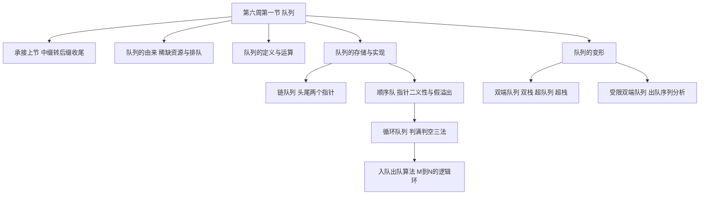
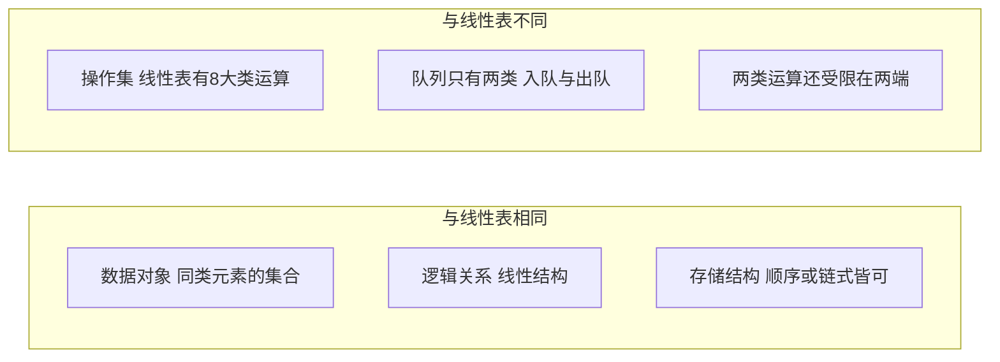
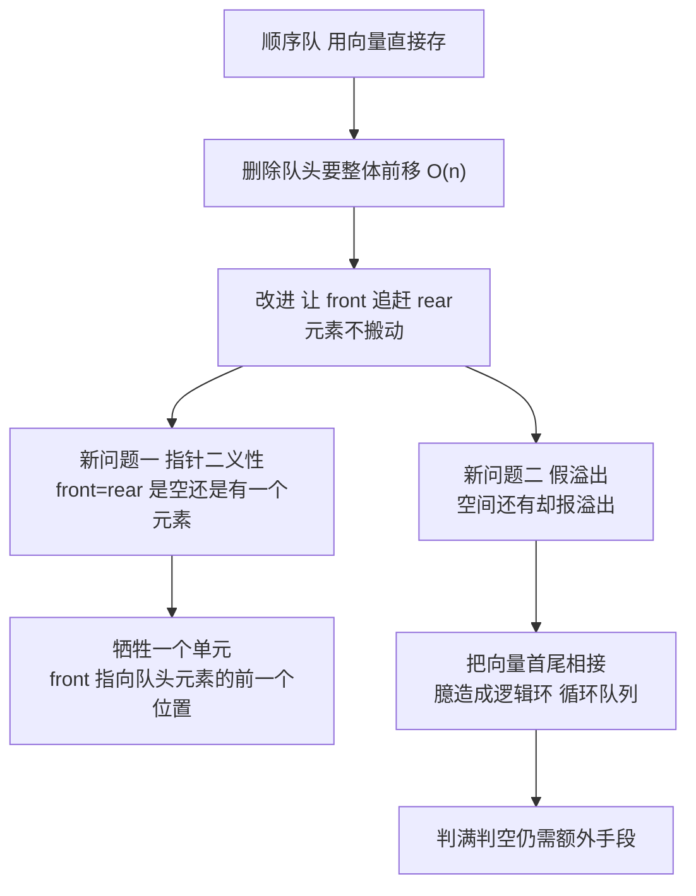
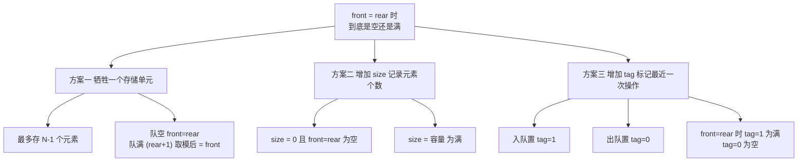
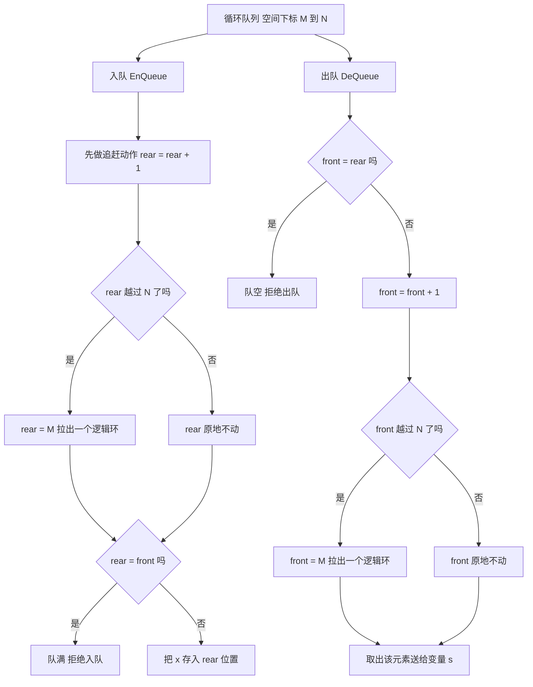
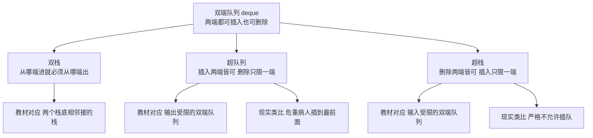
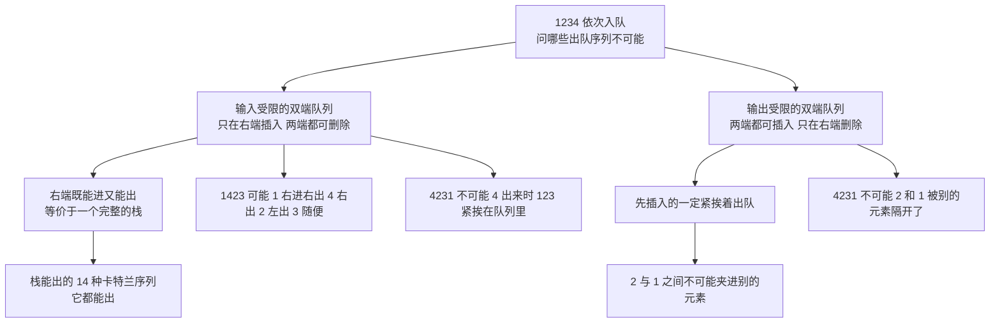

# 数据结构 · 第六周第一节 · 队列 · 详细版讲义

> **来源说明**：本讲义依据课堂录音的两份本地转写与逐段分析素材整理，并与严蔚敏《数据结构（C语言版）》第 3 章 3.4 节对照校订而成，属**学习笔记性质的整理稿**，不是老师的官方逐字稿。
>
> - **转写来源（两份本地文件，均为课堂录音的 ASR 导出文字）**：① `20261010_103048_导出原文.txt`（前半：中缀转后缀收尾，以及队列的由来、定义、与线性表的异同、两类运算、链式存储、顺序存储、指针二义性、假溢出、循环队列与判满判空三法，约伪时间 00:00–01:16）；② `队列相关课程讲解_导出原文.txt`（后半：循环队列的入队与出队算法、与类 C／C++ 取模写法的比较、队列的四种变形、受限双端队列的出队序列分析，约伪时间 01:16–01:56）。**两段顺序的依据**：转写一末尾是老师一句「我们先休息几分钟，然后我们再讲入队和出队的算法」，转写二开头正是入队算法，两段直接衔接，无重叠。两份合并后按 760 字左右切成 38 段，其中 2 段是转写分隔标记，**36 段正文逐段分析产出 36 份素材**（`segment_001.md` ~ `segment_025.md`、`segment_027.md` ~ `segment_037.md`），本讲义以这 36 份素材为底稿，必要处回看原始转写。
> - **教材对照范围**：严蔚敏《数据结构（C语言版）》第 3 章 **3.4 队列**——3.4.1 抽象数据类型队列的定义（含双端队列、输入受限与输出受限的双端队列的说明）、3.4.2 链队列、3.4.3 循环队列——为主要对照，用于校对术语、算法写法与「判满判空」的标准表述；复杂度部分对照 1.4.3、1.4.4。**但本节课关于队列的引入（分时系统、时间片轮转、视觉暂留）、顺序队的两大顽疾（指针二义性与假溢出）、「超队列／超栈」这套变形命名、以及受限双端队列出队序列的整套分析法，教材中没有对应小节**，属课堂扩展，附录 A 已逐条注明，讲义不为其硬套教材出处。
> - **标注约定**：课堂举例一律标「（转写举例）」；老师没讲、但教材里有的内容标「（教材补充：3.4.x）」；能对上教材的标「（教材对应：3.4.x）」；教材里没有、属课堂扩展的标「（课堂扩展）」；为把口述讲通而作的整理标「（讲义补充）」；能依据教材与上下文裁定的口误／误识，在正文用「（讲义校订：…）」当场说明，裁不掉的全部进「待核实内容」。
> - **术语口径**：本讲义统一使用**队头 front**、**队尾 rear**、**入队 EnQueue**、**出队 DeQueue**、**循环队列**、**假溢出**、**双端队列**、**双栈**、**超队列**、**超栈**、**输入受限双端队列**、**输出受限双端队列**。需要注意老师口述与教材命名的错位：老师说的**超队列**（插入两端皆可、删除只限一端）对应教材的**输出受限的双端队列**；老师说的**超栈**（删除两端皆可、插入只限一端）对应教材的**输入受限的双端队列**；老师说的**双栈**（从哪端进就必须从哪端出）对应教材「两个栈底相邻接的栈」。正文第一次出现时都做了对照标注。
> - **front 指向的两种口径**：老师口述的顺序队是**牺牲一个单元**的方案，约定 **front 指向队头元素的前一个位置**、rear 指向队尾元素本身；而教材 3.4.3 的循环队列约定 front 指向**队头元素本身**、rear 指向**队尾元素的下一个位置**。两者只差一格，读题时按语境分辨，讲义在相应小节都标了出处。
> - **时间说明**：本节课为**文字模式**（无音视频轨、无关键帧），各节时间戳是按**字数折算的伪时间**（约 200 字／分钟），非音频真实时间；它只是讲义内部单调递增的定位坐标，用于与 36 份分段素材对齐。全课伪时间长约 1 小时 56 分，其中 **01:16 处是两段转写的接缝**，也大致对应课间休息的位置。
> - **编号说明**：老师沿用自己旧课程体系的节次编号，与严蔚敏教材章节号**不一致**：老师口中的「第三章」＝链表（教材 2.3）、「第 4 章」＝栈和队列（教材第 3 章）。本节课是队列专题，属老师编号体系里「第 4 章」的后半。该对应关系为讲义的推断。
> - **关联阅读**：[数据结构 第五周第二节 栈的应用与递归 详细版讲义](数据结构%20第五周第二节%20栈的应用与递归%20详细版讲义.md)（上一节，本节课开头的中缀转后缀正是那一节的收尾）、[数据结构 第五周第一节 线性表的应试技巧与栈 详细版讲义](数据结构%20第五周第一节%20线性表的应试技巧与栈%20详细版讲义.md)、[数据结构 第二章 线性表 详细版讲义](数据结构%20第二章%20线性表%20详细版讲义.md)。
> - **示意图说明**：正文里嵌了 7 张**操作示意图**，用 `tikz` 代码块书写，在 Obsidian 中由 TikZJax 插件渲染成 SVG（阅读视图可见）。**图内标签一律用字母、数字、数学记号与英文短语（纯 ASCII），中文解释放在图下方的「图注」里**——这是 TikZJax 的硬限制：它的引擎用 `btoa()` 把 TeX 源码写进 WASM 文件系统，**源码里只要出现非 Latin-1 字符（汉字、全角标点）就会直接抛异常、连编译都不会开始**；而且它只随附 Computer Modern 字体、没有中文字体，汉字即使送进去也排不出来。7 张图均已在 Chromium + TikZJax 下实测渲染通过。

## 开场导读

这节课的主题是**队列**。它的开头并不是一句「今天我们讲队列」，而是接着上一节课的话头往下说——老师先给「中缀转后缀」补了一个收尾，才正式转入队列。

**前半是队列的来历与定义。** 老师从一个很大的命题讲起：人要活在这个世上就得消耗资源，而资源往往是有限的，**人的生命也是有限的**——所以稀缺资源的竞争必须有一种「比较文明」的解决办法，那就是**排队，先来先得**。他顺手补了一句反证：如果人的生命无穷尽、像神仙一样永远不会死，那早晚轮到我，大家也就不着急、不用争夺了。现实里的排队他从购物结账数到生产流水线、飞机起降、火车运行调度，再落回计算机：队列是**工具性的数据结构**，凡涉及资源竞争排队都要用到，其中最明显的是**分时技术与并行技术**。

于是有了这节课最生动的一段「为什么」。一台服务器要同时服务 7 个用户，一台手机只有一个 CPU 却要听歌、聊天、下棋全都不卡——老师当场提问，学生答「都分配一个内存」，他没接，而是先报了两组数字：**PID 进程编号**、**一万三千多个任务**、**撑死了四核**。答案在**时间片轮转**里：CPU 把时间切成一个一个的小片，`0~1ms` 服务用户 1，一毫秒执行不完就把**现场封存扔进队列**，切到用户 2，第 `8ms` 再回来服务用户 1；而人感觉不到卡顿，是因为**CPU 太快了**，快到**人的视网膜还有视觉暂留**——就像电影每秒超过 24 帧就接得上一样。他还交代了 Windows 的口径：**多级时间片轮转式**，最高等级 1ms、下一级 5ms、再下一级 100ms，等级越低时间片越大。

接着是定义。老师给的是一个**向量口径**的定义：队列是**下限和上限都只能增加而不能减少的向量**。排队要有场地，所以他说「很多教科书用线性表来定义队列**不严谨**」，并用数据结构研究内容的三条——数据对象与逻辑关系、存储结构、操作集——把两者比了个透彻：**同**在都是同类元素的集合、都是线性结构、存储结构也可以一样；**异**在操作集，线性表有 8 大类运算，队列只剩两类且**受限在两端**。中间的插曲很好记：线性表可以按身高重新排个队，队列上「**他们绝对不干，说不定打仗**」——因为一打乱就破坏了先来后到。课程给出的严谨定义是：队列是**限定性线性表**，仅能进行插入和删除，且插入在一端、删除在另一端。

**中段是队列怎么存。** 链式存储先被否掉一半：现实里的排队往往要开辟场地，而链队列**存储密度低、管理麻烦**（医院拿号算个例外）。链队列的关键一问是**队头放表头还是表尾**——老师让学生答，答案是**队头放表头、队尾放表尾**，代价是必须**同时保存两个指针**，这正是他反复讲的「**空间换时间**」。顺序存储则是「最自然的方式」，但立刻撞上**致命缺陷**：要保持**结构一致性**，删除队头元素会让后面所有人**依次往前挪一个位置**，一次删除就是 $O(n)$。老师用春运买票作为类比——窗口卖完票，后面的人提着大包小包一个个往前挪，而计算机里这 N 个元素还得由计算机一个一个完成，更费劲。

于是有了那个贯穿全课的**改善思路**：让**售票员出来卖票**，指针不停往后走，出队不再搬动元素。代价是只用一个指针就不知道队列里还有多少元素——所以要 `front` 与 `rear` 两个指针；而两个指针又带来**指针二义性**（`front = rear` 到底是空还是有一个元素？老师用水打比方：**0℃ 的水到底是固体还是液体，说不清**），解决的办法是**牺牲一个单元**，约定 **front 指向队头元素的前一个位置**。第二个顽疾是**假溢出**：空间明明还有，却报溢出——根子就在「上下限都只能增加不能减少」这条定义上。老师的解法是**循环队列**，现实类比是排队的人碰到墙会**自动拐弯**，以及小时候那种掰成圆圈的葫芦形铁丝玩具：首尾相接，做一个**逻辑上的环**。

**循环队列最核心的一问是「队满和队空的条件到底相不相同」。** 老师把这个问题抛给学生，并给出了根本理由：**入队时 rear 先做了一次「追赶动作」——先加 1，再去判断相等；出队是「一上来直接判断」**，所以不能把两者说成一样。他还把本课写法与类 C／C++ 教科书的 `(rear + 1) % N` 写法摆在一起比较：`mod` 不过是整除 N 再求余，两者 if 语句的效率一样，但**本课的空间下标是用户可指定的 $M$ 到 $N$，范围更广**——「如果人家出一个题目说队列空间下标是 $M$ 到 $N$，那你就傻眼了」。判满判空的三条路他也讲齐了：**牺牲一个单元**、**加 `size` 变量**、**加 `tag` 标记**——根因是「装载情况有 7 种，两个指针的差值只有 6 种」，信息量不够，必须额外引入一个单元或变量。

**后半是队列的四种变形。** 老师从自己研究生时代去广州火车站的经历讲起：五点多起床、打的半小时、前面排了五六十号人，大喇叭一喊「只剩 10 张票了」——那能不能**直接离开**？常规队列说不能，因为先来先服务，哪怕买不上票也得静静地排着；医院里 120 拉来的**危重病人**同样插不进来。所以他依次讲了**双端队列**（两端都可插入删除）、**双栈**（从哪端进就必须从哪端出，要跟「两栈共存」区分开）、**超队列**（插入两端皆可、删除只限一端，对应危重病人先服务）、**超栈**（删除两端皆可、插入只限一端，严格不允许插队）。他说这几种变形在 408 考研里**近几年几乎年年考一道选择题**。

于是最后一件事是把上一节**出栈序列**的旧账翻出来：4 个元素依次入栈，排列组合 24 种，合理出栈顺序只有**卡特兰数** $\frac{1}{n+1}C_{2n}^{n}$ 种，$n=4$ 时是 **14 种**。然后把这套分析法搬到**受限双端队列**上：输入受限（插入只在一端）下 `1423` **可能**、`4231` **不可能**；输出受限（删除只在一端）下 `4231` 同样**不可能**，理由特别干净——**2 和 1 一旦相继插入，出队时一定紧挨着出来**，中间夹不进 3、4。最后留了一道 5 个元素 `A B C D E` 的课堂练习，转写在此处进入课堂杂音，答案没有留下来。

## 总览知识地图

全课内容跨「来历 · 定义 · 存储 · 算法 · 变形」五件大事，塞进一张图会糊掉，所以拆成 7 张小图，每张只画一层意思。

**图 1 · 全课主线：从队列的来历到队列的变形**



**图 2 · 队列与线性表：同在三处，异在操作集**



**图 3 · 顺序队的两个顽疾，如何逼出循环队列**



**图 4 · front = rear 说不清空与满，三条出路**



**图 5 · 循环队列的入队与出队：先追赶，再判断**



**图 6 · 四种变形与教材命名的对照**



**图 7 · 受限双端队列的出队序列：两种受限，两条判据**



## 正文

### 一、承接上节：中缀转后缀，一个只存运算符的栈 `00:00-00:03`

老师先把表达式记法的座次排开：后缀表达式事实上更优，中缀表达式虽然是我们现在流行的书写方式，却并不是最好的表达方式。

> 「后缀表达式……它事实上更优。中缀表达式是我们现在流行的，但不是最好的表达方式。」（转写举例）

这句判断是承接上一节来的收束，也顺势把本节第一个技术问题顶了出来——中缀表达式到底怎么转换成后缀表达式？（讲义补充）"流行"与"更优"是两件事，需要分开看：中缀流行只是书写传统的结果，人从小写 $a+b$，习惯如此；而后缀更优，是站在"机器能不能一遍扫完就定序求值"这个角度说的。中缀的运算符夹在两个操作数中间，先后次序不能只看书写位置，必须叠加运算符优先级和括号两条额外规则才能消解歧义；后缀把运算符写在操作数之后，运算符出现的先后次序就是运算的先后次序，不再需要括号。老师没有展开这层论证，只给结论，本节全部的力气都花在"怎么转换"上。

转换的关键结论，老师一口气给了三条。

第一条，**只需要一个栈，而且这个栈只存运算符**。老师给的理由是"因为后缀和中缀表达式它这个操作数是一模一样的"。这里的"一模一样"不是指字符不变，而是指**操作数之间的相对先后次序不变**：中缀 $a+b*c$ 里的操作数依次是 $a、b、c$，它对应的后缀 $a\ b\ c\ *\ +$ 里操作数还是 $a、b、c$，前后关系从不颠倒。既然操作数只是按原顺序平移到输出串上，就根本不需要找地方"暂存"它们——扫到一个操作数，直接追加到后缀串尾部即可。（讲义补充）真正需要暂存的只有运算符，因为运算符的先后会变：中缀里 `+` 写在 `*` 前面，后缀里却必须先写 `*`、后写 `+`。这种"先后颠倒"正是栈（后进先出）负责的事——把暂时还轮不到出场的运算符压在栈里候场，等它该出场时再弹出。所以判据很清楚：**次序不变的东西（操作数）直接输出，次序会变的东西（运算符）用栈候场**。老师在这条上有一处口误，需要当场说明：

> 「所以这个栈里面只需要存操作数啊，只需要存运算符。」

前半句"存操作数"是脱口而出的错误说法，老师说完立刻改口为"只需要存运算符"，后半句才是正解。（讲义校订：栈里只存运算符，不存操作数；把操作数也压栈不但白占空间，还会破坏"栈顶永远是最近一个待定运算符"这个判断依据。）

第二条，**从左到右扫描，比较优先级**。规则浓缩成一句话：拿新来的运算符，和栈里（也就是左边）已有的运算符比优先级。若栈里那个（左边）运算符优先级比较高，说明它应当被优先运算，于是把它**弹出栈**；若栈里那个运算符优先级低，说明它还轮不到现在算，新来的这个运算符就**入栈**等待。这里的方向最容易记反，要点是：比较的参照物始终是**栈顶那个"左边的"运算符**，而不是新来的那一位，即"左边高 → 弹出"，而不是"新来的高 → 弹出"。

第三条，**遇到左括号，无条件入栈**。老师强调得毫不含糊：

> 「一到左括号，毫无疑问，全都要无条件入栈。」（讲义校订："入栈"原文转写为"进站／侵占"，属同音误识。）

左括号不参与优先级比较，因为它根本不是运算符，而是一个"隔离屏障"。它一进栈，栈顶就成了屏障，后面扫描来的任何运算符都无法越过它去弹出括号外的内容；直到遇到与它配对的右括号，才把这一段清空。老师只说了"无条件"三个字，没解释原因，理由就在这里。

最后老师用一句话收尾：

> 「那当然还有别的中缀转换成后缀的方法，我就不讲了啊。」（转写举例）

也就是说，本节采用的是"一个栈、只存运算符"这一种转换路线，其它路线老师明确不作展开。本册后续出现的算法与代码，都以这一条路线为准。

（课堂扩展）需要交代一句：严蔚敏教材第 3 章并没有把"中缀转后缀"单列成一个算法，教材 3.2.5 走的是"算符优先"的双栈路线，用两个栈直接求表达式的值。因此本节的转换算法标注为课堂扩展；而栈、队列这两个结构本身，教材在 3.1、3.4 两节都有正式定义。

把上面的三条规则写成类 C 风格的伪代码（PDL），就是下面这段扫描流程。要注意，老师课堂上把操作数的直通、左括号的无条件入栈都讲了，但**没有讲遇到右括号怎么处理，也没有讲运算符同级时怎么办**，这两处是（讲义补充）。

```txt
算法 InToPostfix(E)            // 将中缀串 E 转为后缀串 P
  InitStack(S)                 // S 只存运算符，不存操作数
  P ← 空串
  for 从左到右扫描 E 的每一个记法单元 t:
      if t 是操作数:
          P ← P + t                                // 操作数直通，不进栈
      else if t = '(':
          Push(S, t)                               // 无条件入栈
      else if t = ')':                             // （讲义补充）
          while not StackEmpty(S) and GetTop(S) ≠ '(':
              P ← P + Pop(S)                       // 弹出的运算符追加到 P 尾部
          Pop(S)                                   // 丢弃配对的左括号
      else:                                        // t 是运算符
          while not StackEmpty(S) and GetTop(S) ≠ '('
                and Priority(GetTop(S)) ≥ Priority(t):   // （讲义补充：含相等情形）
              P ← P + Pop(S)
          Push(S, t)
  while not StackEmpty(S):
      P ← P + Pop(S)
  return P
```

**时间复杂度**：$O(n)$，$n$ 为表达式长度。整个转换对表达式只从左到右扫一遍，每个运算符至多进栈一次、出栈一次，每次进出都是常数时间操作，因此总时间与表达式长度成正比。
**空间复杂度**：$O(d)$，$d$ 为扫描过程中运算符栈的最大深度，与表达式的嵌套深度有关，最坏情况与 $n$ 同阶。

**关键易错点**

- 栈里**只压运算符，不能压操作数**——这正是老师本段口误过、又当场更正的地方。
- 比较方向别记反：是"栈内（左边）运算符优先级**高**则弹出"，不是"新来的高则弹出"。
- 左括号入栈后充当**屏障**：栈顶为左括号时，任何运算符都不能弹出它；左括号只能在遇到配对的右括号时被弹出并丢弃。
- 相等优先级的处理老师未讲，实际实现中通常也弹出（讲义补充），否则会破坏后缀串中运算符的定序。
- 别把"弹出"只理解成"丢出栈"——弹出的运算符要**追加到后缀串尾部**才算完成一次输出。

三条规则对照成表如下，做题时照这张表逐条比对即可：

| 栈内（左边）运算符 | 新来的记法单元 | 动作 | 直觉解释 |
| --- | --- | --- | --- |
| 优先级较高 | 任意运算符 | 弹出栈内运算符并输出 | 左边的先算，先算完才轮到新来的 |
| 优先级较低 | 任意运算符 | 新运算符入栈 | 新来的后面才轮到，先在栈里等着 |
| — | 左括号 `(` | 无条件入栈 | 左括号不是运算符，不受优先级约束，充当屏障 |
| 任意（非左括号） | 右括号 `)` | 连续弹栈输出，直到栈顶为 `(`（讲义补充） | 括号内先算完，屏障随配对括号一并清除 |

这一节还隐含了一个对照：处理表达式时用的是**栈**（后进先出），而本节接下来要引入的新结构是**队列**（先来先得），两种结构对应两种完全不同的次序规则——前者用来表达"最近的优先"，后者用来表达"最早的优先"，后面各节会反复用到这个分界。

### 二、队列的由来：稀缺资源、有限生命，与「先来先得」 `00:03-00:05`

讲完表达式转换，老师把话题一拐，引出本节的第二个主角。承接上一节末尾"对于这种稀缺资源"的半句话，本段先把处理稀缺资源的思路铺完整。老师的引入逻辑是一条环环相扣的推理链：人活在世上就要消耗资源，而资源往往有限，尤其是一些稀缺资源就更有限；既然资源有限、想要的人又多，需求者之间就必然形成**竞争**；竞争如果不加约束就会退化为抢夺，所以往往要采用一种"比较文明的方式"来解决——这个方式就是**排队**，也就是所谓的**先来先得**。

> 「对于稀缺资源的竞争，那我们往往就要采用一种比较文明的方式来解决，就是啥？就是队列，就是所谓的排队嘛，先来先得嘛。」（转写举例）

这段话表面讲生活，实质讲的是**资源分配**。把它拆开，是一条五步链：存在一种被多人想要的资源 → 资源总量小于总需求 → 需求者之间形成竞争 → 竞争需要一条裁决规则 → 裁决规则就是按到达先后服务的排队。后面要讲的队列，本质上就是把最后这一步"先来先得"固化成一套可计算的数据结构。

这条链里最容易被忽略、也最关键的一环，是老师紧接着给出的**反证**——他假设人的生命是无穷尽的：

> 「就像神仙一样，你永远不会死的话，那反正早晚会轮到我对吧？那大家也就不着急嘛。」（转写举例）

老师用"神仙"这个比喻指出了排队机制成立的隐含前提：**等待必须是划算的**。一个人愿意排队，是因为他相信"我多等一会儿，最终能拿到"；而"最终能拿到"的前提，是"我还有时间等"。假如人的生命无穷尽，时间无限多，那么早晚一定会轮到自己，也就无所谓争夺，排队自然没有必要。可现实偏偏不是这样，老师马上用一句成语把这个假设砸了下去："咱们说一寸光阴一寸金啊"（讲义校订：原文转写为"寸金寸光阴"，成语本作"一寸光阴一寸金"）——人的生命有限而且宝贵，等待是有成本的，资源就必须被尽快、公平地分掉。

于是两个前提缺一不可，可以并成一张表：

| 前提 | 缺了它会怎样 | 老师原话依据 |
| --- | --- | --- |
| 资源有限 | 人人可得，根本不需要排队 | "尤其是对一些稀缺资源，它更有限" |
| 生命／时间有限 | 慢慢等也无所谓，不需要争夺 | "就像神仙一样……早晚会轮到我" |

只有两者同时成立，才逼出"公平的排队机制"这个结论。（讲义补充）这一层在做笔记时值得盯住：计算任务也有自己的"生命"——一个待处理的任务不能无限等下去，否则用户就会察觉到卡顿，这与"生命有限"在结构上是同构的，后面第三节讲"为什么感觉不到卡顿"时会直接用到。

排队机制在现实生活里到处都是，老师一口气举了四类场景（转写举例）：一是大家购物时排着长长的队结账；二是生产流水线上的产品，一个接着一个从流水线下来；三是飞机的起降调度；四是火车的运行调度——这些都要用到队列这个模式。把这四个例子抽象成队列的术语，可以整理成下面这张对照表，其中"元素是谁""哪一端先被服务"是（讲义补充）的整理：

| 现实场景 | 谁在排队（数据元素） | 队头方向（先被处理） | 队尾方向（后加入） |
| --- | --- | --- | --- |
| 购物结账排长队 | 顾客 | 排在最前面的顾客先结账 | 后来的顾客排到末尾 |
| 生产流水线的产品 | 待加工的产品 | 先到工位的产品先被加工 | 新送来的产品接在后面 |
| 飞机起降调度 | 等待起降的航班 | 先获得许可的航班先动 | 后续航班请求排在后面 |
| 火车运行调度 | 等待进站的列车 | 先安排的列车先进站 | 后到的车次排在后面 |

四类场景形不同而理相同：**多个请求、一份资源、按到达顺序服务**。这正是队列的语义——谁请求得早，谁就先得到服务。

接着老师把镜头从现实搬到计算机。他说，计算机是一个**模拟学科**：现实生活中普遍存在的排队机制，计算机当中也需要有相应的结构来实现它。这句话包含两层意思：一是计算机里的很多机制，是先观察现实、再把现实的规律抽象成模型搬进机器里的，现实有排队，机器里就要有排队的模型；二是"模拟"不等于"照搬"——现实中的队伍可以插队、可以中途离开、可以开好几条窗口，而队列结构只保留"先来先得"这一条最本质的规则，是**简化、归纳之后的模拟**。

由模拟学科这层铺垫，老师给出了本节最重要的定性：计算机当中实际上广泛采用一种数据组织模式，就是队列；**凡是涉及到资源的竞争排队，都要用到队列这种数据结构**，所以队列也是一种**工具性的数据结构**。

> 「凡是涉及到资源的竞争排队，那都要用到队列这种数据结构，所以它也是一种工具性的数据结构。」（转写举例）

所谓"工具性"，指这类结构本身并不承载具体的业务数据含义，而是**提供一种组织与管理数据的手段**。数组、链表、树可以表示"一份名单""一棵目录"，是装着具体数据的容器；栈和队列则更多被当作**流程的控制结构**来用——栈表达"后进先出"的嵌套与回退，队列表达"先进先出"的排队与调度，是可以搬到任何场景里复用的通用零件。（教材对应：3.4.1）教材对队列的正式定义是"一种先进先出（FIFO）的线性表，只允许在表的一端进行插入，在另一端删除元素"，并记 $q=(a_1,a_2,\cdots,a_n)$，$a_1$ 为队头元素、$a_n$ 为队尾元素；老师本段反复说的"先来先得"，正是 FIFO 的通俗说法，只是他此时还没有念出队头 front、队尾 rear 这两个名字。

最后老师把视角落回计算机内部：队列在计算机中也非常普遍、非常流行，是一种基本的管理技术，"现在最明显的就是分时技术"，并且顺带点出了**并行技术**的名目。这里要留意，老师只是把分时技术和并行技术并列点了个名，**并行技术他并没有展开讲**；后面的整段讲解全部围绕分时技术展开，具体怎么分时、为什么用户感觉不到卡顿，都是下一节的内容，本节到此只作引子。

### 三、从分时系统看队列：一个 CPU 为什么要同时伺候一万多个任务 `00:05-00:11`

上一段末尾老师点到"计算机中最明显的例子就是分时技术"，本段接着这个话题往下说：分时技术和并行技术都要用计算机来落实，为把问题讲清楚，老师选择以**分时技术**为例。仍然要强调，本段只在开头并列点了"并行技术"的名目，**没有任何关于并行的展开**——没有讲多核、也没有讲物理上同时执行；真正被讲透的只有分时。

老师先摆出一个最小模型：摆在面前的是一台大型机，或者说一台服务器，现在有 7 个用户同时要使用它，可是**服务器只有一台**（转写举例）。资源只有一个，想用它的用户有 7 个，那该怎么办？老师把问题直接抛给同学——"你咋做呢？咋做啊？"他没有立刻给答案，只把"资源少、需求多"这个矛盾摆到台面上。

紧接着老师指出这个情景并不是大型机独有的，我们的微机、大家手上的手机也是同一个道理。手机是一个**多任务系统**，多任务体现在哪里呢？比如你当前正在听歌，同时又聊天，同时又下棋（转写举例）。老师让大家注意观察现象：下棋很顺畅，聊天也没有间断，下棋也丝滑无比。于是追问一句"那为啥？"——为什么会这样？

老师的提示是：想一想我们的计算机、我们的手机，**CPU 有几个**？答案只有一个。于是矛盾被推到最尖锐处：聊天的程序、下棋的程序、听音乐的程序，按道理应该互相抢这唯一的 CPU，可你偏偏感觉不到卡顿，特别丝滑，感觉就好像每个任务都有一台单独的 CPU 在为自己服务一样——但实际上只有一个服务器、只有一个 CPU。

> 「你只有一个 CPU，你为这多个任务服务，结果你感觉不到卡顿，感觉好像每个任务都有一个单独的 CPU 来为我服务一样，但实际上只有一个服务器，只有一个 CPU。」

老师把"看起来每个任务都有一台自己的 CPU"明确标为**错觉**：现象与事实之间存在落差，落差需要解释。这个问题老师没有自己回答，而是点了名，让同学来回答。

> 「你们班的学生应该知道吧，找个同学回答一下，为啥你感觉不到卡顿呢？」（转写举例；"你们班"原文转写为"你们集体班"，疑为班级名称被识别有误，此处不作硬猜。）

被叫起来的同学答了一段话，本段只留下了这句答话的尾句——"**都分配一个内存**"（转写举例；前半句没有被转写进来，此处只作照录，标注"存疑"）。老师随即让他"坐下"，然后顺着这位同学的思路继续往下讲。

顺着"任务到底有多少"这条线，老师把现象**量化**了：他先抓住一个词追问——PID 是什么？随即自己给出答案，"PID 就是这个进程的编号"。每个任务来到计算机之后，都要由计算机给它配发一个**进程编号**，也就是属于它的身份号码。这样的任务有多少呢？老师给了一个很具体的量级：**一万三千多个**，紧接着又用"这 1 万多个任务"回指同一批东西。然后他亮出这台计算机的硬件底数："现在我们的计算机撑死了……四核"，所谓四核，也就是四个 CPU（讲义校订：原文"撑死了大大多分是啥"中"大大多分"不成词，按上下文应读作"最多"）。矛盾于是变得极其悬殊：

| 项目 | 数量 |
| --- | --- |
| 需要被服务的单位（任务／进程） | 13000+ 个 |
| 能同时干活的执行单元（四核 = 四个 CPU） | 4 个 |
| 大致比例 | 约 1 : 3250 |

只有四个 CPU，却要为一万多个任务服务，老师再一次抛出这节课反复追问的那个问题：那你为什么感觉不到卡顿？

这一回他先自问自答，给出了**第一层答案**：基本原因在于，实际上这个 CPU 太快太快了。

> 「基本原因在于，实际上这个 CPU 太快太快了。」

这句话说得很克制，用的是"基本原因"四个字，把这件事先归到 CPU 的速度上。它还可以拆成两句来理解：（讲义补充）一是单次占用极短，CPU 每秒能跑几十亿个时钟周期，完成一次"换个服务对象"的动作只耗极短时间；二是频率高到超出人的感官分辨力，人对外界变化有分辨极限，变化一旦比这更快，人就感觉不到"间断"，只觉得它是连续的。这里必须划一条界：本段老师**只讲到了"CPU 太快"这一层，并没有讲任务之间究竟怎么轮流上台**——轮转的具体规则是第四节的内容。

接下来，老师用了本段后半程的全部篇幅打了一个比方——**电影**。他先连问几个问题引出话题："大家知道电影咋来的呀？电影为啥有电影？"然后给出解释：电影本质上是一张张静止的画面，一秒钟内只要**超过 24 张**图像连续播放，人类的视觉就有"遗留效果"。

> 「上一张图片看完了，下一张图片来了，我的大脑里面还把上一张图片留下一部分印象；那么超过 24 张，一秒钟你就感觉不到卡顿。」

老师把这种效果描述得很具体：上一张图片看完了，下一张图片来了之后，大脑里面还留着上一张图片的一部分印象；在这种印象还没散掉的时候去看第二张，两张就接上了。他把这件事总结成一句话——"实际上我们的视觉有停留效果"，规范的说法是**视觉暂留**（讲义校订／课堂扩展："遗留效果""停留效果"都是同一个生理现象的口语说法）。但停留效果是有极限的，老师马上补了一个反例：如果一秒钟只放十张图片，那就不行，连不起来，形成不了那种顺滑的影片效果；**得超过 24 张，才有影片的顺滑感**。

把电子这一侧和电影这一侧并排看，这个类比的骨架如下：

| | 电影 | 本段中的计算机 |
| --- | --- | --- |
| 离散的单位 | 一张张静止的图像 | 一个个需要 CPU 服务的任务 |
| 快速连续呈现 | 每秒 24 张以上 | CPU "太快太快了" |
| 感知端的极限 | 视觉暂留，太快就分不出张 | 人感觉不到卡顿 |
| 低于阈值会怎样 | 每秒 10 张，连不起来 | 老师本段未展开 |

需要说明，老师本段只把类比讲到"够快就感觉不到断续"这一层；"CPU 究竟以多快的节奏在各任务之间轮换"，本段一个字都还没有讲。本段结束在提问与类比上，正确的读法是：**矛盾已经摆明，第一层答案（CPU 快）已经给出，机制（怎么轮）尚未揭开**——那是下一节的悬念。（课堂扩展）分时技术、进程编号 PID、四核、电影 24 帧与视觉暂留，都不属于严蔚敏教材第 3 章的内容，是课堂延伸；只有"多个请求争用同一资源、要靠排队机制分配"这层大结论，与教材 3.4.1 队列的定义相呼应。

### 四、时间片轮转与视觉暂留：为什么感觉不到卡顿 `00:11-00:17`

承接上一节"四个 CPU 服务一万多个任务而人不觉得卡"这个话题，老师开始交代机器的执行端究竟是怎么做的。他先点明这四个 CPU 的分工就是**分时**——把 CPU 的时间切成一个一个的小时间片，用来进行**轮转服务**。

> 「分时就是把这个 CPU 的时间切成一个一个的小的时间片，来进行轮转服务。」

这句话拆开有三层意思：（讲义补充）一是**切**，CPU 的连续时间被切成等长的小段，每一段叫一个**时间片**；二是**轮**，每一段分给一个排队等待的服务对象，一圈一圈地转，谁也不落下；三是**服务**，时间片内该对象独占执行权，用完就交还，换下一个。

接着老师用一条时间轴把这套机制讲了一遍。他假设把 CPU 的时间切成"一毫秒一个时间片"，于是有了下面这张"绝对时间轴"（表格为讲义补充的整理，格值与去向均为老师原话）：

| 绝对时间段 | 谁在被服务 | 到点后的两种去向 |
| --- | --- | --- |
| 0～1 ms | 用户 1 | 一毫秒内跑完 → 离开；没跑完 → 封存、入队列尾 |
| 1～2 ms | 用户 2 | 同上 |
| 2～3 ms | 用户 3 | 同上 |
| …… | …… | …… |
| 6～7 ms | 用户 7 | 同上 |
| 7～8 ms（转回队头） | 仍在队列里排着的用户 1 | 再分配一毫秒 |

老师把每个时间片内的结局分成"跑完"和"没跑完"两类，这是整段的主干逻辑。第 0～1 毫秒这个 CPU 给"用户 1"服务，如果用户 1 的进程在这一毫秒之内运行结束了，那很好，它就走了（服务完成、退出）。可如果这个进程比较大、需要消耗比较多的 CPU，一毫秒搞不定怎么办？老师的说法是把它**封存**，到 1ms 的时候扔进**队列**里去：

> 「一毫秒执行不完怎么办？把你扔到队列里面去，排着队，下一次轮到你再说。」

到了绝对的 CPU 第二毫秒，CPU 转为"用户 2"服务，同样给一毫秒；一毫秒能执行完很好，执行不完也同样扔进队列，排着队，下一次轮到再说。然后第三、第四……一直到第七，逐毫秒往下轮。等到**第八毫秒**，如果用户 1 还在队列里排着，就又轮到它，再给它分配一毫秒。老师把这一整套总结为：所以它实际上是 CPU 的**轮转制**；他还强调，这个 CPU 太快太快了，在进程之间进行切换时，速度太快太快。

这里有一个必须点明的关键动作：**没跑完的进程不是被丢掉，而是被放回队列尾部重新排队**。（讲义补充）被换下 CPU 时，进程的运行现场（寄存器、程序计数器等）要先保存起来，下次轮到时再恢复；老师用"封存"两个字概括的，就是这个"保存现场—挂起—重新排队"的过程，它的规范说法是**挂起**，归宿是回到**队尾**（入队 EnQueue）——而不是原地不动地等。两种结局一正一反，不能混淆：

| 情形 | 老师给出的动作 | 含义 | 术语 |
| --- | --- | --- | --- |
| 进程在一毫秒内运行结束 | "它就走了" | 服务完成，进程退出系统 | 出队 DeQueue 后不再回队 |
| 进程较大、一毫秒搞不定 | "封存，扔到队列里去，排着队" | 未完成的进程被挂起，回队尾继续排 | 保存现场 → 重新入队 EnQueue |

一圈走完（用户 1～7 各拿一段）之后，转回队头继续下一轮，这就是**轮转（round robin）**的字面含义——谁先把活干完谁先走，没干完的下次再来；队列的先进先出保证了每个人都不会被永久饿死，只要排到了，总能轮上。

紧接着老师把机器端和人端连了起来。他再次接回上一节的生理学解释：而我们人类刚才说过，视网膜实际上有**视觉暂留**效果，所以就导致——这个分时你好像感觉不到断，听音乐一点不卡顿，聊天上网也非常顺畅，下棋也一点不受影响。也就是说，**分时的时间片轮转 + CPU 切换足够快 + 人眼视觉暂留**，三者合起来才解释了"为什么感觉不到卡顿"。（讲义补充）从被服务对象的角度看，微观上每个进程都是"跑一下—被换下—排队—再跑一下"，宏观上却像同时在跑，这正是本讲反复强调的"微观轮流、宏观并行"。

讲完单一级别的时间片轮转，老师马上把它升级，并给出一个大家最熟悉的靶子——**Windows**。

> 「Windows 系统叫所谓的多级时间片轮转式，它分为好几个等级；你 1ms 执行不完，有可能把你扔到更长的档位，这样子你的时间片就加大了，早晚你能执行完。」

老师说 Windows 是所谓的**多级时间片轮转式**，把时间片分成好几个等级来轮转（讲义校订：原文转写"多级感转制"中的"感"是"轮"的同音误识，应为"多级轮转制"）。他举例说明这种分级：最高等级给 1 毫秒；第二等级给 5ms；等级越低，可能给 100ms。整理成表：

| 等级 | 时间片长度（老师举例） | 特点 |
| --- | --- | --- |
| 最高等级 | 1 ms | 最短，响应最快 |
| 第二等级 | 5 ms | 稍长 |
| 更低等级 | 100 ms | 最长 |

这套机制的关键动作是：如果 1ms 执行不完，**有可能把你扔到更长的时间片档位**上去，这样你的时间片就加大了，于是"早晚你能执行完"——老师把这句话说了两遍，强调的就是这种"档位往上走、总归能跑完"的收敛性。（讲义补充）要注意，老师此处只讲了"加大"这一个方向；真实的调度器还有把长时间占用 CPU 的进程降到更低优先级的相反做法，那不在本节范围之内。

引子铺完，老师把话头转到正题："那队列的话呢？我们给一个定义吧。"他给出的是队列的**朴素定义**：

> 「队列实际上说白了，就是把数据元素按照排队的规则进行组织。」

这句话有三个要点：一是组织对象是**数据元素**，和线性表一样，队列装的是一批同类元素；二是组织依据是"**排队的规则**"，这是队列区别于其他结构的本质，其核心就是"先来后到"；三是它落成一种**组织结构**，不是临时约定，而是有固定形态的数据结构。（教材对应：3.4.1）教材对队列的正式定义是"一种先进先出的线性表，只允许在表的一端进行插入，在另一端删除元素"，允许插入的一端叫**队尾 rear**、允许删除的一端叫**队头 front**；老师本节用的是同一件事的通俗说法，正式的定义式表述与命名留到下一节。

为了让定义落到实处，老师让同学去观察现实世界中的排队，一步步引导：现实中的排队往往**要有场地**；假设就有这么一块场地，这些元素在这里排队，比如说这是前面、那是后面；然后说到**存储区**——这一块地方我们开辟出来，就是用来排队的。观察这类排队会发现一个规律：**它的一端总是取出数据元素**，而**另外一端总是加入元素**。老师把"总是取出元素""总是加入元素"各说了一遍加以强调。这个观察其实是一次"抽象映射"：

| 现实世界 | 数据结构 |
| --- | --- |
| 一块用于排队的场地 | 一段开辟出来的存储区（数组／存储空间） |
| 排在队伍里的元素 | 数据元素 |
| 场地前面的一端 | 总是取出元素的一端（后来的"队头"） |
| 场地后面的一端 | 总是加入元素的一端（后来的"队尾"） |

"总是"两个字很关键：不是可出可进，而是**单向的固定分工**——一端只负责出（出队 DeQueue 发生在队头），一端只负责进（入队 EnQueue 发生在队尾），谁也不越界。老师各强调一遍，正是在敲实这种分工。于是结论浮了出来：通过这样的操作，就能实现数据元素按照排队来进行组织。本节到此收尾，队列还只是一个"按排队规则组织、一端进一端出"的意象；"先进先出"这个正式结论，以及队头 front、队尾 rear 这两个名字，都还没有在本节出现——它们是后续分册的内容。

至此，本册四节走完了一条完整的动机链：从"用栈处理表达式"转到"用队列分配资源"，再从"人有稀缺资源、生命有限所以先来先得"推进到机器内部"一台 CPU 服务一万多个任务"，最后落到"时间片轮转 + 视觉暂留"这一对机器端与感知端的配合，并顺势引出队列的朴素定义。队列的严格定义、存储结构与入队／出队算法，从下一节正式开始。

### 五、队列的定义（一）：排队要有场地，队头与队尾 `00:17-00:21`

本节从计算机里的分时系统收束回来，正式给队列下定义。老师在讲完 CPU 时间片轮转之后，把镜头从"操作系统里的调度队列"拉回到队列这个东西本身，先抛出一个再朴素不过的观察：大家去观察现实世界里的排队，往往是要有**场地**的。他设想出一块场地，让若干数据元素在这块场地上一字排开，接着说：这一块地方我们**开辟出来就来排队**。这句话点出了队列最基础的物理前提——排队要先有地方站；对应到数据结构里，就是必须先有一段可以存放元素的空间（讲义补充：在后文展开存储实现时，这块空间正是用向量、也就是一段连续编号的存储单元来充当的）。

紧接着，老师让大家注意这块场地上两端的分工：**它的一端总是取出数据元素，而另外一端总是加入元素**。通过这样"一头进、一头出"的操作，数据元素才按照排队的规则被组织起来。为了让"排队"更贴近生活，他还补了一幅画面：现实生活中为了防止插队，人们往往会在**两边各拉一根线，弄成一个甬道的形式**，让大家只能在甬道里排队。这一点很值得记——**甬道就是队列的物理约束**：两侧的线把人群约束成一列，谁也不能从旁边挤进来，只能从一端进、从另一端出。老师把这么做的目的归结为四个字：**公平竞争资源**。也就是说，先进先出并不是设计者凭空强加的规则，而是排队的人为了彼此公平、共同接受的结构。

这两点值得再各说一句。（讲义补充）其一，**甬道是物理约束，约束的方向就是队列的操作规则**：两侧的线不允许人从旁边挤入，等价于队列不允许在中间插入或删除；人只能从队尾进、从队头出，等价于队列只准在两端操作。现实里的"秩序"和数据结构里的"先进先出"，其实是同一条边界的两面。其二，**公平来自结构本身**：只要所有元素都从队尾进、从队头出，服务顺序就自动等于到达顺序，先来的先被服务，后来者不会越过前面的人，不需要额外的仲裁者。这正是队列被广泛用作"缓冲""公平调度"工具的根据。（教材对应：3.4.1）教材举的典型例子就是操作系统里的作业排队：几个作业同时运行，谁先请求输出谁先排到队头，通道一空出来，队头的作业先退出做输出，凡是申请输出的都从队尾进入——这正是"甬道"在计算机里的样子。

讲到这里，老师回头指认这块场地（他先自问"这个玩意儿看起来像啥？"，随后自答"看起来是个向量"）。于是队列的逻辑定义被正式落下来：

> 「队列，我们下定义就是：它是一个下限和上限都只能增加而不能减少的向量。」

（讲义校订：转写此处的引子"跟自然类似是个啥"不成词，据后文"看起来是个向量"理解，语义仍是指认那块场地是一个向量。）定义给完，老师立刻补出一个"反之"的说法以免误解：所谓反之，就是**下限和上限都只能减少而不能增加**；他明确说这两种说法"是一个意思"。这一点（讲义补充）要抓的是内核而不是字面：老师真正要强调的是**下界与上界必须同步、同向地移动**——排队的有效范围由两端共同界定，不允许一端钉死不动、另一端单独伸缩；至于这两个界是往大走还是往小走，只是同一个约束换一种方向的措辞。记住"两端一起动"，就不会被两种相反的句子绕住。

定义之后，老师给两端命名，这是本节最要背牢的一组术语：

| 名称 | 英文 | 位置 | 只做什么 |
| --- | --- | --- | --- |
| 队头 | front | 取出元素的一端 | 出队（删除、取走） |
| 队尾 | rear | 加入元素的一端 | 入队（加入、插入） |

（讲义校订：转写"往往叫做对手"中"对手"是"队头"的同音误识，规范术语为**队头 front**；同段"加入元素的这一端往往称为队尾"转写正确，保留。）老师用"资源竞争"这条线索解释这个命名：**你想参与资源竞争，往往是从最后面进到这个队列里来**——也就是说，进来的人一定排在队尾；等到排到你，就给你分配资源，你**享受完服务就离开**（他把"享受完服务就离开"重复了两遍）——离开的地方正是队头。（教材对应：3.4.1）教材的说法与此完全一致：允许插入的一端叫队尾（rear），允许删除的一端叫队头（front）。

命名讲完，老师作了一次重要的方法提醒：你们去看书，**很多教科书都把线性表和队列的定义挂钩起来，也就是用线性表来定义队列**。他说，这样挂钩"有好处，但也有局限性"。好处（讲义补充）是线性表的两类存储结构可以直接搬来给队列用，$a_1,\dots,a_n$ 的记法也能帮我们看清两端；局限（讲义补充）则在于线性表可以在任意位置插入删除，而队列只准在两头动，是一种受限的结构。既然有局限性，老师说他"不妨就用线性表来看一下队列的组织方式"，随后摆出线性表的记号：线性表是 $a_1, a_2, \dots, a_n$ 共 n 个元素（讲义校订：转写"An nn 个元素"中"nn"为记音重复），并且指出**这一端是表头，那一端是表尾**（讲义校订：转写"信息表"是"线性表"的同音误识，全段老师一直在讲线性表）。把线性表的两端与队列的两端对上，就是：

| 线性表 | 队列 |
| --- | --- |
| 表头（$a_1$ 所在端） | 队头 front |
| 表尾（$a_n$ 所在端） | 队尾 rear |

需要点明的是，本节只说了定义、命了名、摆出了线性表做对照，还**没有**推"上限怎么才能增加、下限怎么才能增加"——这两个追问正是下一节的开头，也是理解"入队就是插入、出队就是删除"的钥匙。（教材对应：3.4.1）教材同样把队列记作一个序列 $q=(a_1,a_2,\dots,a_n)$，并约定 $a_1$ 端为队头、$a_n$ 端为队尾。

本节还可以补出两处易混。（讲义补充）**"队列是向量"与"队列是线性表"并不矛盾**：向量是存储层面的说法（一段连续编号的存储单元），线性表是逻辑层面的说法（有头有尾的一列元素），说的是同一个东西的两个侧面。**"队头／队尾"切勿对调**：想参与竞争的人从**尾**进，轮到自己、服务完的人从**头**出——这是全课程后来最容易记反的一处。

### 六、队列的定义（二）：上限只增、下限只增，与 FIFO `00:21-00:24`

接上一节的"两端"与"线性表"，老师先复述定义并把它落到具体坐标上：队列是只允许上下限都只能增加而不能减少的向量，那么"只能增"到底怎么增？他先给出一个几何图景——这个是队头、这个是队尾（讲义校订：转写"对头""对尾"为"队头""队尾"的同音误识），然后规定存储单元的编号**从 1 到 N**，并把编号和定义词挂钩：**这个 1 就是我们说的下限，N 对应的就是队列的上限**——他还补了一句"或者说线性表的上限"，提醒队列两端与线性表两端是一回事。

| 要素 | 取值 | 含义 |
| --- | --- | --- |
| 存储单元编号 | $1,\dots,N$ | 连续编号的一排格子 |
| 下限 | 1 | 有效元素的起端下标 |
| 上限 | N | 有效元素的末端下标 |
| 队头 front | 取出端 | 出队发生在此 |
| 队尾 rear | 加入端 | 入队发生在此 |

有了坐标，老师用"两问两答"把机制推出来。**上限怎么才能增加？**他的回答很直接：无非就是我**新来一个元素**，把它放在它的**最后**，那么上限 N 不就增加了一个单元吗。（转写举例）**下限怎么才能增加？**他的回答同样直接：无非就是**第一个元素**——我给它服务、服务完成，它**享受完服务离开我们的队头**（讲义校订：转写"地头"是"队头"的同音误识），这样才能变成第二个元素，下限才会增加。把这层对应翻译成线性表语言，就是两条必须记住的等式：**上限增加＝从队尾加入元素＝线性表的插入操作**；**下限增加＝从队头取出一个元素＝线性表的删除操作**（讲义校订：转写"删除这样子的对头"中"对头"即队头；老师把"也能加 1"重复了两遍，语气上在强调这件事的确就是"一个动作对应一个下标加一"）。

| 队列动作 | 发生端 | 对应线性表操作 | 对下限／上限的影响 |
| --- | --- | --- | --- |
| 入队 EnQueue（加入元素） | 队尾 rear | 插入 | 上限 $+1$ |
| 出队 DeQueue（取出元素） | 队头 front | 删除 | 下限 $+1$ |

由此可以看清上一节"两端同步移动"具体是怎么发生的：**入队推着上限走，出队推着下限走**，两端都只增不减——这也解释了为什么队列里一切增量都只发生在这两头，中间的存储单元不会被单独动到。（讲义补充）这里还埋着后来**假溢出**问题的根：随着出队不断发生，下限一路前移，前面被腾空的单元无法回用；而上限一旦顶到 N 就再也没法入队，可队列里实际元素却不多。这一层留到讲循环队列时再解决，本节只推到"两端怎么增"。（教材对应：3.4.3）教材在处理顺序存储时专门点出这一点：队列的实际可用空间并未占满却不能继续插入，于是把顺序队列臆造为一个环状空间，即循环队列——但那是后续内容，本节的落点只在"上、下限各自靠什么增加"。

（讲义补充）把"上限增加＝插入""下限增加＝删除"这两条等式对到头，还能防止一类常见的误记。有人会把"从队尾加入元素就是线性表的插入操作"听成"队列可以在任意位置插入"——这是不对的：这里说的插入是**只在队尾发生的、受限的插入**，普通线性表可以在任意位置插入，队列不行，这正是上一节"用线性表定义队列有局限性"的落点。同理由，"出队就是删除"也只能理解为**只在队头删除**，并不表示队列里任何元素都能删。此外，本节说"上限增加一个单元"是顺着定义得到的朴素说法，重在讲清"上限靠什么增加"这条因果链，并不涉及任何具体的下标运算（$rear+1$、取模等），那些要等讲到存储实现时才会出现。

两端的增法一旦定下，队列的行为特征也就水到渠成：**队列满足先进先出**，也就是按时间"先来后到"。老师把它落到具体元素上——**先进去的 $a_1$ 这个元素先出来，后进去的 $a_n$ 这个元素最后出来**。一进一出的先后完全由到达时间决定，队列本身不做任何挑选。于是队列又得到一个别名：

> 「（队列）在很多教科书上面我们也把它叫做先进先出表，英文就叫做 fifo，就是 first input first output。那你以后碰见这个 fifo，默认它就是队列。」

（讲义校订：老师口头把 FIFO 展开为 "first input first output"，规范全称应为 **First In First Out**——In／Out 指的是元素进入和离开结构，不是"输入／输出设备"；缩写 FIFO 即"先进先出"。）这句"默认它就是队列"老师连说了三遍，是在给初学者立一条约定：今后在别处见到 fifo，不用多想，它指的就是队列。（教材对应：3.4.1）教材开篇即说"和栈相反，队列是一种先进先出（first in first out，缩写为 FIFO）的线性表"，与本节完全吻合。（课堂扩展）与 FIFO 成对出现的是 **LIFO**（Last In First Out，后进先出），描述的正是栈的行为。这正是教材把栈与队列放在同一章讲的原因：它们同属"操作受限线性表"家族，只是规则恰好相反——一个是先来先服务，一个是后来先服务。

本节还需要用一句话把"先进先出"讲透。（讲义补充）判断一个结构是否满足先进先出，有一个等价的说法：**出队序列与入队序列的次序完全相同**。若一组元素按 $1,2,3$ 的顺序入队，那么出队序列必定是 $1,2,3$，不可能出现 $2,1,3$ 这样越过先来者的顺序；而栈恰恰相反，$1,2,3$ 入栈只能出 $3,2,1$。（教材对应：3.4.1）教材把这个意思写得很直白：只有在 $a_1,a_2,\dots,a_{n-1}$ 都离开队列之后，$a_n$ 才能退出队列。

本节还有两处容易记混的地方，值得单独点明。（讲义补充）其一是**"队头／队尾"与"下限／上限"这两组词不要混用**：下限对应队头那一端（下标小、取元素），上限对应队尾那一端（下标大、加元素）；老师正是靠这层对应，把抽象的定义词"上下限"和具体的操作端"队头队尾"连了起来。其二是**"上限 $+1$"只是顺着定义推出的朴素说法，它并没有处理"上限顶到 $N$ 之后怎么办"**：本节说新元素放到最后、上限就增加一个单元，是就"还能放"的情形而言的；一旦上限已经到顶，再要入队就必须借助循环队列的取模式 $(rear + 1) \% N$（即"整除 $N$ 取余"，让下标到 $N$ 之后绕回 1）才能继续——那是后续分册的内容，不要用后面的细节倒推本节。就本节而言，只需牢牢记住一对等式：**上限靠队尾入队（插入）增加，下限靠队头出队（删除）增加。**

### 七、队列与线性表的异同：同在三处，异在操作集 `00:24-00:32`

本节是整块比较的主干。老师先立起方法论：线性表是一个数据结构，队列是另一个数据结构，那就"辨一下异同"（讲义校订：转写"变一下异同"中"变"是口语，语义为比较、辨析）——同，同在哪里？异，异在哪里？比较的办法还是从**数据结构的研究内容**入手。他把数据结构定义为"给定数据对象以及那上面定义的操作集构成的整体"，然后说研究内容有三个方面，逐条展开。（讲义补充）老师口里的这句话，其实更接近教材第 1 章的"抽象数据类型（ADT）"——一个 ADT 由数据对象、数据关系、基本操作三部分构成；课堂上把"数据结构"与"抽象数据类型"混着说，不影响理解，做笔记时心里知道这是两套说法即可。

第一个方面是**数据对象**，要研究的是数据的逻辑关系。老师拿线性表对照：$a_1$ 到 $a_n$ 这 N 个元素，是具有同类事物的集合（讲义校订：转写"信性表"为"线性表"、"同类素"为"同类事物"）。接着把这个判断搬到队列上：排着队的这 N 个人，是不是也是同类元素的集合？他的理由是：

> 「正是因为大家都想参与资源的竞争，大家是有相同的属性，我们才排着队。」

（转写举例）这句话可以拆成两步：其一，排队是**资源有限**的产物——要是什么东西人人都有、要多少有多少，就不会有人排队；其二，站在同一条队里的人**争夺的是同一份资源**，所以他们对这份资源的资格相同、需求同一，抽象出来就是"相同的属性"。（讲义补充）"同类"在数据结构里还有很实际的一层意思：所有元素的数据类型相同，因而可以共用同一种存储方式、同一套操作——$a_1$ 与 $a_n$ 之所以能放进同一个队列，前提就是它们同类；如果队里混进一个类型完全不同的东西，插入操作就没法统一处理了。

第二个方面是**逻辑关系**。老师的话接了个话头：队列排队是"一个接着一个排"的**线性结构**。由此他给出小结——从数据对象来看，元素的逻辑关系是一样的：**大家都是同类事物的集合，并且逻辑关系是线性关系，一个接一个**。队列和线性表的元素都是这样。（讲义补充）要提防把"线性结构"误读成"操作方式"：线性结构说的是元素之间**怎么连**（每个元素最多有一个直接前驱和一个直接后继，连成一条线，不分支、不成环），而"只能在两端操作"说的是**能被怎样使用**；队列即使操作受限，内部元素之间的关系仍然是一条线，并没有因此变成别的结构。

第三个方面是**存储结构**。老师这一句很短，但结论很硬：既然同属线性结构，那么线性结构的那两类存储——**顺序存储**和**链式存储**——同样可以用在队列当中，所以**存储结构也可以相同**（讲义校订：转写"存储关系呢"按上下文应为"存储结构"）。（讲义补充）顺序存储是用一段地址连续的单元依次存放元素、可按下标随机访问；链式存储是用结点存放元素、用指针把结点串起来、容量可动态增长。老师只给了"可以相同"的结论，并没有在本节说明队列实际该选哪一种——这个取舍属后文内容。

走到这里，三个维度上的"同"全部归拢完毕，剩下的只有唯一的差别——**操作集**。老师先立参照：线性表前面讲过有**八大类运算**；队列呢，刚才讲过，实际上只有**两类**。他把两类各自的来龙去脉说了一遍——第一类是**插入**："新来一个元素，插入到它的队尾，参与资源的竞争"，所以是"从队尾进行插入操作"；第二类是**删除**："不同的元素轮到你享受服务，你享受完了服务、为你分配资源之后，你离开"，也就是"删除一个元素"。

| 序 | 操作 | 发生端 | 老师的功能描述 | 对应线性表运算 |
| --- | --- | --- | --- | --- |
| 1 | 入队（插入） | 队尾 rear | 新来一个元素，插入到队尾，参与资源的竞争 | 插入 |
| 2 | 出队（删除） | 队头 front | 轮到你享受服务，服务完毕、分配完资源之后你离开 | 删除 |

于是老师下判断：线性表的八大类运算，在队列这里"就没有那么多"，它只有两类。他随即追问"为什么"，并挑出一个线性表能做、队列不能做的操作当反例——**重组**（把线性表里的元素按某个标准重新排序，例如按身高排个序、重新排个序）。他问：队列能不能做这个事？不能。于是他描述了现场——$a_1$ 到 $a_n$ 这 N 个元素本来排得好好的队，你说按身高打乱顺序来，重新排一下队，你看他们干不干？

> 「（他们）绝对不干……说不定打仗了。」

（转写举例）老师随即给出理由：**你一旦打乱，就会打断"按时间先来后到"这条原则；原则一被打破，它就不是个队列了**（讲义校订：转写"打断他的那种按时间先来后到的这种什么呢原则"中的"什么呢"是口头填充语）。这句话把"重组不能做"从"做不到"抬到了"做了就不再是队列"的高度。他紧接着又追了一个更弱的操作——**拆分**：这一队排得好好的，你把它拆分成两队，也不行。（转写举例）拆分甚至没有改变任何两个人的相对先后，它只是把一条队变成了两条；但队列对应的是一份资源的一个等待序列，拆成两条就出现了两个队头、两套位次，先来后到立刻失去唯一的判断依据，所以同样不可接受。（讲义补充）从"重排"到"拆分"，两个反例想说明的是同一件事：可做的操作不是"少一点"，而是**少到只剩两种，而且每种都钉在固定的一端**。

据此老师回收比较框架，做了一次总结陈词：操作这一块是**有限制**的；逻辑关系一样、每个元素具有相同的属性、都是线性结构；存储也可以一样。而不一样在哪呢？他给了两种说法——**需求不一样，或者说操作集不一样**（讲义校订：转写"操作级"为"操作集"）。（讲义补充）这两句不矛盾：需求决定操作集，操作集反映需求——排队的人只需要"进来"和"出去"两件事，不需要按身高重排，需求落到数据结构上就体现为可用的操作变少了。第三次比较的完整结论如下表：

| 研究维度 | 线性表 | 队列 | 是否相同 |
| --- | --- | --- | --- |
| 数据对象 | 同类事物的集合 | 同类事物的集合（都想竞争同一份资源） | 相同 |
| 逻辑关系 | 线性结构，一个接一个 | 线性结构，一个接一个 | 相同 |
| 存储结构 | 顺序存储／链式存储 | 两类存储都能用 | 相同 |
| 操作集 | 八大类运算（插入、删除、重组、拆分……） | 只有两类（插入、删除），且限制在两端 | **不同** |

最后是本节最关键的一句结构性结论：**队列的运算是线性表运算的子集**。老师的展开是——线性表的运算是八大类，什么插入、删除、重组、拆分之类；队列只有两类，插入和删除。（讲义补充）用"子集"这个词时要小心它的边界：准确的说是**运算种类**成了子集——线性表能做的插入、删除队列也能做，只是位置受限；线性表能做的重组、拆分，队列干脆不提供。而且队列的插入和删除并不是线性表插入删除的简单照搬，它们还被加了一道附加条件——**这两类运算还要做限制，限制在两端**：**插入只能在队尾这一端，删除只能在队头这一端**（讲义校订：转写"删除只能在对头这一端"中"对"为"队"的同音误录）。这两条合起来，恰好就是先进先出的实现方式。（讲义补充）换个说法：**"能在哪一端做哪种操作"这件事本身，就是队列的定义**——所以老师强调"这两类运算还要做限制"，不是补充说明，而是定义的必要组成部分。

（讲义补充）本节还藏着两层容易被忽略的东西，值得单独记一笔。**第一层是方法本身**：老师没有一上来就罗列"队列和线性表像不像"，而是先退回一个更根本的问题——数据结构到底由什么构成？他给出"数据对象＋操作集"这个定义之后，才按同一套维度逐层去拆、去对。这是一个可复用的分析套路：凡要比较两个数据结构，就按同一组维度拆开逐项对，而不是凭印象说"它们很像"。**第二层是两个维度的区分**：**逻辑结构**回答"元素之间是什么关系"（队列是线性关系），**存储结构**回答"这些关系在内存里怎么摆"（可以用顺序存储，也可以链式存储）；一句话的检验法是——逻辑结构相同的两个结构，存储结构可以不同，反之亦然。老师本节的两个结论分别落在两层上，不要合成一条。此外，"八大类运算"与"两类运算"比的是**运算的"类"数，不是操作条数**：线性表的一个大类里可能还包含若干具体操作，把"八"和"二"直接当成操作次数去对，会得出错误的印象。

### 八、队列的严谨定义与两类基本运算 `00:32-00:35`

比较做完，老师转到本节最容易引起争议的一点——**定义的严谨性**。他的原话是：很多教科书上不严谨，它用线性表来定义队列。但他没有一棍子打死，而是承认这样定义"可以"：当然我可以定义，可以；随后补一句转折——但是它的定义往往**不严谨**。于是他给出了一条更严谨的路径：如果你非要把队列和线性表挂起钩来定义，也可以这样说——**队列是限定性线性表**（讲义校订：转写"队列是限定线性表"，规范说法是**限定性线性表**），再补全条件：

> 「仅能进行插入和删除操作的线性表，并且插入在一端、删除在另外一端进行，这个才是严谨的定义。」

（"严谨的定义"他连说了两遍，是本段被强调的第一句。）这句完整定义可以拆成三层，三层缺一不可：

| 层次 | 表述 | 作用 |
| --- | --- | --- |
| 承自线性表 | 是线性表 | 交代元素关系与存储方式的来源 |
| 限制运算种类 | 仅能进行插入和删除 | 排除重组、拆分、查找、定位等 |
| 限制运算位置 | 插入在一端、删除在另外一端 | 排除"从中间插入"或"两端都能删" |

（讲义补充）只有第一层，就是老师上一节批评的那种"不严谨"定义；只有前两层，说明不了为什么必须先进先出；加上第三层，"一端进、另一端出"这个机制才被钉死。（教材对应：3.4.1）教材对队列给出的规范定义正是"一种先进先出的线性表，只允许在表的一端进行插入，而在另一端删除元素"，与老师这句话一致。这里还要替老师分辩一句：（讲义补充）他批评的是**只用线性表来定义队列**这种做法不严谨，而不是说"队列不是线性表"——事实上队列**就是**线性表的一个特例，二者的关系是特例与一般，不是对立。

定义收尾之后，老师转入**队列的运算**。他说，刚才讲过，队列实际上主要就两个运算。第一个是**入队**：来一个人，他要参与资源的竞争，那干嘛？你要**进入到队列里面去**——所以是入队；老师把入队解释为"加入人的这个过程"。第二个是**出队**：轮到你服务了，给你分配资源，然后你就可以**取出数据元素、可以删除掉**——这就是出队（讲义校订：转写出处的"你出对"应为"你出队"）。

| 运算 | 发生在哪一端 | 老师的功能描述 | 语义 |
| --- | --- | --- | --- |
| 入队 EnQueue | 队尾 rear | 来一个人要参与资源竞争，进入队列 | 在队尾加入一个新元素 |
| 出队 DeQueue | 队头 front | 轮到你服务，给你分配资源，你取出元素并离开 | 从队头删除一个元素 |

到这里老师补了一句有分寸的话：当然有很多书还有一些**其他的运算**，但这些其他运算"实际上一个语句就搞定了"，所以这里面再不详细讲了，重点只讲入队和出队。他挑了三个"其他运算"举例，边说边确认它们有多简单：

1. **取队头元素的值**。老师解释得很清楚：这指的是队头的元素**并不是出队**，只是我看一下它是谁——就看一下，但不出队（讲义校订：转写"是这样"等口语填充略去；"取对头元素的值"中"对头"即队头）。
2. **置空**。转写在这里是"另外一个自对空，自对空怎么样？无非也就一个语句呗……那你 from the real 嘛"。老师的意思是：把队置空无非一个语句，就是让 front 和 rear 相等——"你 front 等于 rear 嘛"。（讲义校订：转写"自对空"应为**置空**，"from the real"是 **front 等于 rear** 的误听，中间"等于"被吞掉；"自对空"三字本身不成词，此处转写含混，存疑。）
3. **判空**。老师接着说：然后接下来判空，判断队空是不是也是一个语句？于是他直接下结论：这一个语句我们就不详细讲了，因为很简单（讲义校订：转写"判对空"应为"判空"；"一个语"应为"一个语句"）。

这三类"其他运算"的共同点是都可以用极少量的语句完成，因此老师认为不必单独花时间讲——这也是他把重点放在入队、出队上的理由。（讲义补充）需要分清两对容易混的概念。其一是**取队头元素与出队的区别只在"动没动手"**：取队头元素只读取队头元素的值，队列本身不变，同一个元素仍站在队头；出队则把队头元素删除并返回，队列长度减一。其二是**判空与置空作用相反**：判空是"询问"——判断队列现在是不是空的，不改变队列状态；置空是"改变"——把队列恢复为空。两者都是"一个语句"，但一个只问、一个动手。

（讲义补充）还要替"限定性线性表"这个说法补一句分寸：**只说"限定性线性表"其实还不够，必须跟上"插入在一端、删除在另一端"这样的具体限定条件，才能唯一确定是队列**。因为栈同样是操作受限的线性表，只是限制的方向相反（插入和删除都在同一端）；若把"限定性"理解得太宽，栈也会被套进去。所以老师给出的完整定义句里，第一层"是线性表"、第二层"仅能插入删除"、第三层"插入在一端、删除在另一端"层层递进，缺了第三层就无法把队列与栈区分开。反过来说，老师批评"很多教科书不严谨"，批评的正是那些只说了第一层、省掉后两层限定的定义——那不是"说错了"，而是"说了等于没说"。

（讲义补充）还要分清**本质运算与辅助运算**：老师说的"主要就两个运算"指的是入队、出队，它们定义了队列，是本质运算；取队头元素、置空、判空这些是辅助运算，用来查询或维护状态，删掉它们队列仍然成立。本节之所以把篇幅压在这两个运算上，正是因为**运算本身很简单，难的是运算在受限条件下如何实现**——这个"如何实现"就是后续分册要讲的重点。

需要说明的是，本节虽然明确讲了"入队""出队"两个运算的名字和含义，但老师**没有给出任何算法步骤或伪代码**——他反复说"一个语句就搞定了""我们再不详细讲了"，没有写出一行实现。因此下面这段伪代码**全部是讲义补充**，用来把老师口头交代的运算语义固定下来，它以**与存储方式无关**的方式写出；真正的实现（front、rear 两个指针怎么走、取模怎么算）属教材 3.4.3，留待后续分册。

```txt
// —— 队列的抽象运算规格（讲义补充，非老师板书） ——

ADT Queue {
    数据对象：同类元素的集合，元素之间是线性关系
    数据关系：除队头、队尾外，每个元素有且只有一个直接前驱和一个直接后继
    基本操作：
        InitQueue(&Q)      // 置空：构造一个空队列
        QueueEmpty(Q)      // 判空：队空返回 TRUE，否则 FALSE
        EnQueue(&Q, e)     // 入队：在队尾插入元素 e
        DeQueue(&Q, &e)    // 出队：删除队头元素并用 e 返回其值
        GetHead(Q, &e)     // 取队头元素：读队头元素的值，不出队
}

// 置空（老师原话："无非也就一个语句——你 front 等于 rear 嘛"）
void InitQueue(Queue &Q) {
    Q.front = Q.rear = 0;          // 队头、队尾指向同一位置，队列即为空
}

// 判空（老师原话："判断队空是不是也是一个语句"）
Status QueueEmpty(Queue Q) {
    if (Q.front == Q.rear) return TRUE;    // 两头重合，队空
    else                   return FALSE;
}

// 入队：在队尾插入（老师原话："从队尾进行插入操作"）
Status EnQueue(Queue &Q, ElemType e) {
    if (队列已满) return ERROR;     // 判满是循环队列的内容，本节未涉及
    Q.base[Q.rear] = e;            // 先把新元素放到队尾位置
    Q.rear = Q.rear + 1;           // 再让队尾后移一位（"rear 的追赶动作"）
    return OK;
}

// 出队：删除队头元素（老师原话："取出数据元素，可以删除掉"）
Status DeQueue(Queue &Q, ElemType &e) {
    if (QueueEmpty(Q) == TRUE) return ERROR;   // 先判空，防止取空
    e = Q.base[Q.front];                       // 取出队头元素的值
    Q.front = Q.front + 1;                     // 队头后移一位
    return OK;
}

// 取队头元素：只看不出队（老师原话："并不是出队，我看一下它是谁"）
Status GetHead(Queue Q, ElemType &e) {
    if (QueueEmpty(Q) == TRUE) return ERROR;
    e = Q.base[Q.front];           // 只读，Q.front 不动 —— 与出队的唯一区别
    return OK;
}
```

**时间复杂度**：以上五个运算都只含常数条语句，时间复杂度均为 $O(1)$。这正是老师说"一个语句就搞定了""因为很简单"的由来。

**关键易错点**：

1. **出队一定先判空**。不判空就去取 `Q.base[Q.front]`，队空时会读到无效内容。
2. **取队头元素与出队只差一行**：取队头元素不改 `front`，出队要改 `front`。漏写或多写这一次自增，一个就变成"只读"，另一个就变成"删除并返回"。
3. **入队是"先放后移"**。必须先把元素放到 `rear` 指的位置，**再**让 `rear` 后移。（讲义补充）这个顺序正是后文讲循环队列时"队满与队空条件不能相同"的根源。
4. **判满不在本节**。老师没提判满。真正用连续空间实现时，`front == rear` 既可能表示空、也可能表示满，必须靠别的手段区分——这是循环队列（教材 3.4.3）的内容，本节不展开。

（讲义补充）再确认一次队列与线性表的关系：本节的严谨定义句"仅能进行插入和删除操作的线性表"说明队列**就是**线性表的一个特例，这与上一节"用线性表定义队列不严谨"并不矛盾——问题出在"只说线性表、不说限定"，而不是"说它是线性表"错了。（教材补充：3.4.1）教材在 ADT Queue 里给出的基本操作不止两个，一共有 InitQueue、DestroyQueue、ClearQueue、QueueEmpty、QueueLength、GetHead、EnQueue、DeQueue、QueueTraverse 等八个，与本节老师所说"还有很多书还有一些其他的运算"相呼应；老师之所以只重点讲入队、出队，是因为它们才是队列的本质运算，其余都是"一个语句就搞定"的辅助运算。

本节最后一句是整节课的转折点：接下来看**队列的存储以及运算的实现**。老师刚开了个头——"首先第一个，因为它是操作受限的线性表"——话没说完，具体内容（操作受限的线性表该怎样存储、怎样实现入队和出队）就落到了后续分册。

### 九、队列的链式存储（一）：队头放表头，队尾放表尾 `00:35-00:38`

前一节把队列的基本运算理完，并落下了一句结论：队列是**操作受限的线性表**。老师本节的开口正是踩在这句话上——既然是线性表，那么凡是能用在**线性表**上的存储方式，就都能搬到队列上来。于是队列的存储被摊成两条路：**链式存储**，以及**顺序存储**。老师专门补了一句，顺序存储在这门课里还有一个名字，叫**向量存储**；后面讲向量的时候用的就是这个词，两处说的是一回事。两条路里，他先走链式（教材对应：3.4.2）。

先把两条路摆在一起看，物理形态的差别是本节后面所有讨论的底座：

| 存储方式 | 本课别名 | 物理形态 | 次序靠什么维持 |
| --- | --- | --- | --- |
| 链式存储 | —— | 结点分散存放，靠指针串联 | 结点里的指针域 |
| 顺序存储 | 向量存储 | 元素连续存放，一片预先划定的空间 | 元素在内存中的先后位置 |

**链式存储的两条短处，与「开辟一个场地」的现实画面。** 老师对链式方案的表态很直接：现实中的队列管理**往往不会采用**这种方式，理由有两条——一是链接结构的**存储密度低**，二是它的**管理比较麻烦**。这两点要拆开说：所谓存储密度低，是指链式结构的每个结点除了放数据本身，还必须额外背一个指针域，也就是说，为了把结点串起来，结构要为每个元素付出"数据之外的附加空间"，数据在结点总占用里的比例自然就降下来了（讲义补充：存储密度通常定义为"数据本身所占存储量 ÷ 结点所占存储总量"，它衡量的是辅助空间的开销，说的是**比例**小，而不是数据少）；所谓管理麻烦，则是因为结点分散、只能顺着指针一个一个走，要碰到第 $k$ 个元素非得从链首挪过去不可，而向量可以直接按位置定位。说到这里，老师马上搬出大家最熟的画面作证——排队。他说：

> 「大家看我们排队，往往怎么样，往往都会开辟一个场地来让你排队。」

这句话的落点不在"排队"而在**"开辟一个场地"**：现实里最自然的排队形态是"先划好一块地方、大家挨着站"，这恰恰就是**顺序存储（向量存储）**的直观图景——元素连续摆放、头尾边界确定、场地先划好所以容量事先就定了。老师用"往往不会采用链式"这个说法，依据正是这个画面。

不过他紧接着自己抛了一个反例，用来展示思维的另一面：**医院里面拿个号，然后你可以在随便哪个地方坐**（转写举例）。号码说了算、位置无所谓，这种做法**实际上相当于一个链式队列**。这个对比很值得记住：链式队列在现实中确实存在，元素可以散落各处、物理上毫不相邻，次序完全由"排队机制"维护——对应到结构里就是**靠指针／链接维持次序**；它同时解释了链式为什么"管理比较麻烦"：没有固定场地，位置的维护全靠链上的指针，一寸近路都没有。老师的态度因此是一句轻描淡写的"往往不采用"，而不是"不能用"。

**链队列的结构图景。** 老师明确说了一句"这个形式化描述我就可以不给了，非常简单"，把链队列的 ADT 定义整个跳过，只给了口头定义：链队列由**一系列的指针所指向的结点**组成，其中每个结点包含两部分——**数据域**和**指针域**；在此基础上定义出一个链队列类型。这里要留意，本节只交代了"类型长什么样"，一个操作的写法都没给。（教材对应：3.4.2 给出的链队列写法是"结点类型 + 只含队头、队尾两个指针的队列类型"这两层结构，与老师的口头描述一致；但把这两层结构点破是下一节的事。）

**关键问题一：队头放表头还是放表尾？** 结构摆好，老师立刻把问题推到台面上。他假设手上有一条线性表——表头在最前面，表尾就是最后一个元素，两个**物理端点**都是确定的；而队列的两端则被赋予了**逻辑角色**：队头 front 管出队（删除元素），队尾 rear 管入队（插入元素）。于是问题被拆成两问，先问第一问：**队头放在表头好，还是放在表尾好？**

老师的判断方法非常有方法论价值：他不要人凭"哪个名字顺口"去猜位置，而是先把问题倒推回操作，一句句问下去——"队头要做什么操作？出队操作。出队是干嘛？删除元素。"于是判据就清楚了：队头该放哪端，应当**从"删除元素"这个角度**去看。他给的评语是"这个应该很容易"，并点名请一位同学回答，答案是**表头**，老师认可后让他坐下。

为什么必须是表头？老师用**反证**把它讲透。假设把队头放在表尾，那么要删除队尾那个元素，就得**沿着这条链一路找过去**才能找到它——原文这里用了一串拟声口语"嘎嘎嘎嘎嘎"来形容顺着指针一个个结点往后走的过程，代价是 $O(n)$；更麻烦的是第二笔账：**删除一个结点必须改动它前驱结点的指针域**，所以光走到它还不够，还得随时记住它的前一个结点，原文说的是"还要拖个 shift 指针"（讲义校订：'shift' 当为老师口语中"（前驱）指针"的误识／杂音，指删除时必须另带一个指向前驱的跟随指针，具体所指存疑）。两笔账可以合并成一次遍历（一边走一边留着前一步），所以单次删除是 $O(n)$ 而不是 $O(n^2)$；真正的要害在于**这个代价每次删除都要重付**——删掉一个以后，下一个要删的元素还在同一端，又得从头走一遍。只要队头在表尾，出队就永远挂着这笔 $O(n)$ 的账。

反过来说，队头落在表头之后，出队就变成**删除链表的第一个结点**：用一个**临时变量**把要删的结点存住，改一下（它前驱的）指针把它从链上摘掉，再释放即可，干净利落。这里能变快的原因只有一条：**被删结点的前驱是现成的**——表头是链上唯一一个"不需要找就站在你面前"的位置，于是"定位"与"取前驱"这两项开销同时消失。

**关键问题二：队尾放表头还是放表尾？** 第一问定了，老师用与上一问完全相同的追问方式抛出第二问："我们的队尾放在表头还是放在表尾好呢？"答案同样先要把操作问清——队尾要实现的是**插入一个元素**（老师专门在"插入一个元素、删除一个元素吗？还是插入一个元素？"之间自问自答，定下是插入），既然做的是插入，那就看**把队尾放在哪里、插入才方便**。他随后给出判断意见：**应该放表尾**。（转写中"双表头还是表尾呢"是"放表头还是放表尾"的连读误录，并不是某种"双表头"结构，本节讨论的只是**一个**链表两端各放哪里。）

然后老师没有收尾，而是把答案翻过来又问了一遍："队尾放在表尾方便吗？"他开始做反面试算——假设队尾不放在表尾，那么要在这条链后面再接入一个新元素，就得"按照这个列表嘎嘎嘎走过来，走到最后找到它的表尾"，把人接进去；接完新元素成了新的队尾，**又来一个新元素呢**？又得从头走到尾，又是 $O(n)$。于是这一段停在"插不到这儿，它变成一对尾"（讲义校订：'一对尾'即'一个（新的）队尾'）上。也就是说，本节把**"队头必须放表头"这个结论给全了并论证完整**，而**"队尾必须放表尾"只完成了反面试算**；正面结论与解决办法（另加一个队尾指针）留到下一节。

把本节的推理落成可执行的语句，代价看得更清楚（以下均为**讲义补充**，老师本节没有给代码，只描述了动作）：

```txt
/* 在单链表中删除表尾结点——不带尾指针时的代价 */
Status DeleteTail(LinkList L)
{
    p = L->next;                    /* p 从头结点之后的第一个元素开始 */
    if (p == NULL) return ERROR;    /* 空表，无从删除 */
    while (p->next != NULL) {       /* 沿着链"嘎嘎嘎"往后走 */
        pre = p;                    /* pre 始终"拖"在后面，记住前驱 */
        p = p->next;
    }                               /* 结束时 p 指向原表尾，pre 是它的前驱 */
    pre->next = NULL;               /* 改前驱的指针域，绕过被删结点 */
    free(p);
    return OK;
}
/* 时间复杂度：O(n)。定位表尾要 n 次比较，取前驱是顺带的。
   若以此实现出队，每出队一次都要重付 O(n)——这就是"队头不能放表尾"的代价。 */
```

```txt
/* 删除链表的第一个元素——队头放在表头时的代价（不带头结点写法） */
Status DeleteHead(LinkList *front)
{
    if (*front == NULL) return ERROR;   /* 空链，必须先判空 */
    p = *front;                         /* 用临时变量把被删结点保存下来 */
    *front = p->next;                   /* 修改指针，跳过被删结点 */
    free(p);                            /* 把它"干掉" */
    return OK;
}
/* 时间复杂度：O(1)。被删结点的前驱始终是现成的，无需遍历。 */
```

**易错与易混（讲义补充）。** 其一，务必把"表头／表尾"（**物理端点**）与"队头／队尾"（**逻辑角色**）分开：两套名字可以任意对应，不存在"队头天然等于表头"，本节的问题之所以乍看绕口，正是因为它问的是"逻辑角色该安到哪个物理端点上"。其二，端点位置的判据是**操作**不是名字——队头要删、队尾要插，先问这个端点反复执行哪类操作，再挑最省事的那一端，这条思路贯穿整个存储结构部分。其三，本节的"删除很费劲"是两笔账：**找**（走到表尾才能碰到它，$O(n)$）与**记**（删除必须动前驱指针，故要同时持有前驱）；两笔能并成一次遍历，但第二笔说明了一件事——**只要删除发生在表尾，前驱的记账就跑不掉**，这就是它不能像"删表头"那样一步到位的根本原因。其四，"链式存储"与"顺序存储"的取舍在本节只是**倾向性表态**（链式密度低、管理麻烦），不是说链式没用——老师下一句就承认"医院拿号随便坐"这种链式形态真实存在，课程后面更要重点考察向量。

### 十、队列的链式存储（二）：两个指针与两种节点 `00:38-00:48`

上一节停在"队尾不放在表尾行不行"的反面试算上，本节一开口就是对这个试算的断语。老师连用两个反问——"方便吗？根本不方便"——把否定的结论钉死，紧接着摆出矛盾：队头**必须**放在表头，可队尾总不能"我也放在表头"（普通链表的唯一现成入口就是表头指针）。那咋整？老师的转折是"所以这个就涉及到一个啥链式结构的存储"，也就是链式结构里一种典型手法。

**结论先行：两个指针，空间换时间。** 老师给出的方案是：不光保存表头（队头）的位置，还额外保存一个**队尾指针**；把队头指针显式地指示出来，同时也把队尾指针显式地指示出来，让它明确指示出**最后一个元素在哪里**。他原话概括得很干脆：

> 「典型的干嘛空间换时间……所以队列要两个指针，一个指针怎么样？效率很低，效率很低。」

这句话里"两个指针"指的就是**队头指针 front + 队尾指针 rear** 各一个（不是"两个表头指针"，也不是某种特殊结点结构），一个记住链的起点（出队端），一个记住链的终点（入队端）。"一个指针效率很低"被重复了两遍，是老师希望学生记住的要点。把三种方案的时间账并排放在一张表里，取舍一目了然（下表的 $O(1)$/$O(n)$ 标注依据前文"单链表只能顺着 next 单向走链"这一事实，属讲义补充；老师本节只做了定性判断）：

| 实现方案 | 出队（删除队头元素） | 入队（在队尾插入元素） |
| --- | --- | --- |
| 只保留队头指针 front | $O(1)$ | $O(n)$：必须先走到表尾，才有结点可挂 |
| 只保留队尾指针 rear | $O(n)$：得走到表尾，还要记住它的前驱 | $O(1)$ |
| front 与 rear 都保留 | $O(1)$ | $O(1)$ |

规律很清楚：**指针少一个，就必然有某一端要从头走链**。队列的语义本来就要求两端都能进出，只要有一端做不到常数时间，这个实现就不合格；老师选择多花一个指针变量的空间，把这笔时间账一次付清，这正是"空间换时间"四个字的全部内容。（课堂扩展：这一段"按两端运算代价决定指针配置"的推理是课堂自己展开的；教材对应：3.4.2 的链队列实现里也正是同时保留了头、尾两个指针。）

**两个操作为什么都能做到 $O(1)$。** 顺着双指针，老师把两端各推演了一遍。**出队**：有了队头指针，"要删除队头这个元素好不好办？好办"——只要找到它的下一个结点，修改一下指针关系就可以了（转写"找到它的下一个 13"中'13'疑为 next／杂音，存疑）。**入队**：新来一个元素，"从队尾插入咋插也很简单"——因为已经保存了队尾元素的位置，直接在它后面接一个结点，再修改队尾指针就行。两句话都点明了**操作不需要遍历**，所以两端都是常数时间 $O(1)$。老师还特意强调一句"不是我们想的那样啊"，意思是这两个指针一个都不能省、也省不掉，不能为省一个指针而放弃效率。

**C 语言里的两种节点。** 指针数量确定之后，老师把话题从"要几个指针"转到"具体怎么实现"，并指出：用 C 语言实现时，实际上会有**两种结点**。第一种，是队列当中**每一个元素**所对应的结点，"数据元素它有两部分组成，数据域和指针域"（讲义校订：转写"我们用 left 域来进行表示"中'left 域'应为'next 域'／'指针域'——单链表结点只有一个指向后继的指针域，没有"左"这个方向；该校订所依原音存疑）；第二种，是**再定义一个结构体**，把它嵌套地把队列本身表示出来，而这个结构体"里面怎么样？只有两个队头和队尾指针"。两个指针各指向谁，老师讲得很明确——队头指针指向**队头元素**，队尾指针指向**队尾元素**，"那么它都是 QNode 这种类型的指针，因为你是指向它嘛"（讲义校订：转写'Q漏'即'QNode'；教材 3.4.2 中另以 `QueuePtr` 表示结点指针类型）。合起来，"所以它有两种节点"。（教材对应：3.4.2）

| 结构 | 里面装什么 | 作用 | 对应名称 |
| --- | --- | --- | --- |
| 元素结点 | 数据域 + 指针域 | 装队列中的一个数据元素，并指向下一个结点 | QNode |
| 队列结构体 | 只有队头指针 front、队尾指针 rear | 记录这一条链的两端，即入队端与出队端 | 链队列类型 |

两种结点的分工是一件事的两半：**元素结点负责"存数据"和"串起来"，队列结构体负责"记住两端在哪里"**，合起来才是一条完整的链队列。（讲义补充：这与普通单链表的差别在于，普通单链表只要一个头指针就能顺着 next 走遍全表，而入队发生在队尾、出队发生在队头，一个指针撑不起两端的 $O(1)$ 操作，所以必须显式保存两个指针——这正是上一节"空间换时间"的落点。也要提醒一句：链队列里只有**一条**链，别因为"两种节点"就以为队列里有两串链。）

**运算上的三条要点。** 结构交代完，老师转入运算上的注意点，共三条，条条都是考试爱追问的地方。

第一条，**入队不担心队满**。原话是"链式队列的话呢，我们要进行入队的话，我不担心什么呀？队满的问题"。理由在结点的产生方式：元素结点是一个一个**动态申请**的，队列长度只受可用内存限制，压根没有事先定死的容量上界，所以谈不上"满"。（讲义补充：对照之下，顺序（向量）存储的队列要用一段容量固定的数组，写满了就是"队满"，判满的话题属于下一节起的向量部分，不要提前混进链队列。）

第二条，**入队要专门处理"来的是第一个元素"的情形**。老师说"你要专门考察一下这个：来的是第一个元素怎么做啊？……要考虑队空的问题"。这里的"判队空"目的**不是拒收**，而是**判断该走哪一条分支**：在不带头结点的写法下，空队列的 front 与 rear 都为空，此时来的第一个元素既是队头又是队尾，**front 与 rear 必须同时指向它**；而第二、第三个元素只需挂到 rear 之后、让 rear 后移，front 不动。两条分支写法不同，所以必须特判。

第三条，**出队除判空外，还要"往前一步考察"**。老师的原话是："当然要考察这个队列为空，但是除了队列为空之外，我们还需要考察啥？如果你删除的时候还要往前一步考察：如果你删除的是倒数第一个，要修改指针。"关键情形就是**被删结点恰好是队列里的最后一个元素**：摘掉它之后队列变回空，**必须把队尾指针 rear 也一起改回初始的"空"状态**（不带头结点时即置为 NULL），否则 front 已经空了、rear 却仍指着那个已被释放的结点，成为**悬空指针**，后续再入队就会顺着它接到一块已经被回收的内存上。（教材对应：3.4.2 的出队算法正是用 `if (Q.rear == p) Q.rear = Q.front;` 来兜住这一情形的；教材采用了**带头结点**的写法，所以归位目标是头结点。）老师随后明确表态："这个问题，具体的入队、出队算法我就不给了，你可以自己去考虑一下。可能有的题目会专门问你这些问题。"

**带头结点与不带头结点。** 本节最后一条是**实现写法的分岔**：有的链式队列会在真正的队头元素之前再加一个**表头结点**（头结点），这个结点不存放数据元素，只起"挂链起点"的作用。老师说得很简：这种区别要注意一下，没有展开。（教材对应：3.4.2 就在链队列上添加了一个头结点，并令头指针指向它；由此空链队列的判定条件是头指针与尾指针均指向头结点。）两种写法的差别集中在三处：

| 环节 | 不带头结点 | 带头结点（教材 3.4.2 写法） |
| --- | --- | --- |
| 初始化 | front = rear = NULL | front = rear = 指向头结点，且 `front->next = NULL` |
| 第一个元素入队 | 要特判：front、rear 同时指向新结点 | 走通用分支：`Q.rear->next = p; Q.rear = p;` |
| 删除最后一个元素 | rear 归位为 NULL | rear 归位为头结点：`if (Q.rear == p) Q.rear = Q.front;` |

加了头结点之后，上述两处特判都能统一进通用分支，这正是它被采用的原因。本节末了老师用一句"好了，那我们主要考察向量"转场，课堂主线由链队列转向顺序存储。

把本节的口述要点补成类 C 风格伪代码如下（**本节整体为讲义补充**：老师明说"算法我就不给了"，以下不代表他在课堂上写过这些代码）：

```c
/* 类型定义（教材对应：3.4.2） */
typedef struct QNode {          /* 第一种节点：元素结点 */
    ElemType      data;         /* 数据域 */
    struct QNode *next;         /* 指针域：指向下一个结点 */
} QNode, *QueuePtr;

typedef struct {                /* 第二种节点：队列结构体 */
    QueuePtr front;             /* 队头指针，指向队头元素结点 */
    QueuePtr rear;              /* 队尾指针，指向队尾元素结点 */
} LinkQueue;

/* 入队——O(1)（不带头结点写法） */
Status EnQueue(LinkQueue *Q, ElemType e) {
    p = (QueuePtr) malloc(sizeof(QNode));
    if (!p) return OVERFLOW;
    p->data = e; p->next = NULL;
    if (Q->front == NULL) {             /* 队空：来的是第一个元素，两个指针一起指 */
        Q->front = Q->rear = p;
    } else {                            /* 非空：接到队尾，再改尾指针 */
        Q->rear->next = p;
        Q->rear = p;
    }
    return OK;
}

/* 出队——O(1)（不带头结点写法） */
Status DeQueue(LinkQueue *Q, ElemType *e) {
    if (Q->front == NULL) return ERROR; /* 判队空 */
    p = Q->front;
    *e = p->data;
    Q->front = p->next;
    if (Q->rear == p) Q->rear = NULL;   /* 删的是最后一个元素，rear 归位 */
    free(p);
    return OK;
}
```

时间复杂度：**入队 $O(1)$**（已保存队尾指针，直接在 rear 后接入新结点，不需遍历）；**出队 $O(1)$**（队头指针就指向被删结点，改一次指针即可）；判空 $O(1)$（只看 front 是否为空）。链队列**不需要判满**，因为元素结点按需申请、没有固定容量，"队满"属于向量存储的话题。关键易错点有四条：其一，空队列入队时只把 rear 指向新结点、忘了同时设置 front——队列结构直接断掉，之后 front 永远为空、出队永远失败；其二，出队不判空就取 data，访问空指针；其三，删最后一个元素时忘了归位 rear，留下悬空指针，再入队就会接到已被 free 的内存上；其四，混用带头结点与不带头结点两套写法（初始化给了一套、判空用了另一套），这正是老师提醒"注意区别"的地方。

**操作图 1 · 链队列：front、rear 与头结点**

```tikz
\begin{document}
\begin{tikzpicture}[scale=0.95]
  \node[left,font=\small] at (-0.15,1.45) {front};
  \draw[->,thick] (0.70,1.45) -- (0.95,1.45);
  \foreach \i/\v in {1.00/{head},2.65/{$a_1$},4.30/{$a_2$}}{
    \draw[thick] (\i,1.05) rectangle ++(0.80,0.80);
    \draw[thick] (\i+0.80,1.05) rectangle ++(0.45,0.80);
    \fill (\i+1.025,1.45) circle (1.2pt);
    \node[font=\scriptsize] at (\i+0.40,1.45) {\v};
  }
  \draw[->,thick] (2.25,1.45) -- (2.65,1.45);
  \draw[->,thick] (3.90,1.45) -- (4.30,1.45);
  \draw[->,thick] (5.55,1.45) -- (6.15,1.45);
  \node[right,font=\scriptsize] at (6.20,1.45) {NULL};
  \draw[->,thick,red] (4.70,0.55) -- (4.70,1.00);
  \node[left,red,font=\small] at (4.55,0.40) {rear};
  \node[below,font=\small] at (3.10,-0.45) {enqueue: append a new node after rear};
  \node[below,font=\small] at (3.10,-0.90) {dequeue: remove the node after front};
  \node[below,font=\small] at (3.10,-1.35) {empty iff front and rear both point at the head node};
\end{tikzpicture}
\end{document}
```

图注：链队列要两个指针才惟一确定：front 指向头结点、rear 指向尾结点；入队只在 rear 后面接一个新结点，出队只在 front 后面摘掉一个结点——所以入队不担心队满，出队要判队空。


### 十一、队列的顺序存储（一）：为什么向量是最自然的方式 `00:48-00:50`

链式存储讲完，本节换了个方向，回到队列最朴素的存法——**用向量存**。老师的开口照例是先给结论再回头数理由：

> 「这种方式就采用向量，就是怎么样是最自然的方式。」

他把话头接回此前讲过的向量，说"因为我们刚才说了"，这回只挑它跟队列有关的地方讲。"最自然"这个评价值得拆开：队列既然是"一串有序的东西"，把它放进一段**连续的存储单元**，**逻辑上的相邻正好等于物理上的相邻**，第 1 个元素在首个单元、第 2 个元素在第二个单元，以此类推，不需要像链式存储那样靠指针把散落的结点串起来；两端的位置在向量里就是两头的下标，谁在前面谁在后面一目了然；而且**不必为每个元素配额外的组织结构**——链式每个结点除了放数据还要放一个指向后继的指针，向量里每个单元只放数据本身。这三层合起来，就是"最自然"的注脚。（讲义补充）

接着老师自问"它的优点是啥"，自己一条条报出来（教材对应：3.4.3 中向量队列可随机存取、按下标定位）：

| 老师说的优点 | 实际含义 | 对队列意味着什么 |
| --- | --- | --- |
| 随时访问它的下标 | 能直接按下标定位元素，这一访问方式不随元素个数变化而变慢 | 要取队头元素、要改队尾元素，都能一步到位，不必从头遍历 |
| 操作比较方便 | 存取、定位、判断都靠下标算术完成 | 队头队尾的维护只是几个下标的加减，不用追指针、不用申请释放结点 |
| 存储容量比较大 | 可以在初始化时一次划出一大片连续单元 | 一批元素可以连续地、成片地放进去，无需零散找空间 |

老师把这三条紧挨着报完，没有当场展开——这是本节的一贯节奏：先摆好，再回过头收拾。（讲义补充：要注意"随时按下标访问"说的是**访问方式**（定位快），"容量大"说的是**空间开销**（划得出一大块连续空间），两者不是一回事，做笔记时别并成一件事。）

**「顺序队」只是个别名。** 讲完优点，老师提到计算机专业里一个"不好的现象"：人们干脆把"用向量存储的这种队列"另外取了个名字，叫**顺序队**。原文是"我们甚至把向量存储的这种队列取个别名叫顺序队"。这里要听出重点——**这不是新结构，是同一个东西换了个称呼**。把三种说法并排放，关系就清楚了（教材对应：3.4.3）：

| 说法 | 指的是什么 |
| --- | --- |
| 向量存储的队列 | 描述实现方式：用向量（顺序存储）来实现队列 |
| 顺序存储的队列 | 同上，从存储结构的角度说 |
| 顺序队 | 同一个东西的简称、别名 |

所以"顺序队"不是跟"链队列"并列的第三种结构，而只是"用向量实现的队列"这个说法的短名字。

**课堂闲话：计算机的「三个三」与换汤不换药。** 顺着"取别名"这个话题，老师拐进了一段讲得最有情绪的闲话，也是他为什么会专门点出"顺序队"这个名字的原因（课堂扩展）。他说计算机这个专业"经常有个不好的习惯"，就是"干嘛取名字"，接着抛出"我们计算机有三个三对不对啊，哪三个三呢"——但转写里只落出了两层：一是**一个概念"炒 3 年"**，3 年一过不新鲜了，就再换个名字；二是**"计算机这个行当你要干到前三，才有可能生存下来"**。第三个"三"转写中没有出现，本讲义照录到此，不替他补完（见本分册存疑）。顺着"换名字"这个话题，老师举了一个行业里的具体例子：最开始叫**网络计算**，那是个很正统、很正规的说法；结果搞下来不新鲜了，就改叫**网格计算**；网格计算过几年又不新鲜了，现在叫**云计算**。老师对这一串改名的评价就一句——"实际上就一回事，换汤不换药嘛"。这段闲话跟数据结构知识点没有直接关系，但它把"别名"这件事看透了：名词可以一轮一轮地换，底下的问题和技术未必变了；他要提醒的是——顺序队这三个字听着像个专门的术语，其实说的就是"用向量存的队列"，别被名字唬住。

**顺序队的三条好处。** 感慨完，老师收回正题："那么我们这里面也是叫顺序队。"基于向量来实现，他给出三条好处：**空间连续**、**管理方法简单**、**空间利用率是 100%**，说完还补一句"当然好了对不对"。逐条看：**空间连续**指整块存储是一段的、前后紧挨着，直接好处是访问方便，另一个后果是"整段搬移"在物理上完全做得到（这一点在下一节讲删除代价时会用上）；**管理方法简单**指要记的只有两头的下标，不用管结点的申请与释放，少了一堆容易出错的细节；**空间利用率是 100%** 指每一个存储单元里放的都真正是队列的元素，没有哪一块是"只为了维持结构而存在"的（讲义补充：链式存储每个结点里都有一部分空间用来放指针，那部分不装数据，利用率就到不了 100%）。

不过要说一句：这三条好处都是从**空间**和**访问**的角度说的，它们并不能单独证明顺序队就是好选择——老师紧接着的转折正是在补这一刀。好处刚说完，他立刻来了一句"但是"，说顺序队"有一个致命的缺陷"，紧接着自问"啥致命的缺陷呢"，然后只给出一个引子——"就是我们刚才说的，我们经常说，哎要保持啥"。这个"啥"在本节没有说出来，留到下一节揭晓；本讲义也照录到这个断口，不代他把后面的话补上。（本节的"换名词"感慨与"三个三"属课堂扩展；"用向量最自然""顺序队别名""三条好处"对应教材 3.4.3 对顺序（循环）队列的论述，但教材在那里并未使用"顺序队"这一别名，故此处只作对应标注。）

### 十二、顺序存储（二）：结构一致性的代价，一次删除全队前移 `00:50-00:54`

本节一开口就接上一节的断句，把"要保持啥"补齐："**结构一致性**对不对啊"。也就是说，先前反复强调的那条规矩，就是让操作前后的**结构保持一致**。补齐这句话之后，老师把队列的两种主要操作拿出来一个一个过。

先说**插入**。"你插入操作好办"——为什么好办？因为入队的位置在"队列的最末尾，就是线性表的最末尾"，往那儿放一个元素"不会涉及到别的元素的搬动"。一个人往后排一站就完事，前面后面的人谁都不用动。**入队始终只往队尾放一个元素，开销是常数，记为 $O(1)$。**

接着说**删除**，语气立刻变了。老师连问两遍"就会导致啥？导致啥？"，然后自己回答：如果你把 $a_1$ 从队头删除出去，那么后面的 $a_2$、$a_3$ 也好，一直到 $a_n$，都要**"依次往前挪一个位置"**。他紧接着自问自答地追问了一句"为啥要挪呀？"，答案还是那句话——

> 「我们再三强调，要保证操作前后的结构一致性。」

为什么非挪不可？因为向量用**一整块连续的内存**按顺序放下队列的各个元素，元素之间的次序**不是记在指针里的，而是由它们在内存里的先后位置本身体现的**（讲义补充）：换句话说，向量里"谁排在谁前面"这件事，是用"谁的地址更小"来编码的，一旦元素的位置错乱，次序也就错乱了。于是出队时 $a_1$ 被取走、它占的位置空了出来，而 $a_2,a_3,\dots,a_n$ 还老实待在原地，此时向量的存放形态是"前面空了一格，后面挤着一串"；要恢复成"从队头开始一格挨一格"的样子，唯一的办法就是让 $a_2$ 挪到原来 $a_1$ 的位置上、$a_3$ 挪到原来 $a_2$ 的位置上……一直到 $a_n$ 挪到原来 $a_{n-1}$ 的位置上。这就是"依次往前挪一个位置"，也正是老师说的"要保证操作前后的结构一致性"——**一次操作做完之后，数据在向量里必须仍是那样一格挨一格、从队头开始排下去的形状**，否则下一次按下标去访问就会算错位置。

**这笔账到底多大。** 老师的结论是定性的——"删除操作涉及大量元素的移动"，这句话他在同一口气里说了两遍，强调意味很明显。（转写此处两遍都录成"大量人数"，讲义校订为"**大量元素**"——队列里站的是元素不是人，二者读音相近，转写受了正在讲"排队的人"的语境干扰。）把它算清楚就知道"大量"是多少（讲义补充）：设当前队列里共有 $n$ 个元素，删除队头元素 $a_1$ 时，需要往前挪的是 $a_2$ 到 $a_n$，一共 $n-1$ 个元素，每个都要做一次"从后一个位置读到前一个位置"的赋值，故**单次出队的时间开销与队列长度成正比，记为 $O(n)$**。再把时间拉长看：如果一个队列装了 $n$ 个元素，然后把它们从头到尾全部出队，各元素的搬迁次数是一个递减数列——出队第 1 个搬 $n-1$ 次，第 2 个搬 $n-2$ 次，……，出队最后一个搬 0 次，总次数是

$$(n-1)+(n-2)+\dots+1+0=\frac{n(n-1)}{2},$$

也就是说**把所有元素依次出队一遍的累计代价是 $O(n^2)$**；平均一次出队要搬动大约半个队列。这就是老师说的"费劲"落到的具体数字上。

| 操作 | 是否需要移动元素 | 移动的元素个数 | 时间开销 |
| --- | --- | --- | --- |
| 入队（放到队尾，即线性表末尾） | 不需要 | 0 | $O(1)$ |
| 出队（删除队头 $a_1$） | 需要，$a_2\dots a_n$ 全部前移一格 | $n-1$ | $O(n)$ |

这张表最值得留意的一行就是出队：**同一个队列，从队尾进去几乎不要钱，从队头出来却要按整个队列的长度收费**。老师把它叫作"致命的缺陷"，正因为出队是队列的家常便饭，而恰恰是这家常便饭最贵。到这里，老师给出本节的第一个结论——向量存队列导致"有这么个致命的问题"，就是"删除操作涉及到大量元素的移动"。

**现实类比：春运买火车票。** 结论之后，老师换了口气去做铺垫。他说大家对这个代价"很可能体会不深"，于是搬出自己那一代、甚至更早一代人的亲身经历（转写举例）——**春运买火车票**：春节春运，大家提着大包小包去火车站，那个地方拉起来一支长长的队伍，一个一个接着排；窗口卖出一张票，买完票的这个人一走，后面的人"全部通通提着大包小包要往前挪一个位置"；每走一个人，后面的人就要往前挪一下。他顺着这个画面还替排队的人抱怨了几句：我能老老实实排队，我就觉得"这已经是素质很高了"；"你能不能改进一下服务态度？能不能不让我排队？能不能不让我挪动？"他连问了"那咋做咋做"，但没有在下文回答——因为改善的办法是后面的内容。

这串反问之后，老师把现实和计算机摆到一起对比，点出这个类比里最要紧的一层差别：**现实生活**里，"你每个人是挪一步"，各人挪各人的，力气分散在每个人身上，谁也不欠谁——挪动的动作可以**并行**地由 N 个人各自完成；**计算机**里则不同，这 N 个元素的挪动"都要由一台计算机来完成"，只能一个一个地挪，同样多的位移全部压到同一个执行者头上，它没有帮手，只能串行地一件一件做，所以**更费劲**。老师再强调了一遍"更费劲"。（讲义补充：这就是数据结构里说"元素移动的代价"时真正指的东西——机器不会一次性把一整段内存整体平移一格，它只能靠一个一个的赋值把内容挪过去；元素个数越多，要执行的动作次数就越多。老师的"更费劲"三个字，说的正是这笔账。）本段就悬在这句上收尾："那咋改善呢？咋改善？"——老师没有回答，把问题挂在这里。

把"挪"这件事落到行级（**讲义补充**：老师本节没有写出任何代码或伪代码，只给了"$a_2$ 到 $a_n$ 依次往前挪一个位置"这个动作描述和"代价很大"这个结论），约定向量 `Q` 有 `MAXSIZE` 个单元、队头元素存放在下标 `front` 处、当前队列有 $n$ 个元素、队尾元素存放在下标 $front+n-1$ 处：

```txt
/* 顺序队（向量实现）的出队：删除队头元素，返回其值 */
Status DeQueue(Vector Q, ElemType &e)
    若队列为空（n == 0）：
        返回 ERROR              /* 空队不能出队 */
    e = Q[front]                /* ① 取走队头元素 a1 */
    对 i 从 front+1 到 front+n-1：   /* ② 剩下的 n-1 个元素全部前移一格 */
        Q[i-1] = Q[i]
    n = n - 1                   /* ③ 队列长度减一 */
    front 保持不变               /* ④ 队头始终钉在向量开头，前移的是元素而不是队头位置 */
    返回 OK
```

时间复杂度：第 ① 步取队头元素是常数动作；第 ② 步是整个算法的代价所在，循环执行 $n-1$ 次、每次做一次赋值，故本算法为 $O(n)$，$n$ 是出队前的队列长度；第 ③④ 步是常数动作，不构成代价。关键易错点有五条：其一，**移动的方向必须是从前往后**——循环变量 $i$ 从小到大，把 `Q[i]` 写到 `Q[i-1]`，也就是每个元素搬到它前一个位置；如果反过来从后往前搬，会先覆盖掉尚未搬走的元素，搬完的结果是错的；其二，**搬的是元素，不是队头的位置**——在这套方案里队头始终钉在向量开头，做了位移的是元素本身，写笔记时不要把"元素前移"与"队头往前挪"混为一谈；其三，**空队要先判断**——$n=0$ 时 $a_1$ 根本不存在，此时既不能取元素，也不能进入移位循环；其四，**循环是 $n-1$ 次而不是 $n$ 次**——被删掉的 $a_1$ 本来就走了，不参与搬移，容易多算一次；其五，**代价随队列长度增长而不是常数**——这一条是本节真正要传达的结论，不能因为"只是删掉了一个元素"就以为开销很小。

现实场景与数据结构一一对应（转写举例）：

| 生活场景里的东西 | 数据结构里的对应 |
| --- | --- |
| 长长的一支队伍 | 向量里从队头到队尾那一段连续存放的元素 |
| 排在队伍最前面的那个人 | 队头元素 $a_1$ |
| 窗口卖出票、买完的人走人 | 出队操作，把 $a_1$ 从队头删除 |
| 后面的人全体往前挪一步 | $a_2$ 到 $a_n$ 依次前移一个位置 |
| 每走一个人后面就挪一次 | 每出队一次就要搬 $n-1$ 个元素 |
| "能不能不让大家挪动" | 本节悬挂的那个问题：能不能不搬元素 |

最后要分清一处容易混的地方：**"结构一致性"与"元素待在原地不动"不是一回事，也不需要同时成立**。结构一致性要求的是——一次操作过后，数据在向量里仍是"从队头开始一格挨一格"的正确次序；为满足它，本节这套方案采取的手段恰恰是**让元素动起来（全体前移）**。反过来，如果为了省掉搬移而让元素都待在原地，队头一旦删掉，向量里就会出现一个空洞，连续存放的前提被破坏，按下标算位置就会出错（讲义补充）。本节把问题的形状彻底交代清楚了：**队列的两端都要用，队尾进、队头出；而向量只有一个连续区间，一旦从队头取走元素，剩下的元素就必须整体前移**——矛盾不在"能不能存"，而在"从哪一端取走之后，剩下的东西怎么办"。本节结束时老师抛出"那咋改善呢"，但没有给出任何对策；后文要交的答卷正是这个矛盾的对策（教材补充：3.4.3）。教材给出的对策是把顺序队列"臆造为一个环状的空间"，即循环队列，并配套讨论队空与队满的判别；这一部分属于后续小节，本分册不展开。

**操作图 2 · 顺序队删除：全队前移的 O(n) 代价**

```tikz
\begin{document}
\begin{tikzpicture}[scale=0.95]
  \node[left,font=\small] at (-0.25,2.10) {before};
  \foreach \i in {0,...,5}{\draw[fill=blue!12,thick] (\i*0.85,1.50) rectangle ++(0.85,0.80);}
  \node[font=\small] at (0.425,1.90) {$a_1$};
  \node[font=\small] at (1.275,1.90) {$a_2$};
  \node[font=\small] at (2.125,1.90) {$a_3$};
  \node[font=\small] at (2.975,1.90) {$a_4$};
  \node[font=\small] at (3.825,1.90) {$a_5$};
  \node[font=\small] at (4.675,1.90) {$a_6$};
  \draw[->,thick,red] (0.425,2.85) -- (0.425,2.35);
  \node[above,red,font=\scriptsize] at (0.425,2.88) {front};
  \draw[->,thick,red] (4.675,0.95) -- (4.675,1.45);
  \node[left,red,font=\scriptsize] at (4.55,0.80) {rear};

  \node[left,font=\small] at (-0.25,0.15) {after dequeue};
  \foreach \i in {0,...,5}{\draw[thick] (\i*0.85,0.00) rectangle ++(0.85,0.80);}
  \foreach \i in {0,...,4}{\draw[fill=blue!12,thick] (\i*0.85,0.00) rectangle ++(0.85,0.80);}
  \node[font=\small] at (0.425,0.40) {$a_2$};
  \node[font=\small] at (1.275,0.40) {$a_3$};
  \node[font=\small] at (2.125,0.40) {$a_4$};
  \node[font=\small] at (2.975,0.40) {$a_5$};
  \node[font=\small] at (3.825,0.40) {$a_6$};
  \foreach \i in {0.425,1.275,2.125,2.975,3.825}{
    \draw[->,thick,red] (\i+0.72,-0.60) -- (\i,-0.60);
  }
  \node[below,red,font=\scriptsize] at (2.55,-0.66) {every element moves left by one: $O(n)$};
  \node[below,font=\small] at (2.55,-1.60) {improvement: let front chase rear instead of moving elements};
\end{tikzpicture}
\end{document}
```

图注：顺序队的致命缺陷：要保持前后结构一致，删除队头元素会把后面所有元素依次往前挪一格，一次删除就是 O(n)——这就是「春运买票，后面的人提着包一个个往前挪」。


### 十三、顺序存储（三）：售票员出来卖票，与指针二义性 `00:54-00:57`

本节开口就接住上一节末尾那两句没有答案的追问——"那咋改善呢？咋改善？"老师没有绕弯子，一张口就把改善的思路交了出来：不改搬移这个动作本身，改的是**卖票的人站在哪儿**。上一节的病根是"从队头删一个元素，后面全体往前挪一格"；这一节的药，是让那个负责删元素的位置自己动起来。

**第一步，让售票员从窗口后面走出来。** 老师描述的画面分两帧。原来的样子是：售票员"坐在后面"，坐在队伍末端卖票，买票的人排成长队，谁买完了往前走，队伍里每个位置都要跟着往前顶一格——这正是上一节推演过的整体前移。改动之后是：售票员不再坐在后面，而是从窗口里走出来，站到队伍旁边卖票；落到具体动作上，就是 a1 买完票走人，售票员往前挪一步去服务下一位。

> 「售票员出来了——原来售票员坐在后面卖票，现在售票员在旁边给我卖票。」

这句话是整节课最重要的一处类比转折，它把"往前挪"这件事从买票的人头上，挪到了卖票的人头上：**要动的不是数据，是描述数据位置的记号。**买票的顾客就是队列里的元素，售票员所站的位置就是队头标记 front 的位置。旧方案里删除队头之所以要"整体搬移"，是因为这个标记被钉死在向量的开头，删掉一个元素后只能靠搬数据来恢复紧凑；新方案让这个标记自己会走——出队时 front 前移一格，等于把"队头"这个身份交给了原来排在第二位的 a2，而 a2 本人一步都不用动。老师用"a1 买完票走人，售票员往前挪呗，不就得了吗"这半句大白话，把这次"代价的转移"说透了（转写举例）。

把新旧两套做法摆在一起，差别落在这几行上：

| | 旧方案（数据保持紧凑） | 新方案（用指针记账） |
| --- | --- | --- |
| 删除队头 a1 时做什么 | a2、a3……一直到 an 依次往前挪一个位置 | 谁都不动，只把"队头在哪"这个记号往前挪一格 |
| 单次删除的代价 | 涉及大量元素的物理移动，随队列长度增长 | 只改一个记号，常数开销 |
| 数据在向量里的形态 | 始终从队头开始一格挨一格 | 不再紧凑，队头前面会留下空位 |
| 描述队列需要几个量 | 一个指针就够 | 需要两个指针 |

这张表最要紧的是最后一行，它是本节后半段全部麻烦的来源。

**第二步，交代为什么原来一个指针够用，现在不够。** 老师把新旧两套走法并排比了一句：原来在线性表那套做法里，"往前挪一个位置，我们只需要一个指针指示出来"，而且"这个指针指示出来你现在……有多少个元素"。这句话里藏着一个不显眼但很关键的观察——**在旧方案里，一个指针同时携带了两份信息**（讲义补充）：因为数据始终紧凑排列，队头元素永远落在向量的第一个可用位置上，元素之间没有空洞，所以只要知道队头在哪儿，再加上"队尾在队头往后连续 n 个位置"这条约束，元素个数就能被反推出来；位置和个数是绑定的，一个量说了算。

新方案把这个绑定关系打断了。老师说，现在这个 front 在不停地变动，"售票员不断地往后走"，于是只用这一个指针，"就不能知道它……这个队列里面还有多少个元素"，"就不容易获取"了。（讲义校订：转写此处作"你现在信息里面有多少个元素""信息表这个队列"，"信息"不是数据结构术语，按上下文应为"你现在这个队列里面有多少个元素"，疑为口语插入或转写噪声。）一个量承担不了"位置"和"个数"这两件事，于是老师给出对策——**用两个指针**：一个 front，一个 rear。这里他讲得很快，只交代了"用两个指针"这一句结论，没有当场把两个指针各自管什么展开。（讲义补充：双指针并不是"凭空多加了一个量"，而是把队列"先进先出"这条语义的两个必要端点各配一个记号——队列一头进、一头出，只看队头，你知道谁该走，却不知道还有谁在排队；只看队尾，你知道下一个该排在哪，却不知道从头到哪一段才算有效数据。）

| 指针 | 指向 | 它管的事 |
| --- | --- | --- |
| front（队头指针） | 队头元素所在的位置 | 出队从这里取走元素，取走后 front 向前移动 |
| rear（队尾指针） | 队尾元素所在的位置 | 入队往这里放元素，放入后 rear 向前移动 |

**第三步，给接下来的讨论立一条前提。** 老师把坐标系摆了出来：我们用**向量**来存储数据，假设向量是从下标 L 到 P 这一段存数据；既然是向量存储，那么一定有"下限小于等于上限"，即 $L \le P$（教材对应：3.4.3）。这一句是本节讨论的地基——只有在"用一个下标区间来描述一段数据"这个视角下，"两个端点撞到一起"才会成为一个需要额外解释的状态。（讲义补充：老师用 L 和 P 指代存放数据那一段下标的下界与上界，这两个字母是现场的记号，具体用哪个字母并不重要，重要的是他锁定了"用一个下标区间来描述一段数据"这个视角。）

**第四步，立刻把新问题命名：指针二义性。** 老师紧接着给这个对策打了一针预防：两个指针还会带来新的问题，这个问题叫**指针二义性**。他还补了一句来给它定位："这个指针二义性啊，这个问题我们前面在两栈共存里面实际上讲过，是同一类问题。"（讲义校订：转写作"多站共存"，"站"是"栈"的同音误录，应为"两栈共存"；至于老师原词究竟是"两栈"还是"多栈"，转写不足以定论，此处按"两栈共存"理解，存疑。）他说的是同一**类**问题，不是同一个问题：两栈共享一片存储空间时，两个栈底分居向量两端、栈顶相向增长，判断"还有没有空间可用"靠的也是一组贴着边界走的量，当这些量彼此靠近、重合时，状态同样会变得不好区分；指针二义性则是队列的两个端点靠在一起时产生的歧义。（讲义补充）

**第五步，用两个具体情形把"说不清"钉死。** 这是本节第二个重心。老师先给出第一个情形——初始化的时候，向量里"一个元素都没有"，这时 front 就等于 rear，他连着说了两遍，第一遍带问句，第二遍直接写成等式。

> 「你初始化的时候，初始化就是一个元素都没有，那这个时候 front 是等于 rear 对不对？front = rear。」

紧接着他抛出第二个情形："如果仅有一个元素的时候，我们把它画出来"，结果**也是** front = rear，两个指针都指着放着那一个元素的位置。一个元素，两个指针，落在同一处。把这两个情形并排放，问题就一眼可见了：

| 情形 | 队列里有几个元素 | front 在哪 | rear 在哪 | 判断条件 |
| --- | --- | --- | --- | --- |
| 刚初始化 | 0 个 | 某个位置 | 同一个位置 | front = rear |
| 只剩一个元素 | 1 个 | 那个元素的位置 | 同一个元素的位置 | front = rear |

两行的判断条件一模一样，含义却差得很远：一行是"空"，一行是"非空并且恰好只有一个"。老师于是把这个矛盾挑明：那你 front 等于 rear，到底是没有元素呢，还是有一个元素呢？"这就说不清了。"——到这里，指针二义性才正式有了内容。（讲义补充：二义性的根源是"量不够用"——front 与 rear 都是"位置指针"，它们记录的是位置，不是数目；两个位置重合时，仅凭位置反推不出元素的个数。这不是排版上的瑕疵，而是**判断条件失去了区分能力**：出队之前必须判断队列是不是空的，如果错把"只剩一个元素"当成"空"，就会白白拒掉一次合法出队；反过来把"空"误判成"有一个元素"，出队时就会去取一个根本不存在的元素。）

**第六步，把抽象的指针状态翻译成一个看得见的画面。** 老师连问了两遍"那咋解决"，却没有直接给办法，只说"我们可以这样来进行理解"，把售票员的类比接了下去。售票员出来卖票之后，他和队头那个元素 a1 之间就会出现两种"看着一样、含义不同"的配合方式：一种是他**已经**给 a1 卖完票了，a1 只是人还没走开；另一种是他**还没有**给 a1 卖票，a1 也站在那个位置上。两种情况下，a1 都待在那个位置上，售票员都站在旁边，**光用眼睛看是分不出来的**——他到底是在给 a1 服务，还是已经服务完了、只不过人还没走？老师把这种状态叫做"一个说不清的状态"。

对应到数据结构上：售票员所在的位置就是 front 指针的位置，a1 占着的位置就是队头元素所在的位置；两指针重合时，"这个元素已经出队、只是位置还留在那儿"与"这个元素根本还没有出队"，从指针的取值上完全一样。这便是指针二义性的人话版。（课堂扩展）这个类比的要害在于，它把"位置信息相同、状态信息不同"这件事摆到了人的眼前：售票员在不在服务，眼睛从位置上分不出来；同样，front = rear 时队列里到底有没有元素，指针的取值也分不出来。

**第七步，把"说不清"往物理上引。** 本节最后一句，老师抛出了一个跨学科的类比："这种状态有点类似于……你们学物理，那个水啊，问你 0° 的水。"话说到这里，转写就断了——0° 的水到底是固体还是液体，他这一节没有给答案，类比的收尾留给了下一节。（讲义补充：0° 恰好落在冰水共存的临界点上，只说"0° 的水"、不问它此刻处于什么过程（正在熔化、正在凝固，还是已经稳定的冰水混合物），就定不了它究竟是冰还是水。这个类比要说明的道理和队列这边是同构的——**只看一个数值（温度是 0°、两指针取值相等），推不出唯一的状态；要定状态，必须再引入一点额外的信息。**）

本节就停在两个悬念上：指针二义性怎么消除，0° 的水究竟算哪一态。最后顺带分清一处容易混的地方：**"单指针不够用"并不是指针这种手段本身的缺陷，而是"数据不再紧凑"带来的后果**——旧方案之所以能用一个量表达两件事，靠的正是"元素之间无空隙、空间利用率百分之百"这个前提；一旦放弃紧凑性，就必须补上第二个量，而补上第二个量又立刻引出了重合说不清的麻烦。修好一个毛病，又引出一个新毛病，这正是本节的结构。（讲义补充）另外要留意，"顺序队"与"顺序存储的向量"说的是同一件事的两种叫法（课堂扩展）：向量说的是存储结构本身——一片连续的空间；顺序队是给"用向量实现的队列"起的别名，别名换不掉实现，凡是用向量存队列，删除队头都会遇到同一个位置问题。

### 十四、解决二义性：牺牲一个单元，front 指向队头元素的前一个位置 `00:57-01:03`

本节开口第一件事，是把上一节那个没说完的物理类比收掉。老师说："它是固体呢还是液体啊？说不清对吧？说不清啊，是一样的啊。"——0° 的水既可以说是冰、也可以说是水，单凭"0°"这一个数字定不下来；这和队列里"两个指针重合时，到底是没有元素还是有一个元素说不清"是一模一样的处境。类比到此收口，老师随即转入解法："所以那咋改进？改进是这样……"注意他这里问的是"改进"而不是"解决"，给出的第一条思路仍然是拿售票员做文章。

**改进的核心动作：让售票员也占一个单元。**

> 「我让你售票员也在一个单元，售票员出来，他也占一个位置；给你卖完票，我把你扒拉到一边，售票员往前走一步……我售票员占据他的位置。」

拆开看，这是把"售票员站在旁边"这一步做实了：改进之后售票员不再是"站在旁边"的角色，而是**正式占用一个存储单元**。这套动作逐帧展开是这样的——售票员给你卖完票，就把你"扒拉到一边"（你办完事离场）；售票员自己往前走一步，站到你原来的位置上；再来一个顾客，他卖完票同样把人家扒拉到一边，然后售票员自己占据那个位置。一句话：**售票员每服务完一个人，就往前挪一格并接管那个格子。**

| 帧 | 老师的动作描述 | 数据结构含义 |
| --- | --- | --- |
| 1 | 售票员原来在窗口里，现在"出来"并占一个单元 | front 指针自己占着一个存储单元，不存有效数据 |
| 2 | 给某人卖完票，把人家"扒拉到一边" | 队头元素被取走（出队），该位置空出来 |
| 3 | 售票员往前走一步，占据人家的位置 | front 随出队向前移动一格 |
| 4 | 再来一个顾客，重复第 2、3 帧 | 出队动作反复执行，front 一路向前追赶 rear |
| 5 | rear 指针指向售票员时，说明没有元素了 | rear 追上 front，队列为空 |

这张表把抽象的"指针追指针"翻译成了"人追人"。（课堂扩展）老师全程没有用"front 追上 rear"这种说法，而是说"rear 指针指向售票员了"——把 front 拟人化成售票员、把指针的相对运动拟人化成人的走动，这是本节一贯的讲法。

**判空的标志被改写了。** 顺着这套动作往下推，老师给出判据："到最后如果说啊这个 rear 指针指向售票员了，就说明……就没有元素了。"（讲义校订：转写作"热指针"，"热"是 rear 的同音误识。）这句话是本节的关键：**当 rear 指针走到了售票员所在的位置，队列里就没有元素了。**（讲义补充：因为售票员站的位置正是队头指针 front 所在的位置，"rear 指向售票员"就是 rear 与 front 重合，而这一次重合被**唯一地**解释成"空"——这正是改进要达到的效果。）

**代价核算：从存 N 个变成存 N-1 个。** 老师把价码讲得很明白："我牺牲一个单元……我本来可以存 N 个数据，但我只存 N 减一个数据，你想入队不行。"拆成三层：原先存储空间从 1 到 N 编下标（讲义校订：转写作"编址"，应为"下标"）一共 N 个单元，可以存 N 个元素，空间利用是百分之百；现在售票员占掉一个单元，**最多只能存 N-1 个元素**；存满 N-1 个之后再想入队，就是非法操作、被直接拒绝——老师的原话是"对不起，禁止操作"。他自己又把这句话换了个说法重复了一遍："我售票员也耗费了一个单元……就是牺牲一个单元。"（这里"耗费一个单元"与"牺牲一个单元"在本节是同一件事；至于"耗费"是否另指 front 指针变量自身也占内存，转写不能确认，存疑。）

| 项目 | 牺牲单元之前 | 牺牲单元之后 |
| --- | --- | --- |
| 存储空间 | 下标 1 到 N，共 N 个单元 | 下标 1 到 N，共 N 个单元 |
| 可存元素数 | N 个 | **N-1 个** |
| 空间利用率 | 100% | $(N-1)/N$ |
| 存到 N-1 个之后再入队 | —— | 非法操作，直接拒绝 |

（讲义补充）为什么"存满"之后是"禁止操作"而不是"报错退出"：因为按新约定，能存的有效元素最多就是 N-1 个，第 N 个格子必须是空的，它是"售票员的位置"所对应的那个判别位。换句话说，**这一格不是被浪费了，而是被征用去当判别标志了**——这是最典型的"空间换时间"，用一点存储换来判别逻辑上的清爽。（易混辨析：这里"浪费一个单元"与前面说的"空间利用率百分之百"并不矛盾——利用率百分之百说的是存进去的元素占满每个单元，那是牺牲单元之前的顺序队；改进之后最坏情况就是空着一格，利用率降到 $(N-1)/N$，两句说的是不同方案，不要混着记。）

**关于初始状态的一句话（转写不完整）。** 接着老师有一句："那这样子的话呢，它呃初始的时候当然是不等于 6，对不对。"（讲义校订：转写里的"6"按本块多处用法应当读作 rear，这句话最可能的读法是"初始的时候 front 不等于 rear"——因为有售票员占位，空队不再表现为两指针重合；但这句话究竟想说什么，转写不足以断定，存疑。）

**本节的落点：两个指针的约定。** 老师特意放慢速度强调指针的指向，这是本节最要紧的一句话。

> 「这个 front 的指针大家要注意，它有一个特点，就是它是指向队头元素的前一个位置……而 rear 是指向队尾元素的位置，rear 就是队尾元素在哪儿，它就指向哪儿。」

注意这个约定是**不对称**的，也是本节最容易记错的地方。他还把 front 与前一格的对应关系扣回到售票员身上："前一个位置就好像我们刚才说的售票员的那个位置，就是 front 的位置。"——至此，售票员这个形象在整节课里正式获得了技术身份：**售票员 = front 指针 = 队头元素的前一个位置。**

| 指针 | 指向 | 老师的说法 |
| --- | --- | --- |
| front（队头指针） | 队头元素的**前一个位置** | "它是指向队头元素的前一个位置" |
| rear（队尾指针） | 队尾元素**所在的位置** | "rear 就是队尾元素在哪儿，它就指向哪儿" |

（讲义补充）这个约定正是用来消解上一节那个"说不清"的：在中途"只剩一个元素"时，rear 指着那个元素、front 指着它的前一个格子，两者并不重合；只有出队把那个元素取走、front 再前移一格，两个指针才撞到一起，而这一刻队列确实是空的。于是"重合"只剩"空"一种含义，二义性被切开了。还要提醒一句：front 究竟指向"元素所在位置"还是"元素前一个位置"、rear 指向"元素所在位置"还是"元素下一个位置"，不同教材、不同实现并不统一（教材补充：3.4.3 教材采用的是"front 指向队头元素、rear 指向队尾元素的下一个位置"这套约定，与本课恰好相反）；**读任何一段讲循环队列的话，先确认它用的是哪种约定，否则判空判满的式子会整套套错。**

按本节的约定，两个最基础的判定该这样写（**讲义补充**，非老师原话）：

```txt
// 队空：rear 走到了售票员（front）的位置
QueueEmpty(Q):
    if  Q.rear == Q.front  then  return TRUE
    else  return FALSE

// 队满：队头指针在队尾指针的环状下一位置
QueueFull(Q):
    if  (Q.rear + 1) % N == Q.front  then  return TRUE
    else  return FALSE
```

时间复杂度：两个判定都是**常数时间 $O(1)$**，各只做一次比较；判满多做一次"环状下一位置"的推位。这里的 `(Q.rear + 1) % N` 读作"rear 加 1 之后对 N 取余"，即整除 N 取余，结果落在 $0 \sim N-1$ 之间，这一步做的事就是"如果 rear 已经在最后一个位置上，那么它的下一个位置要绕回到开头"。关键易错点有五条：其一，**判满必须用 rear 的环状下一位置去和 front 比**，而不是直接比 rear 与 front——直接比就退回到二义性去了；其二，**取模的 N 是存储空间的单元个数**，由于牺牲了一个单元，实际可存元素数是 $N-1$，不要把 N 当成容量上限；其三，**两个判据要配套**——空看"当前位重合"，满看"下一位重合"，只改一个必然出错；其四，**队列满时不是"报错退出程序"，而是"拒绝这次入队操作"**（老师原话是"对不起，禁止操作"），调用方要能识别这次失败；其五，**约定是 front 指向前一格、rear 指向本位**，换一本书时判空判满的式子会跟着变，先看约定再抄式子。

最后把本节与上一节那个"0° 的水"对上：老师说"说不清啊，是一样的啊"，其实是在确认——**"说不清"是这套方案的病，不是水本身的属性**；只要额外补一点信息（这里补的是"一个空单元"），病就治好了。老师随后给本节收口："好了，那这是二义性问题，我们进行解决了。那还有没有问题呢？"（讲义校订：转写作"这是 21 新问题"，"21 新"整词不成话，按上下文应读作"二义性"。）他把"两指针重合说不清"这件事就此判定为已经解决，然后立刻开出下一个问题——而这个问题，就是下一节的假溢出。

### 十五、假溢出：空间还有，却报溢出 `01:03-01:06`

本节接在上一节"那还有没有问题呢"的问句后面，老师自问自答，抛出顺序队的第二个麻烦。他没有急着说现象，而是先回到队列的定义上去找病根："我们来看一下我们刚才说队列的……定义是上限和下限都只能增加不能减少，对不对？"

**先把病根说清楚。** 这句话说的是队列在向量里的**边界移动方式**，不是元素个数的变化（讲义补充）：下界对应队头那一端，随出队向上走；上界对应队尾那一端，随入队向上走；**两个"界"本身都只会往一个方向走，永远不会往回退。**元素可以越出队、队里的元素数可以变少，但向量被用过的那一段空间只会向右扩张，永远不会回收左边的空地。老师紧接着把因果关系挑明："那么第二个问题就会带来假溢出，为什么呢？因为上下限都只能增加。"

| 概念 | 在本课里的含义 | 移动方向 |
| --- | --- | --- |
| 下界（对应队头端） | 队头元素所在区域的下端，随出队向上走 | 只能增加 |
| 上界（对应队尾端） | 队尾元素所在区域的上端，随入队向上走 | 只能增加 |

**假溢出的定义。** 老师把定义说得非常工整。

> 「假溢出就是存储空间还有，但由于管理方式不当导致元素无法装入的现象。」

这句话里有两个要素，缺一不可：**一是存储空间其实还有**（不是真的没地方了），**二是元素确实装不进去**（被管理方式挡在门外）。两者同时成立，才叫"假"溢出。把它拆成三个条件看得更清楚：存储空间还有——向量里确实存在没被使用的单元；元素无法装入——这一次入队操作被拒绝了；原因和管理方式有关——拒收不是因为没有空间，而是因为指针不会回头。只要三者同时成立，就是假溢出；反过来，如果空间真的被用光了，那是**真溢出**，不是假溢出。

**5 个单元的实例。** 老师用一个具体的空间把定义做实："比如说我可以存 5 个单元，存 5 个单元最多存 5 个元素。那当然前面为了（解决）二义性的细节，最多可以存 4 个元素。"（讲义校订：转写作"前面为了指定 21 细节"，"21 细节"是"二义性细节"的误识。）也就是说，同一个 5 单元的空间，用两种眼光看容量不一样：不做任何牺牲时最多能存 5 个元素，而因为前面已经用"牺牲一个单元"的办法解决了二义性，**实际操作上最多只能存 4 个元素**。设初值 front = 0、rear = 0（讲义校订：转写作"run = 0，real = 0"，"run"是 front 的误识，"real"是 rear 的同音误识），队列为空。接下来一步一步推：

| 步骤 | 操作 | rear 变化 | front 变化 | 队内元素 | 占位情况 |
| --- | --- | --- | --- | --- | --- |
| 0 | 初始化 | 0 | 0 | 空 | 1～5 全空 |
| 1 | a1 入队 | 0→1 | 0 | a1 | 1 号放 a1 |
| 2 | a2 入队 | 1→2 | 0 | a1,a2 | 2 号放 a2 |
| 3 | a3 入队 | 2→3 | 0 | a1,a2,a3 | 3 号放 a3 |
| 4 | a1 出队 | 3 | 0→1 | a2,a3 | 1 号空出 |
| 5 | a2 出队 | 3 | 1→2 | a3 | 2 号空出 |
| 6 | a4 入队 | 3→4 | 2 | a3,a4 | 4 号放 a4 |
| 7 | a5 入队 | 4→5 | 2 | a3,a4,a5 | 5 号放 a5 |
| 8 | a6 入队 | 5→6（越界） | 2 | a3,a4,a5 | **报溢出** |

推演的口径要跟老师对齐。**入队**是"rear + 1，然后把元素放到 rear 指的位置上"（讲义校订：转写作"real + 1"）：a1 落到 1 号位置，a2 落到 2 号位置，a3 落到 3 号位置，三个元素连着入队之后 rear = 3。**出队**则要先动 front："因为你 front 是指向队头元素的前一个位置，我要拿元素咋办？你 front 先要加 1。"（讲义校订：转写作"From 先要加一"，"From"是 front 的误识。）于是出队 a1 时 front 从 0 加到 1、取走 1 号的 a1，出队 a2 时 front 从 1 加到 2、取走 2 号的 a2，此时 front = 2、rear = 3。（讲义补充：1 号、2 号这两个位置并没有被"擦掉"，只是被宣布成了空闲；它们的下标还在那里，不会被回收。）转写把这一段的元素编号记乱了，写成"两个元素入队，A5 入队 a6 入队"，按上下文应是入队 a4、a5，随后 a6 入队失败，此处的原始编号无法从文本复原，存疑（转写举例）。继续入队：rear 从 3 加到 4、a4 落到 4 号；再加到 5、a5 落到 5 号位置，此时队里是 a3、a4、a5 三个元素，rear = 5。（讲义补充：实例里初值写作 front = rear = 0，而元素落在 1 到 5 号位置，即 0 号位置只作起点、不存元素；这个"从 0 起、用 1..N 存"的口径是否为老师本意的规范化写法，转写不足以断定。）

**a6 撞上了"没有 6 号单元"的墙。** 这才是本节的高潮。

> 「a6 要入队要先干嘛？rear 指针加 1，5 + 1 = 6，我有 6 号单元吗？没有。那也就是说它会报溢出。但这种溢出是假的，对吧？」

（讲义校订：转写作"热指针加 1，热指针 1 + 1 6。5 + 1 = 6"，"热"是 rear 的误识，"1 + 1 6"是转写噪声，按紧随其后的"5 + 1 = 6"读作 rear = 5 时的加 1。）这一步的道理很直白：**rear 已经顶到了 5 号位置（空间的最右端），再加 1 就是 6，而这个向量根本不存在 6 号单元**，程序据此报出溢出。可老师的下一句立刻宣布这个溢出是假的，理由是一道很干净的算术："你 5 个单元啊，即使我浪费一个单元，我最多也可以存 4 个元素啊。你现在只有三个元素啊，对不对？按理来说，a6 就应该能入队。"——5 个单元扣掉牺牲的那一个还剩 4 个可用位，而当前队列里只有 3 个元素，**明明还有一格可以放，却被"越界"挡了回去**，所以这是假溢出。那"还有的一格"在哪儿？（讲义补充）就藏在前面空出来的 1 号、2 号位置上：元素明明从队头走掉了、位置明明空着，可 rear 只管一路向右，不会回头去用已经空出来的位置——这正是"上下限只能增加不能减少"造成的后果。

**为什么报的会是"越界"而不是"装不下"。** 把入队、出队两个动作固定下来，这个缺陷就露在代码里了（**讲义补充**，非老师原话）：

```txt
// 线性顺序队（假溢出演示版）
// 空间下标 1..N，约定：front 指向队头元素的前一个位置，rear 指向队尾元素

EnQueue(Q, x):
    if  Q.rear + 1 > N  then        // 撞到空间右墙
        return OVERFLOW             // 注意：这里报的可能正是假溢出
    Q.rear = Q.rear + 1
    Q.data[Q.rear] = x
    return OK

DeQueue(Q, s):
    if  Q.front == Q.rear  then     // 队空
        return UNDERFLOW
    Q.front = Q.front + 1
    s = Q.data[Q.front]
    return OK
```

时间复杂度：入队、出队都是 $O(1)$，各只做一次指针加 1、一次判断、一次存取。关键易错点：其一，入队里"`rear + 1 > N` 就报溢出"这个判断**分不清真溢出还是假溢出**——它只认指针有没有撞到 N，不认空间里还有没有空洞，这正是本节要暴露的缺陷；其二，出队时 front 是**先加 1 再取元素**（因为 front 指向队头元素的前一个位置），顺序写反会取错元素；其三，上面用的是"`rear + 1 > N`"这种纯线性的写法，再走一步就会撞墙——**只要把末尾的越界改成"绕回起点"，假溢出就消失了**，那一步就是下一节的循环队列；其四，本节的容量口径要保持一致：空间 N 个单元，因已牺牲一个单元，实际可存 $N-1$ 个元素（本例 4 个），不要把 $N = 5$ 当成容量上限。

**几处最容易混的地方。** 第一，**假溢出与真溢出**：真溢出是空间真的用光了，容量已达上限；假溢出是空间还有，但指针走不回头。最直观的区分办法就是数一数——当前元素数有没有达到容量上限；本节例子 $3 < 4$，所以是假的。第二，**假溢出与队满**：队满是"数量意义上的满"，假溢出发生时队列通常**并没有满**（例子里只有 3 个元素，离容量上限 4 还差一个），"报溢出"和"队满"是两件事——一个说的是指针撞了墙，一个说的是元素凑够了数。第三，**"上限和下限只能增加不能减少"与"元素可以被删掉"并不矛盾**：元素能删，但向量的两个界不会往回退，"元素会少"与"界只会增"是两回事，假溢出正是这两者错位造成的。第四，**"牺牲一个单元"与"还有空位"也不矛盾**：牺牲的是**队尾那一格**（用于判别），空着的是**队头走过后留下的格子**——一个是有意留的，一个是无意丢的，一个用来判别，一个纯属浪费，别混为一谈。（讲义补充：把两者叠起来看，此时的顺序队处境相当尴尬——利用率上限是 $(N-1)/N$，而实际常常连这个上限都达不到，只要队列在空间里"走"过一段，前面空出来的洞就成了永久失效的存储。）

本节最后一句是"那咋办呢？"——没有给答案，把办法留给了下一节。

### 十六、循环队列：把向量首尾相接成一个逻辑环 `01:06-01:13`

本节回答上一节末尾留下的"那咋办呢？"老师给出的答案是**循环队列**，而且是从现实生活里的排队讲起的。

**从"排到墙边"说起。** 老师没有先定义术语，而是说"就好比现实世界中你去观察那个排队"：一个窗口，后面来了一堆人，窗口里的办事员办事比较慢——比如在登记小学生的入学信息，登记一个、来一个，队伍一个一个往后接；当队伍一直排到墙边、再来一个人时，他站到哪儿去？"那墙里面能放元素吗？不能对不对？"这里的关键一问，是把"空间到头"这件事说成看得见的物理障碍——队伍只会一直往一个方向排，空间一到头，后来的人就没地方站了，这正是上一节那个"没有 6 号单元"的假溢出现象在生活里的样子（转写举例）。

> 「那现实中那个人很聪明的，他会干嘛？自动拐弯嘛，拐过来。」

这是本节最要紧的一句话：**现实中排队的人不会在墙边停住，他会拐个弯继续排。**老师把"拐弯"这个动作抽象出来，说"把这个拐过来的思想运用到这儿，就是所谓的循环队列"。为了把"环"这件事说成手里能摆弄的东西，他又补了一个童年玩具的类比——"就是一个铁丝，我把它掰弯，掰成一个圆圈，像个葫芦一样，你就可以用另外一个铁丝推着它往前走"（转写举例）。（讲义补充：这根弯成圈的铁丝就是那段循环使用的存储空间——它本来是直的，也就是线性的一段，被"掰弯"之后首尾相接，于是"往前走"永远不会到头；推着它走的那另一根铁丝就是不断前进的指针，它走完一圈又一圈，绕着同一段空间跑。空间没变，变的是看待它的方式。）

**落到结构上：首尾相接，组成一个逻辑环。** 老师这一句把类比的出口写清楚了："我们首尾相接起来，组成一个逻辑上的环，实际上是线性的，但是我们组成一个逻辑环。"要注意它说的是两件互不相同的事：

| 视角 | 情形 |
| --- | --- |
| 物理视角 | 存储空间仍是一段连续、有头有尾的线性区域，下标从 M 到 N，彼此紧挨 |
| 逻辑视角 | N 号单元与 M 号单元被"接"在一起，指针可以从 N 直接回绕到 M |

（讲义补充）"逻辑环"这个词的要害在于：**环是看待这段空间的方式，不是空间真的弯了。**数组还是那个数组，回绕这件事完全由指针的算式承担——如果误以为空间本身弯成了圈，就没有地方安放下标 M 到 N 这个区间了。此外要分清一对像极了的名词：**"首尾相接"说的是把 N 号单元与 M 号单元在逻辑上连起来，这是空间的拓扑关系；"首尾重合"说的是 front 与 rear 两个指针撞在一起，这是队列的状态（可能为空、也可能为满）**——一个是结构，一个是状态。

**环上"接续"的具体规则。** 老师把回绕说明白了："也就是说，N 号位置如果当前是最后一个元素，然后再来一个元素咋办？我把它放到 1 号位置，对不对？队头的这个位置。"（讲义校订：转写作"对头的这个位置"，"对头"是"队头"的同音错字。）规则一句话：**当最后一个元素落在 N 号位置（空间末端）时，下一个进来的元素就放到 1 号位置（空间最前端的那个位置）去。**这就是"拉环"——把队尾接回到队头。与之配套的动作可以整理成两条（**讲义补充**，非老师原话）：

```txt
// 循环队列：指针回绕（拉环）
// 空间下标 M..N，约定 front 指向队头元素的前一个位置，rear 指向队尾元素

// 入队时 rear 的前进（先追赶，再落位）
RearNext(Q):
    if  Q.rear == N  then  Q.rear = M      // 走到末端，绕回起点
    else                   Q.rear = Q.rear + 1

// 出队时 front 的前进
FrontNext(Q):
    if  Q.front == N  then  Q.front = M    // 走到末端，绕回起点
    else                    Q.front = Q.front + 1
```

时间复杂度：一次回绕判断加一次赋值，$O(1)$。关键易错点：回绕的条件是"原本就在 N 位置"，此时加 1 才越界；**front 与 rear 必须用同一套回绕规则**，否则两个指针不在同一个环上跑，判空判满必然错；回绕之后，**指针的先后关系不再等于数值大小**——rear 可能"小于"front 却仍在 front 前面（已经绕了一圈），任何拿 rear 和 front 比大小的写法都要先想清楚它在环上的含义；本节的 M 可以不为 0，因此**不能想当然地写 `data[Q.rear - 1]` 之类的偏移**，回绕的边界是 M 与 N，不是 0 与 N-1。（教材补充：3.4.3 的写法把回绕浓缩成一个取模表达式，形如 `(rear + 1) % N`，即 rear 加 1 之后整除 N 取余；那样写会把空间起点钉死在 0，本课保留 M 到 N 的写法，正是为了不被"必须从 0 开始"绑住。）

**收益清单与遗留清单。** 老师把好消息和坏消息各列了一份："那增加首尾指针当然好处出队的时候不移动元素……入队、出队不需要移动元素。"（讲义校订：转写作"不需要引用元素"，"引用"是"移动"的误识。）这句说的是循环队列相比"删除队头就整体前移"的老办法的收益——**无论入队还是出队，都只动指针，不搬数据**，这与前面几节讲的"用两个指针代替整体搬移"是同一件事的延续，只是现在指针还要能绕回来。紧接着他又把坏消息和好消息摊在一起："但是带来的问题是啥呢？首尾指针二义性，然后还有什么呢？还有我们刚才说的……假溢出的问题，我们就通过循环队列来进行做。"（讲义校订：转写作"首尾指针 21 系"，"21 系"按上下文读作"二义性"。）这里要读仔细——老师把"二义性"和"假溢出"并列为"带来的问题"，但紧接着明确说**假溢出用循环队列来解决**：

| 项目 | 循环队列下的情况 |
| --- | --- |
| 入队 | 只动 rear 指针，不搬数据 |
| 出队 | 只动 front 指针，不搬数据 |
| 假溢出 | **被解决**（指针可回绕，队头空出的空洞接得上了） |
| 指针二义性 | **仍未解决**，是"带来的问题"之一 |

（讲义补充）注意后两行：**循环队列治的是"空间用不完"的病，不是"判别说不清"的病**——两件事叠在同一套指针上，所以后面还要继续处理二义性。这也回答了本节与上一节的因果：假溢出之所以是"假的"，就是因为空间还没用完；循环队列把队尾接回队头，正好把那部分"还没用完的空间"重新纳入可用范围，于是报溢出的理由就不存在了。

**空间口径：M 到 N。** 老师把空间范围一般化了："我们假设这个循环队列空间下标是 M 到 N，就是最小是 M，一直到 N。那这样子你可以看到 rear 和 front 在转圈圈，互相在追赶，从 M 到 N，front 和 rear 都是 M 到 N。"（讲义校订：转写作"空间编制是 M 到 N"，"编制"是"下标"的误识；"real 和 ground""方 real"一并改回 rear 与 front。）这个写法值得单独记一笔：它**不要求空间从 0 开始**，起点 M 与终点 N 都可以是别的值，队列只占向量里"中间的一截子"；front 与 rear 的取值范围就是 M 到 N，两个指针在这段区间里转圈、互相追赶。老师用"转圈圈，互相追赶"来描述两个指针的运动：rear 每入队一次向前赶一步，front 每出队一次向前赶一步，二者都在 M 到 N 这个圈上跑，谁追上谁就对应某种队列状态（rear 追上 front 为空，这是上一节已经讲过的）。这句描述是后面所有判空判满算法的直觉来源：**在环上，两个指针的先后关系要用"绕圈"的眼光看，不能按直线上的大小去比。**

**一个 6 单元的实例：队空与队满撞在同一个条件上。** 本节后半段，老师重述了解决二义性的办法——"解决指针二义性用什么？减少一个单元"——并补了一句"实际上也可以有另外一种方法"，这另一种办法他没有展开，只挂了一个引子，本分册不提前补写。然后他搭了一个 0 到 5、共 6 个单元的空间来做对照：这一步用的是**还没有牺牲单元**的口径，容量是 6 个元素，先把"不牺牲单元会发生什么"演示出来。设刚开始 front 和 rear 都是 0，接着一步一步推（转写举例）：

| 步骤 | 操作 | 指针变化 | 队内元素个数 | 说明 |
| --- | --- | --- | --- | --- |
| 0 | 初始化 | front = 0，rear = 0 | 0 | 两指针重合，表示空 |
| 1 | 入队第 1 个 | rear 0→1 | 1 | 落在 1 号 |
| 2 | 入队第 2 个 | rear 1→2 | 2 | 落在 2 号 |
| 3 | 入队第 3 个 | rear 2→3 | 3 | 落在 3 号 |
| 4 | 出队 1 个 | front 0→1 | 2 | 取走 1 号，1 号空出 |
| 5 | 入队第 4 个 | rear 3→4 | 3 | 落在 4 号 |
| 6 | 入队第 5 个 | rear 4→5 | 4 | 落在 5 号 |
| 7 | 入队第 6 个 | rear 5→"6 号"= 0 | 5 | **拉环**：走到末端，绕回 0 号 |
| 8 | 入队第 7 个 | rear 0→"7 号"= 1 | 6 | 落在 1 号；**rear = front = 1** |

推演的口径要对齐老师的口头叫法：他说"再来一个，6 + 1 放到 6 号位置"，又说"再来一个，放到 7 号位置，你看 rear 和 front 又重合了，所以队列满"——这里的"6 号位置""7 号位置"是**按一路向右数**说的话，在 0 到 5 的空间里，它们实际上就是回绕之后的 **0 号位置**和 **1 号位置**（讲义补充：本节的容量口径与上一节不同，这里讲的是"不牺牲单元"时的后果，不要和上一节 5 单元、牺牲后能存 4 个的口径串起来）。走到第 8 步，front = 1、rear = 1，队里 6 个元素，**两个指针重合而队列是满的**。老师把这条旧账重新摆上桌："那队列满也就是说，我们刚才说的 front 等于 rear，有什么呢？有二义性——就你到底队满还是队空啊？刚开始初始化是一样的、相等，现在队满也是相等。"（讲义校订：转写作"二一性""对满""对空"，分别读作"二义性""队满""队空"。）

| 时刻 | 指针关系 | 含义 |
| --- | --- | --- |
| 初始化（刚建好队） | front = rear | 队空 |
| 装满 6 个元素之后 | front = rear | 队满 |

（讲义补充）为什么这里要用**循环**队列来演示二义性：在普通线性顺序队里，"满"表现为"rear 撞到墙"（第 7 步根本走不到）；一旦指针能回绕，"满"就变成"rear 追上了 front"——偏偏和"空"的样子撞在一起。二义性在循环队列下变得格外刺眼。用代码把这件事摊开，两个判定干脆写成了同一个式子（**讲义补充**，非老师原话）：

```txt
// 未牺牲单元的循环队列：0..N-1，容量上限 N
// 约定：front 指向队头元素的前一个位置，rear 指向队尾元素

IsEmpty(Q):                    // 与 IsFull 的判据完全相同 —— 这就是二义性
    return (Q.front == Q.rear)

IsFull(Q):
    return (Q.front == Q.rear) // 危险：空与满共用一个条件
```

时间复杂度：判断本身是 $O(1)$；但**判定结果的正确性无法保证**。关键易错点：`front == rear` 在这套设定下有**两个含义**（空、满），两个判定函数写成同一个式子，调用方根本无从分辨——这不是效率问题，而是**表达能力不够**；一旦改成"牺牲一个单元"，判满就不再是 `front == rear`，而要写成"rear 的环状下一位置等于 front"，**两个判据必须同时改**，只改一个必然出错；容量口径要盯住——牺牲单元前容量是 N（本例 6），牺牲后是 N-1，判满式子与容量口径必须配套，混用就会出现"还能装却判满"或"装满了判空"；回绕动作（"6 号位置"实际是 0 号、"7 号位置"实际是 1 号）**只负责让指针走得回来，不负责区分空满**，把回绕当成解药是本块最常见的误解；本段实例里 front 停在 1 而不是 0，说明**判据不能写死 0**——环上任何位置都可能出现重合，判据必须是"两个指针相等"这种相对关系。

**根本原因：7 种装载，却只有 6 个差值。** 演示完之后，老师一层层追问，把注意力从"怎么改"拉到"为什么会这样"："那为啥呢？根本原因在哪儿？……为啥会出现空和满无法区分呢？根本原因在于什么地方？"他的答案是本块分量最重的一句。

> 「根本原因在于，我们队列实际上它装载元素的情况有 7 种情况。哪 7 种呢？就没有元素，1……」

话到这里转写截断，完整的列举留给了下一节，但这句起头已经把根因点破了。把它拆开（**讲义补充**）：队列里"有几个元素"这件事，一共有 7 种可能——即从"没有元素"到"装满 6 个元素"：

$$0,\ 1,\ 2,\ 3,\ 4,\ 5,\ 6$$

可是两个指针能提供的"位置关系"只有 6 种：两指针在环上可以相隔 0 个、1 个、2 个、3 个、4 个、5 个单元，共 6 种。

| 元素个数（7 种） | 两指针的差值（6 种） |
| --- | --- |
| 0（空） | 0 |
| 1 | 1 |
| 2 | 2 |
| 3 | 3 |
| 4 | 4 |
| 5 | 5 |
| 6（满） | **0（与"空"撞车）** |

一句话概括根因：**装载状态有 7 种，能指认它们的指针关系只有 6 种；信息量不够，空与满必然共用同一个表现。**（讲义补充）这条"7 对 6"的论证是本块最有价值的部分，它把"二义性"从一个"看着别扭"的现象，升级成一个**信息量不足**的必然结果——不是某次操作失误，而是这套表示法本身装不下要表达的区别。也正因如此，消掉二义性的路子只有"补信息"这一条：要么让出一个单元，把可用容量降成 6 个位置对应 6 种状态，这就是上一节"牺牲一个单元"的方案；要么另加一个变量或标记，把状态直接记下来——老师说"实际上也可以有另外一种方法"，指的就是这一类，本节只留了引子，没有展开。三条路并排看，差别一眼可见（方案二、方案三属后续内容，此处只作对照）：

| 方案 | 额外开销 | 判空 | 判满 |
| --- | --- | --- | --- |
| 方案一：牺牲一个单元 | 少用一个存储单元 | front = rear | rear 的环状下一位置 = front |
| 方案二：增加 size 变量 | 一个整数变量 | size = 0 | size = 容量 |
| 方案三：增加 tag 标记 | 一个标志位 | front = rear 且 tag = 0 | front = rear 且 tag = 1 |

**本节收束。** 循环队列不是"换一种新结构"，而是**给已经存在的顺序队加上"指针回绕"这一条规则**：普通顺序队指针走到头就报溢出（可能正是假溢出），循环队列绕回起点继续用，二者是同一结构的前后两版。（教材对应：3.4.3）它治好了假溢出，却把二义性原封不动地留了下来——因为"回绕"解决的是"指针走到头怎么办"，而"判别"解决的是"这一刻队列是什么状态"，前者只给了答案的一半。另外顺带一辨（课堂扩展）：循环队列听着像"环"，但它是**数组 + 回绕下标**，元素之间没有指针域、不靠链；环形链表是**结点 + 指针域**首尾相连——一个是下标的环形，一个是结点的环形，不要混。最后还要留意一句容易被读反的话：老师说循环队列"入队、出队不需要移动元素"，指的是**数据不搬家、只改指针**，它并不表示操作不需要定位——判空判满、算出落位、把元素取出来交给变量，这些动作一样不少，只是都是 $O(1)$ 的直接访问。

**操作图 3 · 循环队列的逻辑环**

```tikz
\begin{document}
\begin{tikzpicture}[scale=0.95]
  \foreach \x/\y/\l in {0/2/0,1/2/1,2/2/2,2/1/3,2/0/4,1/0/5,0/0/6,0/1/7}{
    \draw[thick] (\x*0.95,\y*0.95) rectangle ++(0.95,0.95);
    \node[font=\small] at (\x*0.95+0.475,\y*0.95+0.475) {\l};
  }
  \foreach \x/\y in {0/2,1/2,2/2,2/1}{
    \draw[fill=blue!12,thick] (\x*0.95,\y*0.95) rectangle ++(0.95,0.95);
  }
  \foreach \x/\y/\l in {0/2/0,1/2/1,2/2/2,2/1/3,2/0/4,1/0/5,0/0/6,0/1/7}{
    \node[font=\small] at (\x*0.95+0.475,\y*0.95+0.475) {\l};
  }
  \node[font=\scriptsize,gray] at (3.55,1.42) {ring};
  \draw[->,thick,blue] (-0.85,2.85) -- (-0.05,2.85);
  \node[left,blue,font=\small] at (-0.90,2.85) {rear};
  \draw[->,thick,red] (3.75,1.42) -- (2.95,1.42);
  \node[right,red,font=\small] at (3.80,1.42) {front};
  \node[below,font=\small] at (1.42,-0.45) {the shaded cells hold elements; index range is $M$ to $N$};
  \node[below,font=\small] at (1.42,-0.95) {when rear passes $N$ it wraps back to $M$: that is the logical ring};
\end{tikzpicture}
\end{document}
```

图注：循环队列：把向量首尾相接臆造成一个逻辑环，N 号位置满了就把新元素放回 M 号位置；front 与 rear 在环上互相追赶，入队出队都不再移动元素。


### 十七、为什么 front=rear 说不清空与满：7 种装载与 6 个差值 `01:13-01:15`

上一节的落点是一个麻烦：向量里两个指针 front 与 rear 你追我赶，追到两者重合，就分不清队列究竟是空的、还是已经装满了。本节老师没有直接给解法，而是先把这个"分不清"的账目算一遍——他连抛两个计数，用两个数之间的落差，把二义性的根源摆上台面。

第一个数是**装载状态的种数**。老师开口就把前提定住：容量为 6 的队列，"最多 6 个元素"，而"这是有 7 种情况"。

> 「一个元素、一直最多 6 个元素，对不对？这是有 7 种情况对吧？」

他把这句话当作显而易见的事实报出来，因为它只是把 0、1、2、3、4、5、6 这七个可能的元素个数数了一遍：队列里一个元素都没有，是一种状态；装 1 个，是一种；装 2 个，又是一种；一直到装 6 个（装满）为止，一共 **7 种**。这是他要摆出的第一个数字。

第二个数是**两个指针的差值的种数**。老师话锋一转，视角从"元素有几个"切到"两个指针在追赶过程中相隔多远"，问的是 front 与 rear 能差出几种取值。

> 「它俩的差值啊，只可能是干嘛？重合零，对不对？差一个单元、差两个单元，然后最多怎么样？差 5 个单元。所以它只有 6 种状态啊。」

这句话把取值一列到底：两个指针可以**重合**（差值为 0），可以**差 1 个单元**，可以**差 2 个单元**，一路差到**最多 5 个单元**，于是差值只落在 $0,1,2,3,4,5$ 这六个值上。老师把"只有 6 种状态"重复了一遍，这是第二个数字。

**7 与 6 的落差，就是二义性的算术根源。** 两个数一摆出来，问题就露头了：元素个数有 7 种，两个指针的差值只有 6 种。真正要判的那个量（有多少个元素，7 种）比手头能测的那个量（两个指针差多少，6 种）**多出整整一档**；用少一档的信息去承载多一档的状态，必然有两个不同的状态被压到同一个差值上——这就是"分不清空与满"的算术根源。老师没有把这层推理展开成文字，但把两个数并列摆出，用意正在于此。

| 视角 | 取值范围 | 种数 |
| --- | --- | --- |
| 队列中元素的个数（真正要判的量） | $0,1,2,3,4,5,6$ | **7** |
| 两个指针的差值（手头能测的量） | $0,1,2,3,4,5$ | **6** |

（讲义补充）差值为什么差到 5 就封顶？因为差值表示的是"两个指针之间隔了几个单元"，在容量为 6 的环里最多只能隔开 5 个单元；差到 6 就等于从队头绕满一整圈又回到原地，与差 0 完全等价——环上转一圈就是一周，所以**互不相同的**差值恰好只有 6 种，而不是 7 种。

（讲义补充）把容量换成一般的 $n$，这件事的结构更清楚：元素个数有 $n+1$ 种，而指针差值只有 $n$ 种，落差恒为 $1$、不随容量变化。也就是说，二义性不是"容量等于 6"时的巧合，而是这套判据**结构性的缺口**；要补上差掉的那一档信息，就必须另外引入一个存储单元、一个变量或一个标记——这正是下一节三种方案各自的来路。

**一处容易混的数。** 别把本节里的两个 6 混着用：**"最多差 5 个单元"讲的是两个指针之间的间隔**，**"能存 6 个元素"讲的是队列的容量**，两者正好相差 1，而这个 1 就是缺掉的那一档信息。把它们当成同一个数，后面三种方案就都推不出来。

### 十八、判满判空的三条路：牺牲单元、size、tag `01:15-01:16`

账目算清之后，老师把话头转回已经用过的那一招，再向学生要新招。

**方案一：牺牲一个存储单元。** 他先把它当"已经讲过的那一招"复述：队列明明能存 6 个元素，却"让它存了 5 个元素之后就认为"队列满了，多出来的那个空位不放数据，专门用来把"空"和"满"区分开。说到这里他连问了好几声"对不对"，把这个约定钉牢。把这套约定写成判据是（讲义补充）：

- 判空：`front = rear`，两指针重合，一个元素都没有；
- 判满：`(rear + 1) % N = front`，即**队头指针恰好落在队尾指针的环状下一位置上**——队尾再往前一格就要压到队头，说明没有空位了。

代价是永远有一个单元闲置，容量为 6 时最多只能装 5 个元素。老师把它归入"空间换时间"一类（讲义补充：这里的"空间"指丢掉的那个存储单元，"时间"指判断逻辑最简、两个算式即可写死）。

**抛出问题：除了这一招，还有别的吗？** 老师自己把话题推开，一句"那除了这种还可以用别的什么方式呢"，随即亮明立场——"我不用牺牲一个存储单元的这种方式来解决这个问题"。这句自我设问是本节的分水岭：他要的是**不靠牺牲存储单元**、也能把"7 种装载"与"6 种差值"之间的落差补齐的办法。他提醒学生"你们看书应该也看到过，还有别的方式对不对"，也就是说，下面两条路并非他临时发明，而是教材与常规实现里本就有的（教材对应：3.4.3）。

**方案二：增加一个 size 变量。** 老师给出的第一条替代路是另设一个额外的标记，叫 **size**——"size 是啥？表明队列当中有多少个元素"。既然"有多少个元素"才是那个真正要判的量（7 种状态的那一半），那就干脆**把个数直接记下来**，不必再靠指针差值去反推：

- 若 `size = N`（$N$ 为容量），就认为**队列满**；
- 若 `size = 0`，并且同时 `front = rear`，就是**队列空**。

这样"满"和"空"各自被 size 的一个极值钉死，二义性就消掉了。老师连着确认"是不是可以对吧""区分开了呗，可以区分对吧"，语气是在核对这套判据确实能把两种状态分开。（讲义补充：size 记的是"真值"，它直接记住答案；指针只负责定位，size 负责计数，分工一清，重合时的两义自然消失。）

（讲义校订：转写里"那你 3 = 0 再加 front = 6，是不是就是队空啊"一句，"3"当为 size 的误记、"6"当为 rear 的误记，整句读作"size = 0 且 front = rear，是不是就是队空"；这是据上下文的推断，原音无从确证，存疑。）

**方案三：增加一个 tag 标记。** 第二条替代路是加一个标记位，老师称之为 **tag**，记的是"最近一次做的到底是入队还是出队"：

- **入队**后把 `tag` 置为 $1$；
- **出队**后把 `tag` 置为 $0$。

判据是：当 `front = rear` 时看 tag——若 `tag = 1`，说明两指针是**被入队动作撞到一起**的，那只能是**队满**；若 `tag = 0`，说明是**被出队动作撞到一起**的，只能是**队空**。老师原话是"我入队导致 front = rear，就说明队满；我出队导致 front = rear，就说明队空"。（讲义补充：tag 只记一比特，看似信息量极小，可它对消二义性恰好够用——因为二义性只在"两指针重合"这一个时刻发生，而重合时究竟是入队撞的还是出队撞的，一个 bit 就能回答。转写里"它 AG 标记 tag 标记"中的"AG"是口语里的杂音，规范术语只取 **tag**。）

**教材的两条路。** 教材把这个问题说得更斩钉截铁（教材对应：3.4.3）："由此可见，只凭等式 `Q.front = Q.rear` 无法判别队列空间是'空'还是'满'。可有两种处理方法：其一是**另设一个标志位**以区别队列是'空'还是'满'；其二是**少用一个元素空间**，约定以'队列头指针在队列尾指针的下一位置（指环状的下一位置）'上作为队列呈'满'状态的标志。"老师的 size 与 tag 正走"另设标志位"这一路，"牺牲一个单元"正走"少用一个元素空间"这一路。

把三条路横向摆开（下表为讲义补充整理）：

| 方案 | 额外开销 | 判满 | 判空 | 空间利用率 |
| --- | --- | --- | --- | --- |
| 牺牲一个单元 | 不增字段，闲置 1 个单元 | `(rear + 1) % N = front` | `front = rear` | $n/(n+1)$ |
| 增加 size | 1 个整数字段 | `size = N` | `size = 0`（且 `front = rear`） | $n/n = 100\%$ |
| 增加 tag | 1 个 bit 字段 | `front = rear` 且 `tag = 1` | `front = rear` 且 `tag = 0` | $100\%$ |

（讲义补充）三者的取向可以一句话记住：**牺牲单元是"用 1 个单元的空间，换判断逻辑最简"，size／tag 则是"用一点额外空间与少量维护成本，换回那 1 个单元的空间"**。前者**不动结构**——队列里只有 base、front、rear 三样，两个算式写死即可；后两者多一个字段，入队、出队各多一处维护，出错的面也随之扩大。老师最后把教材的取舍口径点明：

> 「那当然书上怎么样啊？大部分用什么呢？用空间来换时间，就浪费一个存储单元。」

**本节的收束与接缝。** 盘点完三条路，老师没有往下写算法，而是留了个尾巴：

> 「我们先休息几分钟，然后我们再讲入队和出队的算法。」

这句话是全课的一个**接缝**：本段从头到尾只做了"盘点判空判满有哪些路"这一件事，真正的入队、出队算法留到休息之后（讲义补充：这也解释了为什么本分册自第十九节起的内容来自另一段转写——休息前后本就是两段录音）。

**操作图 4 · 判满判空的三条路**

```tikz
\begin{document}
\begin{tikzpicture}[scale=0.95]
  \node[left,font=\small] at (-0.25,3.70) {(1) sacrifice one cell};
  \foreach \i in {0,...,5}{\draw[thick] (\i*0.72,3.00) rectangle ++(0.72,0.75);}
  \foreach \i in {0,...,4}{\draw[fill=blue!12,thick] (\i*0.72,3.00) rectangle ++(0.72,0.75);}
  \draw[fill=gray!15,thick] (5*0.72,3.00) rectangle ++(0.72,0.75);
  \node[font=\tiny] at (5*0.72+0.36,3.37) {held};
  \node[below,font=\scriptsize] at (0.00,2.90) {full iff $(rear+1)\bmod N=front$};

  \node[left,font=\small] at (-0.25,2.10) {(2) keep a size counter};
  \foreach \i in {0,...,5}{\draw[thick] (\i*0.72,1.40) rectangle ++(0.72,0.75);}
  \draw[thick] (0.00,0.40) rectangle ++(1.45,0.70);
  \node[font=\scriptsize] at (0.725,0.75) {size};
  \node[below,font=\scriptsize] at (0.00,0.30) {empty: $size=0$; full: $size=N$};

  \node[left,font=\small] at (-0.25,-0.50) {(3) keep a tag};
  \foreach \i in {0,...,5}{\draw[thick] (\i*0.72,-1.20) rectangle ++(0.72,0.75);}
  \draw[thick] (0.00,-2.20) rectangle ++(1.45,0.70);
  \node[font=\scriptsize] at (0.725,-1.85) {tag};
  \node[below,font=\scriptsize] at (0.00,-2.30) {$front=rear$: tag $=1$ full, tag $=0$ empty};

  \node[below,font=\small] at (2.30,-3.10) {7 loading states but only 6 pointer gaps: one more bit is unavoidable};
\end{tikzpicture}
\end{document}
```

图注：判满判空的三条路：① 牺牲一个单元，最多存 N−1 个；② 加一个 size 记元素个数；③ 加一个 tag 标记最近一次是入队还是出队。根因是装载情况有 7 种、两个指针的差值只有 6 种。


### 十九、循环队列入队算法：先追赶，再判断 `01:16-01:20`

休息之后的下半场开门见山，老师先讲**入队**。

**先把坐标定住。** 老师开口先确认队尾指针指向谁——"因为你是指向最后一个元素"，在他的这套约定里，rear 指向的正是**队尾那个元素本身**。既然它指着最后一个元素，那么要从队尾插进一个新元素，第一步自然不是放数据，而是**把队尾指针往前挪一格**。老师把"加一、加一"连说两遍，强调这个先行动作。（讲义补充：这套约定与教材不同——教材 3.4.3 的 rear 指向"队尾元素的下一个位置"，且下标从 0 起；老师用的是下标 $1..N$，rear 指向队尾元素本身。约定不同，式子的写法就不同，但判空判满的逻辑是同一回事。读别人写的循环队列代码，第一件事就是看它用哪套约定。）

**追赶动作与逻辑环。** 挪之前必须先想好：挪到哪儿去？老师紧接着指出，加一之后一旦越界，就得**拉一个环**——

> 「它这个 rear 和 front 的指针是属于这个什么转圈圈追赶的状态。」

这句话是本节的关键。两个指针在同一条环上朝同一方向跑，rear 从后面逼近 front，这就是"追赶"；正因为它们在环上追，加一就可能冲出环的尽头，所以必须把尽头接回起点。老师把这一步落到式子上：如果 rear 本来就在 N 这个位置，"那我加一，元素要放到 M 这个位置"，于是令 `rear = M`，这就形成了一个**逻辑环**。他用了一个很具体的画面来说明为什么非这样不可（转写举例）：

> 「我没有 N+1 号单元啊，那只能让它变成 M 吧。」

数组的格子只编号到 N，**根本没有 N+1 号单元**；越界那一刻必须把指针改指到 M，而不能真的去访问 N+1 号单元。他把这个动作叫**拉环**，拉出来的是一个**逻辑环**——环是"臆造"出来的，`1..N` 的物理空间并没有首尾相接，只是指针的取值被规定成绕圈而已（教材对应：3.4.3 的"将顺序队列臆造为一个环状的空间"）。他还指着讲义说，这个环"就通过这个红颜色的语句"形成，也就是代码里专门用一行（红色的）if 语句承担"越界则置 M"这个动作。老师另外提供了一套区分两种情形的复述：**正常**情况就是 rear 加一、把元素放进来，加一不越界，用不着拉环；**拉环**只是加一时越了界才走的特殊分支。

**先追赶，再判断。** 拉完环，紧接着才是判断。老师说"如果 rear 等于 front，则说明队列是满的"——两指针在环上重逢，即 rear 追上了 front，此刻即为**满**。最要紧的是这个判断发生的**时机**：判断是在 **rear 加一之后**做的，也就是说，整套动作的次序是**先把 rear 加一、再判满**，而不是先判满再加一。（讲义补充：这个"先追赶、后判断"的次序，正是下一节要反复强调的、判满与判空"看似同形、实则不同"的根本原因。）判满不成立，才落位：把待入队的元素 X 放到 rear 现在所指的位置上，老师对此只说了一句"这个很简单了"。

| 时刻 | 判据式子 | 含义 |
| --- | --- | --- |
| "rear 加一之后"观察 | `rear = front` | 队尾追上了队头，**队满** |
| "什么动作都还没做"时观察 | `rear = front` | 环里一个元素都没有，**队空** |

（讲义补充）两行的式子长得一模一样，差别只在**观察的时刻**；这张表是全课埋下的伏笔，下一节才正面回答它。

**算法。** 把以上步骤按老师口述的次序写成类 C 风格的 PDL（本课约定：下标 $1..N$，环上起点 $M = 1$，牺牲一个单元）：

```c
/* 循环队列入队：先追赶，再判断（本课约定：下标 1..N，M = 1） */
Status EnQueue(SqQueue &Q, QElemType x) {
    Q.rear = Q.rear + 1;                 /* ① 先追赶：队尾指针加一 */
    if (Q.rear == N + 1)                 /* ② 越界？—— N 的下一格不存在 */
        Q.rear = M;                      /*    拉环：接回起点 M，形成逻辑环 */
    if (Q.rear == Q.front)               /* ③ 加一之后两指针重逢 => 队满 */
        return ERROR;                    /*    满则拒绝入队 */
    Q.base[Q.rear] = x;                  /* ④ 不满：元素 x 放到队尾指针处 */
    return OK;
}
```

**时间复杂度**：$O(1)$——只有常数次指针运算加一次赋值，没有循环、没有搬移元素。**空间复杂度**：除数组本身外不增加字段，$O(1)$。

**关键易错点**：

1. **次序不能颠倒**。必须先 `rear = rear + 1` 再判满，不能先判满；这一条是本节与下一节反复强调的重点。
2. **拉环的触发条件是"加一后等于 N+1"**，不是"等于 N"；写错就会少接一格或越过一格。
3. **判满用的是"加一之后"的 rear**；若在加一之前判，判据会整体错位一格。
4. **空与满不能共用一个算式**。本课里两者都写作 `rear = front`，但出现的时刻不同；若把判空也写成 `(rear + 1) % N = front`，就会把"还剩一个元素"误判成"满"。
5. **下标起点随约定变**。改成 $0..N-1$ 约定后，环上起点是 0、越界条件是"等于 N"，整套式子要跟着换算（下一节详述）。

（讲义校订：转写里"热""real""瑞尔"均指队尾指针 rear，"PRO"指队头指针 front，"6"是 rear 的口语误记，"国际环"是"逻辑环"的同音误识，"对一列"是"队列"的口语拉长，"in front"是"（rear）等于 front"的连读。）

**操作图 5 · 循环队列入队：先追赶，再判断**

```tikz
\begin{document}
\begin{tikzpicture}[scale=0.95]
  \node[left,font=\small] at (-0.25,2.45) {step 1};
  \foreach \i in {0,...,7}{\draw[thick] (\i*0.80,1.75) rectangle ++(0.80,0.80);}
  \foreach \i in {2,3}{\draw[fill=blue!12,thick] (\i*0.80,1.75) rectangle ++(0.80,0.80);}
  \draw[->,thick,red] (2.00,2.80) -- (2.00,2.60);
  \node[left,red,font=\scriptsize] at (1.85,2.72) {front};
  \draw[->,thick,blue] (2.80,2.80) -- (2.80,2.60);
  \node[left,blue,font=\scriptsize] at (2.65,2.72) {rear};
  \draw[->,thick,blue,dashed] (3.60,2.80) -- (3.60,2.60);
  \node[right,blue,font=\scriptsize] at (3.73,2.72) {$+1$};
  \node[below,font=\scriptsize] at (3.20,1.62) {$rear \leftarrow rear+1$};

  \node[left,font=\small] at (-0.25,0.75) {step 2};
  \foreach \i in {0,...,7}{\draw[thick] (\i*0.80,0.05) rectangle ++(0.80,0.80);}
  \foreach \i in {2,3}{\draw[fill=blue!12,thick] (\i*0.80,0.05) rectangle ++(0.80,0.80);}
  \draw[->,thick,red] (2.00,1.10) -- (2.00,0.90);
  \node[left,red,font=\scriptsize] at (1.85,1.02) {front};
  \draw[->,thick,blue] (7.60,1.10) -- (7.60,0.90);
  \node[right,blue,font=\scriptsize] at (7.73,1.02) {rear $=N$};
  \draw[->,thick,blue,dashed] (0.40,1.10) -- (0.40,0.90);
  \node[left,blue,font=\scriptsize] at (0.25,1.02) {wraps to $M$};
  \node[below,font=\scriptsize] at (3.20,-0.08) {if $rear$ passed $N$, set $rear \leftarrow M$};

  \node[below,font=\small] at (3.20,-1.05) {then test $rear=front$: equal means full, otherwise store $x$ at rear};
\end{tikzpicture}
\end{document}
```

图注：循环队列入队：先做追赶动作 rear 加 1，越过 N 就置回 M 拉出一个逻辑环，然后再比较 rear 与 front——相等才是队满。出队反过来：先判空，再让 front 追赶。


### 二十、循环队列出队算法：先判空，再追赶 `01:20-01:23`

**与入队互为镜像。** 入队讲完，老师立刻把两个操作各自的心事对齐：入队担心**队满**，那么出队就要担心**队空**。这一对照很整齐，也决定了两个算法的骨架几乎互为镜像——一个动 rear、一个动 front，一个先判满、一个先判空。

**判空：没元素就不能出队。** 老师先给判据的来由：队列里一个元素都没有，"你肯定不能出队"，所以 `rear = front` 就是**队空**。（讲义校订：转写"人群名"不成词，疑为"取元素"一类的口误，整句大意即"没元素就不能取元素"；确切来源无从确认，存疑。）这一条与入队的判满**写法相同、时刻不同**：出队是**一上来直接判**，什么动作都还没做，此时两指针重合，说明环里空空如也。

**非空才动指针，动完同样要拉环。** 判空不成立（队列非空）才做取元素的动作，第一步是**队头指针加一**：`front = front + 1`。这里要留意老师转写里的口误——他连说了好几遍"队头元素要加一""队头元素要加 1"，说的其实是**队头指针加一**，是让指针向前走一格，而不是给元素的值加一（讲义校订）。加一同样可能越界：如果 front 原本就指向 N，加一就成 N+1，而"没有 N+1 号单元"，于是照样令 `front = M`，也是拉环，也是形成**逻辑环**。老师把这一部分收拢成一句"这一部分就是形成逻辑环的样子"。

**取元素要有用——把值传出来。** 拉完环，才轮到真正取元素。老师在这里把同一句话连说了三遍，是本节最响的一句：

> 「我一般取元素啊，这个元素出队我一般要有用啊，要有用啊，要有用啊。」

他连说三遍，强调的不是啰嗦，而是出队的**语义**：出队不能只是把指针挪走、把元素丢掉，取出来的元素通常要交给调用者使用，所以"要把这个元素的值给它传送出来"。落到代码里，就是把这个值赋给一个输出参数——老师说的变量 **S**。（讲义补充：从抽象数据类型的接口约定看，`DeQueue(&Q, &e)` 的定义本就是"删除 Q 的队头元素，并用 e 返回其值"（教材对应：3.4.3）；若只挪指针不带出值，这个操作在语义上就是残缺的。因此 S 必须写成**引用型（输出型）参数**——传地址进去，函数内部把值写进这个地址，函数返回后调用者读到的才是队头元素；若按传值参数写，函数内改的是副本，调用者什么也拿不到。）

**算法。** 把出队按老师口述的次序写出来（本课约定：下标 $1..N$，$M = 1$）：

```c
/* 循环队列出队：先判空，再追赶（本课约定：下标 1..N，M = 1） */
Status DeQueue(SqQueue &Q, QElemType &S) {
    if (Q.rear == Q.front)               /* ① 先判空：一上来直接看 */
        return ERROR;                    /*    空队不能出队 */
    Q.front = Q.front + 1;               /* ② 追赶：队头指针加一 */
    if (Q.front == N + 1)                /* ③ 越界？ */
        Q.front = M;                     /*    拉环：接回起点，形成逻辑环 */
    S = Q.base[Q.front];                 /* ④ 取值：把队头元素传给输出参数 S */
    return OK;
}
```

**时间复杂度**：$O(1)$。**空间复杂度**：$O(1)$。

**关键易错点**：

1. **必须把值带出来**。只移动指针而不写 `S = ...`，调用者拿不到元素，出队就丢了语义。
2. **S 必须是引用型参数**；写成传值参数，赋出去的值出不了函数。
3. **判空要在动指针之前**；顺序反了会先动了指针再发现队空，取出一个并不存在的元素。
4. **拉环条件同样是"加一后等于 N+1"**，与入队的拉环条件只是把 rear 换成 front。
5. **注意老师口误**："队头元素加一"应读作"队头指针加一"，别把它理解成给数据元素的值加一。

**转入与教科书的对照。** 出队算法讲完，老师话锋一转，把它和教科书对上账："那大家可能也看了很多教科书了，尤其是 C 或者是 C++ 的……你会发现他的出入队那个算法写的跟我们这不一样。"他要把自己这套 `1..N` 的写法，和类 C／类 C++ 教科书那套写法摆到一起，看差在哪儿——这是下一节起的正题，本节只把问题提出来。

### 二十一、为什么不能说「队满与队空判断条件相同」 `01:23-01:27`

本节是全课最核心的一问。老师先按教科书的路子，把入队、出队并排过一遍。

**先看两行式子。** "上面是入队，入队担心什么？队满"，判据是 `rear = front`；"出队担心队空"，判据**也是** `rear = front`。老师注意到这个式子出现得太频繁——"rear = front，判断最多"（存疑：原文"判断最多"所指不明，暂按"两边都用它来判断"理解）。于是他把问题当场摆出来，还连问了好几遍——"那能不能这么说，说循环队列判满和判空判断条件是一样的？"

> 「表面看起来这两个一样。那我能不能说，循环队列当中队空和队满判断条件一样？能不能这么说？」

老师反复用"表面看起来""表面"这个限定词，是要学生先在"看起来一样"的直觉上站一会儿：肉眼看到的式子是判断的**结果**，不是判断的**过程**。他强调入队是"从队尾进来，rear 要加一，然后判断"，出队则是"判断（队空）"，"表面看起来这两个一样"，而问题恰恰藏在这里面。

**点名要学生回答。** 老师不自己说了，把话筒递给课堂："讲一下，你回答一下"（讲义校订：转写"咱们能怎么做"从上下文当为"能（不能）这么说"）。转写里随后是一段糊掉的学生回答（"我不觉得啊""至少就是有二十四七年"等），语音含混、不成句（讲义补充：应是学生回答与老师插话被转写糊在一起，此处不作推断）。能辨认出的只有老师给出的判断——"我不觉得""你不能这么说"。**结论是否定的：不能说它俩一样。**

**根本原因。** 但"根本的原因在于什么呢？"，老师自己把答案说透了：

> 「你入队干嘛？入队有个前提条件，先干嘛？这个 rear 加 1，他先做了一个啥追赶动作，然后你再判断……但是队空呢，直接判定。根本原因在这儿。」

这句话是全课的钥匙，拆开是两条路：

1. **入队是"先追赶、后判断"**：rear 指针先做了一个**追赶动作**（先往前加 1），然后才去判断"它等于 front 吗"；在**这一时刻**两指针相等，才说明队满。
2. **出队是"一上来直接判断"**：什么动作都还没做，就直接比较 front 与 rear；此时两指针相等，说明队空。

所以两个 `rear = front` 虽然字面完全一样，却建立在**完全不同的动作前提**之上：一个是"动过之后"的相等，一个是"没动过"的相等。老师用"这两个基本区别"来收束，并重申"所以不能说队满和队空是一样的条件，你是不能这么说的"。

| 操作 | 动指针与判断的先后 | 相等出现在何时 | 相等意味着 |
| --- | --- | --- | --- |
| 入队 EnQueue | **先** rear 加一（追赶），**后**判断 | 追赶动作之后 | 队满 |
| 出队 DeQueue | **先**判断，非空**后**才动 front | 未做任何动作时 | 队空 |

（讲义补充）这也解释了上一节那张表里两行式子"长得一样"却必须分开记的道理：**判断的式子相同，判断的时机不同**。把时机记混，就会把"还剩一个元素"当成"满"，或者把"刚装满"当成"空"。真正决定"空还是满"的，从来不是那个等式本身，而是**做等式之前指针有没有先被挪过一格**。

### 二十二、与类 C／C++ 取模写法的比较：同一动作，两种写法 `01:27-01:31`

问题讲透之后，老师把讲义写法与教科书（类 C／类 C++）写法正式摆在一起对照。先说教科书的约定：**它的空间下标是从 $0$ 到 $N-1$**，而入队那一步写作

$$\text{rear} = (\text{rear} + 1) \% N.$$

老师逐字解释这个式子："当然这是追赶"，先把 rear 加 1；"然后末尾一个 mod N"，而"mod N 是个啥意思？就是**取模运算**，这个运算是干什么呢？是整除 N 再求余"——也就是把"加 1"的结果**除以 N、取其余数**。他接着用一个具体位置把等价性讲穿：如果 rear 停在 N-1，入队之前先加 1 就得到 N，而 $N \% N = 0$，正好回到下标 0，所以教科书是把"拉环动作"和"加 1 动作"合成了取模一步。

这句话把两套写法的等价性点破了：教科书的下标到 N-1 为止，rear 停在 N-1 时再加 1 就得到 N，而 $N \% N = 0$，正好回到下标 0——**取模这一运算，本身就把"越界回到起点"这件事吞了进去**。本课写法则是把它拆成两句：一句 `rear = rear + 1`，一句"越界则 `rear = M`"（就是上一节说的"红颜色的语句"）。两条路算的是同一个东西，老师把结论说成"实际上本质是一样的"。（讲义校订：转写里"末的 N""mode N"均指 mod N，即取模运算；"编辑""边制"是"下标／界值"的同音误识。）

**两种写法的逐项对照。** 把两版并排放在一张表里，差别只落在"下标范围"与"加 1 之后怎么回到环首"两处（下表为讲义补充整理）：

| 对照项 | 讲义版（本课写法） | 取模版（多数类 C／类 C++ 教材） |
| --- | --- | --- |
| 下标范围 | **M 到 N**，两端可由用户给参数指定 | **0 到 N-1**，写死在代码里 |
| 加 1 之后的处理 | 显式判断：若已到 N，则令其等于 M | 一次取模：`(rear + 1) % N` |
| 是否形成逻辑环 | 是（if 语句就是拉环动作） | 是（取模运算内含拉环动作） |
| 执行效率 | 一样 | 一样 |
| 适用范围 | 更宽泛，**包含了取模版** | 只覆盖"从 0 起、右端为 N-1"的情形 |

**效率一样，范围不一样。** 老师对两版的效率给出了明确结论：

> 「你看这个 if 语句执行啊，实际上是一样的，它的执行效率是一样的。但是我们说咱们这个语句，它的范围更广。」

也就是说，单次入队／出队要走的步数、付出的代价，两版是同一量级的，**效率上不分高下**；真正的差别在**适用范围**。老师接着说清"更广"是什么意思："我们这个是干嘛呢？可以让用户给参数从 M 到 N，可以**中间一截子**。"拆开是两层：其一，存储空间的两端 M 和 N 不是写死在代码里的常数，而是**可以由调用方指定的参数**；其二，M 不必是 0、N 也不必是"数组长度减一"，它可以只是整块空间里**中间的一段**。反过来，用取模写法则"它的下标就固定下来，必须是 0 到 N-1"——因为 `% N` 要成立，前提就是下标从 0 起、右端正好是 N-1。（讲义补充：所以说讲义版**包含了**取模版——把 M 取 0、右端取到 N-1，讲义版就退化成取模版那一套；反过来不成立，给一个 $M \neq 0$ 的范围，取模写法就无从下手。两者的"拉环"本质上是**同一个动作**，只是讲义版把它写成一条显式的判断语句，取模版把它藏进了取模运算里。老师原话是"这个拉环是一样的动作"。）

**出队照做一遍。** 老师把出队按同样的两版复述一遍："出队也是一样。先看队空，如果不空，front 加 1，然后 mod N 形成逻辑环，然后把元素取出来。"四步是：判队空 → 不空则把 front 前移一格 → 这一步同样要处理越界（要么显式拉环、要么交给取模运算），使它在逻辑环上落到正确位置 → 把元素取出来。老师在这里先说快了口、说了"放进去"，随即自己改成"取出来"，是取出而不是放回（讲义校订）。

**落到考场上。** 老师最后给了一句很实在的提醒：

> 「如果人家出一个题目说，队列让你空间下标是 M 到 N 呢，那你傻眼了，对吧？它不是从 0 到 N-1 呢。」

只背取模写法的人，碰上题目把下标范围指定成 M 到 N（整块空间里的一小段），公式就套不上了。

**代码对照。** 两版并列如下（讲义版按老师的下标 M 到 N 与显式拉环；取模版按教材写法，教材对应：3.4.3）：

```txt
/* —— 讲义版：下标 M 到 N，显式拉环 —— */
EnQueue(Q, x):
    rear = rear + 1                        /* 先追赶 */
    if  rear == N + 1  then  rear = M      /* 拉环：越界就回到起点 M */
    if  rear == front  then  return ERROR  /* 加一之后重逢 => 满 */
    Q.base[rear] = x                       /* 落位 */
    return OK

DeQueue(Q, x):
    if  front == rear  then  return ERROR  /* 一上来直接判空 */
    front = front + 1                      /* 追赶 */
    if  front == N + 1  then  front = M    /* 拉环 */
    x = Q.base[front]                      /* 取值传出 */
    return OK
```

```c
/* —— 取模版：下标 0 到 N-1，用 % N 把"加 1"与"拉环"合并 —— */
Status EnQueue(SqQueue &Q, QElemType e) {
    if ((Q.rear + 1) % N == Q.front) return ERROR;   /* 满 */
    Q.base[Q.rear] = e;
    Q.rear = (Q.rear + 1) % N;                       /* 加 1 与拉环合并为一次取模 */
    return OK;
}

Status DeQueue(SqQueue &Q, QElemType &e) {
    if (Q.front == Q.rear) return ERROR;             /* 空 */
    e = Q.base[Q.front];                             /* 先取值 */
    Q.front = (Q.front + 1) % N;                     /* 再前移并成环 */
    return OK;
}
```

**时间复杂度**：两版、四个动作都是常数时间 $O(1)$——没有循环、没有搬移元素。

**关键易错点**：

1. **取模版的 `% N` 只在"下标 0 到 N-1、N 是单元个数"这个前提下才对**；换成 M 到 N，就得改成 $(x - M + 1) \% (N - M + 1) + M$ 之类的平移式，或者干脆用显式拉环。
2. **判满用的是"环状下一位置"**（`(rear + 1) % N == front`），不是直接把 rear 和 front 比较；直接比就退回队空队满的二义性了。
3. **"加 1"与"取模／拉环"要先加 1 再做**；顺序颠倒会把边界搞错。
4. **两版的约定不同，代码不能混抄**：讲义版 rear 指向队尾元素本身、下标 $1..N$；教材版 rear 指向队尾元素的下一位置、下标 $0..N-1$。先看约定，再抄代码。
5. 老师说"执行效率一样"，指的是**单次操作的代价**一样；容量、空间利用率这些由"是否牺牲一个单元"那一套方案决定，与写法之争是两个层面的问题。

**本节收口。** 讲完这一层对照，老师把顺序（循环）队列这条线收住："好了，那这是我们说的这一个，接下来这一节就结束了。"到这里，循环队列的表示与实现就讲完了。

### 二十三、队列的变形（一）：双端队列与双栈 `01:31-01:38`

上一节把循环队列的账算完，老师用一句"常规队列的话，实际上非常简单了"给这一章的正传收了尾，随即宣布还有一笔账要补：现实生活中的排队并不是只有一种规矩，队列因此还有几种变形，"也很有必要给大家讲一下"。本节就是这条支线的开头——它从一段买票的亲历讲起，一路讲到双端队列与双栈两种变形。

**起点是一趟买不到票的火车。**（转写举例）老师说在座的同学比较幸福，过年回家从网上抢一张票就行了；他读研究生的时候还不行，得去火车站排队买。他挑了广州到兰州这趟车当例子，因为这趟车够特殊——**途经 6 个省**，路程长，春运时候的人流可想而知。为买这一张票，他 5 点多就起了床；住处离车站远，**打的都得半小时**。赶到售票厅一看，还是晚了：**前面已经排了五六十号人**。

> 「然后 5 点多就起床了，然后就去啊，去了之后怎么样？一看怎么样，还是去晚了。前面排了五六十号人啊。」

队伍排到一半，售票员拿大喇叭喊了一嗓子，把这段亲历推到了最要紧的地方——**票只剩 10 张了**。

> 「排着排着，售票员大喇叭一喊，那来说，火车票只剩下 10 张了，大家想一下。」

老师把这句话后面的追问连成一串抛给学生：我还排着队呢，前面那么多人，轮到我肯定没票了，那咋办？能离开吗？能直接离开吗？这一串问句是本节的题眼——**明知无果，能不能提前走人？**

**按常规队列的规矩：不能走。** 老师自问自答得很干脆："按照我们常规队列、常规队列的管理，能不能离开？不行的，对不对？不行。"理由是队列的根本纪律：

> 「因为我们队列要干嘛？先来先服务。前面这些人全走了，我才怎么样？才轮到我服务。就哪怕我不买票、买不上票，我也得静静地在那排着队。」

（讲义校订：转写作"我也得静定的在那排着队"，"静定的"当为"静静地"的误识，与数据结构无关。）

这句话把三层意思叠在一起：队列的规矩是**先来先服务**；**前面那五六十号人全部走完、服务完，才轮到我**；所以我哪怕压根买不上票，也**不能提前离队**，只能一直站在那儿。用数据结构的语言说，我站在队伍的中间或末尾，而**出队只能发生在队头**——我只有等前面的人一个接一个从队头离开、自己挪到队头，才有资格"出队"；而正常的出队是"被服务完离开"，不是"提前离场"。位置不对，所以走不掉。老师随即下了判词："那肯定不合理啊，对吧？"

**第二个场景更急：医院里的危重病人。**（转写举例）老师接着问"第二种是啥呢"，自己给出答案：医院里一堆人在排队看病，这时 120 拉来一个危重病人，本着人道主义的观点，大夫应该先给这个危重病人服务——可如果是常规队列，他能插进来吗？

> 「你比如说医院，这么一堆人在这儿看病呢……120 拉来一个危重病人，然后本着人道主义的这个观点，那我们肯定得让大夫先给那个危重病人服务嘛。但问题是，你如果是常规队列，他能插进来吗？他能插进来吗？不行的，对不对？」

（讲义校订：转写作"乌拉乌拉，120 拉来一个危重病人"，"乌拉乌拉"是救护车鸣笛的拟声，非术语。）老师自己把病因指了出来："我们说队列就是为了公平竞争啊，就是先来先服务啊，常规队列啊，你这个危重病人是插不进来的。"这句话的分量在于：**队列的公平，恰恰就是它的死板**——它只认到达的先后这一个维度，不认谁更急，也不认再等下去还有没有意义。危重病人被挡在门外，不是因为他"不够重要"，而是因为队列**根本没有表达"重要"的手段**。用数据结构的语言说，这个场景撞上的是另一条规矩：**插入只能发生在队尾**，来得晚就只能排到最后。

把两个场景并排看，会很清楚地发现它们各自击中了队列的一条限制（讲义补充整理）：

| 场景 | 想做的事 | 常规队列为什么不允许 | 被击中的规矩 |
| --- | --- | --- | --- |
| 春运买票 | 明知买不到，想提前走 | 前面的人没服务完，我不能离队 | 删除只能在**队头** |
| 医院危重病人 | 情况紧急，想插到前面 | 只认先来先服务，不接受插队 | 插入只能在**队尾** |

（讲义补充）这两条正是队列全部的限制所在：队列之所以是队列，就在于它的存取点（能进、能出的位置）被钉死了。老师给这个身份起了个名字：

> 「当然，队列我们往往称为限制存取点的表，那么它有一些变形。第一种变形主要有这四种：双端队列、双栈、超队列和超栈。」

（讲义校订：转写作"双端队列、双站、超队列和超站"，"站"当为"栈"的同音误识；同句的"对一列"当为"队列"。）

"限制存取点的表"这个说法值得单独记下来（教材对应：3.4.1）：它限的是**操作发生的位置**，不是存进去的内容——正因为限制得紧，才有"松开某一条限制"的余地；而**松开一条，就得到一种变形**。

**第一种变形：双端队列（deque）。** 老师的讲法是先立常规队列的规矩，再看它松在哪：

> 「我们常规的队列怎么样？一定是从队尾插入元素，而且只能从队头出元素，删除只能从队头。那他现在放宽，放宽什么呢？插入和删除两端都可以。」

（讲义校订：转写作"一定是从最尾插入元素……只能从对五超元素，然后删除只能从对头"，"最尾"是"队尾"的口语说法，"对"均为"队"的误识。）

（教材补充：3.4.1）教材给双端队列的定义是"限定插入和删除操作在表的两端进行的线性表"，并把这两端径直称为**端点 1 和端点 2**；教材还配了一个"铁道转轨网络"的比喻——课堂上没有用这个比喻，但它的意思很直白：轨道彼此接着，从任一端都能进来、也能出去。（教材补充：3.4.1）教材同时交代了一句课堂没有提的评价："尽管双端队列看起来似乎比栈和队列更灵活，但实际上在应用程序中远不及栈和队列有用"，所以教材没有对它展开算法——本分册后面给出的动作描述属于（讲义补充）。

把两套规矩摆成一张表（讲义补充整理）：

| | 插入 | 删除 |
| --- | --- | --- |
| 常规队列 | 只能在队尾 | 只能在队头 |
| 双端队列 | **两端都可以** | **两端都可以** |

老师随即把"两端都可以"铺成两组配对方向：常规队列是"队尾插入、队头删除"，双端队列添上"从队头插入、从队尾删除"这一组，于是四件事——**队尾插入、队头插入、队头删除、队尾删除**——全部允许。用矩阵写更清楚（讲义补充）：

| 插入端 \ 删除端 | 队头端 | 队尾端 |
| --- | --- | --- |
| 队头端 | 可（双端队列新增） | 可（双端队列新增） |
| 队尾端 | 可（**常规队列就是这一格**） | 可（双端队列新增） |

（讲义补充）矩阵里四个格子全开就是双端队列，只留下左下一格就是常规队列。这个"格子"的视角后面还会一直用：所谓变形，无非是在这张矩阵上**划掉或补上某些格子**。

**把买票的故事讲完。** 定义刚落地，老师立刻回到春运那段亲历上收尾：轮到我，反正也排不上了，那咋办？我反正是最后一个人，走了也不影响别人——

> 「那我就最后一个人嘛，我也不影响别人，对吧？那我大不了怎么样？我直接出队，我直接从这边离开，按理来说是可以的，对吧？那所以双端队列是可以的啊。」

这句话就是双端队列的现实解释：**它允许从队尾这一端删除元素**。排在最后的人从队尾离开，队伍里其他任何人的相对位置都不受影响，所以"提前走人"在双端队列里是合法的——本段开头留下那个"能不能直接离开"的问题，到这里才被解开。

**第二种变形：双栈，一个"加了限制的双端队列"。** 老师的定位只有一句："我们双栈呢，它是加限制的双端队列。"为什么又要加限制？因为他嫌双端队列太自由了：

> 「你双端队列太随便了。你从左边进，可以从左边出，也可以从右边出，对不对？那你从右边进，你既可以从左边出，也可以从右边出，太随便了。」

（讲义校订：转写作"双站双战"，均为"双栈"的误识；"太随便了"是老师对"限制太松"的口语说法，不是术语。）

老师加回去的规矩是一条极简单的绑缚：

> 「我们限定你干嘛？从哪一端进去，你还必须从那一端出来。」

于是左右两端各自被锁死：从右端进的元素只能从右端出，从左端进的元素只能从左端出；"左进右出""右进左出"这两种交叉组合被全部划掉。老师马上把这半边的行为和一个熟悉的结构对上：

> 「你从右端进去，你必须从右端出来，你不能从左端出来……你从左边进去的元素，同样的你只能从左边出来。这个是不是有点像栈啊？栈是干嘛？从一端进，必须从这一端出啊，对吧？」

这一对就是双栈的解释：**这块空间在功能上被切成两半，左半是一个"从左进、从左出"的栈，右半是一个"从右进、从右出"的栈**，两半各自满足后进先出（LIFO）。老师话锋一转，立刻补上一句防误解的：

> 「那当然，只不过它看起来怎么样，它实际上是队列。」

（讲义补充）这句最容易读漏。老师的意思是：每一半的**进出规则**像栈，但整体仍是**由双端队列加限制而来**的一种变形——"像栈"说的是规则，"是队列"说的是出身。名字里带"栈"，不能因此把它归到栈那一类里去。

（教材对应：3.4.1）教材给这种形态的原话是：

> 而如果限定双端队列从某个端点插入的元素只能从该端点删除，则该双端队列就蜕变为两个栈底相邻接的栈了。

教材所说的"**两个栈底相邻接的栈**"，正是老师口中的双栈：两端各是一个栈顶，两个栈的底在中间相接。

**"底"是逻辑的，不是砌在数组里的一堵墙。** 老师特意提醒这一点："那么这个底部啊，这个底啊，实际上它是逻辑的，有一个底，实际当中是没有底的……"（讲义校订：转写此句残缺，"有一个意""没有占比的"两句语义无法复原；紧接着的"它是应该浮动的，不动的"前后矛盾，当读作"分界线是浮动的、不是事先钉死的"——这是据上下文的推断，原音无从确证，存疑。）把它讲白：存储空间里并没有一条固定的界线把两半分开，两个栈各占多少格子，是由**当前元素个数**动态决定的，那条约定的分界线只是推理上的分界。考试里这一点很关键：**不能事先把数组对半切开写死。**

**别把双栈和"两栈共存"混为一谈。** 这是本节老师反复叮嘱的一句：

> 「双栈，大家要和两栈共存区分开来——两栈共存，大家就记了它在干嘛？相向生长，对不对？相向生长，它实际上是栈的存储共享，对不对啊？要跟这个区分开来啊。」

（讲义校订：转写作"双端并一列、双在，大家要和两站共存区分开来"，当为"双端队列、双栈，大家要和两栈共存区分开来"；"占存合"当为"栈的存储共享"。）两者的差别一览（讲义补充整理）：

| | 双栈 | 两栈共存 |
| --- | --- | --- |
| 出身 | 双端队列加限制（受限的双端队列） | 一块数组交给两个栈用（栈的存储共享） |
| 规则 | 从哪端进，就必须从哪端出 | 两栈各自从数组的一端向中间长 |
| 特征画面 | 两个栈底相邻接 | **相向生长** |
| 老师的要求 | 要跟它区分开来 | 要跟它区分开来 |

（讲义补充）两者画面相似——都是"两个栈、一块空间"——但来路完全不同：一个是**操作规则**的产物，一个是**存储策略**的产物。名字像、图也像，考试里最容易混的就是这一处。

**把双端队列的四个动作写下来。** 本节老师只讲规则、没写代码，下面按他给的四种组合补一份可执行的描述（**讲义补充**，非老师原话；沿用本课 front 指向队头元素的前一格、rear 指向队尾元素的约定）：

```txt
// 双端队列（循环数组实现，下标 M 到 N）——讲义补充
DequeEmpty(Q):
    if  Q.front == Q.rear  then return TRUE
    else                    return FALSE

PushRear(Q, x):                 // 常规队列的"入队" EnQueue
    if  Q 满  then return ERROR          // 判满：(Q.rear + 1) % N == Q.front
    Q.rear 在环上前移一格;  Q.base[Q.rear] = x
    return OK

PopFront(Q, x):                 // 常规队列的"出队" DeQueue
    if  DequeEmpty(Q)  then return ERROR
    Q.front 在环上前移一格;  x = Q.base[Q.front]
    return OK

PushFront(Q, x):                // 双端队列新增：从队头这一端插入
    if  Q 满  then return ERROR
    Q.base[Q.front] = x;  Q.front 在环上后移一格
    return OK

PopRear(Q, x):                  // 双端队列新增：从队尾这一端删除
    if  DequeEmpty(Q)  then return ERROR
    x = Q.base[Q.rear];  Q.rear 在环上后移一格
    return OK
```

时间复杂度：五个动作都是**常数时间 $O(1)$**——判空判满各一次比较，指针各移动一格；回绕时写 `(rear + 1) % N` 或 `(front - 1 + N) % N`，即"加一（减一）之后整除 N 取余"，把越界的下标拉回环内。

关键易错点：**常规队列只有 PushRear 与 PopFront 两个动作**，双端队列把两端配对成了四个，别把新增的两个当成"常规队列也能做"；**从队头插入时指针的走法与前两个动作相反**（一个是先挪指针再写元素、一个是先写元素再挪指针），具体方向取决于约定，抄代码前先看约定；**判满判空的条件与常规循环队列一致**，两端都能操作并不会消掉"front = rear"的二义性，只会让边界更容易写错；**"两端都可以"不等于"两端随便动"**——环的性质没变，越界了仍要靠回绕绕回来；双端队列的状态组合比常规队列多，测试时最容易漏掉"只剩一个元素、又从头端插入"这类贴边情形。

### 二十四、队列的变形（二）：超队列与超栈 `01:38-01:42`

本节的两种变形与上一节的关系很整齐：双栈是在双端队列上把"插入端与删除端绑在一起"，而超队列与超栈各自只砍掉一种动作的一端。老师先用一句话给超队列定性：

> 「超队列是干啥呢？就是限制你删除，只能从一端进行。」

（讲义校订：转写作"操队列、超队列"，"操队列"是"超队列"的同音误识。）他补了一句解释为什么要这么限："你双端队列两边都可以删除，太随便了。我现在让你删除只能从一端。"（讲义校订：转写作"只能除一端"，"除"当为"从"。）于是超队列的规则是——**插入两端都可以，删除只能在一端**：

| | 插入（入队 EnQueue） | 删除（出队 DeQueue） |
| --- | --- | --- |
| 双端队列 | 两端都可以 | 两端都可以 |
| 超队列 | **两端都可以** | **只能在一端** |

**它像"最新的元素优先级最高"。** 老师给它找的比方，是一个数据结构里现成的角色：

> 「这个有点像这个特殊的什么优先队列一样，允许最新插入的元素怎么样？以最高的优先级删除啊。」

（讲义校订：这句在上一节末尾被截成半句，下半句"以最高的优先级删除"落在本节开头，本分册据上下文拼合。）把它讲透（讲义补充）：插入可以在两端发生，所以"最新的元素"一定出现在某一端；删除只固定在那一端进行，于是**能被删掉的，永远是刚刚在那一端插进来的元素**——从外部看，这个结构偏爱"新来的"。老师紧接着把这个比方落到了医院上：

> 「正常情况下，你在这儿老老实实排队，那然后来一个危重病人怎么样？他到最前面，先给他服务，对吧？先给他服务。」

（讲义校订：转写作"他在最前面"，当为"他到最前面"。）于是上一节那个"插不进来"的危重病人，在这一种变形里被放进门了——插队之所以能发生，正是因为**插入端被放开**了。老师还顺手补了一句社会观察，把这件事讲得比定义还清楚：

> 「我们说插队，对吧？不好，那插队我们说呢，说骂人的话，不要脸，对吧？插队怎么样？不要脸往往插在哪了呀？都插在最前面嘛，对不对？都插在最前面了啊。」

（讲义校订：转写作"插在哪了呀？差在哪？"，"差在哪"当为"插在哪"。）这句话的用意（讲义补充）：插队这个动作只会发生在**允许插入的那一端**，而大家公认插到最前面才最占便宜——这个社会现象，正好被超队列的规则形态表达出来了。

（讲义补充）不过要小心分寸：老师说的是"**有点像**优先队列"，超队列**不是**优先队列。优先队列的次序由元素的优先级值决定，要比较；超队列的次序只由**插入的位置与时间**决定，一步比较都不做。"危重病人先看"在现实里需要判断谁更危重，超队列里没有这一步判断——它只是"从固定的那一端出"，碰巧看起来像"最急的先办"。

**第四种变形：超栈，限制加在插入端。** 老师的话与超队列正好互为镜像：

> 「接下来再来一个超栈。超栈也是双端队列受限，但是它是让插入受限。就是说你两个都可以做删除，但插入只能在一端进行。」

（讲义校订：转写作"超赞也是超双灯队列受限"，"超赞"当为"超栈"、"超双灯队列"当为"双端队列"；同段的"但是加入怎么样插入"中"加入"是"插入"的误识。）对照着记：

| 对照项 | 超队列 | 超栈 |
| --- | --- | --- |
| 双端队列的哪条限制被收紧 | **删除**只能在一端 | **插入**只能在一端 |
| 另一端 | 插入两端自由 | 删除两端自由 |
| 一句话 | 进得宽、出得严 | 出得宽、进得严 |

**超栈的比方是"溢出／超载"。**（转写举例）这一段转写比较碎，能确定的是老师拿"溢出"和"超载"打比方：空间满了还要往里放，装不下就得腾地方，就得**从某一端把元素拿掉**，而被拿掉的往往是**保存得最久**的那一端的元素。

> 「有点类似于在溢出，就在溢出的时候呀，你可以从前面怎么样拿掉元素，正常的。但是怎么样，溢出的时候，你可以把什么呢？保存最久的那一端……就是点删除，对不对？类似于超载。」

（讲义校订：转写作"巴类似于超载"，"巴"是语气词，非术语；"就是点删除"不成话，当为"就是把它删除"；"你可以从前面拿掉元素"里的"前面"指哪一端，转写不足以断定，存疑。）

**超栈的核心判词很短，也很硬：**

> 「我可以从两边删除，但是插入我们只能从一端。也就是说，这种超栈是啥？严格规定，你不允许插队啊？严格规定，不允许插队。」

这句判词与超队列那句"都插在最前面"正好是一对：**超队列允许插队，超栈严格禁止插队。** 讲到这里，四种变形——双端队列、双栈、超队列、超栈——全部讲完，老师用一句"那这是这几种变形的"收了线。

**课堂名与教材名的对应。** 这是本节必须交代清楚的一笔（教材对应：3.4.1）。教材在讲完双端队列之后紧接着说：

> 在实际使用中，还可以有输出受限的双端队列（即一个端点允许插入和删除，另一个端点只允许插入的双端队列）和输入受限的双端队列（即一个端点允许插入和删除，另一个端点只允许删除的双端队列）。

两边对上号就是（讲义补充整理）：

| 课堂名称 | 限制加在哪 | 教材名称（教材对应：3.4.1） |
| --- | --- | --- |
| 超队列 | 删除只在一端（两端都能插入） | **输出受限的双端队列** |
| 超栈 | 插入只在一端（两端都能删除） | **输入受限的双端队列** |
| 双栈 | 从哪端进就必须从哪端出 | 两个栈底相邻接的栈 |

（讲义校订说明：老师课上用的是"超队列／超栈"这套名字，教材用的是"输出受限／输入受限的双端队列"；课堂名称属于（课堂扩展），转写里被误识成"操队列""抄作业""超赞""双战""双站"等，一律改回"超队列""超栈""双栈"。）两套名字的记法正好一正一反：**"输入／输出受限"按被限制的那一头命名，"超"按被放开的那一头命名**——限"出"的叫输出受限，也就是老师那个"允许插队"的超队列；限"入"的叫输入受限，也就是"严格不许插队"的超栈。考试里最容易记反的就是这里，记反了整道题就翻了。

**两种超结构的动作描述**（**讲义补充**，非老师原话）：

```txt
// ———— 超队列（输出受限的双端队列）：插入两端、删除只在一端 ————
PushFront(Q, x):              // 允许：从队头这一端插入
    if  Q 满  then return ERROR
    从队头端写入 x 并挪动 front 侧指针

PushRear(Q, x):               // 允许：从队尾这一端插入
    if  Q 满  then return ERROR
    从队尾端写入 x 并挪动 rear 侧指针

Pop(Q, x):                    // 只允许在固定的那一端删除
    if  Q 空  then return ERROR
    x = 固定删除端上的元素;  该端指针回退一格
```

```txt
// ———— 超栈（输入受限的双端队列）：删除两端、插入只在一端 ————
PushFixed(Q, x):              // 只允许在固定的那一端插入
    if  Q 满  then return ERROR
    从固定端写入 x 并挪动该端指针

PopFront(Q, x):               // 允许：从队头这一端删除
    if  Q 空  then return ERROR
    x = 队头端元素;  front 侧指针回退一格

PopRear(Q, x):                // 允许：从队尾这一端删除
    if  Q 空  then return ERROR
    x = 队尾端元素;  rear 侧指针回退一格
```

时间复杂度：以上两个结构（超队列、超栈）的每个基本动作，与双端队列的那四个动作一样，都是**常数时间 $O(1)$**——两类结构只差一个"操作入口的许可判断"，判断本身是一次比较；空间上它们与双端队列公用同一套循环数组与两端指针，差别只在"允许走哪一个入口"。

关键易错点：**超队列固定的是删除端，超栈固定的是插入端**——写代码时最容易把"哪端不能插"和"哪端不能删"弄反，一弄反就写成了另一个结构；两者本质都是**受限的双端队列**，底层存储与指针机制可以与双端队列共用，实现时把限制做成"操作入口的许可判断"，比另写一套存储清楚得多；判满判空**仍受"是否牺牲一个单元"的方案影响**，两端都能操作并不改变二义性的存在；别因为名字里有"超"就以为它容量更大或更高级——"超"只是这套课堂名称的记号，与存储空间、性能高低都无关。

**操作图 6 · 队列的四种变形**

```tikz
\begin{document}
\begin{tikzpicture}[scale=0.95]
  \node[above,font=\small] at (1.10,3.40) {deque};
  \foreach \i in {0,1,2}{\draw[thick] (\i*0.75,2.50) rectangle ++(0.75,0.70);}
  \draw[<->,thick] (0.375,3.35) -- (1.875,3.35);
  \draw[<->,thick] (0.375,2.35) -- (1.875,2.35);
  \node[below,font=\scriptsize] at (1.10,2.20) {insert / delete at both ends};

  \node[above,font=\small] at (7.60,3.40) {two stacks};
  \foreach \i in {0,1,2,3}{\draw[thick] (6.10+\i*0.75,2.50) rectangle ++(0.75,0.70);}
  \draw[->,thick,blue] (5.35,2.85) -- (6.05,2.85);
  \draw[<-,thick,red] (9.10,2.85) -- (9.80,2.85);
  \node[below,font=\scriptsize] at (7.60,2.20) {left in, left out; right in, right out};

  \node[above,font=\small] at (1.10,1.65) {super queue};
  \foreach \i in {0,1,2}{\draw[thick] (\i*0.75,0.75) rectangle ++(0.75,0.70);}
  \draw[<->,thick] (0.375,1.60) -- (1.875,1.60);
  \draw[->,thick] (0.375,0.60) -- (1.875,0.60);
  \node[below,font=\scriptsize] at (1.10,0.45) {insert both ends, delete one end only};

  \node[above,font=\small] at (7.60,1.65) {super stack};
  \foreach \i in {0,1,2}{\draw[thick] (6.10+\i*0.75,0.75) rectangle ++(0.75,0.70);}
  \draw[<->,thick] (6.475,0.60) -- (7.975,0.60);
  \draw[->,thick] (6.475,1.60) -- (7.975,1.60);
  \node[below,font=\scriptsize] at (7.60,0.45) {delete both ends, insert one end only};
\end{tikzpicture}
\end{document}
```

图注：队列的四种变形：双端队列两端都可插入删除；双栈要求从哪端进就从哪端出；超队列删除只限一端（对应教材的输出受限双端队列）；超栈插入只限一端（对应输入受限双端队列）。


### 二十五、出栈序列的旧账：卡特兰数与 14 种可能 `01:42-01:46`

老师把四种变形讲完，立刻交代了这笔知识的"考法"：

> 「这几种变形的话呢，在现实生活中啊，或者说在那个 408 考研里面呀，就有很多，最近几年几乎年年吧都会出一个选择题。那选择题是啥呢？稍微难一点啊，稍微难一点。」

（课堂扩展）这类题通常的形态是：给一个受限的双端队列和一个输入序列，问哪些输出序列是可能得到的。要答对靠的不是背结论，而是按规则一步步模拟——而"按规则模拟"最简单的样板，正是栈的出栈序列。所以老师在这里话锋一转："这个不得不回顾一下前面的，前面我们讲的出栈序列，大家还记得吗？"

**先把两个数摆出来。** 老师回顾的起点是那句老问题：4 个元素按 1、2、3、4 依次入栈，出栈顺序能有多少种？

> 「四个元素的话，按 1、2、3、4 入栈，那么按理来说，它的排列组合有多少种？有 24 种，对不对？4 的阶乘应该有 24 种，对吧？」

（讲义校订：转写作"按 12346 站""4 个阶层"，"12346 站"当为"1、2、3、4 入栈"（"6"在本课常是 rear 的误识，此处按上下文读作 4），"阶层"当为"阶乘"。）24 是**所有排列**的数目：不管入栈出栈的规矩，四个数字自由排列可以有 $4! = 24$ 种。但真正的答案没这么多——

> 「这 24 种排列组合，你按 1、2、3、4 入栈的话，它的出栈顺序怎么样？没有这么多，对吧？合理的出栈顺序怎么样？只有多少？卡特兰数，对吧？$N$ 加 1 分之一乘 $C$……」

（讲义校订：转写作"你按 112346 路站的话，它的出站顺序"，"路站"当为"入栈"，多出的数字是重复噪声。）老师给出的合法出栈序列数目是**卡特兰数**：

$$C_n = \frac{1}{n+1}\binom{2n}{n}$$

（讲义补充）代入 $n = 4$ 算一遍：$\frac{1}{4+1}\binom{8}{4} = \frac{70}{5} = 14$。也就是说，4 个元素依次入栈，**合法的出栈序列只有 14 种**，比 24 种少了整 10 种。下一段开头老师报出的正是这个数："所以面临 4 的时候，它只有 14 种。"（讲义校订：转写作"它只有 14°"，"°"是"种"的误识。）

| 项目 | 数目 | 说明 |
| --- | --- | --- |
| 4 个元素的全部排列 | $4! = 24$ | 不加任何规矩的排列数 |
| 依次入栈时的合法出栈序列 | $\frac{1}{5}\binom{8}{4} = 14$ | 卡特兰数 |
| 不可能的出栈序列 | $24 - 14 = 10$ | 被后进先出的规矩挡掉的 |

（讲义补充）卡特兰数这一族数是 $1, 1, 2, 5, 14, 42, \dots$；n 个元素的合法出栈序列数、n 个结点的二叉树形态数、n 对括号的合法匹配数都是它。**把 14 这个值记住**，n = 4 的情形在考题里最常见。

**为什么少了 10 种：拿"4 最先出栈"做样板。** 老师没有把 10 种不可能逐条罗列，而是挑"以 4 开头"这一类做示范，把推理链完整走了一遍：

> 「我们 4 要出栈，也就是说你要先出栈的话，就意味着 4 已经入栈了……那意味着 1、2、3 肯定在里面。1、2、3 肯定在里面的话，那么我们按照入栈的顺序，1 先进、2 后、然后 3、然后 4，那一个出栈顺序只能是……然后三二一，对吧。所以这个 4 这一列，这个出栈顺序就只有这一种可能。」

（讲义校订：转写作"啥出在序列""你是要先出站""4 怎么样已经入在""我们按照进站的顺序""只能是试出了""这个四这一列这个空战顺序""红一个人都是不可能的"；"出站／空战"当为"出栈"，"入在"当为"入栈"，"只能是试出了"据上下文（紧接"然后三二一"）当为"只能是 4 先出"，但"试"与"4"音形都对不上，"红一个人"疑为"4 开头的其他排列"，均存疑。）把这条推理链拆开（讲义补充）：

1. 要让 **4 最先出栈**，4 必须先入栈；
2. 入栈顺序固定是 1、2、3、4，所以 4 能进来，说明 1、2、3 早已入栈；
3. 此刻栈内自底向上是 1、2、3、4，栈顶正好是 4；
4. 4 一出，栈顶依次变 3、2、1，只能顺着往外走。

结论：**以 4 开头的合法出栈序列有且只有 4321 这一种**，其他 4 打头的排列都不可能。这条推理可以推广（讲义补充）：只要有元素 x 排在某个比它更早入栈的元素之前出栈，那么所有比 x 先入栈的元素此刻都压在栈里，只能按"后进先出"的次序倒着出来——**这正是逐位筛掉不可能序列时反复要用的招式**。

**把判定写成算法**（**讲义补充**，非老师原话）：

```txt
// 入栈次序固定为 1..n，判断 out[1..n] 是否可能是它的合法出栈序列
CheckPopSeq(in[1..n], out[1..n]):
    InitStack(S);  i = 1                  // i 指向下一个待入栈的元素
    for  k = 1 to n  do
        while  S 空 或 (S.top != out[k] 且 i <= n)  do
            Push(S, in[i]);  i = i + 1     // 需要时不断把元素压进来
        if  S 空  then  return FALSE       // 元素既不在栈顶，也没有可压的了
        if  S.top == out[k]  then  Pop(S)  // 命中，弹出
        else  return FALSE                 // 栈顶不是它且压完了 → 不合法
    return TRUE
```

时间复杂度 **$O(n)$**：每个元素最多入栈一次、出栈一次，总步数是 $2n$；空间 $O(n)$。

关键易错点：**判定的前提是"入栈次序固定"**——题目给的是"1、2、3、4 依次入栈"，卡特兰数对应的正是这个模型，若允许任意时刻入栈，数目就变了；**别把 24 当答案**，24 是所有排列数，合法出栈序列只是其中一部分；模拟里最容易错的不是思路而是"何时还能再压元素"——只要还有没入过栈的元素就可以继续压，一旦压完（i > n）而栈顶又不是目标元素，就该判不合法；**卡特兰数只适用于栈**，题目若换成双端队列或它的受限形态，不能直接套公式，必须按那种结构允许的操作一步步模拟——这正是老师把"变形结构"与"出栈序列"放在一起讲的原因；计数口径别混：这里的 $n$ 是**元素个数**，$n = 4$ 时组合数是 $\binom{8}{4} = 70$，再除以 $n + 1 = 5$ 得 14，**先算组合数再除，不要漏除**。

### 二十六、输入受限的双端队列：1423 可能，4231 不可能 `01:46-01:49`

**先把题目架起来。** 老师把问题从栈搬到队列上："那现在问你，如果换成输入受限的这种双端队列……你就插入只能在一端，但是删除可以在两边进行。那么如果我按 1、2、3、4 依次入队，那么有哪些组合它是不可能的？"（讲义校订：转写作"删除可以在两边进行问语"，"问语"二字不成话，存疑；同句的"出对顺序，不可能是输对顺序"当为"出队顺序"。）他把限制钉死："我现在是限定输入，只能从一端——比如右边啊，我们输入受限的队列。"（讲义校订：转写作"只能重一端"，"重"当为"从"。）

（讲义补充）这道题的容器就叫**输入受限的双端队列**：**插入只能在一端**（约定取右端），**删除两端都可以**。它正是上一节的"超栈"，只是换了教材的说法。而栈恰好是这个结构的一个特例——栈的入栈等于"从右端插入"，栈的出栈等于"从右端删除"，这两个动作它都允许。

**老师先拿 1423 试手，因为它有反差。** 老师的问题是一层套一层的：1423 在栈里不可能——那在队列里呢？

> 「比如说我考察这个 1423，哎，它在里面不可能，对吧？那队列呢？队列有没有可能？我们想一下。」

推演的顺序整理成表就是（讲义补充）：

| 步 | 操作 | 队内状态（左→右） | 已输出 |
| --- | --- | --- | --- |
| 1 | 1 从右端入队，随即出队（两端任选） | 空 | 1 |
| 2 | 2、3、4 依次从右端入队 | 2、3、4 | 1 |
| 3 | 4 从右端出队 | 2、3 | 1 4 |
| 4 | 2 **从左端**出队 | 3 | 1 4 2 |
| 5 | 3 出队（左右任意） | 空 | 1 4 2 3 |

老师的口述把第 3 到第 5 步讲得很快，但每一步的关键都点了名：

> 「我可以 4 从右边出，对不对？从右边出；然后 2 怎么样？从左边出，对不对；然后 3 怎么样，随便左右都可以。所以这个序列是可能的，1423 是可能的。」

（讲义校订：转写作"我可以四怎张从右边出"，"怎张"是吞音噪声，非术语。）**第 4 步是命门**：2 从**左端**出队。栈只有一个出口，被 4、3 压住的 2 根本取不出来；而输入受限的双端队列有两个出口，2 可以从没被用过的那一端直接走人——同一个数字序列，在两种容器里结论相反，差别正在这里。

**再换 4231，就不行了。** 老师连问了三遍："4231 可不可能呢？如果是输入受限的队列，4231 可不可能啊？大家考察一下 4231 这组题有没有可能？"（讲义校订：转写作"如果是输入受线的对列"，"受线"当为"受限"、"对列"当为"队列"。）推理照旧从"谁先出来"起步：

> 「4 要出来，那肯定 4 在里面，那就意味着 1、2、3 肯定也在里面……然后咱们看一下 4231：4 从右边出，对不对？然后要 2，2 的话，能行吗？能行吗？那就不行了。」

（讲义校订：转写作"三组我们看一下四二三一"当为"咱们看一下 4231"，"我四怎么样？四个么样从右边出"当为"4 从右边出"。）理由他说得很干脆：

> 「因为你 4 要出来的话，必然 1、2、3 都在里面，而你只能从这边插入啊。」

把这段推理补完整（讲义补充）：插入端唯一，所以队内现存元素自左至右**永远递增**；删除只从两端取，所以队内现存元素**永远是连续的一段**，形如 $[a, b]$——$a$ 是最小的未删元素，$b$ 是已插入的最大元素。要输出 4231：4 第一个出队，就必须已经插入；插入 4 之前必须按序插 1、2、3，此刻队内自左至右是 1、2、3、4 ⇒ 4 正好在右端，删掉它，队内剩 1、2、3 ⇒ 第二个要出的 2 **被 1 和 3 一左一右夹在中间**，两个出口都够不着 ⇒ 4231 不可能。老师同时给了一个可行的对照：

> 「你可以 1 从左边出来，然后 3 从右边出来，那 4132 或者怎么样都行；但是你要 4231，哎，就办不到，就办不到啊。」

**一条分量很重的判断：栈能做到的，它一定能做到。** 在动手算 4231 之前，老师先给了一条普遍结论：

> 「因为你右边既可以插入也可以删除……所以这个栈的这些个可能的序列，它一定可能……你这边肯定是形成了一个完整的栈啊，栈的这 14 种都可能。」

（讲义校订：转写作"这个赞的什么呢，赞的这些个可能的序列""形成了一个完整的站啊，站的这 14 种"，"赞""站"均为"栈"的误识。）他的理由只有一句，但完全站得住：**右端既能插入又能删除，这一对动作合起来就是一个完整的栈**——栈的 push 对应"右端插入"，栈的 pop 对应"右端删除"，输入受限的双端队列样样允许照做。所以（讲义补充）：

$$\{\text{合法出栈序列}\} \subseteq \{\text{输入受限双端队列的合法出队序列}\}$$

上一节好不容易数出来的 14 种卡特兰序列，一种都不用重算，**全部都在里面**；反过来不成立——队列多出来的那个"从左端删除"能做出栈做不到的序列，1423 就是现成的例子；但也不是全都行，4231 就是被挡在门外的那一个。老师那句绕口的话（"它一定可能……但是有可能这里面就不行，你比如说那 4231"）说的正是这层关系：**栈序列是它的子集，它的可达集合更大，却没有大到包含一切。**

**判定写成算法**（**讲义补充**，非老师原话；把队内状态压成区间 $[a, b]$）：

```txt
// 1..n 依次从右端插入；删除可从左端或右端。判定 out[] 是否合法
InputRestrictedDequeOK(out[], n):
    a = 1;  b = 0                    // 现存元素构成连续区间 [a, b]，初态为空
    for  k = 1 to n  do
        x = out[k]
        while  b < x  do             // 把 x 及之前未插入的元素补插到右端
            b = b + 1
        if  x == a  then  a = a + 1        // 从区间小端（左端）出队
        else if  x == b  then  b = b - 1   // 从区间大端（右端）出队
        else  return FALSE                 // 既不最小也不最大 —— 被夹在中间，够不到两端
    return TRUE
```

时间复杂度 **$O(n)$**（每个元素至多被插入、删除各一次），空间 $O(n)$。

关键易错点：**`while b < x` 是"补插"动作，允许边插边删**，不要误读成"全部插完再开始删"；$x$ 早已插入时（$x \le b$），**必须分别检查左右两端**，只盯一端就会把 1423 这类序列误判成非法——4231 正是在这一步被否掉的（2 不在任何一端）；取端点前先判空，否则空队时会读到不存在的元素；**"输入受限"里被禁的是哪一端并不重要**，左右翻转不影响结论，要紧的是"只能一端"这个性质；区间 $[a,b]$ 这条性质依赖"插入只在一端 + 删除只在两端"，换成输出受限就不成立，必须换一套判据（下一节）；"1423"里 1、4、2、3 是**出队序列**，不是插入顺序——插入顺序自始至终都是 1、2、3、4 从右端一路进，把两者弄混，两道题都会判错。

**操作图 7 · 受限双端队列的出队序列判定**

```tikz
\begin{document}
\begin{tikzpicture}[scale=0.95]
  \node[left,font=\small] at (-0.25,3.05) {input restricted};
  \foreach \i/\v in {0/1,1/2,2/3,3/4}{
    \draw[thick] (\i*0.80,2.35) rectangle ++(0.80,0.75);
    \node[font=\small] at (\i*0.80+0.40,2.72) {\v};
  }
  \draw[->,thick,blue] (4.10,2.72) -- (3.25,2.72);
  \node[right,blue,font=\scriptsize] at (4.15,2.72) {insert only here};
  \draw[<->,thick,red] (0.40,2.05) -- (3.20,2.05);
  \node[right,red,font=\scriptsize] at (3.25,2.05) {delete either end};
  \node[below,font=\scriptsize] at (1.60,-0.55) {1423 possible; 4231 impossible; all 14 stack orders work};

  \node[left,font=\small] at (-0.25,1.15) {output restricted};
  \foreach \i/\v in {0/1,1/2,2/3,3/4}{
    \draw[thick] (\i*0.80,0.45) rectangle ++(0.80,0.75);
    \node[font=\small] at (\i*0.80+0.40,0.82) {\v};
  }
  \draw[<->,thick,blue] (0.40,1.45) -- (3.20,1.45);
  \node[right,blue,font=\scriptsize] at (3.25,1.45) {insert either end};
  \draw[->,thick,red] (4.10,0.82) -- (3.25,0.82);
  \node[right,red,font=\scriptsize] at (4.15,0.82) {delete only here};
  \draw[red,thick] (0.80,0.45) -- (2.00,1.20);
  \draw[red,thick] (0.80,1.20) -- (2.00,0.45);
  \node[below,font=\scriptsize] at (1.60,0.05) {the pair 1,2 always leaves together};
  \node[below,font=\small] at (1.60,-1.30) {4231 needs 2 and 1 separated: impossible};
  \node[below,font=\scriptsize] at (1.60,-1.95) {input restricted: 1423 possible, 4231 impossible, all 14 stack orders work};
\end{tikzpicture}
\end{document}
```

图注：受限双端队列的出队序列判定：输入受限时右端既能进又能出，等价于一个完整的栈，栈能出的 14 种它都能出；输出受限时先插入的两个元素一定紧挨着出队，中间夹不进别人——4231 因此不可能。


### 二十七、输出受限的双端队列：2 和 1 一定紧挨着出队 `01:49-01:53`

**把限制翻个面。** 老师收完 4231，话锋一转，给出与输入受限正好互为镜像的一种：

> 「那然后就是输出受限的队列。输出——也就是说我可以从两边插入，但删除只能从一边删除。」

（讲义校订：转写作"输出竖线的队列"，"竖线"是"受限"的同音误识；后文老师已自行改口说成"输出受限的队列"，可互证。）于是两种受限制的双端队列摆成一对（讲义补充整理）：

| 名称 | 插入（入队） | 删除（出队） |
| --- | --- | --- |
| 输入受限的双端队列（上一节） | 只准一端 | 两端都可以 |
| 输出受限的双端队列（本节） | 两端都可以 | 只准一端 |

**先考察 2413。** 老师给的办法是**倒着推**：

> 「如果是输出受限，那也就意味着我只能从这边出来。你要形成 2413 的话，必然在它出来之前，队列里面的样子就是这样的：2413。」

（讲义补充）这句话可以写成一条硬性条件：删除只在一端发生、而且是一个一个往外开，所以**第一次删除之前，整个队列从队头到队尾必须恰好排成目标序列本身**。目标序列是 2413，那么"全部元素都进来、还没删过任何东西"的那一刻，队列自左至右就必须是 2、4、1、3。于是题目被转成一个逆向的构造题："那你怎么插入才能形成这样一个队列呢？因为两边可以插入，但是删除只能从一端。"

**老师先顺口说了"可能"，随后自己改口。** 他一边比划一边试算：1 从左端进，接着 2 也进去，然后让 2 从右端出来，再让 3 从左端进、4 从右端进，最后 3 出来——转写走到这里只剩零碎音节，其中还夹着"4213 不行"这样的句子，无法可靠复原他到底算到了哪一步。（讲义校订：转写此处"2413"与"4213"前后混杂，"一怎么样，从左路""二十一三十不行""一二攻进去""二出然后 413"等片段彼此矛盾，**具体试算路径存疑**；老师最后的判词是"你会发现怎么样？这个不行"，即**先顺口认可能、随即自己纠正为不可能**。本节的结论以他改口后的判断为准：**2413 不可能。**）

**一条干净的判据：最后插入的元素，一定停在某一端。**（讲义补充）不必跟着零碎的试算走，有一条一步到位的理由：**最后插进来的元素，必定落在当时的左端或右端**；此后不再有元素塞到它外侧，所以它在队列里**永远待在端上**。而目标状态 2、4、1、3 里，**4 恰好夹在正中间**——单凭这一条就足以否定它：4 是最后插入的（入队顺序是 1、2、3、4），它不可能让自己停在中间，所以这样的队列排不出来，2413 也就输不出来。

**收口到 4231：相邻的一对，必须紧挨着出去。** 老师这一节真正要落的结论，是输出受限下"不可能的那一条"到底是谁：

> 「因为它插入可以从两端……不可能的序列是啥呢？不可能的序列是 4231。」

（讲义校订：转写作"不可能的序列是这个括2314231"，"括231"三个音节来源不明，按上下文读作 4231，存疑。）理由他讲了两遍，一遍比一遍直白：

> 「你插入尽管可以从两边，比如说我先插入了一个 1，然后我要插入 2。你当然可以从左边也可以从右边，但是不管你从左边插还是从右边插，我在出来的时候一定是 2 和 1 要紧挨着出来。那么 2 和 1 不挨着，中间如果多一个 3，那这就不行啊。」

> 「你 1 随便哪边插入，但是 2 立马要插入；2 插到左边也好，右边也好，无论怎么样，你 1 出来 2 出来，它俩是紧挨着出队的，它不可能中间隔着一个 3、4。」

（讲义校订：转写作"不管你从左边擦还是从右边擦""一定是 2 合 1 要紧挨着出来""这女的怎么样就不行啊""隔着一个 30 对"；"擦"当为"插"，"2 合 1"当为"2 和 1"，"30 对"当为"3、4"。）这条推理的地基是一条**不变量**（讲义补充）：

- **插入只在两端**：后来者只能放到整个队列的最左或最右，没有任何操作能把新元素塞进已经相邻的两个元素中间——所以 1 与 2 之间永远进不去 3，也进不去 4；
- **删除只在一端**：元素是从某一端逐个取走的，取走的顺序只会整体消耗两端，**不会把相邻的一对拆散**。

两条合起来：**1 与 2 始终相邻；其中一个被取走后，另一个立刻成为端元素，紧接着被取走。** 于是它们在出队序列里必然**相邻出现**，中间夹不进任何元素。而 4231 的排布是 4 → **2** → 3 → **1**，2 与 1 中间隔着一个 3——撞在这条不变量上，所以不可能。老师把它重复了两遍，正是因为这条判据比"4 的处境"更通用：**它管的是"哪一对被打散了"，而不只是"谁第一个出"。**

（讲义补充）对照着看会更清楚：同族的 4213 之所以可能，是因为 4 先出之后队列里剩 2、1、3，其中 2 与 1 仍然相邻、可以接连取出，再取 3，全程既没拆散相邻对、也没往中间塞东西。所以判定的落点是"**相邻对有没有被打散**"，不是"4 是不是第一个出"。

**反向剥离判定法**（**讲义补充**，非老师原话；适用于"全部元素先入队、再从固定一端依次出队"这一口径）：

```txt
// 判定 seq[1..n] 是否为输出受限双端队列（两端插入、固定一端删除）的合法出队序列
PossibleOutputSequence(seq[1..n]):
    D ← 把 seq 装入双端队列            // seq[1] 为首端、seq[n] 为尾端
    for  k ← n downto 1  do           // 按入队次序的逆序回退
        if  D 为空  then  return FALSE
        if  D 的首端元素 == k  then  从首端删除 k
        else if  D 的尾端元素 == k  then  从尾端删除 k
        else  return FALSE            // k 夹在中段 —— 当初它插不到这个位置
    return TRUE
```

时间复杂度 **$O(n)$**（每步只做常数次端点判断，共 n 步；若改用数组、每次删除都搬移元素，则退化为 $O(n^2)$），空间 $O(n)$。验算：4231 对应 $D = [4, 2, 3, 1]$，$k = 4$ 在首端，删掉 → $[2, 3, 1]$；$k = 3$ 时首端是 2、尾端是 1，3 夹在中间，**返回 FALSE**，与老师的结论一致；换成 4213，则一路删到空，返回 TRUE。

关键易错点：反向回退**必须同时看首尾两端**，只盯一端会把合法序列误判成非法；这个算法**只对"先全部入队"的口径成立**，若允许入队与出队交替进行，就得改用状态搜索（枚举"下一个进来的元素放哪一端""现在要不要出队"），最坏是指数级；**"紧挨入队必然紧挨出队"是有前提的**——前提是两个元素同时留在队里的那段时间里没有元素插到它们中间，若 i 还没等到 i+1 入队就先出队了，两者在出队序列里当然可以不相邻（比如 n = 3 时先出 1、再出 3、最后出 2），本节敢直接用这条不变量，是因为 4231 的首元素正是最后入队的 4，**逼得所有元素必须先全部入队**；此外判据说的"相邻"是**入队次序上相邻**的两个元素挨在一起，不是"编号差 1 的数字必然相邻"。

### 二十八、课堂练习：五个元素 A B C D E `01:53-01:56`

本节是这条支线的收尾：老师把刚讲完的判据搬去用在五个元素上，布置了一道随堂练习。

**题面。** 老师讲完 4231 不可能之后，直接布置：

> 「我给你们 10 分钟做一下这个习题。这是五个元素，那五个元素咋分析？它是允许两端进行入队操作，但是仅允许一端进行出队操作。问，这五个元素 A、B、C、D、E 依次入队，那么不可能的出队序列是谁？」

（讲义校订：转写作"它是允许怎么样两端进行路对操作""但是仅允许什么呢？一端进行出兑操作""问你植物元素 A，BCDE 依次入队"，"路对"当为"入队"、"出兑"当为"出队"、"植物"疑为"这五个"。）题面拆开就是三条：① 五个元素 A、B、C、D、E；② 依次入队，输入次序固定；③ **入队可以在两端，出队只能在一端**——正是刚刚讲完的**输出受限的双端队列**。老师补了一句这题"跟这个类似"，说明它与前两节的题同属一类，只是元素从 4 个换成了 5 个。

**这道题该怎么做**（讲义补充，非老师原话）。把上一节的判据原封不动搬过来，步骤是：

1. **认容器**：入队两端自由、出队只准一端——输出受限的双端队列，与 4231 那道题同一个模子；
2. **看首元素**：第一个出队的是谁？若是最后入队的 E，那么所有入队都必须发生在出队之前，题目就等价于"五个元素全部先入队、再从固定的一端依次取走"；
3. **用不变量筛**：入队次序上相邻的两个元素（A 与 B、B 与 C、C 与 D、D 与 E）在队内**永远相邻**，出队时必然紧挨着出来，中间夹不进任何元素；
4. **反向核对**：把候选序列当作"删除前的队列状态"，按 E、D、C、B、A 的逆序往回剥，每一步被剥掉的元素必须正好落在当前区间的某一端；若某一步它夹在中间，这个序列就不可能。

（讲义补充）照这套办法，n = 4 时被挡住的 4231 就是典型病灶——把相邻的一对拆开、中间塞进别的元素；五元素题比它多一位，病灶的种类也随之变多，**凡是"相邻入队的一对在出队序列里被别的元素隔开"的排列，都要被筛掉**。

**答案不在转写里。** 老师说完"给你们 10 分钟"，之后的转写只剩现场做题、互相讨论的拾音残片，全是零碎音节，无法复原成句：

> 「开。开。……四三加上一个长……二是的……一不在……得到了一机关员……」（转写举例·存疑）

引这段只为说明一件事：**转写里既没有老师最终给出的答案，也没有讲评内容**——是老师把这道题留成了思考题，还是讲过而录音没有录上，转写不足以判断。因此本分册**不对五元素题的正确答案作任何断定**，也不臆造一条"标准答案"来把段落凑满；读者请按上面四条步骤自己推一遍，或与教材、习题答案核对。

**本节收束。** 从"队列的几种变形"到"给定入队次序、判断出队序列可不可能"，这一条支线到这里讲完。回头把线索连起来看（讲义补充）：常规队列的两条限制（插入只在队尾、删除只在队头）被逐一松开，就得到了双端队列；在双端队列上再各加一条不同的限制，就得到双栈、超队列、超栈这三种形态；而 **408 考的就是"在这几种形态各不相同的规则下，哪些输出序列可能出现、哪些不可能"**——判定靠的从来不是背结论，而是认准容器允许哪些操作，再按规则一步步模拟。老师用一句话给这条支线的分量作了注脚："最近几年几乎年年吧都会出一个选择题。"

## 结课：把整节课串起来

- **承接上节**：中缀转后缀**只需要一个栈**，而且这个栈**只存运算符**——操作数和后缀式一模一样，直接输出、不进栈；**栈里（左边）运算符优先级高说明它要优先运算**，弹出；优先级低则新来的入栈；**遇到左括号无条件进栈**。
- **队列为什么要存在**：资源有限、**人的生命也有限**，稀缺资源的竞争就需要一种文明的解决办法——**排队，先来先得**；若生命无穷尽，就无需争夺。队列是**工具性的数据结构**。
- **分时系统**：一台服务器服务 7 个用户、一台手机只有一个 CPU 却跑一万三千多个任务。原因不是 CPU 多，而是 **CPU 太快**——**时间片轮转**，`1ms` 一片，执行不完就**封存现场扔进队列**，下一轮再来；人感觉不到卡顿，靠的是**视觉暂留**（电影每秒超过 24 帧）。Windows 是**多级时间片轮转**，等级越低时间片越大（1ms / 5ms / 100ms）。
- **队列的定义（老师口径）**：**下限和上限都只能增加而不能减少的向量**。上限增加＝**从队尾插入**，下限增加＝**从队头删除**；取出端叫**队头 front**，加入端叫**队尾 rear**。
- **队列与线性表**：**同**在数据对象同类、逻辑关系线性、存储结构也可相同；**异**在操作集——线性表 8 大类运算，**队列只有两类（入队、出队）且受限在两端**。**重组与拆分在队列上不成立**。严谨定义：队列是**限定性线性表**，插入在一端、删除在另一端。英文 **FIFO = first in first out**，见到 fifo 默认就是队列。
- **队列的两类基本运算**：**入队 EnQueue**、**出队 DeQueue**；另有取队头元素的值（只看不出队）、判空（`front = rear` 一个语句）等，**一个语句就搞定**。
- **链式存储（链队列）**：**队头放表头、队尾放表尾**（队头要删除、队尾要插入，放反了就是 $O(n)$）；所以必须**同时保存队头与队尾两个指针**——典型的**空间换时间**。C 语言里是**两种节点**：数据元素节点 `QNode` 与含 `front`／`rear` 的 `LinkQueue`。链式**入队不担心队满**，但要专门处理**第一个元素**；**出队要判队空，且删除最后一个元素时要修改尾指针**；有的实现**带表头节点**，注意区别。
- **顺序存储（顺序队）**：向量是**最自然的方式**（可按上下标随机访问、操作方便、容量大、空间连续、利用率 100%）；**致命缺陷是结构一致性**——删除队头会让后面所有元素**依次前移一位**，一次删除 $O(n)$（春运买票「提着包往前挪」）。
- **改善思路**：让**售票员出来卖票**，`front` 不停往后追，**出队不再移动元素**；代价是**必须用两个指针**。
- **指针二义性**：`front = rear` 到底是**空**还是**只有一个元素**？——**牺牲一个单元**，约定 **front 指向队头元素的前一个位置**、rear 指向队尾元素；代价是**最多存 N-1 个元素**。
- **假溢出**：**存储空间还有，但由于管理方式不当导致元素无法装入**的现象（5 个单元的例子：`rear` 由 5 加 1 变 6，没有 6 号单元就报溢出，可此时只有 3 个元素）。**根因是「上下限都只能增加不能减少」**。
- **循环队列**：把向量**首尾相接成一个逻辑环**（现实类比：排队的人碰到墙**自动拐弯**）；`N` 号位置若已是最后元素，再来元素就放到队头位置；好处是**入队出队都不再移动元素**。
- **判满判空的三条路**：① **牺牲一个存储单元**（空间换时间，最多存 N-1，队满以「队头指针在队尾指针的环状下一位置」为标志）；② 增加 **`size`** 记录元素个数；③ 增加 **`tag`** 标记（入队置 1、出队置 0）。**根因**：装载情况有 **7 种**而指针差值只有 **6 种**，信息量不够。
- **入队算法**：`front` 指向队头元素的前一个位置、`rear` 指向队尾元素；**先做追赶动作 `rear = rear + 1`**，越过 `N` 就置为 `M` **形成逻辑环**；**再判断 `rear = front` 即队满**，否则把 `x` 存入 `rear` 位置。
- **出队算法**：**先判队空 `front = rear`**；不空则 `front = front + 1`，越过 `N` 就置为 `M`；再把元素取出**送给变量**（出队元素要有用，值要传送出来）。
- **「队满与队空判断条件是否相同」——不能这么说**：**入队时 `rear` 先做了一次追赶动作（先加 1）再去判断相等，出队是直接判定**，两者的基本区别就在这里。
- **与类 C／C++ 取模写法的比较**：教科书用 `rear = (rear + 1) \% N`，把「拉环」和「加 1」合并，`mod` 就是整除 `N` 求余（`rear` 在 `N-1` 时 `+1` 得 `N`，`N \% N = 0`）；两者的 **if 语句执行效率一样**，但**本课的空间下标是用户可指定的 $M$ 到 $N$，范围更广**。
- **四种变形**：**双端队列**（两端都可插入删除）、**双栈**（从哪端进必须从哪端出，**要与相向生长的「两栈共存」区分开**）、**超队列**（插入两端、删除一端，对应**输出受限的双端队列**，现实对应急诊危重病人先服务）、**超栈**（删除两端、插入一端，对应**输入受限的双端队列**，严格**不允许插队**）。
- **出栈序列旧账**：4 个元素排列组合 24 种，合理出栈顺序只有**卡特兰数** $\dfrac{1}{n+1}C_{2n}^{n}$ 种，$n=4$ 时为 **14 种**；**「4 最先出栈」只有 `4 3 2 1` 这一种可能**（4 要出栈则 1、2、3 都已入栈）。
- **输入受限双端队列**（插入只在一端、删除两端皆可）：`1423` **可能**（1 右进右出、4 右出、2 左出、3 左右皆可），`4231` **不可能**；而且**它的右端既能插入又能删除，等价于一个完整的栈**，所以**栈能出的 14 种它都能出**，它的可能序列是栈序列的超集。
- **输出受限双端队列**（插入两端皆可、删除只在一端）：`4231` **不可能**，因为 **2 和 1 一旦相继插入，出队时一定紧挨着出来**，中间夹不进 3、4。
- **课堂练习**：5 个元素 `A B C D E` 依次入队，允许两端入队、仅允许一端出队，问**不可能的出队序列**——转写在此处进入课堂杂音，答案未保留。

## 待核实内容

本册收录的是**讲义正文确实没有敢写死**的事项。凡是已经能当场裁定、并已在正文用「（讲义校订）」处理过的口误（如「入栈」写作「进站」、「队头」写作「对手」、「队尾指针 rear」在转写里被记成数字「6」等），一律不再重列，避免凑数。条目按主题分五组：①术语与命名、②数值与口径、③算法细节、④课堂事务与残句、⑤转写接缝。每条给出「原音/转写」「可确定的是」「讲义的处理」三截，并标明对应正文节次。

### 一、术语与命名

1. **「两栈共存」的原词是「两」还是「多」**：转写在同一批材料里既写作「多站共存」、又写作「两站共存」（「站」为「栈」的同音误录可确定）。可确定的是：它指的是「一块数组交给两个栈用」这件事，与双栈不是一回事；不能确定的是老师原词用「两」还是「多」，也不排除他把「两栈共享空间」这类问题笼统称作「多栈共存」。讲义的处理是统一按「两栈共存」办理，引用金句时保留原文用字（见正文第十三节、第二十三节）。

2. **「双栈」这个名字与教材「两个栈底相邻接的栈」是否逐字吻合**：教材 3.4.1 的原话是「限定双端队列从某个端点插入的元素只能从该端点删除，则该双端队列就蜕变为两个栈底相邻接的栈了」。可确定的是：教材这个说法指的就是老师口中的双栈（两端各一个栈顶、两栈底在中间相接）；不能确定的是老师对它的口头描述是否与教材逐字一致，因为他只说了「加限制的双端队列」一句定位。讲义的处理是判为同一个对象，在正文里把两者并置对照（见正文第二十三节）。

3. **「超队列／超栈」是否为老师自造**：教材 3.4.1 用的是「输出受限的双端队列」「输入受限的双端队列」这套命名，全课未出现「超队列／超栈」。可确定的是：课堂内的「超队列／超栈」与教材的「输出受限／输入受限」是同一批对象；不能确定的是这两个名字是否另有出处，抑或纯属课堂自造。讲义的处理是标为**课堂扩展**，并在正文用一张对照表把两套名字钉在一起（见正文第二十四节）。

4. **「重组运算」这个术语**：老师把「按身高排序、重新排个序」这类操作叫「重组」。教材线性表的基本操作里与之最接近的是排序类操作，「重组」并非教材用语。可确定的是：它指的是对元素重新排序、打乱时间先后的操作；不能确定的是它是老师自造还是某一教材的叫法。讲义的处理是按老师原词记录，不替换为「排序」（见正文第七节）。

5. **「8 大类运算」的具体名称**：老师在本课多处只说「八大类」，只点出了插入、删除、重组、拆分。可确定的是：线性表有「八大类」这个提法贯穿全课，且队列只取其两支；不能确定的是其余几类各叫什么，老师没有逐条列举。讲义的处理是不代为补全，只用他点名的四项（见正文第七节）。

6. **「限定性线性表」的完整落点**：转入队列严谨定义时老师只说了「限定线性表」几个字，具体限定内容在下一句才给出。可确定的是：完整定义句是「仅能进行插入和删除操作的线性表，并且插入在一端、删除在另外一端」；不能确定的是「限定」二字是否还含别的限定（例如容量、位置约定）。讲义的处理是把三层限定（是线性表／仅插入删除／一端进另一端出）逐层写全（见正文第八节）。

7. **结点指针域与结点类型的命名**：转写出现「left 域」「Q 漏」等。可确定的是：元素结点含数据域与一个指向后继的指针域，指针域常规命名为 next；队列结构体里两个指针都是结点指针类型，教材 3.4.2 把结点指针类型写作 `QueuePtr`。不能确定的是老师课上究竟念的是 next 还是 link、念的是 QNode 还是 QueuePtr。讲义的处理是把指针域按 next、结点类型按 QNode 办理（见正文第十节）。

8. **「上限／下限」的确切所指**：本课用「上限/下限」指向量里队列所占区间的两端，与队尾端、队头端对应。可确定的是：上限靠入队增加、下限靠出队增加；不能确定的是老师是否另有「向量下标的上下界」这层意思，转写不足以判定。讲义的处理是按「上限=队尾端、下限=队头端」记录，并在术语表里注明不要与队头/队尾混用（见正文第六节）。

9. **「拖个 shift 指针」**：原文念作 shift。可确定的是：为了删除表尾结点必须同时持有前驱结点的指针，这是删除必须改前驱指针域所致；不能确定的是「shift」是不是某个英文词（如 predecessor）被误识。讲义的处理是按「（前驱）指针」理解，正文保留原话并加注（见正文第九节）。

10. **「信息表」**：转写多次出现「信息表这个队列」。可确定的是：全段讨论的载体是线性表/队列，「信息」不是数据结构术语；不能确定的是「信息表」是否为口语插入或转写噪声。讲义的处理是判为「线性表」的同音误识（见正文第五节、第十三节）。


### 二、数值与口径

11. **「每秒 24 帧」这个阈值的出处**：老师用电影举例，说「只要超过 24 张」，大脑就把上一张留在印象里、感觉不到卡顿。可确定的是：这是视觉暂留的通俗阈值，用于类比 CPU 切换之快；不能确定的是这个数的确切来源，老师未给。讲义的处理是按老师原话记录，并把它归入**课堂扩展**（见正文第四节）。

12. **「13000 多个任务」的计数口径**：老师先说「一万三千多个」，又说「这 1 万多个任务」，两处指同一批任务。可确定的是：这是一台计算机里同时要服务的任务量级，与「撑死了四核」构成悬殊对比；不能确定的是这个数是老师现场估的还是有据。讲义的处理是照录量级（见正文第三节）。

13. **转写里被记成数字「6」的队尾指针**：转写多处出现「front=6」「方程等于6」「1+1 6」等。可确定的是：这些「6」按上下文都应当读作 rear（rear 的读音可能被并进了数字）；不能确定的是「6」的确切来源，也可能与前面的某个下标混淆。讲义的处理是统一按 front = rear 或 rear 的值处理，正文相关处已加注（见正文第十四节、第十九节）。

14. **环上起点 M 的确切取值**：本课写法里越界后指针置为 M，下标取 M 到 N。可确定的是：M 是环上起点、N 是右端；不能确定的是老师是否处处取 M = 1（若与教材 0..N-1 口径对照，M 也可能被理解为 0）。讲义的处理是按「下标 1..N、M = 1」规范写出，并在附录 B 显式标注（见正文第十九节）。

15. **下标从 0 起还是从 1 起**：假溢出的实例初值写作 front = rear = 0，而元素落在 1 到 5 号位置。可确定的是：0 号位置只作起点、不存元素；不能确定的是这个「从 0 起、用 1..N 存」的口径是否为老师本意的规范化写法。讲义的处理是按此解释并标注（见正文第十五节）。

16. **「7 种情况」的完整列举**：老师说容量为 6 的队列「这有 7 种情况」，随即截断。可确定的是：这 7 种即元素个数 0、1、2、3、4、5、6；不能确定的是老师是否还有别的列法。讲义的处理是按元素个数的 7 种取值补全，并与指针差值的 6 种并列成表（见正文第十七节）。

17. **「牺牲一个单元」是容量减 1 还是另有约定**：老师说「能存 6 个就让它存 5 个」。可确定的是：牺牲一个单元后最多只能存 N-1 个元素，第 N 格被征用去当判别标志；不能确定的是老师是否给出了配套的判满算式。讲义的处理是按通用循环队约定补足判满算式，并标为讲义补充（见正文第十八节）。

18. **「减少一个单元」与「新增一个存储单元」的自相矛盾**：转写先写「减少一个单元对不对？新增一个存储单元」。可确定的是：前一句明确是「少用一个单元」，是牺牲单元这条路；后一句与「减少」在语义上相抵。不能确定的是后一句是口误、是「空出存储单元」的误识，还是在预告「另一种方法」（增加 size/tag 变量）。讲义的处理是按「牺牲一个单元」理解，后半句存疑（见正文第十六节）。

19. **「0° 的水」类比的结论**：老师抛出「问你 0° 的水」后本段即断，下一段只回了一句「说不清」。可确定的是：0° 落在冰水共存的临界点，单凭一个温度值定不了状态，这与「两指针重合定不了空/满」同构；不能确定的是老师是否还有一句收尾的物理结论。讲义的处理是不作补充，只保留类比与「—样的处境」这层落点（见正文第十三节、第十四节）。

20. **合法出队序列条数 $2^{n-1}$ 的口径**：这是别处讲义补充的一个计数结论。可确定的是：它只在「全部先入队、再从一端出队」这一口径下成立；一旦允许入队与出队交替，可达序列会变多。不能确定的是老师是否交代过题目采用哪种口径。讲义的处理是**不把这条计数写进正文**（正文第二十七节只保留老师讲的两条判据与「相邻对有没有被打散」这条不变量），仅在此登记待核。

21. **「8 个操作」与课堂「两类运算」的口径**：教材 ADT Queue 列了 8 个基本操作，课堂说队列「实际上只有两类」（插入、删除）。可确定的是：两者不矛盾——教材列的是接口全集，课堂讲的是受限后的核心两类；不能确定的是老师是否打算把取队头、置空、判空都算进「其他运算」。讲义的处理是把取队头、置空、判空列为「其他运算」，与两类主运算分开（见正文第八节）。

### 三、算法细节

22. **中缀转后缀：遇右括号与同级运算符两处未讲**：老师只讲了「操作数直通」「左括号无条件入栈」「比较优先级」三条，明确没讲遇右括号怎么处理、也没讲运算符同级怎么办。可确定的是：右括号要连续弹栈直到栈顶为左括号，再丢弃左括号；同级时通常也弹出栈内运算符。不能确定的是老师是否打算讲（他说「别的方法我就不讲了」，「别的方法」具体指哪种亦未交代）。讲义的处理是把这两处标为（讲义补充）（见正文第一节）。

23. **「全都要无条件入栈」的歧义**：原话「一到左括号怎么样？毫无疑问，全都要无条件进站」。可确定的是：左括号本身无条件入栈、充当屏障；不能确定的是「全都要」是否被理解为「括号内所有内容一并压栈」。讲义的处理是据上下文取前者（见正文第一节）。

24. **队列结构体里是否只有两个成员**：转写说「它里面只有两个队头和队尾指针」。可确定的是本课按「只有 front、rear」记录；不能确定的是是否有教材写法另加长度计数之类的成员。讲义的处理是按只有两个指针，并在术语表里注明「一条链、两个指针」（见正文第十节）。

25. **空队列的初始状态是 NULL 还是指向头结点**：本段未说明 front、rear 初始取值。可确定的是两种写法都存在（不带头结点时初始为 NULL，带头结点时初始指向头结点且 `front->next = NULL`）；不能确定的是老师授课时用的是哪一套。讲义的处理是两套并列说明，均标（讲义补充）（见正文第十节）。

26. **链队列出队删最后一个元素的归位目标**：老师说删倒数第一个元素时要「修改指针」。可确定的是：删掉最后一个元素后必须把 rear 一并归位，否则 rear 悬空、再入队会接到已 free 的内存；不能确定的是老师是否点明了归位到哪儿。讲义的处理是：不带头结点归位为 NULL，带头结点归位为头结点（`if (Q.rear == p) Q.rear = Q.front;`，教材对应 3.4.2）（见正文第十节、附录 B5）。

27. **本课写法与教材写法的语句次序差**：老师口述的次序是「加一 → 拉环 → 判满 → 落位」，教材是「先判满（内含加一取模）→ 落位 → rear 加一」。可确定的是两种写法**逻辑等价**，差异只在实现风格；不能确定的是老师是否意识到这一步次序差。讲义的处理是两种都保留，并明确「先追赶、后判断」是本课口径（见正文第十九节、第二十二节）。


### 四、课堂事务与残句

28. **「另一自对空」是置空还是判空**：转写出现「另外一个自对空」，「自对空」三字不成词。可确定的是：它紧接着「无非也就一个语句」「你 front 等于 rear 嘛」，指的是置空操作（把队列恢复为空）；而判空是老师**另起一句**单独讲的。不能确定的是「自对空」是否另可解为「判空」。讲义的处理是判为置空，判空另列（见正文第八节）。

29. **被转写糊掉的学生回答**：如「我不觉得啊，原因在哪？这一个。至少就是有二十四七年……」大段不成词。可确定的是：其中夹着老师否定性的判断「我不觉得」「你不能这么说」；不能确定的是学生究竟答了什么。讲义的处理是不作推断，只用老师的判断（见正文第二十一节）。

30. **试算中的零碎残句与错念**：如「人群名」「六小刚」「兰蔻」「红色的」「从左边擦」「括231」等。可确定的是：这些音节分别对应「取元素/出队」「rear 呢」「幻灯片词语或噪声」「4 打头的那一列」「从左边插」「4231」等上下文中的某物；不能确定的是原始读音。讲义的处理是各按上下文理解并逐一加注，不据残句改写任何结论（见正文第二十节、第二十四节、第二十六节、第二十七节）。

31. **五元素练习的答案与讲评未记录**：老师说完「我给你们 10 分钟」，之后只剩现场做题的拾音残片（「开。开。」「四三加上一个长」「7077」等）。可确定的是：转写里既没有最终答案、也没有讲评；不能确定的是老师是否讲过而录音没录上。讲义的处理是**不对五元素题的正确答案作任何断定**，只给出四步判定步骤（见正文第二十八节）。

32. **老师对 408 考情的判断**：如「最近几年几乎年年都会出一个选择题」。可确定的是：这是老师的经验判断，属**课堂扩展**；不能确定的是它是否准确。讲义的处理是照录，未作外部核实（见正文第二十五节）。

### 五、转写接缝

33. **两段录音的接缝**：老师以「我们先休息几分钟，然后再讲入队和出队的算法」把课分成两段，第十九节起的内容来自另一段转写。可确定的是：休息前后本就是两段录音；不能确定的是中间是否有被剪掉的内容。讲义的处理是在正文点明这是全课的一个接缝（见正文第十八节）。

34. **「删掉的到底是 2413 还是 4213」**：输出受限那一节主线考察 2413，结尾却明确说出「4213 不行」（4213 实际是可行的）。可确定的是：老师最后的判词是「这个不行」，结论是**2413 不可能**；不能确定的是末尾的「4213」是口误、转写错误还是临时改考察了另一序列。讲义的处理是主线记为 2413、结论取不可能，并留存原话（见正文第二十七节）。

35. **段末悬空句与断句切口**：如第十节末「然后你说按身高打乱顺序来」没有宾语、第十四节末只完成对「队尾不放在表尾」的反面试算。可确定的是：这些不是老师讲漏，而是分段朗读造成的切口，下一段接上；不能确定的是原始录音的断点位置。讲义的处理是逐段接续补全，不把两段合并引用（见正文第七节、第九节）。

## 附录 A：课堂内容与教材对照表

下表逐行给出本节课核心知识点与严蔚敏《数据结构（C语言版）》第 3 章的对照。凡教材有对应处标「教材对应：3.4.x」；教材没有的标「课堂扩展」；老师口述与教材口径有出入的，在「差异」列写清。教学口径以「课堂内容」为准，教材口径以原书为准，两者不互相覆盖。

| 课堂内容（第六周第一节） | 教材出处 | 对照说明 | 差异 |
| --- | --- | --- | --- |
| 中缀转后缀：一个只存运算符的栈；操作数直通（不进栈）；左括号无条件入栈 | 教材 3.2.5 走「算符优先」双栈路线求表达式值，未单列中缀转后缀算法 | 课堂走「一栈只存运算符、扫描即输出」的单栈路线，与教材的双栈求值路线不同 | **课堂扩展**；教材无同名算法，遇右括号与同级运算符的处置亦为讲义补充 |
| 队列的动机：资源有限、生命有限、稀缺资源竞争、先来先得 | 教材 3.4.1 举「操作系统作业排队」为例：谁先请求输出谁先排队，通道一空队头先出 | 教材用作业排队说明「先到先服务」，课堂另加「生命有限所以先来后得」的动机层 | 课堂讲法比教材更宽，属动机铺陈；大结论一致 |
| 分时技术与并行技术；时间片轮转；视觉暂留（每秒 24 帧） | 无 | 教材不涉及操作系统调度与生理学 | **课堂扩展** |
| Windows 多级时间片轮转（1ms / 5ms / 100ms） | 无 | 教材不涉及 | **课堂扩展**；老师只讲「档位加大」一个方向 |
| 队列定义（上下限都只能增加而不能减少的向量） | 教材 3.4.1：队列是先进先出（FIFO）的线性表，只允许在表的一端插入、另一端删除 | 两者都指同一结构；课堂从「向量上下限只增」切入，教材从「FIFO 线性表」切入 | 表述角度不同，本质一致 |
| 队头 front／队尾 rear；先进先出 FIFO | 教材 3.4.1：允许插入的一端叫队尾 rear，允许删除的一端叫队头 front；缩写 FIFO | 逐字一致 | 无 |
| 队列与线性表的异同：数据对象与逻辑关系同、存储结构可同、操作集不同 | 教材 3.4.1 以 ADT Queue 给出数据对象与数据关系，并说明删除在表头进行 | 教材未逐条展开「异同」，只给定义 | 逐项对比为**课堂扩展** |
| 8 大类运算 vs 两类运算；重组与拆分不成立 | 教材 3.4.1 说队列操作与栈类似也有 8 个，不同处是删除在表头 | 课堂说「线性表八大类、队列只有两类」，是用「运算类别」压缩说法 | 教材按「操作条数」列 8 个，课堂按「类别数」说 2 类，两者口径不同，需分清 |
| 队列的严谨定义（限定性线性表）：仅插入删除、且插入在一端删除在另一端 | 教材 3.4.1：「一种先进先出的线性表，只允许在表的一端进行插入，而在另一端删除元素」 | 一致 | 无 |
| 基本运算 EnQueue／DeQueue／GetHead／QueueEmpty | 教材 3.4.1 ADT Queue 的 8 个操作，含 InitQueue、QueueEmpty、GetHead、EnQueue、DeQueue 等 | 课堂把重点放在入队、出队两支，其余归入「其他运算」 | 无（课堂取子集） |
| 链队列：两个指针、两种结点、头结点、删除最后一个元素要改尾指针 | 教材 3.4.2：链队列需头、尾两个指针，为方便加头结点；出队算法含 `if (Q.rear == p) Q.rear = Q.front;` | 一致，且教材给出了完整伪码 | 课堂只讲结构不提代码，代码为讲义按口述补出 |
| 顺序队：向量、结构一致性、删除前移 $O(n)$ | 教材 3.4.3：顺序存储用一组连续单元存元素，附设 front、rear | 一致 | 课堂用「一次删除全队前移」讲代价，属课堂讲法 |
| 指针二义性与「牺牲一个单元」；front 指向队头元素前一位置 | 教材 3.4.3：既讲「只凭 front=rear 无法判别空满」，也讲「少用一个元素空间」这一处理方法 | 思路一致 | **front 指向有差异**：本课 front 指向队头元素的**前一个位置**、rear 指向队尾元素**本体**；教材 front 指向**队头元素本身**、rear 指向**队尾元素的下一个位置** |
| 假溢出的定义与例子（存储空间还有，却因管理方式不当而装不进） | 教材 3.4.3：队列实际可用空间并未占满却不能继续插入，于是把顺序队列臆造为环状空间 | 教材未用「假溢出」一词，但描述的现象正是它 | 术语「假溢出」为**课堂扩展**，现象教材有对应 |
| 循环队列：把向量首尾相接成一个逻辑环 | 教材 3.4.3：将顺序队列臆造为一个环状的空间，称之为循环队列 | 逐字呼应 | 无 |
| 判满判空三法：牺牲单元 / size / tag | 教材 3.4.3 只有两条：其一另设标志位，其二少用一个元素空间 | 课堂把「另设标志位」拆成 size 与 tag 两法 | 教材两条 ↔ 课堂三法，size 与 tag 同属教材的「另设标志位」 |
| 循环队列入队与出队算法；本课 $M$ 到 $N$ 口径 | 教材 3.4.3 的 `EnQueue`/`DeQueue` 用 `(rear + 1) % MAXQSIZE`、下标 `0` 到 `MAXQSIZE-1` | 同一动作，两种写法 | 本课下标 $M$ 到 $N$、显式拉环；教材下标 $0$ 到 $N-1$、`% N` 合并了加一与拉环。两者逻辑等价，效率相同 |
| 「队满与队空判断条件不能说是相同的」及其根本理由 | 教材 3.4.3：「只凭等式 front=rear 无法判别队列空间是'空'还是'满'」 | 教材讲结论，课堂把「先追赶后判断」与「一上来直接判断」的时刻差讲透 | 课堂的理由更细，落点一致 |
| 双端队列：两端都可插入、都可删除 | 教材 3.4.1：双端队列是限定插入和删除操作在表的两端进行的线性表，两端称端点 1 和端点 2 | 一致 | 教材未展开算法，课堂补了四个动作 |
| 双栈 | 教材 3.4.1：限定从某个端点插入的元素只能从该端点删除，则蜕变为两个栈底相邻接的栈 | 同一对象 | 课堂名「双栈」＝教材「两个栈底相邻接的栈」；名字不同，对象相同 |
| 超队列 | 教材 3.4.1：输出受限的双端队列（一端可插删、另一端只许插入） | 同一对象 | **课堂名「超队列」＝教材「输出受限的双端队列」** |
| 超栈 | 教材 3.4.1：输入受限的双端队列（一端可插删、另一端只许删除） | 同一对象 | **课堂名「超栈」＝教材「输入受限的双端队列」** |
| 出栈序列的卡特兰数 $\frac{1}{n+1}C_{2n}^{n}$（$n=4$ 时 14 种） | 教材本章不以出栈序列计数为正文 | 教材在栈一章未把此式列为必学 | **课堂扩展**；课堂由「4 个元素依次入栈」引出 |
| 输入受限双端队列上 `1423` 可能、`4231` 不可能 | 教材 3.4.1 定义输入受限双端队列，但不做序列判定 | 判定方法为课堂自建 | **课堂扩展**；判据「栈能做的它都能做」仅课堂给出 |
| 输出受限双端队列上 `4231` 不可能（相邻对必紧挨出队） | 教材 3.4.1 定义输出受限双端队列，不做序列判定 | 判定方法为课堂自建 | **课堂扩展**；「相邻对紧挨出队」不变量为课堂结论 |
| 五元素 A B C D E 的随堂练习 | 无 | 教材无此题 | **课堂扩展**；答案与讲评未记录，讲义不作断定 |

**差异小结（三处最要紧的口径差）：**其一，**front/rear 指向相反**——本课 front 指向队头元素的**前一个位置**、rear 指向队尾元素**本体**；教材 3.4.3 front 指向**队头元素本身**、rear 指向**队尾元素的下一个位置**。读任何循环队列的代码，先看约定再抄式子。其二，**「超队列／超栈」是课堂命名**，教材对应的名字是「输出受限／输入受限的双端队列」；命名方向恰好相反——教材按「被限制的那一头」命名，课堂按「被放开的那一头」命名。其三，**出栈序列与受限双端队列的序列判定法是课堂扩展的分析法**，教材只给结构定义不给判定方法。

## 附录 B：核心算法与代码清单

以下 11 条是本课涉及的核心算法与代码。来源分三类：**老师口述**（课堂上讲过思路）、**讲义补全**（老师明确略过、由讲义按口述补出）、**教材 3.4.x**。凡涉及循环队列的，**两份口径分列**：本课口径（下标 $M$ 到 $N$、front 指向队头元素前一位置、rear 指向队尾元素本体）与教材口径（下标 $0$ 到 $N-1$、front 指向队头元素本身、rear 指向队尾元素下一位置），绝不混写。

### B1 中缀转后缀（栈只存运算符）

- **来源**：老师口述（三条规则）＋讲义补全（右括号与同级运算符处置）。
- **复杂度**：时间 $O(n)$，$n$ 为表达式长度；空间 $O(d)$，$d$ 为运算符栈最大深度。

```txt
算法 InToPostfix(E)            // 将中缀串 E 转为后缀串 P
  InitStack(S)                 // S 只存运算符，不存操作数
  P ← 空串
  for 从左到右扫描 E 的每一个记法单元 t:
      if t 是操作数:
          P ← P + t                                // 操作数直通，不进栈
      else if t = '(':
          Push(S, t)                               // 左括号无条件入栈
      else if t = ')':                             // （讲义补充）
          while not StackEmpty(S) and GetTop(S) ≠ '(':
              P ← P + Pop(S)
          Pop(S)                                   // 丢弃配对的左括号
      else:                                        // t 是运算符
          while not StackEmpty(S) and GetTop(S) ≠ '('
                and Priority(GetTop(S)) ≥ Priority(t):   // （讲义补充：含相等）
              P ← P + Pop(S)
          Push(S, t)
  while not StackEmpty(S):
      P ← P + Pop(S)
  return P
```

- **关键易错点**：栈里**只压运算符**，不压操作数；比较方向是「栈内（左边）优先级**高**则弹出」，记反就全错；左括号入栈后充当**屏障**，任何运算符不能越过它；弹出的运算符要**追加到后缀串尾部**才算完成一次输出。

### B2 链队列的结构定义（`QNode` 与 `LinkQueue`）

- **来源**：老师口述（两种结点）＋讲义补全（代码）＋教材 3.4.2（类型定义）。
- **复杂度**：定义本身 $O(1)$。

```c
typedef struct QNode {          /* 第一种节点：元素结点 */
    ElemType      data;         /* 数据域 */
    struct QNode *next;         /* 指针域：指向下一个结点 */
} QNode, *QueuePtr;

typedef struct {                /* 第二种节点：队列结构体 */
    QueuePtr front;             /* 队头指针 */
    QueuePtr rear;              /* 队尾指针 */
} LinkQueue;
```

- **关键易错点**：链队列里只有**一条链**，「两种结点」不是说有两串链；结构体里只有 front、rear 两个指针；结点指针类型教材写作 `QueuePtr`，指针域常规命名 next（老师转写作「left 域」）。

### B3 链队列初始化 InitQueue

- **来源**：讲义补全＋教材 3.4.2。
- **复杂度**：$O(1)$。

```c
/* 教材 3.4.2 写法：带头结点，头尾指针均指向头结点 */
Status InitQueue(LinkQueue &Q) {
    Q.front = Q.rear = (QueuePtr)malloc(sizeof(QNode));
    if (!Q.front) exit(OVERFLOW);      /* 存储分配失败 */
    Q.front->next = NULL;
    return OK;
}

/* 不带头结点写法（对照）：front = rear = NULL */
```

- **关键易错点**：带头结点与不带头结点两套写法不能混用——初始化给了一套、判空用另一套，是最常见的错。教材采用带头结点写法，空链队列的判决条件是头指针与尾指针均指向头结点。

### B4 链队列入队 EnQueue

- **来源**：讲义补全＋教材 3.4.2。
- **复杂度**：$O(1)$（已保存队尾指针，不需遍历）。**链队列不判满**，元素结点按需申请。

```c
/* 不带头结点写法 */
Status EnQueue(LinkQueue *Q, ElemType e) {
    p = (QueuePtr) malloc(sizeof(QNode));
    if (!p) return OVERFLOW;
    p->data = e; p->next = NULL;
    if (Q->front == NULL) {             /* 队空：来的是第一个元素 */
        Q->front = Q->rear = p;         /* 两个指针一起指 */
    } else {                            /* 非空：接到队尾，再改尾指针 */
        Q->rear->next = p;
        Q->rear = p;
    }
    return OK;
}

/* 教材 3.4.2（带头结点）通用分支： */
/*   Q.rear->next = p;  Q.rear = p;   —— 无需特判第一个元素 */
```

- **关键易错点**：空队列入队时只把 rear 指向新结点、忘了同时设置 front，队列结构直接断掉，之后出队永远失败；带头结点写法把这一特判统一进了通用分支。

### B5 链队列出队 DeQueue（含删除最后一个元素）

- **来源**：老师口述（要「往前一步考察」）＋讲义补全＋教材 3.4.2。
- **复杂度**：$O(1)$。

```c
/* 不带头结点写法 */
Status DeQueue(LinkQueue *Q, ElemType *e) {
    if (Q->front == NULL) return ERROR; /* 判队空 */
    p = Q->front;
    *e = p->data;
    Q->front = p->next;
    if (Q->rear == p) Q->rear = NULL;   /* ★ 删的是最后一个元素：rear 归位 */
    free(p);
    return OK;
}

/* 教材 3.4.2（带头结点）： */
/*   if (Q.front == Q.rear) return ERROR; */
/*   p = Q.front->next;  e = p->data; */
/*   Q.front->next = p->next; */
/*   if (Q.rear == p) Q.rear = Q.front;   ★ 归位到头结点 */
/*   free(p); */
```

- **关键易错点**：**必须含「删除的是最后一个元素时归位 rear」这一步**——否则 front 已空、rear 却仍指着被释放的结点，成为**悬空指针**，后续入队会接到已被 free 的内存上。不带头结点归位为 NULL，带头结点归位为头结点（教材用 `if (Q.rear == p) Q.rear = Q.front;`）。

### B6 循环队列的结构定义与初始化（本课 $M$ 到 $N$ 口径）

- **来源**：老师口述＋讲义补全。
- **约定**：下标 $M$ 到 $N$；**front 指向队头元素的**前一个位置**；rear 指向队尾元素**本体**；牺牲一个单元。
- **复杂度**：$O(1)$。

```c
/* 本课口径：front 指向队头元素的前一个位置，rear 指向队尾元素本体 */
#define N 100          /* 右端下标 */
#define M 1            /* 环上起点 */
typedef struct {
    ElemType base[N + 1];   /* 下标 0..N，用 1..N 存元素 */
    int front;              /* 队头指针：指向队头元素的前一个位置 */
    int rear;               /* 队尾指针：指向队尾元素本体 */
} SqQueue;

Status InitQueue(SqQueue &Q) {
    Q.front = Q.rear = 0;   /* 初值重合：队列为空 */
    return OK;
}
```

- **关键易错点**：front 与 rear 的指向**不对称**（一个指元素前一格、一个指元素本身），这是本课最容易记错的地方；下标从 0 起、元素落在 1..N，0 号只作起点；约定一换，判空判满的整套式子都要跟着换。

### B7 循环队列入队 EnQueue（先追赶，再判断）

- **来源**：老师口述（次序原样）＋讲义补全。
- **复杂度**：时间 $O(1)$，空间 $O(1)$。

```c
/* 本课口径：先 rear = rear + 1，越过 N 置 M，再判 rear = front */
Status EnQueue(SqQueue &Q, ElemType x) {
    Q.rear = Q.rear + 1;                 /* ① 先追赶：队尾指针加一 */
    if (Q.rear == N + 1)                 /* ② 越界？（没有 N+1 号单元） */
        Q.rear = M;                      /*    拉环：接回起点，形成逻辑环 */
    if (Q.rear == Q.front)               /* ③ 加一之后两指针重逢 => 队满 */
        return ERROR;                    /*    满则拒绝入队 */
    Q.base[Q.rear] = x;                  /* ④ 不满：元素放到队尾指针处 */
    return OK;
}
```

- **关键易错点**：**次序不能颠倒**——必须先加一、再判满；拉环的触发条件是「加一后等于 N+1」，不是「等于 N」；判满用的是「加一之后」的 rear；空与满在本课里都写作 `rear = front`，但出现的**时刻**不同。

### B8 循环队列出队 DeQueue（先判空，再追赶）

- **来源**：老师口述（次序原样）＋讲义补全。
- **复杂度**：时间 $O(1)$，空间 $O(1)$。

```c
/* 本课口径：先判 front = rear，再 front = front + 1，越过 N 置 M，取出元素送变量 */
Status DeQueue(SqQueue &Q, ElemType &S) {
    if (Q.rear == Q.front)               /* ① 先判空：一上来直接看 */
        return ERROR;                    /*    空队不能出队 */
    Q.front = Q.front + 1;               /* ② 追赶：队头指针加一 */
    if (Q.front == N + 1)                /* ③ 越界？ */
        Q.front = M;                     /*    拉环：接回起点 */
    S = Q.base[Q.front];                 /* ④ 取值：把队头元素传给输出参数 S */
    return OK;
}
```

- **关键易错点**：**必须把值带出来**（`S = ...`），只挪指针不带出值，出队的语义就残缺；S 必须是**引用型（输出型）参数**，写成传值参数则调用者拿不到值；判空要在动指针**之前**；老师口误「队头元素加一」应读作「队头指针加一」。

### B9 教材 3.4.3 的取模写法（口径与 B7/B8 不同）

- **来源**：教材 3.4.3。
- **约定**：下标 $0$ 到 $N-1$；**front 指向队头元素本身**；**rear 指向队尾元素的下一个位置**；牺牲一个单元用 `(rear+1)%N == front` 判满。
- **复杂度**：时间 $O(1)$。

```c
/* 教材 3.4.3：取模把「加一」与「拉环」合并为一次运算 */
#define MAXQSIZE 100   /* 最大队列长度 */
typedef struct {
    ElemType *base;    /* 初始化的动态分配存储空间 */
    int front;         /* 头指针：若队列不空，指向队列头元素 */
    int rear;          /* 尾指针：若队列不空，指向队列尾元素的下一个位置 */
} SqQueue;

Status EnQueue(SqQueue &Q, ElemType e) {
    if ((Q.rear + 1) % MAXQSIZE == Q.front) return ERROR;  /* 队满 */
    Q.base[Q.rear] = e;
    Q.rear = (Q.rear + 1) % MAXQSIZE;                      /* 加一与拉环合并 */
    return OK;
}

Status DeQueue(SqQueue &Q, ElemType &e) {
    if (Q.front == Q.rear) return ERROR;                   /* 队空 */
    e = Q.base[Q.front];
    Q.front = (Q.front + 1) % MAXQSIZE;
    return OK;
}
```

- **与 B7／B8 的差别**：①**下标范围**不同——B7/B8 是 $M$ 到 $N$（两端可为参数），教材是 $0$ 到 $N-1$（写死）；②**拉环方式**不同——B7/B8 用显式 `if` 语句拉环，教材用 `% N` 把加一与拉环**合并**为一次取模；③**判满位置**不同——B7 是「先加一、后判满」，教材是「先判满（内含加一取模）、再落位、最后 rear 加一」；④**指向约定**不同——B7/B8 的 front 指队头元素前一位置、rear 指元素本体，教材 front 指元素本身、rear 指元素下一位置。⑤两者**逻辑等价**、**单次操作效率相同**；差别只在适用范围，本课写法**包含了**教材写法（取 M=0、右端 N-1 即退化）。

### B10 队列长度 QueueLength（两种口径各给一份）

- **来源**：教材 3.4.3（取模版）＋讲义补全（本课版）。
- **复杂度**：$O(1)$。

```c
/* 口径一：教材 3.4.3（下标 0..MAXQSIZE-1，rear 指向队尾元素下一位置） */
int QueueLength(SqQueue Q) {
    return (Q.rear - Q.front + MAXQSIZE) % MAXQSIZE;
}

/* 口径二：本课（下标 M..N，front 指向队头元素前一位置，牺牲一个单元） */
int QueueLength(SqQueue Q) {
    if (Q.rear >= Q.front)
        return Q.rear - Q.front;          /* rear 未绕回 front 之前，差值即元素个数 */
    else
        return (N - Q.front) + (Q.rear - M + 1);
}
```

- **关键易错点**：**两份口径不能混抄**——分母、偏移量随「是否牺牲单元」「下标起点」而变；计算长度时不要忘记取模或分段处理「指针已绕环」的情形。

### B11 判满判空的三种方案（牺牲单元 / size / tag）对照

- **来源**：老师口述（三种思路）＋教材 3.4.3（两条处理方法）＋讲义补全（算式）。

```txt
/* 方案一：牺牲一个单元（本课采用；教材 3.4.3 的「少用一个元素空间」） */
   判空：front = rear
   判满：(rear + 1) % N = front        // 队头指针在队尾指针的环状下一位置上
   代价：永远空着一格，最多存 N-1 个；空间利用率 (N-1)/N

/* 方案二：增加一个 size 变量（教材 3.4.3 的「另设一个标志位」） */
   判满：size = N
   判空：size = 0（且 front = rear）
   代价：多一个整数字段，入队/出队各维护一次；空间利用率 100%

/* 方案三：增加一个 tag 标记（教材 3.4.3 的「另设一个标志位」） */
   入队后 tag = 1；出队后 tag = 0
   判满：front = rear 且 tag = 1       // 被入队动作撞到一起 => 满
   判空：front = rear 且 tag = 0       // 被出队动作撞到一起 => 空
   代价：多一个 bit 字段；空间利用率 100%
```

- **关键易错点**：三者本质都是补上「元素个数 7 种状态」与「指针差值 6 种状态」之间差掉的那一档信息；**牺牲单元用 1 个单元的空间换判断逻辑最简，size/tag 用一点额外空间换回那 1 个单元**；教材的两条路是「另设标志位」与「少用一个元素空间」，size 与 tag 同属「另设标志位」这一路。

## 附录 C：符号与术语速查

下表给出本课核心术语的中文名、英文/记号、含义与易混点。术语一律按讲义统一口径：队头 front、队尾 rear、入队、出队、循环队列、假溢出、双端队列、双栈、超队列、超栈、输入受限双端队列、输出受限双端队列。

### C-1 队列基本术语

| 中文术语 | 英文/记号 | 含义 | 易混点 |
| --- | --- | --- | --- |
| 队列 | queue, Q | 先进先出（FIFO）的线性表，一端只许插入、另一端只许删除 | 与栈（LIFO）方向相反；与线性表是特例与一般的关系 |
| 队头 | front | 允许**删除**（出队）的一端 | 与物理「表头」不是同一个概念，需按操作角色对应端点 |
| 队尾 | rear | 允许**插入**（入队）的一端 | 与「表头/表尾」这两端要分开看 |
| 入队 | EnQueue | 在队尾插入一个元素 | 只在队尾发生；与线性表「任意位置插入」不同 |
| 出队 | DeQueue | 删除队头元素并返回其值 | 与「取队头元素」只差「动没动手」：出队会删除并减长度 |
| 先进先出 | FIFO | 最早进入的元素最早离开 | 别与「先来后到」这类口语并列当成两个术语，它是同义口语 |
| 取队头元素 | GetHead | 只读队头元素的值，队列不变 | 与出队不同：不动手、不减长度 |
| 判空 | QueueEmpty | 询问队列是否为空，不改变状态 | 与置空相反：一个只问、一个动手 |

### C-2 存储与实现术语

| 中文术语 | 英文/记号 | 含义 | 易混点 |
| --- | --- | --- | --- |
| 链队列 | LinkQueue | 用链表表示的队列，需保留队头、队尾两个指针 | 只有一条链；「两种结点」不是说两串链 |
| 顺序队 | SqQueue | 用向量（连续空间）表示的队列，别名「顺序存储的队列」 | 与「顺序存储的向量」说的是同一件事的两种叫法 |
| 循环队列 | circular queue | 把顺序队列臆造为一个环状空间的队列 | 环是**逻辑**的，物理空间并没有首尾相接 |
| 向量存储 | —— | 顺序存储在本课的别名，元素连续存放 | 与链式存储相对；现实排队「开辟一个场地」正对应它 |
| 指针二义性 | —— | front = rear 时，说不清队列是空还是满 | 根源是「位置信息相同、状态信息不同」，量不够用 |
| 假溢出 | false overflow | 存储空间还有，却因管理方式不当而装不进元素 | 与**真溢出**（空间真被用光）不同，别混为一谈 |
| 判满判空三方案 | —— | 牺牲单元 / size / tag 三种消解二义性的方案 | 三者取向不同：牺牲单元用空间换逻辑最简，size/tag 用额外字段换回空间 |
| size | size | 记录队列中元素个数的额外变量 | 记的是「真值」——直接记住答案，不靠指针差值反推 |
| tag | tag | 记录最近一次是入队还是出队的标记（1 bit） | 信息量极小却恰好够用——二义性只在两指针重合那一刻发生 |
| 牺牲一个单元 | —— | 留一格不放数据，专门用来区分空与满 | 之后最多存 N-1 个，空间利用率降到 (N-1)/N |

### C-3 队列变形术语

| 中文术语 | 英文/记号 | 含义 | 易混点 |
| --- | --- | --- | --- |
| 双端队列 | deque | 两端都可插入、都可删除的线性表 | 四个动作全开；比常规队列多出「队头插入」「队尾删除」两组 |
| 双栈 | —— | 双端队列加限制：从哪端进就必须从哪端出 | 与**两栈共存**不同——双栈是受限的双端队列，两栈共存是「栈的存储共享、相向生长」；教材叫「两个栈底相邻接的栈」 |
| 超队列 | —— | 双端队列加限制：插入两端可、**删除只一端** | ＝教材「**输出受限**的双端队列」；名字方向与教材相反，最易记反 |
| 超栈 | —— | 双端队列加限制：删除两端可、**插入只一端** | ＝教材「**输入受限**的双端队列」；判据「严格不许插队」，与超队列的「都插在最前面」正好成对 |
| 输入受限双端队列 | input-restricted deque | 一端可插删、另一端只许删除 | 其可达集合**包含**全部合法出栈序列（右端即一个完整的栈），但不含 4231 |
| 输出受限双端队列 | output-restricted deque | 一端可插删、另一端只许插入 | 相邻入队的一对必然紧挨着出队，中间夹不进元素 |

### C-4 计数与调度术语

| 中文术语 | 英文/记号 | 含义 | 易混点 |
| --- | --- | --- | --- |
| 卡特兰数 | $C_n=\frac{1}{n+1}\binom{2n}{n}$ | n 个元素依次入栈时的合法出栈序列数 | 只适用于**栈**；换成双端队列或其受限形态不能直接套公式。n=4 时为 14，别把全部排列数 24 当答案 |
| 时间片 | time slice | 分时系统把 CPU 时间切成的一小段 | 分给一个排队对象，用完就交还 |
| 时间片轮转 | round robin | 时间片一圈一圈地分给等待对象 | 队列的先进先出保证谁都不会被永久饿死；Windows 是**多级**时间片轮转（1ms/5ms/100ms） |
| 视觉暂留 | persistence of vision | 光像在视网膜上短暂保留的生理现象 | 阈值「每秒 24 帧」是通俗说法，属课堂扩展 |

### C-5 易混概念辨析

| 辨析对象 | 关键区别 | 一句话记住 |
| --- | --- | --- |
| 队列 vs 线性表 | 数据对象与逻辑关系相同、存储结构可相同；**操作集不同** | 队列是操作受限的线性表，运算是线性表运算的**子集**（重组、拆分队列不提供） |
| 双栈 vs 两栈共存 | 双栈＝双端队列加限制（从哪端进就从哪端出），功能上切成两半各管一端；两栈共存＝一块数组交给两个栈用，**相向生长** | 双栈是「受限的双端队列」，两栈共存是「栈的存储共享」 |
| 超队列 vs 超栈 | 超队列限**删除**端（允许插队），超栈限**插入**端（严格不许插队） | 超队列＝输出受限，超栈＝输入受限 |
| 输入受限 vs 输出受限 | 输入受限：**插入**只一端、删除两端可；输出受限：**插入**两端可、**删除**只一端 | 「输入/输出受限」按**被限制的那一头**命名，课堂「超」按**被放开的那一头**命名，方向恰好相反 |
| 假溢出 vs 真溢出 | 假溢出：空间还有却装不进（管理方式所致）；真溢出：空间真的用光了 | 假溢出的病根是「上限、下限都只增不减」，解药是循环队列 |
| 队满 vs 队空（判断条件为何不能混为一谈） | 两者式子都可写作 `rear = front`，但**出现的时刻不同**：入队是「先追赶、后判断」，相等在**动过之后**；出队是「一上来直接判断」，相等在**没动过时** | 决定空还是满的不是那个等式本身，而是**做等式之前指针有没有先被挪过一格** |
