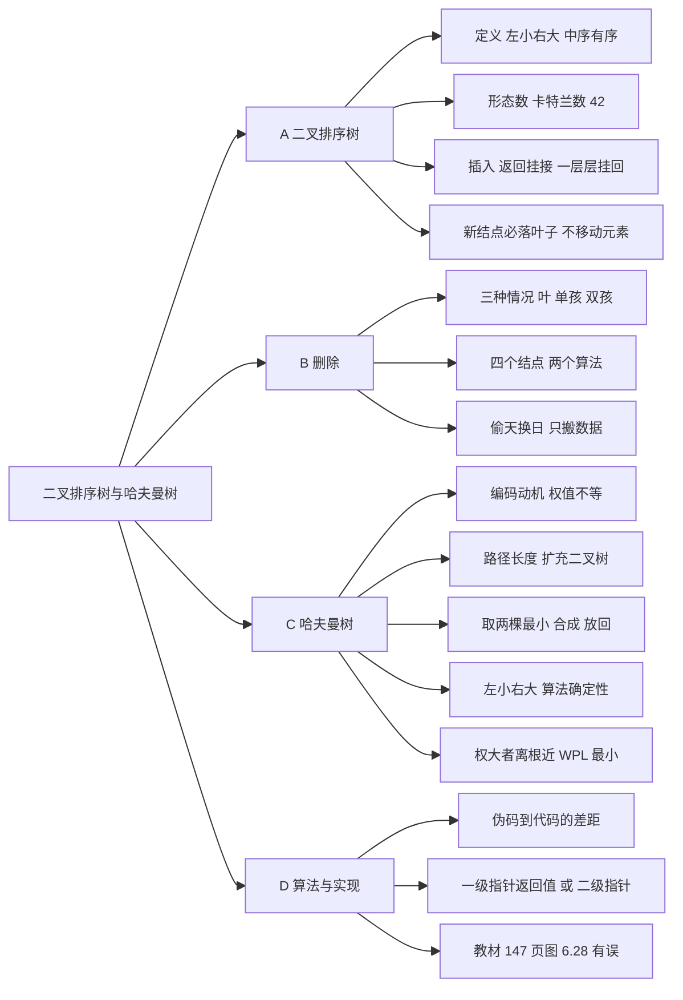
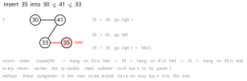
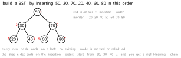
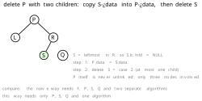
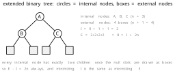
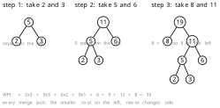

# 数据结构 · 第十一周第一节 · 二叉排序树与哈夫曼树 · 详细版讲义

> **来源说明**：本讲义依据课堂录音的本地转写整理，并与严蔚敏《数据结构（C语言版）》第 9 章（查找）、第 6 章对照校订而成，属**讲授稿性质的整理稿**。全篇以**第一人称**写成——写作者就是讲授者本人，课堂上的追问、点评都以「我」的口吻呈现。
>
> - **转写来源**：一份 ASR 导出文字——`二叉排序树与哈夫曼树讲解_导出原文.txt`（约 2.64 万字，973 行）。开头是承接上一节的「二叉排序树伪码实现」，结尾是期中教学交流的通知，中间完整覆盖**二叉排序树的构造与删除**和**哈夫曼树的引入与构造**两大块。
> - **这一节的主线**：二叉排序树为什么放在树这一章 → 定义与中序有序 → **5 个结点能造几棵＝卡特兰数 42** → 从伪码到代码的「一百年」→ **插入为什么必须返回挂接** → 逐层跟踪 35 的插入 → 构造 BST 与新结点必落叶子 → **删除的三种情况**与「四个结点、两个算法」→ **偷天换日**（搬数据不搬结点）→ 两道随堂题 → 哈夫曼树的**编码动机** → 路径长度与扩充二叉树 → 等权时完全二叉树最优、不等权就不行 → **哈夫曼算法**（取两棵最小、合成、放回）→ **「左小右大」是算法的确定性要求** → 权大者离根近。
> - **这一节的边界**：本节**只讲构造与删除**，**平衡化（AVL／红黑树）没有讲**——我课上明说「现在不涉及到调整的问题，后面的检索那一章会讲二叉排序树调整」。**哈夫曼编码的具体编码表、以及哈夫曼树的存储实现**也没有展开，只讲到「用哈夫曼树做最优编码」这一步。所以这些内容不在本讲义内。
> - **教材对照范围**：**9.1 静态查找表**、**9.2 动态查找表（二叉排序树与平衡二叉树）**、**6.6 哈夫曼树及其应用（最优二叉树、哈夫曼编码）**。**注意教材把二叉排序树放在第 9 章「查找」**，而我把它提前到树这一章讲——理由第一节就交代了。
> - **一处必须点名的教材错图**：教材 **147 页图 6.28** 那棵哈夫曼树，**左子树是 5、右子树是 3（左大右小），紧接着右子树里又是 7 左 8 右（左小右大）**——**同一张图里"左小右大"这条规则前后不一致**。按哈夫曼算法的**确定性**，这是画不出来的。我课上专门把这件事点了出来（第十五节）。**这不是我们要照抄的东西**，你们做题时按「左小右大」一贯到底。
> - **编号说明**：我沿用的章节号比严蔚敏教材**大 1**——我的「第 7 章 树和二叉树」＝教材**第 6 章**；我的「第 10 章 查找」＝教材**第 9 章**。标注教材出处时一律用教材真实章节号。
> - **时间说明**：本节课为**文字模式**（无音视频轨、无关键帧），各节时间戳是按**字数折算的伪时间**（约 200 字／分钟），非音频真实时间，只作讲义内部单调递增的定位坐标；全课伪时间长约 2 小时 5 分。
> - **示意图说明**：本节的图分两类。**开头的「全课思维导图」**用 Mermaid 的 `flowchart` 写成代码块，Obsidian 原生把它渲染成 **SVG 矢量图**；**正文里的数据结构示意图**全部是**独立手写的 SVG 矢量图片**，存放在 `数据结构/插图/`（`w111_01` ～ `w111_05`），正文用 `` 直接嵌入，每张图下都配「图注」。SVG 不依赖插件、不需要联网，打印不糊。
> - **关联阅读**：[[数据结构 第十周第二节 线索二叉树 详细版讲义]]（上一节：线索化的两条实现路线、找前驱后继、线索树上无栈遍历——本节删除 BST 结点时反复用到"找前驱/后继"）、[[数据结构 11月2日 树与森林的转换与线索二叉树 详细版讲义]]（二叉排序树的首次引入、BST 与堆的存法对照）、[[数据结构 第九周第二节 二叉树的遍历 详细版讲义]]（三种次序与展开法，本节判断"中序是否有序"全靠它）、[[数据结构 第五周第二节 栈的应用与递归 详细版讲义]]（卡特兰数与出栈序列的对应关系就出自那里）。

## 开场导读

这一节有两个主角：**二叉排序树**和**哈夫曼树**。一个是"把线性有序序列藏进二叉树"，一个是"按重要性给信息安排长短不一的路径"。表面看是两个不相干的结构，**骨子里是同一个问题：怎么让检索变快。**

先接上一节的尾巴。上节课我留了个尾巴——**二叉排序树的插入，用伪码写出来是一回事，用 C 语言写出来是另一回事**。这一节开头就把这个坑填上：为什么伪码里一句「把 $S$ 送给 $T$」，到了 C 里就挂不上？答案是**链接结构是单行道**：你沿着指针下去，就再也回不来，所以**必须靠返回值把新子树一层层挂回去**。这个「返回挂接」的模式，**在本节第七节的删除算法里还会再用一次**，所以我在第六节花了很大篇幅，把 35 插进那棵 $\{30,41,33\}$ 的树，**一层一层地跟着递归走完**。

填完这个坑，我把二叉排序树这条线走完整：**能造多少棵**（5 个结点是 42 棵，**卡特兰数**，跟出栈序列、括号匹配是同一个数）、**怎么造**（新结点永远落在叶子上，插入**不移动任何元素**，这是它相对顺序表的全部优势）、**怎么删**（三种情况，双孩子最麻烦，要动**四个结点、两个算法**）。然后给它一个"聪明"的解法——**偷天换日**：**不搬结点，只搬数据**，把后继的 `data` 拷过来，问题立刻退化成"删一个最多带一个孩子的结点"。这条思路不只用在树上，**链表里交换两个结点也是这个做法**。

后半节换主角：**哈夫曼树**。我从"计算机只认 0 和 1"讲起——**现实世界要编码才能进计算机，编码要短才好传**。那么问题来了：**每个字符都重要吗？** 不是。e 出现频率高、z 出现频率低，**凭什么给它们一样长的编码**？把这件事量化，就是**权值**；把"权值大的离根近一点"这件事做成算法，就是**哈夫曼算法**：**每次取两棵权值最小的树合成一棵新树，放回去，重复 $n-1$ 次**。

这里有个细节，很多人做作业时栽跟头，我课上专门停下来讲：**「左小右大」不是随便规定的，是算法"确定性"的要求**。你不能这一步让小的在左，下一步让小的在右——**同一个算法，同一步，不能有两种做法**。所以教材 147 页那张图里"这一步左大右小、下一步左小右大"是**自相矛盾**的，按算法画不出来。这一条我在第十五节单独拎出来说。

这一节信息量不小，但**真正会考的只有四处**：**卡特兰数 $C_n=\frac{1}{n+1}\binom{2n}{n}$ 与 $n=5\Rightarrow42$**、**插入必须返回挂接（一级指针返回值 / 二级指针两种写法）**、**删除双孩子的"偷天换日"**、**哈夫曼树的构造步骤与 WPL 的计算**。其余的（爱因斯坦、和珅、纪晓岚那些比方）是**帮你们记的**，不考。

## 总览知识地图



> **图注（全课思维导图）**：这张图把整节课压成四个分支。**A 分支是"是什么、怎么造"**：定义给约束，卡特兰数回答"能造多少棵"，插入和构造回答"怎么造"。**B 分支是"怎么删"**：三种情况是骨架，"四个结点两个算法"是难看的原方案，"偷天换日"是改良后的方案。**C 分支是哈夫曼树**：从编码动机出发，经过路径长度与扩充二叉树，落到"取两棵最小合成放回"这个算法，再加两条纪律（左小右大、权大离根近）。**D 分支是横跨全课的实现问题**：伪码到代码的距离、一级指针与二级指针两条路、以及教材那张自相矛盾的图。**复习时按分支走**：能沿着某一支从根复述到末梢，这一支就过了。

## 正文

### 一、这一节为什么把二叉排序树又拎回来 `00:00-00:03`

有同学问过：**二叉排序树不是"查找"那一章的内容吗，怎么跑到树这一章来了？** 我开场先回答这个。

> 当然有的书啊，是把这一节放在**检索**那一章。那么检索那一章呢，我们之所以把它**提前放到这边**，因为**二叉排序树本质上来说它是一棵二叉树**，对不对？然后并且它是用**二叉链表**模式来进行存储的。那只不过在二叉树的基础之上怎么样？**它加了个规则、加了个约束。**

这段话里其实有三个判断，我逐个拆：

1. **它是一棵二叉树**——所以二叉树的定义、五种形态、三种遍历、性质，**全都适用**；
2. **它是二叉链表存的**——所以"指针只能往下走、回不来"这个特性，**它也躲不掉**（第五、六节会吃这个苦头）；
3. **它只多了一条约束**——**左子树全比根小、右子树全比根大**。

**"只多了一条约束"** 这句话值得琢磨：**它不是一种新的数据结构，它是给二叉树加了个"排序"的门槛。** 所以你在这个结构上做的每一件事，**都要同时满足两条**：既要是二叉树的操作，又要**保持有序**。**删除之所以麻烦，全部麻烦在这第二条上。**

> 那么如果你有左子树，**左子树一定比根结点来得要小**；如果你有右子树，那**右子树一定比根结点来得要大**。那这样子的话就会导致怎么样？**如果是一个二叉排序树，那么在中序遍历的情况下，它就会是一个有序序列。**

**中序有序**是这个结构的"身份证"。我课上把它拔高了一句：

> 所以我们可以说，**二叉排序树是一个非线性结构当中蕴含了一个线性有序序列**。

**"非线性结构里藏着一个线性有序序列"** ——这是我上一节讲线索二叉树时用过的同一句话。**两次出现不是巧合**：线索二叉树是把这条序列**显式地穿起来**，二叉排序树是让这条序列**恰好有序**。**两者都在打同一条"隐藏的线性序列"的主意。**

**本节要点**

- 二叉排序树**本质是二叉树 ＋ 一条约束**（左<根<右），存储用**二叉链表**，所以二叉树那一套全适用。
- **中序有序**是它的身份证：**非线性结构里藏着一个线性有序序列**。
- 它被提前到树这一章讲，是因为**它首先是二叉树**；教材放在第 9 章「查找」是另一条线索。
- **"只多一条约束"** 也意味着：**每个操作都要同时满足"二叉树合法"和"有序"**——删除的所有麻烦都出在第二条。

### 二、先把定义和中序有序这条钉死 `00:03-00:05`

正式开讲之前，把定义再钉一遍，因为后面所有算法都要拿它当判据。

**递归定义**（和二叉树一样是递归的，只是多一条约束）：

> 一棵二叉树是二叉排序树，或者为空，或者满足：
> (1) 若**左子树非空**，则**左子树上所有结点的值均小于**根结点的值；
> (2) 若**右子树非空**，则**右子树上所有结点的值均大于**根结点的值；
> (3) **左、右子树本身又各是一棵二叉排序树**。

**三条要一起看，缺一条都不行**。我课上强调过其中第 (1)(2) 条的**"所有"**两个字：

- 不是"左孩子比根小"，而是**"左子树上所有结点都比根小"**；
- 所以判一棵树是不是 BST，**不能只看每个结点和它的孩子**，要看**整棵子树的值域**。

**这就是为什么"中序遍历一下"是最可靠的判据**：

> 所以判断一棵二叉树是不是二叉排序树呢？**中序遍历一下，如果能得到一个有序序列，就是二叉排序树。**

**为什么中序能当判据？** 因为**中序的访问次序恰好是"左子树 → 根 → 右子树"**，而 BST 的约束是"左小、根中、右大"——**两者一对应，序列自然升序**。反过来，**如果中序是升序，那"左全小于根、右全大于根"也必然成立**，因为左子树的结点全排在根前面、右子树的全排在后面。

**注意两个边界**（课上没细说，但考试会抠）：

- **空树算二叉排序树**（定义第 (1) 句）；
- **结点值互不相同时**，中序是**严格**递增；**如果允许重复值**，中序是**非降**（等号可能出现）——这时"左<根<右"要改成"左≤根<右"或类似约定，**具体看题目怎么规定**。本讲义默认**值互异**。

**本节要点**

- 定义三条：**左子树全部小于根、右子树全部大于根、左右子树又各是 BST**。
- 关键是"**所有**"：不是比孩子，是比**整棵子树的值域**。
- **判据：中序是否升序**——因为中序次序（左→根→右）和 BST 约束（小→中→大）**一一对应**。
- 边界：**空树算 BST**；**值互异时中序严格递增**，允许重复时是非降。

### 三、5 个结点能造多少棵：卡特兰数 `00:05-00:14`

性质讲完，我抛了一个"看着像排列组合、其实是老熟人"的问题：

> 比如说这样子的一个问题：**有 5 个不同结点，让你构造二叉排序树，它的形态有多少种？**

**先说结论：42 种。**

然后我把这个问题**一步步剥开**，剥到最后发现是卡特兰数。这个过程值得跟着走，因为它是**"把一个陌生问题翻译成熟问题"**的样板。

#### 3.1 第一步：把"排序"两个字删掉

> 现在问你这个问题，实际上 **5 个结点构造二叉排序树，你实际上可以把那个"排序"两个字删掉，是一样的结果**。为什么呢？

我课上用 3 个结点演示：

> 你比如说**三个结点**来构造二叉树，它的形态有多少种呢？可能有这种，也有可能**左右子树不一样**。但是**无论你是什么形态，实际上你把它组织一下**——比如说 $1,2,3$ 三个结点——**它都可以中序遍历有序**。

具体怎么"组织"？**按中序位置填数**：

- 如果形状是「根＋左孩子＋左孩子的左孩子」（一条左斜链），那就**最左填 1、中间填 2、根填 3**；
- 如果是「根＋左＋右」，那就**左填 1、根填 2、右填 3**；
- 如果是右斜链，就**根填 1、右填 2、最右填 3**。

**每一种形状，都能填出一棵合法的 BST**——**填法还唯一**（因为中序次序固定，值只能按中序顺序摆）。所以：

$$
\text{能造出的 BST 棵数}=\text{同样结点数的二叉树形态数}
$$

**"排序"这两个字，在这里不增加也不减少形态数**——它只规定"数怎么填"，不规定"树长什么样"。

#### 3.2 第二步：把"造树"翻译成"求先序序列"

> 这个问题实际上就等价于：你去求一棵二叉树，**它有 5 个结点，然后它输出是有序的**（比如 $1,2,3,4,5$），反过来问你：**它的先序序列应该是个啥？**

**为什么能这么翻译？** 因为**中序序列被钉死成 $1,2,3,4,5$**（BST 的身份证），**先序序列一变，树的形状就变**。所以**数形状 = 数"合法的先序序列"**。

这里要当心一个坑，我课上专门提了：

> 当然不见得这个成立——因为**先序和中序合起来能够唯一确定一棵二叉树**，但这个先序**不见得和中序能够构成一棵合法的二叉排序树**。所以这个问题实际上就演化成……**卡特兰数**。

**"先序＋中序能唯一确定一棵二叉树"是真的**，但**不是任何先序排列都能和中序 $1,2,3,4,5$ 拼出一棵二叉树**（比如先序 `2,3,4,1,5` 配中序 `1,2,3,4,5` 连合法二叉树都拼不出来；反过来，只要能拼出中序为 $1,2,3,4,5$ 的二叉树，它就天然满足 BST 约束）。所以不能简单算"先序有多少种全排列"，**能拼出合法二叉树的先序只有一部分**。

#### 3.3 第三步：认出老熟人——出栈序列

> 卡特兰数为什么是卡特兰数呢？大家看一下，**我们卡特兰数前面讲的是有 $n$ 个元素入栈，求出栈的序列**。那这个大家都经历过：**入栈的顺序是 $1,2,3,4,5$，然后问你出栈的顺序**。

> 那这里面你可以把它看成**反过来**——**$n$ 个不同的元素出栈，如果按顺序出栈 $1,2,3,4,5$，那么你入栈有哪几种可能呢？** 这个也是一样的。

**为什么"反过来"也成立？** 因为**入栈序列固定、数出栈序列**与**出栈序列固定、数入栈序列**是**同一个计数问题的两个方向**，**卡特兰数关于这个变换是对称的**。而"中序固定、数先序"恰好就是这个形状：

| 问题 | 固定的东西 | 要数的东西 | 答案 |
|---|---|---|---|
| 栈 | 入栈 $1..n$ | 出栈序列 | $C_n$ |
| 栈（反过来） | 出栈 $1..n$ | 入栈序列 | $C_n$ |
| BST | 中序 $1..n$ | 先序序列 | $C_n$ |

#### 3.4 公式与递推

$$
\boxed{\;C_n=\frac{1}{n+1}\binom{2n}{n}=\frac{(2n)!}{n!\,(n+1)!}\;}
$$

$n=5$ 时：

$$
C_5=\frac{1}{6}\binom{10}{5}=\frac{252}{6}=42 .
$$

**递推式**（课上讲的推导，比公式更好记）：

> 你假设总共有 $n$ 个结点，**左子树有 $i$ 个**，那么左子树有可能的形态有 $F_i$ 种；那你剩下的**右子树的结点数是 $n-1-i$**，形态有 $F_{n-1-i}$ 种。那么整棵树有可能有多少种形态呢？**$F_n$ 等于这两个相乘**，然后 $i$ 从 $0$ 到 $n-1$ 求和。

$$
F_0=1,\qquad F_n=\sum_{i=0}^{n-1}F_i\,F_{n-1-i}\quad(n\geqslant1).
$$

**这个递推式为什么对？** 因为**根占掉一个结点**，剩下的 $n-1$ 个结点**分成两堆：$i$ 个给左子树、$n-1-i$ 个给右子树**。而**左子树的形状与右子树的形状互相独立**，所以**相乘**；**$i$ 可以取 $0$ 到 $n-1$ 的任何值**，所以**相加**。这就是"分左右 + 独立 + 求和"的标准套路。

**前几项**（这些最好记住，做题能直接报）：

$$
F_0=1,\;F_1=1,\;F_2=2,\;F_3=5,\;F_4=14,\;F_5=42,\;F_6=132 .
$$

**验算 $F_3=5$**：$i=0$ 时 $F_0F_2=1\times2=2$；$i=1$ 时 $F_1F_1=1$；$i=2$ 时 $F_2F_0=2$；合计 $2+1+2=5$ ✓（正好是三个结点的五种形态）。

#### 3.5 顺带一句：括号匹配也是它

> 那这个问题卡特兰数呢，还有可能会有这种问题，就是**括号匹配问题**：$n$ 个括号，问你有多少种括号匹配的序列——$n$ 对括号。比如说两对，这是一种，也有可能这样子，这是一种。那如果 3 对呢？跟这个问题是类似的，**都是卡特兰数**。

**为什么括号匹配也是卡特兰数？** 因为"$n$ 对括号的合法匹配"和"$n$ 个结点的二叉树形态"是**同一棵结构**：**左括号＝进左子树，右括号＝回上层**，配对关系一一对应。**这类"配对/嵌套"的问题，十有八九是卡特兰数。**

**本节要点**

- **5 个结点的二叉排序树有 42 种形态**（$C_5=42$）。
- **"排序"两字可以删掉**：任何二叉树形状都能按中序填值变成 BST，所以**数 BST = 数二叉树形态**。
- **等价翻译**：中序固定为 $1..n$、数**先序序列**的合法个数 → 与**栈的出栈序列**同构 → **卡特兰数**。
- $$C_n=\frac{1}{n+1}\binom{2n}{n}$$；递推 $F_0=1,\;F_n=\sum_{i=0}^{n-1}F_iF_{n-1-i}$；前几项 $1,1,2,5,14,42,132$。
- **括号匹配**也是卡特兰数（配对嵌套类问题的通例）。

### 四、从伪码到能跑的代码，隔着「一百年」 `00:14-00:19`

卡特兰数讲完，我掉转话头，回到上一节留的那个尾巴——**BST 插入的伪码实现**。

> 上节课讲到二叉排序树的那个**伪码语言**。我说呢，让大家回去想一下：像这个伪码语言，应该说是**理论的算法**。那么**这个理论的算法，实际上跟实践还有一段距离**——这个依据每个人的编程能力不同，**理论和实际的距离差得有多远，也是不一样的**。

然后我给了一个很重的比喻：

> 这个问题有可能差得很远。就是说**你把算法设计出来，你能不能实现**——这是两步，这是**两个步骤**。那我们说，你看最典型的：**爱因斯坦 1916 年提出广义相对论**，那个时候他就**理论上预言了引力波是存在的**；然后结果**什么时候探测到引力波呢？2016 年**——隔了 **100 年**。**从理论到实践。**

**"一百年"** 这个数字我课上说得很有分量，但它要**说准**：**1916 年是广义相对论的成形年份，引力波是它的一个预言；2015 年 9 月 LIGO 首次直接探测到引力波信号，2016 年 2 月宣布。** 所以"隔了一百年"说的是**从理论预言到实验证实**，**不是说"算法到代码要一百年"**。**这个比喻要听的是"距离"，不是"数字"。**

**落到我们这门课上，这个"距离"具体是什么？** 我给了答案：

> 有啥问题啊？**跟咱们那个二叉树创建是类似的**。你看啊，如果 $T=\text{NULL}$，**你把 $S$ 送给 $T$**——$S$ 送给 $T$ 是什么意思呢？**实际上相当于赋值**。那赋值的话，你把一棵树的**根结点那个信息赋值给这个 $T$**，就相当于干什么呢？

**问题就在"赋值"这两个字上**。伪码里写 `T = S`，看着天经地义；但在 C 里，**`T` 是形参，是一个局部变量**。你 `T = S`，**改的是这个局部变量，函数一返回就没了**，调用者的指针**一点没变**。这就是那个"一百年"的距离。

**那怎么跨过去？** 两条路，我课上点了名：

> 对于我们指针来说，或者说任何函数，**你要改变另一个函数里的值**，你是需要**有几种方法，两种方法**：
> **第一种方法**是传回来参数、**有返回值**，那你就用**一级指针**；
> **第二种方法**是**传指针**——你一个函数 B 去改变函数 A 的值，要传指针。所以我们这里面 **$T$ 本身就是一级指针**，那所以你也可以通过**传二级指针**的方法来实现改变。

| 路线 | 怎么改 | 调用方怎么写 | 教材用哪种 |
|---|---|---|---|
| **返回值法** | 函数**返回新的子树根**，调用方接住并挂回 | `T->lchild = Insert(T->lchild, x);` | 常见 |
| **二级指针法** | 传 `&T`，函数里 `*T = s` 直接改调用方的指针 | `Insert(&T, x);` | 也常见 |

**两条路等价**，只是"谁来写回"不同：**返回值法是"我把新根交给你，你自己挂"；二级指针法是"你把地址给我，我替你挂"。** 本节第五节走**返回值法**（因为它的"挂接"过程最能说明链接结构的脾气），第九节删除时会看到**二级指针/返回值**两种都行。

**本节要点**

- **伪码到代码有距离**：伪码里 `T = S` 是"赋值"，C 里改的是**形参副本**，**调用者的指针不变**。
- 爱因斯坦 1916 预言、2016 宣布探测（**LIGO 2015 年 9 月首测**）这个比喻，说的是**"理论与实现的距离"**，不是真的一百年。
- **两条跨过去的桥**：**返回值法**（返回新子树根、调用方挂接）／**二级指针法**（传 `&T`、函数内改 `*T`）。
- 两条**等价**：一个是"我把新根交给你"，一个是"你把地址给我"。

### 五、插入算法：为什么必须「返回去挂接」 `00:19-00:25`

现在把插入算法的骨架立起来。

**递归思路**（和 BST 定义一一对应）：

1. **若 $T$ 为空**：新建一个结点，值放进去，**返回这个新结点**（它就是这棵新子树的根）；
2. **若 $x<T$ 的值**：到**左子树**去插，**把左子树插完返回的新根，挂回 $T$ 的左边**；
3. **若 $x>T$ 的值**：到**右子树**去插，**把右子树插完返回的新根，挂回 $T$ 的右边**；
4. **否则**（相等）：按题目约定处理（一般视为已存在、不重复插入）。

写成 C：

```c
/* 在以 T 为根的二叉排序树中插入值 x，返回插入后这棵（子）树的新根 */
BiTree Insert(BiTree T, ElemType x) {
    if (T == NULL) {                 /* ① 空树：新建结点，它就是新根 */
        T = (BiTree)malloc(sizeof(BiTNode));
        T->data = x;
        T->lchild = T->rchild = NULL;
        return T;                    /* 关键：把新根交回去 */
    }
    if (x < T->data)
        T->lchild = Insert(T->lchild, x);   /* ② 插左，返回的新根挂左边 */
    else if (x > T->data)
        T->rchild = Insert(T->rchild, x);   /* ③ 插右，返回的新根挂右边 */
    /* else：相等，按约定不插 */
    return T;                        /* 每一层都要把（可能变了的）根交回去 */
}
```

**这两行 `T->lchild = Insert(...)` 就是全部的秘密**：**函数返回的"新子树根"，被赋回孩子指针**。**没有这个赋值，新结点就挂不上去。**

#### 5.1 为什么非要这样？因为链接结构是单行道

我课上用了一个很形象的比喻：

> 你想一下，**链接结构**……我们如果知道链接结构，**它不能回头的**——**我走过去了之后，它是单行道，再回不来了**。然后你这个 $T$ 已经等于 `NULL` 了，你要通过 $S$ 赋值给 $T$，**相当于是要改变 $T$ 的值**。

**"单行道"** 三个字把问题说透了：

- 你从根往下走，**手里只有一个向下的指针**；
- 走到 `NULL` 的时候，**你已经不知道"我爹是谁"了**（二叉链表没有 `parent`）；
- 你要把新结点挂上去，**必须挂到"爹"的孩子指针上**；
- 可你**回不到爹那里**——**除非**你**在往下走之前就把"回来要挂在哪"这件事安排好**。

**返回值法就是"提前安排好"的办法**：**每一层在下去之前，把"我要接住返回值"这件事写在代码里**（`T->lchild = ...`）。等下面那层返回新根，**这一层的赋值语句自然就把结点挂上了**。

我课上还有一句更狠的话，说的是**如果不返回会怎样**：

> 那你想一下，按照我们这个算法，**你要是下去了，你一旦下去了，你都指向空的位置了**，然后你把 35 送给他——**它实际上是个孤立的结点**，你这个 33 并没有完成 35 你要挂接的一个操作。
> 这就好像**你沿着那个链表走走走走走，你都走到悬崖掉下去了，你还能回来吗？**

**"走到悬崖掉下去了"** ——新结点是建出来了，**但它挂在一根已经断了的绳子上**，**整棵树里没有它的位置**，函数返回后**这个结点就丢了（内存泄漏）**。

**本节要点**

- 插入四步：**空则新建并返回**；**小则插左、把新根挂回左边**；**大则插右、把新根挂回右边**；**相等按约定处理**。
- **`T->lchild = Insert(T->lchild, x)` 是全部秘密**：**返回的新根必须赋回孩子指针**。
- 根因是**链接结构是单行道**：走到 `NULL` 时**不知道爹是谁**（无 `parent`），**只能靠"下去之前就写好接住返回值"**。
- **不返回的后果**：新结点成了**孤立结点**，挂不上树、还漏内存——**"走到悬崖掉下去了"**。

### 六、把 35 插进去，一层层看清递归怎么挂回来 `00:25-00:34`

光讲道理不够，我课上**把一次插入的每一步都跟着走了一遍**。这棵树是这样的：**根 30，30 的右孩子 41，41 的左孩子 33**。现在要插 **35**。



> **图注（把 35 插进 $\{30,41,33\}$ 的过程）**：树的结构是 **30 为根、右孩子 41、41 的左孩子 33**。插入 35 时**比较三次**：$35>30$ 往右 → $35<41$ 往左 → $35>33$ 往右，**而 33 的右孩子是空的**。于是**新建 35 结点**（红色），**它先被挂到 33 的右孩子上**；33 这一层返回 33，**33 被挂回 41 的左孩子**；41 这一层返回 41，**41 被挂回 30 的右孩子**；30 这一层返回 30，**整棵树的新根就是 30**。**红线是最后真正新增的那条边**。

**逐步跟一遍**（课上就是这么一步步报的）：

**第一步：进 `Insert(30, 35)`。**
$T=30$、$T\neq\text{NULL}$，$35>30$，所以走 `T->rchild = Insert(T->rchild, 35)`，**进入 41**。

**第二步：进 `Insert(41, 35)`。**
$35<41$，走 `T->lchild = Insert(T->lchild, 35)`，**进入 33**。

**第三步：进 `Insert(33, 35)`。**
$35>33$，走 `T->rchild = Insert(T->rchild, 35)`，**进入 `NULL`**。

**第四步：进 `Insert(NULL, 35)`。**
$T=\text{NULL}$，**新建结点 35**，`return T`——**返回的是"以 35 为根的一棵子树"**。

**第五步：回到 33 那一层。**
`T->rchild = ` 刚才返回的 **35**，于是 **33 的右指针指向 35**。这一层 `return T`，**返回 33**。

**第六步：回到 41 那一层。**
`T->lchild = ` 刚才返回的 **33**，于是 **41 的左指针指向 33**（其实没变，但赋值动作照做）。返回 **41**。

**第七步：回到 30 那一层。**
`T->rchild = ` 返回的 **41**，**30 的右指针指向 41**（也没变）。返回 **30**。

**七步走完，挂接完成。** 我课上特意点了一句：

> 每一次返回的时候**重新挂接**。那当然我们后几步的挂接……**本来有同学说它本来就是那**——但是**最后一步的挂接它就不一样**。

**"本来就一样"的那几步为什么也要赋值？** 因为**代码不知道"一样不一样"**——它只知道"**我这层的孩子指针，必须等于下层返回的根**"。**这个动作是统一的、无条件的**，**正是这种"无条件的重新挂接"保证了正确性**。**如果只在"变了的时候"才赋值，你就得先判断"变没变"，而判断本身又得知道下层的情况**——**反而更复杂**。

#### 6.1 这个模式后面还要用

> 这个玩意儿**后面还会立马就用——二叉排序树删除的时候还会用上**，所以我们这里面给大家分析一下。

**删除双孩子结点时，同样要"下去、改、返回挂接"**（第九节）。**所以这一节花的时间不冤**：**"返回挂接"是二叉链表上所有"可能改变结构"的递归操作的通用模式**。

**本节要点**

- 插入 35 的比较路径：**$35>30$ 右 → $35<41$ 左 → $35>33$ 右 → 空**，四次调用、**新建结点**。
- **返回顺序是自底向上的**：新建 35 → 挂到 33 右 → 返回 33 → 挂到 41 左 → 返回 41 → 挂到 30 右 → 返回 30。
- **每一层都无条件执行"重新挂接"**（`T->lchild = 返回值`），**哪怕子的根没变也照赋**——**统一动作才保证正确**，加判断反而更复杂。
- **"返回挂接"是二叉链表上"会改结构"的递归操作的通用模式**，删除还要再用一次。

### 七、构造一棵二叉排序树：新结点永远落在叶子上 `00:34-00:46`

插入讲清楚了，构造就是"**从空树开始，一个一个插**"。

> 那我们来构建一棵二叉排序树吧，给你一个关键字的集合。**首先，根结点为空，那就作为根结点**。接下来再来一个，**比根来的要小，所以进入左子树**；那左子树的结点为空的，**所以它作为左子树的根结点**。接下来一个，**比根还是来的小，但比刚才那个来的要大**，所以我们进入它的右子树……

我课上给的是**一串字母关键字**，边插边画。**转写里这些字母被 ASR 认得很乱**（`WW`、`Wiilwil`、`XUL`、`sal` 之类），**我没法还原原来那串关键字**。所以下面**换一组干净的数字**重演同样的过程，**规则和每一步的判断完全一致**。

#### 7.1 例子：依次插入 50、30、70、20、40、60、80



> **图注（按 50,30,70,20,40,60,80 的顺序构造 BST）**：红字是**插入顺序**。50 先来，**成为根**；30 比 50 小，**成为 50 的左孩子**；70 比 50 大，**成为右孩子**；20 比 50 小、比 30 小，**成为 30 的左孩子**；40 比 50 小、比 30 大，**成为 30 的右孩子**；60 比 50 大、比 70 小，**成为 70 的左孩子**；80 比 50、70 都大，**成为 70 的右孩子**。**每一个新结点都恰好落在一个空位置（叶子位置）**，**原有结点一个都没动**。中序是 $20,30,40,50,60,70,80$——**升序**，符合 BST。

#### 7.2 特点一：新结点一定落在叶子上

> 总结一下有啥特点？**新插入的结点在哪？在叶结点**。那你想一下，**这个叶子结点有啥好处**？

**好处是**：

> 它的好处是**插入结点的时候不涉及到结点的移动**。

**这条要跟顺序表比才有味道**：

| | **顺序表（有序数组）插入** | **二叉排序树插入** |
|---|---|---|
| 找位置 | 二分，$O(\log n)$ | 沿路径比较，$O(h)$ |
| **插进去** | **平均要移动一半元素**，$O(n)$ | **只改两个指针**，$O(1)$ |
| 元素动不动 | **要挪** | **一个都不挪** |

> 你用向量来存储这 $n$ 个结点，然后往里面插入一个结点——**它的效率是啥？平均要移动一半元素**。但我这里怎么样？**二叉排序树，插入的结点不需要移动元素**。

**这就是 BST 相对有序表的全部优势**：**动态增删不搬元素**。我课上把它归到"链接结构的通性"：

> 虽然它**浪费了存储空间**（因为有指针，达不到百分之百的利用率），但是从它**构造的这个过程**你就知道它的优势是啥——**这也是链接结构的优势：所有的链接结构实行动态变化，插入结点不会涉及原有元素的移动。**

**"用空间换动态性"** ——这笔账在上一节（树的存储）算过，这里又对上了。

#### 7.3 特点二：插入顺序不同，树的形状不同

> **这个插入的顺序跟它的形状有关**。如果你这个**插入顺序改一改，你这个二叉排序树长得就不一样**。

**举极端例子**：同样是 $\{20,30,40,50,60,70,80\}$，

- 按 **50,30,70,20,40,60,80** 插，得到上面那棵**差不多平衡**的树，高度 3；
- 按 **20,30,40,50,60,70,80** 插（**升序**），得到一条**右斜链**，高度 7——**退化成了链表**。

**同一组数据，两种形状，查找效率差一个数量级**。**这就是为什么后面要讲"平衡化"**——我课上明说了：

> 我们现在**不涉及调整的问题**，还没调整。后面**后面的检索那一章会讲二叉排序树调整**，现在就是**直接插**。

#### 7.4 构造时最容易犯的错

> 但是一定要注意，**有的同学这个也会构造错**，为什么呀？他**记不住**，做着做着就**变成去构造一颗啥**……我们要注意：**新插入的结点一定是在叶子上**。

> 所以你可以**直接在原有的基础上做插入**，不需要重新画一棵二叉树。那么有的同学**构造着就晕了，增加一个结点不在叶结点上**——**要注意，一定要在叶结点上**。

**"一定要在叶子上"** 这句话是**判卷的第一眼**：**新结点一旦插在中间（成了某个已有结点的父）**，那说明**整棵树都被重排过了**，**那不是构造 BST，那是重建**。

> 老老实实慢慢地插，**一步一步插**——**你不要想象成那个啥，我们现在不涉及调整的问题**。

**本节要点**

- **构造 = 从空树开始逐个插入**；例：按 50,30,70,20,40,60,80 插入，得高度 3 的树，中序升序。
- **新结点一定落在叶子上**，**原有结点一个都不动**——**插入不搬元素**，这是相对顺序表（平均搬一半）的全部优势。
- **插入顺序决定形状**：升序插入会退化成一条链（高度 $n$），这就是后面要"平衡化"的原因。
- **判卷第一眼：新结点必须在叶子上**；插到中间就说明整棵树重排过了，那不是构造。

### 八、删除的三种情况与「四个结点、两个算法」 `00:46-00:54`

构造讲完，我问了一个更狠的问题：**插入不搬元素，那删除呢？**

> 你插入不会涉及元素的移动，**那你删除呢？删除会不会涉及元素的移动呢？**

**先看顺序表怎么删**：

> 对于线性序列来说咋办？**两种方法**。第一种方法是**后面这些元素通通往前挪一个位置**——因为否则，**结构一致性**嘛：你把这个 $P$ 一拿掉，原来是一个线性有序序列，**你啥都不做就会变成两个线性有序序列**，违反结构一致性。

**这就是顺序表删除的代价：$O(n)$ 的元素移动。**

**那 BST 怎么删？** 关键洞察是：

> 我们现在不是一个线性序列啊，$P$ 是**分支结点**。根据中序规则，**$P$ 的后面是谁？整棵右子树**。那我们**把整棵右子树有必要直接挪动吗？不需要。**

**不用挪整棵子树**，只要**让一个合适的结点"顶替" $P$ 的位置**，**中序有序就能保住**。**顶替者必须满足"在序列里紧挨着 $P$"**，所以只有两个候选：

- **中序直接后继**：**右子树的左链上，第一个没有左孩子的结点**；
- **中序直接前驱**：**左子树的右链上，第一个没有右孩子的结点**。

> 所以他的**中序直接后继就是在他的右子树的左链当中，左儿子不断地往下走，找到了第一个没有左儿子的那个结点**。**所以你可以用中序后继来进行替代。**
> 那当然我也可以**用 $P$ 的直接前驱来替代 $P$**。那 $P$ 的直接前驱在哪呢？**左儿子的右链不断搜索到的第一个没有右儿子的那个结点**。

**这两条就是上一节线索二叉树的"找前驱/找后继"**——我课上专门点了名：

> **上节课刚讲**，$P$ 这个树中序的直接后继在哪儿啊？……**再三问了**。

#### 8.1 按"孩子个数"分成三种情况

> 我们说二叉树实际上有**五种形态**：空、只有根、只有左子树、只有右子树、左右都有。**那我们把它空的不考虑**，然后**一个结点的是一种情况**，然后**有一个孩子的，我们把它合二为一**作为一种情况，然后**左右都有的**是第三种情况。**所以我们分三种情况来讨论。**

| 情况 | 结点形态 | 怎么删 |
|---|---|---|
| **一** | **叶子**（左右都空） | **直接删**，把父的对应指针置空 |
| **二** | **只有一个孩子**（左空或右空） | **用那唯一的孩子顶替它** |
| **三** | **左右都不空** | **用中序前驱或后继顶替** |

**情况一：叶子。**

> 第一种情况是最简单的：$P$ 是个**孤立的结点**、**叶结点**，直接删就行了。就好像**你在城里生活，既没有孩子也没有亲人，孤孤单单一个人**——那这个城市要把你抹掉非常简单，**直接干掉就搞定了**。

**情况二：只有一个孩子。**

> 那如果只有一个孩子呢，就是说**它有一个空的、只有一个非空的左或右**。**实际上删除的要点也是一样：不管你怎么删，你的目标还要保证它是一棵二叉排序树**，也就是**中序遍历有序**。

我课上用了一个很暖的比方解释"孩子顶替"：

> 比如说我要删除的是 $B$，$B$ 只有一个左子树 $L$。中序遍历下序列是"先左子树、再 $B$、再 $A$"。那现在要把 $B$ 删除怎么办？**直接 $L$ 来替换 $B$ 不就行了吗？** 替换完了之后，中序序列还是"$L$、$A$"，**还是满足中序有序**。
> 这个实际上也有**现实意义**：**$B$ 是个父亲，$L$ 是孙子，$A$ 是祖先**。**那你父亲去世了咋办？孙子来孝敬爷爷奶奶呗**——**孙子继承父亲的遗志，替换父亲的位置，来代替父亲在爷爷奶奶跟前尽孝。**

如果 $B$ 只有右子树 $R$，道理完全对称：中序序列是"$B$、$R$、$A$"，删掉 $B$ 后用 $R$ 顶替，中序变成"$R$、$A$"，依然有序。比如前面那棵树里要删 **33**，它只有一个右孩子 **35**，**直接让 35 顶上来替换 33 就搞定了**。

**情况三：左右都不空——最麻烦的一种。**

这里我课上先讲了**"笨办法"**，为的是让后面的改进显得有必要：

> 最麻烦的是 $P$ 的左右孩子都不空。那我就要用 $P$ 的**中序直接前驱 $S$** 来替代它，那问题这个中序直接前驱在哪呢？**要涉及到找的问题了。**

**为什么麻烦？** 因为你要**同时掌握四个结点**：

> 需要关注**四个结点**：一个是 **$P$**（我要删除的），一个是 **$S$**（它的直接前驱）。那另外一个因为你要删除 $P$，所以要知道 **$F$**，就是 $P$ 的**父结点**；然后还要知道 **$S$ 的父结点 $Q$**。**所以涉及到四个结点。**

**而且 $S$ 本身可能还带个左孩子**（它一定没有右孩子，但可能有左孩子），**摘走 $S$ 之前得先把它孩子安排好**：

> 这就好比**现实世界里面有好多人，父母在农村，然后去城里打工**。你想这个 $S$ 要去城里打工，**你能直接说跑路吗？直接走人吗？** **你拖家带口，你娃咋办？**
> 所以你这个 $S$ 替换之前**先要安排好**：**把孩子托付给谁？托付给爷爷奶奶带**——也就是**它的父结点**。

**于是"笨办法"需要两个算法**：

1. **查找算法**：先找到 $P$ 和它的父 $F$（因为删除函数的参数要传 $F$ 和 $P$）；
2. **删除算法**：拿 $F$、$P$、$S$、$Q$ 做一连串指针改写。

**我课上把这段总结成一句话**：

> 你看这个大家想一下这个过程，**麻不麻烦？很麻烦**。**指针乱飞**，然后比较麻烦。

**本节要点**

- **顺序表删除要搬元素**（$O(n)$）；**BST 删除不搬元素**，只需**让合适的结点顶替**，保住中序有序。
- **顶替者只能是中序前驱或中序后继**：**后继＝右子树左链上第一个无左孩子的结点**；**前驱＝左子树右链上第一个无右孩子的结点**。
- **三种情况**：**叶子直接删**；**单孩子用唯一孩子顶替**（"孙子替父亲尽孝"）；**双孩子用前驱/后继顶替**。
- **双孩子的"笨办法"要管四个结点**（$P,S,F,Q$）、**要两个算法**（先查找 $F,P$，再删除），**指针乱飞**。

### 九、偷天换日：只搬数据，不搬结点 `00:54-01:09`

「笨办法」讲完，我停下来问：**能不能简单点？**

> 那你看这个过程**麻不麻烦？很麻烦**。那我能不能**改进一下这个状况**呢？我们**换一种思路**来解决这个问题。

#### 9.1 关键观察：结点"长得一样"

> 简单一点的基本思路是这样：你这个 $S$ 和 $P$，它俩**长得不一样**，但实际上**对于链接结构来说，任何一个链接结构当中的任何一个结点，它有什么共同点？** 它共同点非常多：
> **它的结构是一样的，是一模一样的**；然后**都分为 `data` 域、`link` 域**；然后**每一个结点所占据的内存单元大小，也一模一样**。

**既然两个结点"壳子"一样**，那就不必**把整个结点搬过去**，**只把里面的数据搬过去**就行：

> 那我能不能这么做巧妙一点：**我不是用整棵 $S$ 这棵树来换掉 $P$ 这棵树，而是只需要把结点的值给你复制过去**，然后 **$P$ 不动**。那这个实际上可以叫做——**偷天换日**。

#### 9.2 三步：拷数据、删 $S$、完事

> 你**让 $P$ 不动**，然后**让 $S$ 的数据域直接替换 $P$ 的数据域**，然后**再删 $S$ 不就得了吗？**

**为什么删 $S$ 就简单了？**

> 因为你这个 $S$ **一定没有右儿子**——它**有可能有左儿子，但一定没有右儿子**。那它最复杂的情况，**这个 $S$ 就是个带了一个孩子的结点**，那不就**退化成第二种情况**了吗？

**这里要把"用前驱"和"用后继"的口径统一讲清**：$S$ 必有一侧为空，具体是哪一侧为空，取决于你选的是前驱还是后继：

- 用**前驱**（左子树右链第一个无右孩子者）：$S$ **右孩子必空**，左孩子**可能有**——上面引文就是按**用前驱**来口述的，所以说"$S$ 一定没有右儿子"；
- 用**后继**（右子树左链第一个无左孩子者）：$S$ **左孩子必空**，右孩子**可能有**——下面的示意图（图 3）和 9.4 的代码采用这一种写法。

**两种选法完全对称，都能保证 $S$ 最多只有一个孩子**，从而**只需按情况二处理**。只要代码和画图前后一致，选哪种都对。



> **图注（偷天换日）**：要删的 $P$（根）有左右两棵子树。**选 $S$＝$R$ 子树里的最左结点**（$S$ 的左孩子必为空）。**第一步把 $S$ 的 `data` 拷进 $P$ 的 `data`**——**$P$ 的指针一个都没动**，但它的"值"变成了后继的值，**中序有序保住了**。**第二步把 $S$ 删掉**——$S$ 左空，最多带一个右孩子，**退化成情况二**，直接用它唯一的孩子顶替。**只涉及 $P,S,Q$ 三个结点，一个算法搞定。**

#### 9.3 好处：三个结点、一个算法

> 这个有个啥好处呢？就是说我删 $P$ **不需要带着那个后备变量 $F$**，因为我现在**不是摘除整个结点，而是替换数据域**。**我只涉及到三个结点**，不需要管 $P$ 的父结点。**所以一个算法就搞定了**——你原来不是还得**俩算法**嘛：先找到 $F$ 和 $P$，然后才能把 $F$ 和 $P$ 作为参数传进来。

| | 笨办法 | 偷天换日 |
|---|---|---|
| 涉及结点 | $F,P,S,Q$ **四个** | $P,S,Q$ **三个** |
| 需要几个算法 | **两个**（查找 $F,P$ ＋ 删除） | **一个** |
| 要不要 `parent` | **要**（得知道 $F$） | **不要** |
| 指针改写量 | 多（整棵子树搬家） | **少**（只改 $S$ 那一处） |

**"不需要 `parent`"这一点特别值钱**：**二叉链表没有 `parent` 域**，笨办法要 `F` 就得**额外再写一个查找**；偷天换日**只往下走**（找 $S$），**根本不需要回头**。

#### 9.4 代码

```c
/* 删除以 T 为根的 BST 中值为 x 的结点，返回删除后这棵（子）树的新根 */
BiTree Delete(BiTree T, ElemType x) {
    if (T == NULL) return NULL;                  /* 没找到 */
    if (x < T->data)
        T->lchild = Delete(T->lchild, x);        /* 去左子树删，返回挂接 */
    else if (x > T->data)
        T->rchild = Delete(T->rchild, x);        /* 去右子树删，返回挂接 */
    else {                                       /* 找到了：T 就是要删的 */
        if (T->lchild && T->rchild) {            /* 情况三：左右都不空 */
            BiTree s = T->rchild;                /* 到右子树找最左 */
            while (s->lchild) s = s->lchild;      /* 一直往左，找到后继 S */
            T->data = s->data;                   /* 偷天换日：拷数据 */
            T->rchild = Delete(T->rchild, s->data); /* 再去右子树删掉 S */
        } else {                                 /* 情况一/二：至多一个孩子 */
            BiTree tmp = T;
            T = T->lchild ? T->lchild : T->rchild; /* 孩子顶上来（或 NULL） */
            free(tmp);                           /* 释放原结点 */
        }
    }
    return T;                                    /* 每层返回新根，供上层挂接 */
}
```

**注意两处照应**：

1. **`T->rchild = Delete(T->rchild, s->data)` 又用了一次"返回挂接"**——**和插入完全同一个模式**；
2. **情况一和二可以合并**：`T = T->lchild ? T->lchild : T->rchild`——**有一个孩子就用孩子，一个都没有就变 `NULL`**，**一句搞定**。

#### 9.5 这个思路不只用在树上

> 这个思路实际上**有时候你比如说列表当中也会有这种情况**。比如说**两个结点进行交换**咋做呢？你可以**把它的 `data` 替换过来，两个 `data` 交换就行了**，**不见得需要真的把两个结点都摘下来、然后替换掉**。

**"搬数据不搬结点"是个通用手法**：只要**结点外壳同构**、**对外只暴露 `data`**，就可以**拷数据 + 删旧结点**。**代价是**：**如果有外部指针指向被删的那个结点，它会失效**（数据"搬走"了，那个指针还指着老壳子）。**这一点课本一般不强调，但工程上要当心。**

**本节要点**

- **偷天换日三步**：**$S$ 的 `data` 拷进 $P$ 的 `data`** → **$P$ 不动** → **再去删 $S$**（$S$ 退化成情况二）。
- **选后继则 $S$ 左空；选前驱则 $S$ 右空**——**谁那一侧为空，就保证只需情况二**。
- **好处**：**三个结点（$P,S,Q$）、一个算法、不要 `parent`**；笨办法要四个结点、两个算法、还要 `F`。
- **代码里 `Delete` 又用了一次"返回挂接"**；**情况一、二可合并成一句** `T = T->lchild ? T->lchild : T->rchild`。
- **通用性**：链表交换两个结点也可"搬 `data` 不搬结点"；**代价是外部指向旧结点的指针会失效**。

### 十、两道随堂题：删根 40 与「不可能的查找序列」 `01:09-01:13`

讲完删除，我给了两道随堂题，一道练手、一道判断题。

#### 10.1 第一题：删掉根 40

> 刚才那棵二叉排序树，问你：**用它的中序直接前驱替换，这棵二叉树长啥样？** 本来是长这个样，现在删除**根结点 40**。**40 左右子树都有**，用它的直接前驱——**是谁？** **是 35**。

**推一遍**：40 的左子树里，**一直往右走**（找"第一个没有右孩子的结点"）——若 40 的左孩子就是 **35**（或左子树右链最末端是 35），且 **35 没有右孩子**，那么**中序前驱就是 35**。

> 换咋替换？**沿着它左子树的右面走**，但是右面**它彻底没有**，那就简单了——**直接替换**。**35 顶上去就行了。**

**结果**：**35 成为新的根**，原来的左子树结构**保留**（35 从它原来的位置被摘走）。**注意**：这是**用前驱**的做法，所以是**真的把 35 摘上来**（不是偷天换日）；**偷天换日**是"35 的 `data` 拷到 40 的 `data` 里，然后删 35"，**两种做法得到的树形状不同，但中序序列相同**——这一点要说清，别混。

#### 10.2 第二题：哪个查找序列不可能出现

> 关键字是 $1\sim1000$，现在要**查找关键字 363 的结点**。问：下面哪个**查找过程中经过的序列**是**不可能**在二叉排序树上出现的？

**判据只有一条**：**BST 上的查找路径，必须处处满足"下一步往哪拐，后序的值就要落在那个区间里"**。

- 往**右**走（当前值 $<363$）：**后面所有值都必须比当前值大**；
- 往**左**走（当前值 $>363$）：**后面所有值都必须比当前值小**。

**我带着一位同学验了不可能的那一条（选 C）**：

> 你看 363，**925 肯定比它来得大**，所以**往左走**；**往左走就意味着后面的这些都要比 925 来得小**。然后接下来它的左子树的根又是 **202**，363 比它**要来得大**，**要往右走**，**那后面的序列必须比 202 来得大**。然后接下来来个 **911**，**911 还是比 363 来得大**，所以**往左走**；接着遇到 **240**——注意，202 到 911 之间都符合——在 240 处比 363 小，**再往右走**，下一个是 **912**——**这就不符合了**。

**为什么 $912$ 不符合？** 因为**前面在 911 处是"往左"**（$363<911$），**那么 911 之后的每一个值都必须严格小于 911**（按区间法跟踪：$(-\infty,925)\to(202,925)\to(202,911)\to(240,911)$）；而 **$912>911$**，**越界矛盾**。

> 因为**你 911 往左走，这些个都要比 911 来得小**，但是**你这来一个 912**，所以啊，**这个选 C**。

**这道题的通用做法**：**不用把树画出来**，**只要检查"每一段之后的数，是否都落在当前允许的区间里"**。**维护一个区间 $(\text{lo},\text{hi})$**，**往左走就把 $\text{hi}$ 收紧到当前值，往右走就把 $\text{lo}$ 收紧到当前值**，**任何一步越界就判死**。

**本节要点**

- 删根 40：**用中序前驱 35 顶替**（**一直往右走，找第一个无右孩子的结点**）；**"摘结点上移"与"偷天换日"结果形状不同、中序相同**。
- 查找序列判断题的判据：**维护区间 $(\text{lo},\text{hi})$**，**往左收紧 $\text{hi}$、往右收紧 $\text{lo}$**，**越界即不可能**。
- 本题 **911 之后出现 912** 就是越界（911 处是往左，后面必须都小于 911）。
- **不必画树**，**看区间就够**——这是这道题的解法要点。

### 十一、哈夫曼树从哪来：编码、检索与「谁的书编得好」 `01:13-01:19`

二叉排序树这条线走完，换主角。

> 接下来我们来看下一个话题：**哈夫曼树**。这个算法提出来，是因为它在咱们计算机当中**应用非常非常广泛**——凡是我们的**编码问题**，都会用到它。

#### 11.1 起点：计算机只认 0 和 1

> 我们知道，我们计算机专业和通信、电信也好，整个信息科学，有个共同点：**我们的现实世界，计算机是不认识的**。所以你要先**进行编码**，把它编码成——具体来说就是 **0/1 序列**，**然后计算机才认识**。到了对方之后，还要经过一个**解码**的过程，才能**还原成现实世界**。

$$
\text{现实世界}\;\xrightarrow{\ \text{编码}\ }\;\text{0/1 序列}\;\xrightarrow{\ \text{传输}\ }\;\text{0/1 序列}\;\xrightarrow{\ \text{解码}\ }\;\text{现实世界}
$$

> 我们现实世界不管你 $A$ 也好、$B$ 也好，你一张图片也好、一段声音也好，**它总之是不认识的**；计算机**直接不认识它，只认识 0/1**。所以要**进行编码**。**那在进行编码的过程当中，我们怎么达到最优呢？**

**"最优"就是本节后半段要回答的问题。** 先把"为什么这是个树的问题"讲清楚。

#### 11.2 信息本来就是用树组织的

> 我们前面再三强调，**可以用树形结构来进行组织信息**。我们前面说过：**你看一本书都是啥？都是一棵树**。

我课上把一本书的层次摊开：

> 比如说**数据结构**这本书：**第一章、第二章、第三章、第四章**……然后**第二章的第一节、第二节、第三节、第四节**……然后**第一节的第一个问题、第二个问题、第三个问题**……然后**第一个问题的第一句话、第二句话、第三句话**……然后**第一句话的第一个词、第二个词**……**那么到词了之后，才是字符。**

$$
\text{书}\to\text{章}\to\text{节}\to\text{问题}\to\text{句子}\to\text{词}\to\text{字符}
$$

**这个层层嵌套的层次，就是一棵树。** 我接着问了一个很妙的问题：

> 现在好多人都流行说"我编书"。那你想一下：**A 编了一本书，组织下来是树形结构；B 也编了一本书，它的形态是这样**。那我现在问你：**这两本书，谁编的书效率高？**

> 咋看他编的效率高啊？**我们就要进行检索，就是检索效率对比**。那你检索的话，**真正的信息都在哪儿？都在叶结点上放着呢**——**都在一个一个单词当中**。

**"信息在叶子上"** 这句话是本节的支点：

- **内结点**（章、节、问题）只是**路标**，**不承载真正的信息**；
- **外结点／叶子**（词、字符）才是**你要找的东西**；
- 所以**检索的代价 ≈ "从根走到那个叶子的路径长度"**。

我课上把它收成一句：

> **你一篇文章在进行查找的时候，往往是查找一个词**，而词在哪呢？**对于整个树形结构、整本书来说，它实际上位于叶结点。**

#### 11.3 于是问题变成：谁的树"更好"

> 那这样子，我们就实际上就**引出这个话题：谁的更优**。

**"更优"要有标准**。标准分两步走，这也是本节的骨架：

1. **先假设"所有词一样重要"**（事务平等）——这时**什么样的树最优**？答案是**完全二叉树**（第十三节）；
2. **再考虑"词的重要性不一样"**（事务不平等）——这时完全二叉树**不再最优**，需要**哈夫曼树**（第十四节起）。

> 那当然按理来说，我们实际上是考虑什么呢？**事务是平等的，事务是平等的情况下，我怎么构造？** 那么问题是**他还考虑了一个什么呢？事务的不平等性**。考虑不平等，怎么样？**就引入哈夫曼树。**

**这个"平等 → 不平等"的推进方式**，是本节最容易听漏的地方：**不是"哈夫曼树比完全二叉树好"，而是"完全二叉树只在等权时最优，不等权时它就不是最优了"**。

**本节要点**

- 计算机只认 **0/1**：**现实世界 → 编码 → 传输 → 解码 → 现实世界**，本节的"最优"指**编码最优**。
- **信息本来就用树组织**（书→章→节→问题→句子→词→字符），**真正的信息在叶子上**，内结点只是路标。
- 于是**检索代价 ≈ 根到叶的路径长度**，问题转成**"构造一棵路径长度最小的树"**。
- 分两步：**等权时用完全二叉树**；**不等权时用哈夫曼树**——**不是谁绝对更好，而是适用条件不同**。

### 十二、路径长度、扩充二叉树与内外路径 `01:19-01:30`

要谈"最优"，先把"路径长度"这几个概念钉死。我课上说得很快，因为**图论里都学过**，但定理的用法要交代清楚。

#### 12.1 路径长度

> **两个结点之间的路径长度**，就是**从一个结点到另一个结点之间的边的条数**。

> **树的路径长度**，就是**从根到其他每个结点的路径长度之和**。

$$
\text{PL}(T)=\sum_{v\in T}\big(\text{从根到 }v\text{ 的边数}\big).
$$

**为什么"边数"而不是"结点数"？** 因为**走得越深，经过的边越多**；用边数计量，**根到自己的距离是 0**，**根的孩子是 1**，**孙辈是 2**——**正好对应"需要判断几次"**。**检索的时候每往下一层就多比较一次**，所以**边数就是比较次数**。

我课上还补了一句"为什么老要转成二叉树"：

> 我们往往说**你构造一棵树不好处理，往往是变成二叉树来处理**。那所以**二叉树的路径长度是一样的概念**：从二叉树的根到其他结点的路径长度之和。

#### 12.2 扩充二叉树：把"空"也画出来

这是本节第一个新概念，也是最容易囫囵过去的一个：

> 我们刚才讲，**我们的信息往往都在叶结点上放着**，所以我们除了一般的二叉树之外，一般要讲一个所谓的**扩充二叉树**：就是说**除了原来那些内结点之外，我们把它的左右儿子（空的地方）用方框给它明确地指出来**，这样就得到一棵**扩充二叉树**。

**做法**：**把每个空指针都补上一个"方框结点"**。补完之后：

- **原来的结点叫内结点**（图上是圆的）；
- **补出来的方框叫外结点**（就是叶子位置）。

> **内结点就是圆的那些，外结点就是叶结点**，就是方框那些部分。

**为什么要补出来？** 因为**只有把"空"也变成结点，"路径长度之和"才好统一算**——否则你要分开讨论"有孩子的结点"和"没孩子的结点"。**补完之后，每一个内结点都有恰好两个孩子，树变成"满"的形状**，公式就干净了。

#### 12.3 内路径长度与外路径长度

> 有了这个之后，我们实际上就可以谈两个概念：**扩充二叉树的内路径长度**，以及**扩充二叉树的外路径长度**。

$$
I=\sum_{\text{内结点}}(\text{根到该内结点的边数}),\qquad
E=\sum_{\text{外结点}}(\text{根到该外结点的边数}).
$$

**这两个量有什么关系？** 我课上直接给了结论，理由只用了一句话：

> 这两个实际上你研究哪个都行。为什么呢？**前面根据我们二叉树给大家讲过：任意一棵二叉树，内结点、外结点有什么关系？$n_0=n_2+1$**。$n_0$ 就是你的**外结点**，$n_2$ 就是你的**内结点**。

**由 $n_0=n_2+1$ 可以推出**：

$$
\boxed{\;E=I+2n\;}
$$

其中 $n$ 是内结点的个数。

**为什么差 $2n$？** 把账算清楚很直接：在扩充二叉树里，**每个内结点都恰好有两个孩子**，而**除根之外的每一个结点（包括剩下的内结点和全部外结点）都恰好是某一个内结点的孩子**。设内结点 $u$ 的深度为 $d(u)$，它两个孩子的深度都是 $d(u)+1$，把所有 $n$ 个内结点的孩子深度加起来，得到 $2\sum_{u}(d(u)+1)=2I+2n$；另一方面，全树除根外所有结点的深度和正是 $I+E$（根深度为 $0$，加上去也不变）。两头一等：$I+E=2I+2n$，立刻得到 $E=I+2n$。我课上的说法是：

> **它俩就差了两倍**——为啥？**因为你有两个指针嘛**，一个结点差一个。

**这个结论的用处**：**求内路径最小和求外路径最小是等价的**（差一个常数 $2n$）。所以后面讲"路径长度最小"，**用哪个都行**。



> **图注（扩充二叉树与内外路径）**：**圆是内结点**（$A,B,C$，$n=3$），**方框是外结点**（$4$ 个，正好 $n+1$）。**内路径长度** $I=0+1+1=2$（$A$ 到自己是 0，$B,C$ 各 1）。**外路径长度** $E=2+2+2+2=8$。**验证 $E=I+2n=2+6=8$** ✓。**关键结构事实**：补完方框之后，**每个内结点都恰好有两个孩子**，所以**外结点总比内结点多一个**（$n_0=n_2+1$）。

**本节要点**

- **路径长度 = 边的条数**；**树的路径长度 = 根到各结点边数之和**（等于"总比较次数"）。
- **扩充二叉树**：**把每个空指针补成方框结点**；**圆＝内结点，方框＝外结点**；补完后**每个内结点恰好两个孩子**。
- **内路径 $I$、外路径 $E$**；由 $n_0=n_2+1$ 得 $$E=I+2n$$——**差一个常数，最小化哪个都行**。
- 补外结点的意义：**让"空位置"也参与计量**，公式才统一。

### 十三、等权时完全二叉树最优，不等权就不行了 `01:30-01:35`

现在回答第一个问题：**所有词一样重要时，什么树最优？**

> 那我们刚才说，**一个一个的词我们进行检索。我有没有谈说这一个一个的词，它们谁重要谁不重要呢？没有**。也就是**默认这一个一个的单词，它的重要程度是一样的**——**大家是平等的**。
> 那如果说**大家都是平等的情况下**，我来构造这样子的**最小的检索路径**，**最小的情况下的这样子的二叉树是什么样的形态呢？** 答案就是——**完全二叉树**。**只要你把这棵二叉树构造成为这个样子，那么它的路径长度之和一定是最小的。**

$$
\boxed{\;\text{等权时，完全二叉树的路径长度之和最小}\;}
$$

**为什么？** 直观理由是**"把结点尽量往上层塞"**：完全二叉树**除了最后一层，上面每层都是满的**——**每多一个结点放在最浅的可用位置，总的路径长度就少一点**。**任何"更空"的形状，都会把某些结点挤到更深的地方，总和反而变大。**

**这个结论不唯一**：

> 当然这个结果**不唯一**，因为你把这个根**换到 6 号位置也可以**，这两个数**路径长度是一样的**，**大家都是 13**。

**"不唯一"要说清**：**最小的"值"是唯一的，达到最小的"形状"不唯一**——**同一层内左右互换、甚至把某个同层的结点换到另一个同层空位上，路径总和不变**。**做题时如果问"画出最优的树"，答一种即可，但要说明"不唯一"。**

#### 13.1 不等权：完全二叉树立刻失效

> 那现在问题来了：我们说现实生活中**我们老说人人平等，但真的人人平等吗？** ……**这个事物之间是不平等的**。那**事物之间如果考虑它的不平等性，又怎么来构造**这个二叉树的**路径长度之和最小**呢？**那就是用哈夫曼树。**

我课上拿校园网举了个直白的例子：**同样是学校里的教师，为什么校园网上有的教授天天出现、我却难得出现一次？** 因为影响力不一样——**有的教授管着好几万学生，我才管着几个研究生**。这种"重要程度或出现频率的差异"，在数据结构里就是**权值**（权重）。

> 那当事务不平等的情况下，**你构造成完全二叉树就不行了**，**就不能做到带权路径长度之和最小**。

**"带权"** 两个字是新增的：**现在每个叶子不只是一个"点"，还带一个权值 $w_i$**。于是度量从"路径长度"变成"**带权路径长度**"：

$$
\boxed{\;WPL=\sum_{i=1}^{n}w_i\,l_i\;}
$$

其中 **$w_i$ 是第 $i$ 个叶子的权值**，**$l_i$ 是从根到它的路径长度（边数）**。

> **加权路径长度就是：权值乘上它需要经过的路径（边的条数），然后整个加起来。**

**为什么"带权"就变了？** 因为**代价不再"平均分摊"**：**权值大的叶子，每深一层就多付一份大的代价**。所以**最优策略从"尽量把结点往上塞"变成"把权值大的尽量往上塞"**。

我课上给了个直白的对照：

> 你看这是平等（的情况），**完全二叉树路径长度是 38**；那我这个**不是完全二叉树**，**带权路径长度比你还要来得小**。所以**构造成完全二叉树那就办不到了**。

**这句话是本节的转折点**：**完全二叉树在等权时最优，在不等权时可能比别的树更差。** 不是"完全二叉树不好"，是"**它的最优性依赖等权这个前提**"。

**本节要点**

- **等权时**：**完全二叉树的路径长度之和最小**（上面各层全满，结点尽量浅）。
- **最小值的"值"唯一，"形状"不唯一**（同层互换不变）。
- **不等权时**：用**权值**刻画重要程度/出现频率的差异（如校园网上不同教师出现频率的差异），度量换成 **$WPL=\sum w_il_i$**；**完全二叉树不再最优**（权大的被压深就吃大亏）。
- 转折点一句话：**完全二叉树的最优性依赖"等权"这个前提**。

### 十四、哈夫曼算法：取两棵最小的，合成，放回去 `01:35-01:41`

现在给算法。

> **1952 年哈夫曼这个人提出来的**，**构造最小加权路径长度的二叉树的这个算法，我们叫哈夫曼算法**。那**哈夫曼树**是啥呢？就是**按这个哈夫曼算法构造的那棵树**。

> 有的教科书也叫做**最优二叉树**——**这个"最优"指的是带权路径长度之和最小**。

#### 14.1 算法三步

**输入**：$n$ 个权值 $w_1,w_2,\dots,w_n$。

**第一步：造森林。**

> 那这个 $n$ 个权值不一样，**一个权值代表一个事物**。也就是说**给了你 $n$ 个事物**。那现在**这 $n$ 个事物让你构成 $n$ 棵二叉树**——**每一个结点都是一个孤立的二叉树**。那这个二叉树的集合，我们把它叫成**森林**。
> 所以**这个地方我们概念发生转移了**：森林前面讲是 **$m$ 棵互不相交的树的集合**；这里面是二叉树，**我们也把它叫成森林**。

**第二步：排序。**

> 将森林 $F$ **按照根结点的权值从小到大进行排序**。

**第三步：取两棵最小的，合成，放回去。**

> 排完序之后，**取两棵最小的**。取出来就意味着**从森林里删除了**。取出来之后，**我再构造成一棵新的二叉树**；这个新的二叉树构造完了之后**还要放回去**——**取出来之后还要放回去，放回去之后还要保证有序，所以还要排个序**。

**新树的权值怎么定？**

> **把 $T_1$ 根结点的值和 $T_2$ 根结点的值加起来，作为这棵新的树 $T$ 根结点的权值。**

**重复次数**：

> 你每次**删除两个结点，然后构成一棵新的二叉树**，那也就相当于**每做一步，结点个数减 1**。那所以**$n$ 个结点，每一次减一个，那做 $n-1$ 次**，最后**这个集合就只剩下一个结点**——**这一个结点就是我们的根结点**。

$$
\boxed{\;\text{共做 }n-1\text{ 次；每次取两棵最小、合成、放回；最后剩下一棵就是哈夫曼树}\;}
$$

**为什么是 $n-1$ 次？** 因为**每合一次，森林里的树就少一棵**；从 $n$ 棵变成 1 棵，**要减少 $n-1$ 棵**，所以**合 $n-1$ 次**。

#### 14.2 为什么"取最小的两棵"是对的（贪心）

课上没有严格证明，我补一个**能说服人的理由**（不必写进卷子，但要理解）：

**在最优树里，权值最小的那两个叶子，一定是最深的一对兄弟。** 为什么？**如果有一个更小的权值不在最深处，那把它和最深处的一个较大权值对调，总代价一定变小**——**这就矛盾了**。既然它们在最深处且是兄弟，那**把它们合成一个"权值为两者之和"的新叶子**，**总代价只增加 $w_1+w_2$**，**而剩下的问题仍然是"用 $n-1$ 个权值构造最优树"**——**这就是递归的子问题**。

**所以哈夫曼算法是"贪心 + 递归子问题"**：**每一步都做局部最优（取最小两棵），剩下的问题规模减一，且形式不变。**

#### 14.3 存储上怎么做

课上没细讲实现，但如果要写代码，**用最小堆（优先队列）**最自然：

```c
/* 哈夫曼树结点：权值 + 双亲 + 左右孩子（下标表示，0 表示空） */
typedef struct {
    unsigned int weight;
    unsigned int parent, lchild, rchild;
} HTNode, *HuffmanTree;

/* 思路：n 个叶子占 1..n；每次从"双亲为 0"的结点里取两个权最小的，
   合成为新结点放到 n+1..2n-1，两个孩子的 parent 指向它。
   共 2n-1 个结点，循环 n-1 次。 */
```

**为什么数组要开到 $2n-1$？** 因为在哈夫曼树里，每一次合并都是把**两棵**树合成一棵新树，**每个内部结点都恰好有左右两个孩子，因此哈夫曼树中没有度为 1 的结点**（$n_1=0$）。由二叉树性质 $n_0=n_2+1$，叶子有 $n$ 个，则内部结点恰有 $n-1$ 个（也正好对应 $n-1$ 次合并每次新增 1 个内部结点），所以**总结点数 = 叶子数 + 内部结点数 = $n+(n-1)=2n-1$**。

（顺便一提：上面的 `HTNode` 结构体是数组下标存储的三叉链表表示法；如果每轮从"双亲为 0"的结点里线性扫最小两个，总时间 $O(n^2)$，改用**最小堆（优先队列）**加速选最小，就能降到 $O(n\log n)$。）

**本节要点**

- **哈夫曼树＝按哈夫曼算法构造的树＝最优二叉树**（**WPL 最小**），1952 年提出。
- **三步**：**$n$ 个权值造 $n$ 棵单结点树（森林）** → **按权值排序** → **取两棵最小的合成一棵（权值相加）、放回、重排**，**重复 $n-1$ 次**。
- **为什么 $n-1$ 次**：每合一次森林少一棵，从 $n$ 棵到 1 棵。
- **贪心正确性的直觉**：**最小的两个必然在最深处且为兄弟**，合并后剩下的是同规模的子问题。
- **没有度为 1 的结点**（$n_1=0$），**总结点数 $2n-1$**；选最小两棵可用线性扫描或**最小堆**加速。

### 十五、「左小右大」不是可选项：算法的确定性 `01:41-01:48`

这一步我课上停下来讲了很久，因为它**既是易错点，又牵出一张教材错图**。

#### 15.1 左右互换不影响 WPL，但影响"算法"

> 我们从二叉树这个路径长度来讲，**你 $T_1$ 放左边、$T_2$ 放右边，和反过来——$T_1$ 放右边、$T_2$ 放左边——它们顺序交换一下没什么问题**，**也是一棵带权路径长度最小的**。

**确实**：**左右互换，$l_i$ 不变，WPL 不变**。所以**从"最优性"看，左右随便放**。

**但**：

> 但是**哈夫曼算法跟哈夫曼方法不一样**。不一样在哪儿？**算法呀，我们需要……取的时候这个有讲究。**

> 因为**根据我们算法的特性**——算法有五个特性：第一个是**有穷性**，第二个是**确定性**。所谓**确定性，就是我们算法的每一步必须无二义**。而我们算法每一步，**计算机只能做一个动作**。所以取两棵呀，**你能同时取吗？不能**，你只能**一次一次取**。

**这段推理很关键**：

1. **算法必须有确定性**（每一步无二义、可机械执行）；
2. **计算机一次只能做一个动作**——所以"取两棵"实际上是"**先取一棵，再取另一棵**"，**这两次取有先后**；
3. **既然有先后，"先取的那棵放左还是放右"就必须事先定死**，**不能这次放左、下次放右**。

> 那如果说你刚开始取的是 $T_1$，那你就不可能生成"$T_1$ 在右边"的那棵树。也就是说 **$T_1$ 如果作为左子树，那你每一次都要是 $T_1$ 作为左子树**；如果 $T_2$ 作为左子树呢，那你**每一步都要大的那个作为左子树**。也就是说，**从算法实现的角度，我们在做的时候，左子树大还是小是确定下来的**——**如果左子树小，它每一步都应该更小**。

**结论**：

$$
\boxed{\;\text{全程统一：要么"左小右大"，要么"左大右小"；不能中途换}\;}
$$

**本课采用"左小右大"**（先取到的最小者放左边）。

#### 15.2 教材 147 页图 6.28 的问题

> 那说到这儿的话，咱们这个教材呀，虽然拿过了国家规划教材二等奖，但实际上**它也有问题**。啥问题呢？**咱们这个版本的书，147 页的图 6.28**，那个图有啥问题？

> 大家看一下：**你看这个叶结点，最下面左边的那个——5 作为左子树、3 作为右子树，左边的大、右边的小**；那你再看**右子树：7 作为左子树、8 又作为右子树——你看这又反过来了**。

> 那实际上**根据我们哈夫曼算法，这个玩意儿你能构造出这样的一棵哈夫曼树来吗？那是不可能的**。从算法的角度：**如果你左子树是小的，那你任何子树都应该保证左子树更小**；如果你右子树是小的，那你也要每一步都保证右子树最小——**因为我们算法是确定的**。

**这就是我上一节说的"一处必须点名的教材错图"。** 要注意**说准**：

- **这张图画出来的树，WPL 可能仍然是最小的**（左右互换不影响 WPL）；
- **但它不可能由"哈夫曼算法"一步步生成**——**算法每次取两棵最小的、按固定次序放置，中途不会出现"这一步左大、下一步左小"**；
- 所以**问题不是"这棵树不最优"，而是"这张图与它自己讲的算法不一致"**。

#### 15.3 那什么情况下"不一致"是可以的？

我课上主动给了一个"辩护"，然后自己把它否了：

> 当然我也可以认为，**你这是一颗真真正正的哈夫曼树**，为啥呢？因为**在计算机当中，除了传统算法之外，还有一种叫做概率算法**——**就是到某一步刷新，弄一个随机数，两颗随机抓**。**但问题是咱们这个书上给的哈夫曼算法，它又不是随机算法、不是概率算法**，所以**这个是有问题的、不严谨**。

**这一段的价值在于"区分三种东西"**：

| | 是什么 | 左右是否固定 |
|---|---|---|
| **哈夫曼树**（结果） | **WPL 最小的二叉树** | **不固定**（左右互换仍最优） |
| **哈夫曼算法**（过程） | **取两最小、合成、放回** | **固定**（确定性要求） |
| **随机化版本** | 用随机选择打破平局 | **不固定** |

**所以教材那张图的毛病是"把结果的性质当成了过程的自由度"**——**树是最优的，但过程画不出来**。

#### 15.4 作业里的两个典型错误

我课上点了两个：

> **你们以后构造也是这样，尤其是中间步骤**。比如说我这里面**右子树是大的**，那么排完序之后**取两个**；放回去我还有一个 6，**这个 6 要写到哪边？注意你这个 6 要写到右边**，**符合这个规则**。**你的中途的这个构造排完序也是一样，怎么取固定取，固定取**，**不要随心所欲地来**。

> 那还有一些同学构造二叉排序树咋构造呢？**他就这样——像一串葡萄似的，不断地就这么右斜或者左斜，直接整个骨头**。这个肯定也是有问题——**咱们哈夫曼树一般来说不会说歪着的**。

**两个错误**：

1. **中途换边**：前面左小右大，中间某一步图省事换成了左大右小；
2. **画成"一条斜链"**：**哈夫曼树不会是一条链**，因为**每次都把两棵合成一棵，树是"往上长"的**，**不可能形成单支**。

**本节要点**

- **左右互换不影响 WPL**，但**影响"能不能由算法生成"**。
- **算法确定性**：每一步无二义、一次只做一个动作 → **"先取谁、放左右"必须全程固定**。
- **本课统一"左小右大"**；中途换边是**作业最常见的错**。
- **教材 147 页图 6.28**：**5 左 3 右、又 7 左 8 右**，**前后不一致**——树可能仍最优，但**画不出这个算法的过程**。
- **"结果不唯一"≠"过程可以随意"**；**哈夫曼树也不会是一条斜链**。

### 十六、手算一遍与「权大者离根近」 `01:48-02:03`

#### 16.1 例：权值 2、3、6、8

我课上带着算了一组：

> 比如说 **3、2、6、8**。第一步**排序**，排完序**这是 $n$ 棵二叉树组成的森林**。那**取两棵**：**2、3 取出来，小的在左边、大的在右边**，构造成一棵新的 **5**。



> **图注（用 2、3、6、8 构造哈夫曼树）**：**第一步**取最小两个 **2、3**，合成 **5**（小者在左）。**第二步**森林是 $\{5,6,8\}$，取最小两个 **5、6**，合成 **11**。**第三步**森林是 $\{8,11\}$，取**8、11**合成 **19**——**注意 8 < 11，所以 8 放左边**（这就是"左小右大"，不能因为 11 是"后来的大树"就放左边）。**WPL**：2 和 3 深度都是 3，6 深度 2，8 深度 1 → $2\times3+3\times3+6\times2+8\times1=35$。

我课上把中间那步单独强调：

> 排完序**五六八**，接下来应该轮到 **6** 了，**那 6 比 5 来得要大，放在哪儿？放在它的右边**。看到没有？**五六十一**。**十一完了之后再来构造：就是 11 放在左边、8 放在右边**——然后得到 **19**。

**这里有个容易绕晕的地方**：上面口述第三步时说了句"11 放左边、8 放右边"，其实那是口误/转写误差——**第三步取出的两棵是 8 和 11，8 更小，按"左小右大"规则应该是 8 在左、11 在右**。图 5 与 WPL 的计算均按这一致口径执行：**8 在深度 1，11（内部结点）也在深度 1，6 在深度 2，2 和 3 在深度 3**，$WPL=2\times3+3\times3+6\times2+8\times1=35$——全程贯彻"左小右大"。

#### 16.2 特点：权越大，离根越近

> 那这个有啥特点？**权值越大，离中央越近**——你看**离根结点越近**。这个 **8 的权值最大，它离根结点最近**；**2 的权值最小，离根结点最远**。

**为什么必然如此？** 因为**权值大的如果放得深，每深一层就多付一份大代价**；**把大的往上提，总代价一定下降**。**这正是"贪心取最小合成"的必然结果**：**小的先被合并，合并出来的新结点权值变大，后面还会被继续合并**——**所以小的越合越深，大的越留越浅**。

我课上用了个官场的比方，很传神：

> 那拿做官的角度，实际上这也很好理解：**一个人当官当得越大，他离中央越近**。
> 你想一下，你去看那个电视连续剧——**《铁齿铜牙纪晓岚》**，还有**《宰相刘罗锅》**。这两部剧有一个很奇怪的现象：**纪晓岚向皇上汇报工作，旁边总有一个人；刘罗锅向皇上汇报工作，那个人还在**。**那个人是谁？就是和珅。**
> 为啥和珅老在呀？这两个电视剧**他都不是主角**，那和珅为啥老在电视机前晃悠呢？**因为人家官做得特别大**——和珅的官曾经达到**一个人身兼好几个部长职位**。**官做得越大，皇帝越离不开他**，皇帝有啥事儿都把他叫到跟前参与讨论，**所以他就老在那儿晃悠**。

**"权大者离根近"** 这个直觉，用这个比方一下就记住了：**离决策中心近的，是分量重的人。**

#### 16.3 随堂题：3、5、6、7、12 选哪棵

> 那接下来我们看一下这个——**3、5、6、7、12 构造一下**，然后看它对应的哈夫曼树是哪个。

我课上**当场指出这道题出得不严谨**：

> 这个也**不严谨**啊，我这直接就截图，没有来得及给它画一下。**你自己可以试着做一下**：比如说**左腿不小、右腿不大**……大家看这个形状，**按理来说应该不太严谨**。**没有六六七、六九的**，**哈夫曼要求左小右大嘛，没有一个满足**。

**按规则自己算一遍**（我把它算清楚）：

1. 排序：$3,5,6,7,12$；
2. 取 **3、5** → 合成 **8**；森林 $\{6,7,8,12\}$；
3. 取 **6、7** → 合成 **13**；森林 $\{8,12,13\}$；
4. 取 **8、12** → 合成 **20**；森林 $\{13,20\}$；
5. 取 **13、20** → 合成 **33**。**完成。**

$$
WPL=3\times3+5\times3+6\times2+7\times2+12\times2=9+15+12+14+24=74 .
$$

**核对一下深度**：3、5 最深（深度 3），6、7 深度 2，12 深度 2。**验算 $74$** ✓

我点了一位同学回答，他先猜 B，再一看才改选 C：

> 应该是**选 C**——它（C）是**严谨的**那一个。**我回去再把这个 PPT 给改过来。**

**这一段的教益**：**题目给的四个选项里，可能只有一个是"按算法一步步生成"的**；**其余的可能 WPL 也最小，但过程画不出来**。**所以做这类题，先看"左小右大是否一贯"，再看 WPL。**

**本节要点**

- **2、3、6、8 的构造**：$2+3=5$ → $5+6=11$ → $8+11=19$；**WPL $=35$**。
- **易错点**：第三步是 **8 与 11 合成，8 更小所以在左**——**不是"11 放左边"**。
- **权越大离根越近**（8 深度 1、2 深度 3）；原因：**大的放深了代价翻倍，往上提一定更省**。
- **3、5、6、7、12**：$3+5=8$、$6+7=13$、$8+12=20$、$13+20=33$；**WPL $=74$**，选 **C**。
- **判题顺序**：**先查"左小右大"是否一贯，再算 WPL**——很多选项"最优但画不出来"。

### 十七、结课前的教学交流安排 `02:03-02:05`

课末我交代了一件教学事务，照录如下（不是知识点，但属于课堂内容）：

> 那这个稍微跟大家说一下：**因为现在是期中了，学校说要面对面教学交流**，然后要**问大家征询一下意见**，就是大家对这个课程**有啥改进的想法**。
> 我的话呢，是这样安排：**就星期三到时候你们班的学委、五六节课——第 5 节课吧——学委过来**，然后**聊一下**。我们在**致远楼的大厅**那儿。
> 因为我也**没有办法说给你们每个人都聊一天**，那就**跟学委聊一聊**。那**其他的人如果有想法也过来**，也过来聊一下。
> 另外一个，大家**有什么想法可以写到纸上交给你们学委**，你们**学习笔记再汇总过来**——就是说觉得**我想要从哪个方面进行改进**，或者说**我觉得哪一方面的知识我感兴趣**。

**三件事**：**周三第 5 节、致远楼大厅、学委来聊**；**其他人可自愿来**；**书面意见交给学委汇总**。

**本节要点**

- 期中教学交流：**周三第 5 节，致远楼大厅，与学委座谈**；其他同学可自愿参加。
- **书面意见**可写纸条交学委，**汇总后转交**。
- 征询两件事：**课程改进建议**、**你感兴趣的知识方向**。

## 结课：把这一节课串起来

这一节两个主角，但只有一条主线：**怎么让检索变快**。

**前半节是二叉排序树。** 它本质是**二叉树加一条约束**（左小右大），所以**中序一定有序**——**非线性结构里藏着一个线性有序序列**。围绕这条序列，我们回答了三个问题：

**能造多少棵？** **42 棵**（5 个结点）。把"排序"两字删掉，**数 BST 就是数二叉树形态**；再翻译成"中序固定、数先序"，就和**栈的出栈序列**、**括号匹配**并成了同一个数——**卡特兰数** $C_n=\frac{1}{n+1}\binom{2n}{n}$，递推 $F_n=\sum_{i=0}^{n-1}F_iF_{n-1-i}$。

**怎么造？** **从空树一个个插**，**新结点一定落在叶子上**，**原有结点一个不动**——这是它相对顺序表（平均搬一半元素）的全部优势。而插入在代码里有个坎：**链接结构是单行道**，走到 `NULL` 就不知道爹是谁，所以**必须靠返回值一层层挂回去**（`T->lchild = Insert(T->lchild, x)`）。我们跟着 35 插进 $\{30,41,33\}$ 走了七步，看清了每一次返回都在做同一件事。

**怎么删？** 三种情况：**叶子直接删**、**单孩子用孩子顶替**（"孙子替父亲尽孝"）、**双孩子用前驱/后继顶替**。双孩子的"笨办法"要管**四个结点、两个算法**，所以给了**偷天换日**：**只把 $S$ 的 `data` 拷进 $P$，$P$ 的指针一个不动，然后去删 $S$**——$S$ 必有一侧为空，**退化成情况二**，**三个结点、一个算法、还不用 `parent`**。这个"搬数据不搬结点"的手法，**链表里交换结点也一样用**。

**后半节是哈夫曼树。** 从"**计算机只认 0/1**"讲起：现实世界要编码、编码越短越好；而**信息在叶子上**，所以**检索代价＝根到叶的路径长度**。于是问题变成"造一棵路径和最小的树"：

- **等权时**，**完全二叉树最优**（结点尽量往上塞），但**形状不唯一**；
- **不等权时**，度量换成 **$WPL=\sum w_il_i$**，**完全二叉树立刻失效**——**它的最优性依赖"等权"这个前提**。

**哈夫曼算法**就是为不等权准备的：**造 $n$ 棵单结点树 → 按权排序 → 取两棵最小的合成（权相加）→ 放回重排 → 重复 $n-1$ 次**。它的正确性直觉是：**最小的两个必然在最深处且为兄弟**，合并后剩下的还是同规模的子问题。**结果**是**权越大离根越近**（8 深度 1、2 深度 3）。

**最后一条纪律**：**「左小右大」不是可选项**。左右互换虽然不改 WPL，但**算法有确定性要求**——每一步无二义、一次只做一个动作，所以**"谁放左"必须全程固定**。**教材 147 页图 6.28 就是栽在这上面**：5 左 3 右、又 7 左 8 右，**前后不一致**。**那张图的树可能仍然最优，但它画不出这个算法的过程**——**"结果不唯一"不等于"过程可以随意"**。

**留一句给你们**：这一节从头到尾在算"代价"。**卡特兰数算的是"有多少种可能"，WPL 算的是"这一种有多贵"，偷天换日算的是"能不能少动几次指针"。** 数据结构的很多"技巧"，本质上就是**把代价挪到你看不见的地方**——**偷天换日把"搬结点"挪成了"搬数据"，代价是外部指针会失效；哈夫曼把"平均路径"挪成了"加权路径"，代价是必须先知道权值**。**看懂代价挪到哪儿去了，比记住算法步骤有用。**

## 待核实内容

以下 5 条是我整理这份讲义时**无法从转写或现有电子版教材确证**的，列出供核对：

1. **课上那串字母关键字无法还原**（第七节）。转写里构造 BST 用的关键字被 ASR 认成 `sal`、`WW`、`Wiilwil`、`XUL` 等，**无法还原原来那串字母**。正文因此**改用 50,30,70,20,40,60,80 这组数字**重演同样的构造过程，**规则与每一步判断完全一致**，但**不是课堂原例**。请以课件原图为准。
2. **"$S$ 一定没有右儿子"这句话的口径**（第九节）。转写里课上按"**用前驱**"来口述，所以说"$S$ 一定没有右儿子、可能有左儿子"；而图 3 与 9.4 节 C 代码按"**用后继**"来画和写（$S$ 为右子树最左结点，左孩子必空）。正文已将两套对称口径统一说明：**选前驱则 $S$ 右空，选后继则 $S$ 左空**——只要前后统一，都能保证只需退化成情况二。
3. **教材 147 页图 6.28 的具体画法**（第十五节）。正文对它的描述（5 左 3 右、7 左 8 右）**依据课堂口述**；本地严蔚敏教材 OCR 版中图 6.28 为幂集状态图（6.7 节），而权值含 5、3、7、8 的赫夫曼树例题为图 6.26（6.6.2 节），具体版次、页码与图号**请对照课堂纸本第 147 页确认**。
4. **随堂题 3、5、6、7、12 的四个选项图**（第十六节）。转写只说"选 C"、并说明"题目不严谨"，**四个选项的图形没有出现在转写里**。正文给出的构造过程与 $WPL=74$ 是**按规则独立算出**的，**是否与 C 选项一致，需对照课件**。
5. **删除根 40 那棵树的具体结构**（第十节）。转写只清楚念出 40 与直接前驱 35（另有疑似 ASR 误识的 `38T`），**整棵树的形状没有完整念出来**。正文按"40 有左右子树、其左子树右链最末端为 35（且 35 无右孩子）"来叙述，**中序前驱为 35** 这一点是确定的；**其余结点位置请以课件为准**。

另外两处**已在正文中处理**、这里备案：

- **课堂点名的同学姓名**（转写出现几处人名），正文**一律不点名**，改为"一位同学"；这是有意为之，不是遗漏。
- **校园网类比里提到的一位校内教授的姓名**，正文**改为"有的教授"**，**不指名**。

## 附录 A：课堂内容与教材对照表

教材指严蔚敏《数据结构（C语言版）》。**注意：我的章节号比教材大 1**——我的「第 7 章 树和二叉树」＝教材**第 6 章**；我的「第 10 章 查找」＝教材**第 9 章**。

| 本讲义节次 | 内容 | 教材出处 | 口径差异／说明 |
|---|---|---|---|
| 一 | 为什么把 BST 提前到树这一章 | 教材在 **9.2** | **教材按"查找"编排**；本课按"它首先是二叉树"编排，正文已说明理由 |
| 二 | BST 递归定义、中序有序 | **9.2.1 二叉排序树** | 一致；本课补了"所有"二字与"空树算 BST""值互异才严格递增" |
| 三 | **5 个结点 42 种形态＝卡特兰数** | 教材**无**（散见习题） | **课堂专题**；递推推导与"括号匹配同构"为本课补充 |
| 四 | 伪码与 C 代码的距离 | 教材**未讨论** | **课堂方法论**；爱因斯坦引力波类比为本课插入 |
| 五 | 插入算法与"返回挂接" | **9.2.1**（算法 9.5 一系） | 教材给"插入"过程；**"为什么必须返回挂接"是本课重点展开** |
| 六 | 逐层跟踪 35 的插入 | **9.2.1** | 教材只给结论；**"七步跟踪"为本课补充** |
| 七 | 构造 BST、新结点落叶子、顺序决定形状 | **9.2.1** | 一致；"与顺序表插入对比（搬一半元素）"为本课补充 |
| 八 | 删除三种情况、四个结点两个算法 | **9.2.1**（删除讨论） | 一致；"四个结点 $F,P,S,Q$、两个算法"的复杂度批评为本课强调 |
| 九 | **偷天换日**（拷 `data` 再删 $S$） | **9.2.1 删除实现** | 教材即此思路；本课把它作为**独立方法**来讲，并与"整棵子树搬家"对照 |
| 十 | 删根 40、查找序列判断题 | 教材**无此题** | **课堂练习**；"区间 $(\text{lo},\text{hi})$"判法为本课补充 |
| 十一 | 哈夫曼树的编码动机、信息在叶子上 | **6.6 引入** | 一致；"谁的书编得好"的检索对比为本课补充 |
| 十二 | 路径长度、扩充二叉树、$E=I+2n$ | **6.6.1 最优二叉树** | 一致；教材由 $n_0=n_2+1$ 推出，本课同法并画图验证 |
| 十三 | 等权时完全二叉树最优、不等权失效 | **6.6.1** | 一致；"最优性依赖等权前提"是本课强调的措辞 |
| 十四 | 哈夫曼算法三步、$n-1$ 次、贪心理由 | **6.6.1 哈夫曼算法** | 一致；**"贪心正确性直觉"与"用最小堆实现"为本课补充** |
| 十五 | **"左小右大"是确定性要求**、教材 147 页图 6.28 有误 | 教材**图 6.28** | **本课的批评**；教材该图前后不一致，本课按"算法确定性"指出，并区分"结果不唯一"与"过程可随意" |
| 十六 | 2,3,6,8 与 3,5,6,7,12 两组手算、权大离根近 | **6.6.1** 例 | 一致；"和珅"类比为本课插入 |
| 十七 | 期中教学交流安排 | 教材**无** | **课堂事务**，照录 |

**关于"哈夫曼树"与"最优二叉树"两个名字**：**教材两个名字都用**，"最优"指**WPL 最小**。**注意"最优"是有前提的**——**在"用二叉树表示前缀编码"这个框架内最优**，不是"任何编码方案里最优"。

## 附录 B：核心公式与算法清单

### B.1 卡特兰数

$$
C_n=\frac{1}{n+1}\binom{2n}{n}=\frac{(2n)!}{n!\,(n+1)!},\qquad
F_0=1,\quad F_n=\sum_{i=0}^{n-1}F_iF_{n-1-i}.
$$

| $n$ | 0 | 1 | 2 | 3 | 4 | **5** | 6 |
|---|---|---|---|---|---|---|---|
| $C_n$ | 1 | 1 | 2 | 5 | 14 | **42** | 132 |

**同构的三类问题**：**$n$ 结点二叉树形态数** ＝ **$n$ 元素出栈序列数** ＝ **$n$ 对括号的合法匹配数** ＝ **$n$ 结点二叉排序树棵数**。

### B.2 BST 插入（返回值法）

```c
BiTree Insert(BiTree T, ElemType x) {
    if (T == NULL) {
        T = (BiTree)malloc(sizeof(BiTNode));
        T->data = x; T->lchild = T->rchild = NULL;
        return T;                                  /* 新根交回 */
    }
    if (x < T->data)      T->lchild = Insert(T->lchild, x);
    else if (x > T->data) T->rchild = Insert(T->rchild, x);
    return T;                                      /* 每层都交回（可能变了的）根 */
}
```

**要点**：**`T->lchild = Insert(...)` 是挂接动作**；**根因是二叉链表无 `parent`、走进去回不来**。

### B.3 BST 删除（偷天换日）

| 情况 | 判定 | 处理 |
|---|---|---|
| **一：叶子** | 左右皆空 | **直接删**，父指针置空 |
| **二：单孩子** | 一侧空 | **唯一孩子顶替** |
| **三：双孩子** | 两侧皆非空 | **$S$ 的 `data` 拷进 $P$**，**再删 $S$**（$S$ 必有一侧空 → 退化成情况二） |

**$S$ 的取法**：**用后继 → 右子树左链第一个无左孩子者（$S$ 左空）**；**用前驱 → 左子树右链第一个无右孩子者（$S$ 右空）**。

### B.4 路径长度与 WPL

$$
\text{PL}(T)=\sum_{v}\text{depth}(v),\qquad
E=I+2n,\qquad
WPL=\sum_{i=1}^{n}w_i\,l_i .
$$

**$E=I+2n$ 的来源**：**扩充二叉树中 $n_0=n_2+1$**（外结点比内结点多一个），由此推出外路径比内路径多 $2n$。

### B.5 哈夫曼算法

$$
\boxed{\;\text{造 }n\text{ 棵单结点树}\to\text{排序}\to\text{取两最小合成（权相加）}\to\text{放回}\to\text{重复 }n-1\text{ 次}\;}
$$

- **总结点数**：$2n-1$（$n$ 个叶子 ＋ $n-1$ 个内部结点）。
- **左右规则**：**全程统一"左小右大"**（或统一"左大右小"），**不得中途更换**。
- **实现**：**最小堆／优先队列**每次取两个最小。

### B.6 查找序列判断题（区间法）

维护区间 $(\text{lo},\text{hi})=(-\infty,+\infty)$，依次读序列中的值 $v$：

- 若 $v<\text{目标}$：**说明这一步往右走**，令 $\text{lo}=v$；
- 若 $v>\text{目标}$：**说明这一步往左走**，令 $\text{hi}=v$；
- **任何一步出现 $v\le\text{lo}$ 或 $v\ge\text{hi}$，该序列不可能。**

## 附录 C：符号与术语速查

### C.1 符号

| 符号 | 含义 | 备注 |
|---|---|---|
| $n$ | 结点数／叶子数 | 视上下文 |
| $C_n$ | 卡特兰数第 $n$ 项 | $C_5=42$ |
| $h$ | 树高 | BST 查找 $O(h)$ |
| $I$ | 内路径长度之和 | 扩充二叉树 |
| $E$ | 外路径长度之和 | $E=I+2n$ |
| $w_i$ | 第 $i$ 个叶子的权值 | 频率／重要性 |
| $l_i$ | 根到第 $i$ 个叶子的边数 | 即深度 |
| $WPL$ | 带权路径长度之和 | $\sum w_il_i$ |
| $F,P,S,Q$ | 删除时的父、待删、前驱/后继、$S$ 的父 | 第九节 |

### C.2 术语

| 术语 | 含义 | 易错点 |
|---|---|---|
| **二叉排序树（BST）** | 左子树全小、右子树全大、左右又各是 BST | **"所有"结点**，不是只看孩子 |
| **中序有序** | BST 的判据与身份证 | **值互异才严格递增** |
| **卡特兰数** | $C_n=\frac{1}{n+1}\binom{2n}{n}$ | **5 个结点是 42**，不是 $5!=120$ |
| **偷天换日** | **拷 `data` 再删结点**，不搬结点 | **外部指向旧结点的指针会失效** |
| **扩充二叉树** | 把空指针补成方框结点 | **圆＝内、框＝外**；补完每个内结点恰两孩 |
| **内／外路径长度** | $I$／$E$ | $E=I+2n$，**最小化等价** |
| **$WPL$** | 带权路径长度之和 | **"最优"指 WPL 最小** |
| **哈夫曼树** | 按哈夫曼算法构造的树 | **结果不唯一**（左右可换） |
| **哈夫曼算法** | 取两最小、合成、放回，$n-1$ 次 | **过程必须确定**：左右不能中途换 |
| **确定性** | 算法每步无二义、可机械执行 | **"左小右大"就是它的要求** |
| **最小堆／优先队列** | 哈夫曼算法的实现结构 | 每次取两个最小 |

### C.3 最容易混的四组

| 容易混的 | 正确说法 |
|---|---|
| "5 个结点有 $5!=120$ 种 BST" | **$C_5=42$**（卡特兰数） |
| "插入时直接 `T = s` 就行" | **不行**——改的是形参副本；要**返回值挂接**或**二级指针** |
| "哈夫曼树左右随便放" | **结果不唯一，但算法过程必须"左小右大"一贯到底** |
| "删双孩子要把整棵子树搬上来" | **可以只搬 `data`（偷天换日）**，再删那个"必有一侧空"的 $S$ |
