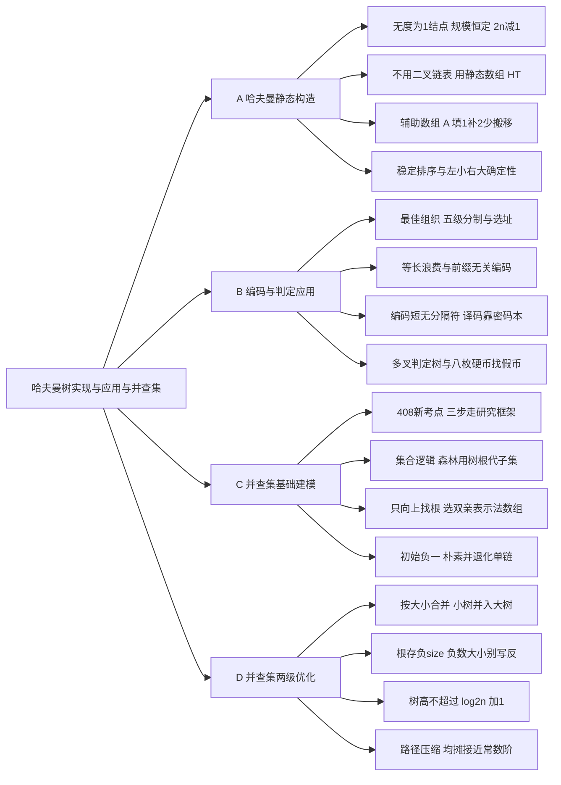
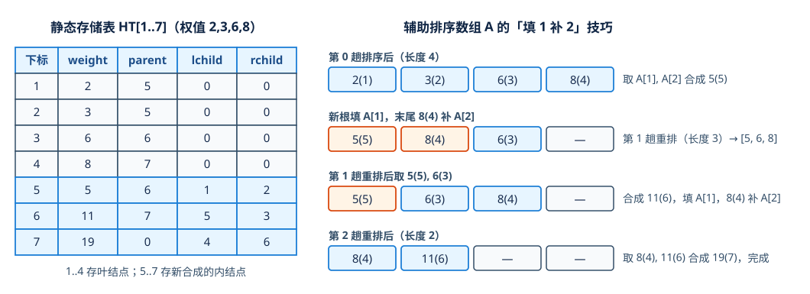
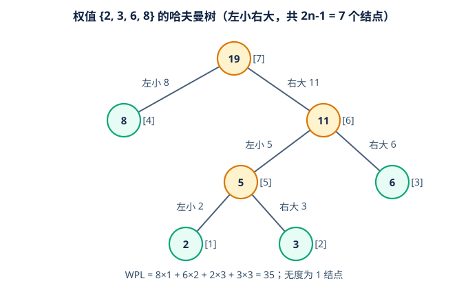
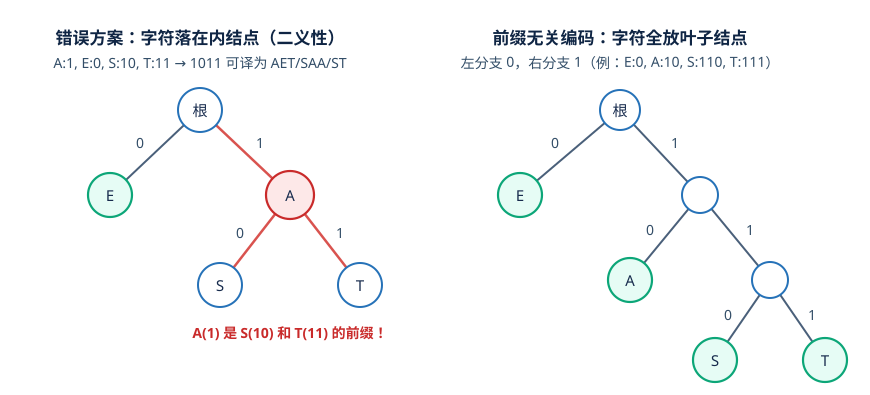
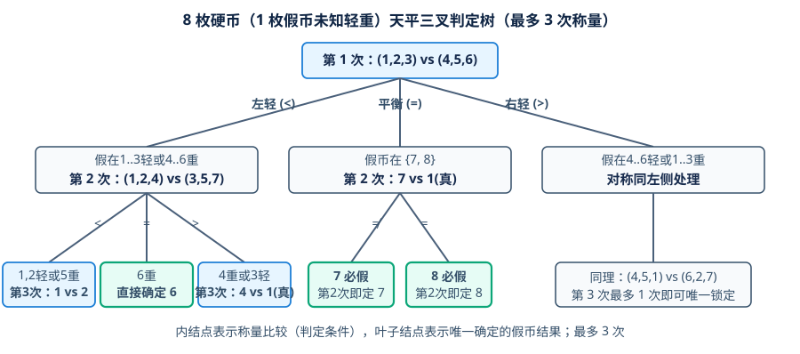
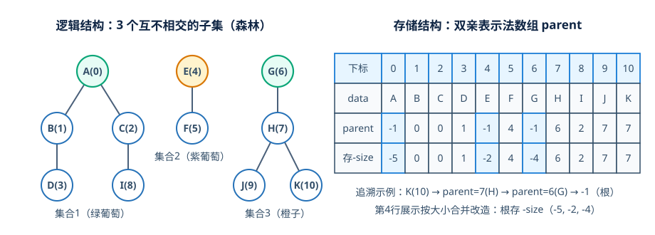
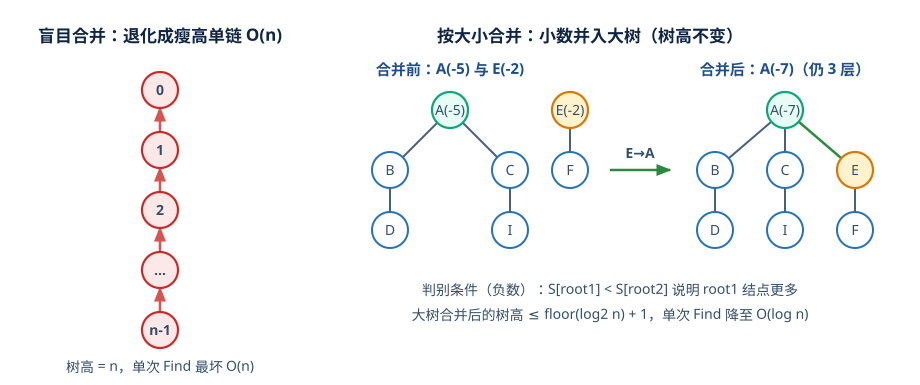
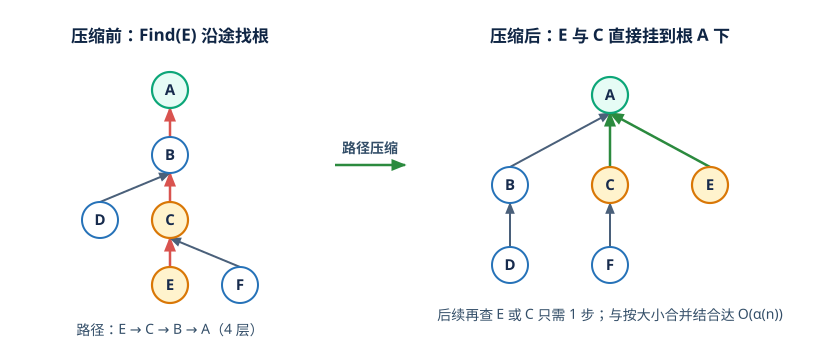

# 数据结构 · 第十一周第二节 · 哈夫曼树与并查集 · 详细版讲义

> **来源说明**：本讲义依据课堂录音的本地转写整理校订而成，属**讲授稿性质的整理稿**。全篇以**第一人称**写成——写作者就是讲授者本人，课堂上的追问、点评、板书推演与例题讲评都以「我」的口吻呈现。
>
> - **转写来源**：一份 ASR 导出文字——`哈夫曼树及并查集讲解_导出原文.txt`（约 2.46 万字，124 行），为本讲义的唯一课堂事实依据。前半段承接上一节的哈夫曼树构造思想，直接进入算法设计、静态数组存储与「花花肠子」优化，再展开最佳组织结构、哈夫曼前缀编码与判定树；后半段引入 2022 年进入 408 考研大纲的「并查集」，完成逻辑结构、双亲存储与两级优化的全套推演；结尾补充了下午期中教学交流的安排。
> - **这一节的主线**：**哈夫曼树如何从纸面算法落地成静态数组实现**（无度为 1 结点带来恒定规模 $2n-1$ → 辅助数组「填 `A[1]`、末尾补 `A[2]`」减少搬移 → `{2,3,6,8}` 全程步进与稳定排序、`左小右大` 确定性）→ **哈夫曼树的三大经典应用**（最佳组织结构如五级分制与配送中心选址 → 通信编码与前缀无关编码、为何译码更难 → 分类判定树与 8 枚硬币天平称重）→ **并查集从零建构**（森林与集合的对应 → 为什么必须选双亲表示法数组 `parent` → 朴素 `Find`/`Union` 的单链退化隐患 → 按大小合并「小数并入大树」把树高控在 $\lfloor\log_2 n\rfloor+1$ → 路径压缩与按大小合并结合，把均摊复杂度压到近似常数级的 $O(\alpha(n))$）。
> - **这一节的边界**：上一节讲过的「二叉排序树构造与删除」「路径长度 $E=I+2n$ 的推导」「`{3,5,6,7,12}` 手算选 C 与教材图 6.28 的批评」本节不再重复；并查集主要讲透核心思想、双亲数组表示、按大小合并与路径压缩的 C 实现，**图算法（如 Kruskal 最小生成树中如何调用并查集判环）留到下一章「图」再展开**；「从叶子到根逆向求编码表 `HuffmanCode`」的完整字符串回溯代码课上未逐行板书，本讲义在附录给出通行标准实现并注明范围。
> - **教材对照范围**：严蔚敏《数据结构（C语言版）》第 6 章相关主题（树的双亲表示法、树与等价问题 `MFSet`、赫夫曼树及其应用）。注意教材把并查集放在等价问题章节并用 `MFSet` 命名，而考研 408 大纲与本课统一称作「并查集」；教材把 Huffman 译作「赫夫曼」，本课与通行题库称「哈夫曼」。（因本次校订未取得教材 OCR 原文，具体小节号、图号、页码与算法编号已列在文末「待核实内容」备核。）
> - **编号说明**：我沿用的章节号比严蔚敏教材**大 1**——我的「第 7 章 树和二叉树」＝教材**第 6 章**；我的「第 10 章 查找」＝教材**第 9 章**。凡在本讲义中标注教材出处时，一律使用教材真实章节号。
> - **时间说明**：本节课为**文字模式**（无音视频轨、无关键帧），各节时间戳按**字数折算的伪时间**（约 200 字／分钟）标注，仅作讲义内部单调递增的定位坐标，不代表真实录音秒数；按转写约 2.46 万字折算，全课伪时间长约 2 小时 3 分（`00:00`～`02:03`）。
> - **示意图说明**：本节配图分两类。**开头的「总览知识地图」**使用流程图表代码块编写，Obsidian 原生渲染为矢量图；**正文里的数据结构示意图**全部是**独立手写的 SVG 矢量图片**，存放在 `数据结构/插图/` 目录下（`w112_01.svg` ～ `w112_07.svg`），正文以标准 Markdown 图片语法直接嵌入，每张图下均附「图注」，且图内所有权值、下标与字母均与正文一致。
> - **关联阅读**：[[数据结构 第十一周第一节 二叉排序树与哈夫曼树 详细版讲义]]（上一节：WPL 定义、哈夫曼算法自然语言步骤、`{2,3,6,8}` 初步手算与「左小右大」确定性原则）、[[数据结构 第九周第一节 树与二叉树 详细版讲义]]（树与二叉树的三种存储表示——双亲、孩子、孩子兄弟，以及 $n_0=n_2+1$ 性质的证明）、[[数据结构 第九周第二节 二叉树的遍历 详细版讲义]]（递归与非递归遍历基础）、[[数据结构 11月2日 树与森林的转换与线索二叉树 详细版讲义]]（森林与树的转换基础）、[[数据结构 第十周第二节 线索二叉树 详细版讲义]]（树形结构里的指针利用与前驱后继）。

## 开场导读

上一节我们把哈夫曼树的「道理」和「手算流程」讲清楚了：权值相等时完全二叉树最优，权值不等时要用哈夫曼算法——每次挑两棵根权最小的树合并、放回去、重排、重复 $n-1$ 次。但手算归手算，真要把这套逻辑写进程序里跑起来，马上就会遇到两个绕不开的问题：**树在内存里怎么存？每合并一趟就要删除两个旧根、插回一个新根还要重新排序，这中间的数组搬移开销怎么省？** 这一节的前半段，就是专门把哈夫曼算法从「纸面自然语言」真正落地成「静态存储结构与可执行代码」。

紧接着，我把哈夫曼树从「怎么造」推向「怎么用」。为什么把 `switch/case` 五级分制的判断顺序调一调就能快不少？为什么连锁超市的配送中心总要设在营业额最大的门店旁边？更核心的是**通信编码**——信息要进计算机必须先编码，而要让电文总长度最短，既不能用浪费位数太多的等长编码，也不能随便乱定不等长编码（否则接收方拆不开二义性电文）。这里我会专门拆开那个容易把人绕晕的术语坑：**所谓的「前缀编码」，英文原名是 prefix-free code，本质是「前缀无关编码」**，所有字符只能老老实实待在叶子结点上。顺着判定过程，我们还会把「分类与判定树」一块收掉，用 8 枚硬币找假币的例子说明判定树不是新结构，就是树形结构在决策分支上的直接体现。

后半节我们换一个全新又非常实用的主角——**并查集**。这是 2022 年正式进入 408 考研大纲的新考点，也是树形结构里「集合逻辑」非常典型的一次应用。我依然按研究数据结构的三步走来展开：先看逻辑结构（把互不相交的等价类看成一片森林，用树根唯一标识每个子集），再选存储结构（为什么在双亲、孩子、孩子兄弟三种方式里，非用一维数组形式的**双亲表示法**不可），最后落到**查（`Find`）**与**并（`Union`）**两个操作的实现与两轮优化。

很多人初学并查集，代码背得很快，一做题就丢分，往往栽在看似不起眼的细节上。结合这节课的课堂追问与历年常见误区，开讲前我先把**最容易丢分的三处**点出来，你们听讲时专门盯着看：

1. **哈夫曼树静态构造的下标与排序重置**：很多同学做手工构造或模拟代码时，习惯把每次合成的新结点一路往一侧挂，忘了「放回集合后还要重新排序」；在看静态表 `HT[1..2n-1]` 与辅助数组 `A` 时，又容易搞混「`A[1]` 填新根、`A[2]` 用当前末尾 `A[n-i]` 补位」的设计意图，以及为什么必须坚持「左小右大」不能中途改口径。
2. **「前缀编码」概念反直觉与译码二义性判断**：看到「前缀编码」四个字，千万别按字面理解成「一个编码是另一个的前缀」，恰好相反，它是「任何字符的编码都不是另一个字符编码的前缀」；落实到二叉树上，只要有一个字符落在内结点上，就一定违反前缀无关性。
3. **并查集按大小合并的负数比较方向与路径压缩边界**：在 `parent` 数组里，根结点存的是元素个数的**相反数**（如 5 个结点存 `-5`，2 个结点存 `-2`）。判断「谁是大树、谁是小树」时，写的是 `S[root1] < S[root2]` 才表示 `root1` 所在集合更大——负数越小，绝对值越大。把大于号、小于号写反，就会把「小数并入大树」做反成「大树并入小数」，树高照样一路飙升。

## 总览知识地图



> **图注（全课思维导图）**：这张图把本节压成四个分支。**A 分支是「哈夫曼树如何落地」**：由「无度为 1 结点」推出总结点数恒为 $2n-1$，选定静态数组 `HT`，再用辅助数组 `A` 的「填 1 补 2」技巧省掉线性表删除搬移；**B 分支是「哈夫曼树怎么用」**：从五级分制与超市选址的最佳判定组织，过渡到通信里的前缀无关编码，再到判定树与 8 枚硬币称重；**C 分支是「并查集怎么建」**：按逻辑（集合／森林）→ 存储（双亲数组）→ 基本运算（`Find`/`Union`）三步走，点明朴素合并退化成单链的风险；**D 分支是「并查集怎么快」**：靠「按大小合并（小数并入大树）」把树高控到 $O(\log n)$，再与「路径压缩」结合把均摊复杂度压到近似常数级的 $O(\alpha(n))$。

## 正文

### 一、承接上节：从哈夫曼自然语言到算法设计 `00:00-00:07`

上一节结束时，我们已经把哈夫曼树的动机和手工构造过程走通了一遍。今天一开场，我先带你们把上节课的起点快速拉直，免得直接写算法时忘了自己到底在解决什么问题。

如果所有事物在「平等」的情况下——也就是每个元素的出现概率或者重要程度完全一样，**大家权值相等**——那要让带权路径长度最短、让平均搜索效率最高，直接把它们组织成一棵**完全二叉树**就行了。这个结论我们在上一节已经验过：完全二叉树把能填的浅层位置全部塞满，没有任何一个叶子可以再往上挪，等权情形下它的路径和已经是极限。

可一旦把「权值」放进来，也就是**各个事物不再平等、权值大小不一**，再按顺序或者按完全二叉树那样平均地铺，效率就会立刻掉下来。这时候就必须用哈夫曼提出来的构造方法。我把那套自然语言步骤重新拧紧成四句话，让你们在脑子里再过一遍：

1. **各自独立**：给定 $n$ 个事物（对应 $n$ 个权值），先把每一个事物都看成一棵**只含一个根结点的独立二叉树**，于是手头上共有 $n$ 棵树。
2. **排序取两最小**：每次先把当前森林里的树按**根结点的权值从小到大排序**，然后从中**拿出两棵根权最小的树**。注意「拿出来」就意味着这两棵树从当前候选集合里**删掉了**——例如拿走权值为 `2` 和 `3` 的两棵树，原来候选集合里就没有单棵的 `2` 和 `3` 了。
3. **合成放回**：把拿出来的两棵最小树作为左、右子树，合成为一棵新的二叉树，新根结点的权值等于两棵子树根权之和（如 $2+3=5$），再把这棵**新树放回候选集合中**。
4. **重排重复 $n-1$ 趟**：每拿走两棵、放回一棵，候选集合里二叉树的总棵数就**净减少 $1$ 棵**。对 $n$ 个初始叶子而言，重复上述动作共 $n-1$ 趟，最后候选集合里只剩下一棵树，这棵树就是**哈夫曼树**。

说到这里，转折就来了。**上面这四句话叫「自然语言描述」，它离「计算机里能跑的算法」还隔着一层。** 要把它写进程序，我们立刻面临三个实打实的工程问题：

- **第一，树结点用什么存储结构？** 前面学二叉树这一章时，我再三强调过默认用「左右二叉链表」模式，但哈夫曼树偏偏反其道而行之，绝大多数教材都选用**静态数组**。这是为什么？
- **第二，每趟都要「排序—取两个—放回—再排序」，辅助结构怎么摆？** 放进数组里的不是一堆孤立的数字，而是一棵棵正在生长的子树，排序时得同时带着「权值」和「这棵树在数组里的位置」。
- **第三，拿走前两个元素后，线性表前面空出两个坑，新合成的又放回来，怎么避免每次都把后面一大串元素来回搬移？**

带着这三个问题，我们就正式进入**哈夫曼算法的设计与存储实现**。

**本节要点**

- **等权 vs 不等权**：权值相等时完全二叉树最优；权值不等时必须按哈夫曼算法构造最优二叉树。
- **自然语言四步**：各自成树 → 按根权升序排列 → 取出两棵最小树（从集合删除）合成新树并放回 → 重排并重复 $n-1$ 趟，最终剩一棵树。
- **数量守恒**：每趟取走 2 棵、放回 1 棵，森林规模净减 $1$；从 $n$ 棵变成 $1$ 棵，恰好执行 $n-1$ 次合并。
- **从想法到代码的三个核心问题**：选什么存储结构、怎么维护排序、怎么减少合并过程中的元素搬移。

### 二、为什么哈夫曼树不用二叉链表，而用静态数组 `00:07-00:16`

你们一定记得，从第九周讲二叉树开始，我反复叮嘱过：一般二叉树默认采用**二叉链表**（每个结点带 `lchild` 和 `rchild` 两个指针）。可翻开市面上绝大多数数据结构教科书——包括我们使用的严蔚敏教材 6.6.2 节——写哈夫曼树构造算法时，清一色不用动态二叉链表，而是改用**静态结构**，说白了就是用**一维数组**来存整棵树。

这可不是教材作者心血来潮换口味，而是基于**两条非常硬的原因**。

#### 2.1 理由一：哈夫曼树没有度为 1 的结点，总结点数恒定为 $2n-1$

为什么以前我们不愿意用静态数组存普通二叉树？因为普通二叉树的形态变化极大、规模往往动态增长，你事先不知道它会往哪边偏、总共会长出多少结点，强行按满二叉树开数组会像前面算过的那样浪费得一塌糊涂。

但哈夫曼树不一样。请你们顺着它的构造过程往下推：

- 每一次合并，我们都是**两两取出**两棵树，合成一棵新的二叉树。也就是说，**每一个新创造出来的内部结点，在诞生那一刻就必然同时拥有左孩子和右孩子，绝对不可能只挂一个孩子**。
- 由此直接得出哈夫曼树的一条铁律：**哈夫曼树中绝对不会出现度为 $1$ 的结点**，即 $n_1 = 0$（这类每个分支结点都恰好有两个孩子的二叉树，在离散数学和教材里也称作**正则二叉树**或**严格二叉树**）。

现在把第九周讲过的二叉树性质 3 拿出来用。对于**任意一棵二叉树**（不需要满、也不需要完全，只要是二叉树就成立），叶子结点数 $n_0$ 与度为 $2$ 的结点数 $n_2$ 永远满足：

$$
n_0 = n_2 + 1
$$

在哈夫曼树里，最初给定的 $n$ 个事物（带着各自权值）在合并过程中只被当作子树挂到别人下面，从来不会在它们底下再挂新结点，所以**原始的 $n$ 个信息全都稳稳落在叶子结点上**，即：

$$
n_0 = n
$$

由 $n_0 = n_2 + 1$ 立得度为 $2$ 的结点数（也就是合并过程中新生成的内部结点数）：

$$
n_2 = n_0 - 1 = n - 1
$$

再加上刚才证明的 $n_1 = 0$，整棵哈夫曼树的总结点数 $m$ 为：

$$
m = n_0 + n_1 + n_2 = n + 0 + (n - 1) = 2n - 1
$$

你看，**只要原始事物的个数 $n$ 一旦给定，这棵哈夫曼树最终有多少个结点就彻底锁死了，不多不少，恒定是 $2n - 1$ 个**。规模完全确定、运行时不会再多长出第 $2n$ 个结点，用静态数组一口气把这 $2n-1$ 个位置开出来，既不会溢出，也几乎没有空间浪费（最多算上 0 号单元留空不用，也只占 $2n$ 个结构体空间）。

#### 2.2 理由二：照顾早期与科学计算语言的「无显式指针」现实

第二个理由站在编程语言的视角。我们学 C 语言习惯了 `*` 和 `->`，总觉得动态链式结构用指针天经地义。可放眼整个计算机程序设计语言家族，**并不是所有语言都像 C/C++ 那样提供明晃晃的显式指针**。像工程计算常用的 **MATLAB**，或者历史上极其重要的科学计算语言 **Fortran**（转写中误作 `fortu`），它们本身就不直接支持显式指针操作（顶多通过下标或间接引用实现类似效果）。

如果把哈夫曼树设计成静态数组：

- 把最初的 $n$ 个叶子结点依次放进数组的 `1 ~ n` 号下标位置；
- 后面每一趟新合成的内部结点，依次放进后面的 `n+1 ~ 2n-1` 号下标位置；
- 用**数组下标（整型游标）**来代替 `lchild`、`rchild`（需要从叶子回溯到根求编码时再加一个 `parent` 域），比如 `0` 表示空指针 `NULL`，`5` 表示指向下标 `5` 的结点。

这样一来，不需要任何显式指针、`malloc` 只需一次或直接声明静态数组，**几乎所有主流编程语言都能照着同一套逻辑写出来**。

顺便提醒一句：C 语言静态表里的静态结点结构，在教材 6.6.2 节定义如下（为清晰起见，这里写出带中文注释的对应结构体）：

```c
/* 哈夫曼树的静态三叉链表（顺序表存储）结点定义 */
typedef struct {
    unsigned int weight;               /* 结点权值 */
    unsigned int parent, lchild, rchild; /* 双亲、左孩子、右孩子在数组中的下标（0 表示空） */
} HTNode, *HuffmanTree;
```

下标 `1..n` 存原始叶子，下标 `n+1..2n-1` 存每次合并新生成的内部结点，合计 $2n-1$ 个有效单元（习惯上 `0` 号单元空出，用作「空指针」哨兵标记，这样申请长度为 $2n$ 的数组即可）。

**本节要点**

- **无度为 1 结点**：因为哈夫曼算法每次都是两两合并，所以 $n_1 = 0$。
- **总结点数恒为 $2n-1$**：由 $n_0 = n$ 和任意二叉树恒等式 $n_0 = n_2 + 1$，推得 $n_2 = n - 1$，故总结点数 $m = n + 0 + (n - 1) = 2n - 1$。
- **采用静态数组的两大理由**：一是规模在建树前就已经彻底确定，静态分配刚好不浪费也不溢出；二是许多编程语言（如 MATLAB、Fortran）不支持显式指针，用整型下标当「游标指针」通用性更强。
- **区间分工**：静态数组 `HT[1..2n-1]` 中，前 `1..n` 号单元存叶子，后 `n+1..2n-1` 号单元存合并产生的内结点，`0` 表示空。

### 三、辅助数组与那个减少搬移的「花花肠子」 `00:16-00:26`

存储结构定下来了，静态数组 `HT[1..2n-1]` 摆在那里，下一步立刻撞上算法核心里的那句话：**「每次对当前所有的树按权值从小到大排序，取出最小的两棵」**。

问题来了：**怎么排序？直接把 `HT` 数组自己拿来排序行不行？**

绝对不行！因为 `HT[1..n]` 里的下标本身就是「地址」，后面新合成的结点要靠下标记录自己的 `lchild` 和 `rchild` 分别是几号。你如果直接去交换 `HT` 数组里元素的位置，孩子的下标地址全乱套了，这棵树当场散架。

所以，为了排序而不打乱树结点在 `HT` 里的固定位置，我们必须单独开一个**辅助数组 $A$**（或者说排序索引表）。这个辅助数组里的每个元素只需存两样东西：

1. **当前这棵二叉树根结点的权值**（作为排序比较的关键字 `weight`）；
2. **这棵二叉树根结点在 `HT` 数组中的下标位置**（作为找回这棵树的指针替代品 `index`）。

注意：以前用动态链式结构时，辅助数组里存的可能是指向树根的指针；现在用静态数组 `HT`，辅助数组里存的就是它在 `HT` 中的**整型下标**。

#### 3.1 照直了写为什么会多出两次 $O(n)$ 搬移？

很多书上的伪代码写到这儿，看着平平无奇，可真落到辅助数组 `A[1..n]` 的操作上，如果你不理解作者动的小心思，读代码时会觉得莫名其妙。我把这层「花花肠子」给你们扒开看。

假设现在 `A[1..n]` 已经按权值从小到大排好序了，最小的两棵树稳稳待在最前面——`A[1]`（比如权值 `2`）和 `A[2]`（比如权值 `3`）。按自然语言描述，下一步我们要拿走 `A[1]` 和 `A[2]`：

1. **拿走引发的第一次大搬移**：`A` 是一个顺序存储的线性表。把最前面的 `A[1]` 和 `A[2]` 拿走后，数组最前面就空出了两个洞。按照顺序表的规矩，为了保持「连续存储」的结构一致性，你是不是得立马把后面的 `A[3] ~ A[n]` 共 $n-2$ 个元素**统统往前移动两个位置**？这是一次 $O(n)$ 级别的大规模元素搬移。
2. **放回引发的第二次大搬移**：好不容易往前挪完了，新合成了一棵权值为 `5` 的树，你又得把它放回 `A` 里，并让 `A` 恢复有序。哪怕利用「前面 $n-2$ 个已经有序」这个便利，用一趟直接插入排序把新元素插到正确位置，最坏情况下还是得把前面那堆元素往后挪一格，这又是第二次 $O(n)$ 级别的元素搬移（如果要彻底重排，或者实现得不巧，搬移量更大）。

每次合并都要折腾两次大片元素移动，虽然量级上是 $O(n^2)$，但写起来既啰嗦又白白折腾下标。有没有办法把其中那次「删除前两个导致的整体前移」直接省掉？

#### 3.2 「填 `A[1]`、末尾补 `A[2]`」的省力技巧

教材和经典实现里，就在这儿耍了一个非常巧妙的小花招：

**既然你刚把 `A[1]` 和 `A[2]` 拿走，最前面恰好空出两个位置；而这一趟合并的结果，正好又会新生成一个元素（新树的根），同时整体有效长度必定从 $k$ 缩减为 $k-1$（最后那个位置下轮肯定用不着了）——那何必先把后面 $n-2$ 个元素集体前移呢？直接就地填坑！**

具体做法只有两步：

1. **新根直接填进 `A[1]`**：把刚合并生成的新二叉树（权值、新下标）直接覆盖写进 `A[1]`；
2. **当前末尾直接补进 `A[2]`**：把当前有效序列的最后一个元素 `A[n-i]`（也就是当前还未合并的倒数第一号位置）直接搬到 `A[2]` 补位！

你们仔细想一想，**为什么可以把最后一个元素直接挪到 `A[2]` 这么干？**

因为每一趟哈夫曼操作都会**拿走 2 棵、放回 1 棵**，候选森林的元素个数**严格减 $1$**。本来有效区间是 `1 .. len`，这趟做完后，有效区间必然缩短为 `1 .. len - 1`，原来的第 `len` 号位置**往后永远再也用不上了**。与其把 `3 .. len` 这 $len-2$ 个元素集体往前挪两格、再从头腾地方插新根，不如干脆把即将废弃的第 `len` 号元素「提溜」到 `A[2]`，把新元素丢进 `A[1]`，然后直接对 `A[1 .. len - 1]` 这一段做排序（或者只需调整 `A[1]` 和 `A[2]` 两个乱序元素的位置即可）。

这样一来，两步之内就瞬间维持住了顺序表的**连续存储结构一致性**，一个多余的批量前移都没发生，逻辑上也干净利落！



> **图注（静态表 `HT[1..7]` 与辅助数组 `A` 的「填 1 补 2」过程）**：左表是 `{2,3,6,8}` 构造完毕后的静态三叉链表 `HT[1..7]`，叶子占据 `1..4`，内结点依次填入 `5..7`；右图展示了辅助数组 `A`（括号内为 `HT` 下标）的三轮状态变化——每取走 `A[1]` 与 `A[2]`，新根直接写回 `A[1]`，当前有效区间末尾元素直接补进 `A[2]`，有效长度严格减 1，彻底省去了删除表头时的全体前移。

**本节要点**

- **不能直接对 `HT` 排序**：`HT` 的下标承担着指针地址的作用，交换 `HT` 元素位置会破坏孩子下标引用。
- **辅助数组 `A`**：每个单元存放「根结点权值」和「根结点在 `HT` 中的下标」，专用于排序和挑选最小两棵树。
- **朴素删除的痛点**：直接拿走 `A[1]`、`A[2]` 后若按线性表常规删表头，需把后面 $n-2$ 个元素全体前移，放回新根又可能整体后移，产生两次大量搬移。
- **「填 1 补 2」技巧**：利用每趟规模必然减 1 的性质，新根直接写入 `A[1]`，当前最后一个有效元素直接搬到 `A[2]`，再对缩短后的区间排序，既保持连续存储又免去全体前移。

### 四、用 2、3、6、8 走一遍静态构造与代码骨架 `00:26-00:35`

光说技巧容易飘，咱们直接拿上一节刚算过的那组熟悉数据——**`{2, 3, 6, 8}`**（共 $n=4$ 个权值）——把静态表 `HT[1..7]` 和辅助数组 `A[1..4]` 的每一步状态仔细走一遍，再把完整 C 代码写出来。

#### 4.1 步进推演：`{2, 3, 6, 8}` 如何填满 `HT[1..7]`

**初始化（读入 $n=4$ 个叶子）**：

将权值 `2, 3, 6, 8` 依次存入 `HT[1..4]`，它们的 `parent, lchild, rchild` 全置 `0`；同时把这 4 棵单结点树登记到辅助数组 `A[1..4]` 中（这里记作 `权值(HT下标)`）：

- 初始 `A[1..4]`（此时输入恰已有序，若无序则先排一遍）：`[ 2(1), 3(2), 6(3), 8(4) ]`，当前有效长度 `len = 4`。

**第 1 趟（$i = 0$，新结点存入 `HT[n+1+i] = HT[5]`，当前有效长度为 `4 - 0 = 4 ≥ 2`）**：

1. 排序后最小两棵是 `A[1] = 2(1)` 和 `A[2] = 3(2)`。
2. 生成新结点 `HT[5]`：
   - `HT[5].weight = 2 + 3 = 5`；
   - `HT[5].lchild = 1`（权 `2`），`HT[5].rchild = 2`（权 `3`）；
   - 同时回填双亲：`HT[1].parent = 5`，`HT[2].parent = 5`。
3. 辅助数组「填 1 补 2」：
   - 新根 `5(5)` 填入 `A[1]`；
   - 当前最后一个有效元素 `A[4] = 8(4)` 补进 `A[2]`；
   - 此时 `A[1..3]` 变为 `[ 5(5), 8(4), 6(3) ]`，有效长度缩为 `3`。

**第 2 趟（$i = 1$，新结点存入 `HT[6]`，当前有效长度为 `3 ≥ 2`）**：

1. 先对 `A[1..3]` 按权值升序重排，得到 `[ 5(5), 6(3), 8(4) ]`（**注意看：刚才补到 `A[2]` 的 `8(4)` 已经靠排序退回到了第 3 位，现在排前两位的是 `5(5)` 和 `6(3)`！**）。
2. 取出 `A[1] = 5(5)` 和 `A[2] = 6(3)`，生成新结点 `HT[6]`：
   - `HT[6].weight = 5 + 6 = 11`；
   - `HT[6].lchild = 5`（权 `5`），`HT[6].rchild = 3`（权 `6`）；
   - 回填双亲：`HT[5].parent = 6`，`HT[3].parent = 6`。
3. 辅助数组「填 1 补 2」：
   - 新根 `11(6)` 填入 `A[1]`；
   - 当前最后一个有效元素 `A[3] = 8(4)` 补进 `A[2]`；
   - 此时 `A[1..2]` 变为 `[ 11(6), 8(4) ]`，有效长度缩为 `2`。

**第 3 趟（$i = 2$，新结点存入 `HT[7]`，当前有效长度为 `2 ≥ 2`）**：

1. 对 `A[1..2]` 按权值升序重排，得到 `[ 8(4), 11(6) ]`（注意：`8` 小于 `11`，所以 `8(4)` 排在 `A[1]`，`11(6)` 排在 `A[2]`！）。
2. 取出 `A[1] = 8(4)` 和 `A[2] = 11(6)`，生成最终根结点 `HT[7]`：
   - `HT[7].weight = 8 + 11 = 19`；
   - `HT[7].lchild = 4`（权 `8`），`HT[7].rchild = 6`（权 `11`）；
   - 回填双亲：`HT[4].parent = 7`，`HT[6].parent = 7`。
3. 辅助数组「填 1 补 2」：
   - 新根 `19(7)` 填入 `A[1]`；此时有效长度变成 $4 - 3 = 1 < 2$，循环结束！

你们看最后一棵根 `HT[7]` 的结果：权值 `19`，左孩子是 `4` 号位置（权 `8`），右孩子是 `6` 号位置（权 `11`）；顺着 `6` 号再往下，左孩子 `5` 号（权 `5`）、右孩子 `3` 号（权 `6`）；再顺着 `5` 号往下，左孩子 `1` 号（权 `2`）、右孩子 `2` 号（权 `3`）。**倒着一层层展开，与上一节手算的树形完全重合！**



> **图注（`{2,3,6,8}` 静态构造最终树形）**：圆圈内为权值，旁注方括号为在静态数组 `HT[1..7]` 中的下标。每一层分支严格满足「左小右大」（$2<3$，$5<6$，$8<11$），总带权路径长度 $WPL = 8\times 1 + 6\times 2 + 2\times 3 + 3\times 3 = 35$。

#### 4.2 静态构造代码实现与两个纪律提醒

下面把刚才这套「辅助数组 + 填 1 补 2」的算法完整写成 C 代码（用循环控制 $i$ 从 $0$ 到 $n-2$，循环条件等价于 `n - i >= 2`）：

```c
#include <stdio.h>
#include <stdlib.h>

typedef struct {
    int weight;
    int parent, lchild, rchild;
} HTNode, *HuffmanTree;

/* 辅助排序数组元素：存根结点权值与它在 HT 中的下标 */
typedef struct {
    int weight;
    int idx;
} AuxNode;

/* 稳定排序（这里用简单插入排序/冒泡排序保证稳定性）：对 A[1..len] 按 weight 升序排列 */
void StableSort(AuxNode A[], int len) {
    for (int i = 2; i <= len; i++) {
        AuxNode key = A[i];
        int j = i - 1;
        /* 严格大于才后移，相等时不交换，从而保证稳定排序 */
        while (j >= 1 && A[j].weight > key.weight) {
            A[j + 1] = A[j];
            j--;
        }
        A[j + 1] = key;
    }
}

/* 构造含 n 个叶子的哈夫曼树，结果存入静态数组 HT[1..2n-1] */
HuffmanTree CreateHuffmanTree(const int w[], int n) {
    if (n <= 0) return NULL;
    int m = 2 * n - 1;
    HuffmanTree HT = (HuffmanTree)malloc((m + 1) * sizeof(HTNode));
    AuxNode *A = (AuxNode *)malloc((n + 1) * sizeof(AuxNode));

    /* 1. 初始化 1..n 号叶子结点，并登记到辅助数组 A */
    for (int i = 1; i <= n; i++) {
        HT[i].weight = w[i - 1];
        HT[i].parent = HT[i].lchild = HT[i].rchild = 0;
        A[i].weight = w[i - 1];
        A[i].idx = i;
    }
    /* 初始化 n+1..2n-1 号内部结点 */
    for (int i = n + 1; i <= m; i++) {
        HT[i].weight = HT[i].parent = HT[i].lchild = HT[i].rchild = 0;
    }

    /* 2. 当剩余二叉树棵数 n - i >= 2 时，反复合并 */
    for (int i = 0; n - i >= 2; i++) {
        int curLen = n - i;
        StableSort(A, curLen);                     /* 对当前 curLen 棵树按权值稳定排序 */

        int s1 = A[1].idx;                         /* 最小树下标 */
        int s2 = A[2].idx;                         /* 次小树下标 */
        int newPos = n + 1 + i;                    /* 新根写入静态表 HT 的位置 */

        HT[newPos].weight = HT[s1].weight + HT[s2].weight;
        HT[newPos].lchild = s1;                    /* 坚持左小右大：A[1] 作左，A[2] 作右 */
        HT[newPos].rchild = s2;
        HT[s1].parent = newPos;
        HT[s2].parent = newPos;

        /* 3. 填 1 补 2：新根放回 A[1]，当前末尾 A[curLen] 补进 A[2] */
        A[1].weight = HT[newPos].weight;
        A[1].idx = newPos;
        if (curLen > 2) {
            A[2] = A[curLen];
        }
    }

    free(A);
    return HT;
}
```

写完这段代码，我必须再敲一遍黑板，强调两个地方：

1. **为什么代码注释里特意写「稳定排序」？**
   什么是「稳定的排序算法」？简单说，就是两个权值相等的元素，排序前谁在前面，排序后相对先后次序不变（第 9 章／教材第 8 章排序会专门细讲）。在现实社会里，稳定才能让人安心过日子，战火纷飞时谁也安生不了；在算法里也一样，遇到相同权值时，稳定的排序才能确保每一次合并哪棵树排在 `A[1]`、哪棵树排在 `A[2]` 是完全可预测的。
2. **为什么一定要「`lchild = A[1]`、`rchild = A[2]`」（左小右大）？**
   课上我再一次把教材的「左右不统一」拎出来批评了：排完序后 `A[1] <= A[2]`，你从辅助数组取左、右孩子时，**不可能靠意念同时抓住两个，必然先取 `A[1]` 作为左孩子，再取 `A[2]` 作为右孩子**。算法有一个基本性质叫**确定性**——同一步骤、同样条件下只能有一条执行路径，绝不可能前一步「小的放左边」，下一趟突然心血来潮把「大的放左边、小的放右边」。坚持「左小右大」全程一贯到底，构造出来的二叉树才是算法真正执行的唯一结果。

（注：当然，在更高效率的实现里，辅助数组 `A` 还可以直接换成**最小堆 / 优先队列**，每次取堆顶两次、合并后插回一次，可以把总排序开销从 $O(n^2)$ 或 $O(n^2 \log n)$ 降到 $O(n \log n)$；但考试手算与教材基础版理解，先把上面这套「数组 + 填 1 补 2」吃透就足够了。）

**本节要点**

- **`{2,3,6,8}` 步进轨迹**：`[2,3,6,8]` → 合成 `5` 填 `A[1]`、`8` 补 `A[2]` 得 `[5,8,6]` → 排序 `[5,6,8]` → 合成 `11` 填 `A[1]`、`8` 补 `A[2]` 得 `[11,8]` → 排序 `[8,11]` → 合成 `19`，存入 `HT[7]`。
- **循环终止条件**：剩余棵数 `n - i >= 2` 时继续；当只剩 1 棵树（`n - i == 1`）时结束。
- **稳定排序的意义**：当存在权值相等的结点时，稳定排序保证它们的相对先后顺序不乱跳，使构造过程可复现。
- **确定性原则**：程序按顺序先取 `A[1]` 挂左子树、再取 `A[2]` 挂右子树，天然贯彻「左小右大」，绝不会中途调换左右。

### 五、最佳组织结构：从五级分制到超市供货中心 `00:35-00:44`

静态构造讲完，接下来下半段讲哈夫曼树的**应用**。这玩意儿可不只是考试里让你算几道 `WPL` 的纸面体操，它在工程与生活里到处都是影子。

#### 5.1 最佳组织结构：五级分制 `switch/case` 怎么改顺序

你们还记得前面第二章讲线性表和分支控制时，我举过一个把百分制成绩转换成 `A, B, C, D, E` 五级分制的 `if-else` / `case` 语句例子吧？

如果从某一段分数一路挨个往下问，代码行数虽然完全一样，但因为学生成绩通常集中在中间较常见的几个分数段（例如 `70~89` 分），大量数据都要连过好几道关卡才能判定出来。可一旦我们把各分数段出现的**比例当成权值**，按哈夫曼思想把出现最频繁的分数段放到离根最近的位置，把代码里的判断分支顺序颠倒调整一下，代码量一个字节没多写，**平均比较次数和判定效率就会大大提高**（具体示例的分数段分布比例与比较次数对照留待纸质教材核实）。

这就是哈夫曼树的第一个大类应用——**最佳组织结构（最优测试顺序 / 最佳检索结构）**。就像前面讲过的「两个人编了两本书，看谁编的书目录检索效率高」，比的也是同样一件事：把查得最多的内容放到最浅的层，把冷门内容放到深层。

#### 5.2 选址问题：连锁超市供货中心放哪儿，与为什么大厂爱把分公司放西安

再给你们看一个更贴近现实商业的例子。假如你在兰州开连锁超市——比如全市有十几二十家甚至好几十家华联超市，它们共用一个统一的**供货中心（配送仓库）**。现在问你：如果各家门店的进货频率、营业额度不一样，这个供货中心选在什么位置总运输代价最低？

道理跟哈夫曼树一模一样：**把每家门店的营业额度／补货频次看成权值**，权值越大，就越应该让它离「根」（供货中心）越近——甚至直接把供货中心建在**营业额最大的那家核心门店旁边**！这样一来，无论是高频补货还是日常调拨，跑在主干路上的总体路程成本才是最低的，整个系统的周转效率才最高。

说到选址和商业布局，我顺便多聊几句你们将来毕业找工作会亲眼见到的现象。国内很多大型 IT、通信公司在各省会城市都会设总公司直属的二级分公司，**但兰州往往是个例外**。除了方正等少数公司在兰州设有直属二级机构外，像华为、联想这样的大厂，大多在兰州没有直属二级分公司。

以后你们毕业跑校招就会发现：华为、联想过来招人，常常是**从西安派人过来**。为什么人家把西北的二级直属分公司设在西安，而不是兰州？背后其实也是商业成本与「权值」在起作用：

- 从销售总额度来看，西安一座城市的销售额往往顶得上甘肃、青海、宁夏三省区之和，总公司把资源「根结点」放到西安，离大权值市场最近，最为划算；而新疆因为涉及边境口岸与出口贸易的特殊体量，也单设了直属分公司。
- 反观兰州本地的消费市场结构有些特殊：一方面总消费体量偏小，养不起高规格直属机构；另一方面本地用户其实**非常挑剔**——你看城关区这一片，集中了寒旱所（注：转写误作「韩寒所」，实为中国科学院西北生态环境资源研究院前身之一寒旱所）、510 所、沙漠所、物化所以及兰州大学等大批科研院所，高级知识分子密度在全国都算高的。知识面广、对产品性能和技术指标抠得细，可总采购盘子又不够大，从总公司的投入产出比来算，把二级直属机构放在西安、由西安辐射甘青宁，就是最合理的资源组织方式。

（当然，这段行业观察只是帮你们理解「资源按权值布局」的现实逻辑，不属于考试考点。）

**本节要点**

- **最佳组织结构**：把各分支出现频率当作权值，按哈夫曼思想调整判定顺序（如五级分制成绩转换），不增加代码量即可大幅减少平均比较次数。
- **物流与选址直觉**：连锁超市的配送中心要靠近营业额最高的门店，本质也是「权大者离根近」。
- **现实联想**：大型企业设置区域直属分公司同样看重区域「权值」（销售额度与市场辐射成本），这也是西北区域中心常设在西安的原因。

### 六、通信编码的起点：等长编码为什么浪费 `00:44-00:52`

在所有应用里，哈夫曼树最经典、考试最爱考的场景，当属**通信编码**。

把以前画过的信息流转图再拉出来看一遍：

$$
\text{现实世界} \xrightarrow{\;\text{编码}\;} \text{计算机（0 / 1 序列）} \xrightarrow{\;\text{传输}\;} \text{接收端} \xrightarrow{\;\text{解码}\;} \text{现实世界}
$$

计算机是个只认 `0` 和 `1` 的死脑筋——它既不认识字母 `A`、`B`，也不认识一段语音波形或一张照片。现实世界里的任何信息，必须先通过**编码**变成二进制比特流，计算机才能存储、处理与传输；到了接收方，再用**同一套密码本（编码方案）**反向**解码**，还原回现实世界能看懂的文字或声音。

#### 6.1 从电报到字符编码：怎么让一段话占的位数最少

大家都看过谍战片吧？报务员坐那儿「滴滴答、滴滴答」发报，靠电流通断发出长短信号，这背后就是摩尔斯电码，本质也是二进制符号的组合。现在我们提一个非常具体的通信问题：

> 假设要发送一段总长为 **58 个字符** 的文本，统计发现这段话里翻来覆去其实只用到了 **7 种不同的字符**（转写中提到的有 `A`、`E`、`I`、`T`、空格、换行等，第 7 个字符及各自出现次数原转写未全部念全），而且这 7 个字符出现的次数各不相同。请问：**怎么给这 7 种字符编码，才能让发出去的总二进制位数最小？**

我们先拿计算机最省事的默认办法试一试——**等长编码**。

1. **用现成的 ASCII 码（转写误作「阿斯 I 玛」「2 什码」）**：
   因为现代计算机诞生在欧美，欧美制定的字符编码标准 **ASCII 码**（美国信息交换标准代码）就成了微机和小型机事实上的通用标准（顺带提一句，早期大型机如 IBM 大型主机不用 ASCII，常用 **EBCDIC 码**，转写误作 `ebc DAC`）。标准 ASCII 码规定，**每个字符固定占 1 个字节，即 8 个二进制位**。按这个标准，58 个字符一共需要：
   $$
   58 \times 8 = 464 \text{ 位}
   $$
   （转写中说「400 多位」，精确算正是 464 位。）
2. **改成紧凑的 3 位等长编码**：
   可仔细一想，这段文本里总共才出现 **7 种**字符，完全用不着 8 位去覆盖 256 个符号！因为 $2^3 = 8 \geqslant 7$，**只要每个字符用 3 个二进制位**（如 `000` 到 `110`），就足以把 7 种字符全部分开。这样一来，58 个字符的总长度立刻降到：
   $$
   58 \times 3 = 174 \text{ 位}
   $$
   比刚才整整省了将近三分之二！

#### 6.2 为什么要拼命缩短编码位数？

在谍战片里，你们常看到地下工作者开着车出去秘密发电报，发完立刻撤离，紧接着敌人就开着无线电测向车满大街搜信号。为什么发报员多待一秒都危险？

因为**无线电电磁波是开放信道，它不分敌我**——只要你按下电键发出去，不仅己方能收到，敌方的监听站也能同时截获并开始三角定位。所以，**你的电文二进制位数越少，发报耗时就越短，暴露的风险就越低，你就越安全**。放到今天的互联网和移动通信里，位数越少就意味着带宽占用越小、传输越快、流量与存储成本越低。

既然 3 位等长编码能把 464 位压到 174 位，那我们自然要继续追问：**174 位到头了吗？还能不能再压短？**

答案是**能**——但前提是放弃「人人平等的 3 位」，改用**不等长编码**：让出现次数极高的常见字符（如空格、`E`、`T`）只用 1 位或 2 位，让难得露一次面的生僻字符用 4 位或 5 位，靠「高频短、低频长」把加权总位数进一步拉低。

**本节要点**

- **通信闭环**：现实世界 $\to$ 编码 $\to$ 二进制存储与传输 $\to$ 同方案解码 $\to$ 现实世界。
- **编码长度基准**：微机通用 **ASCII 码**（大型机常用 **EBCDIC 码**），每字符 8 位，58 个字符需 $464$ 位；若仅区分 7 种字符，改用 $\lceil\log_2 7\rceil = 3$ 位等长编码只需 $174$ 位。
- **缩短码长的价值**：在开放无线电信道中减少发报时长（提升隐蔽安全），在现代通信中节省带宽与存储空间。
- **下一步突破口**：既然 7 种字符频率不同，想要比 174 位更短，就必须走向**不等长编码**。

### 七、不等长编码的坑与「前缀编码」的翻译乌龙 `00:52-01:01`

不等长编码听起来美好，可如果拍脑袋随便编，马上会掉进一个大坑。

#### 7.1 随堂试错：为什么 `A:1, E:0, S:10, T:11` 会译不出来

假设我手头有 `A, E, S, T` 四个字符，我拍脑袋给它们定了一套不等长编码：

$$
A \mapsto \text{1}, \qquad E \mapsto \text{0}, \qquad S \mapsto \text{10}, \qquad T \mapsto \text{11}
$$

编码看着确实很短，可现在我发给对方一串二进制电文 **`1011`**，然后出一道课堂选择题问你们：**下面四个字符串中，哪一个的编码「不是」 `1011`？**（课堂上喊了一位第三排靠窗走神的同学回答，选出了正确选项 D；因为原题其余三个选项字母序列未在转写中全部念出，我这里把能拼出 `1011` 的全部合法拆法列给你们看，你们自己就能一眼看穿问题所在）：

- 拆成 `1 | 0 | 1 | 1` $\implies$ 对应 **`A E A A`**；
- 拆成 `1 | 0 | 11` $\implies$ 对应 **`A E T`**；
- 拆成 `10 | 1 | 1` $\implies$ 对应 **`S A A`**；
- 拆成 `10 | 11` $\implies$ 对应 **`S T`**。

（反过来，如果某个选项是像 `A T` 这样编码为 `111`，或者 `T A` 编码为 `111` 的串，那自然就不是 `1011`。）

问题太严重了！你高高兴兴发过去一个 **`1011`**，结果接收端拿着密码本一拆，发现 **`AET`、`SAA`、`ST`、`AEAA` 全都对应 `1011`**！到底是发了 `ST` 还是发了 `AET`？接收方根本解不开。这种现象在编码理论里叫**译码二义性**——一旦存在二义性，这套编码方案再短也是废纸一张。

#### 7.2 中文翻译的大乌龙：什么是「前缀编码」

怎么彻底消除二义性？教材给出的条件叫做**前缀编码（Prefix Code）**。

这里我必须专门停下来，替你们把一个**极其反直觉的中文翻译错误**挑明。很多同学一看到「前缀编码」四个字，脑子里本能地以为：「哦，前缀编码就是一个字符的编码是另一个字符的前缀」——**大错特错！正好反了！**

为什么会这样？因为当年把英文术语往中文翻的时候翻岔了。这个概念在英文原版教材里叫：

$$\text{Prefix-free code}$$

看见后面的 **`-free`** 了吗？就像 sugar-free 是「无糖」、duty-free 是「免税」一样，**prefix-free code** 的准确意思应该是**「无前缀编码」**或**「前缀无关编码」**——即**任何两个字符之间，谁的编码都不能是另一个人编码的开头（前缀）**。

只可惜早期译文把后面的 `-free` 丢了，翻成了「前缀编码」，结果几十年来教材、考题都跟着「将错就错」沿用了这个名字。你们看选择题或者简答题时，**脑子里务必自动把「前缀编码」翻译成「前缀无关编码」**，千万别被字面意思带沟里去！

#### 7.3 放到二叉树上：把字符全部赶到叶子结点去

我们把刚才那套出错的编码 `A:1, E:0, S:10, T:11` 画成一棵二叉树（约定**左分支标 `0`，右分支标 `1`**），二义性的根源立刻原形毕露：

- 从根往左走一步（`0`），到叶子 **`E`**；
- 从根往右走一步（`1`），停在这里就是 **`A`**；
- 可是从 **`A`** 继续往下走，左分支（`10`）是 **`S`**，右分支（`11`）是 **`T`**！

你看，**字符 `A` 蹲在了一棵子树的「内部结点」上，它正好挡在了从根通往 `S` 和 `T` 的必经之路上！** 在树形结构上，「某字符的编码是另一个字符编码的前缀」完全等价于**「这个字符落在另一个字符从根出发的路径中间（即它不是叶子结点）」**。

既然病根找着了，药方也就一句话：**禁止在内结点存放任何要编码的字符，把所有待编码的字符全部赶到叶子结点上！**

在二叉树里，从根到每一片叶子的路径都互不相同，**没有任何一片叶子会落在另一片叶子的路径中间**。因此，**只要所有待编码字符全都在叶子结点上，左分支标 `0`、右分支标 `1`，得到的编码就天然满足「前缀无关」，绝对不会有任何二义性！**



> **图注（前缀冲突与前缀无关编码二叉树）**：左图画出 `A:1, E:0, S:10, T:11`，字符 `A` 位于内部结点 `1` 上，挡在通往 `S(10)` 和 `T(11)` 的路径中间，导致 `1011` 出现多重译法；右图将所有字符全部放到叶子结点上（例如 `E:0, A:10, S:110, T:111`），任意两片叶子互不经过对方路径，彻底消除译码二义性。

**本节要点**

- **二义性案例**：`A:1, E:0, S:10, T:11` 下，`1011` 可拆出 `AET`、`SAA`、`ST`、`AEAA`，无法唯一译码。
- **术语纠偏**：英文原名是 **prefix-free code**，准确含义是**前缀无关编码**（任一字符编码都不是另一字符编码的前缀），切勿被「前缀编码」的中文简写误导成反义。
- **树上判据**：一个字符编码是另一个的前缀 $\iff$ 前者落在后者的根到叶路径上（即占用了内部结点）。
- **无二义性构造法**：将全部待编码字符放到二叉树的**叶子结点**上，约定左分支 `0`、右分支 `1`，即得绝对无二义性的前缀无关编码。

### 八、用哈夫曼树造最短编码：译码难与图灵的故事 `01:01-01:11`

把所有待编码字符都放在叶子上之后，新的优化问题马上接上来：**同样是把 $n$ 个字符摆在叶子上，有的树把大家全塞成完全二叉树（比如 4 个字符 `00, 01, 10, 11`，或者更多字符按等长算），有的树把高频字符拽到浅层、低频字符沉到深层。哪一种发出去的电文总位数最短？**

答案我们已经证明过了：设字符 $i$ 在电文中出现次数为 $w_i$，编码长度为 $l_i$（即叶子到根的路径边数），电文总位数就是：

$$
\text{电文总长度} = \sum_{i=1}^{n} w_i \, l_i = WPL
$$

要让 $\sum w_i l_i$ 最小，**以各字符出现频次作为权值构造出来的哈夫曼树，就是使得二进制前缀编码电文总长最短的最优树**，由此从根到叶读出的 `0/1` 串就叫**哈夫曼编码**。

#### 8.1 构造防晕提醒：放回之后一定要重排！

在继续往下走之前，我结合往年同学做作业最爱犯的错，再泼一盆冷水提醒你们：**只要叶子数 $n$ 稍微多一点（比如五六个、七八个字符），很多同学构造哈夫曼树画着画着就画晕了，最常见的毛病就是「忘了放回之后要重新排序」，结果把一棵树画得像一边倒的斜链一样直着往上长！**

记住：**不是拿一次最小的合成完就顺手一直往上接**。比如 `{2, 3, 6, 8}` 合成 `5` 之后，`5` 放回去和 `{6, 8}` 比还排最小；可如果遇到 `{3, 5, 6, 7, 12}`，`3+5=8` 放回去以后，它就比 `6` 和 `7` 大了！下一轮必须去合并 `6` 和 `7` 变成 `13`，绝不能拿 `8` 直接去搭 `6`。**「放回 → 重排 → 再取两最小」**，这三个动作缺一不可。

#### 8.2 哈夫曼编码的优缺点：编码短且无分隔符，但译码更困难

把哈夫曼编码拿去通信，它有两条非常亮眼的**优点**：

1. **电文总长度最短**：严格达到了前缀无关编码框架下的理论下界 $WPL_{\min}$。
2. **字符之间不需要分隔符**：虽然每个字符码长不等，但因为满足前缀无关性，接收方只要拿着哈夫曼树从根出发，读到 `0` 往左走、读到 `1` 往右走，**一旦撞到叶子结点就立刻吐出一个字符，然后马上回到树根重新读下一位**，根本不需要在字符之间额外插逗号或空格隔开（注：如果传输的是英文自然语言句子，单词与单词之间的空格本身就是一个独立编码的字符，这里说的「不需要分隔符」是指**比特流里两个字符的编码边界不需要额外加分割标记**）。

可凡事有利必有弊，它的**缺点**也很突出：**编码容易，译码困难（尤其是在没有密码本的截获破译场景下）**。

为什么不等长编码会大幅增加译码（破译）难度？你们打个比方就能明白：平时我们去银行取款机取钱，银行卡默认全是 **6 位密码**，长度是固定的；可现在如果我告诉你密码长度不固定——可能是 2 位，可能是 8 位，也可能是 18 位或 20 位——你在猜每一位是 `0~9` 哪个数之前，还得先猜它到底有几位！猜测的工作量会急剧增加。

所以在谍战片里，敌我双方全力争夺的往往就是那个**译码本（密码本）**——**编码端与译码端必须手里拿着同一棵哈夫曼树（同一套编码方案）**，接收端拿着树一比特一比特往下走才能轻松还原；要是对方没有你的密码本，想从一串毫无分隔符、长度忽长忽短的 `01` 流里硬猜原文，非常困难。

#### 8.3 顺带普及：图灵奖、破译 Enigma 与《模仿游戏》

聊到通信译码与密码本，我课上顺带给大家普及一点计算机学科史——毕竟以后你们要在计算机这行吃饭，不能连本行最高奖都不认识。

大家都知道数学界最高奖是**菲尔兹奖**（转写误作 `费尔斯`），科学界有诺贝尔奖；**计算机界没有诺贝尔奖，最顶级的最高荣誉叫「图灵奖」**，以计算机科学之父阿兰·图灵（Alan Turing）的名字命名。

图灵一生有两项极其重要的贡献：

1. **理论奠基：图灵机**。他在 1936 年提出了抽象计算模型「图灵机」，证明了任何可执行的算法运算，都可以抽象成一条纸带上按局部状态转移规则一步步推进的计算过程——这相当于划定了现代计算机「什么能算、什么不能算」的理论边界。
2. **实战破译：恩尼格玛（Enigma）密码机**（转写误作「P 码 / 写码 / 英格玛」）。这段故事拍成过一部很好的电影，叫**《模仿游戏》**，推荐你们有空去看一看。二战期间，德军用极复杂的 Enigma 密码机加密军事电报；盟军虽然能用无线电截获密文（电磁波不分敌我），但因为没有密码本，硬是用早期计算设备去穷举反推，算着算着机器就直接死机崩掉了，试了无数次都失败。

后来图灵是怎么破局的呢？他抓住了敌方行文里的一个固定习惯——**已知明文提示**（转写口误提到「病毒」，实指破译所利用的固定格式明文线索，即密码学里的 *crib*）：德军电报在每天汇报或结尾处几乎总会例行公事地出现问候元首（希特勒）或者固定的天气预报用语。图灵抓住这几个必然出现的关键词反推密钥设置，造出专门破译设备，最终成功撕开了德军整个 Enigma 通信体系。这项情报突破极大地支援了盟军欧洲战场与随后的**诺曼底登陆**，直接加速了二战的终结。

很令人惋惜的是，这样一位杰出的学者不到 42 岁就早早离世了。当时英国法律严厉禁止同性恋，图灵因私人住所失窃案报警，结果被牵连供出同性关系，遭到起诉并面临两种惩罚：要么坐一两年牢，要么接受化学阉割。图灵太热爱科研，不愿因入狱中断研究工作，选了第二种；可长期药物副作用拖垮了他的身体，不久后他便离世了（1954 年，放到包容得多得多的今天，这样的悲剧原本完全不该发生）。每次讲编码讲到这里，我都愿意把这段历史带一句，让你们记住：你们今天在屏幕前敲下的每一行代码，背后站着前人用生命和智慧铺出来的地基。

**本节要点**

- **哈夫曼编码定义**：以字符出现频次为权构造哈夫曼树，根到叶子的 `0/1` 路径即最优前缀无关编码，电文总长等于 $WPL$。
- **防晕纪律**：每次合成新树放回集合后，**必须重新排序**再挑最小两棵，切忌一路只沿着一侧向上拼接。
- **核心优势**：电文总比特数最短，且因前缀无关，**字符编码之间无需额外分隔符**即可直接按树切分译码。
- **核心代价与学科史**：不等长带来极高的无密本破译难度（译码双方需共享同一编码树）；课上借此拓展了**图灵机**与二战破译 **Enigma** 的历史贡献。

### 九、分类与判定树：产品分级与八枚硬币找假币 `01:11-01:19`

讲完编码，我们把树形结构在**分类与判定问题**上的应用也收个尾。教材和不少参考书里会单列一个名词叫**判定树（Decision Tree）**，很多同学一看新名词又发怵。我直接给你们拆穿：**判定树根本不是一种新的数据结构，它就是用树形结构（可以是二叉树，也可以是多叉树）来描述分类或比较判定过程而已**。

它的画法非常固定：

- **内部结点**：表示一次「判定／比较动作」（比如「体重够不够」「天平哪边重」）；
- **分支边**：表示该判定的各种可能结果（如「是／否」，或天平的「左轻／平衡／右轻」）；
- **叶子结点**：表示最终落定的**分类结果**或**答案**。

#### 9.1 流水线产品分等：品牌机、散装机与「一等品」瓷砖

现实生活里到处都是判定分类。你比如同一条生产流水线上造出来的 CPU、内存条或电子元器件——就跟同一个妈妈生下的双胞胎、三胞胎体质也会有强有弱一样——同一批出厂的芯片，实测出来的电气性能、耐压和极限频率也是分三六九等的。

厂家出厂前必须拿测试流程这棵「判定树」一层层筛一遍：

- 实测等级达到最高标准（比如等级 8 以上）的优质芯片，卖给正规大厂去组装**品牌机**——你们去买电脑时就知道品牌机通常比散装拼装机贵一截、高负荷下也更稳，贵就贵在这些核心元器件的筛分等级更高；
- 性能稍微逊一筹（比如等级 7）的，正常用也没什么毛病，就流向普通组装厂或者个人装机市场，成了**散装机／组装机**；
- 再低一档（比如等级 6）但功能完好的，就降格去当**维修备件**。

平时只看看网页、写写文档，各个等级用起来差别不大；可一旦让机器**满负荷峰值运转**，稳定性差异就显露出来了——等级差的芯片在极限温度和频率下就容易报错甚至烧毁。

顺带给你们提个生活里用得上的冷常识，以后你们买房装修买瓷砖时别踩坑：我有位邻居去买瓷砖，商家说是「一等品」，他听着「一」字就以为是最高档，结果买回家铺上发现平整度和质量很一般。为什么？因为在建材分级标准里，**最好的等级叫「优等品」（或「正品」）**，排后面的才叫「一等品」——在人家那棵分类判定树上，「一等品」恰恰是低一档的叶子！

#### 9.2 经典多叉判定树：8 枚硬币天平找假币（最多 3 次）

前面画的编码树、五级分制判定树大多是**二叉树**（每次判断只有两种走向）。可如果判定工具一次能给出**三种结果**，比如**没有砝码的天平**（左边轻、两边平衡、右边轻），画出来的就是**三叉树（多叉判定树）**。

来看一个很经典的问题：**有 8 枚外观一模一样的硬币，其中混入了 1 枚假币（假币重量与真币不同，但事先不知道它是偏轻还是偏重）。问：只用一架无砝码天平，最少通过几次称量，就能保证一定把假币找出来？**

答案是：**最多只需 3 次称量！**

我们可以把第 1 次称量按 `(1, 2, 3)` 对 `(4, 5, 6)` 来分三组（留下 `7, 8` 在天平外），画成下面这棵判定树：

1. **第 1 次称量：`(1, 2, 3)` vs `(4, 5, 6)`**：
   - **分支①：两边平衡（`=`）**
     说明 `1..6` 全是真的，假币必在 `{7, 8}` 中！这时随便抓一枚已知真币（比如 `1`）作为参照：
     - **第 2 次称量：`7` vs `1(真)`**：若天平倾斜（`≠`），则 **`7` 是假币**；若平衡（`=`），则 **`8` 是假币**。甚至只用 **2 次**就搞定了！（如果题目还要求进一步判出 `8` 究竟偏轻还是偏重，再拿 `8` vs `1` 称第 3 次即可，依然不超过 3 次。）
   - **分支②：左轻右重（`<`）**
     说明要么假币在 `{1, 2, 3}` 中且**偏轻**，要么假币在 `{4, 5, 6}` 中且**偏重**；无论哪种情况，`7, 8` 都已证清白（是标准真币）。
     - **第 2 次称量：`(1, 2, 4)` vs `(3, 5, 7)`**（把 `1,2` 留左边、`5` 移右边、`4` 换到左边、`3` 换到右边、拉真币 `7` 凑数，故意打乱对称！）：
       - 若依然左轻（`<`）：只有位置没挪动方向的两组可能出问题——即**`1` 轻、`2` 轻，或 `5` 重**。**第 3 次**只需拿 **`1` vs `2`**：左轻则 `1` 假、右轻则 `2` 假、平衡则 `5` 假（偏重）。
       - 若突然平衡（`=`）：说明没上秤的那枚 **`6` 必是假币**（偏重），第 2 次直接锁定，连第 3 次都省了！
       - 若反转成右轻（`>`）：说明刚才交换过左右盘的硬币出了问题——即**`4` 重，或 `3` 轻**。**第 3 次**只需拿 **`4` vs 真币 `1`**：倾斜则 `4` 假，平衡则 `3` 假。
   - **分支③：左重右轻（`>`）**
     与分支②完全对称，只要把上述角色对调即可（第 2 次称 `(4, 5, 1)` vs `(6, 2, 7)`），同样最多 3 次全部锁定。

你看上面整套决策流程：根结点有 **3 个分支**，往下第二层按剩余候选分成 **2 个或 3 个分支**——这和我在课堂 PPT 上点给你们看的「上面三个分支、下面两个分支，是一棵普通的多叉树形结构而非二叉树」正好完全吻合。



> **图注（8 枚硬币天平找假币判定树）**：在假币未知轻重的条件下，第 1 次称 `(1,2,3)` vs `(4,5,6)` 产生 3 个分支；无论走哪条分支，通过巧妙调换左右盘与引入已知真币，第 2 次与第 3 次最多只需 3 次称量即可将所有叶子（唯一假币）全部锁定。

**本节要点**

- **判定树的本质**：不是新数据结构，只是用树形结构表达分类与判别过程——内结点做判断，分支对应判定结果，叶子代表最终类别。
- **多叉判定树与 8 枚硬币**：当单次判定有 3 种输出（如天平 `<, =, >`）时，得到三叉判定树；8 枚硬币（1 枚假币未知轻重）最多 **3 次** 即可找出假币。
- **信息论直觉（补充）**：每次天平有 3 种结果，3 次最多能区分 $3^3 = 27$ 种情况（8 枚硬币分轻重共 $16$ 种情况，$16 \leqslant 27$，故 3 次必可完成）。

### 十、引入并查集：2022 年 408 新考点与十台电脑连通问题 `01:19-01:26`

往年讲到这儿，第七章「树与二叉树」基本就可以打完收工了。但从 **2022 年开始**，全国计算机考研统考 **408 大纲**在树这一章正式新增了一个非常重要的考点——**并查集（Disjoint Set Union）**（教材第 6.5 节称其为「树与等价问题 / `MFSet`」）。所以从近几年起，我们必须专门匀出一大块时间把并查集彻底讲透。

#### 10.1 引出问题：10 台电脑拉网线，2 和 7 通不通？

咱们不直接甩定义，先看一个具体问题。假如机房里有 **10 台电脑**（编号 `1` 到 `10`），为了组网提供服务器集群服务，工作人员陆陆续续拉了几根网线把其中一些机器连了起来：比如 `1` 连了 `2`、`2` 连了 `4`、`3` 连了 `5`、`4` 连了 `7` 等等（只要有间接通路就算连通）。

现在突然要问你两个问题：

- `2` 号电脑和 `7` 号电脑之间能不能连通？
- `5` 号电脑和 `9` 号电脑之间能不能连通？

如果把每台电脑看成一个元素，把「互相连通」看成同一个朋友圈／等价类，这个问题本质上就是：**给定一批两两合并的连通关系，如何快速判断任意两个元素是不是待在同一个集合里，并支持把两个集合合并到一起？** 解决这个问题的专用工具，就是**并查集**。

#### 10.2 老规矩三步走：先定逻辑结构——「集合」

还记得整门《数据结构》课程开篇时我立下的老规矩吗？**不管碰到什么陌生的结构，研究它永远是三步走：**

1. **逻辑结构**：元素之间是什么逻辑关系？
2. **存储结构**：用什么物理方式（顺序还是链式）放进一维内存？
3. **运算操作**：它要支持哪些核心操作，怎么实现得又对又快？

先看第一步——**并查集的逻辑结构是什么？**

我们在绪论里讲过，绝大多数数据结构教材把所有逻辑结构分成四大类：**集合、线性、树、图**。前面学了线性表、栈、队列、串（线性），这几周在学二叉树与树（树），后面要学图——平时一直「缺席」的那第一大类**「集合」**，今天终于在并查集这儿登场了！

**并查集的逻辑结构就是「集合」**（严格说是把全集划分成若干个**互不相交的子集**）。

拿我们眼前的班级举例：在座各位属于基地班这个大集合，每个同学就是一个元素。针对集合，现实中主要有两类查询与维护需求：

- **归属与同组判定**：随便点一位同学，问他「你属不属于这个班？」，或者点两位同学，问他俩「是不是同一个班的？」。
- **按属性划分子集**：假设我统计一下全班同学喜欢吃的水果——其中 `A, B, C, D, I` 这几位喜欢吃**绿葡萄**，`E, F` 这两位喜欢吃**紫葡萄**，`G, H, J, K` 这几位喜欢吃**橙子**（注：为了PPT投影对比度清楚，我把浅绿色标成了深绿；当然现实里的葡萄也不长成一个个圆圈这样）。这样一来，整个全集就被切分成了**三个互不相交的子集**——绿葡萄爱好组、紫葡萄爱好组、橙子爱好组。

有了这三个互不相交的子集，我就可以随时问：
- 「`D` 在哪个集合里？他喜欢吃什么水果？」
- 「`D` 和 `F` 喜欢同一种水果吗？」
- 「现在要把喜欢吃绿葡萄的和喜欢吃紫葡萄的统统归到『喜欢吃葡萄』这一大组里，怎么合并？」

**「查」和「并」这两个字，已经呼之欲出了。**

**本节要点**

- **考纲地位**：并查集于 **2022 年正式进入 408 考研大纲**，对应严蔚敏教材 6.5 节「树与等价问题」。
- **研究三步走**：逻辑结构（集合划分）$\to$ 存储结构 $\to$ 核心运算（合并与查找）。
- **逻辑结构定位**：并查集属于四大逻辑结构中的**集合**，维护的是若干**互不相交的子集**。
- **直观问题**：无论是判断 10 台电脑哪些连通，还是按水果偏好划分小组，本质都是动态维护互不相交子集的「查询归属」与「集合合并」。

### 十一、逻辑与存储抉择：为什么非用双亲表示法不可 `01:26-01:35`

逻辑上确定是「若干个互不相交的子集」之后，紧接着问题就来了：**我拿什么结构把这些互不相交的子集表达并存储出来？**

听到「互不相交的集合」这几个字，你们的脑子里有没有立马蹦出一个早就学过的概念？

**森林！** 森林的定义正是「$m$ 棵**互不相交**的树的集合」。

只要灵机一动把这两个概念一对接，表达方式立刻就通透了：**我把属于同一个子集的所有元素，组织成一棵树；三个互不相交的子集，天然就是三棵互不相交的树——一片森林！**

- 喜欢吃绿葡萄的 `{A, B, C, D, I}` 组成第一棵树；
- 喜欢吃紫葡萄的 `{E, F}` 组成第二棵树；
- 喜欢吃橙子的 `{G, H, J, K}` 组成第三棵树。

更妙的是，**怎么区分这三个不同的集合？** 每棵树都有且仅有一个**树根结点**。只要树根不同，就绝对是两棵不同的树（两个不同的集合）。因此，**我们就用每一棵树的树根来唯一代表这个集合**！

#### 11.1 「查」和「并」在森林上长什么样？

把集合映射成森林之后，最核心的两个动作立刻变得直观到不需要背：

1. **查（`Find`）**：
   - 问「`D` 在哪个集合里？喜欢吃什么水果？」——沿着 `D` 往上找，找到它的根结点 **`A`**，就知道了它属于 `A` 代表的绿葡萄组；
   - 问「`D` 和 `F` 是不是同一个集合的？」——分别从 `D` 往上找根得 **`A`**，从 `F` 往上找根得 **`E`**；因为 **`A ≠ E`**，立刻判定两人不属于同一集合！
2. **并（`Union`）**：
   - 现在要把「喜欢吃绿葡萄的」和「喜欢吃紫葡萄的」合并成「喜欢吃葡萄的」，怎么在森林里动手？
   - 极其简单：**只需要让其中一棵树的根结点（比如 `E`），认另一棵树的根结点（比如 `A`）当父亲，成为 `A` 的孩子子树！** 一根指针／一个双亲下标一改，两棵树瞬间并成一棵大树，所有挂在 `E` 下面的元素（比如 `F`）顺着新路往上找，根也自动变成了 `A`。

#### 11.2 回顾树的三种存储：为什么最终只选「双亲表示法」？

好，逻辑表达定成了「森林」，现在走三步走的第二步：**怎么把森林存进内存？**

课上我专门停下来提问了一位靠窗最后一排的同学，帮大家把第九周第一节学过的「树的三种存储结构」拉回来温习了一遍：

1. **双亲表示法**（转写中偶误作「双氢」）：用一维顺序数组存放所有结点，每个结点记录自己的数据以及**唯一双亲结点的数组下标**（根结点没有双亲，记作 `-1`）；特点是**向上找父亲极快，向下找孩子困难**。
2. **孩子表示法**（孩子链表）：每个结点把自己的所有孩子串成一条链表；特点是**向下找孩子方便，向上找父亲得遍历整张表**。
3. **孩子兄弟表示法**：每个结点只存 `firstchild`（第一个孩子）和 `nextsibling`（右边第一个兄弟）；特点是能把任意树／森林等价转成二叉树，但**同样没有向上指的指针**。

现在，对比并查集的核心需求——**`Find` 操作的核心动作永远是「从某个成员出发，一路向上找父亲，直到摸到树根」；而 `Union` 操作也只需要把一棵树根的双亲改成另一棵树的根**。整个过程中，我们**从来不关心某个结点有哪些孩子**，只关心「谁是我的父亲」！

况且在树形结构里，无论一棵树有多少个分支，**每个结点最多只有唯一的父亲**。所以，**双亲表示法非常契合并查集的需求**！

#### 11.3 用一维数组 `parent` 存下三棵树（含 `K → H → G` 追溯）

我们直接把刚才那 11 个元素 `A ~ K`（下标 `0 ~ 10`）装进一个整型数组 `parent[11]` 里（转写里把 `parent` 简记为 `S[]`）：

- **第一棵树（根 `A` 在 `0` 号位）**：`A` 是根，记 `parent[0] = -1`；`B(1)` 和 `C(2)` 的双亲是 `A`，记 `parent[1] = 0, parent[2] = 0`；`D(3)` 挂在 `B` 下，记 `parent[3] = 1`；`I(8)` 挂在 `C` 下，记 `parent[8] = 2`。
- **第二棵树（根 `E` 在 `4` 号位）**：`E` 是根，记 `parent[4] = -1`；`F(5)` 的双亲是 `E`，记 `parent[5] = 4`。
- **第三棵树（根 `G` 在 `6` 号位）**：`G` 是根，记 `parent[6] = -1`；`H(7)` 的双亲是 `G`，记 `parent[7] = 6`；`J(9)` 和 `K(10)` 的双亲都是 `H`，记 `parent[9] = 7, parent[10] = 7`。

（注：课上最初举水果例子时我曾口头说用 `G` 和 `F` 对比归属 `A` 与 `E`，随后在黑板画 11 个结点的双亲数组时把 `G` 单独放成了第三棵树的根。为了全篇示意图与表格下标严格自洽，本讲义在森林与双亲数组中统一按 `0..10` 共 11 个结点的完整配置来画，并保持课上 `K(10) → 7(H) → 6(G) → -1` 的完整追溯路径完全不变。）

我们来亲自走一遍下标 `10`（结点 `K`）的查找过程：
1. 查 `parent[10]`，得到 `7`（$\geqslant 0$，还不是根），跳去下标 `7`（即 `H`）；
2. 查 `parent[7]`，得到 `6`（$\geqslant 0$，还不是根），跳去下标 `6`（即 `G`）；
3. 查 `parent[6]`，得到 **`-1`（负数！）**，说明已经到顶了——`K` 所在集合的根结点就是下标 `6`（结点 **`G`**）。

你看，**用一个简单的一维整型数组，负数代表树根，非负数代表双亲结点的数组下标**，就把整片森林存得清清楚楚！



> **图注（并查集逻辑森林与双亲表示法对照）**：左侧是将 11 个元素按爱好组织成的 3 棵树（分别以 `A(0)`、`E(4)`、`G(6)` 为根），箭头方向表示「认双亲」；右侧是一维数组 `parent`，常规版用 `-1` 标记树根，第 4 行展示后续按大小合并优化时改存 `-size`（`-5, -2, -4`）的布局。

**本节要点**

- **集合 $\iff$ 森林**：每个互不相交的子集对应森林里的一棵树，用**树根**唯一代表所属集合。
- **双亲表示法的唯一性**：并查集只需要「向上找根」和「修改根的双亲」，不需要向下遍历孩子；而每个结点只有唯一双亲，故一维数组形式的**双亲表示法**最契合。
- **编码约定**：数组元素 `S[x] < 0` 表示 `x` 本身就是树根；`S[x] >= 0` 表示 `x` 的双亲结点的数组下标。
- **同集合判定**：分别找到两个元素的树根，根下标相等则在同一集合，否则不在同一集合。

### 十二、并查集的基本实现：初始化、Find 与朴素 Union `01:35-01:43`

存储结构敲定为一维数组 `S[MAXSIZE]` 之后，接下来就把「初始化」「查（`Find`）」「并（`Union`）」三个基本操作写成实打实的 C 代码，然后立刻用一组极端案例把朴素版本的性能隐患扒出来。

#### 12.1 初始化、朴素 `Find` 与朴素 `Union`

1. **初始化（`Initial`）**：最开始一条网线都没拉、谁也不认识谁，每个元素自己独立成一棵单结点树（一个孤立集合），因此把整个数组全部赋值为 **`-1`**。
2. **查找（`Find(S, x)`）**：给定元素下标 `x`，只要 `S[x] >= 0`，就说明还没到树根，不断令 `x = S[x]` 顺着双亲下标往上爬；一旦跳出循环（即 `S[x] < 0`），此时的 `x` 就是所属集合的**根结点下标**，直接返回 `x`。
3. **合并（`Union(S, root1, root2)`）**：给定两棵树的根下标 `root1` 和 `root2`（如果传入的是普通元素，先各自调用 `Find` 找到根）。如果 `root1 == root2`，说明两者本来就在同一棵树（同一个集合）里，什么都不用干；否则，闭着眼睛直接把其中一棵树挂到另一棵树下面，例如 `S[root2] = root1`。

（注：课上我提到「1 和 2 并、2 和 4 并，再问 2 和 7 通不通、5 和 9 通不通」，在刚才 10 台电脑的例子里，只要先把每组连线当作一次 `Union(Find(u), Find(v))` 合并进去，最后问通不通就只需要调用 `Find(2) == Find(7)` 和 `Find(5) == Find(9)`！）

对应的朴素版 C 语言代码非常短，十来行就写完了：

```c
#define SIZE 100

int S[SIZE];   /* 全局双亲数组，存放各个结点的双亲下标或根标记 */

/* 1. 初始化：每个元素各自构成一棵单结点树，全部置为 -1 */
void Initial(int S[], int n) {
    for (int i = 0; i < n; i++) {
        S[i] = -1;
    }
}

/* 2. 朴素查找（Find）：沿着双亲指针一路向上爬，返回 x 所在树的根下标 */
int Find_Naive(int S[], int x) {
    while (S[x] >= 0) {     /* 非负数表示还存在双亲结点 */
        x = S[x];
    }
    return x;               /* 遇到负数，说明 x 就是根结点，返回根下标 */
}

/* 3. 朴素合并（Union）：若 root1 与 root2 不是同一棵树，直接将 root2 挂到 root1 下 */
void Union_Naive(int S[], int root1, int root2) {
    if (root1 == root2) return;   /* 本就在同一集合，无需合并 */
    S[root2] = root1;             /* 闭着眼睛把 root2 认 root1 作双亲 */
}
```

#### 12.2 朴素版为什么会掉进 $O(n)$ 与 $O(n^2)$ 的泥潭？

代码虽然只有十几行，看着真省事，可我必须立马打住：**上面这个 `Union_Naive` 是「闭着眼睛不管三七二十一」乱并的，一旦遇到坏顺序，性能会直接崩掉！**

对比两棵同样存了 $n$ 个结点的树：
- 如果一棵树长得**矮胖矮胖**的（树高很小），随便抓一个叶子往根上爬，走两三步就到头了；
- 可如果因为合并顺序不当（例如每次都把一棵已经很大的树挂到一棵只有 1 个结点的新树下面），你就会亲手捏出一棵**瘦高瘦高、退化成一条单链**的树：$n$ 个结点排成整整 $n$ 层（`n-1 -> ... -> 2 -> 1 -> 0`）！

一旦退化成这种单链：
- 单次调用 `Find_Naive` 找最底端结点的根，必须一步一步爬完所有 $n-1$ 条边，**最坏时间复杂度直接变成 $O(n)$**；
- 如果你有 $n$ 个单元素集合，连续执行 $n-1$ 次最坏顺序的合并，并且每次合并后都去查最深那个元素，**全部操作的总时间复杂度就会恶化到 $O(n^2)$**！

几万、几十万个结点的数据规模下，$O(n^2)$ 是完全不可接受的。既然病根出在「树长得太瘦高」，那优化的方向就非常明确：**怎么在合并和查找的时候，尽量把树压得矮胖矮胖的？**

**本节要点**

- **三步实现**：`Initial` 全置 `-1`；`Find` 循环 `while (S[x] >= 0) x = S[x]`；朴素 `Union` 在 `root1 != root2` 时直接令 `S[root2] = root1`。
- **单链退化风险**：朴素 `Union` 盲目指定谁当根，可能把包含 $n$ 个结点的集合合并成深度为 $n$ 的单链。
- **复杂度恶化**：退化单链导致单次 `Find` 最坏达 $O(n)$，连续 $n-1$ 轮建构加查询总开销可恶化到 $O(n^2)$。
- **优化目标**：让树保持**矮胖**，压缩根到叶子的路径长度。

### 十三、合并优化：矮胖还是瘦高？按大小合并（小数并入大树） `01:43-01:52`

先从 `Union` 这一端开刀。

回到前面那个「吃绿葡萄（`S1`，共 5 个结点）和吃紫葡萄（`S2`，共 2 个结点）合并」的例子。现在要把两棵树并成一棵，其实摆在面前的有两条截然相反的路线：

- **方案一（小树并入大树）**：让结点少的 `S2`（根 `E`，共 2 个结点，2 层）去认结点多的 `S1`（根 `A`，共 5 个结点，3 层）当父亲，也就是把 `E` 直接挂到 `A` 下面。
- **方案二（大树并入小树）**：反过来，让 5 个结点的 `S1` 整体认 2 个结点的 `S2` 当父亲，把 `A` 挂到 `E` 下面。

课上我专门点了一位走神的同学起来比较这两种方案。他答得一针见血：**应该选「小数并入大树」，因为这样合并之后树的最长路径更短。**

你们来亲手数一数两边的层高变化：
- 合并前，`S1` 有 3 层（`A` 第 1 层，`B,C` 第 2 层，`D,I` 第 3 层），`S2` 有 2 层（`E` 第 1 层，`F` 第 2 层）。
- 如果按**方案一（小树 `S2` 挂到大树 `S1` 根 `A` 下面）**：`E` 变成第 2 层，`F` 变成第 3 层——**整棵大树的高度依然保持 3 层，一点没长高！**
- 可如果反过来按**方案二（大树 `S1` 挂到小树 `S2` 根 `E` 下面）**：`E` 占第 1 层，`A` 掉到第 2 层，`B,C` 掉到第 3 层，最底下的 `D,I` 直接被挤到了**第 4 层**——**大树的高度凭空加了 1！**

记住这句大白话：**我们希望这棵树长得矮胖矮胖的，千万别让它长高高；谁小谁委屈一下挂到大的下面，尽量别把原本高个子的大树再往下压一层！**

#### 13.1 结点个数存在哪？——把根结点的负数位置盘活！

道理一听就懂，可落到代码上马上面临一个实际问题：**我怎么知道 `S1` 和 `S2` 哪棵树结点更多、哪棵树更小？** 难道每次合并前再去遍历数一遍？那肯定不行。必须找个地方把这个「结点个数（大小 `size`）」存起来。

存哪儿最省空间？**还记得吗？以前所有树根的 `S[root]` 位置全都闲着，统一傻乎乎地填着 `-1`，只为了当个「我是根」的标志！**

其实只要它是**负数**，计算机就已经知道它是树根了——管它是 `-1`、`-2` 还是 `-5`，只要小于 `0` 就代表「我是根」！于是我们干脆把这片闲置的负数空间彻底盘活：

- **约定：所有树根结点的 `parent` 值，不仅用负号表示「我是根」，而且用它的绝对值 $|S[\text{root}]|$ 直接记录这棵树（集合）当前包含的结点总个数！**
- 刚开始每个元素单干时，每棵树只有 1 个结点，所以初始全部为 `-1`（恰与原来完全一致！）；
- 前面图里的三棵树，按新约定存下来就变成：
  - `A` 这棵树共 5 个结点 $\implies S[0] = -5$；
  - `E` 这棵树共 2 个结点 $\implies S[4] = -2$；
  - `G` 这棵树共 4 个结点 $\implies S[6] = -4$。

#### 13.2 极大易错点：负数的大小比较千万别写反！

把 `A` 和 `E` 合并时，新动作分成两步：
1. 让小树的根 `E(4)` 指向大树的根 `A(0)`：`S[4] = 0`；
2. 更新大树根 `A(0)` 里的结点总个数：原来是 `-5`，吞并了 `-2` 个结点，合计 7 个结点，所以 `S[0] = -5 + (-2) = -7`！

现在我把判断「谁是大树」的 `if` 条件写出来，**请所有人瞪大眼睛盯紧那个小于号**：

```c
/* 按大小合并（Union by Size）：小树并入大树 */
void Union_BySize(int S[], int root1, int root2) {
    if (root1 == root2) return;          /* 同一个集合无需合并 */
    if (S[root1] > S[root2]) {           /* 注意！负数越大，绝对值越小，说明 root1 更小 */
        S[root2] += S[root1];            /* 更新大树 root2 的结点总数（负值累加） */
        S[root1] = root2;                /* 小树 root1 挂到大树 root2 下面 */
    } else {                             /* S[root1] <= S[root2]，说明 root1 结点不少于 root2 */
        S[root1] += S[root2];            /* 更新大树 root1 的结点总数（负值累加） */
        S[root2] = root1;                /* 小树 root2 挂到大树 root1 下面 */
    }
}
```

你看明白这个坑在哪儿了吗？拿我们刚才的数据代入验算一遍：
- `S[root1] = S[0] = -5`（代表 5 个结点，大树）；
- `S[root2] = S[4] = -2`（代表 2 个结点，小树）；
- 在数轴上，**`-5 < -2`**（`S[root1] < S[root2]`，即 `S[root1] > S[root2]` 为假）！
- 于是走 `else` 分支：`S[root1] += S[root2]` 让 `S[0]` 变成 `-7`，然后 `S[root2] = root1` 把 `E(4)` 挂到 `A(0)` 下！

**考场上每年都有同学把 `if (S[root1] < S[root2])` 当成「`root1` 更小」来写，结果恰恰因为负号反了方向，写成了「大树并入小树」！** 记住：**负数数值越小，代表树里的结点越多（树越大）！**

#### 13.3 树高严密证明：为什么不会超过 $\lfloor\log_2 n\rfloor + 1$

用了「按大小合并（小数并入大树）」之后，树高到底被控制到了多矮？可以证明一个很简洁的结论：**一棵总共包含 $n$ 个结点的集合树，其树高（层数）绝对不会超过 $\lfloor \log_2 n \rfloor + 1$**。

为什么？道理三句话就能讲清（数学归纳法）：
- 在「按大小合并」下，任何结点所在的深度要想增加 $1$，只发生在它所在的树作为「小树」被挂到另一棵规模**至少和它一样大**的「大树」根底下的时候；
- 每发生一次这样的深度加 $1$，新合并出来的大树的结点总数，**至少变成了原来那棵小树结点数的 $2$ 倍**；
- 从最初只有 $1$ 个结点（深度为 $1$）开始，结点数最多只能翻倍 $\lfloor \log_2 n \rfloor$ 次就达到上限 $n$ 了，因此任意结点的深度（层数）**最多不会超过 $\lfloor \log_2 n \rfloor + 1$**！

这样一来，仅仅靠这一招「小数并入大树」，**单次 `Find` 的最坏时间复杂度就从 $O(n)$ 显著降到了 $O(\log n)$**（注意：这里不像二叉树那样只有两个分支，并查集是多叉树，底数可以是 $2, 3, 4 \dots$，上限以 $2$ 为底已经最保守），$n$ 个元素的建树加查找总时间也从 $O(n^2)$ 降到了 $O(n \log n)$。

（注：除了这种按结点个数「按大小合并」之外，还有一种等效思路叫**按秩合并 / 按树高合并（Union by Rank）**——根里存树高的相反数或秩的上界，同样能把树高严格压在 $\lfloor\log_2 n\rfloor + 1$ 以内；我们 408 大纲与通行实现中，「按大小合并」和「按秩合并」都是常见写法。）



> **图注（朴素合并单链退化 vs 按大小合并）**：左侧为盲目合并造成的瘦高单链（树高 $n$，查找 $O(n)$）；右侧演示把 $E(-2)$ 并入 $A(-5)$ 时，因 $-5 < -2$ 判定 $A$ 更大，故令 $E$ 认 $A$ 作双亲并更新 $A$ 为 $-7$，合并后整棵树依然保持 3 层不变。

**本节要点**

- **核心策略**：**小数并入大树**——小树挂到大树根下，避免把大树整体往下压一层，从而控制树高「不长高高」。
- **空间复用**：根结点闲置的负值位置改为存放 `-size`（元素总个数的相反数），无需任何额外辅助数组。
- **最容易写反的坑**：负数比较时，**`S[root1] < S[root2]` 才意味着 `root1` 更大**；合并后记得把两棵树的负值加到新根上（如 `-5 + (-2) = -7`）。
- **性能跃升**：按大小合并后，集合树高不超过 $\lfloor \log_2 n \rfloor + 1$，单次 `Find` 最坏降至 $O(\log n)$，总时间降至 $O(n \log n)$。

### 十四、查找优化：路径压缩与 $O(\alpha(n))$ 均摊复杂度 `01:52-01:59`

$O(\log n)$ 已经很快了——十亿个元素找一次也才三十步左右。可计算机科学家向来不知足：**能不能在「查（`Find`）」这一端再动一次刀子，把查找的均摊复杂度进一步压到近似常数级？**

答案是可以，这第二招就叫**路径压缩（Path Compression）**。

#### 14.1 顺路「认祖归宗」：两趟走完路径压缩

你们想一下刚才我们在 `Find` 里是怎么找根的：

假设有一条比较深的路径 **`E → C → B → A`**，其中 `A` 是整棵树的根（`S[A] < 0`），`B` 挂在 `A` 下（`B` 下还挂着 `D`），`C` 挂在 `B` 下（`C` 下还挂着 `F`），`E` 挂在 `C` 下。现在我要调用 `Find(E)` 查 `E` 属于哪个集合：

1. **第一趟（先顺藤摸瓜找到总根 `root`）**：
   从 `x = E` 出发，只要 `S[x] >= 0` 就不断沿着父亲往上爬：`E → C → B → A`，最终撞见负数，锁定总根 **`root = A`**。
2. **第二趟（回头把沿途碰到的结点统统直接挂到 `root` 底下）**：
   既然我已经清清楚楚查明了 `E` 归属 `A`，顺带着也查明了路上的 `C` 和 `B` 全都归属 `A`——那我**干嘛还让 `E` 隔着 `C` 和 `B` 绕两道弯去认 `A` 呢？**
   于是再从最初的起点 `x = E` 重新沿着老路往上走一遍，**把路径上经过的每一个结点 `E`、`C`……的 `parent` 直接改成总根 `A`**（`B` 本来就直接挂在 `A` 下，改了也还是 `A`，一并处理或到根停止即可）！如果 `C` 原本下面还挂着一棵子树 `F`，顺带着就把以 `C` 为根的整棵子树也一起「提拔」成了 `A` 的直接子树。

看看压缩完之后的效果：原本 4 层深的路径 `E → C → B → A`，瞬间压成 `B, C, E` 全部一步直达树根 `A` 的 2 层结构（而各自挂着的 `D` 和 `F` 仍停留在第 3 层）！以后不管是查 `E`、查 `C` 还是查 `F`，往往只需 1 次或 2 次跳转就能直达根结点；课堂上我为了好记口头比喻成接近常数级，但严格说来，**必须配合按大小／按秩合并，均摊复杂度才是近似常数级的 $O(\alpha(n))$，不能严格写成 $O(1)$**。



> **图注（路径压缩过程：`Find(E)` 前后对比）**：左侧在调用 `Find(E)` 时需经历 `E → C → B → A` 共 3 条边；经过路径压缩后（右侧），沿途节点 `E` 与 `C` 的 `parent` 均被直接改写为树根 `A`，树高压扁，此后再次查询 `E` 或 `C` 均可一步到根。

#### 14.2 完整 C 代码实现与最终复杂度 $O(\alpha(n))$

下面我把「路径压缩版 `Find`」和前面「按大小合并 `Union`」拼成一套工业级、也是 408 考试标准写法的完整 C 代码（包含非递归两趟写法与等价的递归一行压缩写法供对照）：

```c
#include <stdio.h>

#define MAXN 1000

/* 初始化：n 个元素各自独立，根存 -size = -1 */
void Initial(int S[], int n) {
    for (int i = 0; i < n; i++) {
        S[i] = -1;
    }
}

/* 路径压缩版 Find（非递归两趟法，稳健不爆栈） */
int Find(int S[], int x) {
    int root = x;
    /* 第一趟：先一路向上找到真正的树根 root */
    while (S[root] >= 0) {
        root = S[root];
    }
    /* 第二趟：再从 x 出发走一遍路径，把沿途所有结点的双亲直接指向 root */
    while (x != root) {
        int parent = S[x];    /* 先暂存 x 原来的双亲，防止改写后丢路 */
        S[x] = root;          /* 路径压缩：直接挂到总根 root 下 */
        x = parent;           /* 继续往上处理原双亲 */
    }
    return root;
}

/* 等价递归版 Find（考场代码简洁，但极深链表有栈开销）：
int Find_Rec(int S[], int x) {
    if (S[x] < 0) return x;
    return S[x] = Find_Rec(S, S[x]);
}
*/

/* 按大小合并（小数并入大树），入参可以是任意两个元素下标 u 和 v */
void UnionElements(int S[], int u, int v) {
    int root1 = Find(S, u);
    int root2 = Find(S, v);
    if (root1 == root2) return;          /* 已在同一集合，无需合并 */

    if (S[root1] > S[root2]) {           /* root1 绝对值更小，是小树 */
        S[root2] += S[root1];            /* 大树 root2 吸收小树元素个数 */
        S[root1] = root2;                /* 小树 root1 认大树 root2 为双亲 */
    } else {
        S[root1] += S[root2];            /* 大树 root1 吸收小树元素个数 */
        S[root2] = root1;                /* 小树 root2 认大树 root1 为双亲 */
    }
}
```

代码里第二趟循环有个细节写代码时千万别漏：**必须先用临时变量 `int parent = S[x];` 把 `x` 原来的双亲存下来，再执行 `S[x] = root;`，最后 `x = parent;`！** 如果直接写 `S[x] = root; x = S[x];`，第一步就把原本通往上一层的路给覆盖断了，死循环或者直接跳到 `root` 漏压中间结点。

最后讲一下复杂度：当把**「按大小／按秩合并」**和**「路径压缩」**这两大优化**同时用上**之后，经过 Tarjan 等计算机科学家极其艰深的势能摊还分析，执行 $m$ 次 `Find` 与 `Union` 操作总时间为 $O(m \cdot \alpha(n))$，单次操作的均摊时间复杂度为：

$$
O(\alpha(n))
$$

这里的 $\alpha(n)$ 叫做**反阿克曼函数（Inverse Ackermann Function）**。它的增长慢到什么地步呢？只要宇宙中的原子总数还没有超出 $10^{80}$ 这个量级，对于人类能想象到的任何数据规模 $n$（哪怕 $n$ 等于全宇宙原子总数），$\alpha(n)$ 的值都**不会超过 $4$ 或 $5$**！所以在工程应用里它表现得近似常数级，但**严格理论分析中它仍然随 $n$ 极其缓慢递增，必须写成 $O(\alpha(n))$，不能写成 $O(1)$**（并且注意：如果只用路径压缩而不用按大小／按秩合并，均摊上界会退回对数级，两者配合才能达到 $O(\alpha(n))$）。

**本节要点**

- **路径压缩动作**：在 `Find(x)` 找到树根 `root` 后，顺着原查询路径再走一遍，把沿途所有结点（含它们带的子树）直接挂到 `root` 下。
- **指针覆盖防错**：非递归第二趟循环中，务必先用 `parent = S[x]` 暂存旧双亲，再改写 `S[x] = root`。
- **双优化终极复杂度**：同时使用**按大小（或按秩）合并**与**路径压缩**，单次 `Find` 和 `Union` 的均摊复杂度为 **$O(\alpha(n))$**（实用尺度下近似常数级，但严格表述不能写成 $O(1)$）。
- **考研常见考法**：给出一组 `parent` 初始状态和几步 `Find` / `Union` 操作，手推压缩并合并后的最终数组内容。

### 十五、树形结构总收束与下午致远楼交流通知 `01:59-02:03`

讲到这里，把前面四点串一串，再把整个「树形结构」这一大章做一个总收束：

1. 并查集初始化全置 `-1`；
2. 查找根结点顺着 `S[x]` 向上走，朴素版最坏可能退化到 $O(n)$，通过**路径压缩**把路径上的结点直接挂到树根底下；
3. 合并操作若两个元素不在同一棵树就合并，通过**按大小合并（小数并入大树）**把树高有效控制住，尽量让它长得矮胖矮胖的、不要长成瘦高单链；
4. 两者结合，集合的并查问题就以极简洁的一个一维整型数组简洁收官。

到今天为止，我们整个**第七章「树形结构」（对应教材第 6 章）**就全部讲完了。从一般树的定义、三种存储（双亲、孩子、孩子兄弟），到二叉树性质与遍历、线索二叉树、树与森林转换，再到二叉排序树、哈夫曼树与并查集，一条「一对多层次结构」的完整脉络已经搭起来了。下一周开始，我们将跨入数据结构里最综合、也最像真实世界的最后一类非线性结构——**图（Graph）**，而今天刚学的**并查集**，很快就会在图论的「最小生成树（Kruskal 算法判环）」里再次派上大用场。

临下课前，再提醒一件教学事务（接上一节预告的期中教学交流）：

- 今天下午，请班委（学习委员）过来面对面聊一聊课程意见；也欢迎其他对课程改进或者感兴趣的知识方向有想法的同学一起过来聊聊；
- 地点在**致远楼的大厅**（注：本节转写中此处把大楼名称误认作「致远城」，对照上一节教学通知中的明确表述，应为**致远楼**）。

**本节要点**

- **并查集四句收束**：初始全 `-1`；查根沿双亲上溯；优化靠「小树并入大树」控树高、靠「路径压缩」压扁路径；最终均摊达 $O(\alpha(n))$。
- **全章收尾**：树形结构至此全部讲完，下一阶段正式进入「图」，并查集将在图论算法中再次出场。
- **教学通知**：下午在**致远楼大厅**进行期中教学面对面交流，班委参加，有想法的同学均可自愿前往（转写「致远城」应为「致远楼」）。

## 结课：把这一节课串起来

这一节课跨度其实很大，前半段还在写哈夫曼树的静态数组代码，中间聊到谍战发报、图灵破译密码、超市选址与硬币称重，后半段又拉出了一维数组写的并查集。可如果把这些表面细节剥开，**整节课其实始终绕着两根主轴在转：一是「树在内存里怎么落成数组」，二是「怎么把树的高度和路径代价压下来」。**

先看**哈夫曼树**这条线。上一节我们学会了「取两棵最小合成放回」的手算套路，这一节真正解决了工程落地问题：为什么敢放弃通用的二叉链表，改用一维静态数组 `HT[1..2n-1]`？因为每次两两合并注定了**没有度为 1 的结点**，结合 $n_0=n_2+1$，总结点数在输入 $n$ 确定的那一刻就锁定在 $2n-1$，再配合不需要显式指针的设计，一维整型游标数组就是最稳的选择。而在辅助排序数组 `A` 上用的那个**「填 `A[1]`、末尾补 `A[2]`」**的技巧，本质上也是看准了「每趟规模严格减 1」，借此省掉整段向量的删除前移。

再看**哈夫曼树的三大应用**，核心全是一个字——**「短」**。五级分制调整 `switch/case` 顺序和超市供货中心选址，是让高频分支离根最近，让**平均判断或物流路径最短**；通信里的前缀无关编码（务必记住英文原名是 *prefix-free code*，字符只能待在叶子上），则是让高频字符用短码、低频字符用长码，在绝对无二义性、无需分隔符的前提下，把**总比特长度压到极限 $WPL$**；而 8 枚硬币找假币的三叉判定树，是把树形结构推广到多分支决策，在最少称量次数内锁定答案。

后半段的**并查集**，表面上看讲的是「集合」而不是「二叉树」，其实干的是同一件事：**找对存储方式，然后尽量把树压矮。** 因为并查集只认「我是谁的成员（向上找根）」，不关心「我有哪些下属（向下找孩子）」，所以在双亲、孩子、孩子兄弟三种存储里，**一维数组双亲表示法**是最契合的选择。随后两轮优化步步紧扣树高：第一轮**按大小合并（小数并入大树）**，把根闲置的 `-1` 改存 `-size`，防止长出瘦高单链，把树高严格控制在 $\lfloor\log_2 n\rfloor + 1$；第二轮**路径压缩**，在 `Find` 顺藤摸瓜找到总根之后，顺手把路径上的结点直接挂到根底下。两招叠加，就把原本可能恶化成 $O(n)$ 的单次查找压成了近似常数级的 $O(\alpha(n))$。

**最后留给你们一句总判断**：**无论是哈夫曼树还是并查集，凡是能用静态一维数组把「结点的固定位置或单一向上关系」锁死的结构，都不需要动用复杂的动态指针；而所有树形算法的效率瓶颈，最终几乎全集中在「如何控制好根到叶子的路径长度」这一件事上。**

## 待核实内容

以下 7 条是在整理本讲义过程中，无法仅凭本地课堂转写文本 100% 确证的内容，列出备核，请以课堂录音原声、课堂 PPT 课件或纸质教材为准：

1. **「58 个字符包含 7 种字符」的具体字符列表与各自频次**（第六节）。转写第 38 行提到「一段文本包含 58 个字符，只有七个不一样的字符，什么只有 A、E、I、T、空格和换行」，只念出了 6 个字符名，漏掉了第 7 个字符名，且未念出这 7 种字符各自的出现次数（频次权值）。正文已明确标出「第 7 个字符及频次原转写未念全」，请对照课件原例补齐。
2. **随堂选择题 `1011` 与 `A:1, E:0, S:10, T:11` 的四个选项原文**（第七节）。转写第 42～46 行只交待了题干背景「下面哪个字符串编码不是由 `1011` 对应（或编不出 `1011`）」并点出「选 D」，四个选项 A/B/C/D 的具体字母串未出现在转写中。正文按该编码规则列出了所有能拼出 `1011` 的合法拆法并说明原理，请以课堂 PPT 原题为准。
3. **8 枚硬币天平找假币的课堂 PPT 具体分组树形**（第九节）。转写第 76～77 行仅指着屏幕提到「有 8 枚硬币，其中有一枚假币……最多进行三次，你看这个就是树形结构，三个分支对吧，后面是两个分支」，并未把每次左右盘具体放哪几号硬币逐字念出。正文按照经典「未知轻重、最多 3 次」的标准三叉判定树方案推演并配图，课堂原 PPT 若约定「已知假币偏轻（或偏重）」或分组编号不同，请以课件为准。
4. **10 台电脑组网连通题的全部边对清单**（第十节）。转写第 78 行仅念出了「1 和 2、2 和 4、3 和 5、4 和 7 等等」，后面的连接边用「等等」略过。正文因此只把该题作为「为什么要引出并查集」的动机示例，未伪造未念出的边对，请以课件为准。
5. **水果爱好森林例题中结点 `G` 的前期归属口误**（第十一节）。转写第 85 行早期口头举例时提到「查 `G` 和 `F` 是否同一集合，通过 `G` 找到它的根是 `A`」，但第 98～99 行讲解 11 个结点的双亲数组板书时明确将 `G` 设为第三棵树的根（`parent[6]=-1`），且 `K(10)→7(H)→6(G)`。正文已按第 98～99 行与第 115～116 行的完整数组配置统一绘图与编号，并在文中注明该处口误，请以课件图示为准。
6. **几处 ASR 同音／音近误识的还原核对**（全篇）。已按上下文与前序讲义口径还原并标注：`双氢`→`双亲`、`并查题`→`并查集`、`阿斯I玛/2什码`→`ASCII 码`、`ebc DAC`→`EBCDIC 码`、`fortu`→`Fortran`、`韩寒所`→`寒旱所`、`费尔斯`→`菲尔兹奖`、`福林/佟丛林/侯仪`→`图灵`、`P码/写码/英格玛`→`Enigma`、`按字合并`→`按大小（秩）合并`、`优点操作`→`Union 操作`、`致远城`→`致远楼`（对照第十一周第一节讲义确定）。
7. **严蔚敏《数据结构（C语言版）》具体小节号、图号、页码与五级分制示例数值核对**（全篇及附录 A）。本次校订只以转写为准、未取得教材 OCR 原文，因此前稿中涉及的教材具体定位（如第 6 章 `6.4.1`/`6.5`/`6.6.1`/`6.6.2`、`p.147`、`图 6.19`/`6.23`/`6.28`、`算法 6.8～6.12`）、五级分制各段精确比例与比较次数，以及附录 B.3 `GetHuffmanCode` 逆向回溯的完整代码细节，均待对照纸质教材原文进一步核实。

另外两处**已在正文中依体例统一处理**，在此备案：
- **课堂提问的同学**：转写中出现点「靠窗走神的」「最后一排靠窗的」等提问互动，正文保留互动情景，不涉及个人真实姓名。
- **图灵与二战破译史的时间衔接**：转写口述时把破译 Enigma 密码机与诺曼底登陆直接串联（第 66～67 行），实质上图灵主导破译 Enigma 从 1940～1941 年持续推进并长期支撑盟军大西洋与欧洲战场情报（包括诺曼底登陆前期的战略掩护与德军部署研判），正文已用客观准确的措辞表述。

## 附录 A：课堂内容与教材对照表

教材指严蔚敏、吴伟民《数据结构（C语言版）》（注：因本次校订未取得教材 OCR 原文，下表中的具体小节、页码、图号及算法编号均沿用前稿参考定位，已列在「待核实内容」第 7 条待对照纸质教材核实）。**注意：我的章节号比教材大 1**——我的「第 7 章 树和二叉树」＝教材**第 6 章**；我的「第 9 章 排序」＝教材**第 8 章**。

| 本讲义节次 | 内容 | 教材出处 | 口径差异／说明 |
|---|---|---|---|
| 一 | 哈夫曼自然语言四步与算法落地问题 | **6.6.1 赫夫曼算法** | 一致；本课补出从自然语言向存储、排序落地时的三大工程问题 |
| 二 | 为什么用静态数组 `2n-1` 而不用二叉链表 | **6.6.2**（p.147） | 教材给出 `2n-1` 与 `HTNode` 结构体；本课补出「`n1=0` 推 `2n-1`」及「MATLAB/Fortran 无显式指针」两大理由 |
| 三 | 辅助排序数组 `A` 与「填 `A[1]`、补 `A[2]`」技巧 | 教材**6.6.2 算法 6.12** 用 `Select` 扫描，**无辅助数组 `A`** | **重要口径差异**：教材直接在 `HT[1..i-1]` 扫描找两个最小；本课重点剖析另一种经典实现——用排序辅助数组 `A` 并通过「填 1 补 2」消除线性表删除搬移 |
| 四 | `{2,3,6,8}` 静态构造推演、稳定排序、左小右大确定性 | **6.6.1～6.6.2** | 教材不强制每次 `lchild < rchild`；本课基于「算法确定性」严格要求全程「左小右大」 |
| 五 | 最佳组织结构：五级分制与超市供货中心选址 | **6.6.1**（图 6.23 五级分制） | 五级分制对照教材图 6.23；连锁超市供货中心与西北分公司选址为本课拓展 |
| 六 | 通信编码起点：ASCII / EBCDIC 与 3 位等长压缩 | **6.6.2 引入** | 教材以 `A,B,C,D` 2 位等长引出；本课以「58 字符 7 种类」对比 8 位 ASCII 与 3 位等长及谍战发报动机 |
| 七 | 二义性、`prefix-free code` 翻译乌龙、字符放叶子 | **6.6.2 前缀编码** | 一致；**「前缀编码即前缀无关编码（prefix-free code）」的词源纠偏**为本课特别强调 |
| 八 | 哈夫曼编码构造、译码难度与图灵／Enigma 历史 | **6.6.2 赫夫曼编码** | 教材重点写编码与译码实现；本课强调防晕重排纪律、无分隔符特性、无密本译码难点及图灵故事 |
| 九 | 分类判定树、产品分等与 8 枚硬币天平找假币 | **6.6.1**（判定树应用） | 流水线产品分等与 8 枚硬币三叉判定树为本课补充案例 |
| 十 | 2022 年 408 新考点「并查集」、10 台电脑与水果集合 | **6.5 树与等价问题** | 教材称「等价问题 / `MFSet`」，本课与 408 大纲统一称「并查集」，按「逻辑—存储—运算」三步展开 |
| 十一 | 集合与森林对应、为什么选双亲表示法数组 | **6.4.1 双亲表示法** ＋ **6.5** | 一致；本课将双亲、孩子、孩子兄弟三种存储横向比选后敲定双亲表示法 |
| 十二 | 并查集初始化、`Find`、朴素 `Union` 及退化分析 | **6.5 算法 6.8、算法 6.9** | 一致；教材以图 6.19 展示退化成深度 $n$ 导致 $O(n^2)$，本课同法分析 |
| 十三 | 按大小合并（小数并入大树）、根存 `-size`、树高 $\lfloor\log_2 n\rfloor+1$ | **6.5 算法 6.10 (`mix_mfset`)** | 一致；本课专门点出「负数比较方向别写反」这一高频失分点 |
| 十四 | 路径压缩（两趟写法）与 $O(\alpha(n))$ 复杂度 | **6.5 算法 6.11** | 一致；教材提供遍历压缩思路，本课补充迭代两趟与递归写法及反阿克曼函数 $\alpha(n)$ 说明 |
| 十五 | 树形结构全章总结与致远楼期中交流通知 | **第 6 章总收尾** | 课堂进度收束与事务通知 |

## 附录 B：核心公式与算法清单

### B.1 哈夫曼树结点规模公式

$$
n_1 = 0, \qquad n_0 = n, \qquad n_2 = n_0 - 1 = n - 1, \qquad m = n_0 + n_1 + n_2 = 2n - 1
$$

- **静态表划分**：`HT[1..n]` 存 $n$ 个原始叶子，`HT[n+1..2n-1]` 存 $n-1$ 个合并生成的内部结点，`0` 表示空。
- **辅助数组「填 1 补 2」规则**：第 $i$ 趟（$i=0,1,\dots,n-2$）取走 `A[1]`、`A[2]` 后，新树根写入 `A[1]`，当前末尾 `A[n-i]` 补入 `A[2]`，有效长度缩为 `n - i - 1`。

### B.2 哈夫曼静态构造核心骨架（辅助数组版）

```c
/* 每趟在有效长度 curLen = n - i >= 2 时执行： */
StableSort(A, curLen);                  /* 1. 稳定升序排序 */
int s1 = A[1].idx, s2 = A[2].idx;       /* 2. 取两最小，保持左小右大 */
int newPos = n + 1 + i;
HT[newPos].weight = HT[s1].weight + HT[s2].weight;
HT[newPos].lchild = s1; HT[newPos].rchild = s2;
HT[s1].parent = HT[s2].parent = newPos;
A[1].weight = HT[newPos].weight;        /* 3. 新根填回 A[1] */
A[1].idx = newPos;
if (curLen > 2) A[2] = A[curLen];       /* 4. 当前末尾补入 A[2] */
```

### B.3 哈夫曼前缀无关编码逆向求法（对照教材算法 6.12）

课堂上侧重静态建树与编码原则，完整从叶子回溯到根生成编码串的 C 代码对照教材如下：

```c
/* 从静态数组 HT[1..2n-1] 的每个叶子 i (1<=i<=n) 逆向回溯到根，求前缀无关编码 */
void GetHuffmanCode(HuffmanTree HT, char **HC, int n) {
    char *cd = (char *)malloc(n * sizeof(char));
    cd[n - 1] = '\0';
    for (int i = 1; i <= n; i++) {
        int start = n - 1;
        for (int c = i, f = HT[i].parent; f != 0; c = f, f = HT[f].parent) {
            cd[--start] = (HT[f].lchild == c) ? '0' : '1';   /* 左分支 '0'，右分支 '1' */
        }
        HC[i] = (char *)malloc((n - start) * sizeof(char));
        strcpy(HC[i], &cd[start]);
    }
    free(cd);
}
```

### B.4 并查集双优化核心实现（按大小合并 ＋ 路径压缩）

```c
/* 1. 路径压缩 Find */
int Find(int S[], int x) {
    int root = x;
    while (S[root] >= 0) root = S[root];   /* 找根 */
    while (x != root) {                    /* 路径压缩 */
        int p = S[x];
        S[x] = root;
        x = p;
    }
    return root;
}

/* 2. 按大小合并 Union（根存 -size） */
void Union_BySize(int S[], int root1, int root2) {
    if (root1 == root2) return;
    if (S[root1] > S[root2]) {             /* 负数越大说明结点越少（小树） */
        S[root2] += S[root1];
        S[root1] = root2;
    } else {
        S[root1] += S[root2];
        S[root2] = root1;
    }
}
```

### B.5 并查集各版本复杂度对照

| 版本 | `Find` 最坏时间 | `Union` 时间 | $n$ 元素连续合并＋查询总复杂度 | 树高上限 |
|---|---|---|---|---|
| 朴素版（任意合并，无压缩） | $O(n)$ | $O(1)$（给定根） | 最坏退化至 $O(n^2)$ | $n$ |
| 仅按大小合并（小数并大树） | $O(\log n)$ | $O(1)$（给定根） | $O(n \log n)$ | $\lfloor \log_2 n \rfloor + 1$ |
| 按大小合并 ＋ 路径压缩 | 单次均摊 $O(\alpha(n))$ | 均摊 $O(\alpha(n))$（含 `Find`） | $m$ 次操作 $O(m \cdot \alpha(n))$ | 经压缩趋于扁平（均摊查找代价 $\alpha(n) \leqslant 5$） |

## 附录 C：符号与术语速查

### C.1 符号

| 符号 | 含义 | 备注 |
|---|---|---|
| $n$ | 原始叶子数／并查集元素总数 | 视上下文章节而定 |
| $m$ | 哈夫曼树总结点数 | $m = 2n - 1$ |
| `HT[]` | 哈夫曼树静态存储数组 | 下标 `1..n` 存叶，`n+1..2n-1` 存内结点，`0` 表空 |
| `A[]` | 辅助排序数组 | 存 `(weight, idx)`，每趟长度减 $1$ |
| $WPL$ | 带权路径长度之和 | $WPL = \sum_{i=1}^n w_i l_i$，即最短电文总位数 |
| `S[]` / `parent[]` | 并查集双亲表示法一维数组 | 负值表示树根（优化版存 `-size`），非负值表示双亲下标 |
| $\alpha(n)$ | 反阿克曼函数 | 宇宙尺度内 $\alpha(n) \leqslant 5$，常视作常数级 |

### C.2 术语

| 术语 | 含义 | 易错点 |
|---|---|---|
| **正则／严格二叉树** | 没有度为 1 的结点的二叉树（$n_1=0$） | 哈夫曼树必为正则二叉树，由此推出规模恒为 $2n-1$ |
| **稳定排序** | 相等关键字元素排序后保持原有相对次序 | 存在相同权值时保证哈夫曼构造过程确定可复现 |
| **前缀编码（前缀无关编码）** | 任一字符的编码都不是另一字符编码的前缀 | 英文为 *prefix-free code*，切忌按字面误解为「互为前缀」 |
| **判定树** | 用树形结构表达分类或比较决策过程 | 不是新数据结构，内结点是条件、分支是结果、叶子是答案 |
| **并查集** | 维护若干互不相交子集的「查归属」与「并集合」结构 | 逻辑上是集合（表达为森林），存储用**双亲表示法** |
| **按大小合并** | 合并两棵集合树时始终把结点数少的树挂到多的树根下 | 根存 `-size`，判断条件是 **`S[root1] > S[root2]` 时 `root1` 更小** |
| **路径压缩** | `Find` 找到根后，顺路把路径上全部结点直接挂到根下 | 非递归压缩务必先暂存旧双亲 `p = S[x]` 再改写 `S[x] = root` |

### C.3 本课最容易混的四组

| 容易混的写法／说法 | 正确口径 |
|---|---|
| 「前缀编码就是一个编码是另一个的前缀」 | **正好相反！** 英文是 *prefix-free code*（前缀无关编码），要求**任何编码都不能是另一个的前缀**（字符全放叶子上） |
| 「哈夫曼树每次拿走两个直接往一侧往上接就行」 | **不行！** 新树放回后**必须重新排序**，再挑当前最小两棵；且全程坚持「左小右大」 |
| 「并查集根里存 `-5` 和 `-2`，因为 `-5 < -2`，所以 `-5` 是小树」 | **写反了！** `-5` 代表 5 个结点，`-2` 代表 2 个结点；**负得越厉害树越大**，应把 `-2` 挂到 `-5` 下面 |
| 「路径压缩只要改写 `S[x] = root` 然后 `x = S[x]`」 | **会断链！** 必须先 `p = S[x]` 暂存原双亲，再 `S[x] = root; x = p;` |
