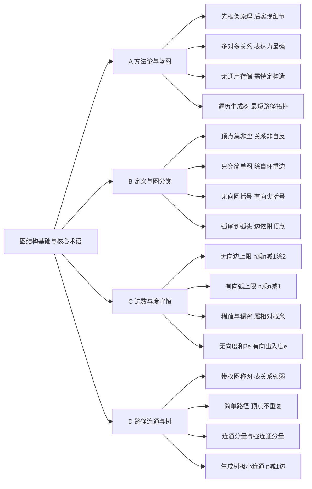
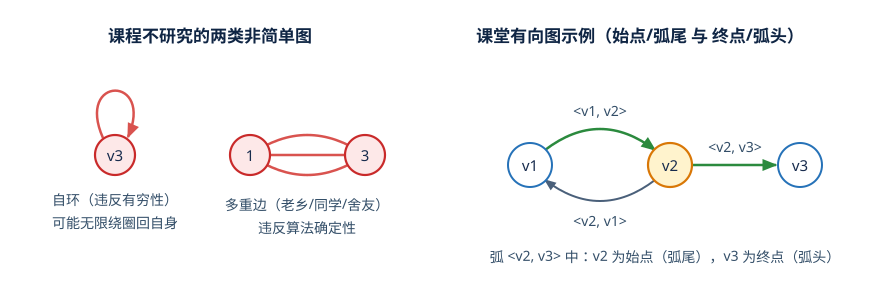
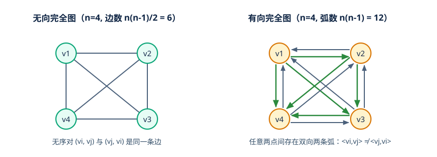
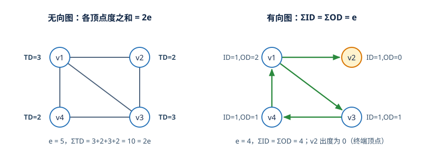
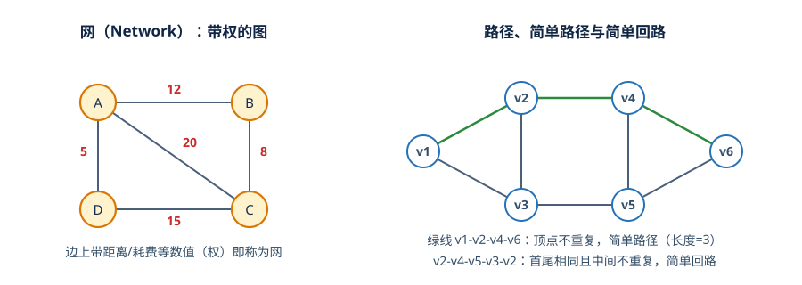
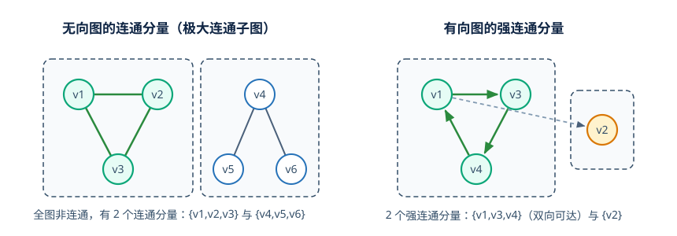
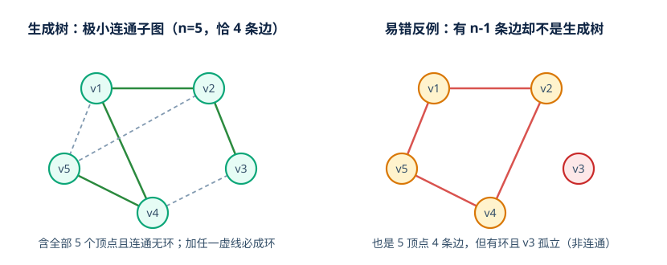

# 数据结构 · 第十二周第一节 · 图结构 · 详细版讲义

> **来源说明**：本讲义依据课堂录音的本地转写整理，并与严蔚敏《数据结构（C语言版）》第 7 章（7.1 图的定义和术语）对照校订而成，属**讲授稿性质的整理稿**。全篇以**第一人称**写成——写作者就是讲授者本人，课堂上的开篇动员、比喻、追问与板书推演都以「我」的口吻呈现。
>
> - **转写来源**：一份 ASR 导出文字——`数据结构图结构课程讲解_导出原文.txt`（约 1.36 万字，609 行）。开头交待第 7 章作业与笔记互评安排，随后切入「图结构」的方法论总览、定义与简单图限定、有向图与无向图、完全图与稀疏/稠密图、顶点的度与出入度守恒，最后做了第 8.1 节随堂练习（末尾 601～609 行为下课前同学讨论实验作业的杂音）。
> - **这一节的主线**：**从「一对多」的树跨进「多对多」的图结构**——先调整学习方法（先抓整体框架、算法群逻辑，不急着抠代码细节）→ 再划清整章蓝图（没有包打天下的存储，要针对运算构造 4 种存储，以遍历、生成树、最短路径、拓扑排序与关键路径为抓手）→ 吃透图的形式化定义 $G=(V,E)$ 与简单图边界（排除自环与重边）→ 掌握有向/无向两类关系、完全图边数上限、度与出入度守恒 $\sum TD=2e$ 和 $\sum ID=\sum OD=e$ → 补齐连通性、路径与生成树等 7.1 节核心术语，为下一节「图的存储」铺平地基。
> - **这一节的边界**：本节只完成「图结构的基本概念与术语」，**4 种具体存储结构（邻接矩阵、邻接表、十字链表、邻接多重表）的详细结构与代码留待下一节（第十二周第二节）展开**；另外需要特别说明的是，课堂录音在本节实际讲授至「顶点的度、度与边数关系及 8.1 随堂题」后便接近下课，为保证「第 8.1 节图的基本术语」体系完整并无缝衔接下节存储与遍历，**第十三至十五节按严蔚敏教材 7.1 节口径补齐了网与权、路径与简单路径、连通分量与生成树（$n-1$ 条边）等内容（教材内容、课上未讲）**，文中不伪造任何课堂口述原话。
> - **教材对照范围**：严蔚敏《数据结构（C语言版）》**第 7 章 图 —— 7.1 图的定义和术语**。
> - **编号说明**：我沿用的章节号比严蔚敏教材**大 1**——我的「第 7 章 树和二叉树」＝教材**第 6 章**；我的「第 8 章 图」＝教材**第 7 章**（对应转写里提到的「8.1 节练习」即教材 7.1 节内容）；我的「第 9 章 排序／第 10 章 查找」分别对应教材第 8、9 章。凡在本讲义标注教材出处时，一律使用教材真实章节号。
> - **时间说明**：本节课为**文字模式**（无音视频轨、无关键帧），各节时间戳按**字数折算的伪时间**（约 200 字／分钟）标注，仅作讲义内部单调递增的定位坐标；按转写约 1.36 万字折算，全课伪时间长约 1 小时 8 分（`00:00`～`01:08`）。
> - **示意图说明**：本节配图分两类。**开头的「总览知识地图」**使用流程图表代码块编写，Obsidian 原生渲染为矢量图；**正文里的数据结构示意图**全部是**独立手写的 SVG 矢量图片**，存放在 `数据结构/插图/` 目录下（`w121_01.svg` ～ `w121_06.svg`），正文以标准 Markdown 图片语法直接嵌入，每张图下均附「图注」，图内顶点编号、弧向与度数均与正文验算完全一致。
> - **关联阅读**：[[数据结构 第十一周第二节 哈夫曼树与并查集 详细版讲义]]（上一节：树形结构收官，并查集将在后续图论最小生成树中再次出场）、[[数据结构 第十二周第二节 图的存储 详细版讲义]]（下一节：邻接矩阵、邻接表、十字链表、邻接多重表四种存储结构）、[[数据结构 第八周第一节 数组的存储与特殊矩阵 详细版讲义]]（稀疏矩阵与压缩思想，本节对比「稀疏图」时再次提及）、[[数据结构 第九周第一节 树与二叉树 详细版讲义]]（一对多层次结构基础，与本节「多对多」形成对比）、[[数据结构 第一章 绪论 课堂讲义]]（算法有穷性与确定性、逻辑结构四大分类）。

## 开场导读

上节课我们把树形结构（我的第 7 章）全部收了尾，从今天开始，我们正式迈进《数据结构》里最复杂、也最接近真实世界的一章——**图结构**。注意，我专门在标题里写的是「图结构」而不是「图」，因为和前面的线性结构、树形结构一样，这一章研究的仍然是一大类模型，而不是某一个孤立的实例。

一进这一章，我首先要敲打你们的不是某个公式，而是**学习方法必须立刻换挡**。前面学线性表、栈、队列、树的时候，一个算法往往十几二十行代码就写完了，你们可以一边听原理一边顺手把细节扣死。可到了图这一章，很多时候一个看上去很朴素的基本原理，真落到代码上是一整个「算法群」，单个算法的代码量就抵得上前面整章的编程总量。如果你还没搞清楚整张图的框架、原理和适用场景，就一头扎进某几行下标里死抠细节，很快就会被绕晕，最后往往两头落空。所以这一章的原则是：**先抓整体框架与基本原理，再谈实现细节**。

沿着这条方法论，这一节我主要解决两件事：第一，帮你们把第 8 章的全局蓝图搭出来——为什么我们不讲图论数学证明、只讲计算机里的表示与操作？为什么树靠左右二叉链表就能一招走天下，而图却没有任何一种存储结构能包打天下，必须老老实实针对不同运算去构造特定的存储方案？第二，把图的「基本术语地基」夯实——到底什么叫顶点集、什么叫非自反的直接后继关系？为什么我们只研究简单图，坚决把自环和多重边踢出去？有向图与无向图的边数上限、完全图公式、稀疏与稠密图的相对性、以及顶点的度、入度、出度怎么和总边数建立起守恒等式？考虑到课堂时间恰好卡在随堂练习收尾，我还会按教材 7.1 节的标准口径，把网与权、路径与简单路径、连通分量与生成树这几组下节必用的术语一并补全。

虽然这一节概念多、名词密，听着像在「背词典」，但真到考卷和工程里，最容易丢分的地方其实非常集中，开讲前我先把**最易踩坑的三处**拎出来：

1. **有向图与无向图的最大边数混算，以及「度之和」的 2 倍系数丢掉**：$n$ 个顶点的简单**无向图**最多只有 $\frac{n(n-1)}{2}$ 条边，简单**有向图**最多有 $n(n-1)$ 条弧；对应到度数上，无向图所有顶点的度之和等于 **$2e$**（因为每条边关联两个端点），而有向图是 $\sum ID(v_i) = \sum OD(v_i) = e$，总度数 $\sum TD(v_i)$ 依然等于 $2e$。做选择填空时少除一个 2 或少乘一个 2，很容易把分数丢掉。
2. **「非简单图」被想当然算进边数上限，以及把「稀疏图」的 $e < n \log_2 n$ 当成死标准**：本课程讨论的图一律排除了**自环**与**多重边**（因为分别破坏算法的有穷性与确定性）；而所谓「稀疏图」和「稠密图」是相对完全图而言的相对概念，个别教材写 $e < n\log_2 n$ 只是一种经验口径，不能当作固定分界线去硬套。
3. **误以为「有 $n-1$ 条边的 $n$ 顶点无向图一定是生成树」**：这是 7.1 节概念判断的经典陷阱。生成树是极小连通子图，确实有 $n$ 个顶点和 $n-1$ 条边；但反过来，如果一个 $n$ 顶点图恰好有 $n-1$ 条边，却可能「一部分点抱团成环、另一部分点孤立出去」（例如 5 个点、4 条边组成一个四角环加 1 个孤立点），它既不连通又有环，肯定不是生成树。

## 总览知识地图



> **图注（全课思维导图）**：这张图按「方法 $\to$ 定义 $\to$ 计数 $\to$ 连通」四个分支展开。**A 分支是整章导引**：从多对多模型出发，明确学习顺序与「四大存储＋遍历＋四大典型应用」的全局蓝图；**B 分支是图的基本定义与边界**：钉死至少 1 个顶点、关系非自反、只研究简单图，分清无向边与有向弧头弧尾；**C 分支是全节核心计算底座**：完全图边数公式、稀疏稠密辨析，以及无向图 $\sum TD=2e$、有向图 $\sum ID=\sum OD=e$；**D 分支是承接下节的 7.1 术语补齐**：网、简单路径与简单回路、极大连通分量与极小生成树（$n-1$ 条边）。

## 正文

### 一、从树到图：课前安排与这一章的学习方法调整 `00:00-00:02`

在正式翻开第 8 章之前，先把近期的教学收尾与作业安排交待清楚：上一章「第 7 章 树形结构」我们已经全部讲完，本周星期三按时提交书面作业。另外，今天回去我还会布置新一轮的笔记互评——前面第 1、2、3 章你们已经提交并完成过一轮，接下来要把第 3、4、5、6、7 章的课堂笔记分批整理提交做互评（转写中「护皮/不平」系「互评」的口误/误识），后面等第 8 章图结构、第 9 章排序和第 10 章查找（转写中「五符和排序/检索八九时」对应后续各章）讲完，再到第 11、12 周汇总交一次，后半学期课业任务会比前半学期更紧凑，大家节奏得跟紧。

事务说完，现在看章名：**这一章叫「图结构」**，注意「结构」两个字——我讲的不是美术课里的图片，也不是离散数学里单纯某一张画出来的图。和前面一样，我们研究的是**一大类数据结构问题**：

- 线性结构是一大类问题，线性表、栈、队列是其中具体的个体；
- 树形结构是一大类问题，一般树、二叉树是其中具体的个体；
- 一旦冠上「结构」二字，研究的对象必定包含**两个或两个以上存在关联的事物**，以及它们之间形成的普遍组织规律。

进这一章的第一件事，**我必须严肃提醒大家调整学习方法——从这一章开始，不能再用前面学线性表和二叉树的那套习惯硬套了**。

为什么必须调方法？因为图这一章**太复杂了**。你们以前学顺序表插入、链表删除或者二叉树递归遍历，一个核心操作通常就一个短函数，一边理解思想一边就把下标、`next` 指针全抠透了。可到了图结构这一章，**哪怕只实现一个最基本的原理，往往都需要一整套「算法群」协同配合**，而且这套算法群里**随便拎出来一个单独算法，它的代码量和编程复杂度都几乎赶得上前面一整章的编程总量**！

因此，学习第 8 章必须严格遵守两步顺序：
1. **第一步：先抓基本框架、基本原理和基本思路**。弄明白「为什么要设计这种结构」「这个算法每一步打算达到什么效果」「它能解决哪类问题」。
2. **第二步：在整体原理通透的前提下，再去抠实现细节**。

如果你一上来连全局框架都没站稳，就埋头去死抠某个数组下标是 `i` 还是 `i+1`、某条指针先改左还是先改右，我把话放在这儿：**你很快就会迷失在海量代码细节里，最后往往什么都记不住、写不出，基本原理也跟着一团糟。** 先把骨架搭牢，再去长血肉，这是学好图这一章最重要的方法论。

**本节要点**

- **教学事务**：第 7 章树形结构已收尾，作业周三提交；按阶段推进第 3～7 章笔记互评与后续第 8～10 章任务。
- **研究定位**：「图结构」研究的是多事物关联的一大类结构模型，而非单一图形实例。
- **学习方法原则**：第 8 章单个算法编程量堪比前面整章，且常常是一组「算法群」，**务必先吃透整体框架与基本原理，再深入抠代码细节**。

### 二、一对一、一对多到多对多：最复杂模型与现实应用 `00:02-00:06`

抓住了学习方法，咱们回到课程大脉络里，给「图结构」摆正位置。在绪论里我们就用「前后驱关系」把几种主要逻辑结构对比过，今天再把这张对比表拉到底：

1. **线性结构（一对一）**：把结点排成一条线，任何一个结点往前看，**最多只有一个直接前驱**（第一个结点没有）；往后看，**最多只有一个直接后继**（最后一个结点没有）。典型的就是「一对一」关系。
2. **树形结构（一对多）**：任何一个结点往后看，**可以有多个直接后继**（多个孩子）；但往前看，**只能有唯一的一个直接前驱**（唯一的双亲，根结点除外）。这就是「一对多」的层次关系。
3. **图结构（多对多）**：到了图这一章，约束被彻底放开——**任何一个结点往后看，直接后继可以有多个；同时往前看，直接前驱也可以有多个！** 这就是数据结构里最一般、也最复杂的**「多对多」**关系。

在计算机科学的模型世界里，有一条非常朴素的规律：**模型越复杂，它的表达能力就越强，跟真实世界就越吻合；但反过来，用计算机去存储和处理它的难度也就呈几何级数往上涨。** 图恰好站在了这条曲线的顶端——它是我们这门课接触到的**最复杂的非线性逻辑结构**。

也正因为图跟现实世界的贴合度最高，图论才成为《离散数学》三大核心板块之一（与数理逻辑、代数系统并列，转写中「三大派成/三大会计」系 ASR 对「三大块/三大分支」的误识），它的理论极其丰厚，而且在自然科学与人文社科里几乎无处不在：

- **自然科学与工程领域**：
  - **电子线路分析**：一块电路板上，每一个**结点**可能是一个二极管、电阻或电容，结点之间的导线连线就是**边**；分析电路通断与电流分配，本质上就是在分析一张图。
  - **有机化学分子结构**：研究一个复杂的有机化合物分子成分时，每一个**点**就是一个原子，原子与原子之间的关联关系就是一条**边**；此外，研究**控制论、自动化、遗传学**等学科时也都要用到图这种结构。
- **社会科学与人文领域**：
  - **复杂人际关系网与反腐案件侦办**：我们常说一个人「关系网很大、背景很复杂」。看反贪反腐题材的片子就能发现，往往查处一个高官，叫「拔出萝卜带出泥」——把他端掉之后，顺着图里的关联边往外摸，跟他有关联的一系列人员都会被牵出来逐一考察。
  - **六度空间理论（Six Degrees of Separation）**与科研合作网络：你们可能听说过著名的**六度空间理论**——它为什么把庞大的地球称作「地球村」？因为研究发现，世界上任意两个天涯海角、看起来八竿子打不着的人，要想通过熟人关系网把你们俩连起来，中间需要经过的人**不会超过 6 个**（$A$ 认识 $B$，$B$ 认识 $C$，$C$ 认识 $D \dots$）。再比如在社会学和科研工作里，考察某位学者跟谁合作、学术关系如何，画出来的也全是合作关系图。

正因为自然界和人类社会到处都在用图，作为专门研究信息处理的专业基础课，《数据结构》必须把「图」接过来，搞清楚计算机到底怎么把它吃进去、算出来。

**本节要点**

- **结构演进脉络**：线性结构是一对一（前驱后继至多各 1），树形结构是一对多（前驱至多 1、后继可多个），图结构是**多对多**（前驱与后继均可多个）。
- **表达力与处理难度成正比**：图是最复杂的非线性模型，与现实世界最吻合，因此用计算机处理的代价也最高。
- **跨学科应用实例**：电子线路（元件为点、连线为边）、有机分子结构（原子为点、化学键为边）、反腐关系网追溯、六度空间理论（「地球村」社交链不超过 6 人）等。

### 三、第 8 章全局蓝图：为什么没有任何存储能包打天下 `00:06-00:10`

既然图论在《离散数学》里已经是一门庞大到可以单开一本书的学科，那我们《数据结构》第 8 章到底讲什么、不讲什么？边界必须先划清：**我们不纠缠图论本身那些纯数学定理的证明，我们的侧重点只有一个——「图在计算机内部怎么表示，以及图上的基本运算怎么实现」。**

计算机是个死板的二进制机器，它既不认识你画在纸上的圆圈和连线，也不懂什么六度空间。要让它干活，必须把图搬进内存里。说到这儿，**我必须提前给你们打一针极其重要的预防针**：

> **在图这一章，没有任何一种存储结构能够「包打天下」！**

这句话什么意思？你们拿前面刚学完的「树形结构」对比一下就全明白了：

- 在**二叉树**那一章，我们只要祭出**左右二叉链表**，几乎不管你后面要做什么操作——先中后序遍历也好、求树高求叶子也好、二叉排序树插入删除也好——**同一套左右二叉链表全都能给你兜住、全都能实现**！顶多是某些特殊场景下（比如只想往上找双亲时）写起来稍微绕一点、多花点查找代价，但总归是「一招鲜吃遍天」，用不着动不动换一套全新的内存结构。
- 可到了**图**这儿，情况彻底变了！因为图是多对多关系，拓扑形状毫无规律、稠密稀疏千差万别，如果死抱着某一种固定存储结构不放，**你会发现很多常见操作在这套结构上根本不好算，甚至慢到无法忍受或者根本实现不了**。
- 所以在研究图结构时，我们**不再是「拿来主义」**，而是**针对具体应用的问题与运算需求，去专门构造与之匹配的特定存储结构**！

围绕「怎么存」和「怎么算」这两件事，我把整个第 8 章后面几周要学的所有内容，给你们画成一张四步路线图：

1. **第一块：图的存储表示（4 种主要方法）**
   怎么把纸上的图搬进计算机一维内存？我们下一节就会重点学 **4 种经典存储方式**（分别是：邻接矩阵、邻接表、十字链表、邻接多重表），弄清每一种分别适合有向图还是无向图、稀疏图还是稠密图。
2. **第二块：图的遍历（表面切入点）**
   和前面树这一章的套路一样，由于图的实际应用极其五花八门，而我们做数据结构研究需要提炼**普适性模型**，不好被某一个具体行业例子绑死；但要想把普遍原理讲清楚，又很难脱离具体例子把所有复杂运算一并讲透。因此，在讲图的基础运算时，我们也只能先「蜻蜓点水」——抓住所有图运算的共同起点：**图的遍历**（对所有顶点不重复地访问一遍，即深度优先搜索 DFS 与广度优先搜索 BFS）。
3. **第三块：由遍历向深处挖——求生成树（及最小生成树）**
   光在表面飘着讲一个遍历能干啥用？就像前面二叉树讲完遍历后，我们立刻往深挖出了二叉排序树、线索二叉树一样，**图的遍历往深里一挖，直接引出的核心问题就是「求生成树」**（以及带权网上的最小生成树）。
4. **第四块：两种最普适存储对应的四大典型应用**
   虽然没有包打天下的结构，但工程与考试里最普遍使用的还是**两种基础存储方法——邻接矩阵和邻接表**。为了演示「不同的存储结构各自最擅长支持哪些算法」，教材和课程专门为它们各自配了经典应用例子：
   - **基于邻接矩阵**：主要用来演示求**最短路径**问题（以及部分最小生成树算法）；
   - **基于邻接表**：主要用来演示有向无环图上的**拓扑排序**与**关键路径**问题。

把上面这四块连同今天要讲的第一块「图的基本概念」，就是我们第 8 章整章的全部家底。脑子里先装着这张蓝图，后面一节节往里填内容，你就不会乱。

**本节要点**

- **课程定位**：不研究离散数学里的纯图论定理证明，聚焦于**图在计算机里的存储表示与算法实现**。
- **核心警示**：不同于树可以用左右二叉链表通吃，**图没有任何一种存储结构能包打天下**，必须根据运算需求去构造特定的存储结构。
- **第 8 章全局路线**：基本概念 $\to$ 4 种存储表示 $\to$ 图的遍历（DFS/BFS）$\to$ 引申出生成树 $\to$ 典型存储配对应用（邻接矩阵 $\leftrightarrow$ 最短路径；邻接表 $\leftrightarrow$ 拓扑排序与关键路径）。

### 四、图的定义：顶点集、非自反后继关系与两类事物 `00:10-00:15`

全局蓝图立住了，现在正式翻开 8.1 节（对应教材 7.1 节）——**图的基本概念与术语**。教材和离散数学书里围绕图生造出了几十上百个名词，我们数据结构这门课**绝不搞名词堆砌，只挑后面存储和算法真正要用到的核心概念来钉死**。

#### 4.1 两种语言看定义：自然语言 vs 数学形式化表达

首先看：**到底什么叫「图」？**

我先后用两种语言给你们下定义——**计算机专业训练最重要的两项基本功，第一是解决问题的思维方式，第二就是形式化（数学符号化）的表达能力**。对照着看，理解最透：

1. **自然语言描述（从前后继关系出发）**：
   图是由 $n$ 个结点 $v_1, v_2, \dots, v_n$（**$n \geqslant 1$**）构成的数据集合，并且在这个结点集上定义了一个称为「直接后继」的关系 $E$，要求该关系 $E$ 是**非自反的**（注：转写第 216 行、220 行将「非自反的」误作「V字版的 / 复反的」，从紧接着第 222～229 行「学过离散数学，A 能推出自身来就是自反的」可完全确证原文为「非自反的」）。
   这里有两个细节必须划重点：
   - **第一，$n \geqslant 1$ 而不是 $n \geqslant 0$**：大家还记得吗？线性表可以是空表（$n=0$），二叉树可以是空树（$n=0$），可**在图里，结点数 $n \geqslant 1$——也就是说图当中必须至少有一个顶点，不讨论「空图」**！这一点在严蔚敏教材 7.1 节也写得清清楚楚：「$V$ 是顶点的**有穷非空**集合」。
   - **第二，关系 $E$ 必须是「非自反的」**：在离散数学里，如果每个元素 $a$ 都有关系 $(a, a)$（即「自己指向自己」），那就叫自反关系。图结构明确要求「非自反」，通俗讲就是**不能存在顶点指向它自己的边（自环）**，下一节我会从算法可行性的角度解释为什么非得把它踢掉。
2. **数学形式化描述（符号集合表达）**：
   用最标准的形式化记法，一个图 $G$ 写成一对集合的二元组：
   $$
   G = (V, E)
   $$
   其中：
   - **$V$** 叫做**顶点集**（取自英文 **Vertex** 的首字母；转写中误作 `ver text`）；
   - **$E$** 叫做**边集**（取自英文 **Edge** 的首字母；转写中误作 `H`，教材在 ADT 定义中亦写作 $VR$ 表示顶点关系，在有向图时常写作 $A$ 表示弧集 Arc）。

#### 4.2 图为什么比线性表、树复杂？——同时研究「两类事物」

把形式化式子 $G = (V, E)$ 写出来之后，我再带你们往深处看一眼：**从线性表到树，再到图，到底发生了什么本质变化？**

- 在**线性结构**和**树形结构**里，我们把每一个独立的研究个体叫做**数据元素（结点）**；到了图这儿，个体换了个名字，改叫**顶点（Vertex）**。
- 那有同学会反问：**「前面讲线性表和树的时候，不也谈前驱后继、双亲孩子这些『关系』吗？难道只有图才研究关系？」**
  这个问题问得非常到位，区分点就在这儿：
  - 在线性结构里（比如三个同班同学 `A, B, C` 排队），我们当然也说 `A` 的直接后继是 `B`、`B` 的直接后继是 `C`；但你也可以按另一种顺序排成 `A, C, B`。**在线性表和树里，所谓「关系」仅仅是用来把数据组织起来的手段**——比如树里说 `A` 有三个孩子 `B, C, D`，我们只是借用血缘/隶属关系把这三个结点挂到 `A` 底下就完事了，至于 `A` 和 `B` 之间关系深不深、强不强、这条关系本身叫什么，我们**根本不关心**。
  - **可到了图这儿彻底变天了！** 图里的每一条边（关系）**不再只是组织数据的辅助线，而是实实在在、客观存在的第二类核心研究对象**！我们不仅要关心这堆**顶点**本身，还必须独立把**边集 $E$（顶点与顶点之间的关系结构）**作为第二类事物来专门存储和研究；甚至再往后（带权网），我们还要去度量**每一条关系的深浅与强弱**（距离有多远、花费有多大、带宽有多宽）！

要同时照顾好「顶点」和「关系」这两类事物，而且关系本身还能带属性、分方向、任意交织——图的复杂度一下子就增加了。

**本节要点**

- **图的定义要件**：$G = (V, E)$，其中 $V$（Vertex）为**有穷非空**顶点集合（$n \geqslant 1$，不允许空图），$E$（Edge）为边／直接后继关系的集合，且要求**非自反**。
- **核心术语切换**：个体从线性表／树里的「数据元素（结点）」改称**顶点**。
- **复杂性根源**：线性表和树里的关系仅用于组织数据；而图同时把**顶点集 $V$** 与**边集 $E$** 视为两类客观存在的研究对象，后续还要度量关系的强弱（权值）。

### 五、为什么只研究简单图：自环破坏有穷性，重边破坏确定性 `00:15-00:19`

既然现实世界的关系千奇百怪，这里立刻出现一个很实际的问题：在离散数学的广义图论里，允许一个顶点自己连一条边回自己（叫**自环 / 自身环**），也允许两个顶点之间同时拉好几条平行的边（叫**多重边 / 平行边**）。比如我和班里某位同学，我们俩既是**老乡关系**，又是**同班同学关系**，还是**同一个宿舍的舍友关系**——那在 `1` 和 `3` 之间画上三条不同的边，在生活逻辑里完全说得通啊！

**那为什么我们在《数据结构》这门课里，既不研究带自环的图，也不研究带多重边的图，把它们统统拒之门外呢？**

我课上特意停下来追问了大家：决定我们「研究什么、不研究什么」的唯一标尺，不是现实里存不存在，而是——**计算机和算法能不能干净地处理它**！回忆一下第一章绪论里讲过的**算法的五大特性**（有穷性、确定性、可行性、输入、输出），这两类图正好违背了算法最关键的两条特性：

1. **为什么不研究带「自环」的图？——破坏算法的「有穷性」**
   算法的定义是什么？解决某个特定问题的**指令的有限集合**，第一条硬性要求就是**有穷性**（执行有限步后必须结束）。现在你想想，如果允许 `v3` 上面长出一个指回自己的自环边，当遍历算法沿着关系边往外走时，走到 `v3` 一看：「哎，`v3` 自己跟自己有关系！」于是沿着边走一圈又回到了 `v3`，再一查又有关系，转个圈又回到 `v3`……这不是你在代码里写错了 `for` 或 `while` 循环条件，而是**你输入的这张图数据结构里实实在在存在着一条可以无限绕回去的关系通路**！为了从结构模型根源上杜绝这类无谓的死转圈风险，我们直接禁止自环，要求关系非自反。
2. **为什么不研究带「多重边」的图？——破坏算法的「确定性」**
   算法的第二条硬性要求是**确定性**（每一步操作必须含义唯一、无二义性）。现在看 `1` 和 `3` 之间同时连了三条边（老乡、同学、舍友）：当算法运行到 `1` 准备沿着边去访问 `3` 或者计算 `1` 到 `3` 的代价时，它立刻犯糊涂了——**你到底是让我查「老乡关系」走过去，还是查「同学关系」走过去，还是查「舍友关系」？** 如果不先指明唯一一种确定关系，算法在同一条指令上就面临多种歧义解读，根本没法机械执行。所以你必须先把关系确定下来——每次只研究其中明确的一种关系，不要把多张不同性质的关系网叠在同一对顶点间画重边。

把这两条一刀切掉——**既没有顶点到自身的自环，也没有任意两顶点之间的多重平行边**——剩下的这种规范图，在图论和教材里就叫做**简单图（Simple Graph）**。

所以请记住一条大前提：**除特殊说明外，本课程以及严蔚敏教材第 7 章讨论的所有图，全都是「简单图」**。后面算完全图边数上限、设计邻接矩阵存储，全都是建立在「无自环、无重边」这个地基之上的。

**本节要点**

- **两类排除对象**：课程不讨论带**自环**（顶点连向自身）的图，也不讨论带**多重边**（两顶点间多条同向/无向边）的图。
- **排除依据（算法特性）**：自环破坏算法的**有穷性**（可沿自身边无限绕回）；多重边破坏算法的**确定性**（多种关系混杂导致操作语义不唯一）。
- **课程默认范围**：本课所称的「图」，默认一律指**简单图**（无自环、无重边）。

### 六、关系的二分法：无向图与有向图的符号和图示 `00:19-00:22`

排除掉自环和重边后，剩下的简单关系，按「有没有方向和主次」只分成两大类：**无向图**和**有向图**。

#### 6.1 无向关系与无向图

生活里大量关系是**平等对等、没有方向、不分主次**的。拿「同学关系」「老乡关系」来说，在座的大家都在这个教室里上过这门课，咱们互为同学。`A` 能决定 `B` 吗？不能。`B` 能决定 `A` 吗？也不能。`A` 是 `B` 的同学，等价于 `B` 是 `A` 的同学。

在形式化表达（集合与关系代数）里，怎么把两个结成无向关系的事物捆绑到一起？——用一个**圆括号**把它们括起来，叫做**无序偶对**：

$$(v_i, v_j)$$

注意：**单个元素是谈不上关系的**（「孤掌难鸣」，必须两个及以上事物才能谈关系）。在图形画法上，无向关系用一条**不带箭头的无向线段**把 $v_i$ 和 $v_j$ 连起来。如果图中的每一条边都是无向边（无序偶对），就称为**无向图（Undigraph）**。

#### 6.2 有向关系与有向图

可现实社会能够不停动态演化、往前发展，靠的往往不是静态的平等关系，而是**有先后次序、有主导方向、谁主动发起**的有向关系。比如「`1` 关注了 `2`」（注意：`2` 未必关注了 `1`）。

为了表达这种先后次序与主导方向，我们在形式化符号里改用**尖括号**把两个顶点括起来，叫做**有序偶对**（又叫**弧**）：

$$\langle v_i, v_j \rangle$$

我课上给你们留了一个特别形象的记忆法帮你们区分圆括号和尖括号：平时我们形容一个人性格很尖锐、棱角分明、不好惹，是不是说他**「有棱有角」**？**尖括号 `< >` 两头尖尖的、有棱有角，恰恰用来表示「有方向、分先后、有主次」的有向边！** 而圆括号 `( )` 圆滑温和、左右对称，正好用来表示「彼此平等、没有方向」的无向边。

在图示法里，有向边用一条**带箭头的有向线段**表示，箭头从发起方指向接收方。如果图中每条关系都是顶点的有序偶对，就称为**有向图（Digraph）**。

**本节要点**

- **无向图**：关系平等、无主次先后之分，用**无向线段**绘制，形式化记作**圆括号无序对 $(v_i, v_j)$**。
- **有向图**：关系有方向、分主次先后，用**带箭头有向线段**绘制，形式化记作**尖括号有序对 $\langle v_i, v_j \rangle$**（「有棱有角」即有方向）。
- **最小关系前提**：一条边／弧至少涉及两个不同顶点，单个顶点无法构成关系。

### 七、有向图术语：弧头弧尾、邻接到/自、边依附于顶点 `00:22-00:27`

先拿有向图把一整套标准术语踩实。看我们课上展示的这个 3 顶点有向图 $G_1$（教材第 7 章图 7.1(a) 用的是 4 顶点示例，课上我先用了最精简的 3 顶点例子）：

- **顶点集**：$V_1 = \{v_1, v_2, v_3\}$
- **边（弧）集**：$E_1 = \{\langle v_1, v_2 \rangle,\; \langle v_2, v_1 \rangle,\; \langle v_2, v_3 \rangle\}$

请特别盯紧里面的 $\langle v_1, v_2 \rangle$ 和 $\langle v_2, v_1 \rangle$：在无向图里 $(v_1, v_2)$ 和 $(v_2, v_1)$ 表示同一条边，但在有向图里它们是**完全不同的两条弧**——前者代表 `v1` 主动关注 `v2`，后者代表 `v2` 反过来关注 `v1`，互不相替，一共是 **3 条弧**。

针对有向图里的任意一条弧 $\langle v_i, v_j \rangle$，有两组完全等价但视角不同的叫法，考试填空选择题经常混着出：

1. **始点 vs 终点（从事物发展方向来看）**：
   因为这条关系是从 $v_i$ 发起、指向 $v_j$ 的，所以：
   - $v_i$ 叫做这条弧的**始点**（起始位置）；
   - $v_j$ 叫做这条弧的**终点**（终止位置）。
2. **弧尾 vs 弧头（从箭头图形外观来看）**：
   把一条带箭头的有向线段想象成射出去的一支箭（转写中「狐尾梧同 / 骨头」系 ASR 对「弧尾、弧头」的连续同音误识）：
   - 箭杆出发的屁股那一端（$v_i$）叫做**弧尾（Tail）**；
   - 带着尖尖箭头扎过去的那一端（$v_j$）叫做**弧头（Head）**。
   **千万别背反了！** 很多同学一听「头」字，以为是「开头、起点」，把 $v_i$ 当成弧头——**大错特错！箭头所在的那一端才是「弧头」，也就是终点 $v_j$；箭尾（无箭头那一端）才是「弧尾」，也就是始点 $v_i$！** 记一句「**箭头＝弧头＝终点**」，永远不错。

紧接着，因为有方向和主次，有向图里的**邻接（Adjacent）关系**也要分正反两个方向来念：

- 如果你此刻正站在始点 **$v_i$** 上往外看，称作 **$v_i$ 邻接到 $v_j$**（我发出去的箭头射向你）；
- 如果你此刻正站在终点 **$v_j$** 上往回看，称作 **$v_j$ 邻接自 $v_i$**（课上口语也说「$v_j$ 是从 $v_i$ 邻接过来的」，即箭头射向我）。

最后再把「点」和「边」的主从地位再一次摆正：如果存在边／弧关联 $v_i$ 和 $v_j$，我们说**这条边「关联于」或「依附于」顶点 $v_i$ 和 $v_j$**。为什么用「依附」这个词？中国有句古话叫**「皮之不存，毛将焉附」**——顶点就是「皮」，是整个图结构的根本；边只是「毛」，是附着在顶点身上的关系！连顶点都不存在了，哪来的关系可谈？这也再次呼应了前面为什么规定「$V$ 必须非空（$n \geqslant 1$）」。



> **图注（非简单图排除与有向图 $G_1$ 术语）**：左侧展示课程排除的两类非简单图（自环破坏有穷性，多重边破坏确定性）；右侧画出课堂 3 顶点有向图 $V=\{v_1,v_2,v_3\}, E=\{\langle v_1,v_2\rangle, \langle v_2,v_1\rangle, \langle v_2,v_3\rangle\}$，明确弧 $\langle v_2,v_3\rangle$ 中 $v_2$ 为始点（弧尾），$v_3$ 为终点（弧头）。

把上面这组术语在图 $G_1$ 上逐点对照着念一遍，保证一个都不混淆：
- 对弧 $\langle v_1, v_2 \rangle$：$v_1$ 是始点（弧尾），$v_2$ 是终点（弧头）；站到 $v_1$ 看，**$v_1$ 邻接到 $v_2$**；站到 $v_2$ 看，**$v_2$ 邻接自 $v_1$**；
- 对弧 $\langle v_2, v_1 \rangle$：方向反了，$v_2$ 是始点（弧尾），$v_1$ 是终点（弧头）；$v_2$ 邻接到 $v_1$，同时 $v_1$ 邻接自 $v_2$；
- 对弧 $\langle v_2, v_3 \rangle$：$v_2$ 是始点（弧尾），$v_3$ 是终点（弧头）；$v_2$ 邻接到 $v_3$，$v_3$ 邻接自 $v_2$；但注意 **$v_1$ 与 $v_3$ 之间没有任何弧直接相连**，所以它们不是直接邻接关系（只能通过 $v_2$ 间接到达）。

**本节要点**

- **有向弧的两套名称**：对于 $\langle v_i, v_j \rangle$，$v_i$ 称**始点／弧尾**，$v_j$ 称**终点／弧头**（牢记「箭头＝弧头＝终点」）。
- **邻接方向区分**：$v_i$ **邻接到** $v_j$（向外发出），$v_j$ **邻接自** $v_i$（从外部连入）。
- **主从关系**：边**依附（关联）于**顶点——「皮之不存，毛将焉附」，顶点是根本，关系依附顶点而存在。

### 八、无向图与完全图：为什么无向边上限要除以 2 `00:27-00:34`

把有向图说透了，无向图就好理解得多，但有两个极容易被忽视的细节，照样得掰开讲。

#### 8.1 无向图的形式化写法多样性隐患

在无向图里，$(v_1, v_2)$ 和 $(v_2, v_1)$ 在图示上画的是同一条无向线段，表达的也是同一份对等关系（比如「1 和 2 是同学」等于「2 和 1 是同学」）。因此无向图里不讲「邻接到／邻接自」，只直接说 **$v_1$ 和 $v_2$ 互为邻接点**，边 $(v_1, v_2)$ 依附于顶点 $v_1$ 和 $v_2$。

**但是！这里藏着一个以后写代码与存储时会冒出来的小暗礁：** 在图形上 $(v_1, v_2)$ 和 $(v_2, v_1)$ 毫无差别，可一旦落到书面形式化符号或者输入序列里，你把它写成 `(v1, v2)` 还是写成 `(v2, v1)`，隐含的关注视角就出现了微小的差异——写成 `(v1, v2)` 往往默认先抓 `v1`、以 `v1` 为主导去登记，写成 `(v2, v1)` 则是先抓 `v2`。**同一张无向图在形式化表达和输入顺序上存在多样性**，这也是下一节设计无向图邻接矩阵（对称存储两份）或邻接多重表（只存一条边结点同时挂两条链表）时必须解决的麻烦来源！

#### 8.2 边数取值范围与两种「完全图」

现在来算一笔极其重要的硬账——**在一个有 $n$ 个顶点的简单图里，边数 $e$ 的取值范围是多少？**

1. **有向图的边数范围与有向完全图**：
   - 最小可以一条边都没有（全都是孤立顶点），所以 $e_{\min} = 0$。
   - 最多能有多少条弧？因为不允许自环（$v_i$ 不能连向自己），所以**每个顶点最多只能向其余 $n - 1$ 个顶点各发出 1 条有向弧**；同时因为不允许同向重边，往每个其他顶点至多只能发 1 条。全图共有 $n$ 个顶点，因此最多有：
     $$
     e_{\max} = n(n - 1)
     $$
     也就是说，有向图边数范围为 **$0 \leqslant e \leqslant n(n - 1)$**。
   - 当有向图的弧数恰好达到最大值 **$n(n - 1)$**（任意两个不同顶点之间都存在方向相反的两条弧，两两双向连通）时，称为**有向完全图**。
2. **无向图的边数范围与无向完全图**：
   - 同样可以一条边都没有，$e_{\min} = 0$。
   - 最多能有多少条边？在无向图里，$(v_1, v_2)$ 和 $(v_2, v_1)$ 是**同一条边**，相当于把上面有向完全图里每对顶点之间的两条反向弧合并成了一条无向边，所以总数**必须除以 $2$**（组合数 $\binom{n}{2}$）：
     $$
     e_{\max} = \frac{n(n - 1)}{2}
     $$
     也就是说，无向图边数范围为 **$0 \leqslant e \leqslant \frac{n(n - 1)}{2}$**。
   - 当无向图的边数恰好达到最大值 **$\frac{n(n - 1)}{2}$**（任意两个不同顶点之间都有一条边直接相连）时，称为**无向完全图**。

#### 8.3 $n = 1 \sim 6$ 完全图边数速算与边界直观检验

为了方便你们在考场上不用每次都现套公式从头算，我把 $n = 1$ 到 $6$ 个顶点的无向完全图和有向完全图边数上限列在一张对照表里。以后遇到选择题给出一张图的顶点数和边数，扫一眼这张表就能立刻判出「是不是完全图」「边数有没有突破简单图上限」：

| 顶点数 $n$ | 简单无向图边数上限 $\frac{n(n-1)}{2}$ | 简单有向图弧数上限 $n(n-1)$ | 直观几何与边界意义 |
|---|---|---|---|
| $1$ | $0$ | $0$ | 单顶点简单图绝不能有自环，故只能有 $0$ 条边 |
| $2$ | $1$ | $2$ | 无向仅 1 线段 $(v_1,v_2)$；有向可发 $\langle v_1,v_2\rangle$ 与 $\langle v_2,v_1\rangle$ |
| $3$ | $3$ | $6$ | 三角形 3 边；有向每边拆双向共 6 弧 |
| $4$ | $6$ | $12$ | 正方形加两条对角线共 6 边；有向共 12 弧 |
| $5$ | $10$ | $20$ | 五边形 5 边加内部五角星 5 条对角线共 10 边 |
| $6$ | $15$ | $30$ | 6 个顶点两两握手共有 $\binom{6}{2}=15$ 条无向边 |

特别盯紧 **$n = 1$** 和 **上界越界检验**：如果题目说「某简单无向图有 5 个顶点、11 条边」，不用画图，直接判**不可能存在**——因为 5 顶点简单无向图撑死只有 10 条边，多出第 11 条边必然要么是自环、要么是重边！同理，6 顶点简单有向图如果给了 32 条弧，也一定违反了简单图规则。

拿 $n=4$ 验算一下（下图）：$4$ 个顶点的无向完全图恰有 $\frac{4 \times 3}{2} = 6$ 条边（一个正方形加两条对角线）；$4$ 个顶点的有向完全图则有 $4 \times 3 = 12$ 条弧。



> **图注（$n=4$ 的无向完全图与有向完全图）**：左图为 4 顶点无向完全图，任意两顶点间仅计一条无序边，共 $\frac{4\times 3}{2}=6$ 条边；右图为 4 顶点有向完全图，任意两顶点间存在两条反向弧，共 $4\times 3=12$ 条弧。

**本节要点**

- **无向图邻接**：无方向性，称 $v_i$ 与 $v_j$ **互为邻接点**；$(v_i, v_j)$ 与 $(v_j, v_i)$ 表示同一条边，但形式化写法顺序会带来后续存储处理的差异。
- **有向图边数范围**：$0 \leqslant e \leqslant n(n - 1)$；达到上限 $n(n - 1)$ 时称**有向完全图**。
- **无向图边数范围**：$0 \leqslant e \leqslant \frac{n(n - 1)}{2}$；达到上限 $\frac{n(n - 1)}{2}$ 时称**无向完全图**。
- **除以 2 的本质**：无向边不区分顺序，每对顶点间只有 1 个关联位置，即组合数 $\binom{n}{2}$。

### 九、稀疏图与稠密图：相对概念与对「n log n」口径的辨析 `00:34-00:36`

讲完完全图的最大边数，有些书紧接着会抛出两个名词：**稀疏图（Sparse Graph）**和**稠密图（Dense Graph）**。

这两个概念怎么理解？你们拿第八周第一节讲数组时学过的**稀疏矩阵**和**稠密矩阵**来对照，思路一模一样：**它本质上是一个「相对概念」**！

- 如果一张图的边数 $e$ **远远小于**同规模完全图的最大边数（比如无向图远小于 $\frac{n(n-1)}{2}$，有向图远小于 $n(n-1)$），看上去空荡荡的、绝大多数顶点之间都没连边，我们就习惯把它叫做**稀疏图**；
- 反过来，如果边数 $e$ 接近完全图的上限，到处连得满满当当，就叫做**稠密图**。

说到这儿，我必须把教材 7.1 节里出现的一句话拎出来敲打一下（免得有些同学死背教条）。严蔚敏教材在 7.1 节括号里写了一句：「有很少条边或弧（如 $e < n \log n$ ）的图称为稀疏图，反之称为稠密图」（转写中误作「为了自己利益方便 / 小于 n log 2 n 一体化」）。

听好了：**$e < n \log_2 n$ 这只是某几本教材为了方便举例写出来的一家之言，你们千万不要把它当成一条死定理或者全世界的统一标准！**

我给你算笔账你就明白为什么不能死信它：完全图的最大边数是 $\Theta(n^2)$ 级别的，而 $n \log_2 n$ 跟 $n^2$ 比起来确实小很多；可究竟「小到什么程度才叫远远小于」？假如 $n = 8$，$n \log_2 n = 24$，而 $8$ 个顶点的无向完全图总共才 $\frac{8 \times 7}{2} = 28$ 条边！难道 $23$ 条边的 8 顶点无向图（只差 5 条边就是完全图了！）也能叫「稀疏图」吗？显然荒谬！哪怕把 $n$ 放大到几百上千，$e = 2 n \log_2 n$ 难道就不稀疏、非得算稠密图了吗？一样荒谬！

所以记住这个准确结论：**「稀疏」和「稠密」在学术界和工程界都没有一条精确的数学硬杠杠**，它永远是相对于具体问题规模而言的定性描述——它真正起作用的地方，是下节课帮我们决定：**图比较稠密时适合用邻接矩阵，图非常稀疏时更适合用邻接表**。

**本节要点**

- **概念性质**：稀疏图与稠密图是**相对概念**，如同稀疏矩阵与稠密矩阵，边数远少于完全图上限称稀疏，接近上限称稠密。
- **反教条辨析**：部分教材标注 $e < n\log_2 n$ 仅作直观参考的一家之言（小 $n$ 时甚至接近完全图），学术界并无固定数值界线。
- **工程意义**：用于下节课权衡存储结构——稠密图倾向邻接矩阵，稀疏图倾向邻接表。

### 十、顶点的度、入度与出度：社会关注与「人情账」模型 `00:36-00:40`

紧接着来看图里最常用的一个量化指标——**顶点的度（Degree）**。

#### 10.1 度、入度、出度与终端顶点

什么叫顶点的度？**一句话：和顶点 $v$ 有关联（依附于 $v$）的边或弧的条数，就叫做顶点 $v$ 的度，记作 $TD(v)$（或者 $\deg(v)$）。** 说得更直白点：凡是跟「我」扯上关系的边，都算在我「度」的账上。

在**无向图**里，边没有方向，只要一根线头连着我，我的度就加 $1$。比如在正四边形带一条对角线的 4 顶点无向图里，连接了对角线的两个顶点各连出 3 条边，度为 $3$；另外两个顶点各连出 2 条边，度为 $2$。

到了**有向图**，因为关系带了箭头，一厢情愿和被人追捧完全是两码事，所以必须把「跟 $v$ 有关的边」拆成一进一出两笔账。课上我拿当官升迁来打了个通俗的比方：

- 一个人想往上爬，他会主动去「巴结、关注」一些对他的升迁有利的上级或人脉（说得俗气点就是主动跑去送礼、主动连出一条箭头指向别人）。**这种「我发出去、指向别人」的箭头，代表我关注了多少人**——在有向图里，**以顶点 $v_i$ 为始点（弧尾）向外发出的弧的数目**，叫做 $v_i$ 的**出度（Outdegree）**，记作 **$OD(v_i)$**；
- 反过来，你在社会上位置起来了，也会有一批人反过来主动来「关注你、依附你」（从别人那儿射过来一条箭头指向你）。**以顶点 $v_i$ 为终点（弧头）射进来的弧的数目**，叫做 $v_i$ 的**入度（Indegree）**，记作 **$ID(v_i)$**（转写中「露肚 / 粗入」系 ASR 对「入度 / 出度」的误识）。

有了「入度」和「出度」，有向图里顶点 $v_i$ 的**总度 $TD(v_i)$** 就等于两者相加：

$$
TD(v_i) = ID(v_i) + OD(v_i)
$$

另外补充一个专门术语（考试概念题偶尔会考）：在有向图里，**出度为 $0$（$OD(v_i) = 0$）的顶点**——也就是只进不出、没有任何关系从它往外发出的顶点——称为**终端顶点**，借用树形结构的习惯，有时也叫**叶子节点**。



> **图注（顶点的度、入度、出度与边数守恒）**：左图为 4 顶点 5 边的无向图，各顶点度分别为 $3, 2, 3, 2$，总度之和 $10 = 2 \times 5$；右图为 4 顶点 4 弧的有向图，逐点统计得 $\sum ID = \sum OD = 4 = e$，其中 $v_2$ 的出度 $OD(v_2)=0$，是一个终端顶点。

**本节要点**

- **无向图的度 $TD(v)$**：与顶点 $v$ 相关联的边数。
- **有向图的入度 $ID(v)$ 与出度 $OD(v)$**：以 $v$ 为终点（弧头）的弧数称为**入度**；以 $v$ 为始点（弧尾）的弧数称为**出度**；总度 $TD(v) = ID(v) + OD(v)$。
- **终端顶点**：有向图中**出度为 $0$**（$OD(v)=0$）的顶点，又称叶子节点。

### 十一、度与边数的核心等式：握手定理与出入度守恒 `00:40-00:46`

把每个顶点的度、入度、出度定义清楚之后，把全图所有顶点的度加起来，就能得出整个第 8 章最核心、做题出镜率最高的两条守恒等式（离散数学里常称作**握手定理**）。

#### 11.1 无向图：$\sum_{i=1}^n TD(v_i) = 2e$

设无向图有 $n$ 个顶点、$e$ 条边。把所有顶点的度全加起来，总和正好等于边数的 $2$ 倍：

$$
\sum_{i=1}^{n} TD(v_i) = 2e \qquad \text{（等价写成 } e = \frac{1}{2} \sum_{i=1}^{n} TD(v_i) \text{）}
$$

**为什么一定乘以 2？** 道理一句说死：**任何一条无向边都必定连接两个不同的顶点（因为简单图没有自环）**。你往图里画下 $1$ 条边 $(A, B)$，它给顶点 $A$ 的度账本上贡献了 $+1$，同时又给顶点 $B$ 的度账本上贡献了 $+1$——**每 1 条边在全图总度数里整整报了 2 次账**！所以 $e$ 条边总共贡献了 $2e$ 个度。

顺便从这个等式里还能直接白捡一个极其有用的推论（做选择题快速判定用）：因为 $2e$ 永远是个**偶数**，所以**任意无向图中，度数为奇数的顶点个数必定是偶数个**（不可能出现全图只有 1 个或 3 个奇度顶点的无向图）！

#### 11.2 有向图：$\sum_{i=1}^n ID(v_i) = \sum_{i=1}^n OD(v_i) = e$

再看有向图：设有 $n$ 个顶点、$e$ 条弧。把所有顶点的**入度**加起来，和把所有顶点的**出度**加起来，满足下面这条漂亮的连等式：

$$
\sum_{i=1}^{n} ID(v_i) = \sum_{i=1}^{n} OD(v_i) = e
$$

**为什么？** 每一条有向弧 $\langle u, v \rangle$，恰有**唯一一个始点（弧尾 $u$）**和**唯一一个终点（弧头 $v$）**：
- 它给始点 $u$ 的**出度**贡献 $+1$；
- 同时给终点 $v$ 的**入度**贡献 $+1$。
全图一共 $e$ 条弧，自然就产生 $e$ 个出度和 $e$ 个入度！

如果我们再把总度 $TD(v_i) = ID(v_i) + OD(v_i)$ 全部加起来，那么有向图的总度数之和同样满足：

$$
\sum_{i=1}^{n} TD(v_i) = \sum_{i=1}^{n} ID(v_i) + \sum_{i=1}^{n} OD(v_i) = e + e = 2e
$$

这就解释了为什么教材 7.1 节把公式 $e = \frac{1}{2} \sum_{i=1}^{n} TD(v_i)$ 同时适用于无向图和有向图——**只要不把有向图的 $TD$ 误算成单边入度或单边出度，全图总度数永远是总边（弧）数的 2 倍！**

#### 11.3 拿两个具体算例现场验算一遍

- **无向图算例**（见上一节图左）：$4$ 个顶点，$e=5$ 条边，各顶点度数分别是 $3, 2, 3, 2$。求和：$3+2+3+2 = 10 = 2 \times 5$ ✓，其中奇度顶点（度为 $3$ 的 $v_1$ 和 $v_3$）共 $2$ 个（偶数个）✓。
- **有向图算例**（见上一节图右，即教材图 7.1(a)）：$4$ 个顶点，$e=4$ 条弧 $\langle v_1,v_2\rangle, \langle v_1,v_3\rangle, \langle v_3,v_4\rangle, \langle v_4,v_1\rangle$：
  - 入度：$ID(v_1)=1, ID(v_2)=1, ID(v_3)=1, ID(v_4)=1 \implies \sum ID = 4 = e$ ✓；
  - 出度：$OD(v_1)=2, OD(v_2)=0, OD(v_3)=1, OD(v_4)=1 \implies \sum OD = 4 = e$ ✓；
  - 总度：$\sum TD = (1+2)+(1+0)+(1+1)+(1+1) = 8 = 2e$ ✓。

#### 11.4 握手定理的典型反推题型示范

掌握了这两条守恒式，考卷上最常见的一类「知度反推图规模」的选择填空就能直接解出。下面用两道典型小题带你们走一遍推理（依握手定理补充示例，方便对接随堂题型）：

1. **度序列合法性判断**：「一个简单无向图的各顶点度数能否依次为 `3, 3, 3, 2, 2`？」
   一眼判**不能**！把度数加起来：$3+3+3+2+2 = 13$，居然是个奇数，而 $\sum TD = 2e$ 必须是偶数（换个说法：奇度顶点 `3, 3, 3` 共有 $3$ 个，奇数个奇度点直接违背握手定理推论）！
2. **已知总边数与部分顶点度求至少还有几个顶点**：「已知某无向图有 16 条边，其中有 3 个度为 4 的顶点、4 个度为 3 的顶点，其余顶点的度均小于 3，问该图至少有多少个顶点？」
   按守恒式立算总账：
   - 全图总度数 $\sum TD = 2e = 2 \times 16 = 32$；
   - 已知这 $3 + 4 = 7$ 个顶点已经吃掉的度数为 $3 \times 4 + 4 \times 3 = 12 + 12 = 24$；
   - 剩下的顶点总共还需要分摊 $32 - 24 = 8$ 个度；
   - 要想让「其余顶点数」尽量少，每个其余顶点分摊的度数就得尽量大——题目规定「其余顶点度小于 3」，即每个最多只能取 **度为 2**！因此至少还需要 $8 / 2 = 4$ 个度为 2 的顶点；
   - 于是总顶点数至少为 $7 + 4 = 11$ 个（再验算可行性：这 11 个顶点里度数为 `4,4,4,3,3,3,3,2,2,2,2`，最高度 $4 \leqslant 11-1=10$，无自环无重边完全画得出来）。

你看，一旦把 $\sum TD = 2e$ 和「其余顶点度取上限 2」这根思路摸透，这类题目连草稿图都不用画全，十几秒就能把下界卡死。

**本节要点**

- **无向图握手定理**：$\sum_{i=1}^n TD(v_i) = 2e$；由此推得任意无向图中**奇度顶点的个数必为偶数**。
- **有向图出入度守恒**：$\sum_{i=1}^n ID(v_i) = \sum_{i=1}^n OD(v_i) = e$，且总度数 $\sum_{i=1}^n TD(v_i) = 2e$。
- **解题抓手**：遇到「已知各顶点度数求边数」「度序列合法性判定」或「已知边数反推最少顶点数」的题，第一时间列这两条等式。

### 十二、随堂练习 8.1 题讲评与课尾实验讨论说明 `00:46-00:49`

上面刚刚把「顶点的度」和「度与边数关系」讲完，课上我马上给你们发了一道 **8.1 节的随堂练习题**（转写中误作「DS 淋巴结是第八章 8.1」，实为数据结构第 8.1 节题目——我提醒过你们：我把之前部分章节总结整合了一下，所以题号可能显得少一些），给了大家 3 分钟思考时间，结果你们大约一分钟就做完了，共同选出了 **B**。

需要向看讲义的同学老实交待的是：**这道题的题干当时通过线上截图发给大家，我没有把整道选择题的四个选项逐字念进录音里，转写文本（第 572～600 行）只留下了「至少……最少……选 B……其余剩下的都是度为 2」这几个关键词**。为了严谨不编造原题，我不去硬凑原题干的具体数字，而是把这类「已知部分结点度数或最少边/点数量、利用其余点度为 2」的 8.1 节标准解题思路给你们复盘一遍：

1. **用握手定理列方程**：假设题目给出了图里已有某些顶点的度数（比如若干度为 3、4 的顶点），或者问「至少还要多少个顶点／多少条边才能构成一个合法简单图（或连通图）」。先把已知顶点贡献的总度数加出来；
2. **用「简单图度上限」与「奇度点成对」压下界**：
   - 在 $n$ 顶点的简单无向图里，**任何顶点的度最大不能超过 $n - 1$**；
   - 如果需要凑足总度数使之尽量「省」（即在给定最高度数或最少结点数的条件下构造），其余补入的顶点往往恰好让它们**度为 $2$**（串联成链或补成环，每增加一个度为 2 的顶点恰好可以稳稳吃掉两条连接需求而不新增奇度点），从而快速算出最小边数或最少结点数！
3. **验证可行性**：算出来的最小数字，必须能画出一张既无自环、又无重边的真实简单图才算数。

（注：转写第 601～609 行在随堂题讲评结束后，录入了课间／下课后同学们讨论实验作业进度的零散对话，提及了前面实验报告还没做完、周末赶做实验等内容，与图论正文无关，此处如实略去并备案。）

**本节要点**

- **随堂练习 8.1 实情**：转写仅留存答案 **选 B** 及「其余剩下的都是度为 2」的简评，原题干截图未念入录音（已列入待核实）；课上另说明因整合了部分章节内容，题目数量显得偏少。
- **同类题通法**：用 $\sum TD = 2e$ 列总度方程，结合简单图单点度上限 $\leqslant n-1$、奇度点成对、其余点取度为 2 串接的方法，验证可画性后即可快速求解。
- **课尾杂音边界**：转写末尾（第 601～609 行）为下课前后同学讨论实验作业进度的杂音，与图结构正文无关，讲义中不予展开。

---

*(注：以下第十三～十五节均为**教材内容、课上未讲**——严格依严蔚敏教材第 7.1 节口径补齐本节尚未讲完但下节「图的存储」与全章算法必用的核心术语：网与权、子图、路径与简单路径、连通分量与强连通分量、生成树与生成森林。)*

### 十三、教材 7.1 术语补齐（上，教材内容、课上未讲）：网与权、子图、路径与简单路径 `00:49-00:55`

> **说明（教材内容、课上未讲）**：本节依据严蔚敏《数据结构（C语言版）》第 7.1 节补齐，课堂录音中未讲授这部分内容。

课堂上在讲图的定义时我已经提前埋过一个伏笔：**「到了图这儿，我们不光要研究顶点和边有没有关系，后面还要研究关系的深浅和强弱。」** 下面按照教材 7.1 节，把这组描述「强弱」「局部」「行走路线」的术语一次补齐。

#### 13.1 权（Weight）与网（Network）

在很多实际图问题里，光记录「两点之间有边」是不够的，边上往往还附带着一个具有物理或经济意义的数值——比如两座城市之间的**公路里程**、两台路由器之间的**网络延迟**、两个工序之间的**耗费工时**。

- **权（Weight）**：这种与图的边或弧相关的数值，叫做**权**。
- **网（Network）**：**边或弧上带权的图，通常称为网**（细分可分为**无向网**和**有向网**）。大家记住：**「网」就是「带权图」的简称**，下一节写邻接矩阵存储结构时，普通图矩阵里填 `0/1`，而「网」的矩阵里就要直接填权值与无穷大 $\infty$！

#### 13.2 子图（Subgraph）

设两个图 $G = (V, E)$ 和 $G' = (V', E')$，如果满足：

$$
V' \subseteq V \qquad \text{且} \qquad E' \subseteq E
$$

（当然 $G'$ 本身也必须是一个合法的图，即 $E'$ 里每条边依附的两个端点都必须在 $V'$ 里面，且 $V'$ 非空），就称 **$G'$ 是 $G$ 的子图**。这个概念就像集合里的「子集」一样朴素——从原图里挑出一部分（或全部）顶点，再挑出一部分（或全部）合法的边，组成的新图就是子图。

#### 13.3 路径、路径长度、回路、简单路径与简单回路

图画出来了，要在图上「走路」，就需要下面五个咬文嚼字但考卷极其爱抠的概念：

1. **路径（Path）**：
   - 在无向图 $G$ 中，从顶点 $v$ 到顶点 $v'$ 的路径是一个顶点序列 $(v = v_{i,0}, v_{i,1}, \dots, v_{i,m} = v')$，要求序列中相邻两个顶点之间都有边相连，即 $(v_{i,j-1}, v_{i,j}) \in E$（$1 \leqslant j \leqslant m$）。
   - 在有向图 $G$ 中，路径必须是**顺着箭头走**的，即每一步都要求有向弧 $\langle v_{i,j-1}, v_{i,j} \rangle \in E$（$1 \leqslant j \leqslant m$），不能逆行！
2. **路径的长度**：
   **路径上经过的边或弧的数目**（即上面序列中的 $m$）。特别注意：**路径长度默认数的是「边的条数」，不是顶点的个数**（除非明确说明求带权路径长度，才把各边权值相加）。
3. **回路或环（Cycle）**：
   **第一个顶点和最后一个顶点相同**的路径，称为**回路**或**环**（例如 $v_1 \to v_3 \to v_4 \to v_1$）。
4. **简单路径（Simple Path）**：
   序列中**顶点不重复出现**的路径，称为简单路径（例如 $v_1 - v_2 - v_4 - v_6$）。如果走着走着又绕回曾经踩过的某个顶点然后再拐向终点，那也算一条「路径」，但**不是**「简单路径」。
5. **简单回路或简单环（Simple Cycle）**：
   **除了第一个顶点和最后一个顶点相同之外，其余中间顶点均不重复出现**的回路，称为简单回路或简单环（注意首尾必然重复一次，如果要求连首尾都不重复那就不叫回路了，所以定义特意加了「除了第一和最后一个顶点之外」这句限定）。



> **图注（带权网、路径与简单路径）**：左图展示 4 顶点无向网（边带数值权值）；右图展示无向图上的绿色路径 $v_1 - v_2 - v_4 - v_6$（长度 $3$，顶点互异，为简单路径），以及 $v_2 - v_4 - v_5 - v_3 - v_2$（首尾重合且中间顶点不重复，为简单回路）。

为了防止做选择题时把「一般路径」和「简单路径」「回路」和「简单回路」混成一团，我们直接对照右图（含 $v_1 \sim v_6$ 六个顶点）写四条具体序列来分辨：
- **简单路径**：$(v_1, v_2, v_4, v_6)$，经过 $3$ 条边，长度 $= 3$，途中踩过的 4 个顶点 $v_1, v_2, v_4, v_6$ 全不重复；
- **非简单路径**：$(v_1, v_2, v_4, v_5, v_3, v_2, v_4, v_6)$，相邻顶点间都有边，所以它**依然是一条合法路径**（长度 $= 7$），但因为中间重复踩了 $v_2$ 和 $v_4$，所以**不是简单路径**；
- **简单回路**：$(v_2, v_4, v_5, v_3, v_2)$，首尾都是 $v_2$，长度 $= 4$，中间的 $v_4, v_5, v_3$ 互不重复；
- **非简单回路**：$(v_1, v_2, v_4, v_5, v_3, v_2, v_1)$，首尾都是 $v_1$，但它绕了一个「8 字形」或回头腿，中间的 $v_2$ 出现了两次，因此它是回路，但**不是简单回路**。

**本节要点**

- **网＝带权图**：边或弧带有数值（距离、费用、耗时等）称为**权**，带权的图称为**网**。
- **子图**：$V' \subseteq V$ 且 $E' \subseteq E$（$E'$ 的端点均在 $V'$ 内）。
- **路径长度**：路径上**边或弧的条数**（有向图路径必须顺箭头方向）。
- **「简单」的含义**：**简单路径**指全程所有顶点都不重复；**简单回路**指首尾顶点相同、其余中间顶点都不重复的环。

### 十四、教材 7.1 术语补齐（中，教材内容、课上未讲）：连通图、连通分量与强连通分量 `00:55-01:01`

> **说明（教材内容、课上未讲）**：本节依据严蔚敏《数据结构（C语言版）》第 7.1 节补齐，课堂录音中未讲授这部分内容。

有了「路径」概念，我们立刻就能定义一张图「散没散架」「能不能彼此走到」——这就是**连通性**问题，它分为无向图和有向图两套对应口径。

#### 14.1 无向图：连通、连通图与连通分量

- **顶点连通**：在无向图 $G$ 中，如果从顶点 $v$ 到顶点 $v'$ 存在路径，就称 $v$ 和 $v'$ 是**连通的**。
- **连通图**：如果对于无向图 $G$ 中**任意**两个顶点 $v_i, v_j \in V$，$v_i$ 和 $v_j$ 都是连通的（整张图是一整块，没有彼此隔绝的孤岛），就称 $G$ 是**连通图（Connected Graph）**。
- **连通分量（Connected Component）**：如果无向图不是连通的，它会自然裂成好几块互不相连的「孤岛」。每一块各自抱团到底、不能再往外拉进任何一个新顶点的连通块，叫做原无向图的**连通分量**——标准定义就是：**无向图中的「极大连通子图」**。

这里必须把**「极大连通子图」**里的**「极大」**两个字嚼烂（后面一节马上要和「极小」对比，这是 408 概念辨析的高频题）：
- 所谓**「极大」**，指的是**顶点数和边数尽可能大**——只要图里还有任何顶点能和这一块连通，就必须全部拉进来；并且这群顶点之间原图里有的边也必须全部保留，**多一个顶点都不再连通，就叫「极大连通子图」**。
- 显然，如果一个无向图本身就是连通图，那它有几个连通分量？**只有 $1$ 个**，就是它自己！非连通图才有 $2$ 个或以上的连通分量。

#### 14.2 有向图：强连通图与强连通分量

把「连通」搬到有向图上，条件瞬间苛刻了一倍：因为有向弧是单行道，$v_i$ 能顺着箭头走到 $v_j$，并不代表 $v_j$ 能逆着走到 $v_i$！

- **强连通图**：在有向图 $G$ 中，如果对于**每一对**不同的顶点 $v_i, v_j \in V$（$v_i \neq v_j$），**既有从 $v_i$ 到 $v_j$ 的有向路径，又有从 $v_j$ 到 $v_i$ 的有向路径**（两两双向互达！），则称 $G$ 是**强连通图**。
- **强连通分量**：有向图中的**极大强连通子图**，称做有向图的**强连通分量**。

拿第十节配图右半部分（也是下图右半部分）那个 4 顶点有向图（教材图 7.1(a)：`v1→v2, v1→v3, v3→v4, v4→v1`）来实战划一下：
- 看看 `{v1, v3, v4}`：它们恰好首尾相连组成一个有向环 $v_1 \to v_3 \to v_4 \to v_1$，圈内任意两点都能双向互达！
- 再看看孤零零的 `v2`：`v1` 可以走到 `v2`（`v1→v2`），可 `v2` 的出度是 $0$，一旦进去就再也出不来了，根本走回不到 `v1, v3, v4`！
- 因此整张图不是强连通图，它一共有 **2 个强连通分量**：`{v1, v3, v4}`（含 3 个顶点的环）和 `{v2}`（单个顶点自身算 1 个强连通分量）。



> **图注（连通分量 vs 强连通分量）**：左图是非连通无向图，拆为 `{v1,v2,v3}` 与 `{v4,v5,v6}` 两个极大连通子图（连通分量）；右图是有向图，由于 $v_2$ 只入不出、无法返回，故整图拆为 `{v1,v3,v4}`（有向环双向可达）与 `{v2}` 两个强连通分量。

#### 14.3 连通图与强连通图的最少／最多边数极值总结

把今天学的「边数计算」和这里的「连通／强连通」拼在一起，还会衍生出另一组极其高频的极值填空题，我直接帮你们把无向图和有向图的极端构造方式列成一张对照清单：

1. **$n$ 个顶点的无向图，要保证「一定连通」**：
   - 最少需要多少条边才能连通？答案是 **$n - 1$ 条边**（连成一棵树或一条单链，绝不能再少）。
   - 如果题目换一种问法——「**$n$ 个顶点的无向图（$n \geqslant 2$），无论怎么连边，至少有多少条边才能保证它必定连通？**」注意「能连通」和「必定连通」一字之差、天壤之别！要想构造「边数尽量多、却偏偏还不连通」的最坏情况，只需要让其中 **$n - 1$ 个顶点抱团连成一个完全图**（共 $\frac{(n-1)(n-2)}{2}$ 条边），把剩下最后 **1 个顶点彻底孤立**在外面。只要再多给 **1 条边**，这第 $n$ 个点无论连向谁，整张图都必定连通！所以「确保必定连通」的最少边数是（$n \geqslant 2$）：
     $$\frac{(n - 1)(n - 2)}{2} + 1$$
2. **$n$ 个顶点的有向图，要保证「强连通」**：
   - 当 $n \geqslant 2$ 时，最少需要多少条有向弧才能构成强连通图？答案是 **$n$ 条弧**——只需把 $n$ 个顶点首尾顺次穿成一个**有向大环**（$v_1 \to v_2 \to \dots \to v_n \to v_1$），圈上任意两点顺着环走都能彼此到达！注意千万别答成 $n-1$ 条（$n-1$ 条弧至多穿成一条有向链，链尾永远回不到链头；仅当 $n=1$ 时需 $0$ 条弧）。

**本节要点**

- **无向图连通分量**：无向图中的**极大连通子图**——「极大」意味着把所有连通的顶点和相关边尽可能全包进来。连通图本身只有一个连通分量（即自身）。
- **有向图强连通**：任意一对不同顶点 $v_i, v_j$ 之间**双向都存在有向路径**。
- **强连通分量**：有向图中的**极大强连通子图**；出度为 $0$（或入度为 $0$）的顶点必然自己单独成为一个仅含 1 个顶点的强连通分量。
- **连通极值两笔账**：无向图连通最少 $n-1$ 条边（$n \geqslant 2$ 时确保必定连通需 $\frac{(n-1)(n-2)}{2}+1$ 条）；有向图强连通最少 $n$ 条弧（$n \geqslant 2$ 时首尾穿成有向大环）。

### 十五、教材 7.1 术语补齐（下，教材内容、课上未讲）：极小连通子图——生成树（n-1 条边）与生成森林 `01:01-01:08`

> **说明（教材内容、课上未讲）**：本节依据严蔚敏《数据结构（C语言版）》第 7.1 节补齐，课堂录音中未讲授这部分内容。

最后一组术语，正好回扣我们在第三节全局蓝图里预告过的核心问题——**生成树**，同时把「极大」和「极小」这对反义词彻底钉死。

#### 15.1 生成树：极小连通子图与 $n - 1$ 条边

给定一个有 $n$ 个顶点的**连通无向图 $G$**，什么叫它的**生成树（Spanning Tree）**？

> **一个连通图的生成树，是它的一个「极小连通子图」——它含有图中全部 $n$ 个顶点，但只有足以构成一棵树的 $n - 1$ 条边。**

请把刚才的「极大连通子图（连通分量）」和这里的「极小连通子图（生成树）」放到一起对着看，两个「极」字差之毫厘、谬以千里：

- **「极大」**（连通分量）：要求在保持连通的条件下，**边和点尽量多到不能再多**（一个不落全包进来）。
- **「极小」**（生成树）：前提是**必须已经包住了全部 $n$ 个顶点且保持连通**，在这个前提下，**砍掉一切多余的冗余边，使边数少到不能再少**！多留一条边就必定成环，少留一条边整张图就立刻断开不再连通。

围绕 $n$ 个顶点的无向图与「$n - 1$ 条边」，教材 7.1 节给出了四条极其经典、几乎年年考选择题的判断口径（务必逐条记死）：

1. **一棵有 $n$ 个顶点的生成树，有且仅有 $n - 1$ 条边**；
2. 如果在生成树上再**添加任意 $1$ 条边**，因为原生成树上任意两点间已经存在唯一路径，新加的这条边立刻提供了**第二条路径**，所以**必定构成一个环**；
3. 如果一个 $n$ 顶点的无向图**边数小于 $n - 1$**（$e < n - 1$），那么它**必定是非连通图**；如果边数**大于 $n - 1$**（$e > n - 1$），那么它**必定有环**；
4. **反过来不成立！一个有 $n$ 个顶点且恰好有 $n - 1$ 条边的无向图，未必是一棵生成树！**
   为什么？看下面的反例：取 $n = 5$ 个顶点、`4` 条边，让其中 `v1, v2, v4, v5` 四个顶点围成一个四边形环（恰好用掉 `4` 条边），把剩下的 `v3` 扔在旁边做孤立点。它虽然凑齐了 $5$ 个顶点、$5 - 1 = 4$ 条边，但它**既不连通（`v3` 过不去），内部又有环**，当然不是生成树！只有当「$n$ 个顶点、$n - 1$ 条边」**再加上「连通」或「无环」中的任意一条**时，才能等价推出它是一棵生成树。



> **图注（生成树 vs 「$n-1$ 条边却非生成树」反例）**：左图绿色实边为 5 顶点连通图的一棵生成树（含全员 5 顶点与 4 条边，极小连通无环，添任一虚线即成环）；右图同样是 5 顶点 4 条边，但构成一个 4 顶点环加 1 个孤立点 $v_3$，证明仅有 $n-1$ 条边不足以保证是生成树。

#### 15.2 生成树拆边数与森林边数公式（高频推论）

顺着「生成树恰有 $n - 1$ 条边」继续往前推半步，还有两个极其顺手、考场可以直接报答案的小结论：

1. **连通图变成生成树需要删掉多少条边？**
   设连通无向图 $G$ 有 $n$ 个顶点、$e$ 条边（既然连通，必有 $e \geqslant n - 1$）。要想把它修剪成一棵生成树，因为最终只保留 $n - 1$ 条边，所以**必须不多不少删掉 $e - (n - 1) = e - n + 1$ 条边**（注意删掉的必须是破环边，不能把图删断开）。
   拿上面左图算一遍：$n = 5$ 个顶点、总计 $e = 7$ 条边（5 条外加 2 条内部边），要抽出一棵生成树（保留 $4$ 条绿色边），恰好需要删去 $7 - 5 + 1 = 3$ 条虚线边 ✓。
2. **非连通图／森林的生成森林有多少条边？**
   如果一个无向图 $G$ 有 $n$ 个顶点、但**不是连通图**，而是分成 $k$ 个互不相交的连通分量（设每个连通分量分别有 $n_1, n_2, \dots, n_k$ 个顶点，满足 $\sum_{i=1}^k n_i = n$）。那么为每个连通分量各自求一棵生成树，合并起来叫做原图的**生成森林**。这片生成森林的总边数等于各棵生成树边数之和：
   $$
   \sum_{i=1}^{k} (n_i - 1) = \left(\sum_{i=1}^{k} n_i\right) - k = n - k
   $$
   也就是说：**含 $n$ 个顶点、$k$ 棵树（$k$ 个连通分量）的无环森林，总边数恒等于 $n - k$**！同样，上面右图里 $5$ 个顶点、要想拆成 $2$ 个连通分量且无环（生成森林），最多只能留 $5 - 2 = 3$ 条边；它却塞了 $4$ 条边，所以那 $4$ 顶点分量里必定憋出了一个环 ✓。

#### 15.3 补一句有向图：有向树与生成森林

如果把生成树搬到有向图里，对应的两个名词顺带记一下：
- **有向树**：如果一个有向图**恰有一个顶点的入度为 $0$**（当作树根），**其余所有顶点的入度均为 $1$**（且基图连通无环，构成以该入度为 $0$ 顶点为根的树形结构），则是一棵有向树；
- **生成森林**：一个有向图的生成森林由若干棵**不相交的有向树**组成，含有图中全部顶点，但只有足以构成这些有向树的弧（具体构造常来自深度优先遍历有向图所产生的森林）。

至此，教材 7.1 节与本课第 8.1 节的全部核心定义和术语就全部对齐完毕，下一节我们就能毫无障碍地直接上代码与内存布局，一口气拆解图的四种存储结构。

**本节要点**

- **生成树定义**：连通图的**极小连通子图**——包含全部 $n$ 个顶点，且有且仅有 **$n - 1$** 条边；添 1 边必成环，少 1 边必断开。
- **边数四句结论（$n$ 顶点无向图）**：$e < n-1$ 必不连通；$e > n-1$ 必有环；生成树必有 $n-1$ 边；**只有 $e = n-1$ 未必是生成树**（除非同时保证连通或无环）。
- **「极大」与「极小」对照**：连通分量是**极大连通子图**（不连通图中拼最大块）；生成树是**极小连通子图**（连通图中砍到最精简骨架）。
- **有向延伸**：**有向树**要求恰 1 点入度为 0、其余点入度全为 1；若干不相交有向树覆盖全部顶点构成有向图的**生成森林**。

## 结课：把这一节课串起来

如果用一句话概括今天这节课的任务，那就是：**给全课程最复杂的模型——图结构，立下规矩、划清边界、打好术语底座。**

上半程我们先定了学习方法与整章的战略地图。因为图是**多对多**关系，每个结点既可以有多个前驱、又可以有多个后继，它是和现实世界贴得最近、表达力最强的模型，但也正因如此，单个算法常常牵出整片「算法群」，所以学第 8 章必须**先立框架与原理，再抠代码细节**。同时要记住整章最关键的工程判断：**不同于二叉树可以用左右二叉链表一招通吃，图没有任何一种存储结构能包打天下**——正是为了适配遍历、生成树、最短路径、拓扑排序与关键路径这些截然不同的运算，我们下一节才不得不学四种截然不同的存储结构。

中半程我们用数学和算法的标尺把「什么是课程要研究的图」钉死在了**简单图**上：首先，形式化写作 $G = (V, E)$，顶点集 $V$ 必须非空（$n \geqslant 1$）；其次，图不再像线性表和树那样仅仅拿关系当「捆绑数据的绳子」，而是把**顶点**与**关系（边）**一起当成两类客观对象来研究；再次，为了守住算法**有穷性**与**确定性**两条底线，坚决把**自环**和**多重边**踢出研究范围。紧接着把关系按「有棱有角」和「平等圆滑」劈成有向图 $\langle v_i, v_j \rangle$（弧尾＝始点、弧头＝终点）与无向图 $(v_i, v_j)$，算清了简单图的全部边数边界：无向图 $0 \sim \frac{n(n-1)}{2}$、有向图 $0 \sim n(n-1)$，以及两类完全图和仅作相对定性的稀疏／稠密图概念。

紧跟着的**度与边数守恒**，是课堂上唯一能立刻落笔算账的硬公式：每一条无向边贡献 2 个度，于是 $\sum TD(v_i) = 2e$（奇度点必成对）；每一条有向弧贡献 1 个出度和 1 个入度，于是 $\sum ID(v_i) = \sum OD(v_i) = e$。随堂 8.1 题考的正是这套边、度转化关系。

最后我们在后三节依照教材 7.1 节的完整体系，把课程开篇预告过的「关系强弱」与「求生成树」落回了标准术语：带权图即**网**；顶点不重复走的是**简单路径**、首尾重合其余不重复的是**简单回路**；非连通无向图里的**极大连通子图**叫**连通分量**（有向图对应两两互达的**强连通分量**）；而连通无向图里的**极小连通子图**叫**生成树**——含全员 $n$ 个顶点与最精简的 **$n - 1$ 条边**，绝不能把「有 $n-1$ 条边」直接倒推成「一定是生成树」。

**最后留给你们一句总判断**：**图结构的所有麻烦，本质上都来自「边（关系）脱离了单向层次的束缚，变成了独立于顶点之外的自由网」——所以概念上必须靠简单图和度守恒把它框住，下节课存储上也必须靠不同的物理结构去迁就不同的用边方式。**

## 待核实内容

以下 5 条是在整理与校订本讲义过程中，无法从本地转写文本直接 100% 确证的内容，列出备核，请以课堂录音原声、课堂课件或纸质教材为准：

1. **随堂练习第 8.1 节选择题的完整题干与图例**（第十二节）。转写第 572～600 行显示课上通过线上截图发布了一道第 8.1 节的选择题，给了 3 分钟做题（大家 1 分钟左右即完成），最终共同选 **B**，课堂口头简评了「最少……其余剩下的都是度为 2」。由于原题干与四个选项文本未在录音中念出，正文仅保留可确证结论与通用度边推导方法，未捏造原题干，请以课堂发布题库或截图为准。
2. **第十三～十五节的课程进度边界**（教材内容、课上未讲）。原转写全文约 1.36 万字，第 571 行讲完有向图终端顶点后即进入 8.1 随堂练习，第 601～609 行为下课前后同学讨论实验报告进度的杂音，**课堂口述部分并未直接展开「网与权、简单路径与回路、连通分量、生成树 $n-1$ 条边」的逐条讲授**。为完整覆盖 7.1 节核心术语并衔接下一节「图的存储」，第十三～十五节按严蔚敏教材第 7.1 节口径系统补齐并明确标注为「教材内容、课上未讲」（全段未伪造任何课堂口述原话），实际授课是否把这些术语放在下节课前或通过课件略讲，请以实际课件进度为准。
3. **随堂提问与前序笔记互评章节口述对应**（第一节、第十二节）。转写第 4～6 行提及「以经护皮 / 笔记不平 / 五符和排序 / 检索八九时 / 十一十二」，已结合课程章节体系还原为「已经做过一次笔记互评／3～7 章笔记互评／后面第 8 章图、第 9 章排序、第 10 章查找（检索）／第 11、12 周节点」，如与具体教学日历微调有出入，请以课程通知为准。
4. **几处 ASR 同音／音近误识的还原核对**（全篇）。已按上下文与严蔚敏教材 7.1 节标准术语还原：`V字版的 / 复反的`→`非自反的`、`ver text`→`Vertex`、`H`→`Edge`、`狐尾梧同 / 骨头`→`弧尾 / 弧头`、`露肚 / 粗入`→`入度 / 出度`、`三大派成 / 三大会计`→`离散数学三大块（分支）`、`云接矩阵 / 临接表`→`邻接矩阵 / 邻接表`、`图便利 / 便秘`→`图的遍历`、`DS 淋巴结 8.1`→`数据结构第 8.1 节`。
5. **教材页码与补齐小节的逐字对照**（第十三～十五节及附录 A）。本次校订未提供教材 OCR 原文文件，因此讲义中第十三～十五节「教材内容、课上未讲」部分以及附录 A 所标注的严蔚敏《数据结构（C语言版）》第 7.1 节对应页码（`p.156～160`）与教材引述细节无法在本轮对照原文逐字核验，请以手头纸质教材为准。

另外一处**已在正文中依体例处理**，在此备案：
- 转写第 273、318 行同学反问时对讲授者（我）的称呼，以及末尾学生私下讨论实验的零散话语，正文已按第一人称讲授体例自然改写为「有同学会反问」「大家会奇怪」等句式，不留第三人称转述词，结尾实验杂音仅作一句客观备案。

## 附录 A：课堂内容与教材对照表

教材指严蔚敏、吴伟民《数据结构（C语言版）》。**注意：我的章节号比教材大 1**——我的「第 8 章 图」＝教材**第 7 章**。

| 本讲义节次 | 内容 | 教材出处 | 口径差异／说明 |
|---|---|---|---|
| 一 | 作业互评安排、第 8 章学习方法（先框架后细节、算法群） | 教材**第 7 章导言**无方法论 | **课堂方法论补充**：强调图算法代码量大，先抓框架再抠细节 |
| 二 | 多对多关系对比、电子线路／化学／反贪／六度空间应用 | **第 7 章引言** | 教材简述物理化学语言学应用；本课补充**反贪关系网**与**六度空间理论** |
| 三 | 不研图论证明、无包打天下存储、4 种存储＋遍历＋生成树＋最短路径／拓扑关键路径蓝图 | **第 7 章全局** | **全局路线提炼**：对比二叉树链表的通用性，点明图必须针对运算构造存储 |
| 四 | 图的定义（$n\geqslant 1$、$E$ 非自反）、$G=(V,E)$、两类研究对象 | **7.1 图的定义和术语**（p.156，页码待核） | 一致；本课对比线性/树把「边也是独立研究对象」挑明 |
| 五 | 为什么只研究简单图（自环破有穷性、重边破确定性） | **7.1**（隐含不考虑自环） | **深度原因补充**：教材只写「不考虑顶点到自身的弧或边」，本课用**算法有穷性与确定性**讲透原因 |
| 六 | 无向图圆括号 $(v_i,v_j)$ 与有向图尖括号 $\langle v_i,v_j \rangle$ | **7.1**（p.157，页码待核） | 一致；「有棱有角」助记尖括号有向弧为本课插入 |
| 七 | 有向图示例、始点／终点、弧尾／弧头、邻接到／邻接自、边依附顶点 | **7.1**（p.157～158，页码待核） | 一致；「皮之不存，毛将焉附」强调顶点为根本 |
| 八 | 无向图写法多样性、边数范围 $0\sim\frac{n(n-1)}{2}$ 与 $0\sim n(n-1)$、完全图 | **7.1**（p.157，页码待核） | 一致；本课特别提醒 $(v_1,v_2)$ 与 $(v_2,v_1)$ 符号顺序差异带来的存储问题 |
| 九 | 稀疏图与稠密图、对教材「$e < n\log n$」口径的辨析 | **7.1**（p.157，页码待核） | **批判性辨析**：教材括号写出 $e < n\log n$，本课明确指出其只是一家之言，属相对概念 |
| 十 | 顶点的度、入度 $ID$、出度 $OD$、终端顶点 | **7.1**（p.158，页码待核） | 一致；「官场关注／被关注」比方与终端顶点名称为本课补充 |
| 十一 | 无向图 $\sum TD = 2e$、有向图 $\sum ID = \sum OD = e$ | **7.1**（p.158，页码待核） | 一致；教材直接给出 $e = \frac{1}{2}\sum TD(v_i)$，本课拆开无向与有向逐一说明并推导出「奇度点偶数个」 |
| 十二 | 第 8.1 节随堂练习（选 B）与课尾实验杂音记录 | 教材**无此题** | 原题干截图未入转写，仅保留答案 B 与度边通用解法 |
| 十三 | 网与权、子图、路径、路径长度、回路、简单路径、简单回路 | **7.1**（p.157～159，页码待核） | **教材内容、课上未讲**：依教材 7.1 补齐（承接课堂「关系强弱」伏笔） |
| 十四 | 连通图、连通分量（极大连通子图）、强连通图与强连通分量 | **7.1**（p.159～160，页码待核） | **教材内容、课上未讲**：依教材 7.1 补齐 |
| 十五 | 生成树（极小连通子图、$n-1$ 边）、「有 $n-1$ 边未必是生成树」、生成森林 | **7.1**（p.160，页码待核） | **教材内容、课上未讲**：依教材 7.1 补齐（承接课堂蓝图「求生成树」） |

## 附录 B：核心公式与算法清单

### B.1 简单图的边数上限与范围（$n \geqslant 1$ 个顶点，$e$ 条边／弧）

| 图类型 | 最小边数 | 最大边数（完全图） | 边数取值范围 | 备注 |
|---|---|---|---|---|
| **简单无向图** | $0$ | $\frac{n(n-1)}{2}$ | $0 \leqslant e \leqslant \frac{n(n-1)}{2}$ | 无向边不区分顺序，组合数 $\binom{n}{2}$ |
| **简单有向图** | $0$ | $n(n-1)$ | $0 \leqslant e \leqslant n(n-1)$ | 每对顶点间至多两条反向弧 |

### B.2 度与边数的核心守恒式

$$
\text{无向图：}\sum_{i=1}^{n} TD(v_i) = 2e \quad\Longrightarrow\quad e = \frac{1}{2}\sum_{i=1}^{n} TD(v_i)
$$

$$
\text{有向图：}\sum_{i=1}^{n} ID(v_i) = \sum_{i=1}^{n} OD(v_i) = e, \qquad TD(v_i) = ID(v_i) + OD(v_i), \qquad \sum_{i=1}^{n} TD(v_i) = 2e
$$

- **奇度顶点推论**：任意无向图中，度数为奇数的顶点个数必为**偶数**（0, 2, 4, ...）。

### B.3 $n$ 顶点无向图边数与连通性／成环判定表

| 边数条件 | 能否连通 | 是否有环 | 能否是生成树 |
|---|---|---|---|
| $e < n - 1$ | **必不连通** | 可能有环也可能无环 | **不能** |
| $e = n - 1$ | 可能连通也可能不连通 | 可能无环也可能有环 | **仅当连通（或无环）时才是生成树** |
| $e > n - 1$ | 可能连通也可能不连通 | **必有环** | **不能**（多出多余边） |

### B.4 抽象数据类型与核心操作示意（对照教材 7.1 节 C 接口思路）

图这一节主要建立概念，下一节才会展开四大存储结构。这里先把教材 7.1 节定义的 `ADT Graph` 最核心的接口骨架用 C 函数原型标出，方便对接下节实现：

```c
/* 第 8.1 节 ADT Graph 核心操作接口原型（概念框架，具体存储结构下一节展开） */

/* 1. 构造与销毁 */
int CreateGraph(Graph *G);                        /* 按给定顶点集 V 与边/弧集 VR 构造图 G */
void DestroyGraph(Graph *G);                      /* 销毁图 G，释放顶点与边空间 */

/* 2. 顶点定位与属性访问 */
int LocateVex(Graph G, VertexType u);             /* 查找顶点 u 在图中的位置（下标） */
VertexType GetVex(Graph G, int v);                /* 返回下标为 v 的顶点的值 */

/* 3. 邻接点扫描（后续 DFS / BFS 遍历的基础原语） */
int FirstAdjVex(Graph G, int v);                  /* 返回顶点 v 的第一个邻接点下标，无则返回 -1 */
int NextAdjVex(Graph G, int v, int w);            /* 返回 v 相对于 w 的下一个邻接点下标，无则返回 -1 */

/* 4. 图的遍历（所有复杂图运算的共同基础） */
void DFSTraverse(Graph G);                        /* 深度优先遍历 */
void BFSTraverse(Graph G);                        /* 广度优先遍历 */
```

## 附录 C：符号与术语速查

### C.1 符号

| 符号 | 含义 | 备注 |
|---|---|---|
| $G = (V, E)$ | 图的数学二元组记法 | $V$ 为非空有限顶点集，$E$ 为边集（教材有向图亦记 $VR$ 或 $A$） |
| $n$ | 图中顶点（Vertex）的个数 | $n = |V| \geqslant 1$（不讨论空图） |
| $e$ | 图中边（Edge）或弧（Arc）的条数 | $e = |E|$ |
| $(v_i, v_j)$ | 无向边（圆括号无序对） | $(v_i, v_j) = (v_j, v_i)$ |
| $\langle v_i, v_j \rangle$ | 有向弧（尖括号有序对） | $v_i$ 为始点／弧尾，$v_j$ 为终点／弧头 |
| $TD(v)$ | 顶点 $v$ 的总度（Total Degree） | 有向图中 $TD(v) = ID(v) + OD(v)$ |
| $ID(v)$ / $OD(v)$ | 有向图顶点 $v$ 的入度 / 出度 | 分别统计以 $v$ 为弧头 / 弧尾的弧数 |

### C.2 术语

| 术语 | 含义 | 易错点 |
|---|---|---|
| **简单图** | 无自环、无重边的图 | 本课程及教材第 7 章默认全部讨论简单图 |
| **弧尾与弧头** | 有向弧 $\langle v_i, v_j \rangle$ 中 $v_i$ 是弧尾（始点），$v_j$ 是弧头（终点） | **箭头指向的一端才是弧头**，切勿把「头」理解成起点 |
| **完全图** | 边数达到最大上限的简单图 | 无向完全图 $\frac{n(n-1)}{2}$ 边，有向完全图 $n(n-1)$ 弧 |
| **网（Network）** | 边或弧上带有权值的图 | 「网」专指带权图 |
| **简单路径 / 简单回路** | 顶点不重复的路径 / 除首尾外顶点不重复的回路 | 路径长度算的是**边数**而非顶点数 |
| **连通分量 / 强连通分量** | 无向图的极大连通子图 / 有向图的极大强连通子图 | 强调**极大**（能包尽包）；强连通要求两两**双向**可达 |
| **生成树** | 连通无向图的**极小连通子图**（全 $n$ 点、$n-1$ 边） | 强调**极小**（去一边断、添一边环）；只有 $n-1$ 条边未必是生成树 |

### C.3 本课最容易混的四组

| 容易混的说法／理解 | 正确口径 |
|---|---|
| 「有向弧 $\langle u, v \rangle$ 里 $u$ 是弧头、$v$ 是弧尾」 | **正好相反！** 箭头扎向谁谁是**弧头**（终点 $v$），出发的那一端是**弧尾**（始点 $u$） |
| 「有 $n$ 个顶点的图只要边数 $< n\log_2 n$ 就一定是稀疏图」 | **一家之言，不是死标准！** 稀疏与稠密是相对完全图而言的相对概念，没有统一数值界线 |
| 「有向图所有顶点的出度之和等于 $2e$」 | **错！** $\sum ID = \sum OD = e$；把入度和出度全加起来的**总度之和**才等于 $2e$ |
| 「有 $n$ 个顶点和 $n-1$ 条边的无向图一定是生成树」 | **不一定！** 它可能「部分成环 + 其余孤立」（如 4 顶点环 + 1 个孤立点）；必须同时满足**连通（或无环）**才是生成树 |
