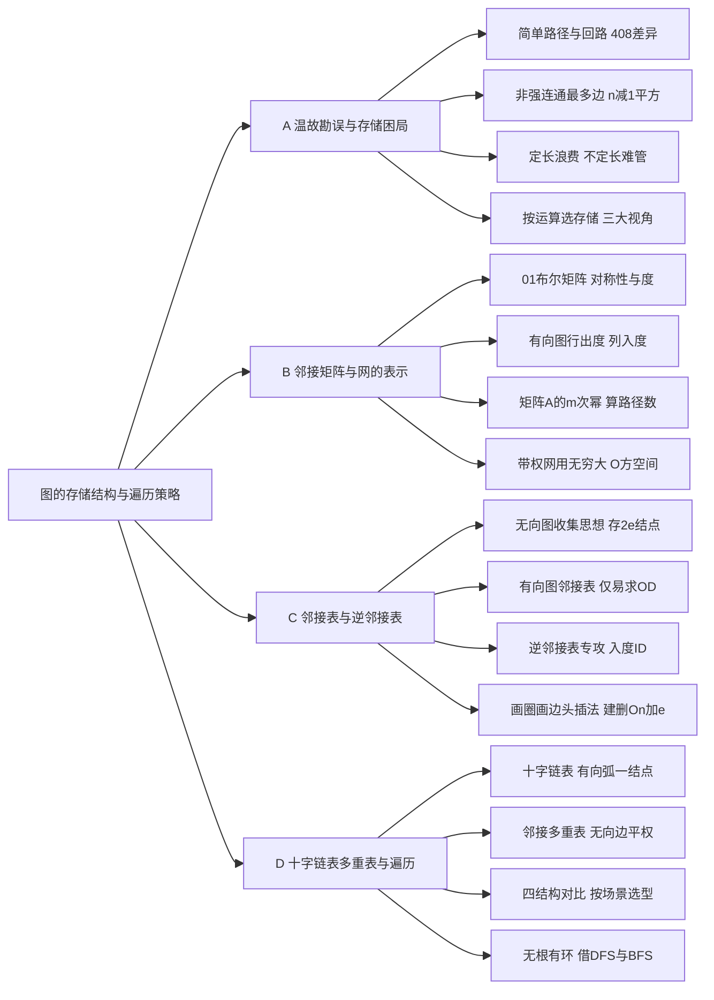
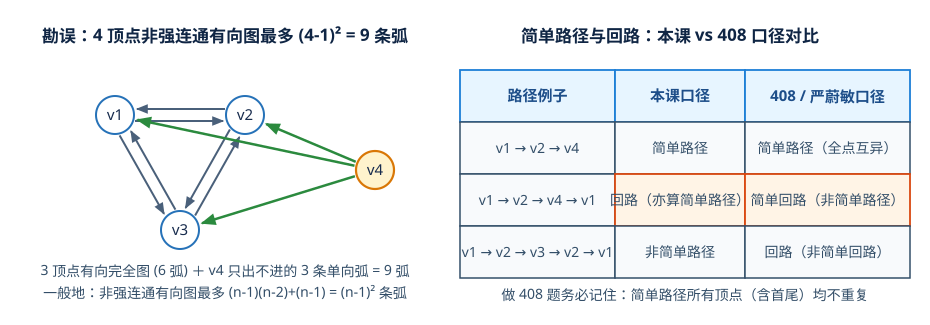
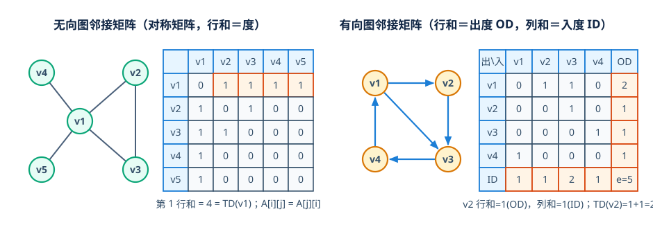
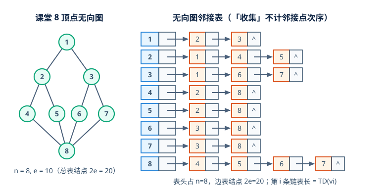
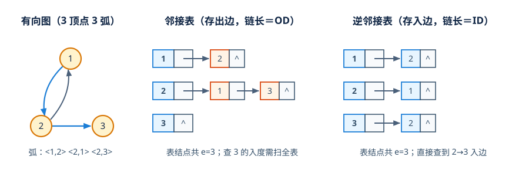
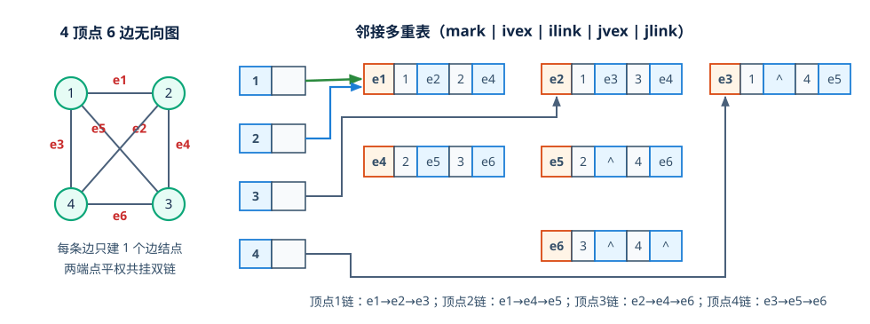
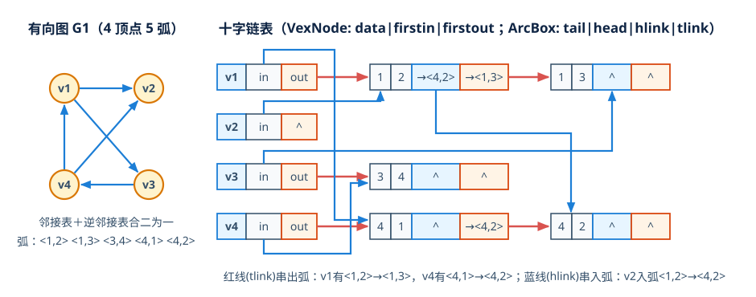
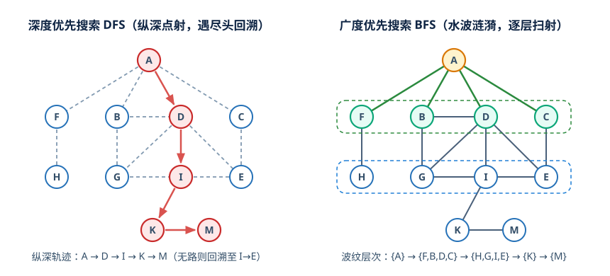

# 数据结构 · 第十二周第二节 · 图的存储 · 详细版讲义

> **来源说明**：本讲义依据课堂录音的本地转写整理校订而成，属**讲授稿性质的整理稿**。全篇以**第一人称**写成——写作者就是讲授者本人，课堂上的勘误说明、方法论拆解、例题讲评、板书推演与课堂互动都以「我」的口吻呈现。
>
> - **转写来源**：一份 ASR 导出文字——`图的存储相关课程讲解_导出原文(1).txt`（约 2.4 万字，580 行）。开头先对上一节「简单路径与回路」的 408 口径差异及「非强连通有向图最多边数图示错误」作勘误说明，随后直入「图的存储结构」核心：先论证为何没有通用存储结构及多重链表（定长／不定长）的工程两难，提出「关系优先、顶点牵引、边平权系统观」三大存储视角；再依次展开**邻接矩阵**（无向／有向／网、标号依赖、矩阵幂次与随堂练习陷阱）、**邻接表与逆邻接表**（收集思想、头插法建表与删边复杂度）与**邻接多重表**（边平权与 4 顶点 6 边示例）；最后从存储跨向运算，剖析图遍历为何比树更难，引出 `visited[]` 与 **DFS（深度优先）**、**BFS（广度优先）**两大搜索策略。
> - **这一节的主线**：**从「简单图逻辑」真正落地成「可计算的图存储结构」，再架起通往「图遍历」的桥梁**——先补齐上节遗留的路径口径差与 $(n-1)^2$ 弧数勘误 → 看清为何定长／不定长多重链表都走不通，确立「按运算需求选型」的三维设计观 → 精讲**邻接矩阵**（用二维数组把关系存成 $O(n^2)$ 随机表，行出列入、权值与 `∞` 哨兵）→ 精讲**邻接表与逆邻接表**（用「收集」思想把空间压到 $O(n+e)$，用画圈、画边、头插法落成 C 代码并分析删边代价）→ 展开无向图专用的**邻接多重表**并对照补齐有向图专用的**十字链表**（让同一条弧／边只存一份结点、同时挂在两条链上）→ 对比各类存储结构的时空代价与适用边界 → 从「无根、无层、有环」三大痛点出发，引出 `visited[]` 数组与 DFS／BFS 两大遍历策略。
> - **这一节的边界**：原转写录音在总体概括存储分类时侧重三大视角（关系侧重、顶点侧重、边平权一体），课堂上详讲了**邻接矩阵**、**邻接表／逆邻接表**、**邻接多重表**，以及**图遍历难点与 DFS／BFS 搜索策略引出（第十六、十七节）**；同属「边只存一次」的有向图对称结构——**十字链表**在本次转写中未展开，第十四节（对应插图 `w122_06.svg`）按常规数据结构教材（第 7 章 7.2.3 节）体系补作结构与语义对照，未对照原书核对的具体代码细节已列入「待核实内容」。至于 DFS 与 BFS 的递归／队列完整代码实现及连通分量应用，留待下一节专门展开。
> - **章节对应说明**：本讲义「第 8 章 图结构」对应常见教材（如严蔚敏《数据结构（C语言版）》）**第 7 章 图**（转写里提到上节课讲完的「8.1 节」即对应 7.1 节）；「第 7 章 树形结构」对应第 6 章。凡在本讲义标注常规教材章节处，均以此映射为准，具体细节请以各自教材与课件为准。
> - **时间说明**：本节课为**文字模式**（无音视频轨、无关键帧），各节时间戳按**字数折算的伪时间**（约 200 字／分钟）标注，仅作讲义内部单调递增的定位坐标；按转写约 2.4 万字折算，全课伪时间长约 2 小时 4 分（`00:00`～`02:04`）。
> - **示意图说明**：本节配图分两类。**开头的「总览知识地图」**使用流程图表代码块编写，Obsidian 原生渲染为矢量图；**正文里的数据结构示意图**全部是**独立手写的 SVG 矢量图片**，存放在 `插图/` 目录下（`w122_01.svg` ～ `w122_07.svg`），正文以标准 Markdown 图片语法直接嵌入，每张图下均附「图注」，图内所有顶点编号、矩阵元素、链表指针与轨迹均与正文验算一致。
> - **关联阅读**：[[数据结构 第十二周第一节 图结构 详细版讲义]]（上一节：图的逻辑定义、简单图限定、完全图公式与度守恒）、[[数据结构 第十一周第二节 哈夫曼树与并查集 详细版讲义]]（并查集双亲表示法，后续 Kruskal 最小生成树判环的直接底座）、[[数据结构 第八周第一节 数组的存储与特殊矩阵 详细版讲义]]（二维数组存储、对称矩阵下三角压缩与稀疏矩阵三元组／十字链表前传）、[[数据结构 第九周第一节 树与二叉树 详细版讲义]]（双亲、孩子、孩子兄弟三种存储对比，树是「一对多」的通用链式起点）、[[数据结构 第九周第二节 二叉树的遍历 详细版讲义]]（先根遍历与层次遍历思想，分别是图 DFS 与 BFS 的前身）、[[数据结构 第四周第二节 单链表的插入与删除算法 详细版讲义]]（头插法更新指针先后顺序与防断链基本功）。

## 开场导读

上一节我们把第 8 章的「名片」发了出去：先立下了「先抓整体框架与基本原理，再抠代码细节」的学习铁律，又把图的形式化定义 $G=(V,E)$、简单图边界、完全图边数上限以及顶点度与边数的守恒关系夯实了一遍。可那些圈圈和连线全都画在黑板和纸面上——计算机既看不懂你用粉笔画的圆圈，也不认识你用直尺拉的线段。所以今天这节课，我们就要解决整章最关键的工程落地问题：**把逻辑上「多对多」的图，真正搬进计算机内存里。**

如果按前面线性表和二叉树的惯性去猜，很多同学大概会觉得：线性表无非顺序表和单链表，二叉树无非左右二叉链表，图不外乎多加几个指针吗？这正是这节课一开场就要打破的幻觉。图结构没有任何一种存储结构能「包打天下」——你如果给每个顶点固定开出一样多的指针槽，遇到少数几个超级枢纽结点就会把整片内存浪费空；可如果按每个顶点自己的度数动态分配大小不一的结构体，代码和内存管理立刻变得混乱不堪。因此，计算机科学家把图的存储拆成了四条分工明确的路线：**邻接矩阵（数组表示法）**、**邻接表（含逆邻接表）**、**十字链表**与**邻接多重表**。每一种结构都在「省空间」「判边快」「求出入度」「删边方便」之间做了不同的取舍。

在正式铺开这四种存储之前，我还会先花几分钟做两件「排雷」工作：一是把上节课最后提到的「简单路径与回路」拿去跟 408 考研大纲和严蔚敏教材逐字对齐，以免做选择题时被同一名词的不同定义坑掉；二是亲手把上节课讲非强连通有向图最多边数 $(n-1)^2$ 时画偏了的那张示意图纠正过来。紧接着，顺着「关系优先」「顶点牵引」「边平权一体化」三条思路，我们把四种存储结构的结构体定义、手算画法、C 语言建表与删除复杂度逐一推透；最后在课程尾声，再顺势跨进下一节的大门——看看为什么图的遍历比树难得多，以及**深度优先搜索（DFS）**和**广度优先搜索（BFS）**到底代表了两种怎样的搜索策略。

这节课概念密度较高、代码结构从二维数组一路跨到十字交叉双链，同学们在练习和考试中容易出错的，往往集中在这**三处细节**上，听课时务必留心核对：

1. **简单路径的口径差与非强连通最多弧数算错**：在咱们课堂课件的口径里，只要除两个端点之外其余顶点不重复就算简单路径（因此首尾相同的简单回路也被包含在内）；但在 **408 大纲与严蔚敏教材**口径里，**简单路径要求所有顶点（含起点与终点）互不相同**，首尾相同的叫**简单回路**。做统考选择题时一旦把这两个口径混了，选项直接选反。此外，$n$ 顶点非强连通有向图的最多弧数是 $(n-1)^2$，不是 $(n-1)(n-2)+1$——那个多出来的顶点可以向其余 $n-1$ 个顶点全部拉满单向弧。
2. **邻接矩阵把有向图当无向图算度，以及网中「无边」误填 `0`**：课堂随堂练习已经证明，哪怕再三提醒，还是有同学看到一个不对称的 0/1 矩阵时只把第 $i$ 行相加就当成顶点 $v_i$ 的度。记住：**无向图对称矩阵，第 $i$ 行和才是度；有向图一般不对称，第 $i$ 行和只是出度 $OD(v_i)$，第 $i$ 列和才是入度 $ID(v_i)$，总度必须行加列！** 而在带权网里，两点无边一般要填充分大的哨兵值 $\infty$，只有特定应用需求下才会用 `0` 表示无边，千万别在求最短路径时把无边填成 `0`。
3. **邻接表「有向图漏算入度／无向图忘乘 $2$」与十字／多重表双链混用**：在无向图邻接表中，每条边要在两个端点的链表里各挂一次，总表结点数是 $2e$ 而不是 $e$；在有向图邻接表中，第 $i$ 条链表长度只是出度 $OD(v_i)$，想直接查入度必须另建逆邻接表或扫描全表；用头插法插入边结点时，**务必先连 `p->nextarc = firstarc` 再改 `firstarc = p`**，顺序写反整条链当场丢失。至于更进阶的十字链表（有向图专用）与邻接多重表（无向图专用），核心都是**一条弧／边只建一个结点**，分别挂进两条方向／端点不同的链里——把这四条链域分清，这节课最硬的骨头就啃下来了。

## 总览知识地图



> **图注（全课思维导图）**：这张图按「排雷定调 $\to$ 矩阵 $\to$ 邻接表 $\to$ 十字／多重表与遍历引出」四个分支展开。**A 分支解决前置边界**：对齐简单路径的课堂／408 口径并纠正 $(n-1)^2$ 图示，说明定长／不定长多重链表的两难，确立按运算选型的三大视角；**B 分支讲透邻接矩阵**：以布尔代数为根基，区分无向对称、有向行出列入、矩阵 $A^m$ 计数与带权网的 $\infty$ 哨兵；**C 分支落地邻接表**：以「收集」不计邻接次序解释多样存储，用邻接表与逆邻接表分工读写出入度，并给出头插法建表与全图删边的 $O(n+e)$ 实现；**D 分支完成高级链式结构与过渡**：用有向图十字链表与无向图邻接多重表消除「一弧／一边存两份或难查双向」的痛点，汇总四结构选型，最后由「无根、无层、有环」引出 DFS 与 BFS 策略。

## 正文

### 一、温故与勘误：简单路径的 408 口径差与非强连通最多弧数 `00:00-00:08`

上节课下课前，我们赶着把第 8 章第 1 节（对应严蔚敏教材 7.1 节）的基本术语过了尾，因为当时 PPT 翻页有点卡顿，退出再进反应也慢，只能一页一页往前推，结果有两个地方我回去复盘对照了一下，觉得必须一上课就专门拎出来给你们交代清楚。一个是**「简单路径」和「回路」在不同教材与 408 统考里的定义差异**，另一个是**上节课最后画的那张非强连通有向图最多边数的示意图**。

#### 1.1 简单路径与回路：课堂课件口径 vs 408／严蔚敏教材口径

先看**路径（Path）**。上一节我们讲过，路径的本质其实是一个**点边交替序列**（转写里误作「两边交集序列」）：一个顶点、一条边、一个顶点、一条边，交替着往前走。平时为了书写方便，大家习惯把中间的边省掉，直接简写成一串顶点序列（例如 $v_1, v_2, v_4$），但你心里必须清楚，它的底层含义是一步步沿着真实的边走过去的。

问题出在**简单路径（Simple Path）**和**回路（Cycle，也叫环）**的定义上。我们课堂使用的课件，是这样界定简单路径的：

> **本课程课件口径**：如果一条路径上，除了两个端点 $v_p$ 和 $v_q$ 可以相同以外，其余的顶点互不相同，这样的路径就称为**简单路径**；而两个端点相同的简单路径，就称为**回路**（或者叫环）。

照这个口径来看：
- 序列 $v_1 \to v_2 \to v_4$，中间没有重复点，起点终点也不同，当然是简单路径；
- 序列 $v_1 \to v_2 \to v_3 \to v_2 \to v_1$，中间顶点 $v_2$ 重复出现了，它就不是简单路径，是非简单路径；
- 序列 $v_1 \to v_2 \to v_4 \to v_1$，起点和终点都是 $v_1$，但中间经过的 $v_2, v_4$ 互不相同——按照咱们课件的定义，它既是**回路**，同时也算作一条**简单路径**。

可我课后专门回去翻了 **408 考研大纲**和**严蔚敏教材 7.1 节**的标准定义，发现两边在这个词的边界上**并不完全一致**！如果你们以后直接拿着课件里的理解去刷 408 真题，遇到概念辨析题很容易白白丢分。我把两边的定义并排拆开给你们看：

1. **408 与严蔚敏教材对「简单路径」的要求更严格**：它规定**路径序列中所有顶点都必须互不相同**——注意，**包括首尾两个端点在内都不能相同！** 也就是说，在 408 口径下，$v_1 \to v_2 \to v_4 \to v_1$ 因为首尾都是 $v_1$，它**根本不算简单路径**。
2. **408 对「回路（环）」的要求反而更宽松**：只要首尾两个端点相同（$v_1$ 出发最终回到 $v_1$），就叫回路或环；至于中间经过的顶点能不能重复，普通「回路」定义并不禁止（比如 $v_1 \to v_2 \to v_3 \to v_2 \to v_1$ 在 408 里依然算回路）。
3. **408 专门多了一个「简单回路（简单环）」的概念**：在 408 里，**除第一个顶点和最后一个顶点外，其余顶点不重复出现的回路**，才叫做**简单回路**或**简单环**。

你把上面这两套说法一对照，马上就豁然开朗了：**咱们课程课件里叫做「回路」的那种路径（首尾相同、中间点不重），恰好就等价于 408 里的「简单回路」**；而咱们课件把「简单回路」归进了广义的「简单路径」里，408 则把「简单路径」收紧成「全序列所有点（含首尾）绝对不重复」。在计算机科学里，同一术语在不同教材体系下微调边界并不少见，平时做本校期末题时注意审题语境，**一旦做 408 统考或外校考研选择题，务必按「简单路径所有顶点（含首尾）均不重复」这条严口径来判断**！

#### 1.2 勘误：非强连通有向图最多边数的图示问题

第二个要专门修正的，是上节课最后讲「$n$ 个顶点的非强连通有向图最多有多少条弧」时PPT 上画的那张示意图。

上节课我先用角落里的最简情形带着大家推了一遍：
- 如果是**完全不强连通、边最少**的情况（比如左下方画的几个孤立点），那一条弧都没有，边数最小值是 $e = 0$；
- 如果是有向图达到**强连通**的最少弧数，只需要把 $n$ 个顶点首尾串成一个**单向大环**，每个点出度 $1$、入度 $1$，边数最小值恰好是 $e = n$；
- 真正容易画错的是：**有 $n$ 个顶点、但仍然保持「非强连通」的有向图，最多能塞进多少条弧？**

上节课我给出的最终公式结果 $(n-1)^2$ 是**完全正确的**，但PPT 上配的那张辅助示意图我回去一看——**画错了**！错在哪儿呢？上节课那张图，我先把前 $n-1$ 个顶点两两之间都加上双向弧，形成了一个 $(n-1)$ 阶的有向完全图（这一块占了 $(n-1)(n-2)$ 条弧）；然后我把第 $n$ 个孤立顶点拿出来，只在它和前面那团完全子图之间画了**1 条**单向弧（比如只连了一条指向它的弧，或者只画了一条从它指出的弧）。

如果只画 $1$ 条单向弧，图上总弧数其实是 $(n-1)(n-2) + 1$，它**远远没有达到「非强连通」的最大弧数上限**！为什么？只要第 $n$ 个顶点**要么只有出弧没有入弧（进不去），要么只有入弧没有出弧（出不来）**，不管它和前面那 $n-1$ 个顶点之间连了多少条同向弧，整张图**都不可能强连通**！既然要问「最多」能有多少条弧，第 $n$ 个顶点当然不能只连 $1$ 条，而应该把其余 $n-1$ 个顶点全部连满——例如从第 $n$ 个顶点向前面那 $n-1$ 个顶点各引出一条单向弧（全部「只出不进」），整整再加 $n-1$ 条弧！

这样一算，总弧数的最大值才是：

$$
e_{\max} = (n-1)(n-2) + (n-1) = (n-1)\bigl[(n-2) + 1\bigr] = (n-1)^2
$$

拿 $n = 4$ 举个具体的例子（见下图左侧）：让 $v_1, v_2, v_3$ 这 $3$ 个顶点组成一个 3 阶有向完全图，一共 $3 \times 2 = 6$ 条弧；再让第 $4$ 个顶点 $v_4$ 向 $v_1, v_2, v_3$ 分别发出一条单向弧 $\langle v_4, v_1\rangle, \langle v_4, v_2\rangle, \langle v_4, v_3\rangle$。此时总弧数达到 $6 + 3 = 9 = (4-1)^2$ 条；因为没有任何一条弧指向 $v_4$，从 $v_1, v_2, v_3$ 永远走不到 $v_4$，所以它依然是非强连通图。只要再往里强行多加哪怕 $1$ 条弧——那唯一剩下的空位只能是某个顶点指向 $v_4$ 的弧，一旦加上去，$v_4$ 立马既能出去又能回来，整张图瞬间就变成强连通图了！这才是 $(n-1)^2$ 背后的严谨构造。



> **图注（上节勘误与术语口径对比）**：左图展示 $n=4$ 时非强连通有向图的最大弧数构造——前 3 个顶点构成有向完全图（6 条弧），第 4 个顶点 $v_4$ 只出不进连满 3 条单向弧，合计 $(4-1)^2=9$ 条弧（此前图示只连 1 条是漏画）；右表并列对照本课程课件与 408／严蔚敏教材在「简单路径」与「回路／简单回路」上的定义边界。

**本节要点**

- **路径的本质**：路径是顶点与边交替出现的序列，简写为顶点序列时不能忘记中间隐含着真实的边。
- **简单路径的口径差**：本课课件允许简单路径首尾相同（此时即回路）；**408 大纲与严蔚敏教材则要求简单路径中所有顶点（含首尾）互不相同**，首尾相同且中间点不重复的单独称为**简单回路**。
- **非强连通有向图最多弧数**：正确构型是 $n-1$ 个顶点构成有向完全图，加上第 $n$ 个顶点全向出（或全向入）的 $n-1$ 条单向弧，总数为 $(n-1)(n-2)+(n-1)=(n-1)^2$。

---

### 二、存储困局：为什么图没有通用存储结构与多重链表两难 `00:08-00:17`

把上节课 8.1 节（教材 7.1 节）的术语与勘误全部收干净之后，从这一小节开始，我们正式切入今天的主角——**图的存储结构**（对应教材 7.2 节）。

先想一个最朴素的问题：**图在计算机内存里到底该怎么存？** 我再三提醒过你们，计算机不认识黑板上画的圈和线，不管你在纸上把一张社交网络图、电路板连线图或者城市交通网画得多清楚，进了程序都必须转化成某种由线性地址和指针编织起来的存储结构。

上一节开头讲学习方法时，我就提前给你们打过预防针：
- 学**线性结构**的时候，不管具体需求是什么，无非就两种物理思路——顺序存储（向量／数组）和链式存储（单链表／双链表），换着花样都能把增删改查做出来，顶多是时间效率有高有低；
- 学**树形结构**的时候，虽然有双亲、孩子、孩子兄弟三种表示法，但到了最核心的二叉树这一块，反正采用**「左孩子 + 右孩子」的二叉链表**几乎就能把所有常见遍历与查找运算通吃，一招就够用了；
- 可是一脚踏进**图结构**，这套老经验立刻失灵——**因为图太复杂了，任意两个顶点之间都可能发生联系，没有任何一种存储结构能「包打天下」**，我们必须针对特定运算需求，老老实实去设计特定的组织存储方法。

有同学可能会不服气，说：「既然树是用结点加指针的链表存的，那图本质上不就是每个顶点多连了几条边吗？我们直接给每个顶点配多个指针域，用**多重链表（Multilist）**来存不就完了吗？」

说实话，从直觉上讲，这个想法非常自然。你们试着想象一下现实世界里的「认识关系」：某一个时刻你忽然认识了一个新同学，或者认识了别的人，你们俩之间就多了一条关联边。从逻辑上看，顶点之间的联系是**动态发生、随时可能增加**的，用「一个数据域 + 若干个指针域」的多重链表结点去对应每个顶点，新认识一个人就在结点里多挂一个指针指向他，似乎再顺理成章不过了。

可一旦真要把多重链表放进内存里写结构体，立刻就会掉进**两头受限的两难困境**：

#### 2.1 方案一：定长结点多重链表——为了兼容极少数人，空间浪费极度严重

第一种做法叫**定长多重链表**：不管你这个顶点实际认识多少人，我在定义结构体 `struct VNode` 时，统统给你分配**一样多个指针域**。

为了保证任何一个顶点都能把自己的边存得下（满足可表达性），这个固定的指针域个数必须取多少？**必须取整张图里所有顶点度数的最大值 $\max TD(v_i)$！**

现在你拿人的「被认识／认识关系」来算一笔账：
- 普通人这一辈子，经常联系、真正认识你的人，也就几十个、几百个、几千个；
- 就算你是个社交圈很大的「交际达人」（转写里 ASR 误认成了「标书达人」），认识你的人达到上万，顶多也就占上万个指针域，这已经很不得了了；
- 可社会这张大图里偏偏存在极端的中心人物——比如说你将来某一天当了**国家主席**，全国号称有 **14 亿人**都认识你！按照定长结构体的规矩，只要这一个节点的度数飙到了 14 亿，那系统里**每一个普通老百姓的结点里面，都得硬生生跟着开出 14 亿个指针域**（转写中此处把「指针」误认作了「矩阵」）！

你们算算这笔空间账：14 亿个普通人，每人背着 14 亿个几乎全为 `NULL` 的空指针域，内存根本装不下！定长方式唯一的好处是结构体类型统一、好管理，但空间浪费大到根本无法承受。

#### 2.2 方案二：不定长结点多重链表——省了空间，却难以统一管理

既然定长浪费空间，那就换第二种做法——**不定长多重链表**：你这个顶点实际认识几个人，我就给你动态分配几个指针域！
- 你只认识 $10$ 个人，我就给你申请带 $10$ 个指针的结构体；
- 他认识 $10000$ 个人，我就给他申请带 $10000$ 个指针的结构体；
- 到了国家主席那个结点，就单独给他配一个带 $14$ 亿个指针的结构体。

表面上看，多余指针都没浪费，空间省下来了！可你想过在 C 语言里怎么写这种代码吗？
1. **类型管理困难**：10 个指针是一种结构体，1 万个指针是另一种结构体，14 亿个指针还得再声明一种结构体；哪怕用动态指针数组去套娃，每个结点的长度都不一致，你还得额外维护度数计数、频繁扩容搬移。
2. **运算与指针遍历极其混乱**：图里的边本来就像网一样拉来拉去、穿插交错，现在连每个顶点结点的内存布局都长得五花八门，遍历、删边、判邻接、释放内存每一步都得根据结点规格做分支处理，既不利于管理，也不利于统一运算。

这也是我们在讲图的存储一开篇就直接否定朴素多重链表的原因：**定长太浪费，不定长难管理。** 正因为这条路走不通，我们才必须跳出「把所有邻接指针死塞进顶点结构体」的惯性思维，针对不同的操作目标，去构造专门的存储结构。

**本节要点**

- **无万能存储**：与线性表（顺序／链式）和二叉树（二叉链表通吃）不同，图的多对多复杂性决定了没有任何一种存储结构能胜任所有运算，必须「看菜吃饭、按需选型」。
- **定长多重链表的痛点**：指针槽数量必须按全图最大度 $\max TD(v_i)$ 对齐；一旦存在极少数高连接度枢纽点（如「14 亿人认识国家主席」），其余所有低度顶点都会产生天文数字级的空指针浪费。
- **不定长多重链表的痛点**：虽然按实际度数分配省下了空间，但结点结构异构、指针个数参差不齐，导致类型声明、内存扩容与边遍历算法极难统一管理。

---

### 三、三大存储视角：关系优先、顶点牵引与边平权系统观 `00:17-00:22`

既然朴素的多重链表走不通，那究竟该怎么设计图的存储结构呢？我带你回到问题最源头的地方来看——**任何一张图，客观上究竟存在哪两类东西？**

很简单，一共就两类客观事物：
1. **第一类事物：顶点（节点）本身**。比如城市地图里的一个个城市、社交网络里的一个个具体的人、电路板上的一个个电子元件。
2. **第二类事物：顶点与顶点之间的关联关系（边或弧）**。比如两座城市之间的公路、两个人之间的相识关系、元件引脚之间的导线连接。

把这两类东西和我们前面学过的结构对比一下，你就彻底明白为什么图这么挑存储结构了：在线性结构和树形结构里，元素之间的先后／父子关系主要是**为了把数据元素本身组织起来**而附带的一种逻辑秩序；可在图结构里，**顶点之间的关联关系本身就是一种独立的客观存在的数据**——很多时候你建一张图，关心的甚至不是某个人叫什么名字，而是「谁和谁连着、这条连接有多强」。

站在这两类客观事物的不同侧重点上，计算机科学演化出了**三种（若把有向图与无向图拆开细数则是四种）经典存储视角**：

1. **视角一：关系优先（重边轻点）$\longrightarrow$ 邻接矩阵（数组表示法）**
   如果我们当下研究的重点，是**客观事物与事物之间的相互作用与邻接关系**——比如「$v_i$ 和 $v_j$ 之间到底有没有边」「这条通道的代价值是多少」「走 $m$ 步能不能从 A 到达 B」——而对顶点自身带了一堆什么复杂属性反倒不太关心，那就干脆用一张二维方阵把所有顶点两两之间的关系全部摊在明面上，这就是**邻接矩阵**。纯矩阵单元里只放关系（$0/1$ 或权值），顶点自身的资料另开一个小一维数组挂在旁边就行。
2. **视角二：顶点牵引（既顾点又顾边，以点为主导）$\longrightarrow$ 邻接表（及逆邻接表）**
   如果我们既要稳稳存住每一个顶点对象本身的信息，又要顺着顶点去查跟它相连的关联关系，但边本身相对稀疏、不需要把所有「不存在的边」也占着茅坑，那么**邻接表**就是最合手的方案。不过要看清它的性格：**邻接表在关注关系的时候，比邻接矩阵要「弱」一些**——它总是站在**某一个主导顶点**的立场上往外看（比如在有向图里，站在 $v_i$ 的视角收集「我发出去的边」），而不是一眼直接锁定任意一对 $(v_i, v_j)$ 是否相连。
3. **视角三：边平权一体化（系统观，点边并重）$\longrightarrow$ 邻接多重表（无向图）与十字链表（有向图）**
   再往深处想一步：邻接表站在单个顶点的角度拉出一条链表，这就带来了某种「偏心」——对于无向图的一条边 $(v_1, v_2)$，明明 $v_1$ 和 $v_2$ 是**完全平权、不分主次**的两个端点，邻接表却不得不把同一条边硬拆成两份，一份塞进 $v_1$ 的地盘、一份塞进 $v_2$ 的地盘；对于有向图的一条弧 $\langle v_1, v_2\rangle$，邻接表只管出弧不管入弧，想两头兼顾就得建两张独立的表。如果我们站在**系统观／一体化处理**的高度，希望把顶点和关系看成一个整体，对每一条边（或弧）只建**唯一一个结点**，同时让依附的**两个端点平权共享这条信息**，于是就引出了无向图专用的**邻接多重表**（转写中重点作为第三视角引出），以及与之成对、专用于有向图的**十字链表**。

你把这三个视角记牢，后面不管看到多复杂的指针结构体，都不会迷路——无非就是看设计者到底把「聚光灯」打在**关系矩阵**上、打在**单个顶点的邻接链**上，还是打在**唯一的一条边结点**上。下面我们就把这四座存储堡垒一座一座拆解开来。

**本节要点**

- **图的两类研究对象**：一是客观事物本身（顶点），二是客观存在且需要独立研究的关联关系（边或弧）。
- **三种设计视角**：**邻接矩阵**重关系、查边最快；**邻接表**以某个顶点为主导牵引出边，兼顾顶点信息与稀疏空间；**邻接多重表与十字链表**站在系统一体化视角，以边／弧为单位、让两端点平权共享唯一结点。
- **课堂口径与教材体系衔接**：课程总体哲学按上述三大视角划分；具体落地到有向图与无向图时，即严蔚敏教材 7.2 节的四大存储结构——数组表示法（邻接矩阵）、邻接表、十字链表、邻接多重表。

---

### 四、邻接矩阵基础：布尔矩阵、计算根基与无向图对称度 `00:22-00:33`

我们从第一种、也是最直观的存储结构开始——**邻接矩阵（Adjacency Matrix）**，教材 7.2.1 节也把它叫做**数组表示法**。

#### 4.1 什么是邻接矩阵？为何非网图用布尔矩阵？

定义其实一句话就能说透：**用矩阵来反映顶点与顶点之间邻接关系的存储结构，就叫做邻接矩阵**。这和你们在《离散数学》图论部分学过的邻接矩阵概念是一模一样的。假设图 $G=(V,E)$ 有 $n$ 个顶点（通常按顺序编号为 $v_0, v_1, \dots, v_{n-1}$ 或 $v_1, v_2, \dots, v_n$），我们就开一个 $n \times n$ 的二维方阵 $A$，用矩阵中第 $i$ 行第 $j$ 列的元素 $A[i][j]$ 来表示顶点 $v_i$ 和顶点 $v_j$ 之间有没有关联。

根据我们关心不关心「关系有多强（有没有权值）」，邻接矩阵自然分成两大类：**非网图（无权图）**和**网（带权图）**。

在非网图里，我们只关心「有没有边／弧」，是个非此即彼的二值判断，因此一般直接用**布尔矩阵**（说白了就是 `0/1` 矩阵，`1` 代表真／有边，`0` 代表假／无边）来表示：

$$
A[i][j] = \begin{cases}
1, & \text{若 } (v_i, v_j) \in E \text{（无向图）或 } \langle v_i, v_j \rangle \in E \text{（有向图）} \\
0, & \text{否则}
\end{cases}
$$

这里再顺嘴把表示符号敲实一下：**圆括号 $(i, j)$ 表示无向边**，没有方向，谁先谁后都一样；**尖括号 $\langle i, j \rangle$ 表示有向弧**，从 $i$ 指向 $j$，顺序绝不能颠倒。

说到**布尔矩阵**和背后的**布尔代数**，我多嘱咐你们两句题外话——这可不是随便凑数用的 `0` 和 `1`。现代电子计算机之所以能运转起来，它最底层的运算理论基础其实就是**布尔代数（Boolean Algebra）**！以后你们学《数字逻辑》《计算机组成原理》的时候会看得清清楚楚，芯片里亿万个逻辑门做的全是「与、或、非」布尔运算。没有布尔代数，现代计算机就失去了它的计算根基。

顺着计算机工业史，我也顺便给你们拓宽一点专业视野：**咱们计算机系的学生，平时看问题、聊行业，千万别眼睛只盯着桌面微机（转写里误作「危机」），张嘴就是 Microsoft、闭嘴就是 Intel，搞得别的巨无霸公司都看不见了，那多丢人！** 放眼整个计算机工业界，有一家真正百年传承的老店必须知道——**IBM**。你们拿微软的专利数量跟 IBM 比一比，简直可以忽略不计；IBM 手握两万多项计算机底层最顶尖的核心专利，从硬件到软件几乎每个关键节点都站在源头：人类第一款双核 CPU 是 IBM 设计并制造出来的，可别以为一提芯片就只有 Intel；世界上第一块磁盘也是 IBM 造出来的；更别提操作系统——上世纪 60 年代 IBM 就已经做出了大型主机操作系统，比后来桌面微机（PC）上的操作系统早了整整一个时代！所以你们将来出去跟人聊技术、看架构，视野一定要把大型机、系统软件与底层硬件理论一起撑开。

#### 4.2 无向图邻接矩阵手推：别在「小学生加法」上栽跟头

视野拉回黑板。来看一个具体的 $5$ 顶点无向图例子（编号 $v_1, v_2, v_3, v_4, v_5$，对应下节插图 `w122_02.svg` 左侧）：顶点 $v_1$ 分别跟 $v_2, v_3, v_4, v_5$ 都有边相连，另外 $v_2$ 和 $v_3$ 之间还有一条边 $(v_2, v_3)$，其余顶点之间都没连线。一共 $5$ 个顶点、$5$ 条边。

我们来把它的 $5 \times 5$ 邻接矩阵一行一行「审」出来。横向列标写 $v_1 \sim v_5$，纵向行标也写 $v_1 \sim v_5$，按顺序挨个考察：
- **看第 1 行（$v_1$）**：我们研究的是简单图，没有自环，所以 $v_1$ 到 $v_1$ 没边，填 `0`；$v_1$ 到 $v_2, v_3, v_4, v_5$ 全都有边，统统填 `1`。第一行就是 `[0, 1, 1, 1, 1]`。
- **看第 2 行（$v_2$）**：$v_2$ 到 $v_1$ 有边填 `1`；$v_2$ 到自己填 `0`；$v_2$ 到 $v_3$ 有边填 `1`；$v_2$ 到 $v_4, v_5$ 没边填 `0`。第二行就是 `[1, 0, 1, 0, 0]`。
- **看第 3 行（$v_3$）**：跟 $v_1, v_2$ 有边填 `1`，其余（包括自身）填 `0`，即 `[1, 1, 0, 0, 0]`。
- **看第 4 行（$v_4$）与第 5 行（$v_5$）**：两者都只和 $v_1$ 有边，所以第 4 行、第 5 行都是 `[1, 0, 0, 0, 0]`。

说实话，照着图形把有边填 `1`、没边填 `0` 写进一个方格表，按理说小学生都能全对。可真到历年期末考试改卷子的时候，还真有同学把无向图的邻接矩阵给写错！十有八九不是不会，就是**毛躁不挨个核对**，看串了行或者漏了一两条边。

写出矩阵之后，立刻观察**无向图邻接矩阵的两个硬性质**：

1. **一定是关于主对角线对称的矩阵（即 $A[i][j] = A[j][i]$）**：原因一目了然——因为无向边 $(v_1, v_2)$ 和 $(v_2, v_1)$ 本质上是**同一条边**！只要 $v_1$ 行 $v_2$ 列填了 `1`，反过来 $v_2$ 行 $v_1$ 列也必然填 `1`。而且因为是简单图，主对角线 $A[i][i]$ 全为 `0`。既然对称，在内存特别紧张的情况下，完全可以用前面学过的**对称矩阵压缩存储**，只存下三角或上三角的 $\frac{n(n-1)}{2}$ 个元素即可。
2. **第 $i$ 行（或第 $i$ 列）中 `1` 的个数之和，恰好等于顶点 $v_i$ 的度 $TD(v_i)$**：
   $$TD(v_i) = \sum_{j=0}^{n-1} A[i][j] = \sum_{j=0}^{n-1} A[j][i]$$
   什么叫「度」？就是跟这个顶点有边相连的边的条数（或邻接点的个数）。你看上面第 1 行 `[0, 1, 1, 1, 1]`，四个 `1` 加起来等于 $4$，正好说明和 $v_1$ 相连的有 $v_2, v_3, v_4, v_5$ 共 $4$ 条边，$TD(v_1)=4$！整张矩阵里所有元素加起来，每条边被算了两次（$(i,j)$ 和 $(j,i)$ 各一个 `1`），正好印证了上节课的 $\sum TD(v_i) = 2e = 10$。



> **图注（无向图邻接矩阵）**：$5$ 个顶点的无向图，矩阵是 **$5\times5$ 的 $0/1$ 方阵**。**它关于主对角线对称**（$(v_1,v_2)$ 与 $(v_2,v_1)$ 是同一条边），**主对角线全 0**（简单图无自环）。**第 $i$ 行（或第 $i$ 列）的 1 的个数就是顶点 $v_i$ 的度**：例如第 1 行有四个 1，$\deg(v_1)=4$。

**本节要点**

- **邻接矩阵定义**：用 $n$ 阶二维方阵表示 $n$ 个顶点两两之间的邻接关系；非网图用 `0/1` 布尔矩阵，体现现代计算机以布尔代数为底层运算基础的共性。
- **符号规范**：无向边用圆括号 $(i, j)$，有向弧用尖括号 $\langle i, j \rangle$。
- **无向图邻接矩阵性质**：矩阵必然对称（$A[i][j] = A[j][i]$），主对角线全 $0$（简单图无自环），必要时可按对称矩阵压缩为上／下三角存储；第 $i$ 行或第 $i$ 列元素之和即为顶点 $v_i$ 的度 $TD(v_i)$。

---

### 五、有向图的邻接矩阵：行是出度，列是入度 `00:33-00:36`

无向图那条边是"双向"的，所以矩阵对称。**有向图就不一样了**：$A$ 认识 $B$，$B$ 未必认识 $A$。

> 有向图有啥特点啊？**第一个特点就是一般来说就是非对称矩阵**……因为在有向图当中，**$A$ 认识 $B$，$B$ 未必认识 $A$** 呀。

**"一般来说"三个字要留住**：**有向完全图**（每对顶点之间都有双向弧）的矩阵**碰巧**是对称的；但**一般的有向图不对称**。所以我们谈概念时**按一般情形说**。

**那有向图的"度"怎么读？** 这是本节第一个**必须分清**的地方：

> 矩阵的**第 $i$ 行之和是顶点 $v_i$ 的出度**；反过来，**第 $i$ 列之和是顶点 $v_i$ 的入度**。

$$
OD(v_i)=\sum_{j=0}^{n-1}A[i][j]\quad(\text{第 }i\text{ 行之和}),\qquad
ID(v_i)=\sum_{j=0}^{n-1}A[j][i]\quad(\text{第 }i\text{ 列之和})
$$

**为什么行是出度？** 因为 $A[i][j]=1$ 表示"**从 $v_i$ 发出一条弧到 $v_j$**"——**起点固定在第 $i$ 行**，所以**同一行里的每个 1 都是 $v_i$ 发出去的**。**列则相反**：固定终点，数"谁发给我"。

$$
\text{有向图里，顶点的度}=OD(v_i)+ID(v_i)=\text{行和}+\text{列和}
$$

比如在第四节插图 `w122_02.svg` 右侧的 $4$ 顶点 $5$ 弧有向图示例里，取 $v_2$ 来算：第 $2$ 行只有第 $3$ 列是 `1`（发往 $v_3$），所以行和 $OD(v_2)=1$；第 $2$ 列只有第 $1$ 行是 `1`（来自 $v_1$），所以列和 $ID(v_2)=1$；两者相加，$TD(v_2)=1+1=2$。

**这一条后面随堂题要直接用**。

**本节要点**

- **有向图邻接矩阵一般不对称**（完全有向图例外），因为"$A$ 到 $B$"不代表"$B$ 到 $A$"。
- **行和＝出度 $OD$**，**列和＝入度 $ID$**，**度＝行和＋列和**。
- 无向图里"行和＝列和＝度"，有向图里**这三者要分开算**——这是最容易混的一处。

### 六、网：把 1 换成权值，无穷大怎么办 `00:36-00:41`

到这儿讲的都是"**有没有边**"。但现实里的关系有**强弱**：

> 我们要研究**关系的强弱**，那我们大不了**把那个布尔矩阵的 `1` 换成权值**呗，一样的，还是一样分无向图和有向图。

**这就是网（带权图）的邻接矩阵**（若两点间无边，通常用 $\infty$ 表示；也可按具体应用取 `0`）：

$$
A[i][j]=\begin{cases}
w_{ij}, & \langle v_i,v_j\rangle\in E\ (\text{有边，权为 } w),\\
\infty\text{（或 }0\text{）}, & \langle v_i,v_j\rangle\notin E\ (\text{无边}),
\end{cases}
$$

**无边到底填 `0` 还是填 `∞`，对角线怎么办？** 我在课上特别提醒：**用零还是用无穷大，要根据你的应用需求来选择。** 当表示距离、代价等「求最短／最小」的问题时，无边必须填 $\infty$（以免把「无路可通」误算成「零代价」），而主对角线 $A[i][i]$ 在求最短路径时一般取 `0`（自己到自己距离为 0），在只把对角线视作「无自环边」的场景下则也常取 $\infty$；相反，若业务权值表示流量、频次或相似度等，无边才适合填 `0`。所以没有唯一死板答案，看你要算什么。

**"无穷大"在计算机里怎么表示？** 这是本节一个很实在的工程问题：

> 我们计算机**只能处理或者表达有限问题**。那在编程实现的时候，面临无穷大，我们只能**取一个相对问题来说充分大的数值**。

我课上用年龄打比方：

> 比如说我们以**年龄**为例，年龄无穷大咋表示啊？……一般人也就活个几十岁，报纸上有报道活了 100 来岁的；从生物学角度考察，**最多也许可以活两三百年**。那古代的皇帝希望自己长寿、希望自己永生，底下的人称呼他啥？**万岁**。
> 那你想一下，**一万**相对于年龄来讲就是一个**充分大的数值**，**相当于无穷大**——**谁能活一万年啊？** 实际上说活一万年那是骂人的话，有句话叫"**千年的老马万年的龟**"。

**所以工程上就这么办**：

- 取一个**明显大于任何可能权值**的数（如所有权值之和的若干倍），当"无穷大"用；
- **注意别溢出**：两个"无穷大"相加会溢出，所以**做加法前要先判"是不是无穷大"**；
- 或者干脆用**邻接表**存稀疏网，**没有边就不存**，从根上避开"无穷大"。

**本节要点**

- **网的邻接矩阵**：有边填**权值**，无边填 **$\infty$**（或 0，看应用）。
- **对角线**取 0 还是 $\infty$ **取决于要算什么**，没有统一答案。
- **计算机只能用"充分大的数"表示 $\infty$**；要防溢出，**加法前先判无穷**；稀疏网**改用邻接表**更省。

### 七、邻接矩阵的代价：$O(n^2)$、存不下顶点、依赖编号 `00:41-00:48`

邻接矩阵好用，但**三条代价**必须记住。

**代价一：空间固定 $O(n^2)$，跟边数无关。**

$n$ 个顶点就是 $n\times n$ 个格子，**不管你有几条边**。**稀疏图（边远少于 $n^2$）会浪费大量空间**——这直接导致后面要讲邻接表。

**代价二：没地方存"顶点本身的信息"。**

> 我们用邻接矩阵的时候，**反映点和点之间的关系，我们是没有地方存储事物本身的信息的**——我们只能反映"$i$ 和 $j$ 之间有没有边"，**$i$ 自身这个结点的信息有没有地方存啊？没地方存。**

**这一点很要紧**：图里每个顶点可能带名字、带权、带别的属性。**邻接矩阵只有"格子"，没有"顶点表"**——所以实际实现时**总要另外开一个一维数组存顶点信息**。**"矩阵管关系，数组管顶点"**，这是邻接矩阵的完整形态。

**代价三：矩阵长什么样，依赖顶点的编号次序。**

> 矩阵的给出**实际上和结点的标定次序是有关的**。比如说**北京如果我编号为 1 和编号为 10，那给出的矩阵一样吗？那肯定不一样。**

**"同一张图，换一种编号，矩阵就换一副样子"**——这不影响正确性，但**影响你读矩阵**。所以：

> 但是我们一般来说，**给你给定了那个图，那个结点的标号就已经确定下来了**，你就根据那个结点的标号来给出它的邻接矩阵。所以我们一般考研当中，或者任何题目，做题的时候我们**认为把图给出来了，它的邻接矩阵是确定下来的**。

**做题口径**：**图给了，编号就定了，矩阵就定了**——不要自己另换编号。

**一个附加性质：$A^m$ 数路径。**

> 两个结点之间**是否有长度为 $m$ 的路径**、**并且它的数目有多少**，我们可以**通过矩阵运算得到**：就是 $A^m$——这个矩阵**乘 $m$ 次**得到的新矩阵，其中 $A^m[i][j]$ 指的是**从 $v_i$ 到 $v_j$ 长度为 $m$ 的路径的总条数**。

**注意是"条数"，不是"有没有"**：**$A^m[i][j]=k$ 表示有 $k$ 条**；**要判"有没有"，看它是不是 0**。**这个性质考试出现过**，但本节不展开。

**随堂题（学习通）**：给一个矩阵，问各顶点的度。

> 要注意**先想一下这个图是个啥图**，然后再想"结点度"这个定义。……**这是个有向图**，你看**它不对称**了。那有向图每个结点的度怎么样？**有两部分信息：出度加入度**。

**做法**：**行和＋列和**。**这道题有同学错在只算行和（只算出度）**——这就是第五节那个"行是出度、列是入度"没记牢。

**本节要点**

- **空间 $O(n^2)$ 固定**，与边数无关——**稀疏图浪费**，这是邻接表出场的理由。
- **矩阵存不下顶点信息**，实际实现要**另开一维数组存顶点**："矩阵管关系，数组管顶点"。
- **矩阵依赖顶点编号次序**；做题口径是**图给了、编号就定了、矩阵就定了**。
- **$A^m[i][j]$＝从 $v_i$ 到 $v_j$ 长度为 $m$ 的路径条数**（判有无就看是否为 0）。
- 随堂题：**有向图的度＝行和＋列和＝出度＋入度**。

### 八、邻接表：$n$ 个表头，各挂一串"收集" `00:48-00:55`

邻接矩阵"只能管关系"，那想**同时管顶点**怎么办？**邻接表**。

> 第二种**邻接表**，实际上它的全称叫**邻接链表**：**为每一个顶点建立一个反映它的邻接关系的链表**。那这样子自然有 $n$ 个顶点，每一个顶点有一个链表，所以就会有 **$n$ 个链表**。

**两类结点**：

| 类型 | 放什么 | 数量 |
|---|---|---|
| **表头结点（顶点结点）** | **顶点信息** ＋ 指向第一条边结点的指针 | **$n$ 个**，通常用**数组**管 |
| **表结点（边结点）** | **邻接点下标** ＋ 指向下一条边的指针 | **无向图 $2e$ 个**；有向图 $e$ 个 |

**"$n$ 个表头怎么管？"**

> 这 $n$ 个起始指针**都具有相同的性质**，我们可以**用一个线性表来进行管理**——既可以用数组也可以用链表。那假设我对这 $n$ 个表头**用数组来管理**……**顶点信息放哪呢？放在你的表头**。

**这就是"矩阵管关系、数组管顶点"的另一种实现**：**表头数组既存顶点信息，又存链表头指针**。

**"收集"这个词，课上专门解释了**：

> 如果面临无向图，那么它放的是**和 $v_i$ 连接的所有结点的"收集"**——凡是跟我有关的，我都把你放到这个列表里面。**注意我专门用了个词叫"收集"**……为什么这个地方要用"收集"这个词呢？

> 比如说我们看第一个、和结点 1 有关的是 2 和 3，**那我把它存成 3 和 2 行不行？当然可以了**。所以为什么叫"收集"呢？**意思就是说：只要以 1 为主导的、发出去的那些边，我都穿到这个链条里就行，我再不谈次序问题了。**

**为什么"不谈次序"？**

> 因为**图本身就是一个复杂结构**。你比如说 2 号结点和它有关的有**三个**结点——**图作为一个复杂结构，我们仅仅研究这个关系，有时候还搞不明白**；**你再把关系叠加到次序**（这是第一关系、第二关系、第三关系），**那更没法研究了**。**你把一个问题复杂问题更复杂化，那我更不会研究了。**

**"收集"＝"一股脑儿扔进去，谁在前谁在后不关心"**。**但代价是**：**同一个图、同一种存储结构，存出来的结果可能不一样**——这就是第九节要讲的"存储多样性"。

**本节要点**

- **邻接表＝$n$ 个链表**：**表头存顶点信息＋链头指针**（常用数组），**表结点存邻接点下标＋next**。
- **表头 $n$ 个**；**表结点：无向图 $2e$、有向图 $e$**。
- **"收集"的含义：只记"跟谁有关"，不记次序**——因为图已经是复杂结构，**再叠次序就更难研究**。
- **代价**：同一图同一结构，**存储结果可能不同**（后面"存储多样性"）。

### 九、无向图邻接表：度是链长，查边要 $O(n)$ `00:55-01:01`

**先看无向图的三个量**：

> **第 $i$ 个链表的结点个数就是 $v_i$ 的度**。……那**总的表结点数目就是两倍的 $e$**，为什么是两倍呢？**因为对于无向图来说，一条边关注着两个顶点 1 和 2**：1 里面会有一个 2，反过来 2 里面会有一个 1——**所以每条边要存储两次**。
> **表头的话 $n$ 个结点就是 $n$，所以总空间就是 $n+2e$。**

$$
\text{无向图邻接表空间}=n+2e\ \approx\ O(n+e),\qquad \deg(v_i)=\text{第 }i\text{ 条链的长度}
$$

**"查一条边在不在"要多久？** 这是邻接表**最大的短板**：

> 比如说我要问你**6 和 8 之间有没有边相连**……那你就**要去找**，意思就是你要去**搞搜索**：到 6 号结点里面看一下有没有 8，或者反过来去 8 号里面找 6。**所以就要搞搜索了**。
> 而不像邻接矩阵，**那个边的判断是随机的 $O(1)$，直接就可以判断**。

**复杂度**：

> 如果问**8 号和 6 号是不是相邻**，通过 8 号我要**连着这个链条一直往前走**；那有可能这个结点**和 $n-1$ 个顶点都有边相连**。所以**找邻接关系的复杂度就是 $O(n)$**（准确说是 $O(n-1)$）。

**"存储多样性"**：

> 同样的一个图、同样的存储结构，大家都用邻接表存储，**但是这个存储结果不一样**——你既可以放"2、3"，也可以放"3、2"。那这两种存储状态，**你到时候进行运算，运算结果就会不一样**。所以**结果就出现了多样性**。

**注意"运算结果不一样"不是"答案错了"**：**遍历序列、生成树的形状这类输出，本来就依赖边的扫描次序**。**做题时若要求"写出邻接表"，一般按顶点编号升序写**——这是约定，不是定理。



> **图注（无向图邻接表）**：图的顶点数 $n=8$、边数 $e=10$，所以**表头 8 个、表结点 $2e=20$ 个**。左边一列是**表头数组**（存顶点编号＋链头指针），右边每一行是**该顶点的链表**。**表的长度就是该顶点的度**：如 $v_2$ 的链上有 1、4、5 三个结点，$\deg(v_2)=3$。**链上结点的先后次序不代表什么**——这正是"收集"的含义，也是"存储多样性"的来源。

**本节要点**

- **无向图**：**度＝链长**；**表结点 $2e$ 个**；**空间 $n+2e\approx O(n+e)$**。
- **查一条边要 $O(n)$**（顺着链扫），**不如邻接矩阵的 $O(1)$ 随机访问**。
- **存储多样性**：同图同结构，**链上次序可以不同**，**后续运算输出也可能不同**（所以做题一般约定按编号升序）。

### 十、有向图邻接表与逆邻接表：出度好求，入度要搜 `01:01-01:07`

**有向图的邻接表存的只有"出边"**：

> 有向图类似：**我发出去的点**——1 号结点发出去只有一条边指向 2 号；2 号结点发出去两条；3 号结点发出去没有，是空的。**顶点信息给它存到表头结点上**。
> 然后**第 $i$ 个链表当中结点的数目就是 $v_i$ 的出度**——**它只能反映出度，就是我关注的我发出去的边**。
> 那有向图**有多少条边它就有多少个表结点**……**总空间是 $n+e$**。

$$
\text{有向图邻接表空间}=n+e,\qquad OD(v_i)=\text{第 }i\text{ 条链的长度}
$$

**短板立刻出现**：

> 那我们判断是否有边相连**更困难**。比如说我要问你**从 3 号有没有发出去到 2 号的边**……或者反过来问 **2 号到 3 号有没有边**。
> **因为我们只能关注我发出去的边，不能关注"由谁射向我"**。比如说我要问你 **3 号结点有谁射向我**？**就要去整个邻接表当中去找**——找到 3 的邻接表结点，那就知道哦，有一个 2 号结点是射向 3 号结点的。

**"求入度要扫全表"**，这就是有向图邻接表的根本局限。**怎么办？建逆邻接表**：

> 啥叫逆邻接表？**邻接表是以 $v_i$ 为始点的终点的收集**；那**逆邻接表就反过来，以 $v_i$ 为终点的始点的收集**。



> **图注（有向图：邻接表存出边，逆邻接表存入边）**：3 个顶点、3 条弧 $\langle1,2\rangle,\langle2,1\rangle,\langle2,3\rangle$。**邻接表**每条链挂的是"我发出去的终点"：$1\to2$、$2\to1,3$、$3$ 空，**链长就是出度**（$OD(1)=1,OD(2)=2,OD(3)=0$），**表结点共 $e=3$ 个**。**逆邻接表**换成"谁指向我"：$1\leftarrow2$、$2\leftarrow1$、$3\leftarrow2$。**两张表都不能同时给出出入度**——**要哪个就得有哪张表**，除非另加结构。

**注意最后一句**：**"邻接表＋逆邻接表"是两张表**，**空间也要两份**。**所以"能不能既求出度又求入度"这个问题，在邻接表里没有便宜的答案**——这正是后面**十字链表**出场的理由。

**本节要点**

- **有向图邻接表只存出边**：**链长＝出度**，**表结点 $e$ 个**，**空间 $n+e$**。
- **求入度必须扫全表**（遍历 $n$ 个表头与 $e$ 个表结点，时间复杂度 $O(n+e)$），因为链上只有"我指向谁"。
- **逆邻接表存入边**：**以 $v_i$ 为终点的始点收集**——**只解决入度，解决不了出度**。
- **两张表不能互相替代**，空间要两份——这是**十字链表**的动机。

### 十一、建表：画圈一个 `for`，画边头插三步 `01:07-01:22`

这一段是"**怎么把图装进计算机**"，讲得最细，也最能体现"**把人工动作机械化的翻译**"。

> 我们说呢，**很多同学说：这个事儿我会做，我就是设计不出来、算法编不出来**——觉得编程很难、设计很难。实际上**计算机模拟学科，只要你这件事儿会做，你应该能设计出这个算法**。

**人怎么画一个图？就两个动作**：

> 无非就**两个动作**：**第一个动作就是画圈**——给一个事物给个编号、画个圈圈；**第二个动作就是画边**——它和它有边相连，给个线段……**画边就是给关联关系**。

**于是"建表"就是把这两个动作翻译成代码**：

**第零步：先声明两类结点（表结点与表头结点）。**

邻接表里有两类对象：一类是存顶点信息与链头指针的**表头结点**（用数组管），一类是反映关联关系的**表结点**（存邻接点下标 `adjvex` 与指向下一条边的指针 `nextarc`）。在写建表循环前，先给出两种记录类型：

```c
typedef struct ArcNode {        /* 表结点（边／弧结点） */
    int adjvex;                 /* 相邻顶点下标 */
    struct ArcNode *nextarc;    /* 指向下一条边结点的指针 */
} ArcNode;

typedef struct VNode {          /* 表头结点（顶点结点） */
    VertexType data;            /* 顶点信息 */
    ArcNode *firstarc;          /* 指向第一条依附该顶点的边 */
} VNode;
```

**第一步：画圈（把 $n$ 个顶点填进表头）。**

> 一个圈就是一个事物，我们现在假设就用一个编号来表示，**就是一个数**。那这一个一个圈在计算机里面处于哪个部分呢？**处于表头部分**。所以我们先**逐个输入每个顶点**——**先不考虑它的邻接关系**，就是**一个 `for` 循环**：重复做第 $i$ 个数据项，把它输进去，然后第 $i$ 个表头的 `link` 域**赋值为空**。
> **刚开始不考虑关系，我们光把数搞清楚，先把事搞明白再说。**

```c
/* 第一步：建表头（画圈）—— O(n) */
for (i = 0; i < n; i++) {
    scanf("%c", &(head[i].data));   /* 顶点信息 */
    head[i].firstarc = NULL;        /* 先不管边 */
}
```

**第二步：画边（一条边一个表结点，头插）。**

> 假设 $u$ 到 $v$ 有一条边，那咋画？……**$u$ 和 $v$ 刚开始是在客观存在的**，我们要把它放到计算机里，**你 $u$ 和 $v$ 的信息要给我**。所以每一条线段实际上是一个连接关系。
> 体现在动作上就是：**顶点 $u$ 的列表当中增加一个顶点 $v$**。那这个 $v$ 我怎么知道呢？**需要申请空间，然后把结点创建出来**。
> 那在 $u$ 的链里插入一个 $v$，**咋插入？我们有多种方法**——**哪种方法最快？在链表结构当中，放在表头是最快的**。

**"头插法"三步**：

> 首先你要给 $u$、$v$ 的信息，那就是 `read(u, v)`；然后**申请空间创建这个结点**，让 $p$ 指向它、存储 $v$；存储完了之后，**把这个结点链到 $u$ 的链条里面**。

```c
/* 第二步：画边（头插）—— 每条边 O(1) */
p = (ArcNode *)malloc(sizeof(ArcNode));   /* 申请表结点 */
p->adjvex = v;                            /* 数据域【关键：存"邻接点编号"】 */
p->nextarc = head[u].firstarc;            /* ① 新结点指向原链头 */
head[u].firstarc = p;                     /* ② 表头指向新结点 */
```

**为什么"放表头最快"？** 因为**不用找尾**：**插入位置永远已知（就是第一个）**，**两步指针赋值完事**，**$O(1)$**。**代价是链上次序与边的输入次序相反**——**又回到"不谈次序"那条**。

**注意那两行的顺序不能反**：

> 第一步让 `p->next = u` 的 `link`；第二步 `u` 的 `link = p`。**修改这个指针的同时，这个链条就断掉了**——所以**必须先接后断**（先把 $p$ 的 `next` 指向原链头，再让表头指向 $p$），**反了就把后面的链丢了**。

**无向图呢？**

> 无非就是 **$u$ 里面有个 $v$，$v$ 里面还得有个 $u$**。……**这个动作执行两遍**：$u$ 里面创建一个 $v$；对应的 $v$ 里面创建一个 $u$。

**总复杂度**：

> 首先**给事务 $n$ 个就需要 $O(n)$**；另外**给边一条一条就是 $O(e)$**。所以这个算法的复杂度就是 **$O(n+e)$**。

**本节要点**

- **建表＝两个人工动作的机械化**：**画圈**（一个 `for` 填表头、`firstarc` 置空）＋**画边**（每条边建表结点）。
- **画边用头插**：**`p->next = 原链头` 再 `表头 = p`**——**$O(1)$**，**顺序反了会丢链**。
- **无向图每条边做两遍**（$u$ 挂 $v$、$v$ 挂 $u$）。
- **总复杂度 $O(n+e)$**。

### 十二、删除与某个顶点相关的所有边：$O(n+e)$ `01:22-01:26`

建完就想删。课上的问题是：

> 如果有 $n$ 个顶点、$e$ 条边的**有向图**，采用邻接表存储，**删除和某个顶点 $v$ 相关的所有边**，时间复杂度是多少？

**关键是"所有边"包含两类**：**出边**和**入边**。

> 所有的边就意味着**既删出边也删入边**。……我们要**删除和顶点 $v$ 有关的所有边**。
> 删出边需要多少时间？**某个顶点可能和其他的 $n-1$ 个顶点都有联系**，所以删出边**是 $O(n)$**（准确说与 $v$ 的出度成正比，最坏 $n-1$）。
> 那删入边呢？**删入边就要去搞搜索**——把**所有表结点挨个找，谁的数据域是 $v$，就把这个结点删除**。所以**总体时间复杂度也是 $O(n+e)$**。

**为什么入边要 $O(e)$？** 因为**邻接表里没有"谁指向我"的信息**，**只能把全部 $e$ 个表结点扫一遍**，看谁的 `adjvex` 等于 $v$。

$$
\text{删出边 }O(OD(v))\ \le O(n);\qquad
\text{删入边 }O(e);\qquad
\text{合计 }O(n+e)
$$

**这也是一条"选存储结构"的依据**：**如果你的运算频繁"删除与某顶点相关的所有边"，邻接表并不算快**（入边要扫全表；若是无向图，同样可能需把与 $v$ 相连的边逐一在对方链表里摘除或扫表，时间复杂度同样是 $O(n+e)$）。

**本节要点**

- **"与 $v$ 相关的所有边"＝出边 ＋ 入边**，两类都要删。
- **删出边**：顺着 $v$ 的链走，**$O(OD(v))\le O(n)$**。
- **删入边**：**要扫全部 $e$ 个表结点**（看谁的 `adjvex` 是 $v$），**$O(e)$**。
- **合计 $O(n+e)$**——**"入边要扫全表"是邻接表的结构性短板**。

### 十三、邻接多重表：以边为单位，两端平权 `01:26-01:36`

前面三种（矩阵、邻接表、逆邻接表）都有个共同毛病：**要么不管顶点，要么以某个顶点为主导**。**邻接多重表要解决的是"平权"**。

> 我们从**一体化的角度**来考虑。**邻接表既可以关注顶点也可以关注边，但它关注边往往是以某个事物为主导**……**那我两个事物按理来说针对这条边来讲，应该是平权的，不应该说谁主谁次**。
> 那我**都要关注这两个事物还要平权**咋办？**那就是我在处理的时候以边为单位来进行处理**，这样子就可以**同时关注边依附的两个顶点，并且是平权地关注**。

**结构**（每条边**只建一个结点**）：

| 域 | 含义 |
|---|---|
| `mark` | **标志域**，可标记这条边是否被处理过（如遍历时） |
| `ivex` / `jvex` | 这条边的**两个端点编号** |
| `ilink` | 指向**依附于 `ivex` 的下一条边** |
| `jlink` | 指向**依附于 `jvex` 的下一条边** |
| `info` | 边的附加信息（如权值） |

**关键区别**：**一条边只存一个结点，但它同时挂在两个端点的链上**——所以叫"**多重**表"（一个结点被两条链共用）。

> 那我们说**多重表一般往往用于无向图的设计**，就**以边为单位考虑两个端点**，每一个顶点用这种信息来进行组织。

**和无向图邻接表比**：

| | 无向图邻接表 | 邻接多重表 |
|---|---|---|
| 边结点数 | **$2e$**（一条边存两次） | **$e$**（一条边存一次） |
| 找"这条边是否处理过" | 要在两处各标一次 | **一个 `mark` 就够** |
| 删一条边 | 要删两个结点 | **删一个结点**（改两条链） |
| 找"依附于 $v$ 的边" | 顺 $v$ 的链走 | 顺 $v$ 的链走（**同样方便**） |

**所以邻接多重表的收益主要在"边"上**：**省一半边结点**，**"按边处理"的操作（标记、删除）都更简单**。



> **图注（邻接多重表）**：$4$ 个顶点、$6$ 条边。**每条边只建一个结点**（$e_1\sim e_6$），结点里存 `mark`（图中为排版紧凑省略 `mark` 与 `info` 的文字格）、两个端点 `ivex/jvex`、以及两条链指针 `ilink/jlink`。**每个边结点同时挂在两个端点的链上**——比如顶点 1 的链为 $e_1\to e_2\to e_3$，顶点 2 的链为 $e_1\to e_4\to e_5$，顶点 3 的链为 $e_2\to e_4\to e_6$，顶点 4 的链为 $e_3\to e_5\to e_6$；$e_1$ 既是顶点 1 链上的结点，也是顶点 2 链上的结点。**总边结点数 $e=6$**，而无向图邻接表要 $2e=12$。

**本节要点**

- **邻接多重表以"边"为单位**：**一条边一个结点**，**两端点平权**，**同时挂在两条链上**。
- 域：**`mark`、`ivex`、`ilink`、`jvex`、`jlink`、`info`**。
- **用于无向图**：**边结点 $e$ 个**（邻接表要 $2e$），**标记／删除一条边只需一处操作**。
- **动机是"平权"**：不预设"以哪个顶点为主"。

### 十四、十字链表（教材 7.2.3，本节未展开，仅作对照） `01:36-01:40`

**有向图**有个两难：**邻接表求出度快、入度慢；逆邻接表反过来**。**能不能一张表两头都快？** 教材给的答案是**十字链表**。

**思路**：**每条弧一个结点**，这个结点**同时挂在两条链上**：

- 挂在**弧尾**的**出链**上（`tlink`，指向同弧尾的下一条出弧，"我发出去的下一条弧"）；
- 挂在**弧头**的**入链**上（`hlink`，指向同弧头的下一条入弧，"指向我的下一条弧"）。

**顶点结点**存**顶点信息** ＋ **第一条入弧指针（`firstin`）** ＋ **第一条出弧指针（`firstout`）**。于是：

$$
\text{求 }OD(v)\text{：顺着 }tlink\text{ 走出链；求 }ID(v)\text{：顺着 }hlink\text{ 走入链——都是"顺链数"，不用扫全表}
$$

**它和邻接多重表的区别**（很容易混）：

| | 十字链表 | 邻接多重表 |
|---|---|---|
| 用于 | **有向图** | **无向图** |
| 单位 | **一条弧一个结点** | **一条边一个结点** |
| 两条链 | **出链（`tlink`）＋ 入链（`hlink`）** | **依附于两个端点的链（`ilink` / `jlink`）** |
| 解决 | **出入度都快** | **边只存一次、平权** |

**本节只讲到"多重表"就转去讲图的遍历了**，**十字链表没有展开**——上面的内容按常规教材体系补齐对照，**考试口径以教材与课件为准**，但要知道它的**存在理由就是"出入度都要快"**。



> **图注（十字链表）**：有向图 $4$ 个顶点、$5$ 条弧（$\langle 1,2\rangle, \langle 1,3\rangle, \langle 3,4\rangle, \langle 4,1\rangle, \langle 4,2\rangle$）。**一条弧一个结点**，结点里既有 `hlink`（挂在弧头的**入链**上，蓝线：如 $v_2$ 入弧 $\langle 1,2\rangle \to \langle 4,2\rangle$）也有 `tlink`（挂在弧尾的**出链**上，红线：如 $v_1$ 出弧 $\langle 1,2\rangle \to \langle 1,3\rangle$，$v_4$ 出弧 $\langle 4,1\rangle \to \langle 4,2\rangle$）。**顶点结点存 `data`＋首入弧（`firstin`）＋首出弧（`firstout`）**。于是**求出度走出链、求入度走入链，都是顺链数**——不用像邻接表那样扫全表。

**本节要点**

- **十字链表用于有向图**：**一条弧一个结点**，**同时挂出链（`tlink`）和入链（`hlink`）**。
- **顶点结点存"首入弧＋首出弧"**，**求出度走出链、求入度走入链，都不用扫全表**。
- **与邻接多重表的分工**：**十字链表管有向图的出入度，多重表管无向图的边平权**——**别记混**。
- **本节未展开，按常规教材对照**。

### 十五、三种存储怎么选：关系优先、顶点牵引、边平权 `01:40-01:45`

课上把三种结构用"**关注什么**"串成了一条线，这条线比背定义有用。

> 常用的有 **3 种存储方式**，**每一种都侧重于图存储当中的一种事物**。我们说图实际上要研究**两类事物**：第一类是**一个一个的结点**；第二类是**结点和结点之间的关联关系**。
> **邻接矩阵**，它侧重的是**事物和事物之间的作用**——**我对结点本身反倒不关心**。
> **邻接表**，就是我除了关注关系之外，**还要关注顶点信息**——它**既可以关注事物本身，也可以关注关联关系**，只不过**关注关系时比邻接矩阵弱一些**。
> 第三种，**站在系统观、一体化处理的角度**：**事物和事物之间的关系这个作用应该同时关注**，而且**1 和 2 这两个顶点对于这个关系来说是平权的**——**没有谁轻谁重**。**邻接矩阵没法关注顶点，只能关注关系；邻接表虽然都关注，但往往以某一个顶点为主导**——**这就违背了"看成一个整体"的系统观**。所以引申出**邻接多重表**：**以完整的边为单位，既包括顶点也包括边，而且顶点平权**。

| 结构 | 关注重心 | 空间 | 查边 | 出度 | 入度 | 典型场景 |
|---|---|---|---|---|---|---|
| **邻接矩阵** | **关系** | $O(n^2)$ | **$O(1)$** | 行和 | 列和 | **稠密图**、频繁判边、要算路径条数（$A^m$） |
| **邻接表** | **顶点 ＋ 关系（弱）** | $O(n+e)$ | $O(n)$ | **链长** | **要扫全表 $O(n+e)$** | **稀疏图**、频繁遍历某点的邻接点 |
| **逆邻接表** | **入边** | $O(n+e)$ | $O(n)$ | 要扫全表 $O(n+e)$ | **链长** | **频繁求入度**（要与邻接表并用） |
| **邻接多重表** | **边（两端平权）** | $O(n+e)$ | $O(n)$ | — | — | **无向图**、频繁"按边标记／删除" |
| **十字链表** | **出入边都要** | $O(n+e)$ | $O(n)$ | **链长** | **链长** | **有向图**、出入度都要快 |

**没有"包打天下"的结构**——这句话第二节就说了，这里落到了具体对比上：

> 图里面这个存储，**必须根据我们特定的运算需求来进行构造**。不像树形结构，反正采用左右的链接模式都 OK；线性表用向量、用链接结构存储都行——**运算肯定能实现，只是效率有高有低**。**但图这里就不行**。

**本节要点**

- **邻接矩阵＝关系优先**（顶点没地方放）；**邻接表＝顶点牵引**（以某顶点为主导看关系）；**邻接多重表＝边平权**（以边为单位看两端）。
- **空间**：矩阵 $O(n^2)$ 与边数无关；其余 $O(n+e)$ 随边数走。
- **查边**：矩阵 **$O(1)$** 最优；链表类最坏都要 $O(n)$。
- **出入度**：矩阵行和列和都有；邻接表只有出度；逆邻接表只有入度；十字链表两者都有。
- **选型看运算**：**没有包打天下的结构**。

### 十六、从存储跨向遍历：为什么图遍历比树更难与 `visited[]` `01:45-01:54`

讲完存储结构，接下来自然要谈**图的运算**。学线性结构时，我们把运算归成了 8 大类；学树形结构时，我们也归出了 6 大类运算。可到了图这一章，我没法给运算需求硬归类——因为图可以反映化学反应、生物遗传、电路连接、社交关系，在不同场合里「顶点」和「边」的本质差别太大了。

在所有运算里，有一个最基础、最需要跨出第一步的整体性操作，叫做**图的遍历（Graph Traversal）**：

> 给定图 $G$ 和**一个出发顶点 $v_0$**，从 $v_0$ 出发，系统地访问 $G$ 中的所有顶点，**且每个顶点只被访问一次**，这个过程就称为图的遍历。

听上去跟二叉树的先根、层次遍历差不多？真做起来，**图的遍历比树形结构复杂得多**，原因正卡在下面三件事上：

1. **没有根节点，无处「提纲挈领」**。
   树形结构里有一个天然的「老祖宗」——根节点，就像一件衣服摊在地上，你拎起领子抖一抖，整件衣服的骨架就全顺下来了，所以树的遍历默认从根出发。可图里任意两个顶点之间的联系是随时、随意发生的（比如班上新转来一位同学，大家就多了一层同学关系），所有顶点都是**平权**的，谁也不能决定谁。你去问一个朋友「中午吃什么」，对方说「随便」——其实说「随便」的人最难对付，图的遍历也一样，「老虎吃天，无处下爪」。因此，**图的遍历算法在逻辑上必须由调用者显式指定一个出发点 $v_0$**；而且同样一张图、同样的存储结果，**出发点不同，得到的遍历序列也会不同**。这也再次印证我反复强调的：**学图一定要先抓大框架与基本原理，再抠具体代码细节。**
2. **没有客观存在的层次结构**。
   树里的父子关系是天然的演化层次；图则没有这种客观层级。有同学在课堂上反问：「那我从 1 号顶点提起来抖搂一下，其余顶点不也一圈一圈分成第 1 层、第 2 层了吗？」没错，但你必须看清——**这种按距离分出来的层次是你选定出发点后人为拉出来的，而不是图本身固有的逻辑层次**。换一个出发点，层次立刻重排。
3. **存在回路，走着走着可能转回原点**。
   我用一个大家可能听过的小例子打比方：以前物资紧缺时，大家过年提着一盒罐头去拜年，自己舍不得吃，转手又拿去送给下一家；别人同样舍不得吃，再往下送——结果转了一圈，那盒罐头又转回自己手里了。图里也完全一样，沿着边一直往前走，很可能绕一个圈又回到已经访问过的顶点！可遍历偏偏要求**每个顶点有且仅处理一次**，怎么办？

解决第三个痛点的办法很干脆：增设一个**全局辅助标志数组 `visited[]`**。

- 初始化时，所有顶点的 `visited[v] = 0`（表示尚未访问）；
- 一旦访问了顶点 $v$，立刻置 `visited[v] = 1`（标记已访问）；
- 之后顺着边试探下一个邻接点 $w$ 时，先看 `visited[w]` 是否为 `0`——若已是 `1`，说明「罐头转回来了」，直接跳过不再重复访问。

**本节要点**

- **图运算难归类，先学遍历**：遍历要求从指定起点 $v_0$ 出发，访问图中所有顶点且每个顶点**仅访问一次**。
- **图遍历比树难的三大原因**：**无根节点**（必须给出发点 $v_0$，且起点不同序列不同）、**无客观层次**（层次只由当前起点人为拉出）、**存在回路**（可能回到已访问顶点）。
- **防重复的核心手段**：引入全局辅助数组 **`visited[]`**，`0` 表示未访问、`1` 表示已访问，访问前先判标志位。
- **多样性叠加**：存储多样性（链表次序不同）叠加出发点不同，使图的遍历结果天然不唯一，做题必须先看约定。

### 十七、两种搜索策略：深度优先（DFS）与广度优先（BFS） `01:54-02:04`

有了出发点 $v_0$ 和 `visited[]` 数组，接下来就要定一套**系统性的推进规则**：处理完当前顶点 $u$ 之后，面对众多与 $u$ 相连的未访问邻接点，下一步到底先去访问谁？从系统观认识事物的两个角度出发，我们有两条截然不同的搜索策略。

#### 17.1 深度优先搜索（DFS）：纵深点射，遇尽头回溯

**深度优先搜索（Depth-First Search，简称 DFS）**的思路是：**处理完当前顶点 $u$ 后，在与 $u$ 相邻的未访问顶点中只选其中某一个，立刻扎进去继续处理它。**

我课上拿打靶作比喻，这叫**点射**——或者像狙击手推进：面前有好几个目标，我只盯着其中一个打倒，然后立刻移动阵地来到这个目标所在的位置，再以它为中心环顾射程之内还有谁，又挑一个打倒、继续往前推进。

拿下面左图（`w122_07.svg`）的轨迹来看：
1. 从 $A$ 出发，与 $A$ 相连的有 $F, B, D, C$ 四个顶点，我们**只挑一个**（比如 $D$），沿 $A \to D$ 深入；
2. 来到 $D$ 后，与 $D$ 相连的有 $A, B, G, I, E$ 五个顶点，其中 $A$ 已经访问过（`visited[A] == 1`）不予考虑，剩下的再挑一个（比如 $I$），沿 $D \to I$ 继续深入；
3. 来到 $I$ 后，与 $I$ 相连的有 $D, G, K, E$ 四个顶点，挑 $K$ 再推进到 $M$——于是走出了纵深轨迹 $A \to D \to I \to K \to M$；
4. 走到 $M$ 之后，如果发现周围再也没有未访问的邻接点（走到尽头了），就必须沿着来路**回溯**（例如退回到 $I$，再改走此前还没访问的分支 $I \to E$）。

从算法本质上看，DFS 跟二叉树里「处理完当前根，接着用同样手法递归处理下一棵子树」的**递归先根遍历**是一脉相承的。

#### 17.2 广度优先搜索（BFS）：水波涟漪，逐层扫射

**广度优先搜索（Breadth-First Search，简称 BFS）**（注：转写中口误及 ASR 曾将缩写混作 `BFS/DBFS`，标准英文缩写分别为 `DFS` 与 `BFS`）走的则是另一条路：**处理完当前顶点 $u$ 后，把与 $u$ 相邻的所有未访问顶点依次全部处理完，再去处理更外一圈的顶点。**

同样拿打靶打比方，这叫**机关枪扫射**：端着机关枪站在当前位置，把射程包围圈里这一层所有目标「突突突」全部扫倒，然后第一层「盾牌」倒下，后一层的靶子才暴露出来，再去扫下一圈。又好比往平静的水面扔进一颗石子，**水波涟漪以落水点为圆心，一圈一圈向外荡漾**——一直扩散到岸边再也没有新顶点可扩，搜索就自然结束，**过程里不需要回溯**。

对照下面右图（`w122_07.svg`）的波纹层次来看：
- 第 0 圈（起点）：$\{A\}$；
- 第 1 圈（与 $A$ 直接相连）：$\{F, B, D, C\}$；
- 第 2 圈（第 1 圈各顶点的未访问邻接点）：$F \to H$、$B \to G$、$D \to \{G, I, E\}$、$C \to E$，去重后汇成 $\{H, G, I, E\}$；
- 第 3 圈：$\{K\}$；
- 第 4 圈：$\{M\}$。

把这两种策略放在一起看，其实正好对应着汉语里评价学问与格局的两个词：**「纵横江湖」**里的「纵」就是深度优先、「横」就是广度优先；**「学识渊博」**里的「渊」是往深处钻研、「博」是往宽处铺开。从系统观来看，认识复杂事物总离不开深度与宽度这两个正交维度。至于 DFS 的递归／栈实现、BFS 的队列实现以及如何处理非连通图，我们留到下一节课再逐行展开代码。



> **图注（DFS 与 BFS 搜索策略对比）**：左图展示 **DFS 纵深点射**：从 $A$ 出发每次只选一个未访问邻接点深入（$A \to D \to I \to K \to M$），遇到尽头则回溯（如退回 $I$ 再探 $E$）；右图展示 **BFS 逐层扩散**：从 $A$ 出发先把第 1 圈 $\{F,B,D,C\}$ 全部处理完，再依次展开第 2 圈 $\{H,G,I,E\}$、第 3 圈 $\{K\}$、第 4 圈 $\{M\}$，如同水波一圈圈向外荡漾直至结束。

**本节要点**

- **DFS（深度优先搜索）**：每次只挑**一个**未访问邻接点深入（点射／狙击手），走到底无路时**回溯**，思想上等价于树的递归遍历。
- **BFS（广度优先搜索）**：先把当前顶点的**所有**未访问邻接点扫完再进下一圈（机关枪扫射／水波涟漪），按层次向外扩散且无需回溯。
- **两策略的哲学映射**：「纵横」「渊博」分别对应深度与宽度两个维度，是系统遍历复杂图的两种基本思路。
- **本节界限**：本节重点立住两种搜索策略的直觉与差异；递归／队列代码实现与连通分量应用留待下一节展开。

---

## 结课：把这一节课串起来

这一节回答一个核心问题：**图这么复杂，怎么装进计算机，又怎样迈出遍历的第一步？**

**第一层：为什么没有通用结构。** 树可以一律用二叉链表，线性表用向量或链表都行——**因为它们的运算能「归类」**。**图的运算归不了类**：它可以表示化学、生物、电路、社交，**不同场合里「顶点」和「边」的本质差别太大**。所以**图的存储必须按运算需求定制**——这是全课的基调。

**第二层：两种「人工动作」的机械化。** 人画图只做两件事：**画圈**（给顶点编号）、**画边**（连线段）。**建表就是把这两件事翻译成代码**：先声明表头结点与表结点两类记录，再用**一个 `for` 填 $n$ 个表头**，**每条边建一个表结点、按「先接后断」头插进链里**，总复杂度 **$O(n+e)$**。算法设计不是凭空创造，而是把人工动作拆成可机械执行的步骤。

**第三层：三类存储视角，四种经典结构。**

- **邻接矩阵**：**只看得见关系，看不见顶点**（需另开一维数组存顶点）。**$O(n^2)$ 空间**、**查边 $O(1)$**、**无向对称／有向行出列入**、**$A^m$ 数长度为 $m$ 的路径条数**、网中无边用 $\infty$（或按需求用 `0`）。**稠密图、频繁判边**用它。
- **邻接表（与逆邻接表）**：**顶点和关系都看得见，但以某个顶点为主导**。**$n+2e$（无向）或 $n+e$（有向）**、**查边 $O(n)$**、**链长＝度（或出度）**，求入度或删全边要扫全表 $O(n+e)$。**「收集」意味着不谈次序**，于是有了**「存储多样性」**。**稀疏图、频繁遍历邻接点**用它。
- **邻接多重表**：**以边为单位，两端平权**。**一条边只存一个结点**，`mark` 一处标记、删边只删一个结点。**无向图里「按边处理」**用它。
- **十字链表（教材对照）**：有向图里**邻接表只给出度、逆邻接表只给入度**，**十字链表**用**「一条弧一个结点、同时挂出链（`tlink`）和入链（`hlink`）」**，把出入度都做成「顺链数」，是「结构跟着运算走」的典型例子。

**第四层：跨向遍历的两大策略与确定性约定。** 图**没有根节点、没有客观层次、且存在回路**，因此遍历必须**显式给出出发点 $v_0$** 并借助 **`visited[]` 数组**防重；在此之上形成了 **DFS（纵深点射＋回溯）**与 **BFS（水波涟漪＋逐层扫射）**两条路线。

**最后一条要记住的**：**同一个图，同一种存储结构，存出来的结果可能不一样**（链上次序不同）；**再往下，遍历的出发点不同，输出的序列也不同**。所以图上往往**没有唯一的绝对序列**——**只有「在约定下确定」**。**做题先看约定（编号次序、链上次序、出发点），再看答案。**

## 待核实内容

以下 6 条是我校订这份讲义时**仅凭转写无法直接确证**的，列出供对照课件与原书核对：

1. **课堂例题的具体图形与顶点编号**（第四、五、九、十、十三、十七节）。转写里「和 1 有关的顶点是 2 和 3」「和 8 有关的有四个」「$e_1 \sim e_6$」「$A$ 连 $F,B,D,C$」等只给了局部编号或邻接关系，**部分图的完整边集未逐条念出**。正文的图（`w122_02`、`w122_03`、`w122_04`、`w122_05`、`w122_07`）按转写线索重建，**与课堂原图细节可能不完全一致**，请以课件为准。
2. **十字链表的教材原文细节**（第十四节）。转写从邻接多重表直接转到「图的遍历」，**没有展开十字链表**。正文第十四节与 `w122_06.svg` 是**按常规教材（第 7 章 7.2.3 节）体系补作的结构对照**，并已标明「本节未展开」；因本次校订未参照原书 OCR 文本，结构体具体字段命名与建表代码细节**请以手头教材及课件为准**。
3. **随堂题（学习通矩阵求度）的原题数据**（第七节）。转写只说「给一个矩阵、求各顶点度」「这是个有向图、不对称」「有同学做错了」，**矩阵本身没有念出来**。正文只保留方法与易错点，**未还原具体数值**。
4. **非强连通有向图最多弧数的推导口述**（第一节）。课上给的是 $(n-1)^2$，并说明「上节课的图示画错了、结果对」；**推导的关键一步（加 1 还是加 $n-1$）转写表述略含混**。正文按 $(n-1)^2=(n-1)(n-2)+(n-1)$ 补全，**请对照课件与教材确认**。
5. **网的邻接矩阵主对角线默认取值与 `MGraph` 具体代码框架**（第六节）。转写明确讲了「无边时用 `0` 还是 `∞` 要按应用需求来选」，但未念出主对角线默认填 `0` 还是 `∞` 以及教材 `MGraph` 完整代码字段，**请对照教材与课件确认**。
6. **邻接表建表代码中的变量命名**（第十一节）。转写口述时夹杂 ASR 谐音（如 `Load2`、`adjacent ink`、`AU` 等），正文第十一节与附录 B.4 采用常规 C 语言命名（`VNode / ArcNode`、`data / firstarc`、`adjvex / nextarc`），**具体符号命名以课件代码为准**。

## 附录 A：课堂内容与教材对照表

本讲义「第 8 章 图」对应常规数据结构教材（如严蔚敏《数据结构（C语言版）》）**第 7 章 图**（转写未附带教材原文，以下教材章节出处供按目录对照核验）。

| 本讲义节次 | 内容 | 对应常规教材章节 | 口径差异／说明 |
|---|---|---|---|
| 一 | 简单路径与回路的 408 口径差、非强连通最多弧数 | **7.1 术语** | **本课的"简单路径"允许首尾相同**，408 要求所有顶点互异；本课"回路"＝408"简单回路"。**做题按 408 口径** |
| 二 | 图为什么没有通用存储结构、多重链表定长／变长两难 | **7.2 开头** | 一致；"定长要按最大度分配、变长难管理"为本课展开 |
| 三 | 三种存储的"重心"：关系／顶点／边平权 | 教材**未这样归纳** | **本课的系统观归纳**（关系优先、顶点牵引、边平权） |
| 四 | 邻接矩阵定义、布尔矩阵与布尔代数、无向图对称与行和 | **7.2.1** | 一致；"布尔代数是计算基础 + IBM 插曲"为本课插入 |
| 五 | 有向图邻接矩阵：行和出度、列和入度 | **7.2.1** | 一致；本课把"度＝行和＋列和"单独点出，图 `w122_02` 右侧补作 4 顶点示例 |
| 六 | 网（带权）矩阵、$\infty$ 与 `0` 的选择、工程防溢出 | **7.2.1** | 一致；"取充分大的数、年龄打比方"为本课补充 |
| 七 | 矩阵三条代价、$A^m$ 路径条数、随堂题 | **7.2.1** | $A^m$ 性质在图矩阵运算中；"依赖编号次序"与随堂题为本课强调 |
| 八 | 邻接表结构、"收集"与不谈次序 | **7.2.2** | 一致；"收集"一词与"为什么不谈次序"为本课解释 |
| 九 | 无向图邻接表：度＝链长、$2e$、查边 $O(n)$、存储多样性 | **7.2.2** | 一致；"存储多样性"为本课强调 |
| 十 | 有向图邻接表、逆邻接表 | **7.2.2** | 一致；"两张表不能互相替代"为本课点明 |
| 十一 | 建表：两类结点声明、画圈＋画边、头插三步、$O(n+e)$ | **7.2.2 建表算法** | 一致；"人工动作机械化"的方法论为本课展开 |
| 十二 | 删除与某顶点相关的所有边 | 教材**无此专题** | **课堂练习**；出边 $O(n)$ ＋ 入边扫全表 $O(e)$，合计 $O(n+e)$ |
| 十三 | 邻接多重表：以边为单位、两端平权 | **7.2.4** | 一致；本课强调"$e$ 个边结点、删边只删一个"的收益 |
| 十四 | 十字链表（出入链合一） | **7.2.3** | **本节转写未展开**；正文按常规教材体系补作对照，细节待核实 |
| 十五 | 五种存储的选型对照 | 教材**未列表** | **本课归纳**；"没有包打天下"呼应第二节 |
| 十六 | 图遍历的三大难点与 `visited[]` 辅助数组 | **7.3 开头** | 一致；"提纲挈领／点菜说随便／拜年送罐头"为本课比喻 |
| 十七 | 深度优先（DFS）与广度优先（BFS）搜索策略引出 | **7.3.1 / 7.3.2 引入** | 本节仅讲策略与直觉（点射回溯 vs 水波扫射），代码实现留待下节 |

## 附录 B：核心公式与算法清单

### B.1 空间与查边代价

| 结构 | 空间 | 查边 $(i,j)$ | 求 $OD(v)$ | 求 $ID(v)$ |
|---|---|---|---|---|
| **邻接矩阵** | $O(n^2)$ | **$O(1)$** | 行和 $O(n)$ | 列和 $O(n)$ |
| **邻接表（无向）** | $n+2e$ | $O(n)$ | 链长 | 链长（无向不分） |
| **邻接表（有向）** | $n+e$ | $O(n)$ | **链长** | **$O(n+e)$ 扫全表** |
| **逆邻接表** | $n+e$ | $O(n)$ | $O(n+e)$ 扫全表 | **链长** |
| **邻接多重表** | $n+e$（边结点 $e$） | $O(n)$ | — | — |
| **十字链表** | $n+e$ | $O(n)$ | **链长（出链 `tlink`）** | **链长（入链 `hlink`）** |

### B.2 度与矩阵

$$
\text{无向图：}\ \deg(v_i)=\sum_j A[i][j]=\sum_j A[j][i];\qquad
\text{有向图：}\ OD(v_i)=\sum_j A[i][j],\ ID(v_i)=\sum_j A[j][i].
$$

$$
\sum_i \deg(v_i)=2e\ (\text{无向});\qquad
\sum_i OD(v_i)=\sum_i ID(v_i)=e\ (\text{有向}).
$$

### B.3 路径条数

$$
\big(A^m\big)[i][j]=\text{从 }v_i\text{ 到 }v_j\text{ 长度为 }m\text{ 的路径条数}.
$$

### B.4 建表（邻接表，头插）

```c
/* 建表头：O(n) */
for (i = 0; i < n; i++) {
    scanf("%c", &(head[i].data));
    head[i].firstarc = NULL;
}
/* 建边：每条边 O(1)，有向图做一遍，无向图做两遍 */
for (k = 0; k < e; k++) {
    scanf("%d%d", &u, &v);
    p = (ArcNode *)malloc(sizeof(ArcNode));
    p->adjvex = v;
    p->nextarc = head[u].firstarc;   /* 先接 */
    head[u].firstarc = p;            /* 后断 */
}
/* 总复杂度：O(n + e) */
```

## 附录 C：符号与术语速查

### C.1 符号

| 符号 | 含义 | 备注 |
|---|---|---|
| $n$ | 顶点数 | — |
| $e$（或 $m$） | 边／弧数 | — |
| $OD(v)$ | 出度 | 有向图 |
| $ID(v)$ | 入度 | 有向图 |
| $\deg(v)$ 或 $TD(v)$ | 度 | 无向图（有向图里等于 $OD(v)+ID(v)$） |
| $A[i][j]$ | 邻接矩阵元素 | 无向图对称 |
| $A^m$ | 矩阵 $m$ 次幂 | 元素＝长度为 $m$ 的路径条数 |
| $w_{ij}$ | 边权 | 网 |
| `visited[v]` | 访问标志数组 | `0` 未访问，`1` 已访问 |

### C.2 术语

| 术语 | 含义 | 易错点 |
|---|---|---|
| **邻接矩阵** | $n$ 阶方阵表示邻接关系 | **只存关系，不存顶点**；空间与边数无关 |
| **网** | 带权图 | 无边填 $\infty$（或 0，看应用需求） |
| **邻接表** | $n$ 个链表 | **无向 $2e$、有向 $e$ 个表结点** |
| **逆邻接表** | 以 $v$ 为终点的始点收集 | **只解决入度** |
| **"收集"** | 只记"跟谁有关"，不记次序 | 导致**存储多样性** |
| **邻接多重表** | 一条边一个结点、两端平权 | **无向图**；`mark/ivex/ilink/jvex/jlink` |
| **十字链表** | 一条弧一个结点、挂出链与入链 | **有向图**；`tlink` 串出链，`hlink` 串入链 |
| **表头结点** | 存顶点信息＋链头 | 常用**数组**管 |
| **表结点** | 存邻接点下标＋next | 又称边结点、弧结点 |
| **存储多样性** | 同图同结构可有不同存法 | 后续运算输出也可能不同 |
| **$O(n+e)$** | 邻接表类结构的常用复杂度 | 又称"和边数线性相关" |
| **DFS / BFS** | 深度优先搜索 / 广度优先搜索 | DFS 点射＋回溯；BFS 逐层波纹扩散 |

### C.3 最容易混的四组

| 容易混的 | 正确说法 |
|---|---|
| "有向图邻接矩阵也对称" | **一般不对称**（完全有向图例外）；**行和出度、列和入度** |
| "无向图邻接表有 $e$ 个边结点" | **$2e$ 个**（一条边存两次）；**邻接多重表才是 $e$ 个** |
| "邻接表能求出度也能求入度" | **只能直接给出度**；入度要扫全表，或用**逆邻接表／十字链表** |
| "十字链表和多重表是一回事" | **十字链表管有向图（`tlink` 出链＋`hlink` 入链）；多重表管无向图（边只存一次、两端平权）** |
