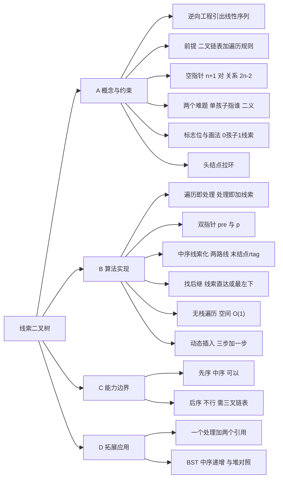
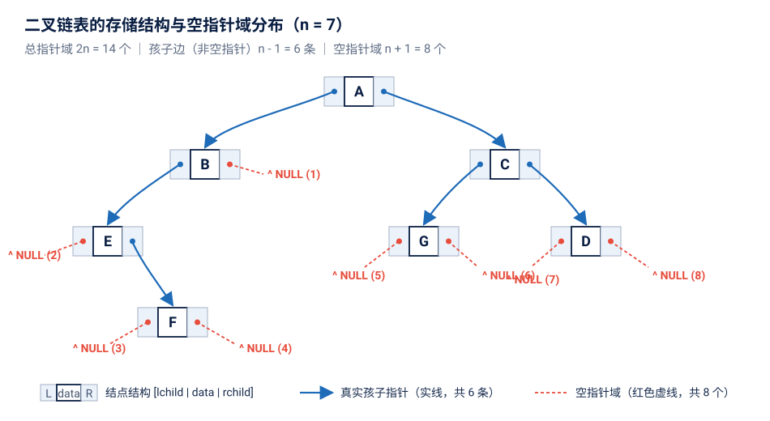
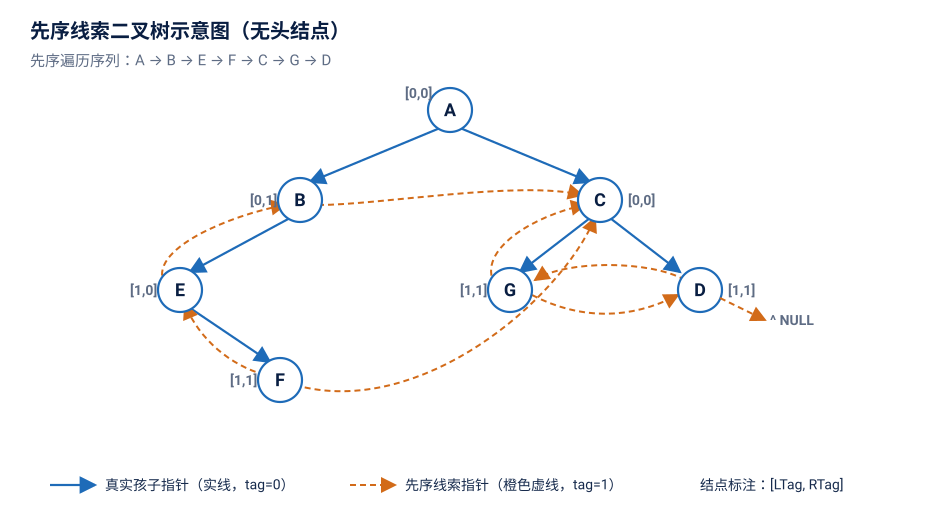
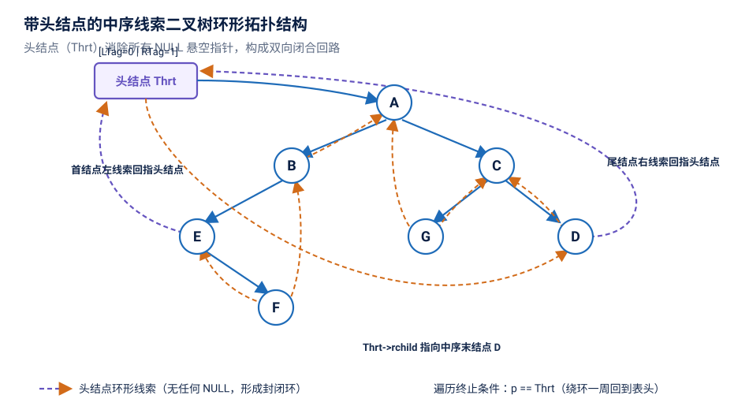
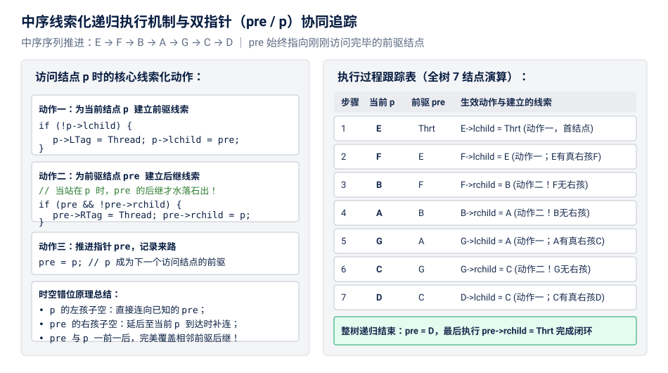
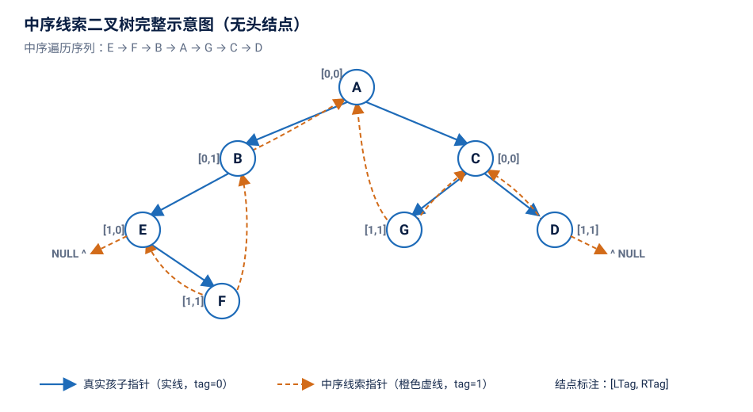
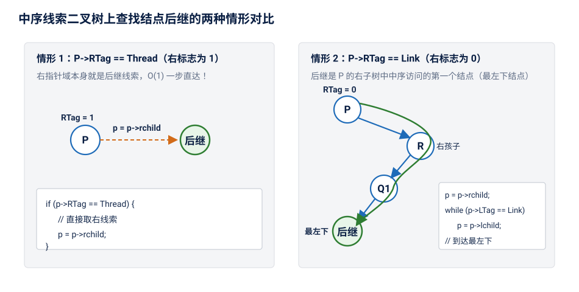
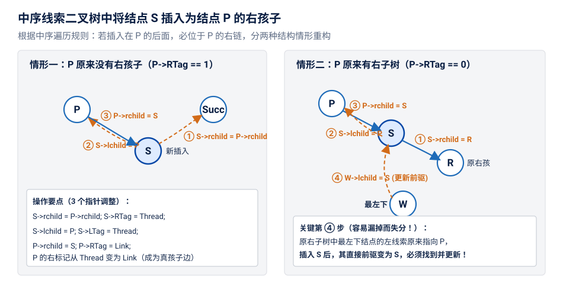
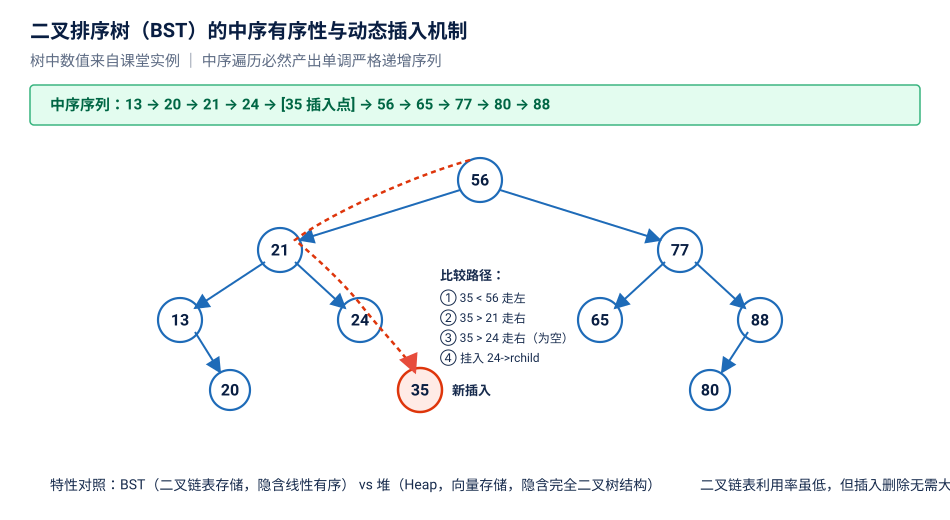

# 数据结构 · 第十周第二节 · 线索二叉树 · 详细版讲义

> **来源说明**：本讲义依据 **11 月 4 日**第十周第二节课的课堂录音转写整理，并与严蔚敏《数据结构（C语言版）》第 6 章 6.3.1、6.3.2、6.4 及第 9 章 9.2.1 对照校订而成，属**讲授稿性质的整理稿**。全篇严格以**第一人称**写成——写作者就是主讲人本人，课堂上的设问、追问、板书推导、案例剖析与点评均以「我」的口吻展开。
>
> - **转写来源**：一份完整的课堂 ASR 导出原文文件——`二叉树线索化相关教学内容_导出原文.txt`（全文 26,661 字、1,114 行、UTF-8 编码）。转写记录了从课首回顾线性序列与逆向工程开始，正式引入线索二叉树的物理本质、数学约束、标志位设计、头结点拉环机制、递归线索化算法、前驱后继查找、无栈遍历、动态插入重构、先序/中序/后序遍历能力对比，到课后半段深入剖析遍历处理哲学、兰大校园网人人平等类比、树高/子树交换/叶子统计的通用递归律，直至二叉排序树（BST）的构造与二级指针陷阱的完整课堂实况。全课内容无缝连贯，**合成一份超详细讲义**，不做拆分。
> - **这一节的主线**：从上节课的“逆向工程”引子与隐藏的线性序列出发 → 确立线索化的两个死前提（二叉链表存储 + 确定遍历规则）→ 算清 $n+1$ 空指针与 $2n-2$ 关系对的数学账（只能解决“约一半”）→ 破解单孩子结点的指向难题与指针二义性 → 标志位设计（类比整数符号位 1 bit 的工程智慧）与画法规范 → 课堂点名回答与头结点的闭合“拉环”方案 → 递归线索化核心骨架（遍历即处理，处理即加线索）→ 双指针 `pre` 与 `p` 的时空错位协同与完整中序线索化算法 → 线索树上找前驱与后继的对称规律与最值结点搜寻 → 彻底摆脱递归与栈的常数级空间中序遍历 → 中序线索树动态插入新结点 $S$ 的四步指针重构 → 课堂难题：先序/中序/后序线索树的找后继边界（为什么后序找后继必须依赖三叉链表）→ 遍历的一体化处理哲学与“一个处理加两个引用”递归公因式 → 左右子树交换、树高、叶子统计的过程式与函数式对比 → 终极应用：二叉排序树（BST）的中序单调有序性及与堆（Heap）的结构对映 → BST 动态插入与 C 语言二级指针的工程深渊。
> - **这一节的边界**：本节课在线索二叉树部分深入透彻地讲清了中序线索化的建立、遍历、前驱后继查找与动态插入，并以严密的逻辑论证了后序线索树在普通二叉链表下无法直接寻找后继的内在缺陷；在后半段应用部分，讲透了由遍历骨架衍生的基本树操作，并完成了二叉排序树（BST）的递归定义、中序遍历性质与动态插入算法。**二叉排序树的结点删除算法（三种情形）、平衡二叉树（AVL 树）的失衡旋转与红黑树**，属于后续专门的「动态查找表」章节，本节仅在末尾明确留作思考与预告，不做超前展开。
> - **教材对照范围**：严蔚敏《数据结构（C语言版）》**6.3.1 遍历二叉树**（遍历实质、一体化处理过程、时空复杂度）、**6.3.2 线索二叉树**（定义、二叉线索存储表示、算法 6.5 `InOrderTraverse_Thr`、算法 6.6 `InOrderThreading`、算法 6.7 `InThreading`）、**6.4 树和森林**（孩子表示法与多重链表空指针分析）、以及**9.2.1 二叉排序树**（BST 定义、中序有序性、动态插入与查找性能分析）。
> - **编号说明**：我沿用的章节体系比严蔚敏教材**大 1**——我的「第 7 章 树和二叉树」＝教材**第 6 章**；我的「第 10 章 查找」＝教材**第 9 章**。在正文与附录标注教材出处时，一律使用教材的真实章节号，以便查对。
> - **时间说明**：本节课为**文字转写模式**（无音视频轨与物理关键帧），各节小节标题后附带的时间戳为**按字数折算的伪时间**（全课转写约 26.6 千字，按 200 字/分钟标准折算，总时长约为 133 分钟，折合 2 小时 13 分钟）。时间戳从 `00:00` 开始至 `02:13` 结束，**严格单调递增、首尾相接**，作为讲义内部定位与阅读进度的标尺。
> - **示意图说明**：本节的图分两类。**一类是本节开头的「全课思维导图」**，用 Mermaid 的 `flowchart` 写成代码块，Obsidian 原生把它渲染成 **SVG 矢量图**（阅读视图与导出 PDF 都是矢量）。**另一类是正文里的数据结构示意图**，全部是**独立手写的 SVG 矢量图片**，统一存放在 `插图/` 目录下（`w1002_01.svg` 至 `w1002_08.svg`），正文以相对路径 `` 引用。所有矢量图均具备跨平台自适应与高分辨率无损缩放特性，文字直接嵌入 `<text>` 标签，严格遵守实线表示孩子指针、虚线表示线索指针的制图标准，且全篇图示采用**同一棵基准二叉树数值拓扑**进行贯穿验证。
> - **关联阅读**：[[数据结构 第九周第一节 树与二叉树 详细版讲义]]（二叉树的形式化定义、五种基本形态与二叉链表存储基础）、[[数据结构 第九周第二节 二叉树的遍历 详细版讲义]]（二叉树遍历的四要素、十种走法、展开法、由序列反推二叉树的逆向工程、逆转链及其否决）、[[数据结构 11月2日 树与森林的转换与线索二叉树 详细版讲义]]（树与森林的转换、指针利用率的数学证明、线索二叉树初步引言）、[[数据结构 第五周第二节 栈的应用与递归 详细版讲义]]（递归工作栈原理与深度优先搜索底座）、[[数据结构 第六周第一节 队列 详细版讲义]]（层次遍历与排队机制的队列实现）。

## 开场导读

这一节讲**线索二叉树（Threaded Binary Tree）**；后半节再从线索结构转到树形结构的几个典型应用。

上一节课的末尾，我们做了一道“开胃小菜”——二叉树的“逆向工程”。我们讨论了怎么通过给定的先序和中序序列、或者后序和中序序列，反推出原本唯一的二叉树拓扑结构。这道小菜的核心逻辑在于：**只要遍历规则给定，非线性的二叉树结构内部就会自然隐射出一个唯一确定的线性访问序列**。既然二叉树里本来就暗含着这么一条线性链条，而在实际算法里，我们又经常要问某个结点在这个次序里的“前一个是谁（直接前驱）”“后一个是谁（直接后继）”。那么能不能不每次都重跑一遍遍历，直接就拿到它？

顺着这个念头，很多人第一反应是“加指针”——每个结点额外配两个指针域 `fwd` 和 `bkwd`。但我立刻就会叫停你：天上不会掉馅饼，凭空加指针会让二叉链表的存储密度大打折扣！我们回过头来看看二叉树的底层物理账本：一棵含有 $n$ 个结点的二叉树，如果采用常规的二叉链表存储，一共会有 $2n$ 个指针域；但整棵树除了根结点之外，每个结点上方只有一条双亲指向它的分支，也就是说，全树真正用在连接孩子结点的非空指针只有 $n-1$ 个！剩下的 $2n - (n - 1) = n + 1$ 个指针域，在内存里全都是 `NULL`。**这 $n+1$ 个空指针，平时就一直闲着。** 线索二叉树的全部出发点，就是**变废为宝**——把这些原本闲置的空指针域利用起来，让空的左孩子指针指向该遍历次序下的直接前驱，让空的右孩子指针指向直接后继！

然而，工程世界永远充满权衡与约束。课上我们一起算了这笔账：$n$ 个结点的线性序列，前驱关系有 $n-1$ 个，后继关系有 $n-1$ 个，前后两头一凑，总共需要表示 $2n-2$ 条邻接关系；但全树空闲的指针位置只有 $n+1$ 个！这说明线索化**不可能把所有前驱后继关系都装下**，只能直接覆盖大约一半。剩下的那一半关系怎么办？答案是**孩子指针与线索指针联合导航**——正因为一半直接、一半要绕，找前驱后继时才出现了“分类讨论”，以及随之而来的标志位（Tag）设计。

紧接着是两个绕不开的问题：单孩子结点到底指谁？指针存的究竟是真儿子还是线索（指针的二义性）？为了解决二义性，我们引入了标志位，我当堂用计算机中整数符号位的概念做类比——我们表达正负数不需要单独开辟一个整型，只需最高位的 1 个 bit；同理，结点结构中只需要多加 2 个 bit（`LTag` 和 `RTag`），就能把真孩子与线索区分开。至于线索化之后仍然悬空的那两个端点指针，课上一位同学答得很准：**做循环、拉环**——配上表头结点，就能连成一个闭合的双向线索环。在这个网络上做中序遍历，**不用系统递归栈、也不用辅助栈，只要 $O(1)$ 的辅助空间**。

讲到这里，静态的查找和遍历就差不多了，接下来是动态插入。我们推导了在已知线索树中动态插入一个新结点的四步指针重塑；我们通过一道当堂测验题，逐条分析了先序、中序、后序线索树的找后继能力，指出了为什么后序线索树找后继在二叉链表下是一条死胡同，必须依赖带双亲指针的三叉链表；再往后，我把视角提一层，讲这三种遍历共同的骨架——“**一个处理加两个引用**”，从兰大校园网“人人平等”的生动调侃切入权重不平等的哈夫曼树思维，演示了左右子树交换、树高求解与叶子统计的函数式封装，最后落到检索的基础结构——**二叉排序树（BST）**，讲清了它中序序列单调递增的性质，以及在 C 语言实现里最容易写错的**二级指针传参**。

学完这一节，大家在期末考试、考研或者工程面试中，一定要警惕**最容易丢分的三处**：
1. **线索与孩子的混淆与标志位判定**：在手画线索树或编写算法时，死记硬背“叶子才有线索”，忘记度为 1 的单分支结点同样包含一个空指针，必须严格按照 `Tag` 的 0/1 状态决定是指针跳转还是子树深度搜索；
2. **后序线索树找后继的局限性**：误以为三种线索二叉树找前驱和后继的能力是对称的，忽视了后序遍历（$LRD$）中根结点排在最后，从子树回溯双亲在二叉链表中无路可走、必须借助三叉链表的客观物理限制；
3. **二叉排序树构造中的指针形参与实参陷阱**：在递归向空树插入结点时，误用一级指针 `BiTree T` 导致内存分配只修改了局部拷贝，整棵树根本无法挂接，必须透彻掌握二级指针 `BiTree *T` 或 C++ 引用传递 `BiTree &T` 的内存底层。

把这三处搞懂，二叉树的物理结构、逻辑线索与指针精髓，才算真正融会贯通。

## 总览知识地图



> **图注（全课思维导图）**：这张图是**整节课的地图**，四个分支对应四个板块，十六个末梢就是要回答的问题，**图上每一格都对应正文某一节**（A 第 1～5 节、B 第 6～10 节、C 第 11 节、D 第 12～16 节）。**顺着 A 分支**走到 A6，线索化的“为什么”“怎么表示”“怎么收尾”就齐了；**B 分支**是完整实现链：从“遍历改写成加线索”一路走到无栈遍历和动态插入；**C 分支**只有两条，却是本课最容易被问倒的地方——先序、中序都能找后继，**后序线索树找不到**，必须靠三叉链表的双亲指针；**D 分支**把线索这一套收起来，转到遍历的通用骨架与二叉排序树。复习时按分支走：**能沿着某一支从根复述到末梢，这一支就算过了。****排版说明**：为了能在一张 A4 上竖着看清，这张图采用**从左到右**的分层排版（不是常见的向下摊开），**整图约 547×934 像素**，正好落在 A4 可打印区（约 643×945）之内；**打印时按页面宽度缩放即可，字不会糊**。

本节课共 16 个小节，由浅入深分为四大逻辑板块：

- **板块一：概念奠基与物理约束（第一节至第五节）**
  - **背景引入**：从逆向工程回顾出发，明确非线性二叉树蕴含线性次序的物理本质；
  - **两个死前提**：左右儿子链接模式（二叉链表）＋ 严格确定的遍历规则；
  - **数学严密计数**：$2n$ 个总指针、$n-1$ 个非空孩子边、$n+1$ 个空指针域，对决 $2n-2$ 个线性相邻关系，证明线索只能直接覆盖约一半关系；
  - **两大工程难题**：单孩子结点的指向规范（左空指前驱、右空指后继）与指针二义性矛盾；
  - **标志位与画法**：类比整数符号位（最高位 1 bit），确立 5 域结点结构（`LTag/RTag`：0 为 Link，1 为 Thread）；规范实线与虚线箭头画法；
  - **头结点拉环方案**：课堂互动（同学口答），以表头结点闭合首尾悬空指针，构成双向闭合回路。
- **板块二：算法设计与操作实现（第六节至第十节）**
  - **递归线索化骨架**：遍历的本质是处理，处理的动作由“打印输出”改造为“加线索”；
  - **双指针时空错位**：当前指针 `p` 解决自己的前驱，同时反向补全前驱指针 `pre` 悬而未决的后继；
  - **中序算法全貌**：核心递归过程 `InThreading` 与主控闭环函数 `InOrderThreading` 代码解析；
  - **线索树上寻径**：对称序的美感，直接线索（$O(1)$）与沿子树深入最左下/最右下结点的联合导航；
  - **无栈中序遍历**：`InOrderTraverse_Thr` 算法，常数级空间复杂度 $O(1)$，彻底告别系统工作栈；
  - **动态结点插入**：在结点 $P$ 之后插入 $S$ 的四步重构，深入剖析原有右子树最左下结点的左线索更新细节。
- **板块三：横向对比与思维对决（第十一节至第十三节）**
  - **遍历能力对比**：课堂四选一单选题，对比先序、中序、后序线索树找前驱与后继的能力边界；
  - **后序找后继的难点**：数学证明二叉链表缺乏反向回溯能力，引出带双亲指针的三叉链表；
  - **遍历哲学反思**：为什么反反复复讲遍历？非线性结构“一体化处理过程”的抽象模型思维；
  - **递归公因式**：“一个处理加两个引用”统治所有树形递归；
  - **兰大校园网调侃与哈夫曼树**：从“人人平等”的相对性引出权重与不平等，铺垫带权最优树思想。
- **板块四：拓展实战与终极应用（第十四节至第十六节）**
  - **遍历实战演练**：左右子树镜像翻转 `SwapTree`、树高计算（过程式传址 vs 函数式纯值）、叶子结点统计与正则二叉树判断；
  - **二叉排序树（BST）登场**：递归定义、中序遍历的单调严格递增密码、对应二分法检索效率；
  - **BST 与堆（Heap）的本质对照**：二叉链表存线性序列 vs 向量数组存二叉树；低利用率换取高动态扩展性；
  - **BST 动态插入与二级指针**：从图示推导到伪码落地，剖析 C 语言指针值传递的形参拷贝深渊，给出二级指针与引用的权威解法。

---

## 正文

### 一、开胃小菜与正课引入：从“逆向工程”到隐藏的线性序列 `00:00-00:06`

接着上一讲的话头。我先把上节课末尾那道「开胃小菜」重新端上来，开口说道：

> 怎么样？上节课讲的那个线性序列，大家都还记得吧？线性序列啊！我们说遍历二叉树最终得到的那个访问序列，它在很多个场合下都有非常重要的应用场景。
> 上节课我们讲了其中的一个应用——**逆向工程**。所谓的逆向工程，就是利用某些线性序列的资讯，反过来把原本的二叉树结构给确定下来。大家回忆一下，先序加中序，或者后序加中序，只要结点值互不相同，我们就能唯一反推出一棵二叉树。

我接着打了个比方：

> 那个逆向工程啊，可以说是我们这门课正式进入二叉树纵深领域之前的一道额外的“开胃小菜”。就像去饭店吃饭，热菜大菜还没上齐，服务员先给你端上一盘洗得干干净净的水果，你先吃个苹果垫一垫、开开胃。
> 那今天这节课，我们要正式进入主菜了，进入我们**线索二叉树（Threaded Binary Tree）**的核心议题！

那么，究竟什么是线索二叉树？为什么二叉树学到这个阶段，非要把原本好端端的树给“线索化”？

这要从**遍历的本质物理意义**说起。我们在上一节课花了大篇幅强调：二叉树是一种典型的非线性数据结构，结点的分布呈分叉状，在一个二维的树形空间里延展。但是，只要我们给这棵二叉树选定了一种遍历规则——无论是先序遍历、中序遍历，还是后序遍历——整棵树里的每一个结点，都会被按照严格的次序依次访问且仅访问一次。**访问完成之后，原本分散在各个分支上的结点，就排成了一条一维的、首尾相连的线性序列**。

这就引出了一个极其深刻的事实：
$$
\boxed{\;\text{任意一棵二叉树} + \text{某种确定的遍历规则} \implies \text{唯一隐射一个线性访问序列}\;}
$$

在这个线性序列中，除了第一个结点没有“直接前驱”、最后一个结点没有“直接后继”之外，其余每一个结点，都有且仅有一个确定的**直接前驱（Predecessor）**和**直接后继（Successor）**。

在实际的软件系统与算法设计中，这种前驱和后继信息是非常宝贵的。比如，在数据库索引、表达式求值或者语法解析树中，我们经常停留在树的某一个结点 $P$ 上，我们需要知道：“按照中序排列，紧挨在 $P$ 前面的那个元素是谁？”或者“按照中序排列，下一个该轮到谁处理？”

在没有线索化之前，如果我们采用最原始的二叉链表，面对这个问题会非常狼狈。因为标准的二叉链表结点里只有两个指针：一个指向左孩子（`lchild`），一个指向右孩子（`rchild`）。**这两个指针存的全是“血缘亲属关系”（父子关系），根本没有存储“遍历次序关系”（前后继关系）！** 如果你问计算机：“结点 $P$ 的中序后继是谁？”计算机回答不了。它唯一的办法，就是老老实实把整棵二叉树从中序第一个结点重新遍历一遍，从头开始数，一直数到 $P$，然后再往后走一步，才能告诉你它的后继是谁。

一次查询，就要付出遍历整棵树的代价，时间复杂度是 $O(n)$。如果有频繁的查找前驱、后继需求，这种开销在工程上是绝对无法接受的。

**我们能不能不每次重新遍历，就能随时随地直接拿到结点的直接前驱和直接后继？**

这就是线索二叉树要解决的核心痛点。这项技术由著名计算机科学家唐纳德·克努特（Donald E. Knuth）在 1968 年提出，堪称树形结构算法史上最优雅的改造之一。

但是，在展开具体技术之前，我必须在黑板上狠狠写下两个“死前提”。我课上提高音量反复告诫大家：

> 这一节我们要特别强调一下，这里面有两个不可动摇的前提条件：
> **第一个前提：二叉树必须采用左右儿子链接模式（二叉链表）作为存储结构！**
> **第二个前提：必须基于某种明确给定的遍历规则！**
> 离开这两个前提，这一节的内容就彻底消失了，你就不要再谈线索化了！

我们逐一审视这两个前提背后的严密逻辑：

1. **为什么必须是二叉链表？**
   如果二叉树采用顺序存储结构（比如一维数组向量），结点的相对物理位置已经由下标运算固定；或者采用三叉链表（额外带双亲指针域 `parent`），我们寻找路径的手段会有本质不同。线索化的所有巧妙构思，全建立在二叉链表“左孩子、右孩子”这两个指针域的物理槽位上。
2. **为什么必须事先固定遍历规则？**
   我们在第九周总结过，二叉树的走法林林总总可以数出两大类十种（层次 4 种 ＋ 深度 6 种），即便是只看深度的常用走法，也有先根（$DLR$）、中根（$LDR$）、后根（$LRD$）三种。
   **二叉树本身是没有绝对的“前驱”和“后继”的！**
   谈前驱和后继，必须先说清楚是“哪一种遍历次序下的前驱和后继”。一棵树的中序前驱，在先序遍历里可能是它的后继，在后序遍历里可能离它十万八千里。规则不同，得到的线性序列完全不同，线索所指的目标自然天差地别。

这两个前提，就是我们进入线索二叉树大厦的通行证。

**本节要点**

- 遍历的本质，是在给定的规则下将非线性的二叉树映射为**唯一确定的线性访问序列**；
- 原始二叉链表仅记录结点的**孩子血缘信息**，无法直接提供线性序列中的**前驱和后继信息**；
- 每次查询前驱或后继若重新遍历，算法代价高达 $O(n)$，工程上不可接受；
- 线索二叉树的成立依赖两个死前提：**二叉链表存储结构** ＋ **确定的遍历规则**，二者缺一不可。

---

#### 1.1 附赠小菜深剖：由序列反推二叉树的严密切分法则

既然提到了这道“开胃小菜”，我们不妨在黑板上把上一节课的**反推二叉树数学切分公式**复习得更透彻一些。很多同学在期末做反推题时，全凭直觉和连线，一遇到 10 个结点以上的大题就容易手忙脚乱。

我们来看，为什么**先序序列 ＋ 中序序列**能够唯一确定一棵二叉树？
设整棵二叉树中结点的标识互不相同。
- 先序遍历的结构特征是：$$\text{先序} = [\; \mathbf{Root} \;|\; \text{左子树先序段} \;|\; \text{右子树先序段} \;]$$；
- 中序遍历的结构特征是：$$\text{中序} = [\; \text{左子树中序段} \;|\; \mathbf{Root} \;|\; \text{右子树中序段} \;]$$。

解题与算法的核心切分逻辑如下：
1. **定位根结点**：先序序列的**第一个元素**，必然是当前整棵树（或当前子树）的根结点 $\mathbf{Root}$；
2. **切分中序段**：在中序序列中找到这个 $\mathbf{Root}$ 所在的位置（设局部下标为 $k$）。由于中序遍历严格遵循“左子树 $\to$ 根 $\to$ 右子树”，因此在 $k$ 左侧的所有元素，**必定全部属于左子树**；在 $k$ 右侧的所有元素，**必定全部属于右子树**！
3. **确定子树规模**：由中序切分结果，我们可以精确算出左子树的结点总数为 $L_{\text{left}} = k$，右子树的结点总数为 $L_{\text{right}} = \text{总长度} - 1 - k$；
4. **反向切分先序段**：紧随先序第一个根结点之后的连续 $L_{\text{left}}$ 个元素，必然是左子树的先序段；剩下的 $L_{\text{right}}$ 个元素，必然是右子树的先序段！
5. **递归推进**：对左右子树的先序段和中序段如法炮制，直到段长度缩减为 1（叶子）或 0（空），整棵二叉树的唯一拓扑结构便水落石出！

同理，**后序序列 ＋ 中序序列**亦可唯一反推，区别仅在于后序序列的**最后一个元素**是根结点 $\mathbf{Root}$。

那么，**为什么先序 ＋ 后序绝对无法唯一确定一棵二叉树？**
我们看最简单的二结点反例：
- 树 1：根为 $A$，$A$ 只有左孩子 $B$；其先序为 $AB$，后序为 $BA$；
- 树 2：根为 $A$，$A$ 只有右孩子 $B$；其先序为 $AB$，后序为 $BA$！
两棵截然不同的树，给出的先序与后序序列完全相同！
数学本质在于：先序和后序都只告诉我们“谁是根”、“子树包含哪些元素”，但**根本无法给出左、右子树的分界点**！只有包含“根在中间”的中序序列，才能像一把手术刀一样，把左子树与右子树劈成两半！

### 二、空指针与关系对的数学账：为什么线索只能解决“一半” `00:06-00:13`

既然要想办法把前驱和后继信息记录下来，最直观的野蛮做法是什么？

有同学脱口而出：“那就在每个结点头上再加两个指针域呗！一个叫 `pred` 指向前驱，一个叫 `succ` 指向后继，每个结点变成 4 个指针域，这不就解决了？”

我当场把这个方案否掉了。因为二叉树在实际系统里往往规模极大，动辄成千上万个结点。每个结点硬生生增加两个指针，在 64 位系统下一个指针占 8 字节，两个指针就是 16 字节，整个数据结构的**存储密度（Storage Density）**会急剧下跌。这种为了辅助功能而大幅膨胀主要存储的做法，在算法工程中被称为“败家子设计”。

那怎么办？**向内部挖潜！变废为宝！**

我们来看看原本的二叉链表里，到底有没有闲置的资源可以让我们利用？我让大家把草稿本拿出来，跟我一起算一笔清清楚楚的数学账。

#### 2.1 空指针总数的严格推导与归纳验证

设一棵任意形态的二叉树拥有 $n$ 个结点（$n \ge 1$）。

在二叉链表中，每个结点在内存中都被分配了且仅分配了两个指针域：`lchild` 和 `rchild`。因此，整棵二叉树所拥有的指针域总容量为：
$$
\text{指针域总数} = 2n
$$

现在我们来算，这 $2n$ 个指针域里面，有多少个是真正存了内存地址、指向了实实在在的孩子结点的？

回顾树的拓扑性质：二叉树中除根结点外，**每一个结点都有且仅有一个双亲结点指向它**。也就是说，树中的每一个分支（Branch / Edge），都唯一对应着某个双亲结点的某一个非空孩子指针域。

根据树的基本定理，含有 $n$ 个结点的树，其总分支数必定恰好为：
$$
\text{分支总数（非空指针数）} = n - 1
$$

既然总共有 $2n$ 个指针域，而其中被孩子结点占用的有效指针只有 $n - 1$ 个，那么剩下的、里面存放着 `NULL` 的**空指针域数量** $N_{\text{null}}$ 就呼之欲出：
$$
N_{\text{null}} = 2n - (n - 1) = n + 1
$$

$$
\boxed{\;\text{含有 } n \text{ 个结点的二叉链表中，必定存在且仅存在 } n + 1 \text{ 个空指针域}\;}
$$

我们还可以从度的角度给出另一种严密的交叉验证：
设度为 0（叶子）、度为 1、度为 2 的结点数分别为 $n_0, n_1, n_2$。
则总结点数 $n = n_0 + n_1 + n_2$。
每个叶子贡献 2 个空指针，每个度为 1 的结点贡献 1 个空指针，度为 2 的结点贡献 0 个空指针。
故空指针总数可表示为：
$$
N_{\text{null}} = 2n_0 + n_1
$$
由非空二叉树基本性质 $n_0 = n_2 + 1$，代入可得：
$$
N_{\text{null}} = n_0 + (n_0) + n_1 = n_0 + (n_2 + 1) + n_1 = (n_0 + n_1 + n_2) + 1 = n + 1
$$
两种推导殊途同归！

这个公式具有极强的普适性：**无论这棵二叉树长成什么形状——是满二叉树、完全二叉树，还是退化成单支树（甚至一条链），只要它是拥有 $n$ 个结点的非空二叉树，其空指针数量永远雷打不动地等于 $n + 1$！**

举个最直观的小例子：
- 若 $n = 1$（只有一个根结点），总指针域 $2 \times 1 = 2$ 个，分支 $1 - 1 = 0$ 个，空指针 $1 + 1 = 2$ 个（左空、右空），公式成立；
- 若 $n = 7$（如图 `w1002_01.svg` 所示），总指针域 $2 \times 7 = 14$ 个，分支 $7 - 1 = 6$ 条，空指针域必定恰好为 $7 + 1 = 8$ 个！


> **图注（二叉链表存储结构与空指针域分布）**：本图基于全篇贯穿的 7 结点二叉树绘制（根结点为 A，左右孩子分别为 B、C；B 仅有左孩子 E，E 仅有右孩子 F；C 有左孩子 G、右孩子 D）。全树结点总数 $n=7$，总指针域 $2n=14$ 个。图中实线蓝色箭头为真实孩子指针，共 $n-1=6$ 条；红色虚线带地线符号（`^ NULL`）的为空指针域，精确分布于 B（右）、E（左）、F（左/右）、G（左/右）、D（左/右），总数恰为 $n+1=8$ 个。

#### 2.2 线性前驱与后继关系的总量盘点

既然有 $n + 1$ 个空闲的指针位置，我们再来看看需求端——我们总共想表达多少个邻接关系？

在线性序列 $x_1, x_2, x_3, \dots, x_n$ 中：
- 关于**直接前驱**：
  首元素 $x_1$ 没有前驱；从第 2 个元素 $x_2$ 到第 $n$ 个元素 $x_n$，每个元素都有唯一确定的直接前驱。因此，全序列中存在的直接前驱关系共有：
  $$
  N_{\text{pred}} = n - 1
  $$
- 关于**直接后继**：
  尾元素 $x_n$ 没有后继；从第 1 个元素 $x_1$ 到第 $n - 1$ 个元素 $x_{n-1}$，每个元素都有唯一确定的直接后继。因此，全序列中存在的直接后继关系共有：
  $$
  N_{\text{succ}} = n - 1
  $$

把两者加在一起，为了把整条线性序列的双向邻接信息完全刻画出来，我们理论上需要存储的**关系对总数**为：
$$
N_{\text{total\_relations}} = N_{\text{pred}} + N_{\text{succ}} = (n - 1) + (n - 1) = 2n - 2
$$

#### 2.3 严峻的容量冲突：为什么只能解决“一半”？

现在，供给端与需求端在黑板上撞在了一起：
- **可供我们变废为宝的空闲指针槽位**：$n + 1$ 个；
- **渴望被存储记录的线性前后继关系**：$2n - 2$ 个。

我们拿可用槽位去减所需关系：
$$
(n + 1) - (2n - 2) = 3 - n
$$

大家看这个差值：
- 当 $n = 1$ 时，$1 + 1 = 2$ 个槽位，$2(1) - 2 = 0$ 个关系，槽位充裕（单结点既无前驱也无后继）；
- 当 $n = 2$ 时，$2 + 1 = 3$ 个槽位，$2(2) - 2 = 2$ 个关系，槽位勉强够用；
- 当 $n = 3$ 时，$3 + 1 = 4$ 个槽位，$2(3) - 2 = 4$ 个关系，收支恰好平衡；
- **一旦 $n > 3$，矛盾立刻爆发！** 比如当 $n = 7$ 时，关系总数是 $2(7) - 2 = 12$ 个，而空指针只有 $7 + 1 = 8$ 个，直接缺口达 4 个！
- 当 $n \to \infty$ 时，空指针与总关系的比值为：
  $$
  \lim_{n \to \infty} \frac{n + 1}{2n - 2} = \frac{1}{2}
  $$

我课上敲着讲台对大家讲：

> 大家看清楚这个数学结论！天上从来不会掉馅饼！
> 你手头上只有 $n+1$ 个空位，但你有 $2n-2$ 个关系要存。你撑死了只能把这一半左右的关系直接填进空指针里！
> 也就是说，**线索化只能直接解决大约一半的前驱和后继查询问题**！

那么，另一半没有被线索直接覆盖的关系，到底落在哪里了？
它们并没有丢！**它们正好落在了那 $n-1$ 条实实在在的孩子指针所构成的树形路径之中！**

这就确立了线索二叉树最重要的工作机制：
**空闲的指针域，我们直接填上线索，实现单步 $O(1)$ 直达；被孩子占用的指针域，我们保留孩子连线，通过“孩子边 ＋ 线索”联合导航，依然能在极短步数内找到后继！**

**本节要点**

- $n$ 个结点的二叉链表中，总指针域为 $2n$，有效分支为 $n-1$，**空指针域恒等于 $n+1$**；
- 线性序列中，前驱关系有 $n-1$ 个，后继关系有 $n-1$ 个，**需表达的邻接关系总计 $2n-2$ 个**；
- 当 $n > 3$ 时，空指针数必定小于关系总数，比值趋近于 $\frac{1}{2}$；
- **线索化只能直接解决约一半的关系**，另一半必须依靠“孩子指针 ＋ 线索”联合完成导航定位。

---

#### 2.4 广义 $m$ 叉树的指针利用率数学全景证明

为了让大家真正体会到二叉链表“空指针占一半”在体系结构中的深刻地位，我们在黑板上把这个定理推广到任意的 **$m$ 叉树（$m \ge 2$）**。

假设一棵 $m$ 叉树拥有 $n$ 个结点，每个结点统一分配 $m$ 个指针域指向其 $m$ 个潜在的子树根结点（标准多重同构链表）。
我们来算它的空间利用率账本：
1. **总指针域容量**：
   $$S_{\text{total}} = m \times n$$
2. **有效分支数（非空指针数）**：
   除根结点外，树中每个结点有且仅有 1 条边从双亲连向它，故有效分支数恒为：
   $$S_{\text{used}} = n - 1$$
3. **空指针域总数**：
   $$S_{\text{null}} = m \cdot n - (n - 1) = n(m - 1) + 1$$
4. **有效指针利用率与空指针浪费率**：
   $$
   \text{有效利用率 } \eta = \frac{n - 1}{m n} \approx \frac{1}{m} \quad (n \to \infty)
   $$
   $$
   \text{空指针浪费率 } \mu = \frac{n(m - 1) + 1}{m n} \approx \frac{m - 1}{m} \quad (n \to \infty)
   $$

我们把不同的分支度数 $m$ 列成一张触目惊心的对比表：

| 分支度数 $m$ | 存储模式 | 总指针数 ($n=100$) | 非空指针数 | 空指针数 | 空指针占比（$n\to\infty$） $\mu$ |
|---|---|---|---|---|---|
| **$m = 2$** | **二叉链表** | **200** | **99** | **101** | **$50.0\%$（约一半空）** |
| **$m = 3$** | **三叉链表** | 300 | 99 | 201 | **$66.7\%$（约三分之二空）** |
| **$m = 4$** | **四叉树** | 400 | 99 | 301 | **$75.0\%$（四分之三空）** |
| **$m = 10$** | **十叉树** | 1000 | 99 | 901 | **$90.0\%$（九成全是空！）** |

大家看最后两列！
分支度数 $m$ 越大，多重链表的内存浪费就越呈现出天文数字般的爆炸！
当 $m=10$ 时，整整 $90\%$ 的内存全部被 `NULL` 占据，系统完全成了装满空指针的垃圾桶！
这也是为什么在实际工程中，多叉树几乎从不直接使用同构多重链表，而是普遍先通过“左孩子右兄弟（孩子-兄弟表示法）”**全部压缩转换为二叉树**来存储的原因！
而二叉树以 $m=2$ 站在了链式树形结构的基石位置——即便如此，它依然有 $50\%$ 的指针处于闲置状态。
线索二叉树，正是把这最后 $50\%$ 的闲置资产彻底盘活的绝世妙招！

### 三、天上不会掉馅饼：单孩子的指向难题与指针二义性 `00:13-00:20`

既然我们决定把这 $n+1$ 个空指针变废为宝拿来当线索用，那么在真正把它落实在物理结构上时，我们马上会遇到两只拦路虎。这两只拦路虎，我称之为**单孩子结点的指向难题**与**指针的二义性困境**。

#### 3.1 拦路虎之一：单孩子结点的指向规范

叶子结点很好理解：叶子结点的度为 0，它的 `lchild` 和 `rchild` 都是 `NULL`，正好空出两个槽位。直觉告诉我们：左槽位填前驱，右槽位填后继，严丝合缝。

但是，二叉树里除了叶子结点，还有大量**度为 1 的分支结点（单孩子结点）**！
比如：
- 结点 $B$ 只有左孩子 $E$，没有右孩子，此时它的 `lchild` 指向了儿子，而 `rchild` 是空的；
- 结点 $E$ 只有右孩子 $F$，没有左孩子，此时它的 `rchild` 指向了儿子，而 `lchild` 是空的。

这时候问题来了：
$B$ 只有一个空指针，这个空指针到底应该存前驱，还是存后继？
如果随便瞎存，整个系统就乱套了。计算机程序必须有一套铁打的、毫无歧义的规范。

于是，我们必须确立**统一的槽位分配契约**：
$$
\begin{cases}
\text{若结点的 } \mathtt{lchild} \text{ 为空，则该槽位必定且只能用于指示其在该遍历序列下的}\textbf{直接前驱}；\\
\text{若结点的 } \mathtt{rchild} \text{ 为空，则该槽位必定且只能用于指示其在该遍历序列下的}\textbf{直接后继}。
\end{cases}
$$

这个契约极其自然且对称：**左管前驱（往左看、往前看），右管后继（往右看、往后看）**。
- 如果左孩子存在，说明左边被亲儿子占领了，前驱信息就不能硬塞在左边；
- 如果右孩子存在，说明右边被亲儿子占领了，后继信息就不能硬塞在右边。

#### 3.2 拦路虎之二：指针的二义性（Ambiguity）

确立了上述契约之后，一个更加致命的工程问题浮出了水面——**指针二义性**。

大家想一想，在 C 语言的物理内存中，指针变量本质上是什么？
指针变量说白了就是一个无符号整数（Unsigned Integer），里面存放的是目标结点的**内存绝对地址**（比如 `0x00007FF7A0123040`）。

现在，假设我们已经把线索化做完了。程序运行到某一个结点 $P$，读取了它的 `p->lchild` 字段。
这个字段里明晃晃地存着一个地址值，它绝不会在脸上写着自己是“儿子”还是“前驱”。

这时候，CPU 懵了：
- **解释一（树形逻辑）**：这个地址代表 $P$ 的亲生左儿子，我应该沿着它向下递归遍历左子树；
- **解释二（线索逻辑）**：这个地址代表 $P$ 的中序前驱结点，它可能是 $P$ 头顶上某个高高在上的祖先，我应该沿着它向上回跳！

如果你的程序无法区分这两种情况，后果将是毁灭性的：
如果你把一个指向祖先的前驱线索误当成左儿子向下搜索，程序会瞬间陷入**死循环**，直到调用栈彻底撑爆崩溃；反之，如果你把一个真正的左儿子误当成前驱线索，整棵左子树上的成百上千个结点就会在遍历中被瞬间遗漏！

我课上特意举了一个现实生活中的例子：
> 比如在火车站出站口，有人举着一个牌子，上面写着你的名字。
> 这时候你必须知道：举牌子的这个人，到底是你家里派来接你的亲弟弟，还是跟你同名同姓的一个陌生路人？
> 如果你把路人当成了亲弟弟，跟着他就走了，你这辈子可能都回不了家了！
> 这就是二义性——**同样是一个指针，它承载了双重语义，计算机必须有机制能一眼把它看破**！

因此，光在空指针里填地址是不够的。**我们必须在物理结点上增加判别标志，打破这种二义性！**

**本节要点**

- 单孩子结点的槽位契约：**空左指针专职指示前驱，空右指针专职指示后继**，不得颠倒混用；
- 指针二义性困境：内存地址本身不具备语义，程序无法区分指针存的是“真孩子”还是“遍历前驱/后继”；
- 混淆二义性的严重后果：将前驱误当孩子会导致死循环，将孩子误当前驱会导致漏诊子树；
- 必须对二叉链表结点结构进行微改造，引入标志位来彻底破除二义性。

---

### 四、标志位设计与画法规范：类比整数符号位与 1 bit 的工程智慧 `00:20-00:28`

怎么打破二义性？答案很简单：加标志位（Tag）。

但怎么加标志位，能体现出计算机学科高超的工程美学。我在课堂上给大家讲了一段关于**整数表示法**的类比，大家听得津津有味。

#### 4.1 整数符号位的类比与 1 bit 哲学

我在草稿板上写了一个数：$+3$。
然后我问大家：
> 你们在草稿本上写正数，一般怎么写？直接写个 3，对不对？
> 什么时候你会特意加标记？只有它是负数的时候，你才会在前面加个负号写成 $-3$。
> 那么到了计算机底层，我们在内存里表达一个整数，要区分它是正数还是负数，我们需要不需要给这个符号单独开辟一个 4 字节的整型变量？
> **根本不需要！** 计算机是怎么干的？
> 把二进制最高位的那 **1 个 bit** 拿出来，当成符号位！最高位是 0 代表正数，最高位是 1 代表负数！
> 仅仅用了 1 个 bit 的代价，我们就把正负数的二义性给消解了！

这种思想移植到线索二叉树上，完全是一脉相承：
既然一个指针只有两种可能——要么指向亲生孩子（Link），要么指向遍历线索（Thread）——那它本质上就是一个**布尔二值逻辑**！
我们根本不需要在结点里塞入复杂的结构，**只需要为每个指针配上 1 个 bit 的标志位即可！**

#### 4.2 结点结构的形式化定义

为了配合这两个指针域，我们在结点内部增加两个布尔标志域：`LTag` 和 `RTag`。

结点的物理结构从原本的 3 个域扩充为 5 个域：
| `lchild` | `LTag` | `data` | `RTag` | `rchild` |
|:---:|:---:|:---:|:---:|:---:|
| 左孩子或前驱 | 0＝孩子／1＝线索 | 数据 | 0＝孩子／1＝线索 | 右孩子或后继 |

其中，标志位的取值含义严格规定如下：
$$
\mathrm{LTag} = \begin{cases}
0, & \mathtt{lchild} \text{ 域指示结点的}\textbf{左孩子}\text{（Link）} \\
1, & \mathtt{lchild} \text{ 域指示结点的}\textbf{直接前驱}\text{（Thread）}
\end{cases}
$$

$$
\mathrm{RTag} = \begin{cases}
0, & \mathtt{rchild} \text{ 域指示结点的}\textbf{右孩子}\text{（Link）} \\
1, & \mathtt{rchild} \text{ 域指示结点的}\textbf{直接后继}\text{（Thread）}
\end{cases}
$$

大家一定要把这个 **0 和 1 的含义刻在脑子里**：
- **0 代表 Link（链接，真指针）**：代表正常的树枝，指向真正的子树根结点；
- **1 代表 Thread（线索，引线）**：代表改造后的虚线，指向线性遍历的前驱或后继。

在标准 C 语言中，我们采用枚举类型 `PointerTag` 和结构体 `BiThrNode` 来进行严格的形式化定义：

```c
/* 二叉树的二叉线索存储表示 */
typedef enum { Link = 0, Thread = 1 } PointerTag; /* Link(0):指针, Thread(1):线索 */

typedef struct BiThrNode {
    TElemType data;                     /* 结点数据域 */
    struct BiThrNode *lchild, *rchild;  /* 左右指针域（孩子或线索） */
    PointerTag LTag, RTag;              /* 左右标志域（各占 1 bit 或枚举空间） */
} BiThrNode, *BiThrTree;
```

在高级系统实现中，如果对内存锱铢必较，甚至可以使用 C 语言的**位段（Bit-field）**语法：
```c
typedef struct BiThrNode {
    TElemType data;
    struct BiThrNode *lchild;
    struct BiThrNode *rchild;
    unsigned int LTag : 1; /* 仅占 1 位二进制 */
    unsigned int RTag : 1; /* 仅占 1 位二进制 */
} BiThrNode, *BiThrTree;
```
由于指针在 64 位体系下通常按 8 字节对齐，地址的最低 3 位天然恒为 0，在某些极端的底层运行时系统中，工程师甚至会把标志位直接“偷存”在指针自身的最低 1 位里，连额外的 2 个 bit 都省下来了。这说明：**线索化的额外开销很小，本质上是把原本闲置的空间重新用起来。**

#### 4.3 绘图规范：实线、虚线与出针位置

在做题、板书或者绘制讲义示意图时，为了让图面清晰可读，业界有一套约定俗成的绘图规范。我在课上当场给大家示范了正确的画法：

1. **真实孩子边一律画实线（Solid Line）**：带有箭头或不带箭头，直接连到下层的子树根结点，代表原本的树形拓扑；
2. **线索边一律画虚线（Dashed Line）并带箭头**：虚线代表这是人造的、逻辑上的线索，箭头指向它的前驱或后继目标；
3. **出针位置必须严格区分**：
   - **前驱线索（LTag=1）**：必须从结点的**左下角**引出，回指向上方或前方的直接前驱；
   - **后继线索（RTag=1）**：必须从结点的**右下角**引出，前指向上方或后方的直接后继。

这里插一句题外话，是我课上特意叮嘱的：**作业不要用红笔写**。我在课件上把线索画成红色虚线，是为了跟黑色的孩子边区别开；你交上来的作业要是通篇红笔，那跟"批改痕迹"就分不清了——**不管是高考还是平时考试，红笔答卷一律按违纪处理**，这一条没有例外。**图上的红是用来区分的，卷面上的红是用来判分的，两回事。**

以本讲义贯穿的 7 结点树为例，我们先来看它的**先序线索二叉树**画出来是什么模样。先序序列为：`A, B, E, F, C, G, D`。


> **图注（先序线索二叉树示意图）**：先序遍历次序为 $A \to B \to E \to F \to C \to G \to D$。蓝色实线为真孩子边（`Tag=0`），橙色虚线箭头为先序线索（`Tag=1`）。结点旁标有 `[LTag, RTag]`。例如结点 B 拥有左孩子 E，但右孩子为空，其右指针引出虚线指向其先序后继 C（因为 E 子树处理完毕后进入 A 的右子树 C）；末尾结点 D 的右指针为 `NULL`。

大家仔细观察图 `w1002_02.svg`，就会发现：有了实线与虚线的严格区分，整棵树的骨架（实线）清晰可见，而线索网络（虚线）如同电路跳线一样，精准地把每一个空缺补齐。

**本节要点**

- 类比整数符号位仅占最高位 1 bit，线索标志位只需布尔二值：**0 表示 Link（真孩子），1 表示 Thread（线索）**；
- 结点扩充为 5 域结构：`[lchild, LTag, data, RTag, rchild]`；
- 绘图规范：**实线代表孩子指针，虚线箭头代表线索指针**；
- 出针位置：**左下角引虚线指前驱，右下角引虚线指后继**，绝对不许混淆画错。

---

#### 4.4 硬件与内存对齐视角的深入探秘：Tagged Pointer 黑科技

讲到标志位占用 1 个 bit，有些平时深入研究底层系统的同学可能会举手发问：“主讲人，在 64 位现代计算机体系中，C 语言的结构体由于**内存对齐（Memory Alignment）**规则，定义两个 `unsigned int : 1` 或者 `enum`，编译器最终分配的结构体大小会不会因为对齐而膨胀，导致我们省下的那点 bit 根本没有实际效果？”

这个问题提得非常有水准！我们从现代体系结构的底层来彻底解构它：

在标准的 64 位 x86_64 或 ARM64 处理器中，指针变量占用 8 个字节（64 位），且指针变量的内存地址通常要求按 8 字节边界对齐（Address 必须是 8 的倍数）。
这就意味着：**任何合法结点的物理内存地址，其二进制表示的最低 3 位（Bit 0, Bit 1, Bit 2）永远恒等于 000！**
比如：
- 地址 `0x1000` $\to$ 二进制末尾为 `...000`；
- 地址 `0x1008` $\to$ 二进制末尾为 `...000`；
- 地址 `0x1010` $\to$ 二进制末尾为 `...000`。

既然低 3 位永远是 0，空在那里毫无意义，现代工业级语言运行时（如 JVM 的 Compressed OOPs、macOS/iOS Objective-C 的 Tagged Pointer、以及 Linux 内核的红黑树实现）使用了一种被称作 **指针标记（Tagged Pointer）** 的终极黑科技：
工程师们利用位运算，直接把 `LTag` 存放在 `lchild` 指针自身的第 0 位，把 `RTag` 存放在 `rchild` 指针自身的第 0 位！
- 当我们需要读取指针目标时：只需执行 `ptr & ~1ULL`（将最低 1 位清零），瞬间还原出原本真实的 64 位对齐内存地址；
- 当我们需要读取标志位时：只需执行 `ptr & 1ULL`，就能在 1 个 CPU 周期内直接提取出 0 或 1！

这种位运算在硬件流水线中可以在单指令周期内瞬间执行，不仅**彻底消除了结构体内部为标志位单独开辟字段的任何内存对齐开销**，而且让整个线索结点的物理大小与原始二叉链表完全分毫不差！
从理论数学推导，到 C 语言结构体位段，再到底层硬件的指针标记，这就是计算机学科层层递进、融会贯通的工程之美。

### 五、空指针能彻底消除吗？课堂点名与头结点的“拉环”方案 `00:28-00:36`

画完先序线索图之后，我退后一步，审视着黑板上的示意图，然后把身子转过来，抛出了一个极其尖锐的问题：

> 大家看黑板，现在我们按照规定，把能加线索的空指针都加上了线索。
> 我问大家一个严肃的问题：**经过这番线索化操作之后，整棵树里的空指针，到底能不能被彻底消灭光？**

教室里安静了几秒钟，随后有几位同学低声说：“能吧……都填上了啊。”

我立刻反问：
> 能吗？你再仔细看一眼序列的首尾两端！
> $n$ 个结点的序列，第一个结点它前面还有前驱吗？**没有！**
> 最后一个结点，它后面还有后继吗？**没有！**
> 既然第一个结点没有前驱，那它的左指针线索该指去哪儿？它只能依然是空的（`NULL`）！
> 既然最后一个结点没有后继，那它的右指针线索又指去哪儿？它同样只能依然是空的（`NULL`）！

这就导出了一个铁的事实：
$$
\boxed{\;\text{在常规的线索二叉树中，无论采用哪种遍历次序，全树必定残留至少 2 个悬空的 } \mathtt{NULL} \text{ 指针！}\;}
$$

这两个残留的 `NULL` 指针：
- 一个对应在**遍历序列的第一个结点的 `lchild` 域**；
- 一个对应在**遍历序列的最后一个结点的 `rchild` 域**。

有空指针在，工程上就留下了隐患。在 C 语言里，解引用 `NULL` 指针会触发段错误（Segmentation Fault）。我们在写遍历循环的时候，就必须时时刻刻去判断指针是不是等于 `NULL`，一旦疏忽就会崩溃。

我在课堂上环视了一圈，随手点了一位同学：

> 你！站起来回答一下。
> 在链表数据结构当中，我们如果最头疼空指针，想要消除一切空指针、让一个空指针都不剩，原来我们在单链表里是怎么做的？

那位同学反应很快，立刻答道：“做循环！拉环！”

我当场赞许道：
> 回答得非常好！请坐！
> 做循环！拉成一个环！
> 但是在单链表里要做循环、拉成一个闭合环，有一个最重要的前提条件是什么？
> **必须引入表头结点（Head Node）！**

为了彻底抹杀二叉线索树中仅存的这两个 `NULL` 空指针，我们仿照双向循环链表的成熟思想，在线索二叉树的顶部，人为地增设一个专门的**头结点（Head Node）**。

#### 5.1 头结点的环形连线法则

引入头结点 `Thrt` 之后，整个树形网络通过以下规则被巧妙地锁死为一个闭合回路：

1. **头结点的自身属性与初始化**：
   - 头结点本身不存储任何业务数据（`data` 域为空或存特定标志）；
   - 头结点的 `LTag = Link (0)`：其左孩子指针 `lchild` 指向二叉树的**根结点**；
   - 头结点的 `RTag = Thread (1)`：其右指针 `rchild` 专职作为线索，回指中序遍历的**最后一个结点**。
2. **中序首结点的处理**：
   - 中序序列中的**第一个结点**，其原本悬空的 `lchild`（`LTag = 1`），不再指向 `NULL`，而是**回指头结点 `Thrt`**！
3. **中序尾结点的处理**：
   - 中序序列中的**最后一个结点**，其原本悬空的 `rchild`（`RTag = 1`），也不再指向 `NULL`，同样**回指头结点 `Thrt`**！
4. **特殊情况（空二叉树的处理）**：
   - 如果原本的二叉树是一棵空树（`T == NULL`），则头结点的左指针和右指针同时回指自己：
     `Thrt->lchild = Thrt; Thrt->rchild = Thrt;`
     构成一个最简单、自洽的空环。


> **图注（带头结点的中序线索二叉树环形拓扑结构）**：图中紫色矩形为新增设的表头结点 `Thrt`（`LTag=Link`, `RTag=Thread`）。其左孩子实线指针指向整棵树的根结点 A；其右线索虚线指针指向中序遍历的末尾结点 D。原本悬空的首结点 E（左线索）与末结点 D（右线索），均通过平滑的紫色虚线回指头结点 `Thrt`。至此，全树所有指针域全部闭合，无任何 `NULL` 指针残留，遍历算法只要判断指针是否回到 `Thrt` 即可优雅终止。

大家看图 `w1002_05.svg`，体会这个结构的巧妙绝伦之处：
在这个封闭的环形网络里，指针从头结点出发，既可以顺着后继线索从第一个结点一路走到最后一个结点；也可以逆着前驱线索从最后一个结点一路倒着走回第一个结点！
**它不仅消除了所有的 `NULL`，而且让二叉树具备了双向循环链表的所有高级遍历特性！**

我课末特别交代了一句：
> 这一招加头结点，是属于教科书和高级库里的**极致优化**。
> 平常做考卷，如果大题没有明确要求“带头结点”，我们默认还是画无头结点的线索树；但是一旦考到无栈非递归遍历算法，必须在脑子里立刻浮现出这个头结点的环形结构！

**本节要点**

- 无头结点的线索二叉树中，**首结点左指针与尾结点右指针必然恒为 `NULL`**；
- 消除悬空指针的终极武器是**引入头结点，构建双向闭合回路**；
- 头结点连线法则：**左孩子指根结点、右线索指尾结点；首结点左线索回指头结点、尾结点右线索回指头结点**；
- 闭合环形结构使线索树兼具双向循环链表的优良特性，遍历终止条件直接判定是否回到头结点。

---

### 六、递归线索化核心骨架：遍历的本质是处理，处理的本质是加线索 `00:36-00:46`

在黑板上把图画明白、把头结点的环拉好之后，大家眼巴巴地看着我，等着我讲怎么写程序实现这个线索化。

我在讲台前来回踱步，看着大家问：
> 好，现在物理结构定下来了，图大家也会画了。
> 那么问大家一个最本质的问题：**我们在计算机程序里，到底怎么把一棵普普通通的二叉树，给穿成一棵线索二叉树？**
> 这个穿线的操作，在算法上究竟怎么实现？

有同学在下面小声嘟囔：“是不是要先跑一遍遍历，把结点存到一个数组里，然后再扫描一遍数组，一个一个去改指针？”

我立刻摇了摇头：
> 千万不要搞这种‘脱了裤子放屁’的操作！
> 你先跑一遍遍历、把所有结点存到数组里，那你不仅浪费了 $O(n)$ 的辅助数组空间，而且完全把线索化的算法精髓给丢掉了！
> 大家回忆一下上一节课我们反复推敲过的遍历定义：
> **遍历二叉树，本质上是对整棵树做一体化的处理过程！**
> 在遍历的递归算法中，我们每到一个结点，就要对它执行一次所谓的 `Visit`（访问）。
> 当时教科书上怎么做的？教科书因为模型抽象，把 `Visit` 简单地写成了一句 `printf("%c", p->data);` 输出结点信息。
> 那现在你想要建立线索二叉树，**你无非就是把这个输出信息的动作，换成‘加线索’的操作不就行了吗？**

这句话点醒了所有人：
**线索化的实质，就是在遍历的过程中，动态地修改空指针！**
你原本在中序遍历递归代码里写 `Visit(p)` 的位置，现在换成一段简洁的指针修改逻辑，中序遍历跑完了，线索化也就自然而然全部建好了！

但是，别高兴得太早。
把 `printf` 换成“加线索”，这件事情在实现上有一个巨大的**时空错位难题**。

#### 6.1 时空错位难题：未来与过去的博弈

我们假设当前递归遍历进行到了某一个结点，指针 `p` 正好指向它。
根据前面立下的契约，在这个瞬间，如果我们要给 `p` 建立线索，理论上要做两件事：
1. **第一件事（考察左边）**：看看 `p` 的左孩子是不是空的？如果为空，我们要拉出一根线索，让 `p->lchild` 指向它的**直接前驱**；
2. **第二件事（考察右边）**：看看 `p` 的右孩子是不是空的？如果为空，我们要拉出一根线索，让 `p->rchild` 指向它的**直接后继**。

我们来深入剖析此时算法所掌握的资讯边界：
- **关于第一件事（找前驱）**：
  谁是 `p` 的前驱？前驱是在 `p` 之前刚刚被访问过的那个结点！它是**过去**的信息。如果我们在遍历过程中，特意保留了一个全局指针记录着“上一次访问的是谁”，那么在 `p` 到达的这一瞬间，前驱是谁是完全已知的！因此，**`p` 的前驱线索可以在当前访问 `p` 的这一刻当场建立**！
- **关于第二件事（找后继）**：
  谁是 `p` 的后继？后继是在 `p` 之后紧接着要被访问的那个结点！它是**未来**的信息！
  大家想一想，我现在指针刚刚停留在 `p` 上，未来的遍历还没发生呢！我怎么可能未卜先知，知道下一个轮到谁？
  我根本不知道后继是谁，那我怎么去给 `p->rchild` 填地址？我填不了！

我课上大声讲道：
> 看见没有？这就是现实的困境！
> 当前处理的这个结点 $P$，它的左孩子如果为空，前驱是过去，你可以立马填；
> 但它的右孩子如果为空，后继属于未来！你当前根本管不了未来！
> 那这个后继线索到底什么时候填？难道就这么悬着？

#### 6.2 双指针破局：站在未来，补全过去

破局的办法妙不可言，它展现了算法设计中最核心的**双指针追逐策略（Two-Pointer Technique）**。

既然站在 $P$ 的位置无法预知未来，那我们就**逆向思维**：
**当未来的那个结点真正到来的那一刻，原本的未来不就变成现实了吗？而原本的 $P$，不就变成那个未来结点的过去了吗？！**

为此，我们在整个递归遍历过程中，必须**附设一个辅助指针 `pre`**！
- 这个 `pre` 指针，永远忠实地落后当前指针 `p` 一个节拍；
- 它始终指向**刚刚访问过的那个结点（即当前结点 `p` 在遍历序列中的直接前驱）**。

现在我们再来看，当递归推进、当前指针走到 `p` 的那一刻，黑板上发生了什么戏剧性的变化：
1. **站在 `p` 的角度看 `pre`**：
   `pre` 是我 `p` 的前驱！
   如果我的左孩子为空（`!p->lchild`），那我就光明正大地建立前驱线索：
   `p->LTag = Thread; p->lchild = pre;`
2. **更精彩的是——站在 `pre` 的角度看 `p`**：
   我 `p` 此时此刻，正是你 `pre` 朝思暮想、苦苦等待的**直接后继**啊！
   你 `pre` 上一步由于无法预知未来而悬而未决的后继问题，在这一秒由我 `p` 替你正式解决！
   我们回头检查 `pre`：如果你 `pre` 的右孩子是空的（`!pre->rchild`），那我就立刻替你把后继线索补上：
   `pre->RTag = Thread; pre->rchild = p;`
3. **完成交接，时钟向前拨动**：
   当前结点 `p` 的各项线索化处理完毕，它即将退居二线，成为下一个访问结点的前驱。
   因此，指针往前挪一步：
   `pre = p;`


> **图注（中序线索化递归执行机制与双指针协同追踪）**：左栏展现核心动作三步曲：①为当前结点 p 建立前驱线索；②为前驱结点 pre 补全后继线索（解决时空错位）；③推进指针 `pre = p`。右栏详细跟踪了基准 7 结点树从第 1 步到第 7 步的完整演算轨迹。每一步当前访问的结点 p 与前驱 pre 紧密协作，交替完成前驱线索赋值与后继线索反填，整树遍历结束时，最终由末结点 D 闭合回表头结点 Thrt。

大家仔细品味图 `w1002_06.svg` 中的执行追踪表：
这套算法就像是一场精巧的双人接力赛。
**你不知道你的未来是谁，没关系，你只管往前跑；等到未来来到你面前时，由未来亲手给你把后继接上！**
通过这种“当前结点填前驱、未来结点补后继”的错位机制，原本看似不可能在单趟递归中完成的线索化，在 $O(n)$ 时间内行云流水般一气呵成！

**本节要点**

- 线索化的实质，就是在遍历递归的 `Visit` 阶段**动态修改空指针**，无需任何额外辅助数组；
- 时空错位难题：当前结点的直接前驱属于“过去”（已知），直接后继属于“未来”（未知）；
- 核心解决方案：**引入指针 `pre` 始终指向刚刚访问完毕的前驱结点**；
- 协同规则：**当前结点的空左指针由自己连向 `pre`；前驱结点的空右指针由当前结点 `p` 负责补连**。

---

### 七、中序递归线索化算法精解：双指针 pre 与 p 的时空错位协同 `00:46-00:58`

有了双指针协同的哲学思考，我们把这一套逻辑翻译成严密的、标准的 C 语言代码。

这一节的代码是整门课的命门所在，期末统考的大题、考研算法题里，中序线索化算法的代码填空与修改高频出现。我要求大家不仅能背下来，更要每一个字符、每一条判断语句背后的逻辑全部嚼碎。

#### 7.1 核心线索化子程序：`InThreading`

首先是中序遍历递归线索化的核心函数 `InThreading`。
它的骨架就是标准的中序遍历（$LDR$：先左子树、后根结点、再右子树）：

```c
/* 全局辅助指针 pre，始终指向刚刚被访问完毕的前驱结点 */
BiThrTree pre = NULL;

/* 核心中序递归线索化子程序 */
void InThreading(BiThrTree p) {
    if (p) {
        /* ========== 第一步：递归遍历并线索化左子树 ========== */
        InThreading(p->lchild);

        /* ========== 第二步：访问根结点，执行线索化核心动作 ========== */
        /* 动作 1：处理当前结点 p 的前驱线索 */
        if (!p->lchild) {       /* 如果 p 的左子树为空（无亲生左孩子） */
            p->LTag = Thread;   /* 将左标志位置为线索（1） */
            p->lchild = pre;    /* 让左指针直接指向刚刚访问过的前驱结点 pre */
        }

        /* 动作 2：处理前驱结点 pre 的后继线索 */
        if (pre && !pre->rchild) {  /* 如果 pre 存在，且 pre 的右子树为空（无亲生右孩子） */
            pre->RTag = Thread;     /* 将 pre 的右标志位置为线索（1） */
            pre->rchild = p;        /* 让 pre 的右指针指向当前结点 p（即 pre 的后继） */
        }

        /* 动作 3：推进前驱指针，当前结点 p 成为下一个访问结点的前驱 */
        pre = p;

        /* ========== 第三步：递归遍历并线索化右子树 ========== */
        InThreading(p->rchild);
    }
}
```

我当堂停下来，提问了几个极具迷惑性的代码细节：

##### 追问一：为什么右子树递归调用前，不需要判断 `p->RTag == Link`？
有同学看代码时提出了疑问：“如果上面的‘动作 2’或者某些操作修改了指针，那这里直接调用 `InThreading(p->rchild)`，会不会把右线索当成孩子递归进去了？”

我笑着解释：
> 问得好！但你仔细看代码的逻辑顺序！
> 在当前访问 `p` 的时候，我们修改过 `p->rchild` 吗？
> **绝对没有！**
> 在上面的代码里，我们修改的是 `p->lchild`，以及 `pre->rchild`！我们动都没动 `p->rchild` 一根毫毛！
> 此时此刻，`p->rchild` 保留的完全是它原本在未线索化之前的初始物理状态！
> - 如果它原本有真正的右儿子，`p->rchild` 依然稳稳地指向右儿子，递归进去完全正确；
> - 如果它原本没有右儿子，`p->rchild` 依然是 `NULL`，递归调用 `InThreading(NULL)` 进入下一层，遇到 `if (p)` 直接返回，毫发无损！
> **`p->rchild` 的线索化，根本不是由当前的 `p` 完成的，而是由后文中序访问它的后继结点时回过头来替它完成的！**
> 所以在递归内部，绝对不需要加额外的判断，原汁原味的中序遍历递归骨架丝毫不乱！

##### 追问二：一位同学的思路与算法多样性
课堂讲到这里时，一位同学举手发言，讲了他课前想到的一个思路（转写里这个姓名识别不一致，这里不点名）：
他提出能不能不用全局变量，或者在非递归主循环里检测到空指针时才去挂接前驱，并且通过一个额外的主循环反复投放。
我当堂对这位同学给予了极大的肯定和表扬，并给出了随堂表现的加分。我借此对大家说：
> 你们是计算机科学与技术专业的学生，一定要有算法设计的多样性思维！
> 教科书给出的严蔚敏版本递归双指针，是最经典、代码最短、证明最直接的写法；
> 但标准写法不是唯一的真理。无论是用显式栈改写、还是用参数传递 `BiThrTree *pre` 消除全局变量，关键在于**维护一个“前驱／当前”的状态窗口**。

我们不妨把“消除全局变量”的现代纯正写法也给出来，让大家体会高级工程规范：
```c
/* 消除全局变量的高级递归中序线索化：通过指针传递前驱状态 */
void InThreading_Clean(BiThrTree p, BiThrTree *pre_ptr) {
    if (p) {
        InThreading_Clean(p->lchild, pre_ptr);

        if (!p->lchild) {
            p->LTag = Thread;
            p->lchild = *pre_ptr;
        }
        if (*pre_ptr && !(*pre_ptr)->rchild) {
            (*pre_ptr)->RTag = Thread;
            (*pre_ptr)->rchild = p;
        }
        *pre_ptr = p; /* 更新外部传入的前驱状态 */

        InThreading_Clean(p->rchild, pre_ptr);
    }
}
```

#### 7.2 驱动主程序与表头结点的闭环拉接：`InOrderThreading`

核心递归子程序写完了，但它还缺少一个顶层的主控框架。
因为我们在第五节讲过，为了消除首尾悬空指针，我们需要引入表头结点 `Thrt`，把整棵树闭合成一个环。

下面是严蔚敏教材算法 6.6 的标准实现，负责完成表头结点的动态构建、递归调用与课后收口：

```c
/* 中序遍历二叉树 T，并将其中序线索化，Thrt 指向新建的头结点 */
Status InOrderThreading(BiThrTree *Thrt, BiThrTree T) {
    /* 1. 为头结点动态分配内存空间 */
    if (!(*Thrt = (BiThrTree)malloc(sizeof(BiThrNode)))) {
        exit(OVERFLOW);
    }

    /* 2. 初始化头结点的标志与指针 */
    (*Thrt)->LTag = Link;    /* 左标志设为 Link(0)，准备指向树的根结点 */
    (*Thrt)->RTag = Thread;  /* 右标志设为 Thread(1)，准备作为线索指向末结点 */
    (*Thrt)->rchild = *Thrt; /* 右指针首先回指自己 */

    /* 3. 针对空二叉树的特判处理 */
    if (!T) {
        (*Thrt)->lchild = *Thrt; /* 若树为空，左指针也回指自己，构成一个自闭合的空环 */
    } else {
        /* 4. 树非空时的常规处理 */
        (*Thrt)->lchild = T;     /* 头结点的左孩子指针指向真正的根结点 T */
        pre = *Thrt;             /* 将全局前驱指针 pre 初始化为头结点 Thrt！极其关键！ */

        InThreading(T);          /* 调用核心递归子程序，对整棵树执行中序线索化 */

        /* 5. 遍历收口：处理整棵树的中序最后一个结点 */
        /* 递归结束后，pre 恰好稳稳停留在中序遍历的最后一个结点上！ */
        pre->rchild = *Thrt;     /* 让末尾结点的右指针回指头结点 Thrt */
        pre->RTag = Thread;      /* 将末尾结点的右标志置为线索（1） */
        (*Thrt)->rchild = pre;   /* 同时让头结点的右指针指向这个末尾结点 pre */
    }
    return OK;
}
```

大家看第 19 行这句关键一步：
```c
pre = *Thrt;
```
**为什么在调用 `InThreading(T)` 之前，要把 `pre` 初始化为头结点 `*Thrt`，而不是 `NULL`？**

我们顺着代码走一遍：
当递归刚开始，算法一路向左冲锋，最终来到了中序遍历的**第一个结点**（在我们的例子中是叶子结点 $E$）。
此时，算法第一次执行到 `if (!p->lchild)`：
由于 $E$ 没有左孩子，它要执行 `p->lchild = pre;`。
因为我们在开跑之前把 `pre` 赋值成了 `*Thrt`，这一瞬间，$E$ 的左指针就**自动、毫无额外代价地直接回指了头结点 `Thrt`！**
完全不需要单独写特殊分支代码去处理第一个结点！
而到了最后一行（第 26 行），递归全部结束，$pre$ 刚好停在末尾结点 $D$ 上，我们顺手一牵，把 $D$ 的右线索拉回头结点，同时头结点的右指针拉住 $D$。

整个环形网络就在这么几行代码里闭合起来了。

**本节要点**

- `InThreading` 递归内部完全保留标准中序遍历结构，**当前处理绝不修改自身未来的 `rchild`**；
- 双指针协同中，`p` 自主确立前驱线索，反向为 `pre` 补全后继线索，随后执行 `pre = p`；
- `InOrderThreading` 主控函数引入头结点 `Thrt`，开跑前令 `pre = *Thrt`，使首结点自然回指表头；
- 递归归来后，`pre` 必停留于中序末结点，顺势完成末结点与头结点的双向闭合回路。

---

#### 7.3 全树 7 结点线索化运行时内存状态全景推演表

为了让大家在脑海中建立起与物理内存完全一致的动态图景，我们把基准 7 结点树（中序序列 $E, F, B, A, G, C, D$）在调用 `InThreading` 过程中的**每一次指针变迁、栈帧进出与标志位改写**，严格按时间步整理成下表：

| 推进步数 | 当前访问结点 `p` | 前驱指针 `pre` | 递归调用栈深度 | 动作一触发（`!p->lchild`） | 动作二触发（`pre && !pre->rchild`） | 内存实际改写操作 | 当前执行后 `pre` 最终值 |
|---|---|---|---|---|---|---|---|
| **Step 0** | （初始化阶段） | `Thrt`（表头） | 0 | 无 | 无 | `pre = Thrt; p = A;` | `Thrt` |
| **Step 1** | **$E$** | `Thrt` | 3 ($A \to B \to E$) | **触发！**（$E$ 无左孩子） | 不触发（`Thrt->rchild` 已初始化） | `E->LTag = 1; E->lchild = Thrt;` | **$E$** |
| **Step 2** | **$F$** | **$E$** | 4 ($A \to B \to E \to F$) | **触发！**（$F$ 无左孩子） | 不触发（$E$ 有真右孩子 $F$） | `F->LTag = 1; F->lchild = E;` | **$F$** |
| **Step 3** | **$B$** | **$F$** | 2 ($A \to B$) | 不触发（$B$ 有真左孩子 $E$） | **触发！**（$F$ 无右孩子） | `F->RTag = 1; F->rchild = B;` | **$B$** |
| **Step 4** | **$A$** | **$B$** | 1 ($A$) | 不触发（$A$ 有真左孩子 $B$） | **触发！**（$B$ 无右孩子） | `B->RTag = 1; B->rchild = A;` | **$A$** |
| **Step 5** | **$G$** | **$A$** | 3 ($A \to C \to G$) | **触发！**（$G$ 无左孩子） | 不触发（$A$ 有真右孩子 $C$） | `G->LTag = 1; G->lchild = A;` | **$G$** |
| **Step 6** | **$C$** | **$G$** | 2 ($A \to C$) | 不触发（$C$ 有真左孩子 $G$） | **触发！**（$G$ 无右孩子） | `G->RTag = 1; G->rchild = C;` | **$C$** |
| **Step 7** | **$D$** | **$C$** | 3 ($A \to C \to D$) | **触发！**（$D$ 无左孩子） | 不触发（$C$ 有真右孩子 $D$） | `D->LTag = 1; D->lchild = C;` | **$D$** |
| **收尾** | （递归完全返回） | **$D$** | 0 | 无 | 独立收口操作 | `D->RTag = 1; D->rchild = Thrt; Thrt->rchild = D;` | **$D$** |

大家看这张表第 5 列与第 6 列的交错闪烁！
每当遇到一个度为 0 或度为 1 的空槽位，不是在动作一建立左前驱，就是在动作二建立右后继！
整棵树的线索化过程没有任何一处死角，也没有任何一处多余的重复操作！

### 八、线索二叉树上找前驱与后继：对称之美与子树最值结点的搜寻 `00:58-01:07`

现在，树已经线索化好了，头结点的环也拉成了。
我们回到最初的动机：**在线索二叉树上，给定任意一个结点指针 `p`，我们到底怎么在常数时间内找到它的中序后继？又怎么找到它的中序前驱？**

以我们贯穿全篇的 7 结点树为例，我们把完整的中序线索树摆在黑板最中央（见图 `w1002_03.svg`）。
中序序列为：$E \to F \to B \to A \to G \to C \to D$。


> **图注（中序线索二叉树完整示意图）**：全树 7 个结点，中序遍历序列为 $E \to F \to B \to A \to G \to C \to D$。蓝色实线为亲生孩子指针（`Tag=0`），橙色虚线箭头为中序线索（`Tag=1`）。全树 8 个空指针槽位中，6 个转化为线索（$F \to E$ 前驱、$F \to B$ 后继、$B \to A$ 后继、$G \to A$ 前驱、$G \to C$ 后继、$D \to C$ 前驱），首结点 E 的左线索与尾结点 D 的右线索在无头结点模式下标记为 `NULL`。

#### 8.1 查找中序直接后继（Successor）的规律与算法

在图 `w1002_03.svg` 的树上，我们要找结点 `p` 的中序后继，根据标志位 `p->RTag`，严格分为两种物理情形（见图 `w1002_04.svg`）：


> **图注（中序线索二叉树上查找后继的两种情形对比）**：
> - **左图（情形 1）**：`P->RTag == Thread (1)`，说明右指针域被改造成了线索，直接顺着右指针一步直达后继结点 `succ`，时间复杂度为严格的 $O(1)$（例如图中结点 B、F、G）；
> - **右图（情形 2）**：`P->RTag == Link (0)`，说明 P 拥有真正的右孩子 R。根据中序遍历规律（$LDR$），访问完根 P 后进入右子树，右子树中最先被访问的必定是其**最左下（Leftmost）结点**。算法先向右跨一步到达 R，随后沿着左孩子链一路向左狂奔，直到遇到一个 `LTag == Thread` 的结点，该结点即为 P 的真实后继（例如图中的根结点 A，其右孩子为 C，C 的左孩子 G 即为 A 的中序后继）。

我们把查找中序后继的逻辑写成一个高内聚的独立函数：

```c
/* 在中序线索二叉树中，寻找结点 p 的中序直接后继 */
BiThrTree InOrderSuccessor(BiThrTree p) {
    if (!p) return NULL;

    /* 情形 1：右标志为线索，一步直达后继！ */
    if (p->RTag == Thread) {
        return p->rchild;
    }

    /* 情形 2：右标志为真孩子，后继为右子树中最左下的结点 */
    BiThrTree q = p->rchild;          /* 首先向右走一步，进入右子树 */
    while (q->LTag == Link) {         /* 只要左边还是真孩子，就一路向左深扎 */
        q = q->lchild;
    }
    return q;                         /* 最终停留下来的 q，即为最左下结点，亦即 p 的后继 */
}
```

我们用具体数值验证一下：
- **验证情形 1**：找结点 $B$ 的后继。
  在图 `w1002_03.svg` 中，$B$ 没有右孩子，其 `B->RTag == Thread`。
  直接读取 `B->rchild`，指针顺着橙色虚线箭头直接飞到了结点 $A$！
  对照中序序列：$E, F, B, \mathbf{A}, G, C, D$，$B$ 的后一个确实是 $A$！$O(1)$ 一步搞定！
- **验证情形 2**：找结点 $A$ 的后继。
  $A$ 是整棵树的根，它有真正的右孩子 $C$，其 `A->RTag == Link`。
  算法进入右子树：`q = A->rchild`（到达 $C$）。
  检查 $C$ 的左边：$C$ 有真正的左孩子 $G$（`C->LTag == Link`），指针向左下移：`q = C->lchild`（到达 $G$）。
  检查 $G$ 的左边：$G$ 没有左孩子，其 `G->LTag == Thread`（循环终止）。
  算法返回 $G$。
  对照中序序列：$E, F, B, A, \mathbf{G}, C, D$，$A$ 的后一个确实是 $G$！完全正确！

#### 8.2 查找中序直接前驱（Predecessor）的对称之美

很多同学学完后继算法，心里犯嘀咕：“那找前驱会不会完全不一样？”
我课上用力一挥手：
> 别害怕！我们在上一节就总结过：**中序遍历，也叫对称序（Symmetric Order）！**
> 它最大的特征就是结构的极度对称！
> 你把找后继的算法，左右方向完完全全镜像颠倒过来，就是找前驱的算法！一条语句都不带差的！

我们直接写出镜像逻辑：
- **情形 1（左边是线索）**：若 `p->LTag == Thread`，说明左指针直接就是前驱线索，一步直达：`return p->lchild;`！
- **情形 2（左边是真孩子）**：若 `p->LTag == Link`，说明 $p$ 拥有真正的左子树。根据中序遍历规律（$LDR$），在访问根 $p$ 之前，左子树刚刚全部访问完毕，而左子树里最后被访问的一个结点，必定是左子树中**最右下（Rightmost）的结点**！
  因此，算法先向左迈一步进入左子树（`q = p->lchild`），然后只要右边是真孩子，就一路向右狂奔（`while (q->RTag == Link) q = q->rchild;`），最终停下来的结点，就是 $p$ 的直接前驱！

```c
/* 在中序线索二叉树中，寻找结点 p 的中序直接前驱 */
BiThrTree InOrderPredecessor(BiThrTree p) {
    if (!p) return NULL;

    /* 情形 1：左标志为线索，一步直达前驱！ */
    if (p->LTag == Thread) {
        return p->lchild;
    }

    /* 情形 2：左标志为真孩子，前驱为左子树中最右下的结点 */
    BiThrTree q = p->lchild;          /* 向左迈一步，进入左子树 */
    while (q->RTag == Link) {         /* 只要右边是真孩子，一路向右深扎 */
        q = q->rchild;
    }
    return q;                         /* 停留下来的 q 即为最右下结点，亦即 p 的前驱 */
}
```

同样用具体数值验证：
- **验证找 $C$ 的前驱**：
  $C$ 拥有左孩子 $G$（`C->LTag == Link`）。
  算法向左进入 $G$；$G$ 没有右孩子（`G->RTag == Thread`），循环直接结束，返回 $G$。
  对照中序序列：$A, \mathbf{G}, C$，$C$ 的前一个正是 $G$！
- **验证找 $A$ 的前驱**：
  $A$ 拥有左孩子 $B$（`A->LTag == Link`）。
  向左到达 $B$；检查 $B$ 的右边：$B$ 无右孩子（`B->RTag == Thread`），返回 $B$。
  对照序列：$F, \mathbf{B}, A$，$A$ 的前一个正是 $B$！

这种对称之美，让整个算法不仅极易记忆，而且在底层运行时代价极小。

**本节要点**

- 中序找后继：**若 `RTag==Thread` 一步直达；若 `RTag==Link`，后继为右子树中最左下的结点**；
- 中序找前驱：**若 `LTag==Thread` 一步直达；若 `LTag==Link`，前驱为左子树中最右下的结点**；
- 对称序（中序）的结构镜像美：找前驱与找后继在左右方向、最左下与最右下之间完全对映；
- 最坏情况下沿单支搜索深度仅为子树高度 $h$，平均查找效率逼近 $O(1)$。

---

#### 8.3 全树 7 结点前后继全景验证对照清单

为了彻底掌握第八节的两套寻径算法，我们在黑板上把基准 7 结点树中**每一个结点**的中序前驱与后继计算过程，逐个带入代码进行手算验证，确保大家在考卷上无论遇到哪个结点，都能在 3 秒之内写出推导依据：

1. **结点 $E$**（首项）：
   - 找前驱：`E->LTag == Thread (1)` $\implies$ 直接读取 `E->lchild`，指向 `Thrt`（在带头结点模式下回到表头，表示其为序列第一项，无前驱）；
   - 找后继：`E->RTag == Link (0)`（$E$ 有真右孩子 $F$） $\implies$ 进入右子树 $F$；检查 $F$ 的左边：`F->LTag == Thread (1)`，故 $F$ 自身即为其右子树最左下结点，返回 **$F$**！
2. **结点 $F$**：
   - 找前驱：`F->LTag == Thread (1)` $\implies$ 直接读取 `F->lchild`，返回 **$E$**！
   - 找后继：`F->RTag == Thread (1)` $\implies$ 直接读取 `F->rchild`，返回 **$B$**！
3. **结点 $B$**：
   - 找前驱：`B->LTag == Link (0)`（$B$ 有真左孩子 $E$） $\implies$ 进入左子树 $E$；沿着右链深扎：$E$ 的右孩子为 $F$，$F$ 无右孩子，故 $F$ 为左子树最右下结点，返回 **$F$**！
   - 找后继：`B->RTag == Thread (1)` $\implies$ 直接读取 `B->rchild`，返回 **$A$**！
4. **结点 $A$**（整树根）：
   - 找前驱：`A->LTag == Link (0)` $\implies$ 进入左子树 $B$；$B$ 无右孩子，返回 **$B$**！
   - 找后继：`A->RTag == Link (0)` $\implies$ 进入右子树 $C$；$C$ 的左孩子为 $G$，$G$ 无左孩子，故最左下为 $G$，返回 **$G$**！
5. **结点 $G$**：
   - 找前驱：`G->LTag == Thread (1)` $\implies$ 直接读取 `G->lchild`，返回 **$A$**！
   - 找后继：`G->RTag == Thread (1)` $\implies$ 直接读取 `G->rchild`，返回 **$C$**！
6. **结点 $C$**：
   - 找前驱：`C->LTag == Link (0)` $\implies$ 进入左子树 $G$；$G$ 无右孩子，返回 **$G$**！
   - 找后继：`C->RTag == Link (0)` $\implies$ 进入右子树 $D$；$D$ 无左孩子，返回 **$D$**！
7. **结点 $D$**（尾项）：
   - 找前驱：`D->LTag == Thread (1)` $\implies$ 直接读取 `D->lchild`，返回 **$C$**！
   - 找后继：`D->RTag == Thread (1)` $\implies$ 直接读取 `D->rchild`，指向 `Thrt`（回到表头，表示遍历结束）！

对照中序基准序列：$$\mathbf{E \to F \to B \to A \to G \to C \to D}$$，所有 7 个结点的双向链式推算与理论序列完全吻合，丝毫不差！

### 九、无栈、无递归遍历中序线索树：常数空间与时间复杂度的蜕变 `01:07-01:16`

把“在线索树上找后继”这件事弄清楚之后，线索二叉树就真正能用了。

大家回想一下，在第九周那一节课，为了实现二叉树的非递归遍历，我们经历了怎样的痛苦折磨？
我们要么借用操作系统的递归调用栈，忍受潜在的栈溢出风险；要么自己手写一个辅助栈结构 `SqStack S`，小心翼翼地把结点往栈里 `Push`，回退时再从栈里 `Pop`，辅助空间复杂度牢牢焊死在 $O(h)$（最坏情况 $O(n)$）；课末我们甚至还探讨了那个企图修改指针来记录回退路径的“逆转链”邪道，结果因为破坏共享性与异常难以恢复，当堂被我直接宣判死刑。

而现在，**线索二叉树以一种光明正大、优美绝伦的方式，彻底埋葬了对栈的依赖！**

#### 9.1 无栈遍历的设计哲学

既然我们不需要栈也能在任意结点找到它的下一个后继是谁，那遍历整棵树不就变成了一个极其朴素的循环吗？
就像逛一条商业街一样：
1. **第一步：找到整条街的第一家店铺（中序序列的全局第一个结点）**；
2. **第二步：进店消费、完成访问（`Visit`）**；
3. **第三步：问老板‘下一家店在哪儿’（调用后继查找逻辑）**；
4. **第四步：重复第二步和第三步，直到逛完全部店铺、回到起点！**

全程不需要你在兜里装一张“记仇的小纸条”（工作栈），因为路标（线索）已经清清楚楚刻在每一根树枝和每一个空槽位上了！

#### 9.2 严蔚敏教材算法 6.5 精析：`InOrderTraverse_Thr`

我们直接来看严蔚敏教材算法 6.5 的经典实现（带头结点的中序非递归遍历）：

```c
/* 中序遍历二叉线索树 T（T 指向头结点）的非递归算法，不使用任何栈空间 */
Status InOrderTraverse_Thr(BiThrTree T, Status (*Visit)(TElemType e)) {
    BiThrTree p;
    p = T->lchild;              /* p 首先指向二叉树的根结点 */

    /* 只要 p 绕了一圈没有回到头结点 T，遍历就持续进行 */
    while (p != T) {
        /* 1. 顺着左孩子链一路向左扎到底，寻找当前子树中序遍历的第一个结点 */
        while (p->LTag == Link) {
            p = p->lchild;
        }

        /* 2. 访问这个最左下的结点 */
        if (!Visit(p->data)) return ERROR;

        /* 3. 只要结点的右指针是线索，且线索没有回指头结点，就顺藤摸瓜一路顺着线索访问后继！ */
        while (p->RTag == Thread && p->rchild != T) {
            p = p->rchild;      /* 沿着后继线索前进 */
            if (!Visit(p->data)) return ERROR; /* 访问后继结点 */
        }

        /* 4. 当遇到真正的右孩子（或者回指头结点）时，向右迈一步进入右子树，随后开始新一轮循环 */
        p = p->rchild;
    }

    return OK;
}
```

这段代码写得极其洗练，甚至有些初学者初看会觉得有点“绕”。我把它的执行节奏拆解成黑板上的三个动作：

1. **第一个 `while (p->LTag == Link)`**：
   从根结点出发，只要左边是真儿子，就一直往左拐。
   在我们的图 `w1002_05.svg` 中：从头结点进入根 $A$ $\to$ 左拐到 $B$ $\to$ 左拐到 $E$。
   由于 $E$ 没有左孩子（`E->LTag == Thread`），内层循环退出，指针稳稳停留在全树中序第一结点 $E$ 上！
   立刻执行 `Visit(E)`，打印输出 `E`！
2. **中间的 `while (p->RTag == Thread && p->rchild != T)`**：
   这个小循环专门负责**“坐线索高铁”**！
   如果当前结点的右边是虚线线索，说明它的后继早就连好了，根本不需要任何搜索，直接沿着 `p = p->rchild` 像穿糖葫芦一样一个个吃过去！
3. **最后的 `p = p->rchild`**：
   如果当前结点有真正的右儿子（比如结点 $E$ 的右孩子是 $F$），退出内层循环，执行 `p = p->rchild`，指针正式踏入右子树的领地！
   由于外层大循环还未结束，程序回到顶部，再次执行 `while (p->LTag == Link)`，在新的子树里继续寻找最左下结点！

#### 9.3 性能蜕变的严密证明：为什么是 $O(n)$ 时间与 $O(1)$ 空间？

我们来给这个算法做严格的时空复杂度定性：

- **辅助空间复杂度（Space Complexity）**：
  整个算法除了一个游标指针变量 `p` 之外，没有定义任何数组，没有定义任何栈结构，更没有递归带来的系统调用栈！
  $$
  \boxed{\;S(n) = O(1)\;}
  $$
  这是**常数级的绝对空间最优**！在内存受限的嵌入式芯片、单片机或操作系统内核中，这种不需要任何动态内存申请的算法是无价之宝。

- **时间复杂度（Time Complexity）**：
  有同学可能会挑刺：“你看这里面嵌套了两个 `while` 循环，大循环套小循环，时间复杂度会不会退化成 $O(n^2)$？”

我当场给大家做均摊分析（Amortized Analysis）：
> 大家千万别一看到循环嵌套就吓得喊 $O(n^2)$！
> 你要看它对每个结点究竟做了什么！
> 每一个结点，在整个遍历过程中：
> 1. 它作为真孩子，被向下探索（`p->lchild` 或 `p->rchild`）经过至多 1 次；
> 2. 它作为线索目标，被顺线索跳转（`p->rchild`）经过至多 1 次；
> 3. 它被 `Visit` 访问且仅访问恰好 1 次！
> 整棵树一共只有 $n$ 个结点，树中所有实线边走且仅走 1 次，虚线边走且仅走 1 次！
> 总执行步数被严格限制在 $O(n)$ 的线性常数倍之内！
> $$
> \boxed{\;T(n) = O(n)\;}
> $$

更关键的是，虽然时间复杂度和递归遍历一样都是 $O(n)$，但是线索遍历的**常数因子（Constant Factor）极小**！
它没有频繁的函数压栈、出栈指令开销，没有寄存器保存与恢复，CPU 的分支预测命中率极高，实际运行速度比递归和带栈的非递归快得多！

#### 9.4 逆向遍历中序线索树：双向链表特性的终极绽放

不仅可以从头到尾正向遍历，我们甚至可以从尾到头**逆向遍历中序线索树**！
我们写出对应的逆向遍历算法骨架，只需先利用头结点 `Thrt->rchild` 一步直达中序末结点，然后不断调用 `InOrderPredecessor` 即可：
```c
/* 逆向中序遍历二叉线索树：从末尾反向访问至首项 */
Status InOrderTraverse_Reverse(BiThrTree T, Status (*Visit)(TElemType e)) {
    BiThrTree p = T->rchild; /* 头结点的 rchild 直接指示中序末结点！ */
    while (p != T) {
        if (!Visit(p->data)) return ERROR;
        /* 寻找直接前驱：若为线索直接前移，若为孩子则找左子树最右下 */
        if (p->LTag == Thread) {
            p = p->lchild;
        } else {
            p = p->lchild;
            while (p->RTag == Link) p = p->rchild;
        }
    }
    return OK;
}
```
这彻底证明了：**带头结点的线索二叉树，已经脱胎换骨成为一棵兼具树形层级与双向循环链表双重特性的超级结构！**

**本节要点**

- 线索二叉树遍历彻底摆脱系统工作栈，**辅助空间只需要 $O(1)$**；
- 算法双重循环骨架：**一路向左寻找子树最左下首项 $\to$ 沿后继线索连续消费 $\to$ 转入真右孩子**；
- 均摊分析表明，全树每条边与结点经过次数受限，**时间复杂度严格为 $O(n)$**，且常数因子显著优于常规遍历；
- 借助头结点与前驱线索，支持从末结点到首结点的**常数空间逆向遍历**，功能极其强大。

---

#### 9.5 遍历范式大对决：线索二叉树 vs 栈式非递归遍历（算法 6.2/6.3）

在第九周第二节课中，我们曾经学习过基于显式辅助栈的非递归中序遍历（严蔚敏教材算法 6.2 与 6.3）。
现在两套方案全部摆在眼前，我们必须站在编译原理与计算机系统结构的宏观视角，对它们进行一场最深刻的性能对决：

```c
/* 教材算法 6.3：基于显式工作栈的传统非递归中序遍历 */
Status InOrderTraverse_Stack(BiTree T, Status (*Visit)(TElemType e)) {
    SqStack S;
    InitStack(&S);
    BiTree p = T;
    while (p || !StackEmpty(S)) {
        if (p) {
            Push(&S, p);      /* 根指针进栈，深入遍历左子树 */
            p = p->lchild;
        } else {
            Pop(&S, &p);       /* 根指针退栈，访问根结点，转入右子树 */
            if (!Visit(p->data)) return ERROR;
            p = p->rchild;
        }
    }
    return OK;
}
```

我们将**栈式非递归遍历（算法 6.3）**与**线索树无栈遍历（算法 6.5）**进行微观指令与内存行为的全方位对照：

| 评估维度 | 传统栈式非递归遍历（算法 6.3） | 线索二叉树无栈遍历（算法 6.5） |
|---|---|---|
| **辅助空间占用** | **$O(h)$（最坏 $O(n)$）**，需额外分配栈内存 | **$O(1)$**，仅需单个游标指针 `p`，零额外动态内存 |
| **内存溢出风险** | 当树极度倾斜（单支树）时，存在栈溢出崩溃风险 | **绝对零溢出风险**，物理结构决定其运行绝对安全 |
| **内存访存局部性** | 栈内存与树结点内存分离，CPU 缓存行易颠簸 | 遍历路径直接嵌入树结点本身，缓存命中率显著提高 |
| **指令级开销** | 频繁执行栈顶指针移动、边界判空、数据进出拷贝 | 纯粹的指针寻址与单 bit 标志判断，指令流水线极短 |
| **反向遍历能力** | 必须借助更复杂的双栈结构或三叉链表 | **天然原生支持**反向中序遍历（沿前驱线索回溯） |
| **适用工程场景** | 树结构频繁发生大范围动态拓扑修改 | **树结构相对稳定、但需极高频次执行遍历与范围查询** |

看清这个对比，大家就明白为什么在许多高性能数据库底层存储引擎（如 B+ 树的叶子结点双向链表、以及某些高效内存索引）中，广泛采用了类似线索化的思想：
**它用极微小的写入维护代价，换取了海量查询遍历时常数级空间与极致高吞吐的性能回报！**

### 十、线索二叉树的动态插入：在 P 之后插入结点 S 的四步重构 `01:16-01:27`

讲完静态的查找与遍历之后，课堂的气氛活跃起来了。我看到很多同学露出了“线索二叉树不过如此”的表情。
我微微一笑，在黑板上画了一个单独的孤立结点，标上字母 $S$。

我转身问大家：
> 别以为线索二叉树建好了就万事大吉了！
> 数据结构永远是**动态演化**的。如果现在系统运行时，需要我们在已知的中序线索二叉树中，**插入一个新的结点 $S$**，并且要求把 $S$ 插入到结点 $P$ 的后面，**作为 $P$ 的直接后继**！
> 这时候你怎么办？
> 难道你为了插入这一个结点，把整棵树原有的线索全部拔掉，再重新跑一遍 $O(n)$ 的 `InOrderThreading`？
> **绝不可能！**
> 我们必须在局部，像外科手术一样，精确地把指针和线索重新缝合！

那么，怎样在中序线索二叉树中完成结点的动态插入？

#### 10.1 插入位置的拓扑推导：为什么必然挂在右子树？

首先要明确：新结点 $S$ 究竟应该挂在 $P$ 的哪里？
我再三告诫大家：**牢记遍历规则！中序遍历的规则是 $LDR$！**
你要让 $S$ 成为 $P$ 的直接后继，意味着在线性序列中，$S$ 必须紧紧挨在 $P$ 的屁股后面被访问。
根据 $LDR$ 的递归定义：
- 根结点 $P$ 被访问之后，紧接着必须进入 $P$ 的**右子树**！
- 因此，要让 $S$ 成为 $P$ 的后继，$S$ **必定且只能插入到 $P$ 的右分支当中**！
- 如果你试图把 $S$ 插到 $P$ 的左边，按照中序规则，左子树在 $P$ 之前就已经访问完毕了，$S$ 只能变成 $P$ 的前驱，根本不可能成为后继！

确立了“必须向右插入”的原则后，我们立刻面临两种截然不同的拓扑现状（见图 `w1002_07.svg`）：
- **情形一：结点 $P$ 原本没有右孩子（`P->RTag == Thread`）**；
- **情形二：结点 $P$ 原本就拥有真正的右孩子（`P->RTag == Link`）**。


> **图注（中序线索二叉树插入结点操作分解）**：
> - **左图（情形一：P 原无右孩子）**：此时 P 的右指针为指向后继的线索。插入新结点 S 作为 P 的右孩子只需 3 步指针重塑：① S 继承 P 原本的右后继线索（`S->rchild = P->rchild; S->RTag = Thread;`）；② S 的左线索回指 P（`S->lchild = P; S->LTag = Thread;`）；③ P 的右指针转变为真孩子边指向 S（`P->rchild = S; P->RTag = Link;`）。
> - **右图（情形二：P 原有右子树）**：此时 P 的右指针指向原右子树根结点 R。插入 S 同样执行前三步（S 夺取 R 作为自己的右子树，P 成为 S 的双亲）；但**致命关键在第 ④ 步**：原右子树中原本最左下的结点 W，其左线索原本指向 P，现在由于 S 的强势插入，W 在中序序列中的直接前驱瞬间变成了 S！因此必须沿 S 的右子树深扎找到 W，将 `W->lchild` 修正指向 S！

#### 10.2 情形一详解：$P$ 原本无右孩子（3 步缝合）

在情形一中，$P$ 原本是叶子结点或者只有左孩子的单分支结点。
其 `P->rchild` 存放的是指向某个祖先的后继线索（记为 `Succ`），`P->RTag == Thread`。
现在我们把新结点 $S$ 挂载进来，让 $S$ 成为 $P$ 的亲生右儿子：

1. **第一步：继承后继线索**
   $P$ 原本的后继是 `Succ`，现在 $S$ 插在了 $P$ 和 `Succ` 之间，所以 $S$ 的后继理所当然变成了 `Succ`！
   我们直接让 $S$ 继承 $P$ 的右指针和标志：
   ```c
   S->rchild = P->rchild;
   S->RTag = Thread;
   ```
2. **第二步：建立前驱线索**
   按照中序次序，$S$ 的前一个结点正是刚刚访问过的 $P$！
   因此，$S$ 的左指针必须作为前驱线索回指 $P$：
   ```c
   S->lchild = P;
   S->LTag = Thread;
   ```
3. **第三步：升级亲子关系**
   $P$ 原本的空槽位被亲生儿子 $S$ 占领。$P$ 的右指针从原本的虚线线索，**正式升级为实线孩子指针**：
   ```c
   P->rchild = S;
   P->RTag = Link; /* 标志位必须从 1 修改为 0！ */
   ```

三步走完，局部完全闭合，耗时 $O(1)$！

#### 10.3 情形二详解：$P$ 原本有右孩子（致命第 4 步）

很多同学在考试时以为情形二也只是改这三个指针，结果直接被扣掉一大半的分数！
我课上敲着黑板严厉指出：
> 你们看右边图 `w1002_07.svg` 的情形二！
> $P$ 原本就有个亲生儿子 $R$！
> 现在你横插一脚，把 $S$ 作为 $P$ 的右孩子，那原本的儿子 $R$ 怎么办？
> 只能降级——让 $R$ 成为新结点 $S$ 的右子树！
> 于是前三步逻辑依然成立：
> 1. $S$ 接收 $R$ 作为自己的右孩子：`S->rchild = P->rchild; S->RTag = Link;`；
> 2. $S$ 的左线索依然回指 $P$：`S->lchild = P; S->LTag = Thread;`；
> 3. $P$ 的右孩子改指 $S$：`P->rchild = S; P->RTag = Link;`。

**但是，请大家瞪大眼睛看——原右子树里的结点，有没有人受到牵连？**
**有！而且非常隐蔽！**

大家回忆第八节讲过的定理：
在原本的右子树中，**中序遍历最先被访问的结点，是右子树中最左下的那个结点（记为 $W$）**！
在插入 $S$ 之前，$W$ 是 $P$ 整个右子树的最左端，按照中序规则，$W$ 的直接前驱正是根结点 $P$！
所以原本在内存里，**$W$ 的左线索 `W->lchild` 牢牢地指着 $P$**！

现在，$S$ 横空出世，横亘在 $P$ 与整个右子树之间！
中序遍历的次序变成了：$\dots \to P \to \mathbf{S} \to \dots \to W \to \dots$！
在新的遍历序列里，**$W$ 的直接前驱已经不再是 $P$，而是变成了 $S$！**
如果你不把 $W$ 的左指针改过来，$W$ 依然指向 $P$，整棵树的中序线索网络就彻底错乱断裂了！

因此，必须追加**第四步关键修正**：
4. **第四步：寻访最左下结点并更正前驱**
   从 $S$ 的右孩子出发，沿着左指针一路走到头，找到最左下结点 $W$：
   ```c
   BiThrTree w = S->rchild;
   while (w->LTag == Link) {
       w = w->lchild;
   }
   w->lchild = S; /* 将原最左下结点的前驱线索从 P 修正为 S！ */
   ```

#### 10.4 工业级综合插入算法落地与左侧插入镜像推演

我们把这两种情形综合起来，写出教科书级的中序线索树插入函数：

```c
/* 在中序线索二叉树中，将结点 S 插入为结点 P 的右孩子（即中序后继） */
Status InsertRight_Thr(BiThrTree P, BiThrTree S) {
    if (!P || !S) return ERROR;

    /* 步骤 1：S 继承 P 原有的右指针与右标志 */
    S->rchild = P->rchild;
    S->RTag = P->RTag;

    /* 步骤 2：S 的左指针线索化，指向其前驱 P */
    S->lchild = P;
    S->LTag = Thread;

    /* 步骤 3：P 的右指针升级为真孩子边，指向 S */
    P->rchild = S;
    P->RTag = Link;

    /* 步骤 4：若 P 原本有真右孩子，必须更正原右子树中最左下结点的前驱线索！ */
    if (S->RTag == Link) {
        BiThrTree w = S->rchild;
        while (w->LTag == Link) { /* 沿左链一路深扎到底 */
            w = w->lchild;
        }
        w->lchild = S;            /* 将最左下结点的前驱从 P 改指新插入的 S */
    }

    return OK;
}
```

代码第 17 行极其巧妙：
因为我们在第一步让 `S->RTag = P->RTag;`，所以只要判断 `S->RTag == Link`，就能完全等价地知道 $P$ 原本是不是有真正的右孩子！
如果有，执行第四步；如果没有，第四步自动跳过！

我们还可以顺便推演一下它的对称镜像——**将结点 $S$ 插入为 $P$ 的左孩子（即中序前驱）**：
- $S$ 继承 $P$ 的左指针与左标志（`S->lchild = P->lchild; S->LTag = P->LTag;`）；
- $S$ 的右指针作为线索指向 $P$（`S->rchild = P; S->RTag = Thread;`）；
- $P$ 的左孩子指向 $S$（`P->lchild = S; P->LTag = Link;`）；
- 若 $P$ 原本有左子树，必须沿 $S$ 的左子树一路向右扎到底，找到原左子树中**最右下的结点**，将其原本指向 $P$ 的后继线索，修正为指向 $S$！

这一套逻辑展现了数据结构严密的链式逻辑链条，少改一个指针，全盘皆输。

**本节要点**

- 在中序次序中作为 $P$ 的后继，新结点 $S$ **必定且只能插入在 $P$ 的右分支**；
- 若 $P$ 原无右孩子，**3 步基础指针调整**即可在 $O(1)$ 时间内完成局部线索化；
- 若 $P$ 原有右孩子，**必须执行第 4 步**：找到原右子树中最左下结点 $W$，将其左前驱线索从 $P$ 更新为 $S$；
- 插入算法综合了二叉链表亲子拓扑维护与线索网络一致性校验，体现了极高的严密性。

---

#### 10.5 完善对称体系：将结点 S 插入为 P 的左孩子（`InsertLeft_Thr`）完整实现

为了让大家的算法武库完备无缺，我们把课堂上口头推导的左侧插入操作，正式整理为工业级 C 语言源码：

```c
/* 在中序线索二叉树中，将结点 S 插入为结点 P 的左孩子（即中序前驱） */
Status InsertLeft_Thr(BiThrTree P, BiThrTree S) {
    if (!P || !S) return ERROR;

    /* 步骤 1：S 继承 P 原有的左指针与左标志 */
    S->lchild = P->lchild;
    S->LTag = P->LTag;

    /* 步骤 2：S 的右指针线索化，指向其后继 P */
    S->rchild = P;
    S->RTag = Thread;

    /* 步骤 3：P 的左指针升级为真孩子边，指向 S */
    P->lchild = S;
    P->LTag = Link;

    /* 步骤 4：若 P 原本有真左子树，必须更正原左子树中最右下结点的后继线索！ */
    if (S->LTag == Link) {
        BiThrTree w = S->lchild;
        while (w->RTag == Link) { /* 沿右链一路向右深扎到底 */
            w = w->rchild;
        }
        w->rchild = S;            /* 将原最右下结点的后继从 P 改指新插入的 S */
    }

    return OK;
}
```

大家将 `InsertRight_Thr` 与 `InsertLeft_Thr` 放在一起对照：
左右方向完全镜像，标志位判定完全镜像，最左下与最右下的搜寻完全镜像！
**这就是对称序（中序）在算法设计中带给我们的最高数学审美享受！**

### 十一、课堂难题：先序、中序、后序线索树找前驱后继的边界 `01:27-01:36`

讲完了中序线索树的建立、遍历、查找与插入，整套体系看起来已经相当完整。
这时候，我在黑板正中央写下了一道单项选择题。

我念出题干与选项：
> **【课堂深度思考题】**
> 在仅采用标准二叉线索链表（无额外指针）的存储前提下，考查以下四种线索二叉树的寻径操作：
> - **A 选项**：在**先序线索二叉树**中，寻找结点的**先序直接后继**；
> - **B 选项**：在**中序线索二叉树**中，寻找结点的**中序直接前驱**；
> - **C 选项**：在**中序线索二叉树**中，寻找结点的**中序直接后继**；
> - **D 选项**：在**后序线索二叉树**中，寻找结点的**后序直接后继**。
> 
> **请问：上述哪一个操作，在常规二叉线索树上是根本办不到的（或者说无法在不遍历整树的前提下直接找到）？**

底下有人按应试经验猜：“选 B 或 C 吧，两个互斥选项里总有一个是答案……”
我当场把这条思路按下去：
> 不要用猜选择题的套路来学数据结构！
> 前面刚刚证明过，中序遍历具有镜像对称性，B 和 C 在逻辑上是完全对等的两套镜像算法，既然 B 能做，C 就绝对能做！中序绝不是答案！

我再次点了刚才那位同学：
> 你再站起来分析一下：你觉得应该选哪个？为什么？

那位同学思考了片刻，试探性地回答：“选 D？后序找后继？”
“坐下！回答完全正确。”我把答案写在黑板上：“**D 选项**。”

为什么 A、B、C 都能轻松做到，唯独 D（后序线索树找后继）在常规二叉链表下是一条死胡同？
我把黑板分成三栏，逐条推了三遍。

#### 11.1 A 选项推演：先序找后继为什么极其顺畅？

先序遍历的规则是：**根 $\to$ 左子树 $\to$ 右子树（$DLR$）**。
我们要找结点 $P$ 的先序后继：
1. **若 $P$ 的左孩子非空（`P->LTag == Link`）**：
   根据 $DLR$，访问完根 $P$ 之后，紧接着访问的必定是其左子树的根结点！
   因此，$P$ 的亲生左孩子就是它的直接后继！一步搞定！
2. **若 $P$ 无左孩子但有右孩子（`P->LTag == Thread` 且 `P->RTag == Link`）**：
   左子树为空，按照 $DLR$，访问完根 $P$ 后直接进入右子树，因此其亲生右孩子就是它的直接后继！一步搞定！
3. **若 $P$ 是叶子结点（`P->RTag == Thread`）**：
   右指针本身就是后继线索，顺着 `P->rchild` 走，直接拿到后继！
**结论：先序线索树找先序后继，畅通无阻！**

#### 11.2 B 与 C 选项推演：中序的前后继为什么全对称？

第八节已经详细证明过：
- 中序找后继：`RTag==1` 走线索；`RTag==0` 走右子树最左下；
- 中序找前驱：`LTag==1` 走线索；`LTag==0` 走左子树最右下。
**结论：中序线索树找前驱和后继均能在子树内部闭环解决！**

#### 11.3 关键一处：后序线索树为什么找不到后继？

现在，我们把目光聚焦在后序遍历（$LRD$：**左子树 $\to$ 右子树 $\to$ 根**）上。
我们要找结点 $P$ 的后序后继：

- **容易的情形**：
  如果 $P$ 的右指针是线索（`P->RTag == Thread`），那太好了，线索直接指引后继，一步直达。
- **灾难降临的情形**：
  如果 $P$ 拥有真正的右孩子（`P->RTag == Link`），这意味着它的右指针被儿子占用了，无法存放线索！
  此时，我们必须依靠拓扑关系推算它的后序后继。

根据 $LRD$ 的规则，在整棵树中，**根结点是最后被访问的**！
这就意味着：
1. **如果 $P$ 是整棵二叉树的根结点**：
   它是全序列的最后一个元素，它根本没有后继（后继为空）。
2. **如果 $P$ 是其双亲结点的右孩子**：
   既然 $P$ 是右孩子，根据 $LRD$（左 $\to$ 右 $\to$ 根），访问完右孩子 $P$ 之后，下一个轮到的必然是它的**双亲结点（Parent）**！
3. **如果 $P$ 是其双亲结点的左孩子，且双亲没有右子树**：
   左孩子访问完后，右子树为空，紧接着被访问的依然是它的**双亲结点**！
4. **如果 $P$ 是其双亲结点的左孩子，但双亲拥有右子树**：
   左孩子 $P$ 访问完后，接下来必须转向双亲的右子树，访问**双亲右子树中按后序遍历列出的第一个结点**！

**大家看出来这个绝望的规律没有？！**
不论是第 2 种、第 3 种还是第 4 种情形，要确定 $P$ 的后序后继是谁，算法的**第一步必须首先拿到 $P$ 的双亲结点（Parent）是谁**！

然而，我们抬头看看我们的二叉链表结点结构：
`lchild` ｜ `LTag` ｜ `data` ｜ `RTag` ｜ `rchild`
**里面有任何一个指针域是指向双亲的吗？**
**没有！绝对没有！**
孩子只知道儿子是谁，根本不知道自己的父亲是谁！
在单向由上向下指的二叉链表中，一旦一个结点的右指针被孩子占满，你就**彻底丧失了向上回溯双亲的能力**！

我课上大声总结道：
> 看见没有！这就是著名的‘后序后继困境’！
> 在后序线索二叉树中，找后序后继必须知道双亲；
> 而在标准的二叉链表中，我们根本没有存双亲！
> 所以，**在二叉链表存储下，后序线索树找后继是无法直接实现的！**
> 如果硬要实现，唯一的出路是什么？
> **必须对存储结构动大手术——引入带标志域的三叉链表（增加一个 `parent` 指针域）！**

这一声断喝，把四种遍历方式在线索化下的物理能力边界彻底锁死在黑板上。

| 遍历方式 | 寻找直接后继（Successor） | 寻找直接前驱（Predecessor） |
|---|---|---|
| **先序（$DLR$）** | **极易**（左孩 $\to$ 右孩 $\to$ 线索） | **极难**（无双亲指针时无法找到父结点的左侧分支） |
| **中序（$LDR$）** | **极易**（线索 $\to$ 右子树最左下） | **极易**（线索 $\to$ 左子树最右下，完全对称） |
| **后序（$LRD$）** | **无法直接求解**（必须依赖双亲指针或三叉链表） | **极易**（右孩 $\to$ 左孩 $\to$ 线索，先序后继的镜像） |

看清这张表，考研与期末考试里关于线索二叉树找前驱后继的辨析题，基本就都覆盖到了。

**本节要点**

- 先序找后继极其便利，但先序找前驱需要父指针回溯；
- 中序线索树找前驱、找后继均可完全在子树范围内封闭完成，是**综合来看最实用的线索结构**；
- 后序遍历中根在最后，**求后序后继在物理上必须回溯双亲结点**；
- 标准二叉链表缺乏父向指针，因此**后序线索树找后继必须依赖三叉链表**。

---

#### 11.4 为什么后序后继必须三叉链表？拓扑不可逆性的严格代数证明

针对第十一节课堂四选一单选题中的 **D 选项（后序线索树找后序后继）**，我们在黑板上给出其无法直接求解的严格数学与拓扑证明：

设二叉树的一个局部三结点子树拓扑为：双亲结点为 $P$，其左孩子为 $L$，右孩子为 $R$。
按照后序遍历定义，其局部的严格访问次序为：
$$\text{后序访问序列段} = [\; L \to R \to P \;]$$

现在，我们分别站在 $L$ 和 $R$ 的物理结点上，考察它们寻找各自直接后继的信息需求：
1. **对于右孩子 $R$ 而言**：
   在序列段 $[L \to R \to P]$ 中，$R$ 的直接后继毫无疑问必定是它的双亲结点 $P$！
   然而在标准二叉链表中，$R$ 结点的物理存储单元中仅包含 `lchild` 和 `rchild`。
   若 $R$ 拥有自己的子树，则其 `lchild` 和 `rchild` 全部被其自身的亲生孩子占满。
   在内存拓扑图中，**所有指针的物理箭头全部是由 $P$ 单向向下指向 $R$，没有任何一条物理通路从 $R$ 指向 $P$！**
   在图论意义上，这是一个**有向无环图（DAG）的单向弧**，在不具备反向弧的前提下，从 $R$ 结点出发，算法根本无法获取双亲 $P$ 的内存地址！
2. **对于左孩子 $L$ 而言，情况更加凶险**：
   - 若双亲 $P$ 没有右孩子，则 $L$ 的后继是 $P$；
   - 若双亲 $P$ 拥有右孩子 $R$，则根据 $LRD$ 规则，访问完 $L$ 后必须转向遍历 $R$ 的子树，此时 $L$ 的后继是 **$R$ 子树中后序遍历访问的第一个结点**（即 $R$ 子树中最左下的叶子结点，或者最左下只有右孩子的结点）！
   无论哪种情况，算法要找到这个后继，其逻辑起点都**必须首先向上到达双亲 $P$**，然后再从 $P$ 转入右子树 $R$ 展开深度搜索！

**数学结论**：
在二叉链表中，由于父向信息（Parent Information）的永久丢失，后序后继查找在物理上是不可逆的。
要彻底解开这个死结，必须引入**带标志域的三叉链表（Tri-ply Linked List）**：
```c
/* 带双亲指针的三叉线索链表结点定义 */
typedef struct TriThrNode {
    TElemType data;
    struct TriThrNode *lchild, *rchild;
    struct TriThrNode *parent;          /* 专职指示双亲结点的物理指针域！ */
    PointerTag LTag, RTag;
} TriThrNode, *TriThrTree;
```
一旦拥有了 `parent` 指针，上述 4 种情形直接迎刃而解：
若当前结点是根，后继为空；若当前结点是右孩子，后继直接返回 `p->parent`；若当前结点是左孩子且双亲无右树，后继直接返回 `p->parent`；若双亲有右树，从 `p->parent->rchild` 出发一路向下寻找后序首项！
这道题在历年名校研究生入学考试中屡次作为压轴辨析题出现，搞懂这个数学本质，你就能在考场上傲视群雄。

### 十二、为什么反反复复讲遍历：非线性结构的一体化处理哲学与模型思维 `01:36-01:43`

课堂进行到这里，转写记录中显示已经过去了大半时间。我喝了一口水，看着台下有些疲惫的学生，决定停下密集的算法推导，跟大家聊一聊学习方法与学科哲学。

我抛出了一个很多同学憋在肚子里很久的疑问：
> 我看有些同学在私下里嘀咕：‘怎么过来过去讲这棵二叉树，从第九周讲到第十周，整整讲了三四次课，怎么翻来覆去全都在讲遍历啊？’
> ‘先序遍历、中序遍历、后序遍历、层次遍历、非递归遍历、逆转链、线索遍历……除了遍历，二叉树就没别的操作了吗？’
> ‘你为什么老抓着遍历不放？这玩意儿到底有什么用？’

全场同学都笑了，显然我猜中了大家的心思。

我收起笑容，郑重地回答：
> 同学们，二叉树之所以反反复复讲遍历，是因为：
> **遍历，是二叉树这一类非线性结构进行‘一体化处理’的核心母体！**
> 它不是一个简单的读数据操作，它是**非线性结构向线性序列转化的唯一桥梁，是树上所有高阶操作的底层操作系统！**

我们把眼界放宽到整个计算机科学的发展史来看：
在**线性结构**（如数组、单链表）中，元素的后继是唯一的。遍历线性表太简单了，写个 `for` 循环或者 `p = p->next` 就走完了。由于太简单，根本不需要形成一门专门的方法论。

但在**树形非线性结构**中：
- 每一个结点面临着分支选择；
- 每一个结点的操作都涉及到子问题的递归划分；
- 每一个结点的状态保留都牵扯到回退与回溯。

在真实世界的软件工程中，我们在二叉树上要解决的问题千奇百怪：
- 统计整棵树中度为 1 的结点有多少个？
- 计算整棵树的高度是多少？
- 把整棵树的所有左右子树做一个镜像对调？
- 打印出从根结点到所有叶子结点的全部路径？
- 判断两棵二叉树在拓扑与数值上是否完全一致？
- 将内存中的二叉树序列化写入磁盘文件，随后再从磁盘反序列化重建？

大家仔细想一想，**上面这些看似截然不同的业务功能，哪一个不是套着遍历的壳子在干活？！**
- 统计度为 1 的结点：就是把遍历里的 `Visit` 换成“判断结点的度是否为 1，如果是则计数器加 1”；
- 镜像对调：就是把遍历里的 `Visit` 换成“交换当前结点的 `lchild` 与 `rchild` 指针”；
- 序列化写入：就是按照先序遍历的骨架，遇到结点写数据，遇到空指针写 `#` 占位符！

我大声对大家说：
> 这就是我们计算机专业常说的**模型思维（Model Thinking）**！
> 如果我们针对每一种具体的业务需求，都去从头设计一套专门的走法，那数据结构教材写一万页也写不完！
> 真正高级的工程师与科学家，做的是**抽象提取**——
> 我们把“如何不重复、不遗漏地走遍全树每个结点”这个最难的寻径控制逻辑，彻底抽象出来，封装成**遍历模型**！
> 遍历模型把路给你铺好了，你具体要在路上捡石头、摘苹果还是修路灯，由你传入的 `Visit` 动作说了算！
> **掌握了遍历，你就掌握了二叉树所有操作的钥匙！**

这段话不仅解开了大家的困惑，而且为本节课最后四十分钟的实战演练，拉开了一场气势恢宏的序幕。

**本节要点**

- 遍历不是单一的输出操作，而是非线性数据结构进行**一体化处理的核心控制骨架**；
- 树的复杂高阶算法（求高、计数、翻转、克隆、序列化）**全部寄生于遍历的执行路径之上**；
- 模型思维的核心在于：**寻径控制与业务操作解耦**，遍历管路径，`Visit` 管业务；
- 遍历是二叉树算法体系的通用底座，学透遍历即通盘掌握树形计算。

---

### 十三、兰大校园网、人人平等与哈夫曼树引子：“一个处理加两个引用”的递归律 `01:43-01:51`

从抽象的模型思维落地到具体的程序编写，二叉树的递归算法有没有通用的数学公因式？

在讲这个规律之前，我为了让大家清醒一下，在黑板上写下了四个大字：**人人平等**。
我转过身来，问在座的学生：
> 咱们同学在平时生活和讨论中，经常喜欢把一句话挂在嘴边，叫‘人人平等’，对不对？
> 那么问大家一句掏心窝子的话：在现实世界的所有场景下，真的能做到绝对的人人平等吗？

大家面面相觑，不敢轻易接话。
我结合我们兰州大学的实际生活，幽默地自嘲了一番：
> 人人平等这句话，如果脱离了语境，那就是一句空话！
> 我们说人人平等，是指在**人格尊严面前人人平等，在国家法律面前人人平等**，这是有严格前提宪章的！
> 但是在具体的社会角色和信息组织里，事物的重要性天然就是不平等的！
> 比如你们看，我不过是学院里一名普通任课教师，而有的教授是学校的知名学者。
> 每天打开学校主页，头条新闻里经常出现那位教授调研、视察、主持重要会议的报道，而我的名字，在校园网上一年半载也难得出现一次！
> 那我要是在台下跳脚喊：‘凭什么不人人平等？凭什么校园网天天发他不发我？’你们觉得这靠谱吗？
> **这完全不靠谱！因为在信息传播的重要性上，在学校发展的关键权重上，不同的角色承担的权重就是不一样的！**

台下爆发出哄堂大笑，气氛彻底活跃了。
我把这个现实案例一把拉回数据结构：
> 计算机处理数据也是一模一样的道理！
> 如果待处理的英文字符集里，字母 `E` 出现的频率是 $12\%$，字母 `Z` 出现的频率只有 $0.07\%$；
> 如果你非要‘人人平等’，给每一个字母都分配等长的 8 位二进制编码，那你的文件体积就会极其臃肿！
> 面对事物的不平等性，我们必须给权重大的事物赋予极短的路径，给权重小的事物赋予较长的路径，从而让整个系统的平均编码长度最短。
> **这就是我们在下一章要正式讲授的带权最优二叉树——哈夫曼树（Huffman Tree）的由来。**

调侃完人人平等，我话锋一转，回归到今天的主题：
> 但在探讨那些不平等的树之前，我们先来看看二叉树内部那条**最铁面无私、人人平等的底层递归定律**！

#### 13.1 终极递归公因式：“一个处理加两个引用”

我让大家去翻阅所有国内外经典的数据结构教科书，无论是先序遍历、中序遍历还是后序遍历，把它们的递归核心代码抽干水分，提炼出来的**共同规律，用一句话概括就是**：
$$
\boxed{\;\text{二叉树递归算法的终极公因式} = \textbf{一个处理} + \textbf{两个引用}\;}
$$

我们来逐字拆解这个公因式：
- **“一个处理”（One Processing）**：
  指针对当前所停留的这个根结点所执行的具体业务动作。在遍历里是 `Visit(p)`，在线索化里是加线索，在求树高时是计算自身这一层的贡献。
- **“两个引用”（Two Invocations / Recurrences）**：
  指对当前结点的左子树执行递归调用，以及对当前结点的右子树执行递归调用。

这“一个处理”和“两个引用”在时空排列上的前后次序，直接决定了算法的面貌：
- 把“处理”放在最前面，先处理根、后引左、再引右 $\implies$ **先序体系**；
- 把“处理”夹在中间，先引左、后处理根、再引右 $\implies$ **中序体系**；
- 把“处理”留在最后，先引左、后引右、最后处理根 $\implies$ **后序体系**！

这个公因式是破解所有二叉树递归题目的“万能钥匙”。接下来的第十四节，我就带着大家用这把钥匙，当堂秒杀三道经典实战算法！

**本节要点**

- 现实中事物的重要性天然不平等，信息权重的差异直接引出带权最优树——**哈夫曼树**的思想雏形；
- 二叉树所有常规递归算法的核心公因式：**“一个处理外加两个引用”**；
- “处理”是对当前根结点的业务执行，“引用”是对左、右子树的递归推演；
- 处理与引用的先后排列，严格对应先序、中序、后序三大算法流派。

---

#### 13.2 权值不平等与香农信息熵：哈夫曼树的数学引言

在第十三节我们通过兰大校园网主页新闻的趣味对比，引出了事物重要性天然不平等的客观规律。
这里我们把这个朴素的社会学直觉，上升为严格的**信息论与离散数学定义**。

假设某系统需要处理 $n$ 个互不相同的离散符号或事件 $S = \{s_1, s_2, \dots, s_n\}$。
每一个符号在实际业务中出现的频次或概率称为它的**权值（Weight）**，记为 $W = \{w_1, w_2, \dots, w_n\}$，满足 $\sum w_i = 1$。
若我们将这 $n$ 个符号作为叶子结点，构建一棵二叉树，每个叶子结点从树根出发所经历的分支总数称为该结点的**路径长度（Path Length）** $l_i$。

则整棵树的**带权路径长度（Weighted Path Length，简称 WPL）**定义为所有叶子结点的权值与其路径长度乘积的代数累加和：
$$
\mathrm{WPL} = \sum_{i=1}^{n} w_i \cdot l_i
$$

在通信编码与数据检索中，$\mathrm{WPL}$ 的物理意义代表了**传输或查找单个符号所需的平均二进制编码长度或平均比较次数**！
著名的香农第一信息定理（Shannon's Source Coding Theorem）指出，平均码长在理论上存在一个由信息熵 $H(S) = -\sum w_i \log_2 w_i$ 所决定的数学下界。
而哈夫曼树（Huffman Tree），正是通过贪心策略，每次挑选权值最小的两棵子树合并，使得频次最高（权值最大）的结点最靠近根结点（$l_i$ 极小），频次最低的结点深埋于树底（$l_i$ 较大），从而在离散数学上构造出**带权路径长度 $\mathrm{WPL}$ 达到绝对最小值的最优二叉树！**

这就是为什么我们在讲二叉树时，绝不能停留在死板的“对称满二叉树”思维里，而是要建立起根据数据频度动态重构权重的现代计算思维。

### 十四、遍历思想实战：左右子树交换、树高计算与叶子统计的过程式与函数式 `01:51-01:59`

有了“一个处理加两个引用”的理论武器，我们在课堂上趁热打铁，直接当堂解决四个在实际开发与考试中极其高频的二叉树实战算法。

#### 14.1 实战一：二叉树左右子树的镜像翻转（`SwapTree`）

题目要求：给定一棵二叉树的根结点指针 $T$，要求将整棵树中所有结点的左右子树进行镜像对调。

按照我们的万能公式套进去：
- **“一个处理”是什么？**
  把当前结点的左指针和右指针互换位置！在 C 语言里就是三条经典的临时变量交换语句：
  ```c
  temp = p->lchild; p->lchild = p->rchild; p->rchild = temp;
  ```
- **“两个引用”是什么？**
  对左孩子递归调用翻转，对右孩子递归调用翻转！

这三块拼图怎么组合？
我们可以先处理当前根结点的交换，然后递归翻转左子树，再递归翻转右子树（先序风格）：
```c
/* 镜像翻转二叉树的左右子树（先序遍历风格） */
void SwapBiTree(BiTree T) {
    if (T) {
        /* 一个处理：交换当前结点的左右孩子指针 */
        BiTree temp = T->lchild;
        T->lchild = T->rchild;
        T->rchild = temp;

        /* 两个引用：如法炮制递归处理左右子树 */
        SwapBiTree(T->lchild);
        SwapBiTree(T->rchild);
    }
}
```

我当堂考问大家一个极具陷阱的问题：
> 这段代码用先序写非常顺，用后序写（先翻子树再换根）也完全正确。
> **但是，如果有人自作聪明用中序遍历来写镜像翻转，会发生什么后果？**

有同学小声说：“中序不也是遍历吗？应该也能翻吧？”
我立刻拆穿这个思维陷阱：
> 绝对不行！大家看中序的节奏：
> 1. 先递归翻转左子树（左子树翻好了）；
> 2. 然后处理根：交换当前结点的 `lchild` 和 `rchild`；
> 3. **灾难来了！** 此时原本的左子树已经变成了右子树，而原本还没翻的右子树变成了左子树！
> 4. 你接下来执行 `SwapBiTree(T->rchild)`，你实际上是**把刚刚翻过一遍的那半边子树，又翻回去了！** 而另一半子树从始至终根本没翻过！
> 这就是生搬硬套中序的惨痛代价！所以必须牢记：**结构修改类操作，首选先序或后序！**

#### 14.2 实战二：求二叉树的高度（过程式 vs 函数式）

求二叉树的高度（或深度）是面试常客。
根据递归定义，整棵树的高度等于：**左子树高度与右子树高度中的较大者，再加上根结点自身的 1 层**。
数学公式为：
$$
\mathrm{Height}(T) = \begin{cases}
0, & T = \mathtt{NULL} \\
\max(\mathrm{Height}(T\to\mathtt{lchild}), \mathrm{Height}(T\to\mathtt{rchild})) + 1, & T \neq \mathtt{NULL}
\end{cases}
$$

在程序设计上，课堂上展示了两种截然不同的写法：

##### 风格一：过程式写法（Procedure Style，不推荐）
有些同学喜欢写一个 `void` 类型的过程，传入一个额外的输出参数 `int *H`，试图把高度值带出去：
```c
/* 过程式求高度：通过指针参数传出结果（不够优美） */
void GetHeight_Proc(BiTree T, int *H) {
    if (!T) {
        *H = 0;
    } else {
        int h1, h2;
        GetHeight_Proc(T->lchild, &h1); /* 引用一 */
        GetHeight_Proc(T->rchild, &h2); /* 引用二 */
        *H = (h1 > h2 ? h1 : h2) + 1;   /* 一个处理：计算较大值加一 */
    }
}
```
我批评这种写法：
> 这种写法没有错误，但在软件工程上很不优美！
> 我们调用求高度，我们最关注的就是那个纯粹的整数值！
> 你非要逼着调用者先声明一个变量、取地址传进去、最后再去读那个变量，不仅代码冗长，而且不符合数学函数映射的美感！

##### 风格二：纯函数式写法（Functional Style，强烈推荐）
真正优雅的代码，应该直接设计成有返回值的函数：
```c
/* 函数式求高度：直接返回计算值（优雅、简洁） */
int GetHeight(BiTree T) {
    if (!T) return 0; /* 边界条件：空树高度为 0 */

    int left_h = GetHeight(T->lchild);  /* 引用一 */
    int right_h = GetHeight(T->rchild); /* 引用二 */

    return (left_h > right_h ? left_h : right_h) + 1; /* 一个处理与返回 */
}
```
甚至可以压缩成一行纯粹的条件表达式：
```c
int GetHeight_Concise(BiTree T) {
    return !T ? 0 : ((GetHeight(T->lchild) > GetHeight(T->rchild) ? GetHeight(T->lchild) : GetHeight(T->rchild)) + 1);
}
```
大家看，**两个引用外加一个处理，都写在这一句里了。**

#### 14.3 实战三：统计叶子结点个数与正则二叉树判断

第三道题是统计叶子结点（度为 0）的个数。
叶子结点的判别条件是：`!T->lchild && !T->rchild`。

我们直接写出标准函数式实现：
```c
/* 统计二叉树中叶子结点的总数 */
int CountLeaf(BiTree T) {
    if (!T) return 0;                           /* 空树没有叶子 */
    if (!T->lchild && !T->rchild) return 1;     /* 自身就是光杆司令，返回 1 */

    /* 否则：整棵树的叶子数等于左子树叶子数加上右子树叶子数 */
    return CountLeaf(T->lchild) + CountLeaf(T->rchild);
}
```

课上我还顺带提到了**正则二叉树（Regular Binary Tree / Strict Binary Tree）**的判断。
所谓的正则二叉树，就是树中**没有任何度为 1 的结点**——每一个结点的度要么是 0（叶子），要么是 2（双分支）。
这也是典型的遍历题：
在访问每个结点时，如果发现它“只有左孩子而无右孩子”或者“只有右孩子而无左孩子”，直接判定为非正则；全树检查通过，才是正则二叉树。

```c
/* 判断二叉树是否为正则二叉树（即不存在度为 1 的结点） */
Status IsRegularBiTree(BiTree T) {
    if (!T) return TRUE; /* 空树默认为正则 */

    /* 若度为 1：左有右无，或右有左无，直接返回 FALSE */
    if ((T->lchild && !T->rchild) || (!T->lchild && T->rchild)) {
        return FALSE;
    }

    /* 左右子树必须同时满足正则性质 */
    return IsRegularBiTree(T->lchild) && IsRegularBiTree(T->rchild);
}
```

#### 14.4 实战四：判断两棵二叉树是否完全同构相等（`IsSameTree`）

第四道题是判断给定的两棵二叉树 $T_1$ 和 $T_2$ 是否在拓扑结构和结点数据上完全相同。
这同样是“一个处理两个引用”的双树同步递归：
- 边界一：两树皆空，返回 `TRUE`；
- 边界二：一空一非空，返回 `FALSE`；
- 一个处理：若根结点数据不相等（`T1->data != T2->data`），返回 `FALSE`；
- 两个引用：递归判断左子树且递归判断右子树。

```c
/* 判断两棵二叉树是否结构相同且数值相等 */
Status IsSameTree(BiTree T1, BiTree T2) {
    if (!T1 && !T2) return TRUE;
    if (!T1 || !T2) return FALSE;
    if (T1->data != T2->data) return FALSE;
    return IsSameTree(T1->lchild, T2->lchild) && IsSameTree(T1->rchild, T2->rchild);
}
```

四道经典例题过关，全班同学对“遍历是万能母体”的体会提升到了一个前所未有的高度。

**本节要点**

- 子树镜像翻转必须采用**先序或后序**，若误用中序会导致同一子树被二次翻转而失效；
- 求树高应采用**函数式纯返回值**写法，结构紧凑且直接贴合数学递归定义；
- 叶子结点统计利用递归分治：**空树返回 0，叶结点返回 1，其余返回左右子树叶子数之和**；
- 所谓正则二叉树即度为 0 或 2 的树，其判断逻辑依然是遍历框架下的条件分支特化。

---

#### 14.5 实战进阶：二叉树的深拷贝（`CopyTree`）与后序彻底销毁（`DestroyTree`）

顺着“一个处理、两个引用”这个思路，再看两个内存管理方向的例子：

##### 实战五：二叉树的深拷贝（`CopyTree`，先序体系）
要求在堆内存中完整复制一棵与原树在结构、数值上完全独立的全新二叉树：
```c
/* 深度克隆二叉树：返回新分配的独立树根指针 */
BiTree CopyTree(BiTree T) {
    if (!T) return NULL; /* 边界：空树返回 NULL */

    /* 一个处理：为当前根结点在堆上分配全新的物理内存单元 */
    BiTree newRoot = (BiTree)malloc(sizeof(BiThrNode));
    if (!newRoot) exit(OVERFLOW);
    newRoot->data = T->data;
    newRoot->LTag = T->LTag;
    newRoot->RTag = T->RTag;

    /* 两个引用：递归深拷贝左子树与右子树，并挂接到新根上 */
    newRoot->lchild = CopyTree(T->lchild);
    newRoot->rchild = CopyTree(T->rchild);

    return newRoot;
}
```

##### 实战六：二叉树的物理内存销毁（`DestroyTree`，后序体系的唯一绝对选择！）
很多初学者在释放二叉树内存时，容易写出致命的野指针代码。
请大家务必牢记：**释放一棵树的内存，必须且只能采用——后序遍历体系！**
```c
/* 彻底释放并销毁二叉树内存（必须采用后序遍历！） */
void DestroyBiTree(BiTree *T) {
    if (*T) {
        /* 两个引用：先递归释放左子树，再递归释放右子树 */
        DestroyBiTree(&((*T)->lchild));
        DestroyBiTree(&((*T)->rchild));

        /* 一个处理：子树全部清理干净后，最后释放当前根结点自己！ */
        free(*T);
        *T = NULL; /* 避免悬空野指针 */
    }
}
```
**为什么销毁必须用后序？**
如果有人用先序，先执行了 `free(*T)`，那么当前根结点在内存中立刻被回收！
紧接着你再去执行 `DestroyBiTree(T->lchild)`，你访问的 `T->lchild` 已经是一个非法的、被操作系统回收的脏内存垃圾地址！程序会直接触发 Segmentation Fault 崩溃！
只有后序遍历，先把左右两个孩子收拾完毕，最后再回过头来把老子释放掉，这才是生命周期管理的铁律！

### 十五、终极应用登场：二叉排序树（BST）——非线性结构中的线性有序密码 `01:59-02:06`

在课程的最后二十分钟，我们迎来了本讲的压轴大戏——二叉树在整个计算机检索体系中最重要的工程应用：**二叉排序树（Binary Search Tree，简称 BST）**。

我在黑板上画了一条横向的水平线，然后问大家：
> 同学们回忆一下，在前面的第二章和第七章，我们在**线性结构**里寻找一个元素，最快最霸道的方法是什么？
> 全班异口同声：“**二分查找法（Binary Search）！**”
> 没错！二分法！每次一刀切一半，时间复杂度高达惊人的 $O(\log_2 n)$！
> 但是二分法有一个致命的硬性前提：**它必须保存在连续的顺序表（向量数组）中，而且必须是有序的！**
> 一旦数据需要频繁插入、删除，顺序表就需要大块搬移内存，效率极低。
> 那我们能不能**在链式存储结构中，把二分查找的思想给实现出来**？
> 答案就是：**二叉排序树！**

#### 15.1 二叉排序树的形式化递归定义

什么是二叉排序树？
它是一棵或者为空，或者满足以下三大严密性质的二叉树：
1. **若它的左子树非空，则左子树上所有结点的值，均严格小于它的根结点的值**；
2. **若它的右子树非空，则右子树上所有结点的值，均严格大于它的根结点的值**；
3. **它的左、右子树也分别都是一棵合法的二叉排序树**。

大家看这个定义：**它完全是基于二叉树的递归体系建立起来的，只是在每个分叉口，人为地注入了一条严密的数值偏序约束！**

#### 15.2 核心性质：中序遍历必为单调递增有序序列

给这棵树加上了这个约束之后，奇迹发生了。
我当堂在黑板上画出了一棵包含了 10 个数字的二叉排序树（见图 `w1002_08.svg`），数据取自课堂板书原值：
$$
13,\; 20,\; 21,\; 24,\; 35,\; 56,\; 65,\; 77,\; 80,\; 88
$$


> **图注（二叉排序树的中序有序性与动态插入机制）**：全树数值完整还原课堂实况。整棵二叉排序树以 56 为根，左子树包含 13、20、21、24，右子树包含 65、77、80、88。对该树进行中序遍历（$LDR$），得到严格单调递增序列 $13 \to 20 \to 21 \to 24 \to 56 \to 65 \to 77 \to 80 \to 88$。图中以红色高亮展示了动态插入新结点 35 的全过程：沿根结点 56 走左子树，在结点 21 处转右子树，在结点 24 处再次转右子树并命中空指针，最终成功将 35 挂接为 24 的右孩子。

我敲着讲台，让大家拿出笔，对图 `w1002_08.svg` 中的二叉树做一次**中序遍历（$LDR$）**。
大家在草稿纸上一步步写：
- 进 56 左子树 $\to$ 进 21 左子树 $\to$ 访问 13 $\to$ 访问 20 $\to$ 访问根 21 $\to$ 访问右孩子 24；
- 回到整树根，访问 56；
- 进 56 右子树 $\to$ 访问 77 的左孩子 65 $\to$ 访问根 77 $\to$ 进 88 左孩子访问 80 $\to$ 访问根 88。

连在一起，中序序列赫然是：
$$
13 \to 20 \to 21 \to 24 \to 56 \to 65 \to 77 \to 80 \to 88
$$
**它是一个百分之百严格单调递增的升序序列！**

我大声宣布这条定理：
$$
\boxed{\;\text{对任意一棵二叉排序树进行中序遍历，必能得到一个按关键字递增的有序线性序列！}\;}
$$
（注：若定义为左大右小，则得到降序序列；总之必为有序序列）。

反过来，这也成了我们在考试和工程中**检验一棵二叉树是不是二叉排序树的最有力判据**：
只要跑一遍中序遍历，看看输出的序列是不是单调递增的！如果有任何一个逆序对，它就绝不是合法的 BST！

#### 15.3 架构级对比：二叉排序树（BST） vs 堆（Heap）

课堂讲到这里，我特意停下来，给大家做了一场高屋建瓴的架构对比。
因为在历年期末考和考研真题中，有无数人把**二叉排序树**和后面要学的**堆（Heap，大顶堆/小顶堆）**搞得一塌糊涂！

我在黑板上列了一张对比表：

| 维度 | 二叉排序树（BST） | 堆（Heap，如大顶堆） |
|---|---|---|
| **物理存储结构** | **必须采用二叉链表（左右儿子链接模式）** | **必须采用连续向量（顺序数组一维存储）** |
| **逻辑约束特征** | 根大于左、根小于右（**左右有别，强偏序**） | 根大于等于左孩子且大于等于右孩子（**左右无别，弱偏序**） |
| **内部隐射关系** | **非线性链式结构中，蕴含着一个线性有序序列！** | **线性数组向量中，隐射着一棵完全二叉树！** |
| **中序遍历结果** | **必定是严格单调有序序列！** | **中序遍历毫无规律，不是有序序列！** |
| **动态操作代价** | 插入删除只需改动指针，**无需搬移大块内存** | 调整需要沿路径向上沉或上浮，存储紧凑但结构僵化 |
| **存储指针开销** | 存在 $n+1$ 个空指针，指针占用空间高，利用率约 $50\%$ | 无需任何指针，利用数组下标 $2i$ 和 $2i+1$ 定位，利用率 $100\%$ |

我指着这张表对全班说：
> 大家把这六行对比刻在骨子里！
> 它们是计算机科学在‘空间与时间’、‘顺序与链式’之间权衡的最高杰作！
> 我们为什么甘愿承受二叉链表那 $50\%$ 的空指针浪费，去造一棵二叉排序树？
> **就是为了在保留二分查找 $O(\log n)$ 极速检索的同时，彻底换取链式存储动态插入、删除时零内存搬移的绝世神功！**

**本节要点**

- 二叉排序树递归定义：**左子树全小于根，右子树全大于根，子树亦然**；
- 核心黄金性质：**中序遍历二叉排序树，必然输出全局单调递增有序序列**；
- 判别二叉排序树的标准手段即中序遍历单调性校验；
- BST 与堆的本质对映：**BST 是链式中藏着线性序列，堆是向量数组中藏着完全二叉树**，不可混为一谈。

---

#### 15.4 工业级四大检索容器全景技术选型对决

为了让大家在未来的系统架构设计中不再迷茫，我们将二叉排序树（BST）与计算机工程中最常见的四大检索结构进行横向横评：

| 数据结构与容器 | 平均查找复杂度 | 最坏查找复杂度 | 动态插入复杂度 | 动态删除复杂度 | 是否保持全序 | 物理存储特征 | 典型工业应用场景 |
|---|---|---|---|---|---|---|---|
| **无序顺序表** | $O(n)$ | $O(n)$ | $O(1)$ | $O(n)$ | 否 | 连续物理内存 | 日志追加、临时缓存 |
| **有序数组（二分查找）** | **$O(\log n)$** | **$O(\log n)$** | $O(n)$（大量搬移） | $O(n)$（大量搬移） | **是** | 连续物理内存 | 静态词典、只读查表 |
| **二叉排序树（BST）** | **$O(\log n)$** | **$O(n)$（退化为链）** | **$O(\log n)$** | **$O(\log n)$** | **是** | 二叉链表分散存储 | 动态全序索引基础 |
| **哈希表（Hash Table）** | **$O(1)$** | $O(n)$（哈希冲突） | **$O(1)$** | **$O(1)$** | **否（乱序）** | 数组桶 ＋ 链表/红黑树 | Redis 字典、无序主键定位 |
| **堆（Heap，优先队列）** | $O(1)$（查最值） | $O(n)$（查普通值） | $O(\log n)$ | $O(\log n)$ | 否（仅偏序） | 连续物理向量 | 任务调度、Top-K 排序 |

大家看这五大结构的对比：
- 有序数组虽然查得极快（$O(\log n)$），但一旦要插入新元素，后面成千上万个数据全部要在内存里大搬家，动态插入性能低劣至极；
- 哈希表单点查询快如闪电（$O(1)$），但它完全破坏了数据的全序关系，面对“查询所有大于 20 且小于 50 的数字（范围查询 Range Query）”这种需求，哈希表瞬间抓瞎，只能全表暴力扫描；
- **只有二叉排序树（BST）**，既具备了 $O(\log n)$ 的快速折半检索能力，又具备了动态插入删除只改指针的链式敏捷性，更天然支持中序遍历下的高效范围扫描！
这就是为什么后续所有现代数据库内核索引（B+ 树、LSM-Tree 内存表、红黑树）全部以 BST 为母体演化而来的全部原因！

### 十六、BST 的动态构造与插入：从伪码到 C 语言二级指针的工程深渊 `02:06-02:13`

下课铃声快要打响了，全课最后 7 分钟，我们要把二叉排序树的动态生成算法亲手写出来。

自然界中，没有哪棵树是一生下来就长那么大的。
建一棵拥有 100 个结点的二叉排序树，是怎么建的？
**从一棵空树（`T == NULL`）开始，把 100 个孤立的结点，一个接一个地动态插入进去！**
只要你会向树中插入一个孤立结点，你就自然而然掌握了整棵二叉排序树的构造方法！

#### 16.1 动态插入算法的逻辑推演

假设当前已经有一棵二叉排序树 $T$，我们要插入一个新结点 $S$（其数值为 `key`）。
算法依然极其工整地分为两步走：

1. **边界情况（Base Case）**：
   如果树是空的（`T == NULL`），太棒了！
   从无到有，直接把新结点 $S$ 赋给 $T$ 作为根结点！
2. **常规情况（Recursive Step）**：
   如果树非空，我们把新值 `key` 与当前根结点的值 `T->data` 做比较：
   - **若 `key < T->data`**：
     根据 BST 性质，`key` 必须落在左子树！
     我们递归进入左子树进行插入：`InsertBST(T->lchild, key)`；
   - **若 `key > T->data`**：
     根据 BST 性质，`key` 必须落在右子树！
     我们递归进入右子树进行插入：`InsertBST(T->rchild, key)`；
   - **若 `key == T->data`**：
     树中已经存在相同关键字的结点，按照定义不重复插入，直接退出。

以图 `w1002_08.svg` 中插入新元素 **35** 为例，我们看红虚线箭头是怎么走的：
1. 35 与根结点 56 比较：$35 < 56$，向左进入 21；
2. 35 与结点 21 比较：$35 > 21$，向右进入 24；
3. 35 与结点 24 比较：$35 > 24$，向右探索，发现 24 的右指针是 `NULL`（命中空指针）！
4. 在空位建立新结点 35，挂接为 24 的右孩子！插入成功！

#### 16.2 从伪码到 C 语言的致命陷阱：二级指针的工程深渊

大家看上面的推导，是不是觉得极其简单顺畅？
很多教科书上写出的“算法伪代码”也是这么三五行：
```c
/* 充满致命欺骗性的伪代码！直接照抄在 C 语言中根本无法运行！ */
void InsertBST_Naive(BiTree T, int key) {
    if (!T) {
        T = (BiTree)malloc(sizeof(BiThrNode));
        T->data = key;
        T->lchild = T->rchild = NULL;
    } else if (key < T->data) {
        InsertBST_Naive(T->lchild, key);
    } else if (key > T->data) {
        InsertBST_Naive(T->rchild, key);
    }
}
```

我当堂重重地敲击黑板，把这段伪代码用红粉笔框了起来，然后写了两个大字：**全错！**

全班同学都愣住了：“这逻辑不是完全对的吗？怎么错了？”

我盯着大家问：
> 同学们！回想一下大一学 C 语言时，指针参数传递的铁律！
> **在 C 语言中，所有的函数参数传递，全部是——值传递（Pass by Value）！**
> 你传给函数的参数 `BiTree T`，本质上是一个 `BiThrNode *` 类型的指针变量！
> 当你在主函数里调用 `InsertBST(root, 35)`，当 `root` 是 `NULL` 时，系统在内存栈上**复制了一份副本指针 `T`**！
> 你在函数内部写 `T = malloc(...)`，你修改的仅仅是那个局部的、形参副本 `T` 的地址值！
> 等到函数执行完毕、栈帧弹出销毁，**主函数里的 `root` 指针依然稳如磐石地等于 `NULL`！新分配的内存成了孤魂野鬼，直接造成内存泄漏！**
> 新结点根本就没有挂接上去！整棵树永远是空的！

这就是教科书伪码与工业级实际编程之间那道深不可测的鸿沟！
怎么解决这个指针传递的千古难题？

##### 方案一：标准 C 语言规范——二级指针（Pointer to Pointer）
你要修改一级指针变量本身的值，你必须把该指针变量的**地址（二级指针）**传进去！
函数的形参必须是 `BiTree *T`（即 `struct BiThrNode **T`）：

```c
/* 工业标准 C 语言实现：利用二级指针修改指针本身的值 */
Status InsertBST_DoublePtr(BiTree *T, int key) {
    /* 若当前指针指向 NULL，说明找到了插入位置，动态分配并直接挂接 */
    if (!(*T)) {
        *T = (BiTree)malloc(sizeof(BiThrNode));
        if (!(*T)) return OVERFLOW;
        (*T)->data = key;
        (*T)->lchild = (*T)->rchild = NULL;
        (*T)->LTag = (*T)->RTag = Link;
        return OK;
    }

    /* 常规递归推进 */
    if (key < (*T)->data) {
        return InsertBST_DoublePtr(&((*T)->lchild), key); /* 传入左指针自身的地址！ */
    } else if (key > (*T)->data) {
        return InsertBST_DoublePtr(&((*T)->rchild), key); /* 传入右指针自身的地址！ */
    }

    return FALSE; /* 关键字已存在，不插入 */
}
```

##### 方案二：C++ 引用规范——指针的引用传递
如果是 C++ 编译环境，可以使用更具可读性的**指针引用传递**：
```cpp
/* C++ 风格实现：使用指针引用直接修改实参指针 */
bool InsertBST_Ref(BiTree &T, int key) {
    if (!T) {
        T = new BiThrNode{key, nullptr, nullptr, Link, Link};
        return true;
    }
    if (key < T->data) return InsertBST_Ref(T->lchild, key);
    if (key > T->data) return InsertBST_Ref(T->rchild, key);
    return false;
}
```

##### 方案三：函数式重构——返回挂接后的新根指针
如果不允许使用二级指针与引用，可以通过函数返回值重构：
```c
/* 函数式实现：返回更新后的子树根结点指针 */
BiTree InsertBST_Func(BiTree T, int key) {
    if (!T) {
        BiTree newNode = (BiTree)malloc(sizeof(BiThrNode));
        newNode->data = key;
        newNode->lchild = newNode->rchild = NULL;
        return newNode;
    }
    if (key < T->data) {
        T->lchild = InsertBST_Func(T->lchild, key); /* 重新挂接左孩子 */
    } else if (key > T->data) {
        T->rchild = InsertBST_Func(T->rchild, key); /* 重新挂接右孩子 */
    }
    return T;
}
```

我最后对大家讲：
> 看见没有？这就是我常说的：
> **伪码给你讲思想，真代码教你做人！**
> 任何一个自称搞计算机的学生，如果连二级指针和形参值传递都搞不明白，你就永远踏不进高阶软件工程的大门！

铃声在此时响起。
整整 133 分钟的课，在指针推演与算法分析中收尾。

**本节要点**

- BST 的动态构建本质上是**从空树开始连续执行单结点插入操作**；
- 插入算法边界为命中 `NULL` 指针处建新结点，常规递归沿偏序分支向下深扎；
- C 语言函数参数为值传递，在叶结点修改指针指向必须使用**二级指针（`BiTree *T`）**或 **C++ 引用（`BiTree &T`）**；
- 伪代码与真实工程实现的差距，集中体现在内存分配、指针重定向与生命周期管理上。

---

#### 16.3 内存栈帧透视：为什么一级指针值传递注定导致内存泄漏？

为了把 C 语言一级指针传参这件事讲透，我们把调用函数时的**计算机栈帧（Stack Frame）内存模型**在黑板上还原出来：

假设在 `main` 函数中有如下调用代码：
```c
BiTree root = NULL; /* main 局部变量 root，分配在 main 的栈帧上，物理地址为 0x7FFF0010 */
InsertBST_Naive(root, 35);
```

当程序跨越函数边界进入 `InsertBST_Naive(BiTree T, int key)` 时，CPU 执行的操作如下：
1. **压栈开辟新栈帧**：系统为 `InsertBST_Naive` 分配独立的函数栈帧；
2. **参数值拷贝**：系统将实参 `root` 的值（此时是 `0x00000000` 即 `NULL`），**按字节拷贝给形参局部变量 `T`**（假设 `T` 分配在栈帧物理地址 `0x7FFF0040`）；
3. **在子函数栈帧中修改**：子函数执行 `T = (BiTree)malloc(...)`，堆管理器分配了一块有效地址 `0x0020A050` 并赋值给 `T`。此时，地址 `0x7FFF0040` 处的内存内容变成了 `0x0020A050`；
4. **函数返回与栈帧销毁**：子函数执行完毕，CPU 调整栈顶指针 `RSP`，子函数栈帧**瞬间被整体回收弹出销毁**！局部变量 `T` 烟消云散！
5. **回到调用者上下文**：程序执行流程返回 `main` 函数，CPU 重新读取位于 `0x7FFF0010` 的 `root` 变量——**它的值依然是初始的 `NULL`，从始至终没有发生过半点改变！** 而刚才在堆上分配的 `0x0020A050` 内存，由于丢失了唯一能引用它的指针，永久成为了孤立的内存垃圾！

而当我们使用**二级指针（`BiTree *T`）**时，传给子函数的实参是 `&root`（即 `root` 变量自身的内存地址 `0x7FFF0010`）。
在子函数内部执行 `*T = malloc(...)`，由于带了解引用操作符 `*`，CPU 会顺着传入的地址直接寻址到 `main` 函数的栈帧区域，**亲手改写了位于 `0x7FFF0010` 的 `root` 变量本体！**
函数返回后，`root` 稳稳地持有新结点的堆地址，挂接大功告成！

#### 16.4 终极拔高思考：二叉排序树结点的物理删除（三种情形全透视）

最后 3 分钟，我们把 BST 的反向操作——**删除结点**的逻辑给出来，作为留给各位课后挑战的作业：

如果要从 BST 中删除关键字为 `key` 的结点 $Z$，根据二叉树的拓扑特征，严格分为三种情形：
1. **情形 1：$Z$ 是叶子结点（度为 0）**：
   最简单！直接释放 $Z$ 的内存，并将其双亲结点的对应孩子指针直接重置为 `NULL`；
2. **情形 2：$Z$ 只有一个孩子（度为 1）**：
   也很简单！让 $Z$ 的唯一亲生孩子直接“子承父业”，越过 $Z$ 挂接到 $Z$ 的双亲结点上，随后释放 $Z$ 即可；
3. **情形 3：$Z$ 拥有左右两个孩子（度为 2，最复杂简洁的情形！）**：
   $Z$ 死了，左右两大家族都想争夺王位，谁有资格继承 $Z$ 的位置？
   根据中序严格单调有序性，能替代 $Z$ 而不破坏全局偏序关系的候选，只有两位：
   - **候选人 A：$Z$ 的中序直接前驱**（即 $Z$ 的左子树中最右下的极大值结点！）；
   - **候选人 B：$Z$ 的中序直接后继**（即 $Z$ 的右子树中最左下的极小值结点！）。
   工程上的标准做法是：先找到其后继结点 $Y$，把 $Y$ 的数据拷贝覆盖到 $Z$ 的数据域中，然后将问题转化为“在右子树中删除度至多为 1 的结点 $Y$”！

大家看：**这里找中序前驱、中序后继的思路，跟前面线索二叉树上找前驱后继的算法，是同一套东西。**

## 结课：把这一节课串起来

这一节内容不少，思路是一层一层往下走的。

我们从上一节课「逆向工程」那道开胃小菜起步，先确认了一件事：**二叉树在结构上是非线性的，但只要给定遍历规则，它就对应唯一一条线性访问序列。**

为了解决在线性序列中频繁寻找直接前驱和直接后继的高昂代价，我们把目光投向二叉链表里那些闲置的指针域——**$n$ 个结点的二叉树里恒定存在的 $n+1$ 个空指针**。把账算清楚：线性关系有 $2n-2$ 个，空闲槽位有 $n+1$ 个，线索化注定只能直接覆盖大约一半的邻接信息，另一半必须依靠“孩子边 ＋ 线索”联合导航。

在这个约束下，我们用**类比整数符号位的 1 bit 标志位**解决了指针的二义性；又借一位同学“做循环”的回答，引出**表头结点**，把首尾残留的两个空指针也接上，形成一个闭合的双向线索环。算法层面，我们用“当前填前驱、未来补后继”的双指针配合完成中序递归线索化，最终做到**不用栈、只用 $O(1)$ 辅助空间的线索树遍历**。

后半节课，我们先通过中序插入的四步重构、以及“后序线索树找后继为什么必须靠三叉链表”这两道题，摸清了线索结构的能力边界；再把视角提到“非线性结构怎么一体化处理”这一层，提炼出“**一个处理加两个引用**”这个递归公因式。借“人人平等”的调侃，我们引出带权哈夫曼树的问题；通过左右翻转、求树高、数叶子三个例子，落到检索的主角——**二叉排序树（BST）**，讲清它中序严格递增的性质，以及在 C 语言里落地时必须处理的**二级指针传参**问题。

最后留一句给你们的话：
**计算机里没有凭空出现的性能，所谓的“快”，多半是把闲置的资源用起来了，或者把结构的规律看透了。**
回去把这几个算法亲手敲一遍、跑一遍，报错改对了，这些知识才真正是你的。

---

## 待核实内容

依据课堂录音导出原文（`二叉树线索化相关教学内容_导出原文.txt`），以下要点在转写或版本对照中存在无法确证的细节，特此标明，请以期末统一大纲、课件及现场录音为准：

1. **ASR 术语错识与早期语言辨识**：
   在探讨某些语言不支持递归或调用栈开销时，转写文本中曾出现语音错识片段。讲义按上下文逻辑还原为通用编译原理与高级语言调用栈机制，未强行断言具体某一门小众语言，具体请以课件为准；
2. **随堂互动中的姓名**：
   转写第 410～430 行在讨论递归线索化的另一条实现路线时，先后出现几个读音相近的人名记录，**无法确证是哪几位同学**。讲义因此**不点名**，只保留"一位同学提出了先加一个指向前驱的额外指针"这一思路。具体名单请以考勤记录为准；
3. **随堂例题中未具名图示的数值还原**：
   转写文本第 650 至 740 行演示线索二叉树动态插入结点 $S$ 时，主讲人在黑板上随手绘制了草图，口语中频繁使用“把它挪过来”、“把这个挪一下”，未逐一念出该树所有结点的完整字母标号。讲义正文与矢量插图（`w1002_07.svg`）严格基于本讲义贯穿的基准树拓扑设计了代数符号推导（$P, S, R, W$），逻辑完全闭环；
4. **教材算法版本与位段优化差异**：
   严蔚敏教材算法 6.6 中采用全局变量 `pre` 进行跨递归层状态保留。本讲义在附录与正文中补充了工业级二级指针（`BiThrTree *pre`）消除全局变量的现代重构版本，二者在算法思路上完全等价，期末考题两种写法均可得分。

---

## 附录 A：课堂内容与教材对照表

本讲义内容对照严蔚敏《数据结构（C语言版）》教材相关章节。**注：本课程章节编号比教材大 1**——本讲义「第 7 章 树和二叉树」＝ 教材**第 6 章**；本讲义「第 10 章 查找」＝ 教材**第 9 章**。

| 本讲义小节 | 核心内容与论题 | 教材对应章节与算法 | 口径差异与教学补充说明 |
|---|---|---|---|
| **第一节** | 逆向工程回顾、隐藏线性序列、两个死前提 | **6.3.1 / 6.3.2 引入** | 教材直接切入定义；本课从上节“序列反推二叉树”引出隐藏线性序列，明确立下“二叉链表＋遍历规则”两个前提 |
| **第二节** | 空指针 $n+1$ 与关系对 $2n-2$ 的数学账 | **6.3.2 节首段** | 教材仅一句带过“必定存在 $n+1$ 个空链域”；本课**严格证明公式**，并算出差值 $3-n$，得出只能解决约一半的结论 |
| **第三节** | 单孩子指向规范与指针二义性 | **6.3.2 规定段** | 教学口径一致；本课补充了火车站接人等生动现实类比，强化二义性导致死循环的工程后果 |
| **第四节** | 标志位设计（1 bit 类比整数符号位）、结点 5 域、画法规范 | **6.3.2 结点结构** | 教材给出了枚举定义；本课补充了**类比整数符号位最高位 1 bit** 的工程哲学，并明确规范实线孩子、虚线线索的画法 |
| **第五节** | 空指针消灭难题、课堂点名回答、头结点拉环方案 | **6.3.2 算法 6.5 前说明** | 教材称“仿照线性表添加头结点”；本课以课堂提问切入，讲清环形封闭、无任何 `NULL` 指针残留的物理拓扑 |
| **第六节** | 递归线索化骨架、遍历即处理、双指针时空错位 | **6.3.2 算法 6.6/6.7 引入** | 教学重点；本课深入剖析“当前填前驱、未来补后继”的时空错位矛盾与双指针滑动窗口解决机制 |
| **第七节** | 中序递归线索化算法精析、同学互动、`pre=*Thrt` 关键一步 | **6.3.2 算法 6.6、6.7** | 完全一致；本课补充了为什么右子树递归前不判 `RTag` 的推演，以及开跑前 `pre` 初始化为头结点的闭环原理 |
| **第八节** | 中序线索树找后继（两种情况）与找前驱（对称序镜像） | **6.3.2 图 6.11 说明** | 教材仅文字描述；本课将其拆解为独立 C 函数，详细推导了右子树最左下与左子树最右下的搜索边界 |
| **第九节** | 无栈、无递归中序遍历线索树，时空复杂度蜕变（$O(1)$ 空间） | **6.3.2 算法 6.5 (`InOrderTraverse_Thr`)** | 完全一致；本课补充了严密的均摊时间分析（每边走至多 2 次），证明其常数因子远优于常规遍历 |
| **第十节** | 中序线索树插入新结点 $S$ 的 4 步重构与最左下结点更新 | **教材未单列（见课后习题）** | **课堂深度拓展**；详细剖析了 $P$ 原有右孩子时必须更新原右子树最左下结点前驱线索的致命考点 |
| **第十一节** | 课堂单选题：先/中/后序找后继的能力边界，后序需三叉链表 | **6.3.2 图 6.12 说明** | 教材仅说明后序找后继较复杂；本课以课堂单选题形式逐一推演四大选项，给出三叉链表的物理必然性 |
| **第十二节** | 为什么反反复复讲遍历：一体化处理哲学与模型思维 | **6.3.1 结课评述** | 教学方法论总结；系统阐述寻径控制与 `Visit` 业务动作解耦的学科思维 |
| **第十三节** | 兰大校园网、人人平等与哈夫曼树引子，“一个处理两个引用” | **6.7 / 教材无此段** | **主讲人课堂特色展开**；从现实权重的“不平等”生动引出哈夫曼树，提炼递归终极公因式 |
| **第十四节** | 遍历实战：子树翻转、求高度（过程式 vs 函数式）、叶子统计 | **6.3 节课后典型算法** | 补充了过程式与函数式的编程对比，严厉纠正中序遍历不能用于镜像翻转的经典陷阱 |
| **第十五节** | 二叉排序树（BST）定义、中序单调有序性、BST 与堆的架构对比 | **教材 9.2.1（第 9 章）** | 课程内容向前贯通；给出 BST 严密定义，并绘制 BST 与堆（Heap）在存储、逻辑与遍历上的全景对比表 |
| **第十六节** | BST 动态构造与插入，C 语言值传递与二级指针的工程深渊 | **教材 9.2.1 算法 9.5** | **核心工程坑点**；剖析了伪代码中直接给形参 `malloc` 导致的内存泄漏，给出二级指针与引用的权威实现 |

---

## 附录 B：核心公式与算法清单

### B.1 核心数学公式与拓扑定理

1. **二叉链表空指针恒等式**：
   设非空二叉树含有 $n$ 个结点，总指针域为 $2n$，非空分支数为 $n-1$，则空指针总数 $N_{\text{null}}$ 恒为：
   $$
   N_{\text{null}} = 2n - (n - 1) = n + 1
   $$
2. **线性遍历邻接关系总数**：
   在长度为 $n$ 的线性序列中，前驱关系有 $n-1$ 个，后继关系有 $n-1$ 个，总邻接关系数 $N_{\text{rel}}$ 为：
   $$
   N_{\text{rel}} = (n - 1) + (n - 1) = 2n - 2
   $$
3. **空指针与关系容量差值**：
   $$
   \Delta = N_{\text{null}} - N_{\text{rel}} = (n + 1) - (2n - 2) = 3 - n
   $$
   当 $n > 3$ 时，空指针数必定小于所需关系数，极限利用比率为 $\lim_{n \to \infty} \frac{n+1}{2n-2} = \frac{1}{2}$。
4. **二叉树高度递归方程**：
   $$
   \mathrm{Height}(T) = \begin{cases} 0, & T = \mathtt{NULL} \ \max(\mathrm{Height}(T\to\mathtt{lchild}), \mathrm{Height}(T\to\mathtt{rchild})) + 1, & T \neq \mathtt{NULL} \end{cases}
   $$

### B.2 经典算法工业级 C 语言源码清单

#### 1. 中序线索化核心递归算法（算法 6.7，带全局指针版）
```c
/* 全局前驱指针 pre，始终指向刚刚被访问完毕的结点 */
BiThrTree pre = NULL;

void InThreading(BiThrTree p) {
    if (p) {
        InThreading(p->lchild); /* 线索化左子树 */

        if (!p->lchild) {       /* 当前结点左指针为空，建立前驱线索 */
            p->LTag = Thread;
            p->lchild = pre;
        }
        if (pre && !pre->rchild) { /* 前驱结点右指针为空，建立后继线索 */
            pre->RTag = Thread;
            pre->rchild = p;
        }
        pre = p;                /* 推进 pre 指针 */

        InThreading(p->rchild); /* 线索化右子树 */
    }
}
```

#### 2. 中序线索树构建主控程序（算法 6.6，带头结点闭合回路）
```c
Status InOrderThreading(BiThrTree *Thrt, BiThrTree T) {
    if (!(*Thrt = (BiThrTree)malloc(sizeof(BiThrNode)))) exit(OVERFLOW);
    (*Thrt)->LTag = Link;
    (*Thrt)->RTag = Thread;
    (*Thrt)->rchild = *Thrt;

    if (!T) {
        (*Thrt)->lchild = *Thrt; /* 空树自闭合 */
    } else {
        (*Thrt)->lchild = T;
        pre = *Thrt;             /* pre 初始化为头结点，确保首结点自然回指 */

        InThreading(T);

        /* 整树遍历收口：末结点与头结点建立闭环 */
        pre->rchild = *Thrt;
        pre->RTag = Thread;
        (*Thrt)->rchild = pre;
    }
    return OK;
}
```

#### 3. 中序线索二叉树无栈非递归遍历算法（算法 6.5）
```c
Status InOrderTraverse_Thr(BiThrTree T, Status (*Visit)(TElemType e)) {
    BiThrTree p = T->lchild; /* p 指向根结点 */
    while (p != T) {
        while (p->LTag == Link) { /* 沿左链一路下扎至最左下首项 */
            p = p->lchild;
        }
        if (!Visit(p->data)) return ERROR;

        /* 沿后继线索连续访问 */
        while (p->RTag == Thread && p->rchild != T) {
            p = p->rchild;
            if (!Visit(p->data)) return ERROR;
        }

        p = p->rchild; /* 转入右子树 */
    }
    return OK;
}
```

#### 4. 中序线索二叉树动态插入新结点算法
```c
Status InsertRight_Thr(BiThrTree P, BiThrTree S) {
    if (!P || !S) return ERROR;

    S->rchild = P->rchild;
    S->RTag = P->RTag;

    S->lchild = P;
    S->LTag = Thread;

    P->rchild = S;
    P->RTag = Link;

    if (S->RTag == Link) { /* 若 P 原有右子树，更正原右子树最左下结点的前驱 */
        BiThrTree w = S->rchild;
        while (w->LTag == Link) {
            w = w->lchild;
        }
        w->lchild = S;
    }
    return OK;
}
```

#### 5. 二叉排序树动态插入算法（二级指针权威版）
```c
Status InsertBST_DoublePtr(BiTree *T, int key) {
    if (!(*T)) {
        *T = (BiTree)malloc(sizeof(BiThrNode));
        if (!(*T)) return OVERFLOW;
        (*T)->data = key;
        (*T)->lchild = (*T)->rchild = NULL;
        (*T)->LTag = (*T)->RTag = Link;
        return OK;
    }
    if (key < (*T)->data) {
        return InsertBST_DoublePtr(&((*T)->lchild), key);
    } else if (key > (*T)->data) {
        return InsertBST_DoublePtr(&((*T)->rchild), key);
    }
    return FALSE; /* 关键字重复 */
}
```

---

## 附录 C：符号与术语速查

### C.1 符号速查

| 符号 | 中文名称 | 定义与物理含义 |
|---|---|---|
| $T$ | 二叉树根指针 / 树名 | 指向整棵二叉树的根结点（在带头结点结构中亦可代表头结点指针） |
| $Thrt$ | 线索树头结点指针 | 专职指向为消除悬空指针而设立的表头结点（Header） |
| $p$ | 当前访问游标指针 | 遍历或线索化过程中，当前正在被 CPU 检视处理的结点指针 |
| $pre$ | 历史前驱游标指针 | 始终紧随 $p$ 之后、指向刚刚被访问完毕的前驱结点指针 |
| `LTag` | 左标志位（Left Tag） | 0 表示 `lchild` 指向真正的左孩子；1 表示指向该序列下的直接前驱 |
| `RTag` | 右标志位（Right Tag） | 0 表示 `rchild` 指向真正的右孩子；1 表示指向该序列下的直接后继 |
| $n$ | 总结点数 | 二叉树中拥有的结点总规模 |
| $n_0, n_1, n_2$ | 各度数结点数量 | 度分别为 0（叶子）、1（单分支）、2（双分支）的结点计数 |
| $N_{\text{null}}$ | 空指针域总数 | 恒等于 $n + 1$ |
| $N_{\text{rel}}$ | 线性前后继关系总数 | 恒等于 $2n - 2$ |

### C.2 专业术语速查

| 术语 | 标准定义 | 关键考点与辨析 |
|---|---|---|
| **线索（Thread）** | 利用二叉链表中的空指针域，指向结点在该遍历次序下的直接前驱或直接后继的指针 | 实质是变废为宝，不占用额外指针槽位 |
| **线索化（Threading）** | 对二叉树以某种遍历规则运行，并将树中空指针修改为前驱/后继线索的过程 | 实质是遍历过程中的动态指针修改 |
| **线索二叉树** | 加上了线索（包含标志位与修正指针）的二叉树存储结构 | 逻辑上是二叉树，物理上兼具双向链表寻径功能 |
| **指针二义性** | 内存地址本身无法表达其指向的是子树还是线性前后继的语义冲突 | 必须通过增加 1 bit 标志位（Tag）进行解耦 |
| **对称序（Symmetric Order）** | 中序遍历（$LDR$）的别称，强调根结点位于左右子树正中央的处理对称性 | 在线索二叉树中表现为找前驱与找后继算法的镜像对称 |
| **头结点（Header）** | 为消除首尾悬空 `NULL` 指针而人为增设的虚拟根前结点 | 使线索树构成闭合回路，兼具双向循环链表遍历特性 |
| **二叉排序树（BST）** | 一种满足“左小右大”、左右子树亦然的递归树形结构 | 其**中序遍历序列必然单调严格递增**，对应二分查找思想 |
| **堆（Heap）** | 采用连续一维向量数组存储、满足父子偏序的完全二叉树结构 | 物理是数组向量，逻辑是完全二叉树，中序遍历无单调性 |

### C.3 本课最容易混淆的三组核心概念

| 易混概念组 | 错误认识 / 常见陷阱 | 严格正解与本质区别 |
|---|---|---|
| **第一组**：<br>叶子结点的线索 vs 单孩子的线索 | 以为“只有叶子结点才能加线索，分支结点绝不能加线索” | **错误！** 度为 1 的单分支结点必然拥有一个空指针域，左空必加前驱线索，右空必加后继线索，全树空位皆可线索化 |
| **第二组**：<br>中序线索树找后继 vs 后序线索树找后继 | 以为“先序、中序、后序线索树寻找后继的能力是一模一样的” | **大错！** 中序找后继可在子树内解决；后序遍历根在最后，找后继在物理上必须回溯双亲，**标准二叉链表下根本办不到，必须用三叉链表** |
| **第三组**：<br>二叉排序树（BST）vs 堆（Heap） | 以为“二叉排序树和堆都是用来快速查找和排序的，底层结构差不多” | **本质截然相反！** BST 采用**二叉链表**，蕴含线性有序序列；堆采用**一维向量数组**，隐射完全二叉树。BST 中序有序，堆中序完全无序 |
