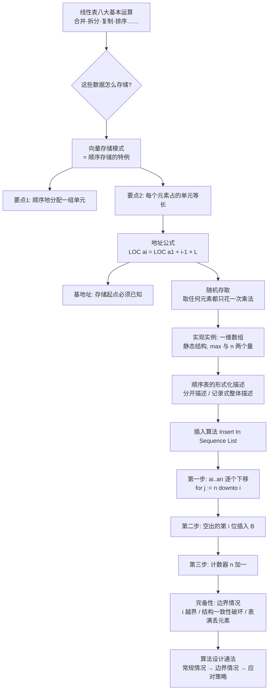

# 数据结构 · 第四周第一节 · 线性表的向量存储与顺序表插入算法 · 详细版讲义

> **来源说明**：本讲义依据课堂录音转写整理，并与本文件夹内严蔚敏《数据结构（C语言版）》（MinerU 识别版）第二章内容对照校订而成，属**学习笔记性质的整理稿**，不是老师的官方逐字稿。
>
> - **转写**：`20260921_103121_导出原文.txt`（约 24 分钟）
> - **教材对照范围**：第 2 章 2.1（线性表类型定义，式 (2-1)）、2.2（线性表的顺序存储表示，式 (2-2) 地址计算、随机存取、SqList、算法 2.3~2.5、式 (2-3)~(2-6) 平均移动次数）
> - **标注约定**：全部"举例"均按老师课堂原例整理并标注"（转写举例）"；教材未直接出现在转写、但为补全知识点而摘引的原文，标注"（教材补充）"并注明出处（如`（教材 式 2-2）`）。
> - **关联阅读**：[数据结构 第二章 线性表 详细版讲义](数据结构%20第二章%20线性表%20详细版讲义.md)（本章教材全解）、[数据结构第三周第二节 PDL语言与线性表引入 详细版讲义](数据结构第三周第二节%20PDL语言与线性表引入%20详细版讲义.md)（上一节）

## 开场导读

这节课要回答四个层层递进的问题。第一，线性表的那八大类基本运算（合并、拆分、复制、排序……）我们记住了，可这些数据到底**怎么存进计算机**？老师给出的答案是"向量存储模式"——它本质上就是教材里说的顺序存储，但加了一个关键约束：每个元素占的存储单元必须等长。第二，正因为等长，才推导得出地址计算公式 $\operatorname{LOC}(a_i)=\operatorname{LOC}(a_1)+(i-1)\times L$，也才有"随机存取"这个宝贵性质——取第 1 个元素和取第 10 万个元素代价完全一样。第三，有了存储结构，怎么在它上面做"插入"运算？这就要走一遍完整的算法设计过程：从抽象命名、参数刻画，到移动元素、插入、计数器加一，再到边界情况的完备性检查。第四，通过插入这个小例子，老师顺带教了一个通用方法论：算法设计没有标准答案，拿到问题先做常规情况、再处理边界情况、再给应对策略。整节课的主线，就是"存储结构决定算法形态"这一个思想——先讲清楚怎么存，再讲清楚怎么算。

## 总览知识地图



## 正文

### 一、复习：线性表的八大基本运算 `00:00–01:52`

上节课我们把线性表的基本运算梳理成了八大类，这节课开头，老师先用几个生活例子帮大家把它们"活化"一遍（转写举例）。

第一个例子是**合并**。学校开运动会，信息院有报 100 米的，化工院也有报 100 米的，物理院还有报 100 米的。体育教研室要干什么？要把各院系报上来的人员**汇总**起来，编排出一个比赛的名单。你看，这就是合并操作。而有"合"必有"分"，与合并相对的是**拆分**：每到节日，全校的工会要给员工发物品——油、米、面之类。学校工会把东西发下来，信息院的员工拿自己院的那份名单去领东西，化工院的拿化工院的名单去领东西。一个完整的表，就这样按某个条件分成了两个表。

第三个是**复制**。要注意，计算机当中的复制是百分之百的复制。老师举的例子是盗版软件（转写举例）：盗版软件实际上也是百分之百复制，只不过到了"验证"那一步，与真品可能有差别——差别不在复制本身，而在后面的验证环节。

第四个是**排序**，也就是对线性表的数据元素**按某个数据项进行重组**。大一军训的时候，教官第一次看到队伍高高矮矮、参差不齐，怎么办？把队伍打散，从低到高重新排一个整齐的队——这就是按"身高"这个数据项重组（转写举例）。再比如打印选修学生的表格时，默认按学号升序排列，也是重组（转写举例）。老师特别强调：重组这个操作在计算机里非常重要，重要到教材专门用一整章——第 9 章排序——来讲它。老师还打了个比方（转写举例）：现在大家常说"卷"，卷的是什么？卷的就是你在社会上的排位嘛。你付出了努力就可能往前排一排，就可能拿到更好的资源、过上更美好的生活。排序的本质，不正是如此吗？

当然，这些运算的具体**命名**，不同的教材可能会有一些差别，但没关系，总体来说就是这八大类。那么基于这些运算，下一个自然的问题就来了：这些数据**怎么存储**？我们第一个要讲的，就是线性表的**向量存储模式**。

### 二、向量存储：顺序存储的特例，等长是关键 `01:52–03:06`

先做一个术语上的澄清，这是本节课的核心亮点，老师专门花了力气辨析。

大部分教科书上讲的是线性表的"**顺序存储**"方式，而我们这节课用的是数学上的一个词汇——"**向量**"。为什么不直接叫顺序存储？老师讲了这个道理。

一个线性表 $a_1, a_2, \dots$ 在逻辑上是一个接一个排好的：第一个、第二个、第三个。那么在计算机里怎么组织它？最自然的方式就是：排完 $a_1$，把 $a_1$ 放进第一个单元；排完 $a_1$ 排 $a_2$，把 $a_2$ 放进第二个单元……逻辑上一个接一个，物理上在存储器里也一个接一个，用**物理上存储单元的相邻**来反映**逻辑上的相邻**——这是最简单、最自然的方式。

到这一步为止，还只是"顺序"二字。顺序存储方式的完整定义包含两个要点：

1. **顺序地分配一组存储单元**；
2. **每个数据元素所占据的存储单元的大小要一模一样（等长）**。

老师再三强调后面这句话："**顺序并不意味着等长**。"顺序存储结构的唯一要求就是元素依次存储，它本身**并没有**要求每个元素大小一样。"向量"这个词，恰恰是在"依次存储"的基础上，额外加上了"等长"这条要求。所以老师给出一句话总结：**向量是顺序存储结构的特例**。正因为多了"等长"这个约束，向量才拥有顺序存储未必拥有的好性质——什么好性质？这就引出了下一段的地址公式。

（教材对照：严蔚敏教材 2.2 节的表述是"线性表的顺序表示指的是用一组地址连续的存储单元依次存储线性表的数据元素"，并以元素在计算机内"物理位置相邻"来表示数据元素之间的逻辑关系；教材将这种机内表示称做**顺序存储结构**或**顺序映像**，称这种存储结构下的线性表为**顺序表**。老师口中的"向量存储"，即教材"顺序存储"基础上强调"元素等长"的特例情形，两种称呼并列使用，所指实质相通。）

### 三、地址计算公式与基地址 `03:06–04:40`

相同大小的存储空间为什么非常重要？因为等长会立刻让数据访问获得一个特别好的性质。我们把它一步步推出来。

想访问第 $i$ 个数据元素，怎么访问？很简单：只要**知道第 $i$ 个元素的地址**，就能把它取出来。那第 $i$ 个元素的地址在哪儿呢？假设每个元素都占固定大小 $L$ 的存储单元。注意，如果我知道第 $i-1$ 个元素的地址，它的位置就确定了，我再加上一个 $L$，不就知道第 $i$ 个元素的地址了吗？把这个递推关系写出来：

$$
\operatorname{LOC}(a_{i}) = \operatorname{LOC}(a_{i-1}) + L
$$

其中 $\operatorname{LOC}(a_k)$ 表示元素 $a_k$ 在存储器中的地址。继续往后推：要知道第 $i-1$ 个元素的地址，就得先知道第 $i-2$ 个的地址；要知道第 $i-2$ 个，又得先知道第 $i-3$ 个……这样从 $a_1$ 出发，每次加一个 $L$，一共加了 $i-1$ 次，依次类推，我们就得到了这个通用公式（教材 式 2-2）：

$$
\operatorname{LOC}(a_i) = \operatorname{LOC}(a_1) + (i-1) \times L \tag{2-2}
$$

这个公式的含义用文字说就是：**已知第 1 个元素 $a_1$ 的地址，加上一个偏移量 $(i-1)\times L$，就得到了第 $i$ 个元素 $a_i$ 的地址**。公式前面这一项 $\operatorname{LOC}(a_1)$，我们给它取个别名，叫做**基地址**——也就是数据在内存中开始存储的位置。这个开始位置你一定要告诉我，一定要明确。老师用了两个例子来说明"起点必须先定下来"（转写举例）：教官让你们重新排队，那从哪儿开始排？这个起点教官必须告诉大家；建一栋楼，地基从哪儿开始打？这也必须先确定。数据存入内存单元，从哪儿开始存，就是所谓的基地址。

现在回到那个关键问题（转写举例式的反问）：如果我只是顺序存储、**没有要求存储单元大小一样**，我还能得到这个公式吗？得不到了。因为元素大小不等时，第 $i$ 个元素的地址不再等于"前面所有元素占据的空间之和"这种规整的形式，偏移量算不出来。所以，等长才有地址公式，地址公式才有后面的一切——这正是我们借用数学词汇"向量"来命名这种方式、而不只叫它"顺序存储"的道理。

（教材补充：教材 2.2 节还给出了更基础的递推形式 $\operatorname{LOC}(a_{i+1}) = \operatorname{LOC}(a_i) + l$，其中 $l$ 为每个元素占用的存储单元数，并指出"每一个数据元素的存储位置都和线性表的起始位置相差一个和数据元素在线性表中的位序成正比的常数"；教材同时明确：$\operatorname{LOC}(a_1)$ 通常称做线性表的**起始位置**或**基地址**——与老师所讲的"基地址"完全一致。）

### 四、随机存取：等长带来的红利 `04:40–06:19`

有了地址公式，我们来看它带来的第一个、也是最重要的性质。

取任何一个元素，花的代价是多少？你想一下，要取第 $i$ 个元素，我就用公式算一下它的地址：一次乘法 $(i-1)\times L$，外加一次加法。加法相对于乘除法来说，一般是可以忽略不计的——因为一次乘除法，相当于许多趟加加减法的总和。所以我要知道第 $i$ 个元素的地址，实际上只需要进行**一次乘法**就可以了。一次乘法，代价极小，地址一算出来，元素立刻就能取到。

由此可以总结向量存储结构的两大结构特性：

- **第一，元素呈线性。** 我们用物理存储单元在地理位置上的相邻性，来反映数据元素之间的逻辑相邻关系——逻辑相邻是通过物理相邻来体现的，所以它呈线性结构。
- **第二，也是最重要的：它属于随机存取结构。** 向量存储这种方式实现的就是随机存取结构。

什么叫**随机存取**？很多书上也把它叫做随机存取方法、随机访问。说白了就是：取任何一个元素——不管你是取第 1 个、第 8 个、第 100 个，甚至第 10 万个元素——从这个公式可以看出来，花的代价都是做一次乘法运算，时间当然一样。**取任何元素所花的代价一模一样、与元素位置无关**，这种特性就叫做随机存取。教材的表述与此完全一致（教材补充）：顺序存储结构中，"只要确定了存储线性表的起始位置，线性表中任一数据元素都可随机存取，所以线性表的顺序存储结构是一种随机存取的存储结构"。

### 五、一维数组：向量在计算机中的实现实例；静态结构 `06:19–07:57`

随机存取当然好，我们可以快速地存取数据。那么这种结构在计算机里怎么落地？

我们访问向量是通过**下标变量**。向量其实不止一维，但我们这里默认讨论一维——不写它的维度，指的就是一维向量。而一维向量在计算机当中的一个具体的实现实例，就是**数组**。你可以直接认为：一维数组是向量在计算机中的一个实例。

接下来要认识数组的一个重要身份：数组是一个**静态结构**。所谓静态，是说它的存储空间大小 $N$ 在**编译阶段就要确定下来**，以后再不能改了。C 语言里你要申请空间，往往得告诉系统：这个数组有多大、要申请多少空间。编译器看到之后做的工作，就是在编译系统里替你完成那个地址计算公式——把基地址算出来、放到那儿。之后你要访问第 $i$ 个数据，它就加一个偏移量形成地址，快速取到该元素。这也从实现层面再次印证了前面讲的：基地址 + 偏移量，就是顺序存取的全部秘密。

### 六、顺序表的形式化描述：分开描述与整体描述 `07:57–09:33`

现在我们把向量存储在计算机里的样子具体化。假设地址（位序）从 $1$ 到 $max$，也就是说最多可以存 $max$ 个数据的存储空间。

老师用一个生活例子来说明"容量"与"用量"必须分开刻画（转写举例）：有的同学用笔记本来记东西。笔记本买回来，一页有多少行、总共有多少页，是不是买回来时就确定下来了？对，印刷厂把笔记本印出来，它的容量就定了。但问题是：张三买回来可能只写了三行，李四买回来写了 100 行——每个人具体**用了**多少行是不一样的。所以，除了表示总容量 $max$，我们还需要一个变量 $n$ 来反映当前实际用了多少。为什么需要它？因为第 $n$ 个之后的单元都是空的，做运算时不需要考虑它们。也就是说，顺序表的形式化描述必须包含两方面信息：**一是整个的存储容量（数组），二是一个计数器 $n$，记录当前用户用了多少个单元**。

那么怎么用计算机认识的方式（形式化，也就是符号化）来描述呢？老师给出的第一种描述方法是**分开描述**：定义顺序表类型 `sqlist`，它是一个数组，下标从 $1$ 到 $max$，最多可存 $max$ 个数据；数组里放的数据元素类型为 `DataType`。为什么用一个笼统的 `DataType`？因为每个数据元素 $a_i$ 是模型问题——我们事先不知道它具体是什么（可能是数、可能是符号、也可能是更复杂的信息），所以给它一个已知的、抽象的数据类型。另外还有变量 $n$，表示当前表长。这就是向量存储的一种形式化表达方法：把这些信息明确地告诉计算机，让它在计算机里保存下来。

（教材对照：老师这种"数组 + 计数器"的静态描述，与教材 2.2 节的 SqList 定义不同——教材采用 C 语言的**动态分配**一维数组：`typedef struct { ElemType *elem; int length; int listsize; } SqList;`，其中 `elem` 指示存储空间基址（即基地址），`length` 指示当前长度，`listsize` 指示当前分配的存储容量，空间不足时可再分配。老师的 $max$ 大致对应教材的 `listsize`，$n$ 对应 `length`；差别在于老师按"编译期定死的静态数组"讲述，教材用指针 + 动态分配。两种描述并列保留，老师原述为准，教材定义详见附录 C。）

### 七、算法设计没有标准答案；考研 408 的三步建议 `09:33–12:51`

上面这种"数组 + 计数器"分开描述的方法只是一种描述方法。我们还可以换一种：把两部分**当成一个整体**来看待。上节课刚讲过：客观世界当中，一个事物如果由两个及两个以上的组成要素构成，反映到计算机里面——不管是数据库也好，操作系统原理也好——我们都叫它**记录**。所以也可以把顺序表看成一个整体：定义一个 Sequence List 类型的记录，它里面包含两部分，一部分是数组 $a$（数据域），一部分是计数器（表长 $n$）。这是另外一种描述方法：把两部分合成一个整体来对待。

（教材对照：这正是教材用 C 语言 `struct` 结构体把数组和表长"打包"成 `SqList` 一个类型的做法——教材的整体描述与老师这里的"记录式整体描述"思路一致，只是老师课上用的是"数组 + 计数器分开描述"与"记录整体描述"两种并陈的讲法。）

有同学会问：老师，前面是两部分分开描述，这里又当成一个整体描述，那我到底用哪个好？老师的回答是：**算法设计可以多样化，没有标准答案**。计算机的算法设计，和我们做数学题、化学题、物理题不一样——不一样在哪儿？在于我们的设计可以多样化。就好比写作文（转写举例）：老师布置题目《我的父亲》，在座 40 个同学会有 40 种写法，你说谁错了？大家都对。只不过在都对的前提下，我们要看哪个**更优**。

说到这儿，老师专门给想考研的同学提了个醒（转写举例）：如果考 408 的话，国家统考出题一般不会出算法设计题；但算法设计题若要答，一般分三步走——

1. 第一步，把你的算法所用的**数据类型**等描述出来（有的题目会要求）；
2. 第二步，把算法的**基本思路**描述出来；
3. 第三步，对算法**分析一下效率**。

一般来说，考场上时间非常紧，很多同学不容易想到最优的算法。但是没关系：你只需要想到一种方法，先把它写上去。把前面两步——怎么描述数据类型、把你的思想描述一遍（完全可以用自然语言表述）——写清楚了，然后能给出算法，这个题目你就能拿到**大半部分分**。实际上，追求最优已经不是最重要的了。工作当中做算法设计也一样，可以用自然语言描述，只要你有想法。

### 八、插入运算的定义：抽象命名与参数刻画 `12:51–14:28`

有了存储结构，接下来看顺序表上的第一个运算：**插入一个数据元素**。

这个运算的定义是：在线性表 $A$ 当中，第 $i-1$ 个和第 $i$ 个元素之间插入一个新的元素 $b$。这个操作咋做？老师反复强调一句方法论：**计算机是模拟学科——人怎么做事情，就照搬到计算机里面**。那我们就看看人是怎么做事情的。

人做事情的第一步是什么？先看一个例子（转写举例）：我伸手、拿杯子、喝、放下——这一系列动作，用一个词概括一下我在干啥？**喝水**。等会儿下了课，大家冲出教室去干啥？下楼梯、去食堂、打饭、找座位……这一系列动作，抽象成一个概念就是**吃饭**。所以人类解决问题的第一步，是对求解的问题给一个**概述性的、抽象的概念**——把一连串具体动作抽象成一个词。

计算机的运算也一样。我们给这个运算抽象成一个名词：**Insert In Sequence List**（在顺序表中插入）。取名词要**见名知意**。

接着，问题是通过**参数来刻画**的——每一个问题（运算）都有一个论域，问题靠参数来刻画。就像"喝水"也有参数（转写举例）：喝的是茶水还是白开水？所以名词后面要跟着参数。插入运算的参数包括：

- 顺序表（线性表）本身；
- 待插入的数据元素 $b$；
- 插入位置：第 $i-1$ 和第 $i$ 个元素**之间**，这两个位置给一个就可以了，假设给 $i$；
- 当前表长 $n$，也得带着。

参数定好之后，还要问一句：这是一个**一般过程**还是**函数过程**？老师判断：是一般过程——这个事儿做了就行，不在乎反馈结果。当然一般来说也可以有返回值，表示操作成功还是不成功，但那个值就是个布尔（标志）值，只告诉你结果，并不作为运算结果来关心。好了，抽象到此完成：Insert、参数齐全、过程性质明确。

### 九、人工演算与存储器状态变化：插入要先移动元素 `14:28–16:05`

接下来按"自顶向下、逐步求精"来设计算法。最顶层就是刚才那个抽象——Insert In Sequence List。往下求精，先看人怎么做。

如果说是做**数学演算**，无非就是刚才那些动作挪到纸上做：我在纸上写出线性表 $(a_1, a_2, \ldots, a_n)$，然后在第 2 个位置插入一个元素 $B$，它就由这个式子变成另一个式子——运算做完，纸上的式子变了。这是人类人工来做。

那**计算机**在哪做呢？这些数据存在哪儿？存在**存储器**里。所以计算机对应的，是由**存储器的一个状态**变到**另一个状态**：第 $i$ 个位置原来是 $a_i$，你把 $B$ 插进去之后，$a_i$ 就跑到第 $i+1$ 的位置去了。这就是模拟：人来做，是式子到式子；计算机来做，是状态到状态。

那么怎么实现这个状态变化？你想一想：现在队伍已经排好了，$B$ 能不能**硬塞**进去？老师用了排队类比（转写举例）：直接塞进去行不行？不行！你要进去，后面的 $a_i$ 就得往后移一个位置。而 $a_i$ 一往后移，它会踩到后面人的脚，后面人会骂娘——所以不能硬塞，硬塞是不行的。

把这个动作抽象一下，插入算法分成两步：

1. **移动元素**：从第 $i$ 个位置一直到第 $n$ 个位置，这些元素通通往后移一个位置；
2. **插入**：移完了，第 $i$ 个位置空出来了，把 $B$ 插进去。

### 十、逐元素下移：for down to 与正循环的易错点 `16:05–17:38`

移动咋移？这里有个关键限制：能不能把 $a_i$ 到 $a_n$ 这一整块数据**一次性整体往下搬一个位置**？不行。因为**计算机一次只能做一个动作**，它不能一次性把整块数据都搬走。所以只能**一个一个移**：$a_n$ 移到第 $n+1$ 的位置，$a_{n-1}$ 移到第 $n$ 的位置，以此类推，$a_i$ 移到第 $i+1$ 的位置——不断地搬，一个元素一个元素地搬。

这显然是一个"**过程重复**"，过程重复用什么？用 **for 语句**（循环）。注意方向：表长 $n$ 比位置 $i$ 大，我们是从大到小地移，所以循环要用 **down to**——$j$ 从 $n$ 到 $i$，把 $a_j$ 搬到第 $j+1$ 的位置。也就是说**先移 $a_n$**，把它挪到 $n+1$ 的位置，再依次类推往前挪。

这里老师故意设了一个易错点：能不能反着写，$j$ 从 $i$ 开始 **to $n$**（正着循环）？老师直接给出结论：一般的肯定不行——"如果是这么个语句，怎么样全覆盖"，元素全被覆盖了，我就不解释了。具体展开一下这个"全覆盖"的道理（讲义补充）：正着循环会先执行 $a_{i+1} := a_i$，把 $a_{i+1}$ 的位置覆盖掉——$a_{i+1}$ 还没来得及搬走就被 $a_i$ 盖住了，等循环结束时 $a_{i+1}$ 到 $a_n$ 的位置全都互相覆盖，**数据就丢了**。所以必须从表尾开始、从后往前移，让每个元素搬走之前，它要腾出的那个位置还没被占用。移完之后，空出第 $i$ 个位置，第二条语句用一条**赋值语句**把 $B$ 插进去——这一步不复杂，一条语句就搞定了。

到这里，算法的"生产"环节完成了。老师打了个比方（转写举例）：从生产的角度看，产品做出来了，是不是就完事了？完成了之后，产品要**检测**，合格了要**打包**，打完包要**装箱**，装完箱还得**贴个标签**，说明这里面装的什么。这个比方是给下一段做铺垫的：算法主体写完，"包装"和"贴标签"的活儿还没干—— namely，得告诉系统"表里多了一个元素"。

### 十一、计数器加一与完备性：三类边界情况 `17:38–20:50`

先补上刚才的"贴标签"。插入做完之后，**计数器 $n$ 还要加一**。为什么？老师再三强调：数组是一个**静态结构**，它是有空间大小的。你往里面插了元素，元素个数从 $n$ 变成了 $n+1$，你得**告诉系统**多了一个元素。否则的话，计数器不知道实情，在你看来就可以不断地插、无限循环地插下去——这就有问题了。

老师说，如果是在语言课里面，你写到"把 $B$ 插进去 + 计数器加一"就算结束了。但在我们这个**设计课**里面，老师只能给你打个对勾之类的记号，也不能说你错，但是——**不完备**。为啥？因为这个算法实际上还有**异常情况**没有考虑。

**异常情况一：插入位置 $i$ 出了论域。** 我要在第 $i$ 个位置插入新元素，如果 $i$ 等于负五行不行？我们有第负五个位置吗？根本没有——参数超出了它的取值范围（论域），所以不能做插入。

**异常情况二：位置合法但会破坏"结构一致性"。** 老师举例（转写举例，具体数字以板书为准）：假设现在一共有若干个单元，当前有 4 个元素，我给你的位置 $i$ 却是 6——中间空着第 5 个位置。这时 for 循环从 $n$ down to $i$ 一次都不做（因为 $i$ 比 $n$ 大，循环条件不满足），然后 $B$ 直接被放到第 6 个位置。这行不行？不行！这里牵扯计算机当中一个非常重要的概念：**结构一致性**。它的意思是：你操作之前是一个线性表，操作之后**还得是线性表**。线性表的定义是什么？$a_1, a_2, \ldots, a_n$ **依次存储**的一个线性序列——元素是连续的，**中间不能有空的位置**。中间留着空位，就不符合线性表的定义，它就不是个线性表了。因为我们的元素要紧挨着存，这就是向量存储方式的约定。

老师给这个概念配了一个非常形象的例子（转写举例）：我是个大夫，有个病人得了很小的毛病，要进手术室做手术。这个人进手术室之前是个人，做完手术推出来**还得是个人**。你要是把他推出来变成两截子了、变成死人了，那还能叫人吗？人默认是要喘气的——手术可以做，但"是人"这个性质必须保持。操作前后结构一致，正是这个道理。

**异常情况三：表满了还插，元素会被"挤出"数组。** 还有没有别的异常？老师提醒大家从"数组是静态结构"入手想。有的：假设我有 6 个存储单元，里面已经存了 6 个元素（表满），你给我一个合法的 $i$，比如在第 4 个位置插入。for 循环可不可以做？可以做。但你想：$a_6$ 往下移一个位置，就移到了第 7 个位置——**出了我们的存储单元了**！我让你做插入操作，你干嘛把我的数据元素丢掉？$a_6$ 就丢了。这也是不行的：静态结构的空间是死的，表满了就不能再插，否则元素被挤出数组边界、直接丢失。

### 十二、边界情况的应对策略与算法设计工作法 `20:50–24:01`

把这几种异常情况统一起来看。这些情况我们统一称为"**边界情况**"。

为什么叫边界？还是回到"问题通过参数刻画"那句话：参数是有**取值范围**的。$i$ 也好、表长 $n$ 也好、容量 $max$ 也好，都有个范围。如果你给的这个值出了取值范围、跑到外面边界上去了，那就叫边界情况——那就危险。老师用一个生活例子来类比（转写举例）：大家拿着身份证可以全国各处跑，但有的地方就不行——比如原来的深圳、现在去澳门，你出了边界就得办**边防证**。为什么？因为边境比较危险，需要专门**约束**。边界情况正是这样：参数跑出了取值范围，必须对它加以约束和专门处理。

光识别出边界情况还不够，还得给**应对策略**：比如 $i$ 给得不合适，那就不能做插入；表满了也一样不能做插入，而且都要**给出提示信息**。应对策略必须写进算法里，看好了，得给。

通过插入这个小例子，我们顺便总结一下**算法设计大致的工作步骤**——拿到一个问题，怎么做算法设计？老师概括总体处理方法是三步（原话步数表述有残缺，见"待核实内容"）：

- **第一步：先解决常规情况。** 就是参数都合合适适、都好好着的时候，这件事儿该咋解决。比如让你算三角形的面积（转写举例）：给三条边 $A$、$B$、$C$，假设这三条边恰好能组成一个真正的三角形，那面积怎么算？先把这一步搞清楚。为什么常规情况要放在前面做？老师反问：如果说我连算面积的公式都还不会呢，你就告诉我说"$A$ 又不合适啦，$B$ 又不合适啦，又组成不了三角形啦"——那我更不会算了！所以必须先把常规情况下的解法拿到手。
- **第二步：处理边界情况。** 就是考虑这个参数不合适了咋办、那个参数不合适了咋办——为什么做边界情况的处理、怎么处理，承接前面的插入算法：$i$ 越界不插、中间不能留空位、表满不插。
- **第三步（也是前面反复强调的）：对每一种边界情况给出应对策略**——不能做时要给出提示信息，让算法"完备"起来。

这个"常规情况先行、边界情况兜底、策略配套"的工作法，就是这节课的插入算法教给我们的、可以迁移到任何算法设计题上的通用套路。

## 结课：把整节课串起来

回看整节课，它其实回答了一条主线上的四个问题。**怎么存？**线性表的第一种存储方式是向量存储——它是顺序存储的特例：在"元素依次存储"之上额外要求每个元素等长。**为什么等长这么重要？**因为等长才推得出地址公式 $\operatorname{LOC}(a_i)=\operatorname{LOC}(a_1)+(i-1)\times L$，公式里才有"基地址"的概念，也才换来"随机存取"这个最值钱的性质：取任何元素都只花一次乘法，代价与位置无关。这个结构在计算机里的实现实例就是一维数组——一个编译期定死大小的静态结构，所以形式化描述时除了容量 $max$ 还得带上计数器 $n$，描述方式可分开、可整体（记录），没有标准答案。**怎么算？**在存储结构上做插入，遵循"计算机是模拟学科"的原则：人不能把 $B$ 硬塞进排好的队，机器也就必须先让 $a_i$ 到 $a_n$ 逐个下移（for down to，从表尾移起，正循环会覆盖元素）、再插入 $B$、最后计数器加一。**怎么才算设计完？**算法主体只是"产品"，还要"检测、打包、贴标签"：检查 $i$ 是否出论域、操作前后是否保持结构一致性（中间不能留空位）、表满时元素会不会被挤出数组——把边界情况和应对策略补齐，算法才完备。这套"常规情况 → 边界情况 → 应对策略"的流程，比插入算法本身更值得带走。

**复习要点（可自测）：**

- 线性表八大运算中的四个及生活对应：合并（运动会报名汇总）、拆分（工会发物品）、复制（盗版软件也是百分之百复制，差别在验证环节）、排序/重组（军训排队；"内卷"卷的就是排位）。
- 向量存储 = 顺序存储的特例：两个要点——顺序分配一组单元 + **每个元素占的单元等长**；"顺序并不意味着等长"。
- 地址公式：$\operatorname{LOC}(a_i) = \operatorname{LOC}(a_1) + (i-1)\times L$；$\operatorname{LOC}(a_1)$ 叫**基地址**；推导靠递推"前一个地址 + $L$"。
- 随机存取的定义：取任何元素的代价一样，都是一次乘法算地址（加法忽略不计）。
- 一维数组是向量的实现实例；数组是静态结构，容量在编译期确定。
- 顺序表形式化描述的两要素：数组（容量 $max$）+ 计数器 $n$；两种描述法：分开描述 / 合成记录（Sequence List）整体描述。
- 算法设计没有标准答案（作文 40 人 40 种写法）；考研 408 答题三步：数据类型 → 基本思路 → 效率分析。
- 插入算法三步：移动元素（$a_n \to a_i$ 逐个下移，用 down to）、插入 $B$、$n := n+1$；正循环会覆盖元素。
- 三类边界情况：$i$ 越界出论域；中间留空位破坏结构一致性（手术室类比）；表满插入丢元素。
- 边界情况要有应对策略与提示信息（边防证类比）；算法设计通法：常规情况 → 边界情况 → 应对策略。

## 待核实内容

1. **异常情况举例中的具体数字**：seg_11–12 转写中"总共有 64 个单元""当前有 4 个元素""位置 $i=6$"等数字在原转写中多处残缺（如"64""4 个元素"为校订推测），老师板书的具体数值无法从音频转写确认，以板书/课件为准。
2. **算法设计工作步骤的"步数"**：seg_13 原文为"处理方法就是 3 步（'3步啊，或者总体来说X步'，后一字残缺）"，本讲义按"三步"（常规情况、边界情况、应对策略）整理；若老师实际说的是其他步数划分，以后续课程为准。
3. **顺序表类型名的读音**：seg_05 中老师口述疑为 "quence list"，校订按教材惯例记作顺序表类型 `sqlist`（Sequence List 的缩写），老师的准确叫法待核。
4. **数组下标范围与 $n$ 的取值**：seg_05 原音不清（"到 max、0 到 max"），老师讲的数组下标是 $1..max$ 还是 $0..max-1$、$n$ 可取 $0..max$ 还是 $1..max$ 的对应关系，未能完全确认；教材补充说明：C 语言数组下标从 0 开始，若 L 是 SqList 类型顺序表，表中第 $i$ 个数据元素是 `L.elem[i-1]`（教材 2.2 节）。
5. **"先移谁"的细节表述**：seg_09 原文"不用打一样"校订为"不能整块一起移"，seg_10 中"这你级一般的肯定啊"校订为"这一般的肯定不行"，均为根据上下文的合理还原，原话措辞待核。
6. **表满判断的记号**：seg_13 原文"S=max"校订为"$n = max$（表长等于容量）时表满、不能插入"；老师使用的容量记号是 $max$ 还是 $maxsize$，待与板书核对。

## 附录

### 附录 A：地址公式速查

| 量 | 含义 | 备注 |
| --- | --- | --- |
| $\operatorname{LOC}(a_1)$ | 基地址（起始位置） | 存储起点必须已知，类比排队起点 / 打地基 |
| $L$（教材记作 $l$） | 每个元素占用的存储单元数 | 等长是公式成立的前提 |
| $i$ | 元素位序 | 偏移量为 $(i-1)\times L$ |

递推起点（教材 2.2 节）：$\operatorname{LOC}(a_{i+1}) = \operatorname{LOC}(a_i) + L$；通项（教材 式 2-2）：$\operatorname{LOC}(a_i) = \operatorname{LOC}(a_1) + (i-1)\times L$。

### 附录 B：顺序表插入算法代码清单

**课堂版（按老师口述的算法步骤整理，PDL 风格）**——注意它与下一段教材版的对应：循环"for j := n downto i"对应教材的"插入位置及之后的元素右移"；"a[i] := B"对应教材的 `*q = e`；"n := n + 1"对应教材的 `++L.length`；而教材在循环之前还多出"i 值合法性检查"与"空间已满再分配"两段——这正是老师课上讲的"边界情况与应对策略"。

```pascal
PROCEDURE Insert_Sq(a, n, i, B);
{ 在顺序表 a 的第 i 个位置插入新元素 B；n 为当前表长 }
BEGIN
  { 第一步：移动元素——a_n 到 a_i 逐个下移一个单元，空出第 i 位 }
  FOR j := n DOWNTO i DO
    a[j+1] := a[j];
  { 第二步：插入 }
  a[i] := B;
  { 第三步：告知系统多了一个元素（计数器加一） }
  n := n + 1;
END;
```

课堂版是"常规情况"主体；完备版还需在开头补上边界检查：若 $i < 1$ 或 $i > n+1$（$i$ 出论域）或 $n = max$（表满），则不做插入并给出提示信息。

**（教材补充）算法 2.4 ListInsert_Sq 的 C 形式**（摘自严蔚敏《数据结构（C语言版）》2.2 节）：

```c
Status ListInsert_Sq(SqList &L, int i, ElemType e) {
    // 在顺序线性表 L 中第 i 个位置之前插入新的元素 e,
    // i 的合法值为 1 ≤ i ≤ ListLength_Sq(L) + 1
    if (i < 1 || i > L.length + 1) return ERROR;    // i 值不合法
    if (L.length >= L.listsize) {    // 当前存储空间已满，增加分配
        newbase = (ElemType *)realloc(L.elem,
            (L.listsize + LISTINCREMENT) * sizeof(ElemType));
        if (!newbase) exit(OVERFLOW);    // 存储分配失败
        L.elem = newbase;    // 新基址
        L.listsize += LISTINCREMENT;    // 增加存储容量
    }
    q = &(L.elem[i - 1]);    // q 为插入位置
    for (p = &(L.elem[L.length - 1]); p >= q; --p) *(p + 1) = *p;
    // 插入位置及之后的元素右移
    *q = e;    // 插入 e
    ++L.length;    // 表长增 1
    return OK;
} // ListInsert_Sq
```

### 附录 C：（教材补充）顺序表类型 SqList 与插入/删除的平均移动次数

教材 2.2 节的顺序表采用动态分配的一维数组描述：

```c
// - - - - - 线性表的动态分配顺序存储结构 - - - - -
#define LIST_INIT_SIZE 100   // 线性表存储空间的初始分配量
#define LISTINCREMENT 10     // 线性表存储空间的分配增量
typedef struct {
    ElemType *elem;          // 存储空间基址
    int length;              // 当前长度
    int listsize;            // 当前分配的存储容量(以 sizeof(ElemType)为单位)
} SqList;
```

与之配套的初始化算法（算法 2.3）为顺序表分配预定义大小的数组空间并将当前长度置 0。另外，教材对插入、删除的时间代价给出了定量结论：在长度为 $n$ 的顺序表中插入一个元素，等概率下平均移动次数为

$$
E_{is} = \frac{1}{n+1}\sum_{i=1}^{n+1}(n-i+1) = \frac{n}{2} \tag{2-5}
$$

删除一个元素平均移动

$$
E_{dl} = \frac{1}{n}\sum_{i=1}^{n}(n-i) = \frac{n-1}{2} \tag{2-6}
$$

即**平均约移动表中一半元素**，故顺序表插入、删除的时间复杂度为 $O(n)$——这与老师"插入涉及大量元素移动"的定性说法一致（教材 2.2 节，式 2-3~2-6；老师本节课未展开推导，详见下一节）。
