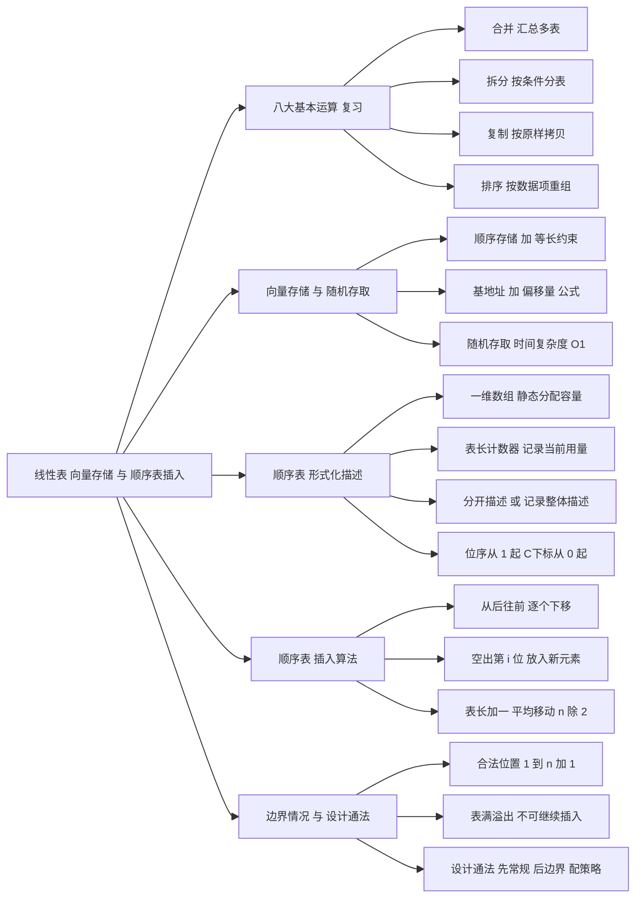

# 数据结构 · 第四周第一节 · 线性表的向量存储与顺序表插入算法 · 详细版讲义

> **来源说明**：本讲义依据课堂录音转写整理，并与本文件夹内严蔚敏《数据结构（C语言版）》（MinerU 识别版）第二章内容对照校订而成，属**学习笔记性质的整理稿**，非逐字逐句的原声记录。
>
> - **转写**：`20260921_103121_导出原文.txt`（约 24 分钟）
> - **教材对照范围**：第 2 章 2.1（线性表类型定义，式 (2-1)）、2.2（线性表的顺序存储表示，式 (2-2) 地址计算、随机存取、`SqList`、算法 2.3~2.5、式 (2-3)~(2-6) 平均移动次数）
> - **标注约定**：全部"举例"均按课堂原例整理并标注"（转写举例）"；教材未直接出现在转写、但为补全知识点而摘引的原文，标注"（教材补充）"并注明出处（如`（教材 式 2-2）`）。
> - **关联阅读**：[[数据结构 第二章 线性表 详细版讲义]]（本章教材全解）、[[数据结构第三周第二节 PDL语言与线性表引入 详细版讲义]]（上一节）

## 开场导读

这节课我要带你们回答四个层层递进的问题。第一，线性表的八大类基本运算（合并、拆分、复制、排序……）你们前面已经记住了，可这些数据到底**怎么存进计算机**？我给出的答案是"向量存储模式"——它本质上就是教材里说的顺序存储，但额外强调了一个关键约束：每个元素占的存储单元必须等长。第二，正因为等长，才推导得出地址计算公式 $\operatorname{LOC}(a_i)=\operatorname{LOC}(a_1)+(i-1)\times L$，也才有"随机存取"这个重要性质——取第 1 个元素和取第 10 万个元素所花的时间代价相同，时间复杂度均为 $O(1)$。第三，有了存储结构，怎么在它上面做"插入"运算？这就要走一遍完整的算法设计过程：从抽象命名、参数刻画，到移动元素、放入新元素、表长计数器加一，再到边界情况（$i$ 的合法范围 $1 \le i \le n+1$ 以及表满溢出）的完备性检查。第四，通过插入这个小例子，我顺带教给你们一个通用方法论：算法设计没有唯一标准答案，拿到问题先解决常规情况、再处理边界情况、再给出应对策略。整节课的主线，就是"存储结构决定算法形态"——先讲清楚怎么存，再讲清楚怎么算。

## 总览知识地图



## 正文

### 一、复习：线性表的八大基本运算 `00:00–01:52`

上节课我们把线性表的基本运算梳理成了八大类，这节课开头，我先用几个生活例子帮你们把它们"活化"一遍（转写举例）。

第一个例子是**合并**。学校开运动会，信息院有报 100 米的，化工院也有报 100 米的，物理院还有报 100 米的。体育教研室要干什么？要把各院系报上来的人员**汇总**起来，编排出一个比赛名单。你看，这就是合并操作。而有"合"必有"分"，与合并相对的是**拆分**：每到节日，全校的工会要给教职工发物品——油、米、面之类。学校工会把东西发下来，信息院拿自己院的那份名单去领，化工院拿化工院的名单去领。一个完整的表，就这样按某个条件分成了多个子表。

第三个是**复制**。要注意，计算机当中的复制是按原样完整复制。我举个盗版软件的例子（转写举例）：盗版软件实际上也是按原样复制了程序文件，只不过到了"验证"那一步，与正版可能有差别——差别不在复制本身，而在后面的授权验证环节。

第四个是**排序**，也就是对线性表的数据元素**按某个数据项进行重组**。大一军训的时候，教官第一次看到队伍高高矮矮、参差不齐，怎么办？把队伍打散，从低到高重新排一个整齐的队——这就是按"身高"这个数据项重组（转写举例）。再比如打印选修学生的表格时，默认按学号升序排列，也是重组（转写举例）。我特别强调：重组这个操作在计算机里非常重要，教材专门用一整章——第 9 章排序——来讲它。我再打个比方（转写举例）：现在大家常说"卷"，卷的是什么？卷的就是排位。你付出了努力就可能往前排一排，就可能拿到更好的资源。排序的本质，就是按一定规则重新确定元素次序。

当然，这些运算的具体**命名**，不同的教材可能会有一些差别，但没关系，总体来说就是这八大类。那么基于这些运算，下一个自然的问题就来了：这些数据**怎么存储**？我们第一个要讲的，就是线性表的**向量存储模式**。

**本节要点**

- 合并是把多个同类表汇总成一张表，拆分是按条件把一张表分成多个子表。
- 复制是指按原样生成一份内容一致的副本；排序则是按指定数据项对元素次序进行重组。
- 线性表运算的具体命名因教材而异，核心逻辑是先理解运算语义，再考虑其在特定存储结构上的实现。

### 二、向量存储：顺序存储的特例，等长是关键 `01:52–03:06`

先做一个术语上的澄清，这是本节课的一个关键区分，我专门花点力气来辨析一下。

大部分教科书上讲的是线性表的"**顺序存储**"方式，而我这节课借用了数学上的一个词汇——"**向量**"。为什么不直接只叫顺序存储？我来说明这个道理。

一个线性表 $a_1, a_2, \dots, a_n$ 在逻辑上是一个接一个排好的：第一个、第二个、第三个。那么在计算机里怎么组织它？最自然的做法就是：排完 $a_1$，把 $a_1$ 放进第一个单元；紧接着把 $a_2$ 放进第二个单元……逻辑上一个接一个，物理上在存储器里也一个接一个，用**物理上存储单元的相邻**来反映**逻辑上的相邻**——这是最直接的方式。

到这一步为止，还只是"顺序"二字。我们这里所说的向量存储（顺序存储的典型形式）包含两个要点：

1. **顺序地分配一组地址连续的存储单元**；
2. **每个数据元素所占据的存储单元大小相同（等长）**。

我再三强调后面这句话："**顺序并不意味着等长**。"如果只讲元素依次存储，字面上并没有强行限定每个元素大小都相等；而"向量"这个词，恰恰是在"依次存储"的基础上，明确加上了"等长"这条约束。所以我给出一句话总结：**向量是顺序存储结构的特例**。正因为多了"等长"这个约束，向量才拥有一般变长顺序放置所没有的好性质——什么好性质？这就引出了下一段的地址计算公式。

（教材对照：严蔚敏教材 2.2 节的表述是"线性表的顺序表示指的是用一组地址连续的存储单元依次存储线性表的数据元素"，并以元素在计算机内"物理位置相邻"来表示数据元素之间的逻辑关系；教材将这种机内表示称做**顺序存储结构**或**顺序映像**，称这种存储结构下的线性表为**顺序表**。在实际编程与教材中，同一线性表内的数据元素类型相同，因而每个元素占用的存储空间大小也相同；我们课上讲"向量存储"时，正是借这一术语把"依次连续存储"和"元素等长"两个条件显式拆开强调，二者所指实质相通。）

**本节要点**

- 顺序表的核心思想是以存储单元的**物理位置相邻**表示数据元素的**逻辑关系相邻**。
- 向量存储的两个要素是：**地址连续、依次存储**，以及**每个元素占用等长的存储单元**。
- 教材中的"顺序存储结构"与课上强调的"向量存储"实质相通，等长约束是推导后续性质的前提。

### 三、地址计算公式与基地址 `03:06–04:40`

相同大小的存储空间为什么非常重要？因为等长会立刻让数据访问获得一个很好的性质。我们把它一步步推出来。

想访问第 $i$ 个数据元素，怎么访问？很简单：只要**知道第 $i$ 个元素的存储地址**，就能把它取出来。那第 $i$ 个元素的地址在哪儿呢？假设每个元素都占固定大小 $L$ 个存储单元。如果我知道第 $i-1$ 个元素的地址，它的位置就确定了，我再加上一个 $L$，不就知道第 $i$ 个元素的地址了吗？把这个递推关系写出来：

$$
\operatorname{LOC}(a_{i}) = \operatorname{LOC}(a_{i-1}) + L
$$

其中 $\operatorname{LOC}(a_k)$ 表示元素 $a_k$ 在存储器中的起始地址。继续往后推：要知道第 $i-1$ 个元素的地址，就得先知道第 $i-2$ 个的地址；要知道第 $i-2$ 个，又得先知道第 $i-3$ 个……这样从 $a_1$ 出发，每次加一个 $L$，一共加了 $i-1$ 次，依次类推，我们就得到了这个通用公式（教材 式 2-2）：

$$
\operatorname{LOC}(a_i) = \operatorname{LOC}(a_1) + (i-1) \times L \tag{2-2}
$$

这个公式的含义用文字说就是：**已知第 1 个元素 $a_1$ 的地址，加上一个偏移量 $(i-1)\times L$，就得到了第 $i$ 个元素 $a_i$ 的地址**。公式前面这一项 $\operatorname{LOC}(a_1)$，我们给它取个别名，叫做**基地址**——也就是线性表在内存中开始存储的起始位置。这个开始位置一定要先明确下来。我用两个例子来说明"起点必须先定下来"（转写举例）：教官让你们重新排队，从哪儿开始排？这个起点教官必须告诉大家；建一栋楼，地基从哪儿开始打？这也必须先确定。数据存入内存单元，从哪儿开始存，就是所谓的基地址。

现在回到那个关键问题：如果我只是依次放置、**没有要求每个元素占据的存储单元大小一样**，还能得到这个公式吗？得不到了。因为元素大小不等时，第 $i$ 个元素的地址等于前面 $i-1$ 个不同长度元素的空间之和，无法简化成 $(i-1)\times L$ 这种规整的乘法偏移形式。所以，等长才有地址公式，地址公式才是后续性质的基础——这正是我们借用数学词汇"向量"来强调等长存储的道理。

（教材补充：教材 2.2 节给出了递推形式 $\operatorname{LOC}(a_{i+1}) = \operatorname{LOC}(a_i) + l$，其中 $l$ 为每个元素占用的存储单元数，并指出"每一个数据元素的存储位置都和线性表的起始位置相差一个和数据元素在线性表中的位序成正比的常数"；教材同时明确：$\operatorname{LOC}(a_1)$ 通常称做线性表的**起始位置**或**基地址**——与前面讲的"基地址"一致。）

**本节要点**

- 由递推关系 $\operatorname{LOC}(a_i)=\operatorname{LOC}(a_{i-1})+L$ 可推出地址公式 $\operatorname{LOC}(a_i)=\operatorname{LOC}(a_1)+(i-1)\times L$。
- $\operatorname{LOC}(a_1)$ 称为**基地址**（起始位置），$L$ 为单个元素占用的存储单元数，$(i-1)\times L$ 为相对基地址的偏移量。
- 只有元素等长，偏移量才与位序 $(i-1)$ 成正比；不等长时无法通过单一乘法直接定位。

### 四、随机存取：等长带来的红利 `04:40–06:19`

有了地址公式，我们来看它带来的第一个、也是最重要的性质。

取任何一个元素，花的代价是多少？你想一下，要取第 $i$ 个元素，我就用公式算一下它的地址：一次减法 $(i-1)$、一次乘法 $(i-1)\times L$，外加一次加法。在早期或粗略估算中，人们常说加法相对于乘除法可以忽略，于是常把重点落在**一次乘法**上；从算法时间复杂度的严格角度来看，减法、乘法和加法都是常数次基本操作，与表长 $n$ 和位序 $i$ 无关。因此，按位序查找并存取第 $i$ 个元素的时间复杂度为 **$O(1)$**，地址算出来后就能直接取到元素。

由此可以总结向量存储结构的两大结构特性：

- **第一，元素呈线性。** 我们用物理存储单元在位置上的相邻性，来反映数据元素之间的逻辑相邻关系——逻辑相邻是通过物理相邻来体现的，所以它对应线性结构。
- **第二，也是最重要的：它属于随机存取结构。** 向量存储这种方式实现的就是随机存取结构。

什么叫**随机存取**？很多书上也把它叫做随机存取方法、随机访问。说白了就是：取任何一个元素——不管你是取第 1 个、第 8 个、第 100 个，还是第 10 万个元素——从地址公式可以看出来，算地址所花的运算次数是一样的，与元素所处位置和表的总长度无关。**存取任一指定位序元素所花的时间代价相同（时间复杂度为 $O(1)$）**，这种特性就叫做随机存取。教材的表述与此一致（教材补充）：顺序存储结构中，"只要确定了存储线性表的起始位置，线性表中任一数据元素都可随机存取，所以线性表的顺序存储结构是一种随机存取的存储结构"。

**本节要点**

- 顺序表具有两大特性：以物理相邻体现逻辑相邻的**线性特性**，以及按位序**随机存取**的特性。
- 所谓**随机存取**，是指访问任意第 $i$ 个元素的时间代价与 $i$ 和表长 $n$ 无关。
- 依据地址公式直接计算位置，顺序表按位序随机访问的时间复杂度为 **$O(1)$**。

### 五、一维数组：向量在计算机中的实现实例；静态结构 `06:19–07:57`

随机存取当然好，我们可以快速地存取数据。那么这种结构在计算机里怎么落地？

我们访问向量是通过**下标变量**。向量其实不止一维，但我们这里默认讨论一维——不写它的维度，指的就是一维向量。而一维向量在计算机当中的一个具体实现实例，就是**数组**。你可以直接认为：一维数组是向量在计算机中的一个实例。

接下来要认识传统数组的一个重要身份：静态分配的一维数组是一个**静态结构**。所谓静态，是说它的存储空间大小 $N$（即最大容量）在**编译阶段就要确定下来**，运行期间通常不能直接改变。C 语言里如果你声明一个定长数组（如 `ElemType a[MAXSIZE];`），就得告诉系统这个数组有多大、要预留多少空间。编译器在编译阶段就会生成按"基地址 + 偏移量"计算元素地址的指令；等到程序运行、基地址确定之后，每次访问第 $i$ 个元素，系统就按基地址加上偏移量快速取到对应单元中的数据。这也从实现层面再次印证了前面讲的：基地址 + 偏移量，就是顺序存取的核心机制。

（教材补充：在 C 语言中，除了编译期固定大小的静态数组外，也可以借助 `malloc` 和 `realloc` 在运行期动态分配和扩充连续存储空间——严蔚敏教材正是用指针加动态分配来定义 `SqList`，兼顾连续存储与容量可扩展性。）

**本节要点**

- 一维数组是一维向量在计算机中的典型实现实例，通过下标访问元素。
- 定长一维数组属于**静态结构**，其容量在编译期确定，运行时不会自动增长。
- 编译器生成按"基地址 + 偏移量"寻址的指令，从而在运行时实现高效的顺序存储访问。

### 六、顺序表的形式化描述：分开描述与整体描述 `07:57–09:33`

现在我们把向量存储在计算机里的样子具体化。假设线性表最多可以存放 $max$ 个数据元素，元素的逻辑位序从 $1$ 到 $max$。

我用一个生活例子来说明"容量"与"用量"必须分开刻画（转写举例）：有的同学用笔记本来记东西。笔记本买回来，一页有多少行、总共有多少页，是不是买回来时就确定下来了？对，印刷厂把笔记本印出来，它的容量就定了。但问题是：一位同学买回来可能只写了三行，另一位同学买回来写了 100 行——每个人具体**用了**多少行是不一样的。所以，除了表示总容量 $max$，我们还需要一个变量 $n$ 来反映当前实际用了多少个单元（即当前表长）。为什么需要它？因为第 $n$ 个之后的单元都是空闲的，做运算时不应该把它们当成有效数据。也就是说，顺序表的形式化描述必须包含两方面信息：**一是整个存储空间（数组，容量为 $max$），二是一个计数器 $n$，记录当前表长（$0 \le n \le max$）**。

这里要特别提醒你们注意**表长、位序与数组下标的关系**：

- 逻辑上，表长为 $n$ 时，有效元素的**位序**从 $1$ 到 $n$（$n=0$ 表示空表，$n=max$ 表示表满）。
- 在类 Pascal/PDL 伪代码中，有时直接把数组下标也写成 $1 \sim max$，此时第 $i$ 个元素就是 `a[i]`。
- 但在 **C 语言**中，数组下标从 $0$ 开始（合法下标范围是 $0 \sim max-1$），因此逻辑位序为 $i$（$1 \le i \le n$）的元素，对应的 C 数组下标是 `i - 1`，即存放在 `a[i-1]`（或 `L.elem[i-1]`）中，当前有效元素的下标范围为 $0 \sim n-1$。记住这句口诀：**C 下标 = 位序 - 1**。

那么怎么用计算机认识的方式（形式化，也就是符号化）来描述顺序表呢？我先给出第一种描述方法——**分开描述**：定义一个一维数组类型或数组变量（如容量为 $max$，在伪代码中位序可记作 $1 \sim max$，在 C 语言中下标为 $0 \sim max-1$），元素类型为抽象的 `DataType`；再单独配一个整型变量 $n$ 表示当前表长。为什么用一个笼统的 `DataType`？因为每个数据元素 $a_i$ 是问题模型决定的——我们事先不知道它具体是什么（可能是数、可能是字符、也可能是更复杂的信息），所以给它一个抽象的数据类型名。把数组和表长 $n$ 明确地交给计算机，这就是顺序表的一种形式化表达方法。

（教材对照：这种"定长数组 + 计数器"的静态描述，与教材 2.2 节的 `SqList` 定义在实现形式上有所不同——教材采用 C 语言的**动态分配**一维数组：`typedef struct { ElemType *elem; int length; int listsize; } SqList;`，其中 `elem` 指示存储空间基址（基地址），`length` 指示当前表长，`listsize` 指示当前分配的存储容量，空间不足时可再分配。课上的 $max$ 大致对应教材的 `listsize`，$n$ 对应 `length`；差别在于这里先按"定长静态数组"建立概念，教材用指针加动态分配。两种描述并列保留，课堂原述与教材定义详见附录 C。）

**本节要点**

- 顺序表描述必须区分**存储容量 $max$** 与**当前表长 $n$**（满足 $0 \le n \le max$，$n=0$ 为空表）。
- **位序、表长与下标关系**：逻辑位序为 $1 \sim n$，C 语言数组下标为 $0 \sim n-1$，即**下标 = 位序 - 1**。
- 分开描述法将存储数据的数组（元素类型为抽象的 `DataType`）与记录表长的变量 $n$ 分别定义，是建立顺序表概念的第一步。

### 七、算法设计没有标准答案；考研 408 的三步建议 `09:33–12:51`

上面这种"数组 + 计数器"分开描述的方法只是一种描述方式。我们还可以换一种：把两部分**当成一个整体**来看待。上节课刚讲过：客观世界当中，一个事物如果由两个及两个以上的组成要素构成，反映到计算机里面——不管是数据库也好，操作系统原理也好——我们都叫它**记录**（在 C 语言里就是结构体 `struct`）。所以也可以把顺序表看成一个整体：定义一个 Sequence List 类型的记录，它里面包含两部分，一部分是数组 $a$（数据域），一部分是计数器（表长 $n$）。这就是第二种描述方法：把两部分合成一个整体来对待。

（教材对照：这正是教材用 C 语言 `struct` 结构体把数组基址和表长"打包"成 `SqList` 一个类型的做法——教材的整体描述与这里的"记录式整体描述"思路一致，只是课上我采用了"数组 + 计数器分开描述"与"记录整体描述"两种并陈的讲法。）

有的同学可能会问：前面是两部分分开描述，这里又当成一个整体描述，那我到底用哪个好？我的回答是：**算法设计可以多样化，没有唯一标准答案**。计算机的算法设计，和我们做一般的数学、物理计算题不太一样——在于设计方案可以有多种合理写法。就好比写作文（转写举例）：有的教材布置题目《我的父亲》，在座 40 个同学会有 40 种写法，你说谁错了？只要立意和结构成立，大家都对。只不过在都对的前提下，我们要比较哪个**更优**。

说到这儿，我专门给想考研的同学提了个醒（转写举例）：如果考 408，算法设计题一般按以下三步来组织作答——

1. 第一步，把你的算法所用的**数据类型**等描述出来（视题目要求）；
2. 第二步，把算法的**基本思路**描述出来；
3. 第三步，对算法**分析一下时空效率**（时间复杂度和空间复杂度）。

一般来说，考场上时间非常紧，很多同学一时不容易想到最优的算法。但是没关系：你只需要先想到一种正确的做法，把它写上去。把前面几步——怎么定义数据类型、把你的思路描述一遍（也可以先用自然语言或清晰的伪代码表述）——写清楚了，然后能给出可执行的代码和复杂度分析，这个题目你就能拿到大部分分数。在工程与应试起步阶段，先保证正确清晰，再追求更优，往往比空着不写更重要。

**本节要点**

- **记录式整体描述**将数组与表长 $n$ 封装为同一复合类型（对应 C 语言的 `struct`）。
- 算法设计没有唯一标准答案，允许多种正确方案并存，再在此基础上比较优劣。
- 考研或规范答题的常规三步为：**数据类型定义 → 算法基本思路（与实现） → 效率分析**。

### 八、插入运算的定义：抽象命名与参数刻画 `12:51–14:28`

有了存储结构，接下来看顺序表上的第一个运算：**插入一个数据元素**。

这个运算的含义是：在线性表 $A=(a_1, a_2, \dots, a_n)$ 当中，在第 $i$ 个元素之前插入一个新的元素 $b$（当 $2 \le i \le n$ 时即插在第 $i-1$ 个和第 $i$ 个元素之间；当 $i=1$ 时插在表头；当 $i=n+1$ 时插在表尾第 $n$ 个元素之后，因此 $i$ 的合法范围是 $1 \le i \le n+1$）。这个操作咋做？我反复强调一句方法论：**计算机是模拟学科——人怎么做事情，就怎么搬到计算机里来设计**。那我们就看看人是怎么做事情的。

人做事情的第一步是什么？先看一个例子（转写举例）：我伸手、拿杯子、喝、放下——这一系列动作，用一个词概括一下我在干啥？**喝水**。等会儿下了课，大家走出教室去干啥？下楼梯、去食堂、打饭、找座位……这一系列动作，抽象成一个概念就是**吃饭**。所以人类解决问题的第一步，是对求解的问题给一个**概述性的、抽象的名称**——把一连串具体动作概括成一个标识符。

计算机的运算也一样。我们给这个运算抽象成一个操作名：**Insert In Sequence List**（在顺序表中插入）。取名字要**见名知意**。

接着，问题是通过**参数来刻画**的——每一个运算都有一个论域，问题靠参数来刻画。就像"喝水"也有参数（转写举例）：喝的是茶水还是白开水？所以操作名后面要跟着参数。插入运算的参数包括：

- 顺序表（线性表）本身；
- 待插入的数据元素 $b$；
- 插入位置 $i$（表示插在原第 $i$ 个位置之前，$1 \le i \le n+1$）；
- 当前表长 $n$（若采用"分开描述"，需要把 $n$ 作为可修改的参数传进来；若采用"记录整体描述"，则 $n$ 已包含在顺序表结构体中）。

参数定好之后，还要问一句：这是一个**一般过程**还是**函数过程**？我来判断一下：从插入本身的动作来看，它可以作为一个过程去修改表；但在实际编程中，往往也需要返回一个状态值（布尔值或状态码 `OK`/`ERROR`），用来告诉调用者这次插入是成功还是失败，这并不改变它的核心任务是修改顺序表本身。好了，抽象到此完成：名称清晰、参数齐全、过程性质明确。

**本节要点**

- 顺序表插入运算是在位序 $i$（即原第 $i$ 个元素之前）插入新元素 $b$，位置 $i$ 的合法范围为 **$1 \le i \le n+1$**。
- 算法抽象遵循"见名知意"与"参数刻画"：需要传入顺序表、当前表长 $n$（若未封装在结构体内）、插入位置 $i$ 和待插元素 $b$。
- 实际实现时通常返回操作状态码（如成功/失败），以便调用方处理非法输入或溢出。

### 九、人工演算与存储器状态变化：插入要先移动元素 `14:28–16:05`

接下来按"自顶向下、逐步求精"来设计算法。最顶层就是刚才那个抽象——`Insert_Sq`。往下求精，先看人怎么做。

如果是做**数学演算**，无非就是把刚才那些动作挪到纸上做：我在纸上写出线性表 $(a_1, a_2, \ldots, a_n)$，然后在第 2 个位置插入一个元素 $B$，它就由这个式子变成另一个式子——运算做完，纸上的序列变了。这是人类人工来做。

那**计算机**在哪做呢？这些数据存在哪儿？存在**存储器**里。所以计算机对应的，是由**存储器的一个状态**变到**另一个状态**：第 $i$ 个位置原来是 $a_i$，你把 $B$ 插进去之后，$a_i$ 就跑到第 $i+1$ 的位置去了。这就是模拟：人来做，是纸面式子到式子；计算机来做，是内存状态到内存状态。

那么怎么实现这个状态变化？你想一想：现在队伍已经排好了，$B$ 能不能**硬塞**进去？我用排队来打个比方（转写举例）：直接覆盖或者硬塞进去行不行？不行！你要进去，后面的 $a_i$ 就得往后移一个位置；如果 $a_i$ 不挪，或者挪了后面没跟着挪，就会挤占甚至覆盖后面的位置。

把这个动作抽象一下，插入算法的核心逻辑分成两步（后面再补计数和边界）：

1. **移动元素**：从第 $i$ 个位置一直到第 $n$ 个位置，这些元素依次往后移一个位置；
2. **插入**：移完了，第 $i$ 个位置空出来了，把 $B$ 放进去。

**本节要点**

- 计算机执行插入的本质，是从插入前的存储器状态迁移到插入后的存储器状态。
- 顺序表元素物理相邻，不能在原位"硬塞"覆盖原有数据，必须先把腾位置的元素后移。
- 核心动作可抽象为先将 $a_i \sim a_n$ 依次后移一位，再将新元素写入空出的第 $i$ 个位置。

### 十、逐元素下移：for down to 与正循环的易错点 `16:05–17:38`

移动咋移？这里有个关键限制：能不能把 $a_i$ 到 $a_n$ 这一整块数据**在基本顺序操作层面一步整体搬走**？在通常的算法模型下不行。因为**处理器一次基本赋值只能处理一个元素**，所以逻辑上要**一个一个移**：$a_n$ 移到第 $n+1$ 的位置，$a_{n-1}$ 移到第 $n$ 的位置，以此类推，直到 $a_i$ 移到第 $i+1$ 的位置——一个元素一个元素地搬。

这显然是一个"**过程重复**"，过程重复用什么？用 **for 循环**。注意移动方向：表长 $n$ 大于或等于插入位置 $i$（当 $i = n+1$ 时不需移动，循环执行 0 次），我们是从大到小地移，所以伪代码循环要用 **down to**——$j$ 从 $n$ 递减到 $i$，把 $a_j$ 搬到第 $j+1$ 的位置（C 语言下标则对应从 `n - 1` 递减到 `i - 1`，执行 `a[j + 1] = a[j]`）。也就是说**先移 $a_n$**，把它挪到 $n+1$ 的位置，再依次往前挪。

这里我故意设一个易错点：能不能反着写，让 $j$ 从 $i$ 开始 **to $n$**（正着循环）？我直接给出结论：通常是不行的——如果这么写，后面的元素就被覆盖掉了。具体把道理展开一下（讲义补充）：正着循环会先执行 $a_{i+1} := a_i$，把 $a_{i+1}$ 还没来得及搬走的值覆盖掉；紧接着下一轮 $a_{i+2} := a_{i+1}$，把刚覆盖进去的 $a_i$ 又复制给 $a_{i+2}$……等循环结束时，$a_{i+1}$ 到 $a_{n+1}$ 的位置全都会变成 $a_i$ 的副本，原来的 $a_{i+1}$ 到 $a_n$ **全丢了**。所以必须从表尾开始、从后往前移，让每个元素搬走时，它要占据的下一个位置恰好已经腾空。移完之后，空出第 $i$ 个位置，接下来用一条**赋值语句**把 $B$ 放进去——这一步一条语句就能搞定。

到这里，算法的"主体动作"部分就完成了。我打个比方（转写举例）：从生产的角度看，产品做出来了，是不是就完事了？完成了之后，产品要**检测**，合格了要**打包**，打完包要**装箱**，装完箱还得**贴个标签**，说明这里面装的是什么。这个比方是给下一段做铺垫的：插入动作做完，"打包"和"贴标签"的活儿还没干——也就是，得告诉系统"表里多了一个元素"，并且把各种异常挡在门外。

**本节要点**

- 逐个后移必须采用**逆序循环**（从 $a_n$ 到 $a_i$ 依次后移一位）；若正序从 $i$ 到 $n$ 移动，会导致 $a_{i+1} \sim a_n$ 被 $a_i$ 逐个覆盖丢失。
- 当 $i = n+1$（插在表尾）时，移动次数为 $0$；当 $i = 1$（插在表头）时，需移动全部 $n$ 个元素。
- 等概率下，在长度为 $n$ 的顺序表中插入一个元素，平均移动次数为 $\frac{n}{2}$，时间复杂度为 $O(n)$。

### 十一、计数器加一与完备性：三类边界情况 `17:38–20:50`

先补上刚才说的"贴标签"。把元素移好、把 $B$ 放进去之后，**计数器 $n$ 还要加一**（`n = n + 1`）。为什么？我再三强调：数组是一个有容量上限的结构。你往里面插了元素，有效元素个数从 $n$ 变成了 $n+1$，必须**更新长度记录**让系统知道表变长了。否则计数器不知道实情，后续访问就会漏掉最后一个元素，甚至误以为表一直没满而继续插下去。

如果是在初级语言课里，你们写到"移动 + 插入 $B$ + 计数器加一"就算把主干写出来了。但在我们这门**设计课**里，我只能先给你打个参考记号，也不能说逻辑全错，但是——**不完备**。为啥？因为这个算法还有**边界与异常情况**没有检查。一个合法的插入位置 $i$ 必须满足 **$1 \le i \le n+1$**，且表不能处于已满状态（$n < max$）。下面具体看三类异常：

**异常情况一：插入位置 $i$ 出了论域下界（$i < 1$）。** 我要在第 $i$ 个位置插入新元素，如果 $i$ 等于 $-5$ 或者 $0$ 行不行？我们不存在第 $-5$ 个或第 $0$ 个逻辑位置——参数超出了最小取值范围，所以不能做插入。

**异常情况二：位置 $i > n+1$，会破坏"结构一致性"。** 我举个例子（转写举例，具体数字以板书为准）：假设现在一共有若干个单元，当前表长 $n=4$（有 4 个元素 $a_1 \sim a_4$），我给你的位置 $i$ 却是 $6$——中间空着第 $5$ 个位置。这时循环条件（$j$ 从 $4$ 递减到 $6$）一次都不满足，循环体不执行，如果直接把 $B$ 放到第 $6$ 个位置，第 $5$ 个位置就空着。这行不行？不行！这里牵扯计算机当中一个非常重要的概念：**结构一致性**。它的意思是：操作之前是一个合法的线性表，操作之后**还得是一个合法的线性表**。线性表的逻辑是一串依次排列的序列，而向量存储要求元素**连续存放、中间不能有空位置**。如果 $i = n+1$（这里 $n+1 = 5$），插在表尾紧挨着 $a_4$ 是合法的；一旦 $i > n+1$（如 $i = 6$），中间留了空位，它就不再是连续存储的顺序表了。

我给这个概念配一个直观的例子（转写举例）：假如我是大夫，有个病人得了小毛病进手术室做手术。这个人进手术室之前是一个活生生的人，做完手术推出来**还得是一个完整、有生命体征的人**——手术可以治病，但"是人"这个基本属性不能在操作后被破坏。操作前后结构保持一致，正是这个道理。

**异常情况三：表满了还插（$n = max$），元素会被"挤出"数组。** 还有没有别的异常？我提醒你们从"静态数组容量有限"入手去想。有的：假设总容量 $max = 6$，里面已经存了 6 个元素（$n = 6$，表满），这时你给我一个在位序范围内看似合法的 $i$，比如在第 $4$ 个位置插入。移动循环能不能算？能算。但你想：$a_6$ 往下移一个位置，就移到了第 $7$ 个单元——**越出数组分配的存储边界了**！如果是静态数组，就会发生数组越界（缓冲区溢出），轻则 $a_6$ 丢失，重则破坏相邻内存数据。所以静态结构的空间上限确定时，表满就不能再直接插入，必须报错或采取扩容等应对策略。

**本节要点**

- 插入后必须执行 **`n = n + 1`** 更新表长，使系统的长度视图与实际有效数据保持一致。
- 插入位置 $i$ 的合法范围是 **$1 \le i \le n+1$**（空表 $n=0$ 时仅 $i=1$ 合法）；$i < 1$ 属下界越界，$i > n+1$ 会留下空位并破坏**结构一致性**。
- 当 **$n = max$（表满）** 时，静态顺序表无法继续插入，否则后移会导致数组越界或数据丢失。

###十二、边界情况的应对策略与算法设计工作法 `20:50–24:01`
Wait: make sure there is a space after `###`! `### 十二、边界情况的应对策略与算法设计工作法` — let's check! Good catch before writing!

Let's continue checking the text of Section 十二:
### 十二、边界情况的应对策略与算法设计工作法 `20:50–24:01`

把这几种异常情况统一起来看。这些情况我们统一称为"**边界情况**"。

为什么叫边界？还是回到"问题通过参数刻画"那句话：参数是有**取值范围**的。位置 $i$ 也好、表长 $n$ 也好、容量 $max$ 也好，都有明确的范围约束。如果你给的值超出了允许范围、或者当前状态已经顶到结构上限，就落到了边界情况上——如果不加检查就会出问题。我用一个生活例子来类比（转写举例）：大家拿着身份证可以在境内各处出行，但到了边境地区或出入境关口（比如过去的深圳特区管理线、现在去澳门），出了普通通行范围就得办专门证件或受专门检查。为什么？因为边界地带需要专门的**约束与把关**。边界情况正是这样：参数或状态触及、越出合法范围时，必须对它加以约束和专门处理。

光识别出边界情况还不够，还得给**应对策略**：比如 $i < 1$ 或 $i > n+1$ 时，不能执行移动和插入，而是直接返回错误状态并给出提示信息；表满（$n = max$）时，静态表同样不能做插入并给出表满提示（若是动态分配的顺序表，则可按策略申请扩容后再插）。应对策略必须实打实地写进算法里。

通过插入这个小例子，我们顺便总结一下**算法设计大致的工作步骤**——拿到一个问题，怎么做算法设计？我把总体处理方法概括为三步（原话步数表述有残缺，见"待核实内容"）：

- **第一步：先解决常规情况。** 就是参数和状态都在正常范围内时，这件事该怎么解决。比如让你算三角形的面积（转写举例）：给三条边 $A$、$B$、$C$，先假设这三条边能构成一个普通三角形，那面积怎么算？先把核心公式和主干逻辑写出来。为什么要把常规情况放在前面？我反问一句：如果我连正常三角形面积都不会算呢，一开始就光顾着检查"$A$ 不合适啦、$B$ 不合适啦、构不成三角形啦"——那核心问题还是没解决！所以必须先把握常规情况下的主干解法。
- **第二步：全面排查边界情况。** 在主干跑通的基础上，逐个思考：哪些参数会越界（如 $i < 1$ 或 $i > n+1$）、哪些结构状态会受限（如空表 $n=0$、满表 $n=max$），确保操作前后不破坏结构一致性。
- **第三步：为每一种边界情况配套应对策略。** 明确写出合法性判断条件，决定是拒绝操作并返回错误信息、还是动态调整容量，让整个算法达到完备。

这个"常规情况先行、边界情况兜底、策略配套"的工作法，就是这节课的插入算法教给你们的、可以迁移到其他算法设计题上的通用思路。

**本节要点**

- 边界情况是指参数越出合法取值范围（如 $i < 1$ 或 $i > n+1$）或数据结构状态触及极限（如 $n = max$ 表满）。
- 识别边界后必须写出明确的**应对策略**（如返回 `ERROR`/提示信息，或动态表触发扩容）。
- 算法设计通用三步：**先解常规主干 → 再查边界异常 → 最后配套应对策略**。

## 结课：把整节课串起来

回看整节课，我们其实围绕一条主线回答了四个递进的问题。**怎么存？**线性表的第一种存储方式是向量存储——它是顺序存储的典型情形，在"用连续存储单元依次存放元素"之上，明确要求每个元素等长。

**为什么等长这么重要？**因为等长才推得出地址公式 $\operatorname{LOC}(a_i)=\operatorname{LOC}(a_1)+(i-1)\times L$，公式里才确立了"基地址"的概念，也才换来"随机存取"这个核心性质：访问任一位序元素只需常数次运算，时间复杂度为 $O(1)$，代价与位置和表长无关。这一结构在计算机里的典型实现就是一维数组，它属于静态结构，因此形式化描述时除了总容量 $max$，还必须搭配计数器 $n$ 记录当前表长；在 C 语言中要注意位序（$1 \sim n$）与数组下标（$0 \sim n-1$）相差 1。

**怎么算？**在顺序表上做插入，遵循"计算机模拟人工过程"的原则：人不能把 $B$ 硬塞进排好的队列，机器也就必须先把 $a_i$ 到 $a_n$ 从表尾开始逆序逐个后移一位（若正序循环会造成元素覆盖丢失），再把 $B$ 放入空出的第 $i$ 位，最后执行表长计数器加一（$n = n+1$）。等概率插入的平均移动次数为 $\frac{n}{2}$（对应删除操作的平均移动次数为 $\frac{n-1}{2}$），插入与删除的平均时间复杂度均为 $O(n)$。

**怎么才算设计完备？**主干动作写完只是完成了常规情况，还要像产品出厂那样做好"检验和把关"：检查插入位置 $i$ 是否满足 $1 \le i \le n+1$（$i < 1$ 越界，$i > n+1$ 会留下空位破坏结构一致性）、检查表是否已满（$n = max$ 时静态表不能再插，避免数组越界或元素丢失）。把这些边界检查与应对策略补齐，算法才算真正完备——这套"常规情况 → 边界情况 → 应对策略"的设计方法，比插入算法本身更值得你们带走。

**复习要点（可自测）：**

- 线性表八大运算中的四个及生活对应：合并（运动会报名汇总）、拆分（工会分名单领物品）、复制（按原样生成副本）、排序/重组（军训按身高排队）。
- 向量存储的两要素：地址连续、依次存储 + **每个元素等长**；"顺序并不意味着等长"。
- 地址公式：$\operatorname{LOC}(a_i) = \operatorname{LOC}(a_1) + (i-1)\times L$；$\operatorname{LOC}(a_1)$ 叫**基地址**；随机存取的时间复杂度为 **$O(1)$**。
- 顺序表两要素与下标关系：容量 $max$ + 当前表长 $n$（$0 \le n \le max$）；逻辑位序 $1 \sim n$ 对应 C 语言下标 $0 \sim n-1$（**下标 = 位序 - 1**）；描述可分开、可合成记录（`struct`）。
- 插入算法与复杂度：从 $a_n$ 到 $a_i$ 逆序后移（正循环会覆盖丢数据）→ 放入 $B$ → $n := n+1$；等概率插入平均移动 $\frac{n}{2}$ 次，删除平均移动 $\frac{n-1}{2}$ 次，时间复杂度均为 $O(n)$。
- 插入边界条件：位置合法范围 **$1 \le i \le n+1$**（$i > n+1$ 破坏结构一致性）；表满 **$n = max$** 时静态表不可再插入；算法设计通法：**常规情况 → 边界情况 → 应对策略**。

## 待核实内容

1. **异常情况举例中的具体数字**：转写稿第 11–12 段中"总共有 64 个单元""当前有 4 个元素""位置 $i=6$"等数字在原录音转写中多处残缺（如"64""4 个元素"为校订时据上下文推测），课堂板书的具体数值无法从音频转写确认，以实际板书/课件为准。
2. **算法设计工作步骤的"步数"**：原文关于总体处理方法步数的语音片段存在一字残缺（"3 步啊，或者总体来说 X 步"），本讲义按"三步"（常规情况、边界情况、应对策略）整理；若课堂板书有不同划分口径，以板书/后续课程为准。
3. **顺序表类型名的准确读法与记号**：课上口述类型名疑为 "quence list"，校订按教材惯例记作 `sqlist` / `SqList`（Sequence List 的缩写）；另外表满判定时课上使用的容量变量记号是 $max$ 还是 $maxsize$，均待与课堂板书核对。
4. **课堂伪代码的数组下标起点**：转写原音在下标范围处含混（"到 max、0 到 max"），课上伪代码按 $1 \sim max$ 还是 $0 \sim max-1$ 书写尚待进一步确认；本文已补充说明伪代码（位序 $1 \sim n$）与 C 语言（下标 $0 \sim n-1$）的对应关系。
5. **局部口误与吞音的语义还原**：转写中"不用打一样"校订为"不能整块一起移"、"这你级一般的肯定啊"校订为"这通常是不行的"，均为根据上下文语义的还原，原话字面措辞待核。

## 附录

### 附录 A：地址公式与复杂度速查

| 量 / 指标 | 含义 / 结论 | 备注 |
| --- | --- | --- |
| $\operatorname{LOC}(a_1)$ | 基地址（起始位置） | 存储起点必须已知，类比排队起点 / 打地基 |
| $L$（教材记作 $l$） | 每个元素占用的存储单元数 | 等长是地址公式成立的前提 |
| $i$ | 元素逻辑位序（$1 \le i \le n$） | 偏移量为 $(i-1)\times L$；C 语言对应下标为 $i-1$ |
| 随机存取复杂度 | $O(1)$ | 由 $\operatorname{LOC}(a_i)=\operatorname{LOC}(a_1)+(i-1)\times L$ 直接计算地址 |
| 插入 / 删除复杂度 | 平均 $O(n)$ | 插入平均移动 $\frac{n}{2}$ 次，删除平均移动 $\frac{n-1}{2}$ 次 |

递推起点（教材 2.2 节）：$\operatorname{LOC}(a_{i+1}) = \operatorname{LOC}(a_i) + L$；通项（教材 式 2-2）：$\operatorname{LOC}(a_i) = \operatorname{LOC}(a_1) + (i-1)\times L$。

### 附录 B：顺序表插入算法代码清单

**课堂版（按课堂口述步骤整理的静态数组 C 实现）**——课上以位序 $1 \sim n$ 推演（伪代码记为 `for j := n downto i` 与 `a[i] := B`）；落到 C 语言静态数组 `a[0..MAXSIZE-1]` 时，位序 $i$ 对应的下标为 `i - 1`。下面代码中同时补全了课堂强调的边界检查（$i$ 的合法范围 $1 \le i \le n+1$，以及表满 `*n >= MAXSIZE`）：

```c
#define MAXSIZE 100   // 静态顺序表的最大容量
#define OK 1
#define ERROR 0

typedef int ElemType; // 示例元素类型，实际可按需替换

// 在静态顺序表 a 的第 i 个逻辑位置（1 <= i <= *n + 1）之前插入元素 B
// 参数 n 为指向当前表长的指针，插入成功后表长加 1
int Insert_Sq(ElemType a[], int *n, int i, ElemType B) {
    int j;
    // 1. 边界检查：插入位置 i 必须在 1 到 *n + 1 之间，否则越界或破坏结构一致性
    if (i < 1 || i > *n + 1) {
        return ERROR; // 位置不合法，给出失败状态
    }
    // 2. 边界检查：静态数组已满（表长达到 MAXSIZE），不能继续插入
    if (*n >= MAXSIZE) {
        return ERROR; // 表满溢出，防止元素被挤出数组边界
    }
    // 3. 常规情况第一步：从表尾下标 *n - 1 到 i - 1，逐个后移一位（必须逆序防覆盖）
    for (j = *n - 1; j >= i - 1; --j) {
        a[j + 1] = a[j];
    }
    // 4. 常规情况第二步：将新元素 B 放入空出的第 i 个位置（对应 C 下标 i - 1）
    a[i - 1] = B;
    // 5. 常规情况第三步：表长计数器加一，告知系统多了一个元素
    (*n)++;
    return OK;
}
```

**（教材补充）算法 2.4 `ListInsert_Sq` 的类 C 形式**（摘自严蔚敏《数据结构（C语言版）》2.2 节，注：形参 `SqList &L` 使用了 C++ 引用语法；若用纯标准 C 编译，应改为指针 `SqList *L`）：

```c
Status ListInsert_Sq(SqList &L, int i, ElemType e) {
    // 在顺序线性表 L 中第 i 个位置之前插入新的元素 e
    // i 的合法值为 1 <= i <= L.length + 1
    ElemType *newbase, *p, *q; // 声明辅助指针变量
    if (i < 1 || i > L.length + 1) {
        return ERROR; // i 值不合法
    }
    if (L.length >= L.listsize) { // 当前存储空间已满，按增量动态扩充容量
        newbase = (ElemType *)realloc(
            L.elem, (L.listsize + LISTINCREMENT) * sizeof(ElemType));
        if (!newbase) {
            exit(OVERFLOW); // 存储分配失败
        }
        L.elem = newbase;             // 更新新基址
        L.listsize += LISTINCREMENT;  // 增加当前存储容量
    }
    q = &(L.elem[i - 1]); // q 指向第 i 个元素（插入位置，下标 = 位序 - 1）
    // 从表尾元素开始逆序向后移动一位，直到插入位置 q
    for (p = &(L.elem[L.length - 1]); p >= q; --p) {
        *(p + 1) = *p;
    }
    *q = e;       // 在位置 q 放入新元素 e
    ++L.length;   // 表长增 1
    return OK;
} // ListInsert_Sq
```

### 附录 C：（教材补充）顺序表类型 `SqList` 与插入/删除的平均移动次数

教材 2.2 节的顺序表采用动态分配的一维数组描述：

```c
// - - - - - 线性表的动态分配顺序存储结构 - - - - -
#define LIST_INIT_SIZE 100   // 线性表存储空间的初始分配量
#define LISTINCREMENT 10     // 线性表存储空间的分配增量
typedef struct {
    ElemType *elem;          // 存储空间基址（指向连续数组首地址）
    int length;              // 当前长度（有效元素个数，0 <= length <= listsize）
    int listsize;            // 当前分配的存储容量（以 sizeof(ElemType) 为单位）
} SqList;
```

与之配套的初始化算法（算法 2.3）为顺序表分配预定义大小的数组空间并将当前长度置 `0`。另外，教材对插入、删除的时间代价给出了定量结论：

1. **插入操作的平均移动次数与复杂度**：在长度为 $n$ 的顺序表中，合法插入位置为 $1 \le i \le n+1$（共 $n+1$ 个位置）。在第 $i$ 个位置插入需后移 $n-i+1$ 个元素（最好情况 $i=n+1$ 移动 $0$ 次，最坏情况 $i=1$ 移动 $n$ 次）。设在各位置插入等概率（概率均为 $\frac{1}{n+1}$），平均移动次数为：

$$
E_{is} = \frac{1}{n+1}\sum_{i=1}^{n+1}(n-i+1) = \frac{n}{2} \tag{2-5}
$$

2. **删除操作的平均移动次数与复杂度**：在长度为 $n$（$n \ge 1$，表空 $n=0$ 时不能删除）的顺序表中，合法删除位置为 $1 \le i \le n$（共 $n$ 个位置）。删除第 $i$ 个元素需将 $a_{i+1} \sim a_n$ 共 $n-i$ 个元素前移（最好情况 $i=n$ 移动 $0$ 次，最坏情况 $i=1$ 移动 $n-1$ 次）。设在各位置删除等概率（概率均为 $\frac{1}{n}$），平均移动次数为：

$$
E_{dl} = \frac{1}{n}\sum_{i=1}^{n}(n-i) = \frac{n-1}{2} \tag{2-6}
$$

即**插入与删除平均均约移动表中一半元素**，故顺序表按位序插入、删除的时间复杂度均为 $O(n)$——这与我课上所讲"插入涉及大量元素移动"的定性判断是一致的（教材 2.2 节，式 2-3~2-6；本节课未展开数学推导，留待后续课程深化）。
