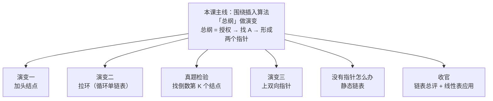
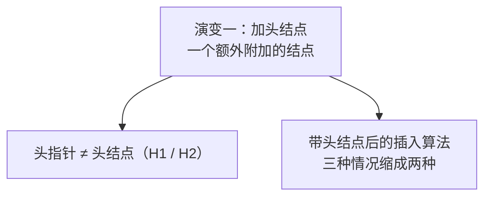
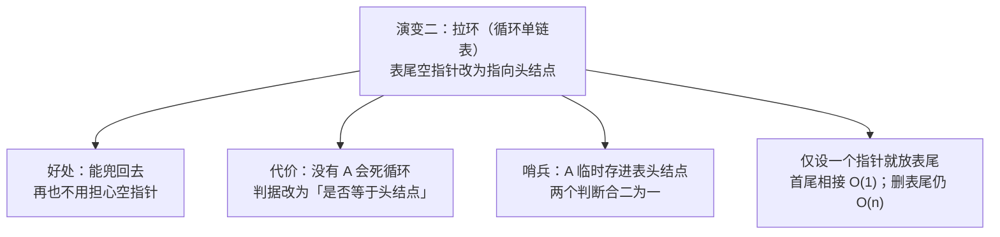
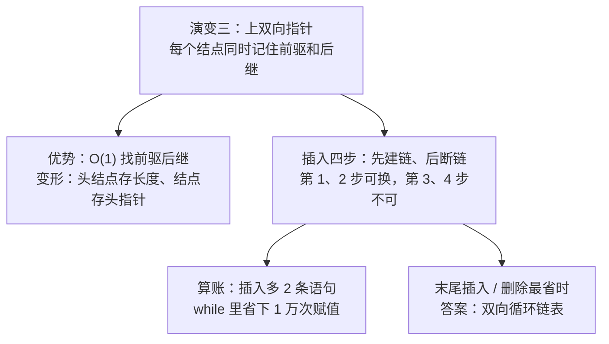
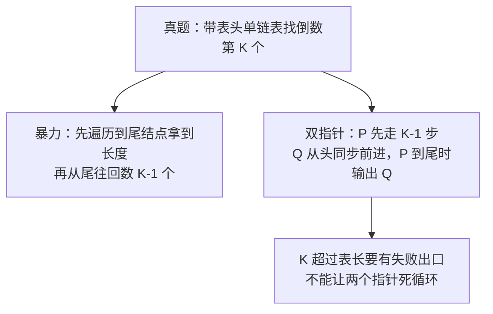
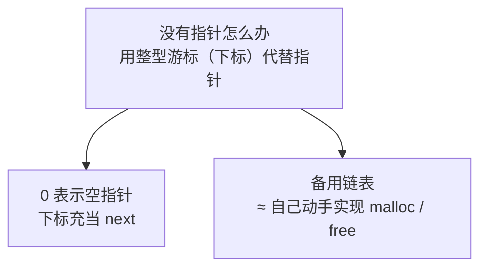
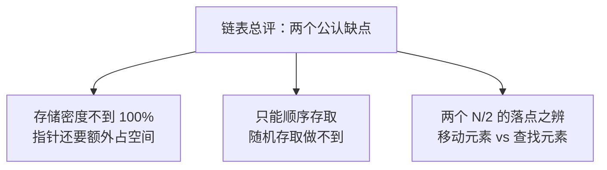
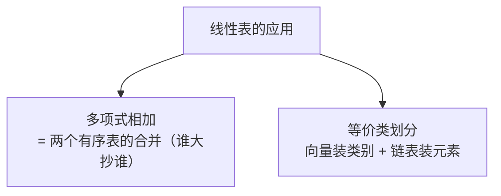
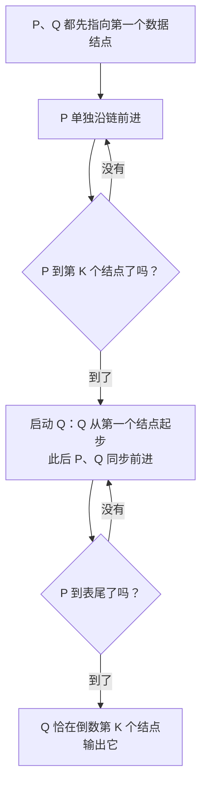

# 数据结构 · 第四周第三节 · 链表的进阶与线性表的应用 · 详细版讲义

> **来源说明**：本讲义依据课堂录音转写整理，并与本文件夹内严蔚敏《数据结构（C语言版）》（MinerU 识别版）第二章内容对照校订而成，属**学习笔记性质的整理稿**，不是老师的官方逐字稿。
>
> - **转写**：`链表相关知识讲解_导出原文.txt`（本次课前半段，至课间休息，约 28 分钟）+ `链表相关知识点讲解_导出原文.txt`（后半段，至下课，约 18 分钟），两份合计约 46 分钟；录音起点为半句残句，"课间休息"处两份转写衔接。
> - **教材对照范围**：第 2 章 2.3.1（线性链表的头结点、算法 2.8~2.12、静态链表与算法 2.13~2.17）、2.3.2（循环链表、图 2.12/2.13）、2.3.3（双向链表、算法 2.18~2.21）、2.4（一元多项式的表示及相加、例 2-4、算法 2.22/2.23）。
> - **标注约定**：全部"举例"均按老师课堂原例整理并标注"（转写举例）"；教材未直接出现在转写、但为补全知识点而摘引的原文，标注"（教材补充：出处）"；本讲义自补的解释标注"（讲义补充）"。
> - **记法说明**：老师课上用 Pascal 风格记法（如 `P^.next`、`S^.right`），教材用 C 风格记法（`p->next`、`s->prior`）；双向链表两个指针域老师按"躺倒"画法叫 left/right，教材记 prior/next。两种记法并列说明，以老师原述为主。
> - **时间说明**：正文各节标注的时间为"伪时间"（按转写字数折算），自本课起点 00:00:00 连续递增至约 00:45:43，节界与分段边界对齐；课间休息位于 00:27:30–00:29:05 之间。
> - **编号说明**：老师课堂按自己的课程编号称本章为"第 3 章"、预告"第 4 章"；本讲义凡引教材一律用教材章号（本章为教材第 2 章），详见正文"待核实内容"。
> - **关联阅读**：[数据结构 第二章 线性表 详细版讲义](数据结构%20第二章%20线性表%20详细版讲义.md)（本章教材全解）、[数据结构 第四周第二节 单链表的插入与删除算法 详细版讲义](数据结构%20第四周第二节%20单链表的插入与删除算法%20详细版讲义.md)（上一节）

## 开场导读

这节课是线性表这一章的收官之课。上半节，老师从上一课留下的"插入算法总纲"出发，沿着三个方向把它做深：给链表加头结点，让算法更简洁；把链表尾部的空指针拉成一个环，变出循环链表；再用一道"找倒数第 K 个结点"的真题检验你的算法设计功力。课间休息之后，老师又讲了双向链表、静态链表，以及线性表的两个经典应用——多项式相加与等价类划分。这节课真正的关键词只有两个：**"变化"**和**"算账"**——同一个插入算法，加上头结点、搭成环、装上双向指针，就变出一族新结构；而每一次变化，都要算清楚你得到了什么、付出了什么。学完这一节，链式结构（连同它的各种变体）就基本讲完了，下节课老师将开启新的一章。

## 总览知识地图

这一节内容比较多，全塞进一张图会挤得看不清字，所以按"主线 + 分支"拆成 8 张小图：先用图 1 拿到全课骨架，再一张一张看细节。

**图 1 · 全课主线：围绕插入算法「总纲」做三次演变**



**图 2 · 演变一：加头结点**



**图 3 · 演变二：把空指针拉成一个环**



**图 4 · 演变三：上双向指针**



**图 5 · 真题：找倒数第 K 个结点**



**图 6 · 没有指针怎么办：静态链表**



**图 7 · 链表总评**



**图 8 · 线性表的应用**



## 正文

### 一、承接上节课：链表的"单向记忆"与插入算法的总纲地位 `00:00:00–00:03:17`

这节课的开头是从上一节课的话头中间直接接进来的（录音起点就是半句"……的节点的整体"），所以我们先把上一节课的落点补齐。

老师说，链表是指针联系起来的**结点**的整体；要访问一个链表，说到底就是要访问它的各个数据元素。元素与元素之间的关系靠什么体现？靠指针——"通过指针来反映它们之间的逻辑相邻性"。正因如此，链表的表头（指针）非常关键，它起到"**统辖全局**的作用"，而且"它不能挪窝"（讲义按口语整理：不能随便移动）。

接着，老师点出了单链表先天的局限：**任意一个结点，只知道它的直接后继，它的直接前驱它是不知道的**。为了把这个抽象的限制讲活，老师用了两个串联的类比（转写举例）。第一个是**特工（卧底）系统**：为了保护某一个卧底，一般只有谁知道他的身份？只有他的**直接上司**——也就是他的直接前驱——知道，别人都不知道；那你要找到这个特工，就得先找第一个、第二个，一直找到他的直接上司，然后才能找到他。第二个是电影《无间道》：刘德华实际上是黑社会，在警察里有表面身份；梁朝伟反过来，是警察、去黑社会卧底，他的身份只有黄秋生知道。故事的最后，黄秋生（也就是梁朝伟的直接上司）被黑社会干掉了，梁朝伟继续兢兢业业地做卧底工作；到了最后的清算阶段，出现了那个非常经典的天台场景——梁朝伟拿枪指着刘德华，说"对不起，我是卧底"（转写如此，影片原台词为"对不起，我是警察"），刘德华回了一句："有谁知道？谁知道？"因为唯一知道他身份的上司去世之后，他的卧底档案全部被删掉了——没有人再知道他是谁。

这个故事的落点，就是单链表操作的落点。老师说，现实中也是一样：**"你要得到 P 这个节点，你必须只能先去保存它的直接前驱。"**（老师的口语是"先保证它的直接前驱"——意思就是先保存好通向它的那个入口，前驱一丢，这个结点就再也找不回来了。）这句话是后面插入、删除乃至排序所有算法的根。

紧跟着，老师快速回顾了上一节课的**经典插入算法**——"分三步"：

1. **第一步：搞授权/赋初值**——把整个链表的头指针 H 赋值给一个工作指针 P。为什么要多此一举？因为头指针"有点像皇帝老爷子"，非常重要、"统辖整个链表的作用"，它是不能随便活动的；所以要派一个活动（工作）指针出去跑，让 P 去存储、去查找——"这个 P 丢了也就丢了，无所谓"。
2. **第二步：找 A**。题意是"在数据元素为 A 的那个结点之前插入新结点 B"，所以第一步工作就是去把 A 找到。
3. **第三步：找到 A 停下来**。这里最关键的，是"要形成两个指针"——一个是搜索指针 P（指示 A 在哪儿），另一个是配合插入使用的指针（上一课讲的"后拖变量/秘书"，即前驱指针）；两个指针都齐了，才能动手改指针、完成插入。

然后老师说了这节课的总纲：**老师给你讲一个算法，讲的是一大类问题的解决方案**。别看这只是一个"插入"，它同时"又是代表删除"——比如要删除 A，由于删除同样必须知道 A 的前驱，用的就是同一套"带前驱指针去搜索"的办法；它还适合"有序操作"——你想，如果一个链表存着一堆同学的成绩、已经从小到大排好了序，现在新来一个结点要插进去，插在哪儿？"肯定是在他之前"——还是同一套办法。所以，"万变不离其宗，也就是说，这就是我们的'宗'"。这节课以及后面的课，都围绕这个"宗"做演变。

### 二、头结点登场：一个"额外附加"的结点，两种容易混淆的指针 `00:03:17–00:09:42`

既然要向"宗"开刀，第一个变化是什么呢？但在讲这个变化之前，老师先花了几分钟把"删除"的操作语义说清楚，因为它直接决定了这个变化为什么值得做。

老师说：有的同学写程序，会说"删除 B 的下一个元素"——这样写当然也能实现，但是从人的认知来看不自然（转写举例）：比如链表中已经有 A、B、C 三个结点，你会不会说"把 B 的下一个元素删掉"？一般不这么说话，这种说法"就不是我们所谓的面向对象、面向目标"的说法；现实中要说"把 B 干掉"，就得直接说"删除 B"。"那我们面向目标，你要删除这个节点 B，怎么办？那你必须知道它的前一个在哪。"——这就是指针做法**普适性**的体现：它既适合插入，也适合删除，还适合有序的操作。到此，老师宣布：上节课那个算法"非常非常基础"，本节"围绕着这个'宗'，做一些演变"。第一个演变就是——**加一个表头结点**。

**什么叫头结点？** 老师的定义很朴素："增加一个附加的节点，放置在表（链）表的最前面，把它称为头节点。"他特意把"附加"二字拎出来解释：附加就是**额外**。这好比你初中做数学题时的**附加题**——百分卷子上额外给你一道 20 分的题，那是"额外的分值"。也就是说，头结点是一个额外搭出来的结点。

但天下没有免费的额外：加一个结点，就要多花一份存储空间。那耗费这空间图什么？老师给了一句话的总回答："**为了使得我们的运算更简单、更高效，那么描述起来更简洁。**"为了让大家体会这句话，他连讲了两个现实生活中的例子（转写举例）。

第一个是**宾馆的服务台**。设想你开了一家宾馆，一层楼一间间客房住客人、收房钱；可你观察一下好一点的宾馆——电梯正对着的那个房间，往往挂着"服务台/服务室"的牌子。这个房间能不能住人？能；但它**不接待客人**。别的房间住客人、给你掏钱，这个房间不但不赚钱，你还要**倒贴**——服务员的工资得你来发。为什么专门拿出这部分空间不赚钱还倒贴？答：为了整个宾馆"运行更顺滑"，有了服务台，服务响应更及时，客户的体验更好。

第二个是**运动会代表团的团长**（转写举例）。运动会开幕式上运动员进场，先排除一个特例：某个国家只来了一个人，这个人既是代表、又是旗手、又是运动员。一般情况呢？像中国、俄罗斯、美国这些大国，乌泱泱一两百号人，但这些人里面**并不个个都是运动员**——走在最前面的那个团长，他能给你带来比赛成绩吗？能带来第 8 名、第 10 名吗？能带来金牌银牌吗？"啥也不能带来"。那要他干什么？你观察一下：进场时他走在最前面；坐飞机他坐头等舱；住宿别人两人一间，他一个人一间。花这么多资源给他，为的是什么？"为了使得我们的比赛更顺滑"——运动员你就专心比赛，跟比赛无关的那些安排、通知，让团长去做。对应到链表：我们额外掏出一间"房"、一份存储空间给头结点，起的就是这个作用。

**画法与账目**（本段的后半程）：为了表示头结点的数据域不存数据元素，画图时用一个**阴影**表示它，默认里面是空的。那么空间账怎么算？如果有 3 个数据结点，加上头结点，就要消耗 **4 个结点**的存储空间；反过来，如果一个数据元素都没有，这张链表也"最最起码有一个表头结点"——空间照样花。老师重复：加头结点的目的，就是使得运算更高效、描述更方便。

讲到这里，老师话锋一转，进入一个年年有人混淆的问题：**头指针和头结点，是两回事**。他先在黑板上画出两只指针做课堂问答（转写示意）：一只叫 H1，指向第一个**有元素的**结点；另一只叫 H2，指着**头结点**——问大家："H1 是头指针还是头结点？H2 是头指针还是头结点？"课堂上有人答错，老师追问"真的吗？谨慎"，并提醒这个问题上一节课专门讲过。最后的结论是——**H1、H2 本质上都是头指针**，只不过指向不同：H1 指向第一个有元素的结点，H2 指向头结点（老师原话："H2 指向的是节点，它自己是头指针"）。他强调，我上一节课没有画存储空间的示意图，你们就以为 H1、H2 这两个"玩意儿"不需要存储？不对——头指针本身也是要存储的。

账要算到字节上，才分得清（转写内容，按 64 位机器整理）：

| 对比项 | 头指针 | 头结点 |
| --- | --- | --- |
| 本质 | 一个指针变量 | 一个完整的结点（记录） |
| 存储内容 | 一个存储地址 | 数据域 data + 指针域 next |
| 占用空间 | 8 个字节（64 位） | 8 个字节（指针域）+ data 那么大 |
| 是否一定有 | 凡有链表必有头指针 | 不见得有（"不是每场考试都有附加题"） |
| 类比 | 宾馆的门牌、统领全局的"皇帝" | 电梯对面的服务台、代表团团长 |

老师最后的总结是："**它自己本质上是什么（头指针），和它所指向的是什么（结点），分清楚这个**。"

（教材补充：教材 2.3.1——"有时，我们在单链表的第一个结点之前附设一个结点，称之为头结点。头结点的数据域可以不存储任何信息，也可存储如线性表的长度等类的附加信息，头结点的指针域存储指向第一个结点的指针……此时，单链表的头指针指向头结点。若线性表为空表，则头结点的指针域为'空'。"这里的"头指针指向头结点"，正对应课堂上 H2 的情形。）

头结点讲完了，它到底怎么让"运算更简单"？老师把上节课的插入算法拿来开刀了。

### 三、带头结点之后的插入算法：三种情况如何变成两种 `00:09:42–00:14:31`

先把上节课的算法结构摆出来：插入算法（在数据元素为 A 的结点之前插入 B）原来共有**三种情况**——两种异常，加一种常规。第一种异常是 **H = nil**（整个链表根本不存在，好比你去买饭想插队，到窗口一看一个人没有）；第二种异常是**第一个结点就是 A**（一搜索就落在 A 上，前驱指针形成不了）；剩下的都是常规情况。

现在加上头结点，操作定义不变（还是在 A 之前插 B），但三种情况会怎么变？

**第一种异常（H = nil）：没有改善。** 为什么？因为老师"再三强调"：头结点的数据域不存储数据元素，所以查找 A 必须**从表头的下一个元素开始**。可是 H = nil 的时候，你连头结点都没有——用 H 的 next 去给 P 赋初值这一步根本执行不了。"P 都没有，你（的 P 的 data、P 的 next）哪来的？"搜索循环形不成，强行访问就是空指针错误。所以带不带表头，这一种异常都客观存在。变化的只是赋值：原来（不带头时）是"把 H 送给 P"（P 直接落在第一个结点上）；现在改成"**把 H 的 next 送给 P**"——P 从第一个有数据元素的结点开始跑，后面的操作一模一样。

**第二种异常（第一个结点就是 A）：消失了，可以并入常规情况。** 这一点值得细品。原来不带头结点时，如果第一个结点就是 A，会有一个尴尬：我们要在 A 之前插入 B，就必须形成两个指针（搜索指针 P 和它的前驱 save）；可是搜索一出场，P 就落在第一个结点上，A 的前面没有元素、是空的——**前驱指针形成不了**。老师在这里复用了上一课那个"金銮殿"的比喻：你（钦差大臣）拿了尚方宝剑，还没出金銮殿呢，皇帝老爷子就让你干活了——后面那些"人马"（前驱指针）根本来不及安排。可带上头结点之后，情况就变了："P 在这儿，P 空不空？不空。前驱是谁？save 就是 H 嘛。"——第一个数据结点就是 A 时，前驱正好是头结点，两个指针都能顺顺当当地形成。于是这个情况完全可以"归到常规情况里去"。老师口误说成"归到频繁情况"，按上下文应理解为"常规情况"。

你看，三减一得二：**只剩"第一种异常（H = nil，不改善）+ 常规情况"**。而头结点的收益是实打实的，老师用"账"来说话：常规情况是执行最频繁的分支。假设你要做 1 万次频繁操作——以前要过**两道**异常判断（先问"H = nil 吗？"再问"第一个结点就是 A 吗？"）才开始干活，相当于 2 万次判断；现在只剩第一道判断，1 万次就够了。"是不是有改善？"当然有。老师顺便提醒：他"还先配了几句"旧写法来对照——分支一基本不变，分支二（常规）只是把初值改成 `P := H^.next`，后面找 A 的语句一模一样（转写中这段代码细节含混，具体语句见"待核实内容"）。

（教材补充：教材在带头结点单链表上实现"第 i 个位置之前插入"见算法 2.9：`p = L; j = 0; while (p && j < i - 1) { p = p->next; ++j; }`——注意教材的 p 是**从头结点出发**向后数、数到第 i−1 个结点作为插入位置的前驱；课堂上的 P 则从 H 的 next 出发去找 A。一个按"位序"走、一个按"数据元素"找，但都是"在表头方向留住一个指针、为插入找到前驱"。另，教材 2.3.1 再次说明头结点数据域可空；教材 2.3.3 末还用基本操作把同一插入改写为算法 2.20，可对照。）

讲完插入的三种变两种，老师突然把话题引向一个更普遍的担忧：**空指针**。他说，在计算机里面，"指针为空"这样的操作，一定是我们最最常遇到的边界情况之一——"我老担心越不越界，会不会跑着跑着掉悬崖？"既然如此，能不能把空指针**利用**起来？——"你不是为空吗？为空怎么样？我让你……指向头结点。我把你这个空指针利用起来。"这个念头一冒出来，链表就长出了一条新路：**循环链表**。这是下一节的全部主题。

### 四、循环链表：把空指针拉成一个环 `00:14:31–00:21:02`

所谓**循环链表**，改动小得超乎想象：把原来最后一个结点里那个空指针（NULL），改成指回头结点——整个链表首尾相接，形成一个环。

**好处一：可以"回到从前"。** 老师说，原来我们有个大问题：p 指向当前某个结点时，它的**直接后继**很容易得到，O(1)——顺藤摸瓜就是了；但它的**直接前驱**呢？没拉环、又没带那"那么多变量"，你就没有办法获得。他在这里感慨了一句"时光一去不复返"：指针一旦调到某个位置，"单行道啊"，要回头，没有办法回溯、没有办法恢复，所以找不着它的直接前驱；真要找，只能从第一个结点开始，用一个 while 循环挨个问："你是不是它的直接前驱？你不是，再看第二个……"——一路走过来。拉了环以后呢？从任何一个结点出发都能顺着环兜回来（"我们现在可以回到从前"）——网上那个流行语怎么说的？"所谓的成功人士：三岁……五岁能自己吃饭，80 岁能去吃饭，90 岁不尿裤子"——绕一圈，回来了。（这句流行语在转写里有缺漏，老师的落点就是"循环"二字。）

（讲义补充：严格地说，循环单链表里沿环走一圈去找前驱，代价仍是 O(n)；这里"拉环"的真正价值，是让"从任一结点出发都能到达表中其余结点"（教材 2.3.2 原话），"回头"不再是死路一条。真正把找前驱压到 O(1)，要等到下一节的**双向**链表。）

**好处二：再也不用担心空指针。** 拉了环之后，"再也不用担心这边会空了""再也不会有什么空指针情况发生了"。理由很简单：指针就是存储地址，这个地址部分填的是**头结点的地址**——它当然不空。

但老师立刻敲了警钟："天上不会掉馅饼""有得必有失"——你享受了便利，就得付出代价。**代价就是：会不会死循环？** 回顾原来的查找循环（找 A）：判据是"P 的 data 不等于 A，**并且** P 所指结点的 next 不等于 NULL（也就是说还没有走到最后一个结点）"，两个条件都成立就继续往后走。可现在最后一个结点的 next 指向头结点、不再是 NULL——如果这张链表里面**根本没有 A**，那么"你不是 A、你不是 A、你也不是 A……"一路问下去，永远等不到"下一个是空"的那一刻，就会绕着环一直转下去，**陷入死循环**（课堂上老师点同学回答，答案正是"会陷入死循环"）。

判据必须修改：从"next 是否等于 NULL"改成"**next 是否不等于头结点**"——老师原话："不是兜一圈子又回来了，对不对？"（教材补充：教材 2.3.2——循环链表的操作和线性链表基本一致，"差别仅在于算法中的循环条件不是 p 或 p->next 是否为空，而是它们是否等于头指针"。）

**哨兵技巧：把两个判断合成一个。** 判据改完了，老师又问：还能不能改得更好？这回的办法是"就地取材"——**借用头结点的数据域**。既然约定俗成"头结点不放任何数据元素"，那我把要查找的数据 A **临时往头结点里放一下**，行不行？行。（生活里也一样：服务台不能住客人，但客人临时待一会儿没问题。）这样一来，查找循环就漂亮了：

```pascal
{ 带头结点的循环单链表：找 A（哨兵版） }
H^.data := A;            { 哨兵：先把 A 临时存进头结点的数据域 }
P := H^.next;            { 从表头后面第一个数据结点开始找 }
while P^.data <> A do    { 循环体每次只需要一个判断：是不是 A }
  P := P^.next;
{ 停下来时：有 A 就停在 A 处；没有 A 就绕一圈回到表头结点停下 }
```

效果是一石三鸟。第一，**终止性**：不管链表里有没有 A，都能停下来——有 A，正常停在 A 上；没有 A，绕一圈回到表头，也会停。第二，**效率**：原来循环里要判断两个条件（"是不是等于 A""是不是到表尾了"），现在"把这两个判断合二为一"，循环判断只做一次——老师用"判断次数"的账来说明这个提高（转写中"原来做三次、现在做一次"的具体口径含混，见"待核实内容"）。第三，**可读性**："后面看起来也简洁了。"

停下来之后怎么办？不管有没有 A，都把新结点 B 插到"当前停下来那个位置"的前面：有 A 时，自然是插到 A 前面；没有 A 时，停在表头，那么把环"错动一下、往后拽一下"，让 B 插在表头结点前面——绕过去看，就相当于插在了**最后一个结点之后**（表尾），恰好满足"找不到就放到最后"的约定（就是那个买饭插队的例子：没找到同学，只好排到最后）。老师提醒这里有个铁打的前提："我们默认（表头）这结点不放数据""查找一定是从表头后面开始"——哨兵是"临时借住"，不能坏了约定。

这个临时存 A 的头结点，作用"有点像那个哨兵"——"相当于就好像祖国边疆，对不对？"这个比喻，他要留到下一段再说。

### 五、只设一个指针的循环链表：为什么放在表尾 `00:21:02–00:24:19`

"**有哨兵在守护我们的国家啊。**"老师把这半句比喻补完：这样的头结点，"就是个哨兵，盾牌的作用"。随后他自问：这个（查找插入的方案）还能不能再改进？自答："似乎好像没办法了。"

为什么没法再压榨了？老师讲了一个很深的道理：**原方案的不方便，在于它"记性不好"**。原来的搜索"时时刻刻带个尾巴、带个后拖变量、带个秘书"，为什么？因为那个指针"只能记住一件事儿"——后继结点在哪；"我从哪儿走过来的，我就不记得了"，所以要专门配个"秘书"（前驱变量）替它记着来路。能不能不带这个秘书？"它只能记住一件事儿……那怎么办？大不了记性好点，我记两件事儿。"（讲义补充：让每个结点同时记住前驱和后继——这就是下一节**双向链表**的伏笔。）老师还留给同学们一个小任务：课后自己动手列个表，把"不带头结点的操作"和"带头结点的操作"对照着写一遍，"你去看一下，有啥区别？是不是（有了）这个带头结点之后，有很多运算能够简化？"

下面是一道思考题（课堂上还做了选项互动）：**有两个循环单链表，要求把它们首尾相接（拼接成一个循环链表），时间复杂度要达到 $O(1)$；并且每个链表只允许设置一个指针，问这个指针放在表头好，还是放在表尾好？**（老师说明：这里的循环链表默认带一个头结点；"当然有的教科书是说没有"，视情况而定。）课堂互动中，同学给出的答案被老师确认：**应该放在（各自的）表尾**——也就是只设一个**尾指针**。

道理老师讲得很干脆：**拼接这件事，"关键是要知道这个链表的表头，也要知道它的表尾"**。

- 如果指针指向**表头**：你要拿到表尾，就得顺着链"走走走走走"到最末端——$O(n)$ 的时间，直接出局；
- 如果指针指向**表尾**（记作 rear）：表尾 $O(1)$ 到手；表头呢？尾结点的 next 就指着头结点，再走一步就是第一个数据结点——同样是 $O(1)$。老师用 R1、R2 分别代表两条链的尾指针，说的就是这个：两个表的头尾都能 $O(1)$ 拿到，拼接时只需要改动两个 next 指针（把一条链的尾与另一条链的头对接），改完再检查一句"是不是还是循环链表？验证一下"——$O(1)$ 达成。

（教材补充：教材 2.3.2 图 2.13"仅设尾指针的循环链表"——"将两个线性表合并成一个表时，仅需将一个表的表尾和另一个表的表头相接……运算时间为 $O(1)$"。）

顺势把**插入、删除**的复杂度账也算清楚（一个易考的对比）：

| 指针设置 | 表头插入 | 表尾插入 | 删除表尾结点 |
| --- | --- | --- | --- |
| 只有头指针 | $O(1)$ | $O(n)$（要遍历找表尾） | $O(n)$（要知道尾的前驱） |
| 只有尾指针 | $O(1)$（表头即 rear 的后继） | $O(1)$（尾指针现成） | $O(n)$（仍要知道尾的前驱） |

插入方面：如果只有头指针，表头插入毫无疑问是 $O(1)$；但要在表尾之后插入，还是要遍历找到表尾，$O(n)$。如果只有尾指针，"这两个都能达到 $O(1)$"。

删除方面：老师"再三强调"——**要删除一个元素，不能直接删，必须先知道它的直接前驱**。哪怕你手里已经有尾指针指着最后一个元素，你要删这个表尾，还是要问："表尾的前一个在哪儿？"——只能绕一圈走回来找，所以还是 $O(n)$。于是结论是："**不管（指针）在表头还是表尾，你如果要删表尾，都是 $O(n)$。**"老师提醒：这些结论"刷题"时最常见，想清楚这几种版本的差别就行。

### 六、真题精讲：带表头单链表中找倒数第 K 个结点 `00:24:19–00:29:05`

讲完复杂度，老师挂出了一道真题：**已知一个带头结点的单链表（注意：是单链表，不是循环链表），只给头指针；在不改变链表的前提下，设计一个尽可能高效的算法，查找链表中倒数第 K 个位置的结点；查找成功则输出该结点——那查找不成功呢？** 老师把问题抛给了大家。

先破题眼："**尽可能高效**"是什么意思？这个我们原来讲过：复杂度是用"阶"来刻画的；如果大家的复杂度都是 $O(N)$、都属于"同级"，那就要比**最高阶项前面的系数**。老师举例：一个算法的执行时间是 $N^2+2N$，另一个是 $2N^2+3N$，谁更高效？"上面的这个"——$N^2+2N$，因为最高阶项 $N^2$ 的系数 1 小于 2。（讲义补充：大 O 记号在"同级比较"的场合会把常数丢掉，可这里恰恰要把那个系数捡起来算。）

接下来是两条路：

**暴力法（两趟扫描）。** 链表不记事，我怎么知道它有几个元素？不知道，那就"走到头，我来数一下"——第一趟得到元素个数 N；然后"再从头又开始"，找正数第 $N-K+1$ 个——因为

$$\text{倒数第 }K\text{ 个}=\text{正数第 }N-K+1\text{ 个}$$

第二趟从第一个结点往后走 $N-K$ 步，就落在第 $N-K+1$ 个结点上。这条路走得通，"只不过就不高效"——同样 $O(N)$，它做的是**两趟**。

**双指针法（一趟扫描，本段重点）。** 怎么高效？老师让大家回忆链表的"老毛病"和"老办法"：我们以前老说链表操作要带着一个滞后的指针（"我们老需要知道 P 呀，它的前一个是谁呢？我们带着的……那个 S 落后他一步"）。那么现在，"**就一点点改进**"——让后面的指针不是落后一步，而是落后 K 步：

- 用两个指针 P 和 Q，起初都指向第一个（数据）结点；
- 让 P 沿着链表往前走；**当 P 走到第 K 个结点的时候，再启动 Q**；
- 此后 P、Q 同步前进（"亦步亦趋"）；
- 当 P 停在**最后一个结点**时，Q 恰好就落在**倒数第 K 个结点**上。

老师一句话点透："是不是实际上就是我们前面那个思想啊……只不过现在不是落后一步，现在是（落后）K（步）。"



（讲义补充：把账算精确一点——P 先单独走到第 K 个结点，Q 再从第一个结点出发；此后两者一起走。P 到表尾（第 N 个）时，Q 一共走了 $N-K$ 步、落在第 $N-K+1$ 个结点上，正是倒数第 K 个。老师口语说的"落后 K 步/差 K"，是粗略说法。）

**特殊情况：K 超出表长。** 老师说：如果"我链表中只有两个元素，结果你让我（找）倒数第 5 个元素的位置"——"那肯定不行啊"。也就是说，K 大于链表长度时，查找注定不成功，必须给出"不成功"的出口（这种特殊情况的处理"就简单了"）。老师还提醒，这道题的分值"你哪怕不是最优（解）也可以把一半以上的分（拿到）"——**考场策略**是：这类题"不见得能很快地想到那个答案"，但你要按步骤写：把基本思想写出来、把步骤大致写下来，就能拿到相当分数（具体"三个步骤"老师课上未展开）。

**课间休息与后半段的衔接。** 讲到这里，老师说："我们先休息 5 分钟，休息 5 分钟再讲另外（的）改进。"（这句位于 00:27:30–00:29:05 这一段内，转写无法给出更精确的时刻。）休息之后的后半段录音，从一句"还是在表头吗？"直接切入**双向循环链表**——所指的具体问题转写不清，但主题明确：给链表装上"回头的路"。

### 七、双向链表：一边前行，一边回头 `00:29:05–00:33:56`

后半段的主线是**双向（循环）链表**。老师先立规矩：双向循环链表"必然有一个规定"——要成环，（首）先要有**表头（头结点）**；一个元素都没有时是什么样？"自己指向自己"——空的双向循环链表里只有头结点，它的两个指针都指着自己。（教材补充：教材 2.3.3 图 2.14：结点含 data、prior、next 三个部分；(b) 为只有一个头结点的空双向循环链表；(c) 为非空双向循环链表。教材还给出双向链表的特性式 $d \to next \to prior = d \to prior \to next = d$——从任一结点出发，"往后一步再往前一步"或者"往前一步再往后一步"，都回到原地。）也有人讨论不循环的双向链表，"还有（单向）循环（链表）也有这种情况……这个我就不详细讲了"。

**双向链表的优势**一句话：单链表"不能回到从前"，而双向链表"轻而易举""不费吹灰之力"，$O(1)$ 就能找到你的前驱和后继——"不光只知道后继"。（教材补充：教材 2.3.3——单链表中 NextElem 的执行时间为 $O(1)$，而 PriorElem 的执行时间为 $O(n)$；"为克服单链表这种单向性的缺点"，才采用双向链表。）

老师还顺手讲了两个**变形**（转写举例）：

- **变形一：拿头结点"兼职"**。头结点按常规什么时候都不放数据，那就"用一用它"，让它来指示链表里一共有多少个元素 N——"这个可以，充分利用嘛"。（教材补充：教材 2.3.1 明确——头结点的数据域"也可存储如线性表的长度等类的附加信息"。）
- **变形二：每个结点存"头结点的指针"**。一般（双向循环）链表里，想从中间某个结点回到表头，还得一个一个往前读；另一种变体是：每个结点里存的都是**头结点的指针**，这样你从任何一个结点"要回来"，**一步到位**；当然，代价是"往后走要挨个来"。老师本想把这一条对应到现实生活里一个例子，但话头收住了，没有展开。

**插入演示（在 A 之前插入 B）——四步操作。** 老师把结点"躺倒"来画，于是两个指针域就按左右称呼：P 指向 A，S 指向新结点 B。算法如下（老师课堂记法）：

```pascal
{ 双向链表：在 P 所指结点 A 之前，插入 S 所指的新结点 B }
1.  S^.right := P;          { S 的右指针指向 A }
2.  S^.left  := P^.left;    { S 的左指针指向 A 原来的前驱 }
3.  P^.left^.right := S;    { A 原前驱的右指针改指 S——断掉一条旧链 }
4.  P^.left := S;           { A 的左指针改指 S——再断掉一条旧链 }
```

对应的 C 风格写法就是把 left/right 换成 prior/next：`S->next = P; S->prior = P->prior; P->prior->next = S; P->prior = S;`。

边写边讲，老师说："这两条链一旦断了，我拽着它抖一抖，这个结点不就进去了吗？"——四步做完，插入完成。

（教材补充：教材 2.3.3 的双向链表插入算法 2.18 给出的是同一件事的四条语句：`s->prior = p->prior;  p->prior->next = s;  s->next = p;  p->prior = s;`——与老师的四步一一对应，只是书写顺序不同；两套写法都必须遵守同一条硬约束：**在覆盖旧指针之前，先把新链建好、把旧值取好**。教材 2.19 是配套的删除算法，课堂上没有展开。）

**顺序性质：哪两步能换，哪两步不能换？** 老师当场考了一位同学："第一步、第二步能不能颠倒？先做第二步再做第一步，行不行？"同学答"不行"，老师追问"真的吗？想一想"——结论是**可以交换**。为什么？因为第一步、第二步都只写新结点 S 自己的两个域，**"不涉及到任何已有链条的断开"**——都是"加链"的动作，先做哪个都行。

但第三步和第四步就**不能颠倒**了：如果先做第四步（`P^.left := S`），原来"旧前驱 → A"这条链就先被覆盖/断掉了；这时再执行第三步，$P \to left$ 已经是 S，于是第三步变成 `S^.right := S`——**S 的右指针指向它自己**，形成一条自循环链，"不能那么写"（当然，要这么写就得先把第三步改掉）。

由此归纳出**总纲性的原则**："**先不要急于去断已有的链条，先去加链条。**"好比做人做事："先建功立业"，先把新链建好，再去搞破坏，"不要着急地搞破坏"。老师再次强调：这四步"有很多种写法""设计没有标准答案"，但这条原则是一条底线。（讲义补充：这与单链表插入"先让 S 接住旧后继、再让 P 认 S"是同一个道理，只是到了双向链表，每插入一次要接牢的新链、要动到的旧链都变成了两条。）

**算账：四个语句反而更划算？** 有人会说：原来（单链表插入）两个语句，现在四个语句，这不是更长了？老师反驳说，算法评价不能"长短论英雄"——要看**执行频度**。while 查找循环是最频繁执行的部分，一次操作往往要循环上万次：原来带着"秘书"（后拖变量），循环体里赋值要做**两步**（先把位置留给秘书，再往前走）；现在把"秘书"甩开，赋值只做**一次**（靠着 prior 就能回头）。"原来做两万次的赋值，现在做一万次。你想一下，你改进了 1 万次的赋值时间，把你（插入时）多出来的这两个语句（的代价）算上，那你算个啥呀？"——"你要会算账的人啊，要会算账。"（老师随后还提到时间效率提高之后"空间进一步降低""我现在要记两件事儿"等说法，转写与语境有出入，见"待核实内容"。）

最后是一道选择题（转写选项名不清）：对链表最常见的操作——**在末尾插入结点、删除结点**——要"**最节省时间**"，应该选哪种链表？（选项大意涉及：带头结点的双向循环链表、循环单链表、单循环单链表等。）有同学答"选 A"，被老师否掉了："错啊""为啥不选这儿呢？"老师说，前面虽然讲过（单链表）"把指针从表头改放到表尾"的改进，但那是**有前提条件**的——它解决不了"删表尾"的问题。答案，下一节揭晓。

### 八、静态链表与链表总评：没有指针怎么办 `00:33:56–00:38:47`

**先揭晓答案：选双向循环链表。** 老师把账重算了一遍：题目的条件是"最节省时间，空间无所谓（你随便造）"。如果只用循环单链表、只设一个指针，"如果（只）涉及插入操作，（指针）放在表尾好"——但"你这删除表尾还得是 $O(n)$ 呢，那咋能提到 $O(1)$ 呢？"单靠一个尾指针，拿不到表尾的前驱；而**双向循环链表的尾结点自己就存着 prior**，删表尾 $O(1)$。所以在这个题上，答案是双向循环链表。

借着一个"最"字，老师把话题引向了更远的地方。他引了爱因斯坦："任何物质，都是……'**动是永恒的**'……'**静是相对的**'"（老师口头提到广义相对论）——（讲义补充：用这句话做类比，"动态"的插入、删除是永恒的客观需求，"静"只是相对的描述。）问题是：除了 C 语言有指针之外，别的语言（老师提到 Python、MATLAB 等）没有（这样的）指针，怎么实现像链表一样"动"的插入、删除，还要求时间尽可能短？——这就轮到**静态链表**出场了。

**静态链表的定义**，老师是这样说的："我们也跟（链）表类似，它要有一个'指针'，但是它这个指针不是真的指针，它是啥？**它是整型变量**。用整型变量的值作为存储（的）链接指针，（相当于）直接用一个（数组下标的）地址把它（们）联系起来。"对照着看：一般链表是"指针连接起来的结点的整体"，静态链表就可以认为是用**整型值**联系起来的结点的整体。还有一个重要的观感差异：普通指针"对用户来说是透明的"——用户不关心它的具体值；而静态链表里这个"静态指针"实质是一个整型变量，"**它的值是可见的、可操控的**，用起来不再是对用户透明"。

**一个下标串接的例子**（转写示意）：假设有 a1 到 a4 四个元素，都用数组单元装着——a1 放在某号单元里，它的"指针"里记着 a2 所在的单元号；a2 的指针记着 a3 的单元号；a3 的指针记着 a4 的单元号；a4 的指针里是 **0**，表示"没有下一个了"——查找就在这里结束（课堂口述的单元号为 8 → 1 → 6 → … → 0，数字细节以转写为准，见"待核实内容"）。这种结构里，插入、删除元素同样**不需要移动元素**：比如要在 a3 前面插入一个元素，改两处游标（下标）就行。（教材补充：教材 2.3.1——静态链表用**游标 cur** 代替指针指示结点在数组中的相对位置，"数组的第零分量可看成头结点"，其指针域指示链表的第一个结点；"0"表示空指针；`i = S[i].cur` 的操作实为指针后移，等价于动态链表的 `p = p->next`。教材例 2-3 用静态链表求集合运算 $(A-B)\cup(B-A)$，配套算法 2.13（定位）、2.14（把整个数组初始化成备用链表）、2.15（从备用空间取结点）、2.16（把空闲结点回收进备用链表）、2.17（difference）——算法 2.14~2.16 相当于**自己动手实现了 malloc 和 free**：把所有未使用和被删除的分量用游标链成一条**备用链表**，分配时从上面取，回收时挂回去。）

至此，老师明说："我们总结一下链表。"他给出链表的两个**缺点**：

1. **存储密度不能达到百分之百。** 结点里除了数据元素，还要额外拿出一部分空间来存指针（地址）信息——这部分"有效载荷"之外的账，永远省不掉。
2. **不能实现随机访问。**

第二个缺点值得展开。老师说，前面讲顺序存储（线性表的向量存储）时，我们夸过它有一个非常好的优势：**随机存取**——要取第 i 个元素，"下标点一下"就拿到了，"任何元素访问代价都是一样的"（一次地址运算即可）。链表呢？它实现了"**顺序存取**"（老师也说"顺序读取"）——要访问第 i 个元素，一定要从头开始，把前 $i-1$ 个元素**统统访问一遍**才能找到第 i 个。这就像那个特工系统：要找到某个具体的、中间办事的人员，你得从最上级（头结点）开始，通过它找到下一个，再找、再找，才能找到他——不能一步到位。

**平均复杂度的"落点"之辨（本段最易错的一个点）。** 老师问：链表的平均复杂度是多少？和上一课算顺序表一样：插入位置可能是第 1 个，也可能是第 $N+1$ 个——平均 $\dfrac{N}{2}$（老师原话"平均复杂度是 2 分之 N"；上一课已经推过 $\dfrac{1}{N+1}\sum_{i=1}^{N+1}(N-i+1)=\dfrac{N}{2}$）。但要注意：**链表的插入、删除操作本身是 $O(1)$ 的**（只改指针），那 $\dfrac{N}{2}$ 花在哪里？花在"**找**"上——老师学给大家听："'是不是 A？在哪儿呢？''你是不是 A？'……走啊，我要去找你。"主要的时间花在搜索上。

而顺序存储的 $\dfrac{N}{2}$ 花在哪儿？花在"**移动元素**"上（平均要搬动一半元素）。于是，那句话能不能说——"线性表的向量存储结构和链式存储结构，插入、删除元素时间复杂度一样、效率一样"？**不能。** 一个是移动元素的代价（"我把你搬动"），一个是找元素的代价（"我看一下你就行了"）——"这俩玩意儿能比较吗？……没有可比性。所以千万要注意：别说他俩时间复杂度一样，这个说法都不成立。"课堂上学生回答"一个是（随机）存取、读取的时候它快；一个是（插入、删除）操作"，老师的评价是："方向上差不多抓住了，就是这个描述不是很精准。"最后老师用一个比喻收尾："就好像一个动物、一个植物，你俩还咋比较啊？"

### 九、线性表的应用：多项式相加与等价类（结课） `00:38:47–00:45:43`

"这一节结束。"——老师用"动物、植物"的比喻关掉了上一话题，转入**线性表的应用**。第一个应用是**多项式的相加**。他说这个问题"应该很简单"，之所以专门拿出来讲，是为了强调一种方法论：

> "大家拿到一个问题的时候，最主要的第一步……是要把这个问题的数据、它的本质——就是多项式的本质是什么——搞清楚，就如何来看待这个事物。这个实际上是你首先要关注的，而且是最最重要的。"

**第一步：把多项式"看"成线性表。** 一个多项式，往往是由"一项一项"组成的；把它写出来有前提条件：系数不为 0 才写（系数为 0 的这一项你就不写了），指数一般从高到低（或从低到高）排列。而每一项，你只要掌握两样东西就能确定它：**系数**和**指数**（变量符号是 x 还是 y、z，无所谓，"换个 Y、换个 Z 不影响"）。于是，把多项式的各项"排一个序、一个一个罗列出来"——问：这让你想到啥？"多项式的实质、本质是啥？**本质就是一个（线性）表**。"只不过在这里，数据元素被具体化了：每个数据结点里存的是一个"（系数，指数）"对。（教材补充：教材 2.4——一个一元多项式由它的各个系数唯一确定，可以用线性表表示；一般的一元多项式可写成 $P_n(x)=p_1x^{e_1}+p_2x^{e_2}+\cdots+p_mx^{e_m}$，其中系数 $p_i\neq 0$、指数按递减排列；教材例 2-4 用带表头结点的**有序链表**表示，数据元素类型 term 含 `float coef;`（系数）和 `int expn;`（指数）。）

**第二步：相加 = 有条件的两表合并。** 老师当场做人工演示（转写举例）：在这张链表和那张链表上各放一个指针（都带表头），然后：

- **比较指数：谁大抄谁。** 把（指数）大的那一项复制到"和多项式"里，被抄的那一方的指针往前挪；
- **指数相同：系数相加抄下来。** 两个指针都往前挪；
- **相加后系数为 0：这一项不写**（不用保留），但老师特意强调："你（指针）还没有往后移的，对不对啊？还要往后移。"
- **一方走完：把剩下的一路照抄下来。**

演示中出现的项值有"3X 的 5 次方""2X 的 4 次方""X 的三次方、系数为零不写"等等（转写只剩碎片，完整多项式无法还原）。走完一遍，得到一张新的链表——老师点破本质："那这是一个链表，运算完了之后得到一个新的链表，这是个啥操作？……两个（线性）表的啥？**合并操作**，只不过有条件——这两个链表合并的时候要做判断。"所以一共就分**三种情况**讨论：指数相等、这边大、那边大。

（教材补充：教材 2.4 的相加运算规则——"对于两个一元多项式中所有指数相同的项，对应系数相加，若其和不为零，则构成'和多项式'中的一项；对于两个一元多项式中所有指数不相同的项，则分别复抄到'和多项式'中去"；实现为算法 2.22、算法 2.23 一带（例 2-4：建立多项式 / 多项式相加），其 switch 分三个分支处理三种比较结果。**一个值得注意的差别**：老师课堂演示的是"新建一张链表、把项复制过去、申请新空间"；而教材的实现强调"'和多项式'链表中的结点无需另生成，而应该从两个多项式的链表中摘取"——两种做法都能实现相加，区别在空间策略，可对照理解。）

**第三步：乘法一笔带过。** "你会加法的话，乘法怎么样？也不难嘛。"——把乘式各项挨个地存、乘完了之后"多插入一些项目"，两个多项式分别相乘，然后再做合并。（教材补充：教材 2.4 节末讲解——"两个一元多项式相乘的算法，可以利用两个一元多项式相加的算法来实现，因为乘法运算可以分解为一系列的加法运算"：$M(x)=A(x)\times B(x)=\sum_{i=1}^{n} b_i A(x)x^{e_i}$，其中每一项都是一个一元多项式。）

**第二个应用：等价类问题。** 老师引用说"还有的书上讲了这个问题——等价问题的求解"，并给了一个大家都能懂的例子（转写举例）：你是一个公司的经理，要招聘人，在网上发了招聘广告，结果一堆人来应聘、收到一堆简历。你怎么办？"一摞的简历，我按学历把它分成好几堆"——初中毕业一堆、高中毕业一堆、大学本科毕业一堆、硕士生一堆、博士生一堆。问：分几堆？**类别分几类、个数是确定的**——就像教师职称只有助教、讲师、副教授、教授四级，"有几级你肯定是知道的"。那用什么来管理这些"堆"？"不用想，（用）向量嘛"——因为有几堆你事先就知道（可以用下标一一对应）。那每一堆里有多少份简历呢？这个**事先不知道**。每一堆简历"一个摞一个、一个挨一个"，本身是一个线性表；线性表的元素个数不定怎么办？——"很简单啊，我们用**链表**来管嘛。"

于是这类问题的存储方案就清楚了：**外层的类别（个数确定）用向量/数组管，每个类别内部的元素（个数不定）用链表拉出一条链子**。（讲义补充：这正是"等价类划分"问题的基本思路——按等价关系把元素分成若干类；教材第 2 章例 2-3 用静态链表求 $(A-B)\cup(B-A)$，展示了链式结构处理集合运算的另一条路子，可以对照体会。）

**结课信息。** 老师宣布："整个咱们这个第三章就讲完了。"随后布置作业（挂在"学习通"上），并重点提醒：**第 3 个和第 4 个题是"就地逆置"**——"所谓的'就地'就（是）不能有额外的存储空间，存储容量不能额外开辟出一个空间来"，也就是说，单链表的就地逆置只能在原来的结点之间倒腾指针；另外还有一道"（两个）有序循环链表的合并"题，"这个已经告诉你是循环（表）了啊"。老师还说这些写法"跟我们这个是算法（编号）里的写法"有对应（编号转写含混，见"待核实内容"）。最后预告："下节课的话，我们就进入第 4 章的学习。"（临近下课，老师还提醒了一句"大家你的手稍微轻一点"，属现场音量提醒。）

## 结课：把整节课串起来

这节课的主线，是**围绕"插入算法"这个总纲做三处演变**。第一处是加**头结点**：一个额外附加的结点，花掉一份空间，换来的是"三种情况变两种"——"第一个结点就是 A"这个边界情况被头结点自然吸收，常规（频繁）路径少过一次判断；同时我们也把"头指针"与"头结点"这两个概念彻底分清了（H1、H2 本质上都是头指针，区别在指向；一个是 8 字节的指针，一个是 8 字节 + data 的结点）。第二处是**拉环**：把尾结点的空指针改指头结点，链表首尾相接成环——好处是从任一结点都能"兜回去"、且再无空指针，代价是没有 A 时会死循环，于是判据从"是否为空"改成"是否回到头结点"；再进一步，把 A 临时存进头结点当**哨兵**，两个判断合一，效率又上一台阶。第三处是**上双向指针**：循环（单向）链表只能记住"一件事"，双向链表的每个结点同时记住前驱和后继，$O(1)$ 前后皆可达；代价是插入从两条语句变四条，但"先建链、后断链"的原则不变，而频繁循环里省下的那"一万次赋值"远胜过插入时多写的那两条语句。

第二条线是**算账**。前半节课几乎每一个结论后面都跟着一笔账：头结点的账（多一个结点的空间，换频繁情况少一次判断）、哨兵的账（借表头一个数据域，换循环判断合一）、尾指针的账（放表尾——首尾相接 $O(1)$、表尾插入 $O(1)$，但**删表尾照样 $O(n)$**，因为删除必须先知道前驱）、双向链表的账（插入多两条语句，查找每轮省一次赋值）、倒数第 K 题的账（暴力法两趟 vs 双指针一趟；K 超长要有失败出口）。**"尽可能高效"的判据，不是模糊的感觉，而是把阶和系数算出来。** 这也是老师反复强调"你要会算账"的原因。

第三条线是**抽象与应用**。链表讲完，老师给的收束是两条缺点（存储密度不到 100%、只能顺序存取），以及一句最要紧的提醒：顺序表的 $\dfrac{N}{2}$ 和链表的 $\dfrac{N}{2}$，落点根本不同——一个是移动元素，一个是查找元素，不能混为一谈。到了应用环节，"多项式相加"的关键动作是把多项式**抽象成线性表**（数据元素 = 系数 + 指数），于是相加就还原成"两个有序表的合并"；"等价类问题"的关键动作是分辨"什么确定、什么不定"——类别个数确定用向量，每类元素个数不定用链表。学到这里，**存储结构怎么选、算法怎么写、代价怎么算，已经串成了一条完整的链**。

复习要点（可自测）：

- 头结点的定义与目的；头指针与头结点的区别（谁一定有、各占多少空间）；用"附加题"和"服务台/团长"给自己复述一遍。
- 带头结点后，插入算法的三种情况为什么变成两种：第一种异常（H = nil）为什么不改善；"第一个结点就是 A"为什么消失；P 的初值为什么要改成 H^.next；"频繁情况少一次判断"的账怎么算。
- 循环单链表：拉环改哪一处、得到哪两个好处、付出什么代价；查找判据为什么从"是否为空"改成"是否等于头结点"。
- 哨兵技巧：A 临时存在哪里、循环判断为什么能合一、使用它的前提（表头不放数据、从表头之后开始找）是什么。
- 只设一个指针的循环链表：为什么放表尾；首尾相接（拼接）$O(1)$ 的改法；插入表头/表尾、删除表尾的复杂度各是多少。
- 倒数第 K 个结点：暴力法为什么"不高效"（两趟）；双指针法两个指针的起步时机与终点关系；K 超长时怎么处理；"尽可能高效"为什么要看最高阶项系数。
- 双向链表：$O(1)$ 找前驱后继；插入四步每一步改的是谁；哪两步可交换、哪两步不可交换、为什么；"先建链、后断链"的总原则。
- 末尾插入、删除最省时的结构选择：为什么是双向循环链表（单链表删表尾仍 $O(n)$）。
- 静态链表：整型游标（下标）代替指针；`i = S[i].cur` 与 `p = p->next` 的对应；"0"表空；插入删除不移动元素；备用链表相当于自实现 malloc/free。
- 链表总评：存储密度为什么到不了 100%；随机存取 vs 顺序存取（访问第 $i$ 个为什么要先走前 $i-1$ 个）。
- "平均 $\dfrac{N}{2}$"在顺序表和链表里分别花在哪里；为什么不能说"两者插入删除时间复杂度一样、效率一样"。
- 多项式相加的三条规则（谁大抄谁 / 指数相同系数相加 / 为 0 不写）与"本质是两个有序表的合并"；乘法怎么化归为加法。
- 等价类问题的存储选择：类别个数确定 → 向量；每类元素个数不定 → 链表。
- 作业提醒：就地逆置不能开辟额外空间；有序循环链表的合并题目已明示它是循环链表。

## 待核实内容

1. **课堂章节编号与教材章号的差异（重点）**：老师本节课说"整个咱们这个第三章就讲完了""下节课进入第 4 章的学习"。但对照严蔚敏《数据结构（C语言版）》，本节课所讲的内容——单链表进阶（头结点、循环链表、双向链表、静态链表）与一元多项式——全部属于教材**第 2 章"线性表"**（2.3 线性表的链式表示、2.4 一元多项式的表示及相加）；教材的**第 3 章是"栈和队列"**。也就是说，老师课堂上的"第 3 章（链表）"对应的是教材第 2 章，老师的"第 4 章"很可能对应教材第 3 章（栈和队列）——具体对应关系（是老师的教学编号、还是所用教材版本不同）**待核实**。本讲义凡引用教材一律使用教材章号，并同时保留老师的说法。
2. **录音拼接与课间休息**：本课录音由两份导出原文拼成——"课程转写 1（前半，至课间休息）"与"课程转写 2（后半，至下课）"，拼接点位于 00:27:30–00:29:05 之间（老师宣布"休息 5 分钟"处）；后半段以"还是在表头吗？"开头，所指的具体问题转写已无法还原，中间可能因课间休息丢掉少量过渡内容。另外，第一段录音开头是半句残句（"……的节点的整体"），其前的内容未录到；00:01:38 处（"刚来/刚回来"）疑似还有一次小的接续停顿，**存疑**。
3. **《无间道》细节**：转写记梁朝伟的台词为"对不起，我是卧底"，与影片原台词"对不起，我是警察"不符；黄秋生所饰角色的身份、卧底档案被删等细节均按老师课堂转写整理，未经影片情节核对。
4. **插入算法回顾中"两个指针"的第二只**：转写作"它的后（面）那个——S 结（点）/S 指针"，含混；按上一课内容应指"后拖变量（前驱指针）save"（或指新结点指针 S），本讲义按"配合插入的指针（上一课的后拖变量）"处理。
5. **带头结点后代码对比段的细节**（00:12:54–00:14:31）：转写含混（"把 S 这部分呢""H 的单词""C5""以前是第一种判断不满足、第二个条件判断也不满足"等），本讲义只保留"P 的初值改为 H^.next、频繁情况少过一次判断、其余语句一模一样"的结论，具体代码无法逐句还原。
6. **哨兵技巧的效率口径**：转写"（原来）判断它一次，看它后面做一次，合起来还要做一次……原来也就是做 3 次；现在只做一次"——"3 次/1 次"具体指哪几个判断不清，本讲义按"两个判断合为一个判断"的定性转述。
7. **静态链表示例的单元号**：转写提到"A1 在 8 号单元、A2 在 1 号单元、6 号单元……A4 的下一个是 0 号单元（没有）"，单元号数字细节**存疑**；"用 0 表示没有下一个"这一约定与教材一致（教材静态链表用"0"表示空指针）。
8. **多项式演示的具体项**：转写只剩"3X 的 5 次方""2X 的 4 次方""x 是三次方、系数为零不写"等碎片，两个多项式与结果多项式的完整内容无法还原；"（相加后）要判断一下，此处是不为 1"一句含义不明（疑为"是否为 0"），未敢按算法常识补写。
9. **"谁大抄谁，然后另外一个（指针）往后移"**：这一句与常见讲法（抄走大的一边、另一边指针暂时不动）方向不一致，转写原文如此，未作修正。
10. **若干听写/口误类存疑（汇总）**：班级称谓前后不一（"七一/七二班""一一班""基一班"）；倒数第 K 题的作答"三个步骤"老师未展开；"文考题"疑为"考研题/统考题"；作业"30mg"疑为截止时间"30 号"；"算法 11（L）"疑为某题/算法编号；"要 3÷4 点"疑为"要删除表尾节点"；老师提到的语言名"火拳""好锅"等听辨不清（可辨识的是 Python、MATLAB）；点名学生名"狗强"存疑；双向链表变形二处"这个没时间了（先不举例了）"老师主动收住了例子。另，转写中的少量口误已按上下文校订："归到频繁情况"→"常规情况"、"倒数第一"→"倒数第 K 个"、"不是不能有额外的空间"（反问强调）→"不能额外开辟空间"。
11. **教材算法编号**：多项式部分，MinerU 识别版把"算法 2.22"标在 CreatPolyn 之后、"算法 2.23"标在 AddPolyn 之后（其后为多项式相乘的说明）；本讲义按此顺序引用"算法 2.22、2.23"，建议对照纸质教材再核实一次编号归属。

## 附录

### 附录 A：课堂内容与教材算法对照表

| 课堂内容 | 老师讲法要点 | 教材出处 / 对应算法 |
| --- | --- | --- |
| 带头结点单链表的查找与插入 | P 从 H^.next 起、找 A、形成两个指针；三种情况缩为两种 | 算法 2.8 GetElem_L、算法 2.9 ListInsert_L（另有基本操作改写版 算法 2.20） |
| 单链表的删除 | 必须先找前驱；先记录 q、再断链、再释放 | 算法 2.10 ListDelete_L |
| 两有序链表的归并（多项式演示的思想本源） | "谁大抄谁"、剩余段照抄——合并操作 | 算法 2.12 MergeList_L（不另建结点，空间更省） |
| 循环单链表 | 尾结点 next 指向头结点；循环条件是"是否等于头指针" | 教材 2.3.2，图 2.12 |
| 只设尾指针的循环链表·首尾相接 | 关键在"头也要知道、尾也要知道"；拼接只改两个 next，$O(1)$ | 教材 2.3.2，图 2.13 |
| 双向链表的插入（在 A 前插 B） | 四步；第 1、2 步可交换，第 3、4 步不可；先建链后断链 | 算法 2.18 ListInsert_DuL |
| 双向链表的删除 | 课堂上未展开 | 算法 2.19 ListDelete_DuL |
| 静态链表 | 整型游标代替指针；下标串接；0 表空；插入删除不移动 | 教材 2.3.1；算法 2.13（定位）与 例 2-3（算法 2.14~2.17，含备用链表） |
| 多项式相加 | 系数 + 指数；谁大抄谁、同指数系数相加、为 0 不写 | 教材 2.4，例 2-4（算法 2.22、2.23 一带） |
| 多项式乘法 | 分解为一系列加法，再合并 | 教材 2.4 节末（$M(x)=\sum b_i A(x)x^{e_i}$） |

### 附录 B：核心代码与教材算法摘录

**B1. 带头结点的插入（老师课堂版伪代码，Pascal 风格整理）**——与上一课的三分支版本对照，体会"少了一种情况、P 初值改为 H^.next"：

```pascal
procedure InsertLinkList_H(H, A, B);
  new(S);  S^.data := B;            { 第一步：申请空间，装入 B }
  if H = nil then                   { 异常：链表不存在——照旧单独处理（不改善） }
    { 处理方式同上一课：链表为空，需要特殊处理 }
  else begin                        { 常规情况（原来的"情况二"已并入这里） }
    save := H;                      { 后拖变量从 H 出发——即使第一个数据结点就是 A，
                                      save 也有归宿（就是 H） }
    P := H^.next;                   { P 从第一个有数据元素的结点开始找 }
    while (P <> nil) and (P^.data <> A) do begin
      save := P;                    { 先把位置告诉秘书 }
      P := P^.next;                 { 再前进一步 }
    end;
    if P <> nil then begin          { 找到了 A：插在 save 与 P 之间 }
      S^.next := P;
      save^.next := S;
    end
    else begin                      { 没找到 A：挂在表尾 }
      save^.next := S;              { 此时 save 指向最后一个结点 }
      S^.next := nil;               { 打封口 }
    end
  end;
end;
```

> （说明：以上为按老师课堂口述整理的教学伪代码，非逐字板书；教材的 C 语言实现见下面 B2。）

**B2. 教材 算法 2.9（带头结点，第 i 个位置之前插入元素 e）**：

```c
Status ListInsert_L(LinkList &L, int i, ElemType e) {
    // 在带头结点的单链线性表 L 中第 i 个位置之前插入元素 e
    p = L; j = 0;
    while (p && j < i - 1) { p = p->next; ++j; }   // 寻找第 i-1 个结点
    if (!p || j > i-1) return ERROR;               // i 值不合法
    s = (LinkList) malloc(sizeof(LNode));          // 生成新结点
    s->data = e;
    s->next = p->next;                             // 先让 s 接住旧后继
    p->next = s;                                   // 再让 p 指向 s
    return OK;
} // ListInsert_L
```

**B3. 教材 算法 2.18（双向链表插入）**——与老师四步对照：

```c
Status ListInsert_DuL(DuLinkList &L, int i, ElemType e) {
    // 在带头结点的双链循环线性表 L 中第 i 个位置之前插入元素 e
    if (!(p = GetElemP_DuL(L, i))) return ERROR;   // 确定插入位置
    if (!(s = (DuLinkList)malloc(sizeof(DuLNode)))) return ERROR;
    s->data = e;
    s->prior = p->prior;    p->prior->next = s;    // 新链先建、旧链后改
    s->next = p;            p->prior = s;
    return OK;
} // ListInsert_DuL
```

**B4. 静态链表的"指针后移"与"0 表示空"（教材 算法 2.13 摘）**：

```c
int LocateElem_SL(SLinkList S, ElemType e) {
    // 在静态单链线性表 L 中查找第 1 个值为 e 的元素；找到返回位序，否则返回 0
    i = S[0].cur;                              // i 指示表中第一个结点
    while (i && S[i].data != e) i = S[i].cur;  // 顺链查找：i = S[i].cur 等价于 p = p->next
    return i;
} // LocateElem_SL
```

**B5. 教材 算法 2.23（多项式相加 AddPolyn）的分支骨架**（与"谁大抄谁、同指数系数相加"对照）：

```c
// 多项式加法：Pa = Pa + Pb（qa、qb 分别指向 Pa、Pb 中当前比较结点）
while (qa && qb) {
    a = GetCurElem(qa); b = GetCurElem(qb);
    switch (*cmp(a, b)) {
        case -1:  ha = qa; qa = NextPos(Pa, qa); break;   // Pa 当前项指数小：qa 前进
        case  0:  sum = a.coef + b.coef;                  // 指数相等：系数相加
                  if (sum != 0.0) { SetCurElem(qa, sum); ha = qa; }
                  else { DelFirst(ha, qa); FreeNode(qa); } // 和为 0：删除该结点
                  DelFirst(hb, qb); FreeNode(qb); qb = NextPos(Pb, hb);
                  qa = NextPos(Pa, ha); break;
        case  1:  DelFirst(hb, qb); InsFirst(ha, qb);      // Pb 当前项指数小：摘下 qb 插入 Pa
                  qb = NextPos(Pb, hb); ha = NextPos(Pa, ha); break;
    }
}
if (!ListEmpty(Pb)) Append(Pa, qb);   // 链接 Pb 中剩余结点
FreeNode(hb);                         // 释放 Pb 的头结点
```

（教材实现是"从两条链上摘取结点"组成和多项式，不会另开新结点；老师课堂演示的是新建链表复制的方式，两种策略并存，参见正文第九节与"待核实内容"。）

### 附录 C：记法与符号速查

| 符号/说法 | 含义 | 备注 |
| --- | --- | --- |
| H（教材作 L） | 头指针 | 统辖全局、不能动；带表头时指向头结点 |
| P / p | 工作（搜索）指针 | 由 H"授权"出去跑 |
| save | 后拖变量、前驱指针 | 老师口头叫"秘书"；上一课统一写作 save |
| S / s | 新结点指针 | 装着待插入的数据元素 B |
| q | 临时记录指针 | 删除时先"立遗嘱"记下要删的结点，再断链、再释放 |
| `P^.next` ／ `p->next` | 指针域访问 | 老师用 Pascal 风格，教材用 C 风格，含义相同 |
| ∧ ／ NULL | 空指针 | 画图用"∧"，代码用 NULL |
| left / right ／ prior / next | 双向结点的两个指针域 | "躺倒"画法叫 left/right，教材叫 prior/next |
| cur | 静态链表的游标（整型下标） | `i = S[i].cur` 等价于 `p = p->next`；0 表空 |
| O(1) / O(n) / $\frac{N}{2}$ | 复杂度记号 | "尽可能高效"在同级时要比较最高阶项系数 |
| 头结点、哨兵、备用链表 | 三个"额外小结构" | 分别解决：边界情况、循环查找终止、静态链表的动态分配 |
