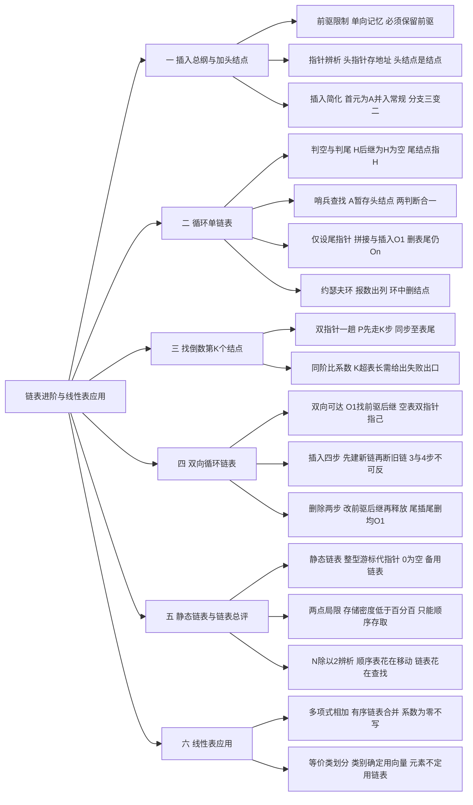

# 数据结构 · 第四周第三节 · 链表的进阶与线性表的应用 · 详细版讲义

> **来源说明**：本讲义依据我本节课的课堂录音转写整理，并与本文件夹内严蔚敏《数据结构（C语言版）》（MinerU 识别版）第二章内容对照校订而成，属**学习笔记性质的整理稿**，并非逐字稿。
>
> - **转写**：`链表相关知识讲解_导出原文.txt`（前半段，至课间休息，约 28 分钟）+ `链表相关知识点讲解_导出原文.txt`（后半段，至下课，约 18 分钟），两份合计约 46 分钟；录音起点为半句残句，"课间休息"处两份转写衔接。
> - **教材对照范围**：第 2 章 2.3.1（线性链表的头结点、算法 2.8~2.12、静态链表与算法 2.13~2.17）、2.3.2（循环链表、图 2.12/2.13）、2.3.3（双向链表、算法 2.18~2.19）、2.4（一元多项式的表示及相加、例 2-4、算法 2.22/2.23）。
> - **标注约定**：全部"举例"均按课堂原例整理并标注"（转写举例）"；教材未直接出现在转写、但为补全知识点而摘引的内容，标注"（教材补充：出处）"；本讲义自补的说明或扩展练习标注"（讲义补充）"。
> - **记法说明**：我在课上习惯用 Pascal 风格口述记法（如 `P^.next`、`S^.right`），教材用 C 风格记法（`p->next`、`s->prior`）；双向链表的两个指针域我按"躺倒"画法叫 `left`/`right`，教材记 `prior`/`next`。为便于统一上机练习，本讲义所有代码块均采用 C 语言风格并附中文注释，同时在正文中保留课堂口述记法的对应说明。
> - **时间说明**：正文各节标注的时间为"伪时间"（按转写字数折算），自本课起点 `00:00:00` 连续递增至约 `00:45:43`，节界与分段边界对齐；课间休息位于 `00:27:30–00:29:05` 之间。
> - **编号说明**：我在课上按课程进度称本章为"第 3 章"、预告下节课进入"第 4 章"；本讲义凡引教材一律用教材章号（本章为教材第 2 章），详见正文"待核实内容"。
> - **附图说明**：本份讲义无由 tikz 转换来的 SVG 插图（共 0 张）。
> - **关联阅读**：[[数据结构 第二章 线性表 详细版讲义]]（本章教材全解）、[[数据结构 第四周第二节 单链表的插入与删除算法 详细版讲义]]（上一节）

## 开场导读

这节课是线性表这一章的收官之课。上半节，我从上一课留下的"插入算法总纲"出发，沿着三个方向把它做深：给链表加上头结点，让插入分支更简洁；把链表尾部的空指针拉成一个环，变出循环链表；再用一道"找倒数第 $K$ 个结点"的真题检验算法设计能力。课间休息之后，我又讲了双向链表、静态链表，以及线性表的两个经典应用——多项式相加与等价类划分。这节课围绕两个关键词展开：**"变化"**和**"算账"**——同一个插入算法，加上头结点、搭成环、装上双向指针，就演变成一族新结构；而每一次变化，都要算清楚你得到了什么、付出了什么。学完这一节，链式结构（连同它的各种变体）就讲完了，下节课我将开启新的一章。

## 总览知识地图

下面用一张总图串联全课脉络，再通过对照表把各分支的细节展开，避免信息遗漏。



各分支要点速览表（对应知识地图各分支细目）：

| 分支主题 | 核心内容与机制 | 关键代价或结论 |
| --- | --- | --- |
| 演变一：加头结点 | 附加不存数据的头结点；辨析头指针 `H1`/`H2` 与头结点 | 多占 1 个结点空间；插入由三种情况缩为两种，高频分支少 1 次判断 |
| 演变二：循环单链表 | 尾结点 `next` 指向头结点；空表 `H->next == H`，判尾 `p->next == H` | 再无空指针，但无 `A` 时需防死循环；可用头结点作哨兵将两条件合一 |
| 仅设尾指针与约瑟夫环 | 仅设尾指针 `rear`；拼接两表、表头/表尾插入与约瑟夫报数模拟 | 拼接与表头/尾插均 $O(1)$；删表尾仍 $O(n)$；约瑟夫环时间 $O(n\cdot m)$ |
| 真题：找倒数第 $K$ 个 | 暴力两趟 vs 双指针一趟（`P` 先走 $K-1$ 步，`Q` 从首元同步前进） | 同为 $O(N)$ 时比较系数；需处理 $K\le 0$ 或 $K > N$ 的失败出口 |
| 演变三：双向链表 | 结点增设 `prior`；插 `s` 于 `p` 前改 4 指针；删 `p` 改 2 指针 | $O(1)$ 找前驱后继；插删遵守先建链后断链；表尾插删均 $O(1)$ |
| 静态链表 | 用数组下标（整型游标 `cur`）代替指针，`0` 表空，维护备用链表 | 在无指针语言中模拟链表动态插删，对用户可见、不移动元素 |
| 链表总评 | 存储密度 $<100\%$；只能顺序存取，不支持随机存取 | 顺序表 $\frac{N}{2}$ 花在移动元素，链表 $\frac{N}{2}$ 花在查找位置，不可混同 |
| 线性表应用 | 多项式相加（`(coef, expn)` 线性表 + 有序表合并）；等价类划分 | 多项式相加 $O(m+n)$；等价类类别确定用向量、类内元素用链表 |

## 正文

### 一、承接上节课：链表的"单向记忆"与插入算法的总纲地位 `00:00:00–00:03:17`

这节课是从上一节课的话头中间直接接进来的（录音起点就是半句"……的节点的整体"），所以我先把上一节课的落点补齐。

链表是通过指针联系起来的**结点**的整体；要访问一个链表，说到底就是要访问它的各个数据元素。元素与元素之间的关系靠什么体现？靠指针——"通过指针来反映它们之间的逻辑相邻性"。正因如此，链表的表头指针非常关键，它起到"**统辖全局**的作用"，而且"它不能挪窝"（不能随便移动）。

接着要看清单链表先天的局限：**任意一个结点，只知道它的直接后继，不知道它的直接前驱**。为了把这个限制讲清楚，我用了两个串联的类比（转写举例）。第一个是**特工（卧底）系统**：为了保护某一个卧底，通常只有他的**直接上司**——也就是他的直接前驱——知道他的身份，别人都不知道；你要找到这个特工，就得从最上面开始，找第一个、第二个，一直找到他的直接上司，才能找到他。第二个是电影《无间道》：一方是黑帮安插在警局的内应，另一方是警方派往黑帮的卧底，而卧底的真实身份只有他的直属上司知道。到了后面，那位直属上司被黑帮除掉，卧底的档案也没人能证实；天台对峙时，卧底拿着枪说"对不起，我是卧底"（转写如此，影片原台词为"对不起，我是警察"），对方回了一句："有谁知道？谁知道？"——因为唯一知道他身份的前驱不在了，这条线就断了。

这个类比的落点，就是单链表操作的落点：**"你要得到 P 这个节点，你必须先去保存它的直接前驱。"**（也就是先保存好通向它的那个入口，前驱一丢，单链表中这个结点就无法从前面直接找回。）这句话是后面插入、删除乃至链表排序所有算法的根。

紧跟着，我快速回顾一下上一节课讲过的**经典插入算法**——"分三步"：

1. **第一步：授权与赋初值**——把整个链表的头指针 `H` 赋值给一个工作指针 `P`。为什么要多此一举？因为头指针"有点像皇帝"，统辖整个链表，不能随便移动；所以要派一个工作指针 `P` 出去搜索和定位，"这个 `P` 就算移动错了，表头 `H` 依然还在"。
2. **第二步：找 `A`**。题意是"在数据元素为 `A` 的那个结点之前插入新结点 `B`"，所以主要工作就是去把 `A` 找到。
3. **第三步：找到 `A` 停下来**。这里最关键的是"要形成两个指针"——一个是搜索指针 `P`（指示 `A` 在哪儿），另一个是配合插入使用的指针（上一课讲的"后拖变量/秘书"，即前驱指针 `save`）；两个指针都齐了，才能动手改指针、完成插入。

这里要记住全课的总纲：**我给你讲一个算法，讲的是一大类问题的解决方案**。别看这只是一个"插入"，它同时"又是代表删除"——比如要删除 `A`，由于删除同样必须知道 `A` 的前驱，用的就是同一套"带前驱指针去搜索"的办法；它还适合"有序操作"——如果一个链表存着一堆同学的成绩、已经从小到大排好了序，新来一个结点要插进去，依然是先找插入位置的前驱，用的还是同一套办法。所以"万变不离其宗"，这就是我们的"宗"。这节课和后续内容，都围绕这个"宗"做演变。

**本节要点**

- 单链表结点只存后继指针，不存前驱指针；要对结点 `P` 做前插或删除，必须先保留其直接前驱。
- 头指针 `H` 统辖整个链表、不能随意移动，搜索时须派出工作指针 `P`（以及前驱指针 `save`）。
- "带前驱指针顺序搜索再改链"是链表插入、删除和有序操作共同的总纲。

### 二、头结点登场：一个"额外附加"的结点，两种容易混淆的指针 `00:03:17–00:09:42`

在向"宗"开刀之前，我先花几分钟把"删除"的操作语义说清楚，因为它直接决定了下面这个演变为什么值得做。

有的同学写程序时，会写成"删除 `B` 的下一个元素"——这样写当然也能实现，但从人的自然认知来看并不顺手（转写举例）：链表里已有 `A`、`B`、`C` 三个结点，平时不会说"把 `B` 的下一个元素删掉"，这种说法不符合"面向目标"的直观要求；真要"把 `B` 删掉"，就应该直接说"删除 `B`"。一旦面向目标直接删除结点 `B`，就必须知道它的前一个结点在哪儿。这再次印证了上一节那套指针做法的通用性：它既适合插入，也适合删除，还适合有序操作。到此，我在上一课基础算法之上开启第一个演变——**加一个表头结点**。

**什么叫头结点？** 我的定义很朴素："增加一个附加的节点，放置在链表的最前面，把它称为头节点。"我特意把"附加"二字拎出来解释：附加就是**额外**。这好比初中做数学题时的**附加题**——百分卷子上额外给你一道 20 分的题，那是"额外的分值"。也就是说，头结点是一个额外搭出来的结点。

不过增加结点也会带来空间开销：多加一个结点，就要多占一份存储空间。耗费这部分空间图什么？一句话总回答："**为了使得我们的运算更简单、更高效，描述起来更简洁。**"为了让大家体会这句话，我连讲了两个生活里的例子（转写举例）。

第一个是**宾馆的服务台**。设想你开了一家宾馆，一层楼一间间客房住客人、收房钱；可你观察一下好一点的宾馆——电梯正对着的那个房间，往往挂着"服务台/服务室"的牌子。这个房间能不能住人？能；但它**不接待客人**。别的房间住客人收房费，这个房间不但不直接创收，你还要支付服务员的工资。为什么专门拿出一间房不收费还要倒贴？答案是为了整个宾馆"运行更顺滑"，有了服务台，响应更及时，住客体验更好。

第二个是**运动会代表团的团长**（转写举例）。运动会开幕式上运动员进场，先排除一个特例：某个代表团只来了一个人，他既是团长、又是旗手、又是运动员。一般情况呢？像大代表团一两百号人，里面**并不个个都是运动员**——走在最前面的团长，他能拿比赛名次或奖牌吗？不能。那还要他干什么？进场时走在最前面，行程和后勤统筹都由他协调。花资源设团长，同样是为了"使得整个比赛安排更顺滑"——让运动员专心比赛，杂务让团长去扛。对应到链表：额外拿出一份存储空间给头结点，起的就是这个作用。

**画法与空间账**：为了表示头结点的数据域不存数据元素，画图时我用一个**阴影**表示它，默认里面是空的。空间账怎么算？如果有 $3$ 个数据结点，加上头结点，就要消耗 **$4$ 个结点**的存储空间；反过来，如果一个数据元素都没有，这张链表也"最起码有一个表头结点"——这份空间照样占用。加头结点的目的，归根结底是为了让运算更简洁、效率更有条理。

讲到这里，我转向一个容易混淆的问题：**头指针和头结点是两回事**。我在黑板上画出两只指针做课堂问答（转写示意）：一只叫 `H1`，指向第一个**有数据元素的**结点；另一只叫 `H2`，指着**头结点**——我问大家："`H1` 是头指针还是头结点？`H2` 是头指针还是头结点？"课堂上有人答错，我提醒"想清楚再答"，因为上一节课专门辨析过。结论是——**`H1`、`H2` 本质上都是头指针**，只是指向的对象不同：`H1` 指向第一个有数据的结点，`H2` 指向头结点（即 `H2` 指向的是头结点，它自己是头指针）。上一节课没有单独画存储空间示意图，有些同学就误以为头指针不占空间——不对，指针变量本身也是要占内存的。

把账算到字节上，才分得清（按 64 位机器整理）：

| 对比项 | 头指针 | 头结点 |
| --- | --- | --- |
| 本质 | 一个指针变量 | 一个完整的结点（结构体/记录） |
| 存储内容 | 一个内存地址 | 数据域 `data` + 指针域 `next` |
| 占用空间 | 8 个字节（64 位地址长度） | 8 个字节（指针域）+ `data` 所占字节 |
| 是否一定存在 | 凡有链表必有头指针 | 不见得有（"不是每场考试都有附加题"） |
| 类比 | 宾馆的门牌、统领全局的入口 | 电梯对面的服务台、代表团团长 |

所以一定要记住：**"它自己本质上是什么（头指针），和它所指向的是什么（结点），要分清楚。"**

（教材补充：教材 2.3.1——"有时，我们在单链表的第一个结点之前附设一个结点，称之为头结点。头结点的数据域可以不存储任何信息，也可存储如线性表的长度等类的附加信息，头结点的指针域存储指向第一个结点的指针……此时，单链表的头指针指向头结点。若线性表为空表，则头结点的指针域为'空'。"这里的"头指针指向头结点"，正对应课上 `H2` 的情形。）

头结点讲完了，它到底怎么让"运算更简单"？下面我就把上节课的插入算法拿来改造。

**本节要点**

- 头结点是附设在链表最前面的额外结点，常规下不存业务数据（教材指出也可存表长等附加信息）。
- 头指针是存放地址的指针变量（64 位下占 8 字节），头结点是包含 `data` 与 `next` 的完整结点，二者不可混淆。
- 加头结点的核心目的，是用 1 个结点的空间代价换取链表操作在边界处更统一、描述更简洁。

### 三、带头结点之后的插入算法：三种情况如何变成两种 `00:09:42–00:14:31`

先把上节课不带头结点的插入算法结构摆出来：在数据元素为 `A` 的结点之前插入 `B`，原来共有**三种情况**——两种异常，加一种常规。第一种异常是 **`H == NULL`**（链表还没有建立、一个结点也没有，好比去买饭想插队，到窗口一看一个人没有）；第二种异常是**第一个结点就是 `A`**（一搜索就落在 `A` 上，前驱指针形成不了）；剩下的都是常规情况。

现在加上头结点，操作定义不变（还是在 `A` 之前插 `B`），三种情况会发生什么变化？

**第一种异常（`H == NULL`）：没有改善。** 为什么？因为我再三强调：头结点的数据域不存储数据元素，所以查找 `A` 必须**从表头的下一个元素开始**。可是当 `H == NULL`（连头结点都不存在）时，用 `H->next` 去给 `P` 赋初值这一步根本执行不了——`P` 都没有，访问 `P->data` 或 `P->next` 就会产生空指针错误。因此只要头指针本身可能为空，这种异常依然存在。发生变化的只是常规路径的赋初值：原来不带头结点时是 `P = H`（`P` 直接落在第一个结点上）；现在改成 **`P = H->next`**——让 `P` 从第一个有数据元素的结点开始跑，后面的搜索操作照旧。

（教材通行口径补充：在严蔚敏教材标准的带头结点单链表定义中，链表初始化时就已创建头结点，**空表**指的是 `H != NULL && H->next == NULL`（区别于未初始化的 `H == NULL`）。在 `H != NULL` 且为空表的情形下，如果令 `save = H; P = H->next;`，则 `P` 为 `NULL`，`while (P != NULL && P->data != A)` 直接不进入循环，随后自然落入"未找到 `A`"分支，执行 `S->next = NULL; save->next = S;`——连空表也能并入同一套常规分支，只剩 `H == NULL` 这种未初始化的非法输入需要单独拦截。）

**第二种异常（第一个结点就是 `A`）：消失了，可以并入常规情况。** 这一点很关键。原来不带头结点时，如果第一个结点就是 `A`，会有个尴尬：要在 `A` 之前插入 `B`，必须形成两个指针（搜索指针 `P` 和它的前驱 `save`）；可是搜索刚一出动，`P` 就落在了第一个结点上，`A` 的前面没有元素、是空的——**前驱指针形成不了**。就像上一课用过的"金銮殿"比喻：你拿了尚方宝剑，还没出金銮殿呢，就让你立刻干活，后面的"人马"（前驱指针）根本来不及安排。可带上头结点之后，情况变了："`P` 在这儿（指向第一个数据结点），`P` 空不空？不空。前驱是谁？`save` 就是 `H` 嘛。"——第一个数据结点就是 `A` 时，前驱正好是头结点，两个指针都能顺当地形成。于是这种情况完全可以归并到常规情况里去（转写中口误说成"归到频繁情况"，按上下文应为"常规情况"）。

这样三减一得二：**按课上逻辑，只剩"第一种异常（`H == NULL`）+ 常规情况"**。而头结点的收益可以用"账"算出来：常规情况是执行最频繁的分支。假设要做 $1$ 万次常规插入操作——以前每次都要先过**两道**异常判断（先问 `H == NULL` 吗？再问第一个结点就是 `A` 吗？）才进入常规流程，相当于 $2$ 万次判断；现在只需过第一道判断，$1$ 万次就够了，效率确实有明显改善。至于代码写法，除了把 `P` 的初值改成 `H->next`、`save` 初值设为 `H` 之外，常规分支里顺链找 `A` 的语句和上一课一样（转写中这部分代码对比细节含混，详见"待核实内容"与附录 B1）。

（教材补充：教材在带头结点单链表上实现"第 $i$ 个位置之前插入"见算法 2.9：`p = L; j = 0; while (p && j < i - 1) { p = p->next; ++j; }`——教材的 `p` 是**从头结点出发**向后数到第 $i-1$ 个结点作为插入位置的前驱；我课上的 `P` 则从 `H->next` 出发按值找 `A`，并用 `save` 留在前驱位置。一个按"位序"走、一个按"数据元素"找，核心都是让一个指针停在待插位置的前驱结点上。）

讲完三种情况变两种，我把话题引向一个在程序设计里更普遍的担忧：**空指针**。在计算机里，"指针为空"是最常遇到的边界情况之一——写代码时总担心越界或掉进空指针陷阱。既然如此，能不能把末尾那个空指针**利用**起来？让最后一个结点的指针域不再为空，而是重新指向头结点。这个念头一出来，就引出了下一节的主角：**循环链表**。

**本节要点**

- 带头结点后，"第一个数据结点就是 `A`"不再是特例，其前驱正是头结点 `H`，可并入常规分支，三分支缩为两分支。
- 若存在 `H == NULL`（头指针未初始化）仍需先判断拦截；但在标准带头结点约定（`H != NULL`）下，空表（`H->next == NULL`）也能直接走入常规循环并完成尾插。
- 相比不带头结点，常规插入每轮减少了一次"首元是否为 `A`"的分支判断。

### 四、循环链表：把空指针拉成一个环 `00:14:31–00:21:02`

所谓**循环链表**，结构改动很小：把原来最后一个结点里那个空指针（`NULL`），改成指回头结点——整个链表首尾相接，形成一个环。

**好处一：可以"回到从前"。** 原来我们有个大问题：`P` 指向当前某个结点时，它的**直接后继**很容易得到，$O(1)$——顺着 `next` 走一步就是；但它的**直接前驱**呢？没成环、又没带前驱变量时，就拿不到。单链表就像一条单行道，指针一旦往后走，没有办法直接回溯；真要找前驱，只能从头开始挨个往后问。拉成环以后，从链表中的任何一个结点出发，都能顺着环绕回来到达表中的其余结点（教材 2.3.2 原话："从表中任一结点出发均可找到表中其他结点"）。我在课上顺口引用过网上一个调侃"轮回"的段子（"五岁自己吃饭，八十岁……"），意思就是绕一圈又回到了起点。

（讲义补充：需要分清的是，在循环单链表里沿环走一圈去寻找某结点的直接前驱，时间代价仍然是 $O(n)$；"拉环"解决的是"有路可回（任一结点可达全表）"，而真正把找前驱压到 $O(1)$，还要靠第 7 节的**双向链表**。）

**好处二：不再出现空指针。** 成环之后，包括空表在内（空循环链表至少也有一个头结点，且 `H->next == H`），每个结点的 `next` 域填的都是某个结点的合法地址，链表结构本身不再出现 `NULL` 指针。

**循环链表的判空与判尾（重点核对）**：拉环之后，判空、判尾和遍历结束条件都与普通单链表不同，必须牢记下表：

| 链表形态 | 判空条件 | 判尾条件（`p` 指尾结点） | 顺链遍历终止条件（`p` 从首元出发） |
| --- | --- | --- | --- |
| 带头结点的普通单链表 | `H->next == NULL` | `p->next == NULL` | `p == NULL` |
| 带头结点的循环单链表 | `H->next == H` | `p->next == H` | `p == H` |
| 不带头结点的循环单链表 | `H == NULL` | `p->next == H` | `p == H`（需用 `do...while` 防首步即停） |

不过，"天上不会掉馅饼"，有得必有失——享受了没有空指针的便利，就得注意随之而来的风险：**会不会死循环？** 回顾原来的查找循环（找 `A`）：判据是 "`P->data != A` **并且** `P != NULL`（或者按课上表述，看下一个结点是否为空）"。可现在最后一个结点的 `next` 指向头结点、不再是 `NULL`——如果这张链表里面**根本没有 `A`**，只按原来的空指针条件去等 `NULL`，就会在环里一直转下去，**陷入死循环**（我在课上提问一位同学，回答的正是"会陷入死循环"）。

因此，循环判据必须修改：把"是否等于 `NULL`"改成"**是否等于头结点 `H`**"（教材补充：教材 2.3.2——循环链表的操作和线性链表基本一致，"差别仅在于算法中的循环条件不是 `p` 或 `p->next` 是否为空，而是它们是否等于头指针"）。

**哨兵技巧：把两个判断合成一个。** 判据改好之后，还能不能继续简化？这里可以用一个"就地取材"的技巧——**借用头结点的数据域**。既然平时约定头结点不放业务数据，我把要查找的目标值 `A` **临时存进头结点的数据域里**，行不行？可以。这好比宾馆服务台不能长期住客，但让客人临时坐一会儿登记信息是没问题的。这样一来，查找循环可以写成下面这样（如果要顺便在 `P` 前插入新结点 `S`，仍需同步维护前驱指针 `save`）：

```c
// 带头结点的循环单链表：哨兵版查找 A，并在 A 之前（或找不到时在表尾）插入新结点 S
bool InsertCircularWithSentinel(LinkList H, ElemType A, ElemType B) {
    if (H == NULL) return false;                    // 保护：头结点不存在
    LinkList S = (LinkList)malloc(sizeof(LNode));   // 申请新结点
    if (S == NULL) return false;
    S->data = B;

    H->data = A;                                    // 哨兵：先把 A 临时存入头结点的数据域
    LinkList save = H;                              // 前驱指针从头结点出发
    LinkList P = H->next;                           // 搜索指针从第一个数据结点开始找
    while (P->data != A) {                          // 循环条件只需 1 个判断：是否等于 A
        save = P;                                   // 同步跟进前驱
        P = P->next;
    }
    // 循环结束时：若表中有 A，P 停在第一个 A 处；若无 A（或空表），P 绕回 H 停下，save 恰在尾结点（空表时在 H）
    S->next = P;                                    // 先接：新结点指向 P
    save->next = S;                                 // 后改：前驱指向新结点（找不到 A 时恰好挂在表尾、H 之前）
    return true;
}
```

这一改带来了三方面好处。第一，**保证终止**：不管链表里有没有 `A`（甚至空表 `H->next == H`），循环都会停下来——有 `A` 就停在 `A` 上；没有 `A` 就绕一圈回到头结点停下。第二，**减少判断次数**：原来每轮循环要判断两个条件（"是不是没回到表头"和"是不是等于 `A`"，课上把两次比较加上逻辑与算作 3 次判断），现在两个判断合二为一，循环条件只判断一次 `P->data != A`。第三，**代码统一简洁**：停下后连 `if (P == H)` 的分支都省了，直接把新结点 `S` 插在 `P` 的前面（`save` 与 `P` 之间）——有 `A` 时插在 `A` 前面；没找到 `A` 时停在头结点 `H` 上，把 `S` 插在尾结点 `save` 与 `H` 之间，在环上正好相当于**插在了最后一个数据结点之后**（表尾），满足"找不到就排到最后"的约定。需要特别守住一个前提：必须约定头结点平时不放有效数据，且查找一定从 `H->next` 开始。

这个临时存 `A`、在环尽头兜底拦截搜索指针的头结点，就像一个守在边防的**哨兵**。

**本节要点**

- 循环单链表将尾结点的 `next` 改指头结点，消除了链表中的 `NULL` 指针，从任一结点出发均可到达其余结点。
- 带头结点的循环单链表判空为 `H->next == H`，判尾为 `p->next == H`，顺链遍历终止条件为 `p == H`。
- 把待查值 `A` 临时放入头结点充当**哨兵**，可将循环条件简化为单一的 `P->data != A`，既防止死循环，又把"找到前插"和"未找到尾插"统一成一套指针修改动作。

### 五、只设一个指针的循环链表：为什么放在表尾 `00:21:02–00:24:19`

上面说的哨兵头结点，起的就是一个盾牌、兜底的作用。那么这个单向循环查找方案还能不能再压榨？课上我自问自答："似乎不太好再减了。"

为什么没法再减？根本原因在于**单向指针"记性不好"**。搜索时要带着一个前驱变量 `save`（"秘书"），是因为指针只记得后继在哪儿，不记得自己从哪儿走过来的。要摆脱这个"秘书"，就得让结点"记性更好一点，记住两件事"——同时记住前驱和后继，这就是第 7 节要讲的双向链表。顺便留一个小练习给大家：自己列张表，对比"不带头结点"和"带头结点"在插入、删除上的写法差异，就能体会头结点带来的简化。

接着是一道课堂思考题（并做了选项互动）：**有两个循环单链表，要求把它们首尾相接（拼接成一个循环链表），时间复杂度要达到 $O(1)$；并且每个链表只允许设置一个指针，问这个指针放在表头好，还是放在表尾好？**（默认循环链表带一个头结点；不同教材有时也会用无头结点版本，审题时需看清。）互动后同学答出的结论是：**应该放在表尾**——也就是只设一个**尾指针**。

道理很直接：**拼接这件事，"关键是要知道链表的表头，也要知道它的表尾"**。

- 如果只设**头指针**：你要拿到表尾，就得顺着链从头走到尾，耗时 $O(n)$，达不到 $O(1)$；
- 如果只设**尾指针**（记作 `rear`）：表尾 $O(1)$ 直接拿到；表头呢？尾结点的 `next` 就指着头结点（`rear->next`），再走一步 `rear->next->next` 就是第一个数据结点——同样是 $O(1)$！课上我用 `R1`、`R2` 分别代表两条非空循环链表的尾指针，要将 `R2` 接到 `R1` 后面（合并后尾指针为 `R2`），只需要保留 `R1` 的头结点，让 `R1` 尾指向 `R2` 的第一个数据结点，释放 `R2` 多余的头结点，再让 `R2` 尾指向 `R1` 的头结点，整个拼接只改两个关键链接指针，$O(1)$ 完成。

```c
// 合并两个仅设尾指针的带头结点循环单链表 R1、R2（R2 接在 R1 之后），返回合并后的尾指针
LinkList MergeCircularByRear(LinkList R1, LinkList R2) {
    if (R1 == NULL || R1->next == R1) {             // 若 R1 为空表（仅有头结点），直接返回 R2
        if (R1) free(R1);
        return R2;
    }
    if (R2 == NULL || R2->next == R2) {             // 若 R2 为空表（仅有头结点），释放 R2 头结点并返回 R1
        if (R2) free(R2);
        return R1;
    }
    LinkList head1 = R1->next;                      // 1. 暂存 R1 的头结点
    LinkList head2 = R2->next;                      // 2. 暂存 R2 的头结点（待释放）
    R1->next = head2->next;                         // 3. R1 尾结点接上 R2 的第一个数据结点
    R2->next = head1;                               // 4. R2 尾结点接回 R1 的头结点，维持循环
    free(head2);                                    // 5. 释放多余的 R2 头结点
    return R2;                                      // 6. 合并后新表的尾指针即为 R2
}
```

（教材补充：教材 2.3.2 图 2.13"仅设尾指针的循环链表"——"将两个线性表合并成一个表时，仅需将一个表的表尾和另一个表的表头相接……运算时间为 $O(1)$"。）

顺势把**插入、删除**的复杂度账一并算清楚（这是刷题和考试的高频对比）：

| 指针设置 | 表头（首元前）插入 | 删除首元结点 | 表尾插入 | 删除表尾结点 |
| --- | --- | --- | --- | --- |
| 只有头指针 `H` | $O(1)$ | $O(1)$ | $O(n)$（需遍历找表尾） | $O(n)$（需遍历找尾的前驱） |
| 只有尾指针 `rear` | $O(1)$（表头即 `rear->next`） | $O(1)$（首元即 `rear->next->next`） | $O(1)$（尾指针现成，更新 `rear`） | $O(n)$（仍要绕环找尾的前驱） |

结论很明确：设尾指针后，表头插入、删除首元、表尾插入与两表拼接都可以做到 $O(1)$；但**不管只设头指针还是只设尾指针，只要在单向循环链表里删除表尾结点，时间复杂度都是 $O(n)$**——因为删除一个结点必须知道它的直接前驱，手里只有尾指针时，还是得绕环一圈去找尾结点的前驱。

#### 扩展应用（教材与考题补充）：约瑟夫环（Josephus 问题）

（讲义补充：循环链表在教材习题与考试中最常考的模型之一就是**约瑟夫环**。）

**问题描述**：$n$ 个人（编号 $1 \sim n$）围成一圈，从第 $1$ 个人开始顺时针从 $1$ 报数，报到 $m$（$m \ge 1$）的人出列；接着从出列者的下一位重新从 $1$ 开始报数，如此反复，直到所有人全部出列，求依次出列的编号序列。

**循环链表模拟思路**：由于不断出列相当于在环中频繁删除结点，使用**不带头结点的循环单链表**最为自然（避免每次绕过头结点）：

1. 构造含 $1 \sim n$ 共 $n$ 个结点的不带头结点循环单链表，令 `p` 指向第 $1$ 号结点，前驱 `save` 指向第 $n$ 号尾结点（即 `save->next == p`）。
2. 当环中还有不止一个结点（`p->next != p`）时，每轮让 `save` 和 `p` 同步前进 $m - 1$ 步（若 $m = 1$ 则步数为 $0$，原地出列），此时 `p` 指向报数到 $m$ 的人，`save` 恰好是 `p` 的直接前驱。
3. 输出 `p->data`，执行 `save->next = p->next; free(p); p = save->next;`，完成该结点出列并让 `p` 落到下一位起点。
4. 循环结束时只剩最后一个结点（`p->next == p`），输出 `p->data` 并 `free(p)` 释放。

```c
// 约瑟夫环模拟（不带头结点的循环单链表）：n 个人，报到 m 出列
void Josephus(int n, int m) {
    if (n <= 0 || m <= 0) return;                   // 边界保护
    LinkList head = NULL, tail = NULL;
    for (int i = 1; i <= n; ++i) {                  // 尾插法建立 n 个结点的无头结点单链表
        LinkList node = (LinkList)malloc(sizeof(LNode));
        if (node == NULL) return;
        node->data = i;
        node->next = NULL;
        if (head == NULL) head = tail = node;
        else { tail->next = node; tail = node; }
    }
    tail->next = head;                              // 首尾相连成环

    LinkList p = head;                              // 当前报数起点（第 1 人）
    LinkList save = tail;                           // 始终保持为 p 的直接前驱
    while (p->next != p) {                          // 环中至少还有 2 人时继续
        for (int step = 1; step < m; ++step) {      // 走 m-1 步（当前 p 报 1，走 m-1 步后 p 报 m）
            save = p;
            p = p->next;
        }
        printf("%d ", p->data);                     // 第 m 人出列
        save->next = p->next;                       // 从环中摘除 p
        free(p);                                    // 释放结点空间
        p = save->next;                             // 从下一位重新开始报 1
    }
    printf("%d\n", p->data);                        // 输出最后剩下的 1 人
    free(p);                                        // 释放最后一个结点
}
```

**复杂度分析**：每出列 $1$ 人最多移动指针 $m - 1$ 步，改链与释放为 $O(1)$；共出列 $n$ 人，因此总时间复杂度为 $O(n \cdot m)$（若报数前先用 `step < (m - 1) % cur_len + 1` 或直接按剩余长度取模，可减少无谓绕圈），除链表本身的 $O(n)$ 存储空间外，辅助空间复杂度为 $O(1)$。

**本节要点**

- 只设一个指针的带头结点循环单链表，把指针放在**表尾**（`rear`）比放在表头更有利：`rear` 直接指表尾，`rear->next` 指头结点、`rear->next->next` 指首元结点。
- 仅设尾指针时，两表首尾拼接、表头插入、删除首元、表尾插入均为 $O(1)$；但删除表尾仍为 $O(n)$，因为找不到尾结点的前驱。
- 约瑟夫环可用不带头结点的循环单链表模拟，维护前驱 `save` 与当前指针 `p` 每次前进 $m-1$ 步后删点，总时间复杂度 $O(n\cdot m)$。

### 六、真题精讲：带表头单链表中找倒数第 K 个结点 `00:24:19–00:29:05`

讲完复杂度对比，来看一道经典真题：**已知一个带头结点的单链表（注意：是普通单链表，不是循环链表），只给出头指针；在不改变链表的前提下，设计一个尽可能高效的算法，查找链表中倒数第 $K$ 个位置的结点；查找成功则输出该结点（或返回其位置/值），查找不成功则返回失败。**

先破题眼："**尽可能高效**"是什么意思？前面讲过，复杂度是用"阶"来刻画的；如果两个算法的渐近复杂度都是 $O(N)$、属于同一量级，那就要比较**最高阶项前面的系数**。比如一个算法的执行时间是 $N^2 + 2N$，另一个是 $2N^2 + 3N$，谁更高效？前一个——因为最高阶项 $N^2$ 的系数 $1$ 小于 $2$。（大 $O$ 记号在跨阶比较时忽略常数因子，但在同阶比优时，系数与扫描趟数就是关键差异。）

接下来看两条解题路线：

**方法一：暴力法（两趟扫描）。** 单链表不知道自己总共有多少个元素，那就先从头走到尾数一遍——第一趟得到元素个数 $N$；然后再次从头开始，找正数第 $N - K + 1$ 个结点，因为：

$$\text{倒数第 }K\text{ 个}=\text{正数第 }N-K+1\text{ 个}$$

第二趟从第一个数据结点往后走 $N - K$ 步，就落在第 $N - K + 1$ 个结点上。这条路走得通，但不够高效——虽然同属 $O(N)$，它需要扫描**两趟**。

**方法二：双指针法（一趟扫描，本段重点）。** 怎么一趟搞定？回想前面反复用过的"带着滞后指针往前走"的思路：以前删除或前插时，`save` 落后 `P` 一步；现在只不过把间隔从 $1$ 步改成保持 $K - 1$ 个间隔（让 `P` 先走到第 $K$ 个结点再一起走）：

1. 初始时，两个指针 `P` 和 `Q` 都指向第一个（数据）结点（`H->next`）。
2. 先让 `P` 单独沿链往前走 $K - 1$ 步，尝试走到第 $K$ 个数据结点；在此过程中，每走一步先检查 `P` 是否已经变为 `NULL`。
3. 若走满 $K - 1$ 步之前 `P` 就变为 `NULL`（或初始时链表为空、`K <= 0`），说明 $K$ 不合法或 $K$ 超出链表长度，直接退出并返回查找失败。
4. 若 `P` 成功停在第 $K$ 个结点上，则启动 `Q`（此时 `Q` 仍在第 $1$ 个数据结点，与 `P` 相差 $K - 1$ 步），此后判断 `P->next` 是否为 `NULL`。
5. 只要 `P->next != NULL`（`P` 还没到最后一个结点），就让 `P` 和 `Q` 同步各自前进一步（`P = P->next; Q = Q->next;`）。
6. 当 `P->next == NULL`（`P` 停在最后一个数据结点，即第 $N$ 个结点）时，由于 `Q` 与 `P` 同步共走了 $N - K$ 步，`Q` 恰好停在第 $1 + (N - K) = N - K + 1$ 个结点上——正是倒数第 $K$ 个结点，输出 `Q` 并返回成功。

（讲义补充：验证边界——设 $N = 5, K = 2$：`P` 先走 $1$ 步到第 $2$ 个结点；之后 `P`、`Q` 同步走 $3$ 步，`P` 到第 $5$ 个结点，`Q` 到第 $4$ 个结点（即倒数第 $2$ 个）。设 $K = 1$：`P` 先走 $0$ 步，`P`、`Q` 一起走到尾，`Q` 落在第 $5$ 个（倒数第 $1$ 个）。设 $K = 5$：`P` 先走 $4$ 步已到第 $5$ 个，`P->next == NULL`，同步走 $0$ 步，`Q` 停在第 $1$ 个（倒数第 $5$ 个），全部准确。）

**特殊情况：$K$ 超出表长。** 如果链表里只有 $2$ 个元素，却要找倒数第 $5$ 个，查找当然不会成功，必须在先走 $K - 1$ 步的循环里做好 `P == NULL` 的判停出口。下面是完整的 C 语言参考实现：

```c
// 在带头结点的单链表 H 中查找倒数第 K 个结点（一趟扫描双指针法）
// 成功时通过 out_node 返回目标结点指针并返回 true；失败返回 false
bool FindLastKth(LinkList H, int K, LinkList *out_node) {
    if (H == NULL || H->next == NULL || K <= 0) {   // 空表或 K 非正数直接失败
        return false;
    }
    LinkList P = H->next;                           // P 指向第 1 个数据结点
    LinkList Q = H->next;                           // Q 初始也指向第 1 个数据结点
    for (int i = 1; i < K; ++i) {                   // P 先单独走 K-1 步，目标停在第 K 个结点
        P = P->next;
        if (P == NULL) {                            // 尚未走够 K-1 步就走出链表，说明 K 大于表长
            return false;
        }
    }
    while (P->next != NULL) {                       // P、Q 同步前进，直至 P 停在最后一个结点
        P = P->next;
        Q = Q->next;
    }
    *out_node = Q;                                  // 此时 Q 恰好在倒数第 K 个结点
    return true;
}
```

考试时我也提醒大家一个应试策略：遇到大题一时想不到最优的一趟双指针解法也不要空着，先把两趟扫描的基本思想和步骤写清楚，就能拿到一半以上的基础分；想通双指针后再优化上去。

**课间休息与后半段的衔接**：讲到这里，我宣布先休息 5 分钟，之后再讲另一种结构改进。（该休息位于 `00:27:30–00:29:05` 之间。）后半段录音切入时直接进入**双向循环链表**的讨论。

**本节要点**

- 同阶算法（同为 $O(N)$）比较效率要看常数系数与扫描趟数：暴力法需扫描两趟，双指针法只需扫描一趟。
- 双指针法令 `P` 先从首元结点前进 $K - 1$ 步到达第 $K$ 个结点，再与位于首元的 `Q` 同步前进至 `P->next == NULL`，`Q` 即落在倒数第 $K$ 个结点。
- 必须在 `P` 先行阶段检查 `P == NULL`（以及初始空表、`K <= 0`），保证 $K$ 超出表长时安全返回失败。

### 七、双向链表：一边前行，一边回头 `00:29:05–00:33:56`

后半段的主线是**双向（循环）链表**。先立一个基本约定：双向循环链表通常带有**头结点**；当一个数据元素都没有时（空表），头结点的两个指针域都指向自己——即 `H->next == H && H->prior == H`。（教材补充：教材 2.3.3 图 2.14：结点含 `data`、`prior`、`next` 三个部分；(b) 为只有一个头结点的空双向循环链表；(c) 为非空双向循环链表。教材还给出双向链表的特性式：$d\to\text{next}\to\text{prior} = d\to\text{prior}\to\text{next} = d$——从任一结点出发，"往后一步再往前一步"或"往前一步再往后一步"，都回到原地。）当然也有不循环的双向链表和单向循环链表等变体，这里以最常用的带头结点双向循环链表为主展开。

**双向链表的优势**很清楚：单链表"不能直接回到前驱"，而双向链表只需要直接读取指针域，$O(1)$ 就能同时拿到前驱和后继。（教材补充：教材 2.3.3——单链表中 `NextElem` 的执行时间为 $O(1)$，而 `PriorElem` 的执行时间为 $O(n)$；为克服单链表这种单向性缺点，才采用双向链表。）

顺手补充两个**结构变形**（转写举例）：

- **变形一：拿头结点"兼职"**。头结点常规下不放业务数据，可以顺便利用它的数据域来记录当前链表共有多少个元素 $N$（教材补充：教材 2.3.1 明确指出，头结点的数据域也可存储如线性表的长度等附加信息）。
- **变形二：每个结点多存一个"头结点指针"**。在常规双向循环链表里，从中间某个结点回到表头仍需要沿环一步步往前走；如果每个结点里都存一份头结点的地址，那从任意结点回到表头就能一步到位，当然代价是每个结点又要多花一份指针空间。

**插入演示（在 `A` 之前插入 `B`）——修改 4 个指针的四步操作。** 课上我把结点"躺倒"来画，把两个指针域口头叫作 `left`（前驱，对应教材 `prior`）和 `right`（后继，对应教材 `next`）：`P` 指向结点 `A`，`S` 指向待插入的新结点 `B`。四步指针修改如下：

```c
// 在双向链表 P 所指结点之前，插入新结点 S（修改 4 个指针）
S->next = P;                // 第 1 步（课上记 S^.right := P）：S 的后继指向 A
S->prior = P->prior;        // 第 2 步（课上记 S^.left  := P^.left）：S 的前驱指向 A 原前驱
P->prior->next = S;         // 第 3 步（课上记 P^.left^.right := S）：A 原前驱的后继改指 S
P->prior = S;               // 第 4 步（课上记 P^.left := S）：A 的前驱改指 S
```

两条旧链断开、新链挂好之后，新结点 `S` 就稳稳嵌进了链表中间。

（教材补充：教材 2.3.3 的双向链表插入算法 2.18 给出的是同一件事的四条语句：`s->prior = p->prior; p->prior->next = s; s->next = p; p->prior = s;`——与上面四步一一对应，只是把两组操作换了顺序；两套写法都严格遵守同一条约束：**在覆盖旧指针之前，先把新链建好、把旧值用完**。）

**顺序性质：哪两步能换，哪两步不能换？** 我当场考了一位同学："第 1 步、第 2 步能不能颠倒？先做第 2 步再做第 1 步，行不行？"同学一开始答"不行"，我追问"想一想再看"——结论是**可以交换**。为什么？因为第 1 步和第 2 步都只修改新结点 `S` 自己的两个指针域，不覆盖任何已有链条。

但第 3 步和第 4 步**不能颠倒**（且第 2 步也必须在第 4 步之前）：如果先做第 4 步（`P->prior = S;`），`P->prior` 原先保存的"旧前驱地址"就被 `S` 覆盖掉了；此时再去执行第 3 步 `P->prior->next = S;`，由于 `P->prior` 已经是 `S`，结果变成 `S->next = S`——`S` 的后继指向了自己形成自环，而原本的前驱结点既没有连上 `S`，也找不回来了。

由此归纳出**核心总原则**：**"先不要急着断已有的链条，先建新链条。"** 先把新结点 `S` 的两条链建牢（同时利用完 `P->prior`），再去修改原有结点上的旧指针。四步代码有多种合法排列，但这条原则是底线。

**删除演示（删除 `P` 所指结点——教材 算法 2.19 补充）**：与插入需要改 **4 个指针**不同，在双向链表中删除已知结点 `P`（`P != H`，即不删头结点），只需要修改 **2 个外部指针**再释放 `P`：

```c
// 在带头结点的双向链表中，删除 P 所指结点（修改 2 个指针，再释放 P）
p->prior->next = p->next;   // 1. 让 P 的前驱直接指向 P 的后继
p->next->prior = p->prior;  // 2. 让 P 的后继直接指向 P 的前驱
free(p);                    // 3. 释放 P 所占存储空间（必须在上面两步之后）
```

注意顺序约束：前两条语句各自通过 `p->prior` 与 `p->next` 定位，互不覆盖对方，因此 **第 1 步和第 2 步可以交换顺序**；但它们都**必须写在 `free(p)` 之前**，一旦先释放 `p`，再去读 `p->prior` 或 `p->next` 就是非法访问已释放内存。另注意按教材算法 2.18/2.19 的接口（按位序 `i` 插删），因为前面需要调用 `GetElemP_DuL(L, i)` 顺链找第 `i` 个结点，所以整体时间复杂度仍为 $O(n)$；若指针 `p` 已经定位好，纯指针修改本身是 $O(1)$。

**算账：从 2 条语句变 4 条语句，反而更划算？** 有人会问：单链表插入改 2 个指针，双向链表插入改 4 个指针，代码变长了，是不是变慢了？评价算法不能只看语句行数，要看**执行频度**。在按值查找的 `while` 循环里，往往要走成千上万次：以前在单链表里要带一个"秘书"（`save`），循环体每轮要做**两步赋值**（`save = P; P = P->next;`）；换成双向链表后，由于随时能用 `P->prior` 找到前驱，不需要在循环里维护 `save`，循环体每轮只需做**一步赋值**（`P = P->next;`）。假设循环跑了 $1$ 万次，就省下了 $1$ 万次赋值操作；相比之下，跳出循环后插入时多写的那 2 条指针赋值语句（共 $O(1)$ 常数次），几乎可以忽略。当然，双向链表是用空间换时间——每个结点多存一个前驱指针，存储密度会进一步降低，换来了 $O(1)$ 找前驱和查找循环少做赋值的时间收益。

最后是一道课上选择题：对链表最常见的操作——**在末尾插入结点、删除表尾结点**——要求**最节省时间**（不限空间），应该选哪种链表？（选项涉及带头结点的双向循环链表、单向循环链表等。）有同学答错了选项，因为单向循环链表即便把单指针放在表尾 `rear`，也只能把"表尾插入"做到 $O(1)$，却解决不了"删除表尾"的问题。答案在下一节开头揭晓。

**本节要点**

- 带头结点的空双向循环链表满足 `H->next == H && H->prior == H`，非空时任一结点满足 $d\to\text{next}\to\text{prior} = d\to\text{prior}\to\text{next} = d$。
- 在 `P` 前插入 `S` 需修改 **4 个指针**（`S->next = P; S->prior = P->prior; P->prior->next = S; P->prior = S;`）：第 1、2 步可互换，但必须在第 4 步覆盖 `P->prior` 之前完成第 2、3 步（先建链、后断链）。
- 删除 `P` 只需修改 **2 个指针**（`P->prior->next = P->next; P->next->prior = P->prior;`），两步可互换，但必须在 `free(P)` 之前执行。
- 双向链表以增加一个指针域（降低存储密度）为代价，省去了搜索循环中维护前驱 `save` 的赋值开销，并将按指针定位的表尾插入和表尾删除都降到了 $O(1)$。

### 八、静态链表与链表总评：没有指针怎么办 `00:33:56–00:38:47`

**先揭晓上一节选择题答案：选带头结点的双向循环链表。** 题目的条件是"最节省时间，空间不限"。如果只用单向循环链表、设一个尾指针 `rear`，表尾插入固然是 $O(1)$，但**删除表尾仍然需要 $O(n)$**（得绕环一圈去找尾结点的前驱）；而双向循环链表由表头的 `prior` 就能 $O(1)$ 直达尾结点（`tail = H->prior`），删掉 `tail` 后再由 `tail->prior` 拿到新的尾结点，整个表尾插入和表尾删除都是 **$O(1)$**。

接着我借用了一句常听到的比喻："动是永恒的，静是相对的。"意思是数据的动态插入、删除是常态，静态只是相对描述。问题是：除了 C/C++ 这类有显式内存指针的语言外，其他一些高级语言（如 Python、MATLAB 等）平时不直接暴露内存地址指针，如果想实现像链表那样不移动元素的动态插删，该怎么办？——这就轮到**静态链表**出场了。

**静态链表的定义**：与一般链表类似，它依然用一条"链"把结点串起来，但结点里的"指针"不是内存地址指针，而是**整型变量（数组下标/游标）**——用数组下标来充当链接地址，把逻辑相邻的结点串在一起。两者在视角上还有一个重要区别：普通内存指针"对用户来说是透明的"，程序通常不关心它的具体数值；而静态链表里的游标本质上是整型数组下标，**它的值是可见的、可由程序直接读写的**。

**下标串接示例**（转写示意）：假设有 $a_1$ 到 $a_4$ 四个元素存在数组的不同单元里——$a_1$ 放在某号单元，它的游标域记着 $a_2$ 所在的下标；$a_2$ 的游标记着 $a_3$ 的下标；$a_3$ 的游标记着 $a_4$ 的下标；$a_4$ 的游标里是 **`0`**，表示"后面没有元素了"（充当空指针，课堂口述的单元下标串如 `8 -> 1 -> 6 -> ... -> 0`，具体数字以转写记录存疑）。在这种结构里，插入、删除元素同样**不需要移动数组中的元素**，只需修改相关结点的整型游标即可。（教材补充：教材 2.3.1——静态链表用整型游标 `cur` 代替指针指示结点在数组中的相对位置，用 `0` 表示空指针；`i = S[i].cur` 等价于动态链表的 `p = p->next`。注意教材两处细微约定：在算法 2.13 `LocateElem_SL` 中把数组第 `0` 分量作为链表头结点，`S[0].cur` 指向第一个数据结点；而在例 2-3 的算法 2.14~2.17 中，把 `space[0].cur` 作为**备用链表**（空闲结点池）的头指针，另用一个整型变量 `S` 指向集合链表头结点——算法 2.14~2.16 相当于在数组上**手动实现了 `malloc` 和 `free`**，分配结点时从备用链表摘取，删除结点时回收挂回备用链表。）

至此，我对链表做一次整体**总结**，给出链表的两个**主要缺点**：

1. **存储密度低于 $100\%$。** 结点里除了有效的数据元素 `data`，还必须额外拿出一部分空间存放指针（地址）信息。按教材定义，存储密度为：

$$\text{存储密度} = \frac{\text{结点数据域所占存储量}}{\text{结点结构所占总存储量}} < 100\%$$

2. **不能实现随机存取（随机访问）。**

第二点值得细讲。前面讲顺序存储（线性表的向量存储）时，它有一个突出优势叫**随机存取**——要访问第 $i$ 个元素，通过首地址加偏移量一步计算就能直接定位，访问任意位置的代价都是 $O(1)$。链表则是**顺序存取**——要访问第 $i$ 个元素，必须从头指针出发，顺链把前 $i-1$ 个元素依次走过一遍才能到达第 $i$ 个（时间复杂度 $O(n)$）。这就像前面说的特工层级系统：要找第 $i$ 层的办事人员，必须从最上级一步步往下找，不能直接跳过中间层级。

**平均复杂度 $\dfrac{N}{2}$ 的"落点"之辨（最易混淆的一点）**：单链表的平均查找/定位复杂度也是 $\dfrac{N}{2}$（与顺序表推导类似，在 $1 \sim N+1$ 个插入位置等概率假设下，$\dfrac{1}{N+1}\sum_{i=1}^{N+1}(N-i+1)=\dfrac{N}{2}$）。但必须分清：**链表的改链（插入、删除动作本身）是 $O(1)$ 的**，那 $\dfrac{N}{2}$ 的时间主要花在**"找位置（搜索）"**上——沿链挨个判断当前结点是不是目标位置。

而顺序表的 $\dfrac{N}{2}$ 主要花在**"移动元素"**上（定位第 $i$ 个位置本身是 $O(1)$，但插入删除平均要搬动一半元素，尤其当每个元素是一本书或一部电影时搬动成本很高）。因此，**能不能说"顺序存储结构和链式存储结构，插入、删除元素的时间复杂度和效率一样"？不能。** 一个是成片搬动元素的代价，一个是沿链比较找位置的代价，两者的主要开销性质完全不同，没有可比性（就好像把动物和植物硬放到一起比）。课堂上同学回答"一个是随机存取快、一个是插入删除操作快"，方向基本抓住了，但表述还可以再精确到"移动元素 vs 查找位置"这个落点。

**本节要点**

- 静态链表用一维数组和整型游标 `cur` 模拟指针（`0` 表示空指针），配合备用链表（算法 2.14~2.16）可在没有指针的语言里实现不移动元素的插删。
- 链表的两大局限：存在指针域额外开销导致存储密度 $<100\%$；仅支持顺序存取，按序号定位为 $O(n)$。
- 顺序表与链表在插入删除时同为 $O(N)$（平均约 $\frac{N}{2}$），但顺序表的 $\frac{N}{2}$ 花在**移动元素**，链表的 $\frac{N}{2}$ 花在**顺链查找**，纯改链本身为 $O(1)$。

### 九、线性表的应用：多项式相加与等价类（结课） `00:38:47–00:45:43`

上一节说完链表总结，接下来进入**线性表的应用**。第一个应用是**一元多项式的相加**。这个问题本身不难，我专门拿出来讲，是为了强调一种核心的方法论：

> 拿到一个实际问题时，最主要的第一步，是把这个问题的数据和它的本质搞清楚——学会如何去抽象看待这个事物。这一步比写循环代码更关键。

**第一步：把多项式"抽象"成线性表。** 一个一元多项式由若干非零项组成：系数为 $0$ 的项通常省略不写，各项指数一般按从高到低（降序）或从低到高（升序）依次排列。对每一项来说，变量字母记作 $x$ 还是 $y$、$z$ 并不改变数据结构，只要抓住**系数**和**指数**两样信息，这一项就唯一确定了。把多项式的各项排好序、一个接一个罗列出来，它的**本质就是一个有序线性表**，只不过每个数据元素被具体化为一个二元组 `(系数, 指数)`。（教材补充：教材 2.4——一般一元多项式可表示为 $P_n(x)=p_1x^{e_1}+p_2x^{e_2}+\cdots+p_mx^{e_m}$，其中 $p_i\neq 0$；教材例 2-4 用带头结点的**有序链表**存储，结点数据域包含 `float coef`（系数）与 `int expn`（指数）。）

**第二步：多项式相加 = 有条件的两个有序表合并。** 课上我用人工演示（转写举例）：在两条带头结点的降序多项式链表 `Pa`、`Pb` 上各放一个工作指针（以及结果链表 `Pc` 的尾指针），按指数从大到小依次推进（片段如 $3x^5$、$2x^4$、$x^3$ 等）：

- **指数不等（谁大抄谁）**：指数较大的那一项直接复制到结果链表中，**被抄那一方的指针连同结果链表的尾指针 `pc` 一起往后移**，未被抄的另一方指针保持不动；
- **指数相等**：两项系数相加，若和不为 $0$ 则写入结果链表，两边的指针连同 `pc` 一起往后移；
- **相加后系数为 $0$**：这一项在结果中**不写**（省略），但两个链表的指针**同样都要往后移**，不能漏掉指针步进；
- **一方走完**：把另一方链表中剩下的所有项直接顺次复制到结果链表末尾。

走完一遍得到和多项式链表，这本质上就是**两个有序线性表的合并操作**，只是在合并时多了一步"同指数系数相加并判零"的条件判断，整个循环按指数比较结果分三种情况处理。设两个多项式分别有 $m$ 项和 $n$ 项，每个结点最多访问一次，时间复杂度为 $O(m + n)$。

（教材补充与重要对照：
1. **排序方向差异**：我在课上举例采用指数**降序**排列，因此口诀是"谁大抄谁"；严蔚敏教材例 2-4（算法 2.22、2.23）采用指数**升序**排列，因此 `AddPolyn` 中 `switch (*cmp(a, b))` 是指数小的一方先保留或先插入（`case -1` 时 `Pa` 指数小、`qa` 后移；`case 1` 时 `Pb` 指数小、摘下 `qb` 插到 `Pa` 当前结点之前）。升序还是降序逻辑完全对称，读代码时注意看清约定。
2. **空间策略差异**：我课上演示的是新建结果链表并复制结点（辅助空间 $O(m + n)$）；教材算法 2.23 则强调和多项式无需另生成结点，而是直接从两条输入链表中**摘取结点复用**（辅助空间 $O(1)$），同时参照教材算法 2.12 `MergeList_L`（两个非递减有序单链表归并：逐一比较 `pa->data` 与 `pb->data`，将较小结点挂到 `pc->next`，最后把未走完的那条链整段接上，时间 $O(m+n)$、额外空间 $O(1)$），二者的核心归并思想完全相通。）

**第三步：多项式乘法。** 掌握了加法，乘法也就不难了：把一个多项式的每一项分别与另一个多项式逐项相乘（系数相乘、指数相加），生成若干个中间多项式，再调用有序多项式加法逐一合并即可。（教材补充：教材 2.4 节末公式——$M(x)=A(x)\times B(x)=\sum_{i=1}^{n} b_i A(x)x^{e_i}$，把乘法分解为一系列多项式加法。）

**第二个应用：等价类问题。** 有的教材和题目里还会讲到**等价类划分**问题。我举一个直观例子（转写举例）：假设你是公司负责招聘的经理，收到一大摞简历，需要按学历分类整理——初中一堆、高中一堆、本科一堆、硕士一堆、博士一堆。怎么设计存储结构？观察两个关键数量：

1. **划分成几堆（类别的个数）**：是**事先确定**的（比如学历分这五档，教师职称分助教、讲师、副教授、教授四级，一共有几类是明确的）——对于个数确定的索引，用**向量（数组）**管理最合适，直接用下标对应各个类别。
2. **每一堆里有多少份简历（每类内部的元素个数）**：是**事先不确定**的，且会随时增删——每一堆内部逻辑上是一个线性表，面对元素个数不定的线性表，自然用**链表**来挂接。

于是等价类划分的经典混合存储方案就清楚了：**外层用向量（数组）存储已知的各个类别头指针，内层用链表串起每一类中不定数量的元素**。（讲义补充：这种"数组 + 链表"的邻接式结构在后续图的邻接表、哈希表拉链法中还会反复遇到；教材第 2 章例 2-3 用静态链表求 $(A-B)\cup(B-A)$，则展示了链式结构处理集合运算的另一条路径。）

**结课与作业提醒**：到这里，课程编号上的这一章就讲完了（对应教材第 2 章线性表）。我在学习通上布置了课后作业，重点提醒两道题：

- **第 3、第 4 题要求"就地逆置"**：所谓"**就地**"就是不能额外开辟与数据规模相关的存储空间（辅助空间复杂度为 $O(1)$），单链表就地逆置只能利用常数个指针变量在原结点之间调转 `next` 指针方向（时间复杂度 $O(n)$）。
- **另一道"两个有序循环链表的合并"**：题目已明确给出是循环链表，注意处理好合并后的闭环与判尾条件。

最后预告：下节课我们将进入下一章（教材第 3 章：栈和队列）的学习。（临近下课时提醒了一句大家翻书动作轻一些，属课堂现场提醒。）

**本节要点**

- 多项式相加的本质是把每一项抽象为 `(系数, 指数)` 二元组，从而转化为两个有序线性表的**条件合并**，时间复杂度 $O(m+n)$。
- 注意区分降序（"谁大抄谁"，被抄指针与结果尾指针同步后移）与教材算法 2.23 的升序（指数小者先留或先插，且就地复用结点、额外空间 $O(1)$）。
- 系数相加为 $0$ 时该项不写入结果，但两条输入链表的指针仍须同时后移；多项式乘法可分解为一系列多项式加法。
- 等价类划分采用"确定数量用向量（数组）、不定数量用链表"的混合存储结构；单链表就地逆置要求辅助空间 $O(1)$。

## 结课：把整节课串起来

这节课的第一条主线，是**围绕"插入算法"总纲做三次结构演变**。第一次是加**头结点**：多用一个不存业务数据的结点，换来"第一个数据结点就是 `A`"并入常规分支，三分支缩为两分支，同时我们也从本质与字节空间上把"头指针"（存地址的指针变量）和"头结点"（含 `data` 与 `next` 的完整结点）分清了。第二次是**拉环成循环单链表**：把表尾空指针改指头结点，消除了链表中的 `NULL` 指针，判空变为 `H->next == H`、判尾变为 `p->next == H`；为防无 `A` 时死循环，我们把循环条件改为判断是否回到头结点，再进一步把 `A` 暂存进头结点作**哨兵**，将两个判断合成一个。第三次是**上双向指针**：结点同时记住前驱和后继，$O(1)$ 双向可达，空表时头结点双指针指己；虽然插入改 4 个指针、删除改 2 个指针，只要遵守"先建新链、后断旧链"，既可保链不断，又能省去搜索循环里每轮维护前驱变量的赋值开销。

第二条主线是**会算账**。这节课几乎每个结构选择后面都跟着一笔时间与空间账：头结点用 $1$ 个结点换高频分支少 $1$ 次判断；哨兵借头结点数据域换循环条件二合一；仅设一个指针的循环单链表把指针放在**表尾** `rear`，能把拼接、表头插、删首元和表尾插全部做到 $O(1)$，但**删表尾依然是 $O(n)$**——要连删表尾都做到 $O(1)$，就得上双向循环链表；求倒数第 $K$ 个结点时，同为 $O(N)$，双指针一趟扫描优于暴力法两趟扫描，且必须给 $K$ 超出表长留好失败出口。评估算法时，既要看大 $O$ 的阶，同阶时还要把趟数、系数和空间账算清楚。

第三条主线是**抽象与选型**。在无显式指针的语言里，可以用数组和整型游标 `cur` 搭出**静态链表**（`0` 表空，用备用链表自实现分配回收）。链表整体的两大局限是存储密度低于 $100\%$ 与只能顺序存取，尤其要牢记顺序表的 $\frac{N}{2}$ 花在**移动元素**，链表的 $\frac{N}{2}$ 花在**顺链查找**，不可把两者的时间效率混为一谈。最后落到线性表应用：多项式相加先抽象成 `(coef, expn)` 有序表，再按有序表合并（$O(m+n)$）处理；等价类划分则按"类别数确定用向量、每类元素数不定用链表"来组合存储。

学到这里，线性表从顺序存储到单链表、循环链表、双向链表和静态链表的整套存储选型、指针操作和代价分析已经串成了一条完整的线。下节课我将带大家进入受限线性表——栈和队列的学习。

复习要点（可自测）：

- 头结点的定义与目的；头指针与头结点的区别（谁一定存在、各占多少空间）；用"附加题"与"服务台/团长"复述其权衡。
- 带头结点后插入分支为何三变二：`H == NULL` 与标准带头结点空表（`H->next == NULL`）有何区别；首元为 `A` 如何并入常规分支。
- 循环单链表：判空（`H->next == H`）、判尾（`p->next == H`）与遍历终止条件（`p == H`）；哨兵技巧的前提（头结点不存业务数据、从 `H->next` 起查）与作用。
- 仅设尾指针的循环单链表：为何放表尾；两表拼接 $O(1)$ 的步骤；表头/表尾插入、删首元、删表尾的复杂度各是多少；约瑟夫环循环模拟的步数与时间复杂度 $O(n\cdot m)$。
- 倒数第 $K$ 个结点：一趟双指针法的起步距离（`P` 先走 $K-1$ 步）与终止条件（`P->next == NULL`）；$K \le 0$ 或 $K > N$ 的失败处理。
- 双向循环链表：空表条件；插入改 4 个指针的顺序约束（第 1、2 步可换，第 3、4 步不可倒，第 2、3 步须先于第 4 步）；删除改 2 个指针再 `free(p)`；为何尾插尾删均可达 $O(1)$。
- 静态链表：整型游标 `cur`、`0` 表空、`i = S[i].cur`；`S[0].cur` 在算法 2.13 与备用链表（算法 2.14~2.17）中的不同角色。
- 链表总评与对比：存储密度公式（$<100\%$）、顺序存取 vs 随机存取；顺序表与链表平均 $\frac{N}{2}$ 分别花在哪里。
- 线性表应用：有序表合并（算法 2.12，$O(m+n)$）；多项式相加的三种指数比较分支（降序"谁大抄谁" vs 教材升序、和为 $0$ 仍须双指针后移）；等价类为何"向量装类别 + 链表装元素"；单链表就地逆置为何要求辅助空间 $O(1)$。

## 待核实内容

1. **课堂章节编号与教材章号的差异（重点）**：我在课上按课程进度称本章为"第 3 章"、预告下节课进入"第 4 章"；但对照严蔚敏《数据结构（C语言版）》，本节课讲的单链表进阶（头结点、循环链表、双向链表、静态链表）与一元多项式全部属于教材**第 2 章"线性表"**（2.3、2.4），教材**第 3 章是"栈和队列"**。具体教学编号来源待核实；本讲义凡引用教材一律使用教材章号。
2. **录音拼接与课间休息过渡**：本课录音由两份导出原文拼接而成（前半至课间休息，后半至下课），拼接点位于 `00:27:30–00:29:05` 之间；后半段以"还是在表头吗？"开头，所指题干细节已无法从转写还原。另外，第一段开头是半句残句（"……的节点的整体"），`00:01:38` 处疑似还有一次短暂停顿，前后少量过渡语**存疑**。
3. **《无间道》片段台词细节**：转写中卧底台词记为"对不起，我是卧底"，与影片原台词"对不起，我是警察"不符；相关剧情细节以原片为准，讲义已淡化为结构角色类比。
4. **插入算法回顾中"两个指针"的第二只**：转写作"它的后面那个——`S` 结点/`S` 指针"，表述含混；按上一课内容应指"后拖变量（前驱指针）`save`"，本讲义按前驱指针 `save` 处理。
5. **带头结点后代码对比段的细节**（`00:12:54–00:14:31`）：该段转写多处听辨含混，本讲义保留"`P` 初值改为 `H->next`、常规路径少过一次判断"的核心结论，并在正文中补充了"标准带头结点空表 `H->next == NULL` 亦可并入常规分支"的教材通行口径，具体原板书逐句细节无法还原。
6. **哨兵技巧的判断次数口径**：转写有"原来做 3 次、现在只做 1 次"的口头算法（把是否到达表头、是否等于 `A` 两个比较加上逻辑与运算算作 3 次）。在按短路求值的 C 语言 `while (P != H && P->data != A)` 中每轮至多执行 2 次比较，因此本讲义按"两个判断条件合二为一"作定性说明。
7. **双向链表"空间效率"口述及未展开例子**：`00:32:45` 附近转写出现时间效率提高后"空间进一步降低"的表述，按上下文应为"存储密度（空间利用率）进一步降低、以空间换时间"，正文已作校订；另外双向链表变形二处原想举的生活例子因时间关系未展开。
8. **静态链表示例单元号与多项式碎片记录**：静态链表示例中转写提及的单元下标（`8 -> 1 -> 6 -> ... -> 0`）数字细节**存疑**（仅"用 `0` 表空"明确且与教材一致）。多项式演示仅存 `3x^5`、`2x^4`、`x^3` 等碎片，完整式子无法还原；转写中"此处是不为 1"疑为"此处是否不为 0"的听辨误差，以及"另外一个往后移"应指结果链表指针 `pc` 随被抄指针同步后移，正文已按算法正确口径校订。另外，教材 MinerU 版将算法 2.22 标在 `CreatPolyn` 之后、算法 2.23 标在 `AddPolyn` 之后，建议对照纸质教材再核一次编号归属。
9. **若干听写/口误类存疑（汇总）**：班级称谓前后不一；倒数第 $K$ 题的作答"三个步骤"未在课上展开；"文考题"疑为"考研题/统考题"；作业"30mg"疑为截止时间"30 号"；"算法 11（L）"疑为某题或算法编号；"要 3÷4 点"疑为"要删除表尾结点"；提及的部分语言名称（除 Python、MATLAB 外）听辨不清；点名一位同学回答问题处的称呼因听辨不清已作泛化处理；转写中少量口误（如"归到频繁情况"→"常规情况"、"倒数第一"→"倒数第 $K$ 个"）已按上下文校订。
10. **讲义补充内容标注**：第五节末关于约瑟夫环的模拟、第七节双向链表删除（算法 2.19）的指针顺序分析、第九节有序链表归并（算法 2.12）的复杂度对比，均为对照教材与经典考点补充，非本节录音原述。

## 附录

### 附录 A：课堂内容与教材算法对照表

| 课堂/讲义内容 | 核心讲法要点 | 教材出处 / 对应算法 |
| --- | --- | --- |
| 带头结点单链表的查找与插入 | `P` 从 `H->next` 起、带 `save` 找 `A`；三种情况缩为两种 | 算法 2.8 `GetElem_L`、算法 2.9 `ListInsert_L` |
| 单链表的删除 | 必须先找前驱；先记 `q`、再断链、再 `free(q)` | 算法 2.10 `ListDelete_L` |
| 两有序链表的归并 | 逐一比较指针、将较小结点链入 `pc` 后、尾段整段接上（$O(m+n)$） | 算法 2.12 `MergeList_L` |
| 循环单链表 | 尾结点 `next` 指向头结点；判空 `H->next == H`，判尾 `p->next == H` | 教材 2.3.2，图 2.12 |
| 只设尾指针的循环链表·首尾相接 | `rear` 指尾、`rear->next` 指头；拼接只改两个关键指针，$O(1)$ | 教材 2.3.2，图 2.13 |
| 约瑟夫环（扩展补充） | 不带头结点循环单链表维护 `p` 与 `save`，步进 $m-1$ 步出列，时间 $O(n\cdot m)$ | 经典循环链表应用（讲义补充） |
| 双向链表的插入（在 `p` 前插 `s`） | 改 4 个指针；第 1、2 步可交换，第 3、4 步不可；先建链后断链 | 算法 2.18 `ListInsert_DuL` |
| 双向链表的删除（删 `p`） | 改 2 个指针再 `free(p)`；两条改链语句可交换，均须在 `free` 前 | 算法 2.19 `ListDelete_DuL`（讲义按教材补充） |
| 静态链表 | 整型游标 `cur` 代指针；下标串接；`0` 表空；备用链表自实现分配回收 | 教材 2.3.1；算法 2.13 与 例 2-3（算法 2.14~2.17） |
| 多项式相加 | `(coef, expn)` 有序表合并；同指数相加为 0 不写，双指针仍须后移 | 教材 2.4，例 2-4（算法 2.22、2.23） |
| 多项式乘法 | 分解为一系列多项式加法再合并 | 教材 2.4 节末（$M(x)=\sum b_i A(x)x^{e_i}$） |

### 附录 B：核心代码与教材算法摘录

**B1. 带头结点的按值前插（按课堂思路整理的 C 参考实现）**——与不带头结点三分支版本对照，体会"少一种情况、`P` 初值改为 `H->next`"：

```c
// 在带头结点的单链表 H 中，将元素 B 插入到第一个值为 A 的结点之前
// 若未找到 A（含标准空表 H->next == NULL），则尾插到表尾；若 H == NULL（头结点未建）返回 false
bool InsertLinkList_H(LinkList H, ElemType A, ElemType B) {
    if (H == NULL) {                                // 异常：链表头结点不存在，无法取 H->next
        return false;
    }
    LinkList S = (LinkList)malloc(sizeof(LNode));   // 第一步：申请新结点空间
    if (S == NULL) return false;
    S->data = B;                                    // 装入数据元素 B

    LinkList save = H;                              // 后拖变量从 H 出发：即使首元就是 A，save 也指向 H
    LinkList P = H->next;                           // P 从第一个有数据元素的结点开始搜索
    while (P != NULL && P->data != A) {             // 没找到 A 且未走出表尾
        save = P;                                   // 先把当前位置记给前驱指针
        P = P->next;                                // 再前进一步
    }
    // 结束时：若 P != NULL，插在 save 与 P 之间；若 P == NULL，save 为尾结点（空表时为 H），尾插封口
    S->next = P;                                    // 若找到 A，P 即 A；若没找到 A，P 为 NULL（恰好封口）
    save->next = S;                                 // 前驱指针指向新结点 S
    return true;
}
```

**B2. 教材 算法 2.9（带头结点，第 $i$ 个位置之前插入元素 $e$）**：

```c
Status ListInsert_L(LinkList &L, int i, ElemType e) {
    // 在带头结点的单链线性表 L 中第 i 个位置之前插入元素 e
    p = L; j = 0;
    while (p && j < i - 1) { p = p->next; ++j; }   // 从头结点出发，寻找第 i-1 个结点
    if (!p || j > i - 1) return ERROR;             // i 值不合法（小于 1 或大于表长 + 1）
    s = (LinkList)malloc(sizeof(LNode));           // 生成新结点
    s->data = e;
    s->next = p->next;                             // 先让 s 接住旧后继
    p->next = s;                                   // 再让 p 指向 s
    return OK;
} // ListInsert_L
```

**B3. 教材 算法 2.18 与 算法 2.19（双向循环链表插入与删除）**——对照"插改 4 指针、删改 2 指针"：

```c
Status ListInsert_DuL(DuLinkList &L, int i, ElemType e) {
    // 在带头结点的双链循环线性表 L 中第 i 个位置之前插入元素 e
    if (!(p = GetElemP_DuL(L, i))) return ERROR;   // 确定第 i 个结点的位置指针 p（耗时 O(n)）
    if (!(s = (DuLinkList)malloc(sizeof(DuLNode)))) return ERROR;
    s->data = e;
    s->prior = p->prior;                           // 第 1 步：s 接住 p 原前驱（须在改 p->prior 之前）
    p->prior->next = s;                            // 第 2 步：p 原前驱的 next 改指 s
    s->next = p;                                   // 第 3 步：s 的后继指向 p
    p->prior = s;                                  // 第 4 步：最后才覆盖 p->prior
    return OK;
} // ListInsert_DuL

Status ListDelete_DuL(DuLinkList &L, int i, ElemType &e) {
    // 删除带头结点的双链循环线性表 L 的第 i 个元素（1 <= i <= 表长）
    if (!(p = GetElemP_DuL(L, i))) return ERROR;   // 确定第 i 个元素的位置指针 p（耗时 O(n)）
    e = p->data;                                   // 取出待删元素值
    p->prior->next = p->next;                      // 1. 前驱绕过 p 指向后继
    p->next->prior = p->prior;                     // 2. 后继绕过 p 指向前驱
    free(p);                                       // 3. 释放结点 p（须在两步改链之后）
    return OK;
} // ListDelete_DuL
```

**B4. 静态链表的游标步进与 `0` 表空（教材 算法 2.13 摘录）**：

```c
int LocateElem_SL(SLinkList S, ElemType e) {
    // 在静态单链线性表 S 中查找第 1 个值为 e 的元素；找到返回数组下标，否则返回 0
    i = S[0].cur;                                  // 约定数组 0 号分量为头结点，i 指示第一个数据结点
    while (i && S[i].data != e) i = S[i].cur;      // i = S[i].cur 等价于动态链表的 p = p->next；0 表空
    return i;
} // LocateElem_SL
```

**B5. 教材 算法 2.12（两个有序单链表归并 `MergeList_L`）**——多项式相加的思想本源：

```c
void MergeList_L(LinkList &La, LinkList &Lb, LinkList &Lc) {
    // 已知单链线性表 La 和 Lb 的元素按值非递减排列
    // 归并 La 和 Lb 得到新的单链线性表 Lc，Lc 的元素也按值非递减排列（时间 O(m+n)，辅助空间 O(1)）
    pa = La->next; pb = Lb->next;                  // pa、pb 分别指向两表第一个数据结点
    Lc = pc = La;                                  // 复用 La 的头结点作为 Lc 的头结点，pc 为尾指针
    while (pa && pb) {                             // 两表均未走完时比较当前结点
        if (pa->data <= pb->data) {                // 摘取较小者接到 pc 后面
            pc->next = pa; pc = pa; pa = pa->next; // pa 与 pc 同步后移
        } else {
            pc->next = pb; pc = pb; pb = pb->next; // pb 与 pc 同步后移
        }
    }
    pc->next = pa ? pa : pb;                       // 将尚未走完的剩余整段直接挂到表尾（O(1)）
    free(Lb);                                      // 释放多余的 Lb 头结点
} // MergeList_L
```

**B6. 教材 算法 2.23（多项式相加 `AddPolyn` 骨架，按指数升序）**：

```c
// 多项式加法：Pa = Pa + Pb（qa、qb 分别指向 Pa、Pb 中当前比较结点，ha、hb 为各自前驱）
while (qa && qb) {
    a = GetCurElem(qa); b = GetCurElem(qb);
    switch (*cmp(a, b)) {                          // 按指数大小比较：a<b 返回 -1，a==b 返回 0，a>b 返回 +1
        case -1:  ha = qa; qa = NextPos(Pa, qa); break;      // Pa 当前项指数小：保留之，qa 后移
        case  0:  sum = a.coef + b.coef;                     // 指数相等：系数相加
                  if (sum != 0.0) { SetCurElem(qa, sum); ha = qa; } // 非零则修改 Pa 当前项系数
                  else { DelFirst(ha, qa); FreeNode(qa); }          // 和为 0 则删除 Pa 当前项
                  DelFirst(hb, qb); FreeNode(qb);            // 无论和是否为 0，均删去 Pb 当前项并释放
                  qb = NextPos(Pb, hb); qa = NextPos(Pa, ha); break; // 双方指针同步推进
        case  1:  DelFirst(hb, qb); InsFirst(ha, qb);        // Pb 当前项指数小：从 Pb 摘下插入 Pa 当前项前
                  qb = NextPos(Pb, hb); ha = NextPos(Pa, ha); break; // 更新前驱与 qb 指针
    }
}
if (!ListEmpty(Pb)) Append(Pa, qb);                // 若 Pb 尚有剩余项，整段挂接到 Pa 末尾
FreeNode(hb);                                      // 释放 Pb 的头结点
```

> （说明：教材算法 2.23 按指数升序排列且就地摘取结点复用，不额外申请结点空间；我课上人工演示则按指数降序且新建链表复制结点，两种策略均可对照理解。）

### 附录 C：记法与符号速查

| 符号/说法 | 含义 | 备注 |
| --- | --- | --- |
| `H`（教材作 `L`） | 头指针 | 统辖全局、不能随意移动；带头结点时指向头结点 |
| `P` / `p` | 工作（搜索）指针 | 由 `H` 赋初值出发搜索 |
| `save` | 后拖变量、前驱指针 | 课上口头叫"秘书"；在单向链表中辅助前插与删除 |
| `S` / `s` | 新结点指针 | 装着待插入的数据元素 `B` |
| `q` | 临时记录指针 | 删除时先记住待删结点地址，再断链、再 `free(q)` |
| `rear`（`R1`、`R2`） | 尾指针 | 仅设尾指针的循环单链表中直接指向尾结点，`rear->next` 为头结点 |
| `P^.next` ／ `p->next` | 指针域访问 | 课上口述用 Pascal 风格，教材与代码块用 C 风格，含义相同 |
| `∧` ／ `NULL` | 空指针 | 画图用 `∧`，C 代码用 `NULL` |
| `left`/`right` ／ `prior`/`next` | 双向结点的两个指针域 | 课上"躺倒"画法叫 `left`/`right`，教材叫 `prior`/`next` |
| `cur` | 静态链表的游标（整型下标） | `i = S[i].cur` 等价于 `p = p->next`；`0` 表空 |
| $O(1)$ / $O(n)$ / $\frac{N}{2}$ | 复杂度记号 | "尽可能高效"在同阶时要比较最高阶项系数与扫描趟数 |
| 头结点、哨兵、备用链表 | 三个辅助结构机制 | 分别简化：边界分支、循环查找终止条件、静态链表的动态分配 |
