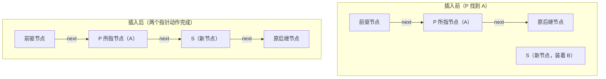

# 数据结构 · 第四周第二节 · 单链表的插入与删除算法 · 详细版讲义

> **来源说明**：本讲义依据课堂录音转写整理，并与本文件夹内严蔚敏《数据结构（C语言版）》（MinerU 识别版）第二章内容对照校订而成，属**学习笔记性质的整理稿**，不是老师的官方逐字稿。
>
> - **转写**：`单链表插入删除算法讲解_导出原文.txt`（约 24 分钟）
> - **教材对照范围**：第 2 章 2.2 末尾（式 (2-3)~(2-6) 平均移动次数、算法 2.4/2.5）、2.3 线性表的链式表示之 2.3.1 线性链表（结点与头指针、头结点概念（教材补充）、算法 2.8 GetElem_L、图 2.8/2.9 指针变化、算法 2.9/2.10）
> - **标注约定**：全部"举例"均按老师课堂原例整理并标注"（转写举例）"；教材未直接出现在转写、但为补全知识点而摘引的原文，标注"（教材补充）"并注明出处（如`（教材 算法 2.8）`）；老师口头叫法（如"后拖变量""秘书"）首次出现时括注说明。
> - **记法说明**：老师课上用 Pascal 风格记法 `P^.next`（P 所指结点的 next 域），教材用 C 风格记法 `p->next`，二者含义完全相同；老师把头指针记作 H、结点指针域记作 next、新结点指针记作 S、前驱指针口头叫"后拖变量/秘书"（本讲义统一写作 save）。教材中头指针一般记作 L。两种记法并列说明，以老师原述为主。
> - **关联阅读**：[数据结构 第四周第一节 线性表的向量存储与顺序表插入算法 详细版讲义](数据结构%20第四周第一节%20线性表的向量存储与顺序表插入算法%20详细版讲义.md)（上一节）、[数据结构 第二章 线性表 详细版讲义](数据结构%20第二章%20线性表%20详细版讲义.md)（本章教材全解）
> - **时间说明**：正文各节标注的伪时间已相对本节课起点归零（原始转写从上一节末尾 00:24:01 处开始），单调递增。

## 开场导读

这节课要解决的问题是：顺序表（向量存储）的插入、删除太慢了怎么办。上一节课我们已经把顺序表插入算法的时间复杂度算清楚了——平均要移动一半的元素，而且元素本身可能很大（一本书、一部电影），这个移动代价"付不起"。这节课就从这道效率分析出发，引出链式存储结构：让逻辑上相邻的元素不再依赖物理位置相邻，而是靠指针串起来，这样插入删除只需修改指针、几乎不用移动元素。课程主线是：链表的定义 → 单链表结点的形式化描述 → 插入算法定义（为什么不说"第 i 个位置"）→ 插入算法三步走 → 头指针不能动、派搜索指针去授权 → 插到 A 之后、插到 A 之前 → 空链表、第一个结点就是 A 两种边界情况 → 用 case 语句整合成完整算法 → 删除算法与结点回收。最后老师点题：这个插入算法是删除、排序等一大类问题的总纲，万变不离其宗。

## 总览知识地图

```mermaid
flowchart TD
    A[上节回顾：顺序表插入平均移动 N/2 个元素] --> B[缺陷：插入删除涉及大量元素移动]
    B --> C[改进思路：链式存储，插入删除几乎不需移动代价]
    C --> D[链表定义：通过指针联系起来的结点的整体]
    D --> E[单链表：结点只有一个指针域]
    E --> F[结点形式化描述：数据域 data + 指针域 next，C 语言 struct]
    F --> G[插入算法定义：把 B 插到第一个数据元素为 A 的结点之前]
    G --> H[三步：申请空间 new S → 找 A → 插入]
    H --> I[插到 A 之后：两个指针动作，无元素移动]
    H --> J[插到 A 之前：需前驱指针（后拖变量/秘书）]
    I & J --> K[while 搜索循环：没找到 A 且不出界]
    K --> L[边界情况一：空链表 H=nil，S 直接成为第一个结点]
    K --> M[边界情况二：第一个结点就是 A，头插 S]
    L & M --> N[case 语句整合三分支，完整插入算法]
    N --> O[思考题：长 N 链表接长 M 链表后面，O(M)]
    N --> P[删除：删除 A 的下一个结点，一句话改指针 + 结点回收]
    P --> Q[删除元素为 A 的结点：同一套前驱方案]
    Q --> R[总结：插入算法是删除、排序等一大类问题的总纲]
```

## 正文

### 一、承接上节课：顺序表插入的效率分析 `00:00–01:37`

这节课是从上一节课的尾巴上直接长出来的，所以我们先把那个还没讲完的账算完。上一节课我们讲了顺序表的插入算法：要在第 i 个位置插入一个元素，从第 i 个开始到表尾的所有元素都得往后挪一位。那么这个算法的效率到底怎么分析呢？按理来说，严格的算法分析应该用**加权平均**——每一个位置被插入的概率是多少，各自加权。但加权平均太复杂了，我们一般用**算术平均**：不管你插哪个位置，我把每个位置需要移动的元素个数都列出来，一视同仁地平均。

我们不妨一个位置一个位置地数。首先问：能不能在**第 N+1 个位置**插入？可以——第 N+1 个位置就是贴着队尾，新元素直接排在 $a_N$ 后面就行，一个元素都不用动。在第 N 个位置插入呢？只把 $a_N$ 一个往后移，移动 1 个。倒数第二个位置？移动 2 个。一般地，在第 i 个位置插入，一共移动 $N-i+1$ 个元素。一直往前推，在第一个位置插入，就要移动全部 N 个元素。

把这张账单列成表（每个位置需移动的元素个数）：

| 插入位置 | 第 1 个 | 第 2 个 | …… | 第 i 个 | …… | 第 N 个 | 第 N+1 个 |
| --- | --- | --- | --- | --- | --- | --- | --- |
| 移动元素个数 | $N$ | $N-1$ | …… | $N-i+1$ | …… | $1$ | $0$ |

总共有多少个插入位置？$N+1$ 个（注意位置编号必须从 1 开始，这遵循我们自然界数数的习惯：第一、第二……第 N，没有"第 0 个"的说法）。算术平均就是：每个位置插入的概率都是 $\dfrac{1}{N+1}$，用概率乘以各自的移动个数再相加。平均下来：

$$\frac{1}{N+1}\sum_{i=1}^{N+1}(N-i+1)=\frac{1}{N+1}\cdot\frac{N(N+1)}{2}=\frac{N}{2}$$

这个式子的分子是把上表从 $N$ 到 $0$ 求和，即 $N+(N-1)+\cdots+1+0=\dfrac{N(N+1)}{2}$；分母是 $N+1$ 个位置。两者相除，平均移动次数正好是 $\dfrac{N}{2}$，也就是**平均要移动一半的元素**。这与教材 2.2 节的推导完全一致（教材 式 (2-3)、(2-5)：$E_{is}=\sum_{i=1}^{n+1}p_i(n-i+1)$，等概率假设 $p_i=\frac{1}{n+1}$ 时 $E_{is}=\frac{1}{n+1}\sum_{i=1}^{n+1}(n-i+1)=\frac{n}{2}$）。

也就是说，插入的时候 i 的位置不固定的话，平均要动一半元素。这个效率就怎么样？太低了。

### 二、移动的代价：作文方格纸与"一本书、一部电影" `01:37–03:12`

为什么说移动一半元素效率太低？老师打了个比方（转写举例）：大家小学都写过作文，给你一张作文方格纸，用铅笔写，誊抄上去。老师有要求：**不允许涂改**——这个地方多了一个字，不许把它涂成黑坨坨；缺一个字，也不许打插入符号添进去。那你想想，这一页可能有 200 多个格子，你好不容易差不多写到最后一个格子，一检查，发现第三行多写了一个汉字。咋办？后面所有的字全部擦掉，通通往前挪一个位置，再重新誊抄一遍。这个作文写起来就太费劲了。

顺序表现在就是这个处境：插（删）一个元素，后面的元素要一个一个挪。而且注意，这才是一个**字符**的代价。我们说 $a_i$ 是个模型问题，它里面存的啥？不知道。如果这个 $a_i$ 是**一本书**呢？随便一本书几兆、几十兆；如果是一部**电影**，更了不得啦。让你移动元素，这个代价你付不起（转写举例）。

小结一下时间复杂度：最坏情况是 $O(N)$（在第一个位置插入），平均情况移动 $\frac{N}{2}$ 个元素，所以顺序表插入的时间复杂度是 $O(N)$。它的缺陷非常明显：**涉及元素的插入与删除时，会涉及大量元素的移动**。

那空间复杂度呢？空间复杂度关注的是**额外空间**。这个插入算法里有什么额外空间？就是循环变量 $i$，或者再来一个计数器之类。这些变量都是常数个：一个也是常数，十个也是常数，那干脆用 1 来代替——也就是说需要的额外空间跟 $N$ 无关，是常数，即 $O(1)$。

那好了，能不能改进？改进的想法很自然：你不是要移动那么多元素吗，我能不能**不移动**？能不能让它们"不理我"？这就引出了这一节的主角——链式存储。

### 三、改进思路：链式存储与链表的定义 `03:12–04:48`

我们说，向量存储这种方式在频繁插入删除的场景下就不行了。为啥？因为向量存储是用**存储物理位置的单元的相邻性**来反映逻辑相邻关系的——物理位置一动，逻辑关系才得以维持，所以插入删除必须移动元素。我们就要启用计算机当中的**动态的存储**方式：对于插入、删除这些操作，它几乎不需要花代价——这就是**链接结构**。

用链接结构来存储的线性表，我们给它取个名字叫**链表**。链表下个定义：链表就是**通过指针联系起来的结点的一个整体**。

链表的核心思想是：数据元素之间的逻辑相邻关系，通过**指针**（指向性的信息）来反映。而向量存储是通过物理存储单元的位置相邻性来反映。这两个本质不一样：向量（顺序表）靠"住得近"表示逻辑相邻，链表靠"手里有你的地址"表示逻辑相邻。（教材补充：教材 2.3.1 节的原话是"这种存储结构为非顺序映像或链式映像"，即逻辑上相邻的两个数据元素其存储的物理位置不要求紧邻。）

和某个结点有关的指针可能有多个，那最简单的情况是什么？只有**一个**指向性的信息——跟我关联的事物只有一个。这就是**单链表**（教材 2.3.1 也称"线性链表"，因为每个结点只包含一个指针域）。单链表是我们研究的起点，先把最简单的吃透。

### 四、结点的形式化描述与一道典型选择题 `04:48–06:21`

单链表的结点长什么样？画个图的话，一个结点有 **data 域**（数据域），还有**指针域 next**。但计算机不认识画图，计算机认识啥？符号。所以我们要用**符号化的方法**把它表示出来：定义一个类型——结点类型，给它命个名。结点是由**两个及以上部分**组成的，所以结点是个**记录类型**（老师口头说的"记录"，对应 C 语言的 struct 结构体）：记录包含两部分——数据域、指针域。然后做个声明（类型定义）就完了。这对应到 C 语言就是（教材 2.3.1 的单链表存储结构定义）：

```c
// - - - - - 线性表的单链表存储结构 - - - - -
typedef struct LNode {
    ElemType data;          // 数据域：存数据元素本身
    struct LNode *next;     // 指针域：存直接后继结点的存储位置
} LNode, *LinkList;
```

一个一个的结点，通过指针串起来，这样一个整体的序列就是链表（LinkList）。空链表用尖角符号 **∧** 表示空（教材记法为 NULL）。

学到这儿，来看一道典型的选择题，大家睁大眼睛：

> **题目**：链式存储设计时，问"节点内的存储单元地址"：
> A. 一定连续　B. 一定不连续　C. 不一定连续　D. 部分连续

当时有同学选 A，老师确认：对，就是 A。但这个题有**陷阱**，必须读懂题意——问的是"**节点内**"，不是"节点之间"。我们链式存储结构里，每个节点是由两部分组成的：一部分是 data，一部分是 next。那你说**这整个节点里面**的这些存储单元连不连续？当然连续了——data 和 next 就紧凑地放在同一块空间里。只不过链式结构说的是**节点之间**不连续：这个节点和那个节点的存储地址往往是分开的、不一定连续。所以答案是 A：**节点之内一定连续，节点之间不一定连续**。做这个题一定要读清楚问的是"内"还是"之间"。（教材补充：教材 2.3.1 明确说"这组存储单元可以是连续的，也可以是不连续的"，指的正是结点之间的关系。）

### 五、插入操作的定义：为什么不说"第 i 个位置" `06:21–07:59`

链表说清楚了，接下来以插入为例，讨论单链表上运算实现的过程和特点。先给操作下定义。我们的定义是：**把数据元素 B，插入到链表 H 中的、第一个数据元素为 A 的节点之前**。

你会发现，这个定义跟很多书上不一样。很多书是这样定义的："在线性表的第 i 个位置（或第 i 个位置之后）插入一个新的数据元素。"我们为什么不采取这种描述形式？因为**链表是一个动态的结构**。动态意味着它的变动很大——在一个随时变动的结构里，谈一个固定的"第 i 个位置"，往往意义不大。

老师给了两个例子（转写举例）：

- **中国银行**：全国各地的柜台，这一刻存进来一笔钱，下一刻放贷款放出去好几百万。我问你"11 点 19 分 02 秒这个具体时刻，中国银行的库存里有多少钱"？这个问题当然能回答——统计一下就行。但你知道这个答案**有意义吗**？没有任何意义，因为数据随时都在变动，这个绝对值没有意义。
- **超市人数**：一个超市，这个时刻进去一个人，下一个时刻出来两个人，再下一刻又进去一个，又挤出 4 个人。门口加个计数器，进加 1、出减 1，你当然能知道某一时刻超市里有多少人。但这个数有用吗？没有用——进超市的人不见得是购物呀。大家都是动态变化的。

所以，一个永远变动的东西，你谈一个具体的"第 i 个位置"，往往意义不大。我们不用这种绝对的、具体的数值来刻画动态结构上的插入操作。

### 六、操作命名与插入算法的宏观三步 `07:59–11:14`

对问题首先要抽象、起名字。前面的顺序表操作是 Sequence 风格，这里就是 **InsertLinkList**（在链表中插入），参数有链表 H、数据元素 B 和 A。这是什么过程？**一般过程**——只要做了就行。返回值是布尔量（真/假，表示操作成功、失败），不是具体值，我们不再关心"第几个"。

从宏观上分析这个算法该怎么做。这个链表在计算机里面，而数据元素 B 是客观存在的，**在计算机外部**。我要把 B 插进去，第一步就得让 B 进到计算机里面来。怎么进？**动态地申请空间**——申请一个节点这么大小的存储空间，并弄一个指针 S 指向它。申请完了，B 还得放进节点的**数据域**里，即 $S \to data := B$（S 所指节点的 data 部分；不同语言写法不太一样，只是外在形式，大家不要在意）。装好了 B，第二步就是**找 A**——按数据元素 A 去链表中查找该节点。第三步才是**插入**（调整指针）。

所以总体就三步：**①申请空间装 B；②找 A 的位置；③插入**。

第二步"找 A"像什么？老师说了个例子（转写举例）：等会儿下完课去吃饭，你想吃牛肉面，卖牛肉面的窗口人特别多，想吃得快一点，咋办？插队。插队前你得先找呗——看队列当中**有没有我们班同学**："你是不是我班同学？"找到了，再插入进去。这就是"先找位置，再调整"。

那么插入的时候，是插到同学前面好还是后面好？现实中你肯定**插到前面**更容易（转写举例）：你插到你同学后面，原来排在你同学后面的那个同学会揍你——"凭啥插我队？"但你插到你同学前面，后面那个同学没招，你同学说"我乐意"，他只能干着急。所以现实中插到前面更简单。不过按一般教科书的讲法，**"插到 A 之后"这个操作计算机动作更简单**（原因马上讲到）。我们两种都分析。

### 七、头指针不能动；插到 A 之后：两个指针动作 `11:14–12:51`

先讨论"插到 A 之后"。插入前要找 A：看（问）你是不是 A？不是，往后走；再看下一个……那第一个问题来了：**链表的头指针 H 能不能动？**不能。如果 H 随着搜索往后走——第一个元素不是 A，H 挪过去；走到第二个、第三个还没找到 A，那怎么样？整个链表的头丢了，**整个链表也就丢了**。所以头指针非常重要，它起到**统辖全局**的作用。

这就好比（转写举例）：皇上——头指针 H——是不能挪窝的，皇帝老爷子一挪窝，江山不稳。他要出去一般是微服私访，悄悄的。那如果他不能亲自去呢？**搞授权**——派个钦差大臣，给他尚方宝剑，"如见皇帝本人"。对应到算法：授权就是搞一个**搜索指针 P**，让 P 去找 A。找到 A，停下来，接下来就好办了。

找到 A 之后，把新节点 S 插到 A 的**后面**，只需两个动作：

1. 第一个动作：把 P 的 next（原来 A 后面的那个节点）送给 S 的 next，即 $S \to next := P \to next$；
2. 第二个动作：把 S 送给 P 的 next，即 $P \to next := S$。

第二个动作完成的同时，原来 P 指向后继的那条指向信息就被覆盖了（相当于断开）。这就好比**皮筋**（转写举例）：皮筋一断开，抖一下，新节点不就进去了。注意：整个插入过程**没有涉及任何元素的移动**，我们就修改了两个指针而已——这正是链式存储"插入删除几乎不需要代价"的由来。

这里补一句（讲义补充）：这两个动作的**顺序不能颠倒**。如果先执行 $P \to next := S$，原来 P 到后继的那条链就被覆盖了，A 后面那个节点就再也找不到了——"先把旧的后继托付给 S，再让 P 认 S"，顺序反了就会断链。教材 图 2.8 给出的正是这两条语句：$s \to next = p \to next;\ p \to next = s$（教材 算法 2.9 中同）。

下面用一张图看清这两个动作前后的指针变化：



### 八、插到 A 之前：单行道与"秘书"（后拖变量） `12:51–14:28`

那如果要插到 A **之前**呢？前面找 A 的过程一样。找到 A 之后，把 S 接到 A 后面那条链好办（$S \to next := P \to next$ 建立这条链不难）；难的是什么？我们是要插到 A **前面**，还得建立"前驱指向 S"这条链，所以必须**知道 A 的前驱是谁**。

问题是：链表是**单行道，有去无回**（转写举例）。你走过来了，当前在的位置知道，但从哪儿来的，你就不知道了——就好像一个人记性不好，前一步干啥了？记不得了。

现实中怎么办？（转写举例）老总记不住太多事儿，咋办？**配个秘书**：秘书，给我记住。有了秘书，我这个指针 P 走之前就跟秘书说："你记住啊，我在这儿。"然后我再往前走一步。等我走过了、停下来，就问秘书："我前一个位置在哪儿？"秘书一指，前驱就找到了。

所以 P 在搜索的时候，**每一次都要带一个后拖变量**（老师口头叫法，就是"前驱指针"，本讲义统一写作 save）——带着那个"秘书"一起走。停下来之后，插入动作就能搞定了。插到 A 之前的关键就是：**同时形成两个指针**——一个 P 指示 A 在哪儿，一个后拖变量 save 指示前驱在哪儿。

### 九、while 搜索循环与常规情况的两个分支 `14:28–16:04`

常规情况的搜索怎么走？还是先"搞授权"：因为 H 不能动，派钦差大臣 P 从第一个节点开始，逐个判断"是不是 A"。走的过程中还有一个前提：**不能出界**。走到表尾再往后走就是"掉悬崖"了（转写举例）：你即使是钦差大臣，拿着尚方宝剑，一旦出了国界，人家外国人认你的尚方宝剑吗？不认。所以走的过程中要保证不出境、不出界。

于是搜索循环的写法是（按老师的叙述整理）：循环条件为"**当前节点不是 A，且还没有走出表尾**"；循环体每次干两件事——

1. **先把我的位置告诉秘书**：$save := P$；
2. **再往前走一步**：$P := P \to next$。

不断地往前走。停下来只有两种结果：

- **情况一：找到了 A**（队列里有你们班同学）。就两个动作（这次是插到 A 之前，所以是插在 save 和 P 之间）：
  ```
  S^.next := P;      { 先把 A 这条链托付给 S }
  save^.next := S;   { 再让前驱指向 S，插入完成 }
  ```
- **情况二：没找到 A**（队伍里没你们班同学）。你的目的是吃饭，想快一点才插队；插不了队，你没辙，老老实实排到队尾去呗。循环停下来时 P 恰好指向**最后一个节点**（因为 P 的 next 已等于 nil，再走就出界了），那我就把 S 链到 P 的后面，并且 S 成为新的表尾节点，要**打封口**——它的 next 置为 nil，告诉系统：这是最后一个元素。
  ```
  P^.next := S;
  S^.next := nil;    { 打封口：这是最后一个元素 }
  ```

老师强调：常规情况本身不难，关键就是把"找到 A"和"没找到 A 链到表尾"这两个收尾动作写对。

### 十、边界情况一：空链表 `16:04–17:40`

常规情况讲完了。但算法设计主要还要干嘛？**考虑异常情况**。没考虑异常情况不行。第一种异常情况：链表本身就是空的（$H = nil$）。你想，链表是空的，一开始搜索，P 一赋值就是空指针。P 是空的，你还能判断它的 data 呀、next 呀？**皮之不存，毛将焉附**（转写举例）——没有这个节点，你谈何访问它的域？强行访问就是大家以后会经常碰到的**空指针错误**。

再打个比方（转写举例）：我让你去南大某校区某栋楼的某间教室，把张三的书包拿回来。你到那儿一看，**那栋楼都不存在**——还谈什么书包、什么凳子？啥都没有，搜索根本没法形成。

所以空指针是链表**最常见**的边界情况之一，见到"P 为空却去访问它的 data/next"，要立刻意识到是链表为空没处理。那空链表怎么插入？（转写举例）我让你去牛肉面窗口插队，你往那儿一看，**窗口前一个人都没有**。咋办？大不了我自己就站在那儿——我既是第一个节点，也是最后一个、唯一的节点，根本不需要插队。处理代码：

```
S^.next := nil;    { S 成为最后一个节点，打封口 }
H := S;            { S 送给 H：窗口从此有人，S 是第一个 }
```

### 十一、边界情况二：第一个节点就是 A `17:40–19:16`

第二种异常情况：**第一个节点就是 A**。回忆一下，插入先要找 A，关键是形成两个地址：一个是 P，一个是后拖变量 save。可现在搜索一开始，P 就落在第一个节点上，P 是有了，**save 形成不了**——还没有走过任何一个节点，"秘书"还没来得及记住任何位置。

这好比（转写举例）：你作为钦差大臣，正常情况是呼啦啦拿着尚方宝剑，后面跟着秘书、跟着一堆人马，耀武扬威巡视全国。可现在的情况是：你还在**金銮宝殿**上，皇帝老爷子刚把尚方宝剑递给你，立马就要你办事——你还没出金銮殿呢。这时候你还敢带那一堆人马吗？不敢，带了皇帝老爷不得把你砍了——你是要造反呀？

那这种情况咋办？S 本来就是要插到 A 的前面嘛，那我就把 S 直接放到最前面，**修改头指针 H**——头插：

```
S^.next := H;      { 把头指针 H 送给 S 的 next，建立这条链 }
H := S;            { S 送给 H，S 成为链表的第一个节点 }
```

原因归纳一下：有 P（它就指向第一个节点 A），但 save 无法形成；既然第一个节点就是 A，也根本不需要搜索。

### 十二、case 整合三分支与思考题：接链表是 O(M) `19:16–20:50`

还有没有其他异常情况？没有了。所以整个算法一共**三种情况**：①链表本身为空；②第一个节点就是 A（形成不了 save）；③常规情况（其余一切）。三种情况用 **case 语句**整合，整个插入算法就是这样一个过程（按老师课堂 case 三分支的讲法整理成伪代码）：

```txt
procedure InsertLinkList(H, A, B)
  new(S);  S^.data := B;          { 第一步：申请空间，装入 B }
  case
    H = nil :                     { 情况一：空链表 }
      S^.next := nil;
      H := S;                     { S 成为第一个也是唯一的节点 }
    H^.data = A :                 { 情况二：第一个节点就是 A }
      S^.next := H;
      H := S;                     { 头插，修改链表头部 }
    otherwise :                   { 情况三：常规情况 }
      P := H;                     { 搞授权：派搜索指针 P，H 不动 }
      save := ∧;                  { 后拖变量（秘书），随 P 逐步形成 }
      while (P <> ∧) and (P^.data <> A) do
        save := P;                { 先把位置告诉秘书 }
        P := P^.next;             { 再前进一步 }
      { 循环停下来，分两种收尾 }
      if P <> ∧ then              { 找到了 A：插到 save 与 P 之间 }
        S^.next := P;
        save^.next := S;
      else                        { 没找到 A：P 已是最后一个节点 }
        P^.next := S;
        S^.next := nil;           { 打封口 }
  end case
end
```

链表的插入算法实际上不难。看好了，我们做一下这个题（转写举例）：**长度为 N 的单链表，接到长度为 M 的单链表后面，时间复杂度是多少？** 第一 O(1)，第二 O(N)，第三 O(M)，第四 O(N·M)。把这一节链表接到另一节链表后面，关键在干嘛？关键是**找到那个链表的尾部**——链表最后一个节点。找链表最后一个节点得从头走到尾，走多远取决于哪条链？要把 N 接到 M 的**后面**，需要遍历的是长度 M 的那条链（找到它的尾），所以是 O(M)——选第三项。老师特意提醒：别答反了。（这个思路其实与教材归并单链表的思想相通：教材 算法 2.12 中 pc 指向 Lc 当前最后一个结点、逐结点链接，本质也是"顺链找位置、改指针"。）

### 十三、删除：删除 A 的下一个节点与节点回收 `20:50–22:25`

接下来讲链表中的**删除**。删除差不多嘛。如果删除的是"**A 的下一个节点**"，这个操作非常简单：跟以前类似，搞搜索找到 A，停下来。删除 A 的下一个，比删除 A 本身还要简单，因为你就站在 A 上，A 的 next 就指向你要删的节点，**一句话修改指针**就搞定：

```
P^.next := P^.next^.next;    { 把 next 的 next 送给他 }
```

（教材对照：教材 图 2.9 与正文给出的正是这条语句 $\mathrm{p} \to next = \mathrm{p} \to next \to next$，为在单链表中实现元素 a、b、c 之间逻辑关系的变化，仅需修改结点 a 的指针域。）

当然要注意：指针这么一送，相当于这条链断掉了，被摘下来的节点还在内存里，这就涉及**节点回收问题**。链表是**动态结构**，动态结构一定要**自己手动回收**这部分存储空间。（教材补充：教材 2.3.1 指出，单链表是一种动态结构，可用 malloc 生成结点、free 回收结点，回收后的空间可以备作再次生成结点时用；整个可用存储空间可由多个链表共同享用。）

回收时有一个要害：**不能直接就修改链条**。如果你直接把链一改，那个被摘下来的节点的空间就**永远拿不到了**——你想访问它，没有任何指针指向它，它永远访问不了。这好比（转写举例）：这个节点是个皇帝，他要去世了，他有 N 多个孩子，历史上出现了啥？九王夺嫡。所以皇帝老爷子要去世，先别忙着咽气，**先立遗嘱**——指明江山谁坐——然后再走。对应到算法就是三步：**先用一个指针 q 把它记录下来（P 的下一个是谁），再修改指针，最后 dispose（释放）**：

```
q := P^.next;          { 先立遗嘱：q 记住要删的节点 }
P^.next := q^.next;    { 再断链：绕过被删节点 }
dispose(q);            { 最后回收：释放 q 所指节点 }
```

老师还说了个轻松的例子（转写举例）：就算你忘了写 dispose，比如测试人员拿代码测试，为了试试功能往里面加一堆语句，测试完忘了删——这也不影响功能，所以这算是**小问题**（但在正式代码里，节点丢失和内存泄漏是要避免的）。

### 十四、删除元素为 A 的节点：同一套方案，总纲万变不离其宗 `22:25–23:29`

那我不要删"A 的下一个"，我要删除**数据元素为 A 的节点**呢？老师说：这个算法我已经给你讲了啊。为啥？因为要删除 A，需要知道它的**前一个节点**。咋知道前一个节点？是不是跟我们前面一样——用一个**后拖变量**（前驱指针）？有了后拖变量记住 A 的前一个节点，这一删除就行了，修改指针就可以了，非常简单。

老师借这个点说了句掏心窝的话：**老师讲一个算法，讲的是一大类问题的解决方案**。前面讲的插入算法，稍微改一下，就变成这里的删除算法了；这个算法实际上既可以是删除，也可以是后面**排序算法的总体思路**。它是一个**总纲性**的东西——万变不离其宗，后面还会在这个算法的基础上做一些演变，不说万遍吧，一遍两遍是有的。

删除元素为 A 的节点的具体算法老师没有再完整写出（细节方面不一样），思路照旧三种情况：如果 H 等于空，那就不做删除操作；如果第一个节点就是 A，大不了把 H 改成指向它的下一个（改表头）；常规情况（老师口误说成"频繁情况"，即常规情况）就把插入的那两个动作改成一个动作——修改它的指针就可以了。

## 结课：把整节课串起来

这节课从上一节课遗留的一笔账讲起：顺序表插入平均要移动 $\frac{N}{2}$ 个元素，最坏 $O(N)$，元素越大（一本书、一部电影）这个代价越付不起——而它空间复杂度倒是很好，$O(1)$。缺陷的根源在于顺序存储"用物理相邻表达逻辑相邻"，所以改进思路是换成链式存储：逻辑相邻关系改由**指针**表达，插入删除只改指针、不移动元素。单链表是最简单的链表：结点只有数据域和指针域，头指针 H 统辖全局、绝不能动，搜索靠授权出去的指针 P，走单行道还要带个"秘书"（后拖变量，前驱指针 save）记来路。

插入算法按 case 分三种情况收束：空链表——S 自己站上窗口（$S \to next := nil;\ H := S$）；第一个节点就是 A——金銮殿上没带人马，直接头插（$S \to next := H;\ H := S$）；常规情况——while 循环边找边留后路，找到 A 就插在 save 与 P 之间（两个指针动作），没找到就链到表尾打封口。删除则是同一套方案的简化版：删"A 的下一个"一句话改指针，但要先 q 记录再断链再 dispose，像皇帝立遗嘱一样先把后事安排好；删"A 本身"照搬后拖变量方案。记住老师最后的话：这个插入算法是删除、排序等一大类问题的**总纲**。

复习要点（可自测）：

- 顺序表第 i 个位置插入移动 $N-i+1$ 个元素；$N+1$ 个位置等概率时平均移动 $\frac{1}{N+1}\sum_{i=1}^{N+1}(N-i+1)=\frac{N}{2}$；最坏 $O(N)$；空间复杂度 $O(1)$（额外空间只有循环变量、计数器等常数个）。
- 链表定义：通过指针联系起来的节点的整体；顺序表用物理相邻反映逻辑相邻，链表用指针反映——本质区别。
- 选择题：节点**内**存储单元地址**一定连续**，节点**之间不一定连续**（答案 A），注意读清题意。
- 插入算法定义：把 B 插到链表 H 中第一个数据元素为 A 的节点**之前**；动态结构下不用"第 i 个位置"定义（中国银行、超市类比）。
- 插入三步：new 申请空间并装 B（$S \to data := B$）→ 找 A → 插入。
- 头指针 H 不能动（统辖全局）；搜索指针 P 是"授权"出去的钦差大臣。
- 插到 A 之后两个动作：$S \to next := P \to next$，再 $P \to next := S$；**顺序不能颠倒**（讲义补充：先改 P 的 next 会丢失后继）。
- 插到 A 之前必须知道前驱：单行道有去无回，所以要后拖变量（秘书）save；循环体每次先 $save := P$ 再 $P := P \to next$。
- 三种情况：空表（$S \to next := nil;\ H := S$）、第一个节点是 A（$S \to next := H;\ H := S$）、常规（找到 A 插 save 与 P 之间；没找到链到表尾打封口）。
- 思考题：长 N 链表接到长 M 链表后面，时间复杂度 $O(M)$（关键是找到 M 链的尾节点）。
- 删除 A 的下一个：$q := P \to next;\ P \to next := q \to next;\ dispose(q)$——先记录、再断链、再回收，否则节点永久丢失。
- 删除元素为 A 的节点：与插入同一套后拖变量方案；空表不做、表头即 A 则改 H、常规改一个指针动作。

## 待核实内容

1. **前驱变量的名称**：老师口头叫"后拖变量/秘书"，分段笔记中该变量的写法存疑（一处分音符为 C，一处理解为 save，也可能原文是 previous/前驱）。本讲义统一写作 save，具体课堂用名无法从转写确认。
2. **seg_18 中"be1"**：转写无法辨识，推测指教材配套的结点图示/伪代码部分，未能核实。
3. **"插到 A 之后两动作顺序不能颠倒"的原因**：老师课上未明确展开（只说两个动作完成插入），本讲义以"（讲义补充）"标注补入；不排除老师口头讲过而转写遗漏。
4. **中国银行例中放贷款金额**：转写数字被截断（几十万/几百万），本讲义按"好几百万"整理，具体数字无法核实（不影响例子本意）。

## 附录

### 附录 A：单链表结点类型定义（C 语言，教材对照）

```c
// 老师课堂讲法：节点 = 数据域 + 指针域 的记录类型（struct）
// 教材 2.3.1 单链表存储结构定义（校对来源）
typedef struct LNode {
    ElemType data;              // 数据域：存储数据元素信息
    struct LNode *next;         // 指针域：存储直接后继的存储位置（指针/链）
} LNode, *LinkList;
```

说明：若 L 是 LinkList 型变量，则 L 为单链表的**头指针**，指向表中第一个结点；L = NULL（老师记法 ∧）表示空表。（教材补充：教材 2.3.1。教材还介绍了在第一个结点之前附设**头结点**的做法——头结点指针域指向第一个元素结点，空表时头结点指针域为空；头结点可使插入、删除不必单独处理"在第一个结点前操作"的情形。老师本课采用不带头的记法 H 直指第一个节点，两种讲法并存，注意区分。）

### 附录 B：插入算法核心（老师 case 三分支讲法的伪代码见正文第十二节；教材对应算法摘抄）

教材在带头结点的单链表上实现"第 i 个位置之前插入"（教材 算法 2.9，供对照老师"找到位置后两个指针动作"的讲法）：

```c
Status ListInsert_L(LinkList &L, int i, ElemType e) {
    // 在带头结点的单链线性表 L 中第 i 个位置之前插入元素 e
    p = L; j = 0;
    while (p && j < i - 1) { p = p->next; ++j; }   // 寻找第 i-1 个结点
    if (!p || j > i-1) return ERROR;               // i 值不合法
    s = (LinkList) malloc(sizeof(LNode));          // 生成新结点
    s->data = e;
    s->next = p->next;   // 动作一：先把 p 的后继托付给 s
    p->next = s;         // 动作二：再让 p 指向 s
    return OK;
} // ListInsert_L
```

（教材补充：教材 2.3.1 还给出按值取元素的 GetElem_L，即"顺链查找"的基本功，与老师"派 P 逐个问是不是 A"同一思想——教材 算法 2.8：）

```c
Status GetElem_L(LinkList L, int i, ElemType &e) {
    // L 为带头结点的单链表的头指针；第 i 个元素存在时赋给 e 并返回 OK
    p = L->next; j = 1;                            // p 指向第一个结点
    while (p && j < i) { p = p->next; ++j; }       // 顺指针向后查找
    if (!p || j > i) return ERROR;
    e = p->data;
    return OK;
} // GetElem_L
```

### 附录 C：删除的核心代码

删除 P 所指节点（A）的**下一个节点**（老师三步 + 教材 算法 2.10 对照）：

```c
// 老师课堂讲法（Pascal 风格）
// q := P^.next;  P^.next := q^.next;  dispose(q);

// 教材 算法 2.10（C 风格，带头结点，删除第 i 个元素）
Status ListDelete_L(LinkList &L, int i, ElemType &e) {
    p = L; j = 0;
    while (p->next && j < i-1) { p = p->next; ++j; }   // 寻找第 i 个结点，p 指向其前趋
    if (!(p->next) || j > i-1) return ERROR;           // 删除位置不合理
    q = p->next;         // 先记录（立遗嘱）
    p->next = q->next;   // 再断链
    e = q->data;
    free(q);             // 最后回收
    return OK;
} // ListDelete_L
```

（教材补充：教材 2.3.1 指出算法 2.9、2.10 的时间复杂度均为 $O(n)$，因为都必须首先找到第 i-1 个结点，即需修改指针的结点。）
