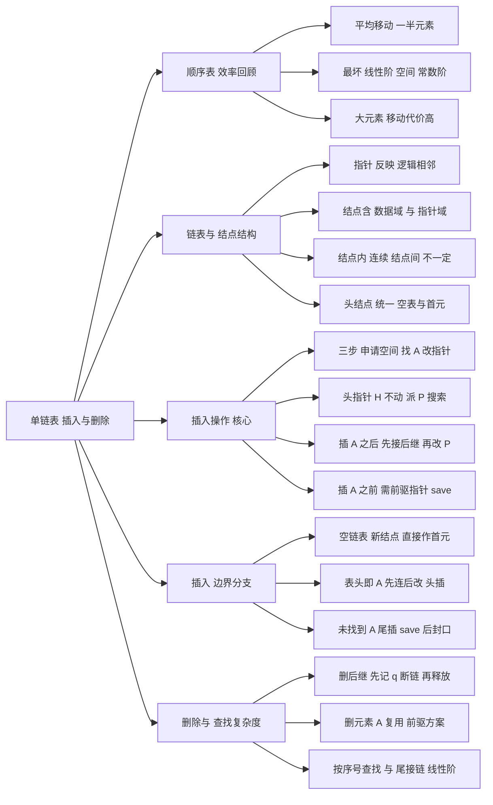

# 数据结构 · 第四周第二节 · 单链表的插入与删除算法 · 详细版讲义

> **来源说明**：本讲义依据课堂录音转写整理，并与本文件夹内严蔚敏《数据结构（C语言版）》（MinerU 识别版）第二章内容对照校订而成，属**学习笔记性质的整理稿**，并非官方逐字稿。
>
> - **转写**：`单链表插入删除算法讲解_导出原文.txt`（约 24 分钟）
> - **教材对照范围**：第 2 章 2.2 末尾（式 (2-3)~(2-6) 平均移动次数、算法 2.4/2.5）、2.3 线性表的链式表示之 2.3.1 线性链表（结点与头指针、头结点概念（教材补充）、算法 2.8 GetElem_L、图 2.8/2.9 指针变化、算法 2.9/2.10）
> - **标注约定**：全部"举例"均按课堂原例整理并标注"（转写举例）"；教材未直接出现在转写、但为补全知识点而摘引的原文，标注"（教材补充）"并注明出处（如`（教材 算法 2.8）`）；课上口头叫法（如"后拖变量""秘书"）首次出现时括注说明。
> - **记法说明**：课上口述与板书采用 Pascal 风格记法 `P^.next`（`P` 所指结点的 `next` 域）与空指针 `∧` / `nil`，教材采用 C 风格记法 `p->next` 与 `NULL`，二者含义相同；课上把头指针记作 `H`、新结点指针记作 `S`、前驱指针口头叫"后拖变量/秘书"（本讲义统一写作 `save`），教材中头指针一般记作 `L`。本讲义代码块统一使用 C 风格并附中文注释，同时在正文中保留课堂记法的对应说明。
> - **关联阅读**：[[数据结构 第四周第一节 线性表的向量存储与顺序表插入算法 详细版讲义]]（上一节）、[[数据结构 第二章 线性表 详细版讲义]]（本章教材全解）
> - **时间说明**：正文各节标注的伪时间已相对本节课起点归零（原始转写从上一节末尾 00:24:01 处开始），单调递增。

## 开场导读

这节课我们要解决的问题是：顺序表（向量存储）的插入、删除太慢了怎么办。上一节课我们已经把顺序表插入算法的时间复杂度算清楚了——平均要移动一半的元素，而且元素本身可能很大（比如一本书、一部电影），这个移动代价"付不起"。这节课我就从这道效率分析出发，引出链式存储结构：让逻辑上相邻的元素不再依赖物理位置相邻，而是靠指针串起来，这样找到位置之后只需修改指针、无需移动元素。课程主线是：链表的定义 → 单链表结点的形式化描述 → 插入算法定义（为什么不说"第 $i$ 个位置"）→ 插入算法三步走 → 头指针不能动、把搜索任务授权给搜索指针 `P` → 插到 `A` 之后、插到 `A` 之前 → 空链表、第一个结点就是 `A` 两种边界情况 → 用三分支结构整合成完整算法 → 删除算法与结点回收。最后我来点题：这个插入算法是删除、排序等一大类问题的总纲，核心思路一脉相承。

## 总览知识地图



## 正文

### 一、承接上节课：顺序表插入的效率分析 `00:00–01:37`

这节课是从上一节课的尾巴上直接长出来的，所以我们先把那个还没讲完的账算完。上一节课我讲了顺序表的插入算法：要在第 $i$ 个位置插入一个元素，从第 $i$ 个开始到表尾的所有元素都得往后挪一位。那么这个算法的效率到底怎么分析呢？按理来说，严格的算法分析应该用**加权平均**——每一个位置被插入的概率是多少，各自加权。但加权平均情况往往较复杂，我们一般先按等概率做**算术平均**：不管你插哪个位置，把每个位置需要移动的元素个数列出来，一视同仁地平均。

我们不妨一个位置一个位置地数。首先问：能不能在**第 $N+1$ 个位置**插入？可以——第 $N+1$ 个位置就是贴着队尾，新元素直接排在 $a_N$ 后面就行，一个元素都不用动（移动 $0$ 个）。在第 $N$ 个位置插入呢？只把 $a_N$ 一个往后移，移动 $1$ 个。倒数第二个位置？移动 $2$ 个。一般地，在第 $i$ 个位置插入（$1 \le i \le N+1$），一共移动 $N-i+1$ 个元素。一直往前推，在第一个位置插入，就要移动全部 $N$ 个元素。

把这张账单列成表（每个位置需移动的元素个数）：

| 插入位置 | 第 1 个 | 第 2 个 | …… | 第 $i$ 个 | …… | 第 $N$ 个 | 第 $N+1$ 个 |
| --- | --- | --- | --- | --- | --- | --- | --- |
| 移动元素个数 | $N$ | $N-1$ | …… | $N-i+1$ | …… | $1$ | $0$ |

总共有多少个插入位置？$N+1$ 个（注意位置编号从 1 开始，遵循我们平时数数的习惯：第一、第二……第 $N$，没有"第 0 个"的说法）。算术平均就是：假设每个位置插入的概率都是 $\dfrac{1}{N+1}$，用概率乘以各自的移动个数再相加。平均下来：

$$\frac{1}{N+1}\sum_{i=1}^{N+1}(N-i+1)=\frac{1}{N+1}\cdot\frac{N(N+1)}{2}=\frac{N}{2}$$

这个式子的分子是把上表从 $N$ 到 $0$ 求和，即 $N+(N-1)+\cdots+1+0=\dfrac{N(N+1)}{2}$；分母是 $N+1$ 个位置。两者相除，平均移动次数正好是 $\dfrac{N}{2}$，也就是**平均要移动一半的元素**。这与教材 2.2 节的推导一致（教材 式 (2-3)、(2-5)：$E_{is}=\sum_{i=1}^{n+1}p_i(n-i+1)$，等概率假设 $p_i=\frac{1}{n+1}$ 时 $E_{is}=\frac{1}{n+1}\sum_{i=1}^{n+1}(n-i+1)=\frac{n}{2}$）。

也就是说，插入的时候 $i$ 的位置不固定的话，平均要动一半元素，这个效率就比较低了。

### 二、移动的代价：作文方格纸与"一本书、一部电影" `01:37–03:12`

为什么说移动一半元素效率太低？我打个比方（转写举例）：大家小学都写过作文，给你一张作文方格纸，用铅笔写，誊抄上去。小学语文课写作文有硬要求：**不允许涂改**——这个地方多了一个字，不许把它涂成黑坨坨；缺一个字，也不许打插入符号添进去。那你想想，这一页可能有 200 多个格子，你好不容易差不多写到最后一个格子，一检查，发现第三行多写了一个汉字。咋办？后面所有的字全部擦掉，依次往前挪一个位置，再重新誊抄一遍。这个作文写起来就太费劲了。

顺序表现在就是这个处境：插（删）一个元素，后面的元素要一个一个挪。而且注意，这才是一个**字符**的代价。我们说 $a_i$ 是个抽象的数据元素模型，它里面存的啥？不一定是个小整数。如果这个 $a_i$ 是**一本书**呢？随便一本书几兆、几十兆；如果是一部**电影**，占用空间更大。让你成片移动元素，这个代价就付不起（转写举例）。

小结一下顺序表插入的复杂度：最好情况是在第 $N+1$ 个位置（表尾）插入，移动 $0$ 个元素，时间复杂度为 $O(1)$；最坏情况是在第 $1$ 个位置插入，移动 $N$ 个元素，时间复杂度为 $O(N)$；平均情况移动 $\frac{N}{2}$ 个元素，所以顺序表插入的时间复杂度是 $O(N)$。它的缺陷很明显：**涉及元素的插入与删除时，会引起大量元素的移动**。

那空间复杂度呢？空间复杂度关注的是**额外空间**。这个插入算法里有什么额外空间？就是循环变量 $i$，或者再来一个计数器之类。这些辅助变量都是常数个：一个也是常数，十个也是常数，所需的额外空间跟问题规模 $N$ 无关，是常数阶，即 $O(1)$。

那好了，能不能改进？改进的想法很自然：你不是要移动那么多元素吗，我能不能**不移动**？能不能让后面那些元素"不理我"？这就引出了这节课的主角——链式存储。

### 三、改进思路：链式存储与链表的定义 `03:12–04:48`

我们说，向量存储（顺序表）这种方式在频繁插入删除的场景下就吃力了。为啥？因为向量存储是用**物理存储单元的相邻性**来反映逻辑相邻关系的——物理位置跟着调整，逻辑关系才能维持，所以插入删除必须移动元素。反过来，顺序表的优势是按序号随机存取只需要 $O(1)$。但当插入、删除频繁时，我们要启用计算机当中的**动态存储**方式：通过**链接结构**，让插入、删除在找到位置后只需修改指针而不用移动元素。

用链接结构来存储的线性表，我们给它取个名字叫**链表**。给链表下个定义：链表就是**通过指针联系起来的结点的一个整体**（线性序列）。

链表的核心思想是：数据元素之间的逻辑相邻关系，通过**指针**（指向性的地址信息）来反映；而向量存储是通过物理存储单元的位置相邻性来反映。这两个本质不同：向量（顺序表）靠"住得近"表示逻辑相邻，链表靠"手里有你的地址"表示逻辑相邻。（教材补充：教材 2.3.1 节的原话是"这种存储结构为非顺序映像或链式映像"，即逻辑上相邻的两个数据元素其存储的物理位置不要求紧邻。）

和某个结点有关的指针可能有多个，那最简单的情况是什么？每个结点只有**一个**向后指向的信息——跟我直接关联的后继只有一个。这就是**单链表**（教材 2.3.1 也称"线性链表"，因为每个结点只包含一个指针域）。单链表是我们研究的起点，先把最简单的吃透。

### 四、结点的形式化描述与一道典型选择题 `04:48–06:21`

单链表的结点长什么样？画个图的话，一个结点有 **data 域**（数据域），还有**指针域 next**。但计算机不认识画图，计算机认识符号，所以我们要用**符号化的方法**把它表示出来：定义一个结点类型，给它命个名。结点是由**两个及以上部分**组成的，所以结点是个**记录类型**（我口头说的"记录"，对应 C 语言的 `struct` 结构体）：记录包含两部分——数据域、指针域。做好类型声明后就可以用了。这对应到 C 语言就是（教材 2.3.1 的单链表存储结构定义）：

```c
// - - - - - 线性表的单链表存储结构 - - - - -
typedef struct LNode {
    ElemType data;          // 数据域：存数据元素本身
    struct LNode *next;     // 指针域：存直接后继结点的存储位置
} LNode, *LinkList;
```

一个一个的结点，通过指针串起来，这样一个整体的序列就是链表（`LinkList`）。空指针在板书上常用尖角符号 **∧** 或 `nil` 表示（C 语言中写作 `NULL`）。（顺带提示：也正因为单链表只能顺着 `next` 从头向后走、无法像数组那样直接算地址偏移，单链表**按序号查找**的时间复杂度是 $O(n)$，后面附录 B 还会对照教材算法 2.8 看具体代码。）

学到这儿，来看一道典型的选择题，大家睁大眼睛：

> **题目**：链式存储设计时，问"结点内的存储单元地址"：
> A. 一定连续　B. 一定不连续　C. 不一定连续　D. 部分连续

当时有一位同学选 A，我确认：对，就是 A。但这个题有**陷阱**，必须读懂题意——问的是"**结点内**"，不是"结点之间"。我们链式存储结构里，每个结点是由两部分组成的：一部分是 `data`，一部分是 `next`。那你说**这整个结点里面**的存储单元连不连续？在 C 语言的同一个 `struct LNode` 结构体内部，`data` 和 `next` 就紧凑地分配在同一块内存里，存储单元地址当然连续。只不过链式结构说的是**结点之间**不要求连续：这个结点和那个结点的存储地址往往是动态分配、相互独立的，不一定连续。所以答案是 A：**结点之内一定连续，结点之间不一定连续**。做这个题一定要读清楚问的是"内"还是"之间"。（教材补充：教材 2.3.1 明确说"这组存储单元可以是连续的，也可以是不连续的"，指的正是结点之间的关系。）

### 五、插入操作的定义：为什么不说"第 $i$ 个位置" `06:21–07:59`

链表说清楚了，接下来我以插入为例，讨论单链表上运算实现的过程和特点。先给操作下定义。我们这节课的定义是：**把数据元素 `B`，插入到链表 `H` 中的、第一个数据元素为 `A` 的结点之前**。

你们会发现，这个定义跟很多书上不一样。很多书是这样定义的："在线性表的第 $i$ 个位置（或第 $i$ 个位置之前/之后）插入一个新的数据元素。"我为什么这里不采取这种按序号的描述形式？因为**链表是一个动态的结构**。动态意味着它的长度和内容可能随时在变化——在一个不断变动的结构里，单讲一个静态的"第 $i$ 个位置"，很多场景下业务意义有限。

我先举两个例子（转写举例）：

- **中国银行**：全国各地的柜台，这一刻存进来一笔钱，下一刻放贷款放出去好几百万。我问你"11 点 19 分 02 秒这个具体时刻，中国银行的库存里有多少钱"？这个问题理论上能回答——统计一下就行。但这个瞬时数字在业务上通常没有多大参考价值，因为数据随时都在进出变动，一个静止的瞬时数值意义不大。
- **超市人数**：一个超市，这一刻进去一个人，下一刻出来两个人，再下一刻又进去一个，又出来 4 个人。门口加个计数器，进加 1、出减 1，你当然能知道某一时刻超市里有多少人。但这个数有多大用处呢？用处不大——大家都是动态进出的，进超市的也不见得都在结账。

所以，面对一个不断动态变化的结构，我们这节课不用固定不变的位置编号，而是改为按值定位："插入到第一个数据元素为 `A` 的结点之前"。（当然，教材 2.3.1 中也保留了按序号"在第 $i$ 个位置之前插入"的通用算法 2.9，我们放在附录 B 里对照。）

### 六、操作命名与插入算法的宏观三步 `07:59–11:14`

对问题首先要抽象、起名字。前面的顺序表操作是 Sequence 风格，这里就是 **`InsertLinkList`**（在链表中插入），参数有链表 `H`、定位值 `A` 和待插入数据元素 `B`。这是一个一般过程，返回值可以是布尔量（真/假，表示操作成功或失败），不再关心"插到了第几个"。

从宏观上分析这个算法该怎么做。这个链表已经在计算机内存中了，而待插入的数据元素 `B` 此时还在外部，还没放进链表结点里。要把 `B` 插进去，第一步就得先给 `B` 建一个"房子"——**动态地申请空间**：申请一个结点这么大小的存储空间，并弄一个指针 `S` 指向它。申请完了，把 `B` 放进新结点的**数据域**里，即 `S->data = B`（课上记作 `S^.data := B`，不同语言写法形式不同，大家领会含义即可）。装好了 `B`，第二步就是**找 `A`**——按数据元素 `A` 去链表中顺链查找该结点。第三步才是**插入**（调整指针）。

所以总体就三步：**① 申请空间装 `B`；② 找 `A` 的位置；③ 修改指针完成插入**。

第二步"找 `A`"像什么？我再举个例子（转写举例）：等会儿下完课去吃饭，你想吃牛肉面，卖牛肉面的窗口人特别多，想吃得快一点，咋办？插队。插队前你得先找呗——看队列当中**有没有我们班同学**："你是不是我班同学？"找到了，再插进去。这就是"先找位置，再调整"。

那么插入的时候，是插到同学前面好还是后面好？现实中你肯定**插到前面**更容易（转写举例）：你插到你同学后面，原来排在你同学后面的那位同学会不高兴——"凭啥插我队？"但你插到你同学前面，你同学愿意让给你，后面的人也没话可说。所以现实中插到前面更顺当。不过在计算机的单链表里，**"插到 `A` 之后"这个操作指针动作更简单**（原因马上讲到）。我们两种都分析。

### 七、头指针不能动；插到 `A` 之后：两个指针动作 `11:14–12:51`

先讨论"插到 `A` 之后"。插入前要找 `A`：看你是不是 `A`？不是，往后走；再看下一个……那第一个问题来了：**链表的头指针 `H` 能不能动？**不能。如果 `H` 随着搜索往后走——第一个元素不是 `A`，`H` 挪过去；走到第二个、第三个还没找到 `A`，那前面走过的结点地址全丢了，**整个链表的头也就丢了**。所以头指针非常重要，它起到**统辖全局**的作用，搜索时不能直接移动 `H`。

这就好比（转写举例）：皇上——头指针 `H`——是不能随便挪窝的，皇帝一挪窝，朝堂容易出乱子。那他不能亲自去外面找人怎么办？**搞授权**——派个钦差大臣，给他尚方宝剑，"如见皇帝本人"。对应到算法：授权就是额外定义一个**搜索指针 `P`**（初始化 `P = H`），让 `P` 替 `H` 去找 `A`。找到 `A` 停下来，接下来就好办了。

找到 `A` 之后，把新结点 `S` 插到 `A`（即 `P` 所指结点）的**后面**，只需两个指针动作，而且**务必先接后断**：

1. 第一个动作（先接）：把 `P` 的 `next`（原来 `A` 后面的那个结点）赋给 `S` 的 `next`，即 `S->next = P->next`；
2. 第二个动作（后断）：把 `S` 赋给 `P` 的 `next`，即 `P->next = S`。

```c
// 在 P 所指结点（A）之后插入新结点 S：先接后断
S->next = P->next;  // 第一步：先把 P 原来的后继托付给 S（先接）
P->next = S;        // 第二步：再让 P 指向 S，覆盖原链（后断）
```

第二个动作完成的同时，原来 `P` 指向原后继的那条链就被覆盖了（相当于断开并重连）。这就好比**皮筋**（转写举例）：皮筋接一下，新结点就嵌进去了。注意：整个插入过程**没有涉及任何元素的移动**，我们只修改了两个指针——这正是链式存储"找到位置后插入代价为 $O(1)$"的由来。

这里要特别强调（教材补充）：这两个动作的**顺序不能颠倒**。如果先执行 `P->next = S`，原来 `P` 到后继的那条链就被覆盖了，`A` 后面那个结点（以及它后面的整条链）就再也找不到了——必须"先把旧的后继托付给 `S`，再让 `P` 认 `S`"。教材 图 2.8 与算法 2.9 给出的正是这两条语句：`s->next = p->next; p->next = s;`。

下面用一张状态表看清这两个动作前后的结点与指针变化：

| 阶段 | 指针动作 | 链表局部连接关系 |
| --- | --- | --- |
| 插入前（`P` 已找到 `A`） | 尚未修改指针；新结点 `S` 游离（数据域已装入 `B`） | `前驱结点 --next--> P 所指结点(A) --next--> 原后继结点`；`S` 独立 |
| 动作一：先接 | `S->next = P->next;` | `前驱结点 --next--> P 所指结点(A) --next--> 原后继结点`；同时 `S --next--> 原后继结点` |
| 动作二：后断 | `P->next = S;` | `前驱结点 --next--> P 所指结点(A) --next--> S --next--> 原后继结点` |

### 八、插到 `A` 之前：单行道与"秘书"（后拖变量） `12:51–14:28`

那如果要按我们前面的定义，把 `S` 插到 `A` **之前**呢？前面找 `A` 的过程一样。找到 `A` 之后，把 `S` 接到 `A` 前面、让 `S` 的指针域指向 `A` 这条链好办（`S->next = P` 就能连上）；难的是什么？我们是要插到 `A` **前面**，还得建立"`A` 的前驱指向 `S`"这条链，所以必须**知道 `A` 的前驱是谁**。

问题是：单链表是**单行道，有去无回**（转写举例）。你沿着 `next` 走过来了，当前在 `P` 这个位置是知道的，但从哪儿走过来的，单链表本身没有向回指的指针，你就不知道了——就好像一个人记性不好，前一步站在哪儿？记不得了。

现实中怎么办？（转写举例）老总记不住那么多位置，咋办？**配个秘书**：秘书，给我记住。有了秘书，我这个搜索指针 `P` 往前走之前就先跟秘书说："你记住啊，我刚在这儿。"然后 `P` 再往前走一步。等 `P` 找到 `A` 停下来，一问秘书："我前一个位置在哪儿？"秘书一指，前驱就找到了。

所以 `P` 在搜索的时候，**每一次往前走都要带一个后拖变量**（我口头上的叫法，其实就是"前驱指针"，本讲义统一写作 `save`）——带着那个"秘书"一起走。停下来之后，插入动作就能搞定了。插到 `A` 之前的关键就是：**同时形成两个指针**——一个 `P` 指示 `A` 在哪儿，一个后拖变量 `save` 指示 `A` 的前驱在哪儿。

### 九、while 搜索循环与常规情况的两个分支 `14:28–16:04`

常规情况的搜索怎么走？还是先"搞授权"：因为 `H` 不能动，派钦差大臣 `P` 从第一个结点开始，逐个判断"是不是 `A`"。走的过程中还有一个前提：**不能出界**。走到表尾再往后走就是"掉悬崖"了（转写举例）：你即使是钦差大臣，拿着尚方宝剑，一旦出了国界，外面就不认你的尚方宝剑了。所以走的过程中要保证不出界（`P != NULL`）。

于是搜索循环的写法是：循环条件为"**当前结点未出界，且当前结点不是 `A`**"（`P != NULL && P->data != A`）；循环体每次干两件事——

1. **先把当前位置告诉秘书**：`save = P;`
2. **再往前走一步**：`P = P->next;`

不断地往前走。停下来只有两种结果（注意这里的指针状态非常关键）：

- **情况一：找到了 `A`**（`P != NULL`，队列里有我们班同学）。此时 `P` 指向 `A`，`save` 指向 `A` 的前驱。就两个动作（先接后断，插在 `save` 和 `P` 之间）：

```c
// 找到了 A（P != NULL）：将 S 插入到前驱 save 与 P 之间
S->next = P;        // 第一步：先把 A（即 P）托付给 S（先接）
save->next = S;     // 第二步：再让前驱 save 指向 S（后断）
```

- **情况二：没找到 `A`**（`P == NULL`，队伍里没我们班同学）。你的目的是吃饭，想快一点才插队；插不了队，就老老实实排到队尾去（**尾插**）。请大家特别盯紧循环退出时的指针位置：因为循环条件是 `P != NULL && P->data != A`，当链表里没有 `A` 时，最后一个结点也会被检查一次，随后循环体执行 `save = P; P = P->next;`。所以循环停下来时，**`P` 已经变成 `NULL`（走出了表尾），而真正指向最后一个结点的是前驱指针 `save`**！（注意：由于空表情况已在前面单独排除了，进入常规分支时链表至少有 1 个结点，循环至少执行 1 次，所以 `save` 此时一定指向原链表的尾结点，不会为空。）因此，要把 `S` 链到表尾，必须接在 `save` 后面，并且给 `S` **打封口**——把它的 `next` 置为 `NULL`，告诉系统这是最后一个元素：

```c
// 没找到 A（P == NULL）：此时 save 指向原尾结点，执行尾插
save->next = S;     // 把 S 接到原尾结点 save 的后面
S->next = NULL;     // 打封口：S 成为新的表尾结点
```

大家注意：常规情况本身不难，关键就是把"找到 `A` 插在 `save` 与 `P` 之间"和"没找到 `A` 接在尾结点 `save` 后面并封口"这两个收尾动作写对，千万别把 `save->next = S` 误写成 `P->next = S`（那样会访问空指针崩溃）。

### 十、边界情况一：空链表 `16:04–17:40`

常规情况讲完了。但算法设计主要还要干嘛？**考虑边界与异常情况**。没考虑异常情况不行。第一种边界情况：链表本身就是空的（`H == NULL`）。你想，链表是空的，一开始搜索，`P` 一赋值就是空指针。`P` 是空的，你还能判断它的 `data` 呀、`next` 呀？**皮之不存，毛将焉附**（转写举例）——没有这个结点，怎么访问它的成员域？强行访问就是大家以后写链表代码最容易碰到的**空指针错误**。

再打个比方（转写举例）：我让你去南大某校区某栋楼的某间教室，把某位同学的书包拿回来。你到那儿一看，**那栋楼都不存在**——还谈什么书包、什么凳子？没有结点，搜索根本无从谈起。

所以空指针是链表**最常见**的边界情况之一，见到"`P` 为空却去访问 `P->data` 或 `P->next`"，要立刻意识到是空链表没处理。那空链表怎么插入？（转写举例）我让你去牛肉面窗口插队，你往那儿一看，**窗口前一个人都没有**。咋办？大不了我自己就站在那儿——我既是第一个结点，也是最后一个、唯一的结点，根本不需要找前驱。处理代码：

```c
// 情况一：空链表（H == NULL），S 成为唯一的结点
S->next = NULL;     // 打封口：S 同时也是尾结点
H = S;              // 更新头指针 H，使 S 成为第一个结点
```

### 十一、边界情况二：第一个结点就是 `A` `17:40–19:16`

第二种边界情况：**第一个结点就是 `A`**（`H->data == A`）。回忆一下，插到 `A` 之前的关键是形成两个指针：一个是 `P`，一个是后拖变量 `save`。可现在搜索一开始，`P` 就落在第一个结点上，`P` 是有了，**`save` 形成不了**——还没有走过任何一个结点，"秘书"还没来得及记住任何前驱位置。

这好比（转写举例）：你作为钦差大臣，正常情况是拿着尚方宝剑，后面跟着秘书、跟着人马，巡视全国。可现在的情况是：你还在**金銮宝殿**上，皇帝刚把尚方宝剑递给你，立马就要你办事——你还没迈出大殿一步呢，身边哪来的那套随行仪仗？

那这种情况咋办？`S` 本来就是要插到 `A` 的前面嘛，既然 `A` 就是第一个结点，我就把 `S` 直接放到最前面，**修改头指针 `H`**——也就是**头插**，同样必须**先接后断**：

```c
// 情况二：第一个结点就是 A（H->data == A），执行头插
S->next = H;        // 第一步：先让 S 指向原表头（先接）
H = S;              // 第二步：再更新头指针 H 指向 S（后改表头）
```

这里也提醒一下：两句顺序千万不能反。要是先写 `H = S;`，原表头的地址就丢了，紧接着再写 `S->next = H;` 就会让 `S` 自己指自己，形成死循环并丢失整条原链表。原因归纳一下：有 `P`（指向第一个结点 `A`），但 `save` 无法形成；既然第一个结点就是 `A`，也就不需要继续向后搜索，直接头插即可。

### 十二、三分支整合与思考题：接链表是 $O(M)$ `19:16–20:50`

还有没有其他边界情况？没有了。所以整个不带头结点的插入算法一共**三种情况**：① 链表本身为空（`H == NULL`）；② 第一个结点就是 `A`（`H->data == A`，形成不了 `save`，需头插）；③ 常规情况（其余一切）。课上我用三分支的 `case` 思想来组织，写成 C 语言就是 `if / else if / else` 三条分支，完整算法如下（注：这里用教材同款的引用参数 `LinkList &H`，确保空表或表头插入时对 `H` 的修改能传回调用者）：

```c
// 在不带头结点的单链表 H 中，将元素 B 插入到第一个值为 A 的结点之前
// 若未找到 A，则尾插到表尾；内存分配失败返回 false，否则返回 true
bool InsertLinkList(LinkList &H, ElemType A, ElemType B) {
    LinkList S = (LinkList)malloc(sizeof(LNode)); // 第一步：申请新结点空间
    if (S == NULL) return false;                    // 内存分配失败保护
    S->data = B;                                    // 将数据元素 B 装入数据域

    if (H == NULL) {                                // 情况一：空链表
        S->next = NULL;                             // 新结点作表尾，打封口
        H = S;                                      // S 成为第一个也是唯一的结点
    } else if (H->data == A) {                      // 情况二：第一个结点就是 A（头插）
        S->next = H;                                // 先让 S 指向原表头（先接）
        H = S;                                      // 再更新头指针 H（后改）
    } else {                                        // 情况三：常规情况
        LinkList P = H;                             // 搞授权：派搜索指针 P 出发，H 不动
        LinkList save = NULL;                       // 后拖变量（秘书），随 P 逐步形成
        while (P != NULL && P->data != A) {         // 没找到 A 且未走出表尾
            save = P;                               // 先把当前位置告诉秘书
            P = P->next;                            // 再向前走一步
        }
        if (P != NULL) {                            // 找到了 A：插在 save 与 P 之间
            S->next = P;                            // 先接后继 A
            save->next = S;                         // 再让前驱指向 S
        } else {                                    // 没找到 A：此时 P 为 NULL，save 为尾结点
            save->next = S;                         // 尾插：将 S 接到原尾结点 save 之后
            S->next = NULL;                         // 新尾结点打封口
        }
    }
    return true;
}
```

链表的插入算法把逻辑理顺之后其实并不难。看好了，我们做一下这个思考题（转写举例）：**长度为 $N$ 的单链表，接到长度为 $M$ 的单链表后面，时间复杂度是多少？** 第一 $O(1)$，第二 $O(N)$，第三 $O(M)$，第四 $O(N\cdot M)$。把这一条链表接到另一条链表后面，关键在干嘛？关键是**找到前面那条链表的尾结点**，把尾结点的 `next` 指向后面那条链表的头指针即可。找尾结点得从头走到尾，走多远取决于哪条链？要把长 $N$ 的链表接到长 $M$ 的链表**后面**，需要遍历的是长度为 $M$ 的那条链（找到它的尾），所以时间复杂度是 $O(M)$——选第三项。大家注意，千万别答反了。（这个思路其实与教材归并单链表的思想相通：教材 算法 2.12 中 `pc` 指向 `Lc` 当前最后一个结点、逐结点链接，本质也是"顺链找位置、改指针"。）

### 十三、删除：`A` 的下一个结点与结点回收 `20:50–22:25`

接下来讲链表中的**删除**。删除跟插入差不多。如果删除的是"**`A` 的下一个结点**"，这个操作比删除 `A` 本身还要简单：跟前面类似，派 `P` 搜索找到 `A` 停下来。因为你已经站在 `A`（即 `P`）上，`P->next` 就直接指向你要删的结点。当然，动手前要先守好边界：**`P != NULL && P->next != NULL`**——如果链表里没有 `A`（`P == NULL`），或者 `A` 本身就是尾结点（`P->next == NULL`），它后面根本没有"下一个结点"可删，不能强行访问 `P->next->next`。

在确认 `P` 和 `P->next` 都非空的前提下，从逻辑上脱链只需一句修改指针：把 `P->next->next` 赋给 `P->next`。（教材对照：教材 图 2.9 与正文给出的正是这条语句 `p->next = p->next->next`，在单链表中为删去元素 `b` 而改变 `a` 与 `c` 的逻辑关系，只需修改结点 `a` 的指针域。）

但要注意：指针这么直接一改，虽然链条断开了，可被摘下来的那个结点还在内存里占着地方，这就涉及**结点回收问题**。链表是**动态结构**，动态申请出来的结点一定要**自己手动回收**这部分存储空间。（教材补充：教材 2.3.1 指出，单链表是一种动态结构，可用 `malloc` 生成结点、`free` 回收结点，回收后的空间可备再次生成结点时复用；整个可用存储空间可由多个链表共同享用。）

回收时有一个要害：**不能直接跳过被删结点就改断链**。如果你直接写 `P->next = P->next->next;`，那个被摘下来结点的地址就丢失了——没有任何指针指向它，你再也无法找到并释放它，这就造成了**内存泄漏**。这好比（转写举例）：这个结点是个皇帝，他要去世了，有好多个皇子，如果不交代清楚就容易出乱子。所以先别急着断链，**先立遗嘱**——先用一个临时指针 `q` 把待删结点的地址记下来，再修改前驱的 `next` 指针绕过它，最后 `free(q)`（课上用 Pascal 的 `dispose(q)`）释放。三步动作如下：

```c
// 删除 P 所指结点（A）的下一个结点：先记 q、再断链、最后释放
if (P != NULL && P->next != NULL) { // 边界检查：A 存在且 A 不是尾结点
    LinkList q = P->next;           // 第一步（先立遗嘱）：q 记住要删的结点
    P->next = q->next;              // 第二步（再断链）：绕过 q，让 P 指向 q 的后继
    free(q);                        // 第三步（最后回收）：释放 q 所指结点空间
}
```

我还说个轻松的例子（转写举例）：课上做短小的功能测试时，就算忘了写 `free(q)`（就像测试代码时加了辅助语句忘了清理），程序输出结果照样是对的，在短时测试里似乎只是"小问题"；但在正式工程和长时间运行的系统里，结点丢失和内存泄漏是必须避免的，养成"先记 `q`、再断链、后释放"的习惯非常重要。

### 十四、删除元素为 `A` 的结点：同一套方案，核心思路一脉相承 `22:25–23:29`

那我不要删"`A` 的下一个"，我要直接删除**数据元素为 `A` 的结点**呢？其实这个算法我已经给你讲过了。为啥？因为要删除 `A`，同样需要知道它的**前一个结点**。咋知道前一个结点？跟我们前面插到 `A` 之前一模一样——搜索时带一个**后拖变量**（前驱指针 `save`）！有了 `save` 记住 `A` 的前一个结点，找到 `A` 后直接把 `save->next` 改成 `P->next`，再释放 `P` 就可以了。

这里我说句掏心窝的话：**我讲一个算法，讲的是一大类问题的解决方案**。前面讲的插入算法，稍微改一下，就变成这里的删除算法了；后面讲**链表排序**时，查找与调整指针的总体思路也还是这一套。它是一个**总纲性**的东西——核心思路一脉相承，后面还会在这个算法的基础上不断演变。

删除元素为 `A` 的结点，课堂上我不再把完整代码一行行拆写，思路照旧是那几种情况并做好边界收口：
1. 如果 `H == NULL`（空表），直接返回失败，不做删除；
2. 如果第一个结点就是 `A`（`H->data == A`），用 `q` 记下 `H`，把 `H` 改成指向 `H->next`（改表头；若链表原本只有这一个结点，`H` 恰好变为 `NULL` 回到空表），然后释放 `q`；
3. 常规情况（课上口误说成"频繁情况"，即常规情况）：派 `P` 和后拖变量 `save` 一起顺链查找；若找到 `A`（`P != NULL`），只需把插入时的两个改指针动作简化为一个动作——`save->next = P->next;`，然后释放 `P`（若没找到 `A`，即 `P == NULL`，则不做任何修改并返回失败）。

按课堂这套三分支思路，整理成 C 语言参考实现如下：

```c
// 在不带头结点的单链表 H 中，删除第一个数据元素为 A 的结点
// 删除成功返回 true，空表或未找到 A 返回 false
bool DeleteByValue(LinkList &H, ElemType A) {
    if (H == NULL) {                                // 情况一：空表，无结点可删
        return false;
    }
    if (H->data == A) {                             // 情况二：第一个结点就是 A（删表头）
        LinkList q = H;                             // 先记下原表头结点
        H = H->next;                                // 修改头指针 H（单结点时 H 变为 NULL）
        free(q);                                    // 释放原表头结点
        return true;
    }
    // 情况三：常规情况，复用插入算法的前驱指针方案
    LinkList P = H;
    LinkList save = NULL;
    while (P != NULL && P->data != A) {             // 没找到 A 且未走出表尾
        save = P;                                   // 先把位置告诉秘书
        P = P->next;                                // 再向前走一步
    }
    if (P == NULL) {                                // 边界：未找到值为 A 的结点
        return false;
    }
    save->next = P->next;                           // 先断链：前驱直接指向 P 的后继
    free(P);                                        // 再释放被删结点 P
    return true;
}
```

## 结课：把整节课串起来

这节课从上一节课遗留的一笔账讲起：顺序表插入平均要移动 $\frac{N}{2}$ 个元素，最坏 $O(N)$（只有表尾插入是 $O(1)$），元素越大（一本书、一部电影）这个移动代价越付不起——而它的空间复杂度倒是 $O(1)$，且按序号随机存取也是 $O(1)$。顺序表插入慢的根源在于"用物理相邻表达逻辑相邻"，所以改进思路是换成链式存储：逻辑相邻关系改由**指针**表达，单链表每个结点只含数据域和指针域 `next`（结点内存储单元连续，结点之间不一定连续），代价是按序号查找需要顺链遍历，时间复杂度为 $O(n)$。

在实现不带头结点的单链表操作时，核心原则是头指针 `H` 统辖全局、搜索时不能直接移动 `H`，而是派搜索指针 `P` 出发；插到 `A` 之后只需两个动作，务必**先接后断**（`S->next = P->next; P->next = S;`）；插到 `A` 之前因为单行道有去无回，需要带一个后拖变量（前驱指针）`save` 一起走。

把搜索和边界收拢成三分支结构：空链表（`H == NULL`）时新结点 `S` 自己成为首元结点并封口；第一个结点就是 `A` 时形成不了 `save`，直接**头插**（先 `S->next = H;`，再 `H = S;`）；常规情况用 `while (P != NULL && P->data != A)` 边走边留后路，找到 `A` 就先接 `S->next = P;` 再断 `save->next = S;`，没找到 `A` 时 `P` 已为 `NULL`、尾结点在 `save` 手里，直接**尾插** `save->next = S; S->next = NULL;`。

最后我们把这套思路延伸到删除与教材对照：删除 `A` 的下一个结点要先检查 `P != NULL && P->next != NULL`，再按"先用 `q` 记下、再断链、最后 `free(q)`"三步回收内存；删除元素为 `A` 的结点直接复用 `save` 前驱方案，同样分空表、删表头、常规查找（含未找到判断）处理。而如果希望把空表、表头与普通位置的插入删除统一起来，教材采用的**带头结点**单链表（附录 A–C）就派上了用场。记住我最后说的那句话：今天讲的这套指针查找与前驱跟踪算法，是链表插入、删除乃至后续排序等一大类问题的总纲。

复习要点（可自测）：

- 顺序表第 $i$ 个位置插入移动 $N-i+1$ 个元素；$N+1$ 个位置等概率时平均移动 $\frac{1}{N+1}\sum_{i=1}^{N+1}(N-i+1)=\frac{N}{2}$；最好 $O(1)$，最坏与平均时间复杂度 $O(N)$；空间复杂度 $O(1)$（额外空间只有常数个辅助变量）。
- 链表定义：通过指针联系起来的结点的整体；顺序表用物理相邻反映逻辑相邻，链表用指针反映——这是二者的本质区别；单链表按序号查找（如 `GetElem_L`）需要顺链扫描，时间复杂度为 $O(n)$。
- 选择题：结点**内**存储单元地址**一定连续**，结点**之间不一定连续**（答案 A），做题注意读清"内"与"之间"。
- 插入算法定义：本课采用动态视角，把 `B` 插到链表 `H` 中第一个数据元素为 `A` 的结点**之前**（教材 2.9 采用按序号第 $i$ 个位置前插入，二者定位方式不同、改指针动作相同）。
- 插入三步：`malloc` 申请空间并装 `B`（`S->data = B`）→ 找 `A` → 改指针插入。
- 头指针 `H` 不能随便移动（统辖全局）；搜索指针 `P` 是"授权"出去的钦差大臣。
- 插到 `A` 之后两个动作：**先接后断**（`S->next = P->next;` 再 `P->next = S;`），顺序不能颠倒，否则丢失后继。
- 插到 `A` 之前必须知道前驱：单行道有去无回，所以要后拖变量（秘书）`save`；循环体每次先 `save = P;` 再 `P = P->next;`。
- 插入三种情况：空表（`S->next = NULL; H = S;`）、第一个结点是 `A`（头插：`S->next = H; H = S;`）、常规（找到 `A` 插 `save` 与 `P` 之间：`S->next = P; save->next = S;`；没找到 `A` 时 `P` 为 `NULL`，接在尾结点 `save` 后尾插封口：`save->next = S; S->next = NULL;`）。
- 思考题：长 $N$ 链表接到长 $M$ 链表后面，时间复杂度 $O(M)$（关键是顺链找到 $M$ 链的尾结点）。
- 删除 `A` 的下一个：先判 `P != NULL && P->next != NULL`，再 `q = P->next; P->next = q->next; free(q);`——先记录、再断链、最后释放，否则结点丢失、造成内存泄漏。
- 删除元素为 `A` 的结点：与插入同一套后拖变量方案；空表不做、表头即 `A` 则记 `q` 改 `H` 并释放、常规找到后改 `save->next = P->next;` 并释放 `P`（未找到则不做修改）。
- 头结点的作用（教材补充）：① 统一空表（`L->next == NULL`）与非空表的处理；② 统一第一个元素结点前插入/删除与其余位置的操作，无需单独修改头指针 `L`。

## 待核实内容

1. **前驱变量的名称**：课上口头叫"后拖变量/秘书"，分段笔记中该变量的写法存疑（一处分音符记为 `C`，一处理解为 `save`，也可能原文是 `previous`/前驱）。本讲义统一写作 `save`，具体课堂用名无法从转写确认。
2. **`seg_18` 中"be1"**：转写无法辨识，推测指教材配套的结点图示或伪代码部分，未能核实。
3. **"插到 `A` 之后两动作顺序不能颠倒"的展开**：课堂转写中未见明确展开（只提到两个动作完成插入），本讲义以"（教材补充）"标注补入；不排除课上口头讲过而转写遗漏。
4. **中国银行例中放贷款金额**：转写数字被截断（几十万/几百万），本讲义按"好几百万"整理，具体数字无法核实（不影响例子本意）。
5. **第九、十二节尾插与第八节前插指针笔误修正**：原转写整理稿第八节曾误写 `S -> next := P -> next`（插到 `A` 之前应让 `S` 指向 `A` 本身，即 `S->next = P`），第九节与第十二节在 `while (P != NULL && P->data != A)` 退出、未找到 `A` 的分支中曾误写 `P^.next := S`（此时 `P` 已为 `NULL`，实际指向尾结点的是 `save`）。本讲义已按算法逻辑直接修正为 `S->next = P` 与 `save->next = S`，课堂原始板书细节待对照录音核实。
6. **第十三、十四节删除边界与释放细节补全**：原整理稿在删除 `A` 的后继时未写出 `P != NULL && P->next != NULL` 判空保护，在按值删除 `A` 时未写出未找到 `A` 的返回与 `free` 释放代码，本讲义已按 C 语言内存安全与教材通行口径补全，课堂具体板书略写程度待核实。

## 附录

### 附录 A：单链表结点类型定义与头结点的作用（C 语言，教材对照）

```c
// 课堂讲法：结点 = 数据域 + 指针域 的记录类型（struct）
// 教材 2.3.1 单链表存储结构定义（校对来源）
typedef struct LNode {
    ElemType data;              // 数据域：存储数据元素信息
    struct LNode *next;         // 指针域：存储直接后继的存储位置（指针/链）
} LNode, *LinkList;
```

说明：若 `L` 是 `LinkList` 型变量，在不带头结点的单链表中，`L` 为**头指针**，直接指向表中第一个结点（首元结点）；`L == NULL`（课堂记法 `∧` / `nil`）表示空表。

**头结点的作用（教材补充：教材 2.3.1）**：教材更常用**带头结点**的单链表——在第一个元素结点（首元结点）之前附设一个类型相同的**头结点**，头指针 `L` 始终指向该头结点，头结点的指针域 `L->next` 指向第一个元素结点（空表时 `L->next == NULL`）。附设头结点主要有两大作用：
1. **统一空表与非空表的处理**：无论链表是否为空，头指针 `L` 都不为 `NULL`（始终指向头结点），判断空表统一为 `L->next == NULL`。
2. **统一首元结点与其余结点的插入/删除操作**：在第一个元素结点之前插入或删除第一个元素结点时，修改的是头结点的 `next` 域（`L->next`），与在表中其余位置修改前驱 `p->next` 的代码逻辑一致，不必像本课不带头结点的 `H` 那样单独区分并修改头指针本身。

### 附录 B：插入算法与按序号查找算法（教材对照）

教材在**带头结点**的单链表上实现"第 $i$ 个位置之前插入"（教材 算法 2.9，供对照本课"找到位置后两个指针动作，先接后断"的讲法；时间复杂度为 $O(n)$，因为首先需顺链找到第 $i-1$ 个结点）：

```c
// 教材 算法 2.9：在带头结点的单链表 L 中第 i 个位置之前插入元素 e（时间复杂度 O(n)）
Status ListInsert_L(LinkList &L, int i, ElemType e) {
    LinkList p = L, s;
    int j = 0;
    while (p && j < i - 1) {                        // 顺链寻找第 i-1 个结点（即插入位置的前驱）
        p = p->next;
        ++j;
    }
    if (!p || j > i - 1) return ERROR;              // i 小于 1 或大于表长+1 时位置不合法
    s = (LinkList)malloc(sizeof(LNode));            // 生成新结点
    if (!s) return OVERFLOW;                        // 内存分配失败保护
    s->data = e;                                    // 装入数据元素 e
    s->next = p->next;                              // 动作一（先接）：先把 p 的原后继托付给 s
    p->next = s;                                    // 动作二（后断）：再让 p 指向 s
    return OK;
} // ListInsert_L
```

（教材补充：教材 2.3.1 还给出**按序号查找**取第 $i$ 个元素的 `GetElem_L`（教材 算法 2.8）。由于单链表不是随机存取结构，查找第 $i$ 个元素必须从头结点出发顺指针向后逐个计数扫描，因此**单链表按序号查找的时间复杂度为 $O(n)$**，这与顺序表按序号 $O(1)$ 随机存取形成鲜明对比：）

```c
// 教材 算法 2.8：单链表按序号查找（时间复杂度 O(n)）
// L 为带头结点的单链表的头指针；当第 i 个元素存在时，其值赋给 e 并返回 OK，否则返回 ERROR
Status GetElem_L(LinkList L, int i, ElemType &e) {
    LinkList p = L->next;                           // 初始化，p 指向第一个元素结点（首元结点）
    int j = 1;                                      // j 为计数器，从 1 开始
    while (p && j < i) {                            // 顺指针向后查找，直到 p 指向第 i 个元素或 p 为空
        p = p->next;
        ++j;
    }
    if (!p || j > i) return ERROR;                  // 第 i 个元素不存在（i < 1 或 i > 表长）
    e = p->data;                                    // 取第 i 个元素的数据域
    return OK;
} // GetElem_L
```

### 附录 C：删除的核心代码（教材对照）

删除结点后继的通用核心步骤（本课三步 + 教材 算法 2.10 对照；算法 2.10 时间复杂度同样为 $O(n)$，因为需先顺链找到第 $i-1$ 个结点）：

```c
// 课堂记法对照（Pascal 风格）：q := P^.next;  P^.next := q^.next;  dispose(q);

// 教材 算法 2.10（C 风格，带头结点，删除第 i 个元素并用 e 返回其值，时间复杂度 O(n)）
Status ListDelete_L(LinkList &L, int i, ElemType &e) {
    LinkList p = L, q;
    int j = 0;
    while (p->next && j < i - 1) {                  // 寻找第 i 个结点，并令 p 指向其前驱
        p = p->next;
        ++j;
    }
    if (!(p->next) || j > i - 1) return ERROR;      // 删除位置不合理（i < 1 或 i > 表长）
    q = p->next;                                    // 第一步（先记录/立遗嘱）：q 指向被删结点
    p->next = q->next;                              // 第二步（再断链）：绕过 q 修改前驱指针
    e = q->data;                                    // 保存被删结点的数据元素
    free(q);                                        // 第三步（最后回收）：释放被删结点空间
    return OK;
} // ListDelete_L
```

（教材补充：教材 2.3.1 指出算法 2.9、2.10 的时间复杂度均为 $O(n)$，因为都必须首先从头指针出发顺链找到第 $i-1$ 个结点——即需要修改指针域的那个前驱结点。）
