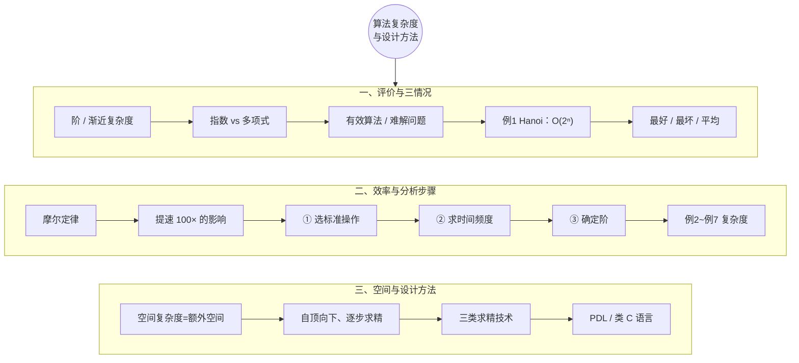
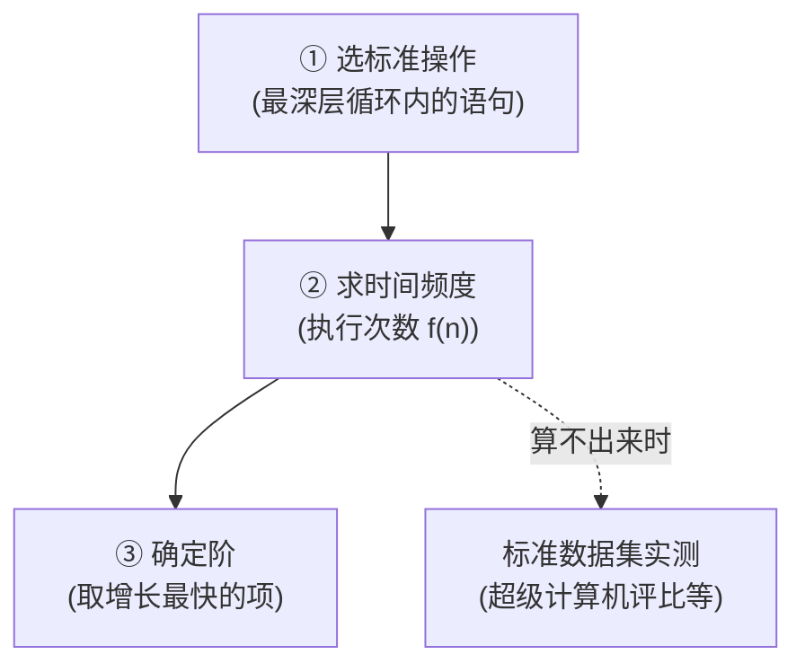
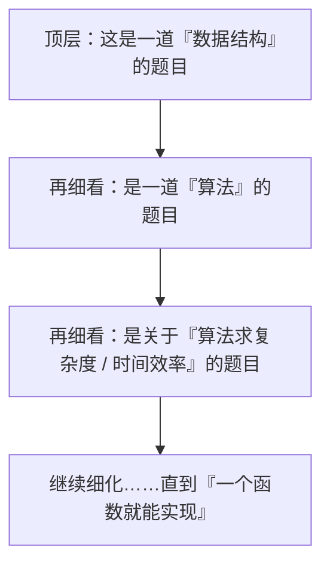

# 数据结构 · 算法复杂度与设计方法 · 详细版讲义

> **来源说明**：本讲义由两段课堂录音转写整理，并与本文件夹内教材（严蔚敏、吴伟民《数据结构（C 语言版）》，MinerU 解析版）逐节对照校订而成。它是**学习笔记性质的整理稿，不是老师的官方逐字稿**：以课堂讲授顺序和口语化讲解为主体，凡属教材补充的内容均以「📖 教材对照」标出，与课堂内容区分；录音转写中个别语句模糊处已标注"（转写存疑）"。
>
> - **音频 1**：`算法复杂度相关教学内容.m4a`（时长 49:46）
> - **音频 2**：`算法复杂度与设计方法讲解.m4a`（时长 41:47）
> - **转写工具**：faster-whisper-large-v3（GPU，float16，beam_size=5，VAD 静音过滤；批处理推理 ≈ 9.5× 实时）
> - **教材对照范围**：第 1 章 1.3（抽象数据类型的表示与实现 · 类 C 语言）、1.4（算法和算法分析：1.4.1 算法 / 1.4.2 算法设计的要求 / 1.4.3 算法效率的度量 / 1.4.4 算法的存储空间需求），以及第 3 章 3.3（栈与递归的实现 · **例 3-2 Hanoi 塔**）。
>
> **标注体例**：全文的"定义"一律单独成块、连续编号，并注明出处——`（课堂）` 表示该内容来自课堂讲授、教材未直接收录；`（教材 X.X）` 表示教材对应章节原文。**全部例题按序号（例 1 ~ 例 12）摘抄**，并注明来源（课堂原题 / 教材原例）与答案。

---

## 总览：本例知识地图



---

# 第一部分　第一次课：算法复杂度相关教学内容

## 1. 评价算法的落脚点：从"具体次数"到"阶"

老师开篇承接上一节课的评价话题：评价算法时**并不关心算法具体执行了多少次**，更关心的是这个算法执行时间的**变化趋势**——因此引入"算法复杂度"，也叫"**阶**"。

### 1.1 定义：阶与渐近时间复杂度

> **定义 1（阶 / 同阶 ｜ 课堂）**：如果我们总能找到一个常数 $k$，使得算法的执行时间**大致小于等于** $k$ 倍的 $f(n)$（前面只是一些常数系数），就认为算法执行时间与 $f(n)$ 是**同阶**的，记作 $O(f(n))$。
>
> 课堂对"阶"的白话解释：阶就是**档次、等级**——好比老师的职称（教授 / 副教授 / 讲师）、学校的层次（985 / 211 / 一般本科）、军衔的高低（上校 / 少校 / 将军），"你处于哪一个档次很重要"。虽然常说"人人平等"，但在评价算法效率时，**先看它属于哪个量级**才是关键。

> **定义 2（渐近时间复杂度 ｜ 教材 1.4.3，式 1-5）**：算法中基本操作重复执行的次数是问题规模 $n$ 的某个函数 $f(n)$，算法的时间量度记作
> $$T(n) = O(f(n)) \tag{1-5}$$
> 它表示随问题规模 $n$ 的增大，**算法执行时间的增长率和 $f(n)$ 的增长率相同**，称做算法的**渐近时间复杂度**（asymptotic time complexity），简称**时间复杂度**。

> 📖 教材对照（1.4.3）：教材指出，为了便于比较同一问题的不同算法，通常的做法是：**从算法中选取一种对于所研究的问题来说是基本操作的原操作，以该基本操作重复执行的次数作为算法的时间量度**。例如在 $N \times N$ 矩阵相乘的算法中，"乘法"是基本操作，其重复执行次数为 $n^3$，故 $T(n)=O(n^3)$。

### 1.2 常见的阶（档次）

| 阶 | 名称 | 典型情形 |
|---|---|---|
| $O(1)$ | 常量阶 | 无循环的几条语句 |
| $O(\log n)$ | 对数阶 | 规模成倍缩小 / 变量成倍增大 |
| $O(n)$ | 线性阶 | 单层循环 |
| $O(n\log n)$ | 线性对数阶 | 归并排序、快速排序（平均） |
| $O(n^2)$ | 平方阶 | 双层循环 |
| $O(n^3)$ | 立方阶 | 三层循环、矩阵相乘 |
| $O(2^n)$ | 指数阶 | Hanoi 塔、穷举子集 |

> 📖 教材对照（1.4.3）：三段程序段含基本操作"x 增 1"的语句频度分别为 **1、n、n²**，则时间复杂度分别为 $O(1)$、$O(n)$、$O(n^2)$，分别称为**常量阶、线性阶、平方阶**。算法还可能呈现**对数阶 $O(\log n)$、指数阶 $O(2^n)$** 等（教材图 1.7 "常见函数的增长率"）。教材的结论是：**应尽可能选用多项式阶 $O(n^k)$ 的算法，而不希望用指数阶的算法**。

### 1.3 定义：指数时间、多项式时间、有效算法、难解问题

> **定义 3（指数时间 ｜ 课堂）**：若一个算法的时间复杂度是 $2^n$（指数）级别的，称该算法需要**指数时间**。课堂强调：**如果你编出一个指数级运行时间的算法，一般认为你"没有解决这个问题"**——因为指数时间随问题规模 $n$ 的增大**爆炸式增长**，人们根本等不到结果。
>
> **课堂给出的唯一例外**：**加密算法**。加密恰恰要"编成指数级"的算法——指数时间意味着**很难被攻破**，这正是我们追求的目标；反之，若加密是多项式时间，别人在有限时间内就能破解，密码就失去了意义。

> **定义 4（多项式时间 ｜ 课堂）**：若时间复杂度是 $n^k$（$k$ 为有理数），称该算法需要**多项式时间**。它是实际应用中追求的目标——"多项式的话往往你还能等一等"。

> **定义 5（有效算法 ｜ 课堂，教材未收录）**：如果一个算法能找到**以多项式时间为界限的时间上界**，则称这个算法是**有效算法**。课堂点题："实际上谈的就是这个算法从实际应用角度**有没有现实意义、有没有应用价值**。"

> **定义 6（难解算法 / 难解问题 ｜ 课堂，教材未收录）**：如果一个问题**不存在以多项式时间为界限的算法**，则称这个算法是**难解的**，整个问题称为**难解性问题**。
>
> 课堂的通俗理解：从计算机的角度看，这类问题"**就认为它解不出来**"——哪怕找到了一个解法，但它是指数级别的，人们照样等不到结果，**没有实际应用价值**；课堂进一步把它类比为以前讲过的"**科学问题**"。

> ⚠️ **注意**：定义 3 ~ 定义 6（指数/多项式时间、有效算法、难解问题）是课堂为说明"复杂度评价的现实意义"而作的补充，属**理论计算机科学（计算复杂性）**范畴，**严蔚敏教材第一章并未收录**；后续开设的《算法设计与分析》及更深的计算复杂性课程会系统讨论。

---

## 例题 1：Hanoi 塔问题（2ⁿ 级复杂度的典型）【课堂 + 教材例 3-2】

> **例 1（Hanoi 塔 ｜ 课堂讲授 + 教材例 3-2 原文摘抄）**
>
> 假设有 3 个分别命名为 X、Y 和 Z 的塔座，在塔座 X 上插有 n 个直径大小各不相同、依小到大编号为 $1,2,\cdots,n$ 的圆盘（教材图 3.5 为 3 阶 Hanoi 塔问题的初始状态）。现要求将 X 轴上的 n 个圆盘移至塔座 Z 上并仍按同样顺序叠排，圆盘移动时必须遵循下列规则：
> (1) 每次只能移动一个圆盘；
> (2) 圆盘可以插在 X、Y 和 Z 中的任一塔座上；
> (3) 任何时刻都不能将一个较大的圆盘压在较小的圆盘之上。

### 1.1 课堂的思路分解

把"从 A 塔把 n 个盘子挪到 B 塔"分解为**两部分**：下面 1 个盘子 + 上面 $n-1$ 个盘子。做法是：

1. 先"不择手段"地把上面 $n-1$ 个盘子**从 A 借助 B 挪到 C**——设解决规模为 $n$ 的问题耗时为 $T(n)$，这一步耗时 $T(n-1)$；
2. 把最底下那个盘子从 A 挪到 B——这一步是 $O(1)$；
3. 再把 C 上的 $n-1$ 个盘子**借助 A 挪到 B**——又耗时 $T(n-1)$。

于是得到递推式：

$$T(n) = 2T(n-1) + O(1)$$

逐层展开（$T(0)=0$）：

$$T(n) = 2T(n-1)+1 = 2\big(2T(n-2)+1\big)+1 = \cdots = 2^n - 1 = O(2^n)$$

> **定义 7（Hanoi 递推 ｜ 课堂）**：$T(n)=2T(n-1)+O(1) \Rightarrow T(n)=O(2^n)$——**课堂结论：这是一个指数级（$2^n$）的算法，"非常非常大"**。

### 1.2 教材对照：例 3-2 与算法 3.5 原文

> 📖 教材对照（3.3 栈与递归的实现 · 例 3-2）：当 $n=1$ 时，只需将编号为 1 的圆盘从塔座 X 直接移至塔座 Z；当 $n>1$ 时，需利用塔座 Y 作辅助塔座，若能设法将压在编号为 $n$ 的圆盘之上的 $n-1$ 个圆盘从塔座 X（依照上述法则）移至塔座 Y 上，则可先将编号为 $n$ 的圆盘从塔座 X 移至塔座 Z 上，然后再将塔座 Y 上的 $n-1$ 个圆盘（依照上述法则）移至塔座 Z 上。而"如何将 $n-1$ 个圆盘从一个塔座移至另一个塔座"是**与原问题具有相同特征属性、只是规模小 1** 的问题，因此可以用同样的方法求解。
>
> ```c
> void hanoi (int n, char x, char y, char z)
>     // 将塔座 x 上按直径由小到大且自上而下编号为 1 至 n 的 n 个圆盘按规则搬到
>     // 塔座 z 上，y 可用作辅助塔座。
>     // 搬动操作 move(x, n, z) 可定义为 (c 是初值为 0 的全局变量，对搬动计数)：
>     // printf("%i. Move disk %i from %c to %c\n", ++c, n, x, z);
> 1 {
> 2    if (n == 1)
> 3       move(x, 1, z);      // 将编号为 1 的圆盘从 x 移到 z
> 4    else {
> 5       hanoi(n-1, x, z, y);   // 将 x 上编号为 1 至 n-1 的圆盘移到 y, z 作辅助塔
> 6       move(x, n, z);         // 将编号为 n 的圆盘从 x 移到 z
> 7       hanoi(n-1, y, x, z);   // 将 y 上编号为 1 至 n-1 的圆盘移到 z, x 作辅助塔
> 8    }
> 9 }
> ```
> —— **算法 3.5**（教材 3.3 节）
>
> 教材指出：Hanoi 塔问题"虽然问题本身没有明显的递归结构，但**用递归求解比迭代求解更简单**"（教材 3.3 节列举的第三类递归问题，同类的还有八皇后问题）。

### 1.3 64 个盘子到底要多久（课堂估算）

课堂设问：主流 CPU 频率是 G 赫兹级，约对应每秒执行 $10^9$ 次加法。若把 $2^{64}$ 代进去：

$$2^{64}-1 \approx 1.84 \times 10^{19} \ \text{次移动} \quad \Rightarrow \quad \frac{1.84\times10^{19}}{10^9 \ \text{次/秒}} \approx 1.84\times10^{10}\ \text{秒} \approx 585\ \text{年}$$

> ⚠️ **转写存疑**：课堂此处转写为"也要搬成 **1840 多年**"，与上述以 $10^9$ 次/秒计算出的约 **585 年**不完全吻合。若按"**每秒只移动 1 次**"的经典口径，则为 $1.84\times10^{19}$ 秒 $\approx 5.85\times10^{11}$ 年（**约 5845 亿年**）。两种口径下课堂数字都对不上，疑为转写误差，**此处以公式推导为准**。
>
> **课堂结论**：哪怕用现在的计算机，"人类也根本等不到"——这就是指数时间的可怕。

---

## 2. 计算机越来越快，还需要好算法吗？

课堂抛出疑问："计算机速度发展这么快，我编的算法是不是不需要考虑效率了？"——答案是**根本不是**。

### 2.1 摩尔定律

> **定义 8（摩尔定律 ｜ 课堂）**：计算机芯片**每 18 个月性能（或集成度）翻一番**。课堂指出：统计表明实际发展速度**比摩尔定律预测的还要快**（"打破了摩尔定律"）。

### 2.2 两个侧面的数据（课堂数据 + 教材图 1.7）

**侧面一：当规模 n 增大时（按每秒 $10^9$ 次基本操作估算）**

| 问题规模 n | $n^2$ | $2^n$ |
|---|---|---|
| 20 | $400\ \text{ns} = 0.4\ \mu s$ | $2^{20} \approx 10^6\ \text{ns} \approx 1\ \text{ms}$ |
| 1000 | $10^6\ \text{ns} = 1\ \text{ms}$ | $2^{1000}/10^9 \approx 10^{292}\ \text{秒} \approx 10^{283}\ \text{年}$ |

课堂点评：规模小时两者"差得也不多"，但规模一大（n=1000），$n^2$ 还在毫秒级，$2^n$ 已经变成 $10^{283}$ 年级别——"**你这个计算机的那一点点速度提高，对你的算法如果设计得很糟糕，根本没用**"，好比"蚍蜉撼大树"。这正对应教材**图 1.7 常见函数的增长率**那条陡得可怕的 $2^n$ 曲线。

**侧面二：机器提速 100 倍/1000 倍，对"可解规模"的影响**

| 复杂度 | 机器提速 100 倍后，单位时间可解规模 |
|---|---|
| $O(n^2)$ | 规模提高 $\sqrt{100}=10$ 倍（因为要开根号） |
| $O(2^n)$ | 规模只增加一个**常数** $\log_2 100 \approx 6.6$——"**相当于忽略，根本没用**" |

> **课堂结论**：即使计算机发展非常快，也**不会削弱我们对算法优化的迫切需求**——因为机器的增长速度**远远赶不上**一个坏算法带来的崩溃性影响。

> 📖 教材对照（1.4.3）：教材以两个 $10\times10$ 矩阵相乘与 $31\times31$ 矩阵相乘为例，说明**事前估算和事后统计两种办法可以结合**：若 $10\times10$ 矩阵相乘实测 $12\text{ms}$，由 $T(n)=O(n^3)$ 可估算 $31\times31$ 需
> $$\left(\frac{31}{10}\right)^3 \cdot 12\text{ms} \approx 358\text{ms}$$

---

## 3. 最好情况、最坏情况与平均情况

### 3.1 定义

> **定义 9（平均时间复杂度 ｜ 教材 1.4.3）**：对输入相关的算法，一种解决办法是**计算它的平均值**，即考虑它对**所有可能的输入数据集的期望值**，此时相应的时间复杂度为算法的**平均时间复杂度**。
>
> 📖 课堂补充：平均情况复杂度又叫**期望复杂度**，本质上要求**加权平均**——即"各种概率、各种实际情况都要进行考量"。但加权平均**数学上几乎弄不出来**（要考虑上场时间、站位、对手强弱、队友强弱……太多因素），因此工程上通常退化为**算术平均**（"上场十次，每场得分加起来除以十"）。**算法的好坏往往用平均性能（算术平均）来衡量**；有的算法连平均性能都求不出来（"数学家来整也整不出来"）。

> **定义 10（最坏时间复杂度 ｜ 教材 1.4.3）**：分析**最坏情况**以估算算法执行时间的一个**上界**，即为算法的最坏情况时间复杂度。**本书以后各章讨论的时间复杂度，除特别指明外，均指最坏情况下的时间复杂度。**

### 3.2 课堂的比喻

- **最好情况没有现实意义**："好比篮球历史上科比一场刷了 **81 分**，可他这一辈子就搞了这么一次，再也不会出现——那你说这个最好情况有啥用？"
- **最坏情况必须考虑**："你是教练，某个球员有可能受伤、有可能上不了场、有可能不在状态——**这个后果你能不能承受？**"现实中，买 CPU 要买**正品**而不是**合格品**，区别就在**峰值（满负荷运转）**时：正品稳定不出问题，等级低的有可能"烧穿"——**最坏情况在现实中有很大的意义**。
- **平均情况是综合考量**："我也不是说只看你受伤完全不能上场，而是**综合考量你的实力**，用平均情况来考察。"

> 📖 教材对照（1.4.3，起泡排序）：以"交换序列中相邻两个整数"为基本操作——
> - 初始序列**自小至大有序**：基本操作执行 **0 次**（最好情况）；
> - 初始序列**自大至小有序**：基本操作执行 **$n(n-1)/2$ 次**（最坏情况）；
> - 假设 $n!$ 种排列概率相等，则**平均**时间复杂度 $T_{avg}(n)=O(n^2)$；
> - 但**各种输入数据集出现的概率往往难以确定**，故教材采用**最坏情况**口径。

---

## 4. 课堂延伸：安迪-比尔定律与"不要过度超前"

> **定义 11（安迪-比尔定律 ｜ 课堂，教材未收录）**：安迪（Andy Grove，英特尔 CEO）不断推出更快的芯片，比尔（Bill Gates，微软 CEO）的软件随即升级换代、**把硬件新增的性能全部吃掉**——结果用户"压根享受不到"硬件提升的收益。

**课堂例证**：

- 四五年一换的电脑，CPU、内存、硬盘全是新的，但运行 Office 之类软件"**速度没啥区别**"——因为软件把新增性能吃掉了；
- 手机开着没上网、没跑程序，过一晚流量却"蹭蹭蹭往下掉"——后台一堆程序在跑（定位、欢迎短信等）；
- **Vista 案例**：当年微软宣传"划时代产品"Vista，装上后"运行速度还不如原来的"——因为内置了大量华而不实（图形图像）的东西；后来的 **Win7 其实就是 Vista 的精简版**。

> **课堂告诫**：做软件设计**不要过分强调"超前功能"**，要**适可而止**、以用户角度规划。竞争压力（招投标）下容易一股脑堆功能，"结果用户压根用不上"，对用户非常不友好。

---

## 5. 复杂性分析的三个步骤

> **定义 12（三步骤 ｜ 课堂）**：分析时间复杂度"只需要知道它是在哪一个级别就可以"，具体分三步：
> ① **根据问题的特点，合理选择一种（或几种）标准操作**；
> ② **确定每个算法在给定输入下总共执行了多少次**（即求出具体的时间频度）；
> ③ **确定它的阶**（有了次数函数之后，取增长最快的项）。

> **定义 13（标准操作 / 基本操作 ｜ 教材 1.4.3）**：从算法中选取一种**对于所研究的问题（或算法类型）来说是基本操作的原操作**，以该基本操作重复执行的次数作为算法的时间量度。
>
> 课堂白话："标准操作就是**有代表性的、它最频繁做的、耗费时间最长的那个操作**"——例如"过循环里面的那个语句"；"多数情况下它是**最深层循环内**的语句"。

> **定义 14（频度 ｜ 教材 1.4.3）**：**语句的频度（frequency count）指的是该语句重复执行的次数。**
>
> 课堂补充：当频度函数**算不出来**（"最顶尖的数学家也搞不出来"）时怎么办？——用**标准数据集**实测：好比**超级计算机的评比**（一台 1 万 CPU/6T 内存、一台 4 万 CPU/1T 内存，"啥都不一样"，没法直接比参数），办法是**拿一个最能说明性能的标准数据集跑一遍**，2.1 小时对 2 小时，谁快谁赢。图像处理领域同样如此（标准数据集是"一张戴着草帽的女孩"的图片），"以数据说明我的运行花了多少时间，和前人的论文工作直接对比"。



---

## 例题 2：教材 1.4.3 三段程序段的频度【教材原例】

> **例 2（教材 1.4.3 原文摘抄）**　在下列 3 个程序段中：
> ```txt
> (a) {++x; s = 0; }
> (b) for (i = 1; i <= n; ++i) {++x; s += x;}
> (c) for (j = 1; j <= n; ++j)
>         for (k = 1; k <= n; ++k) {++x; s += x;}
> ```
> 含基本操作"x 增 1"的语句的频度分别为 **1、n 和 $n^2$**，则这 3 个程序段的时间复杂度分别为 $O(1)$、$O(n)$ 和 $O(n^2)$，分别称为**常量阶、线性阶和平方阶**。

---

## 例题 3：教材 1.4.3 "只需求增长率"的嵌套循环【教材原例】

> **例 3（教材 1.4.3 原文摘抄）**　在下列程序段中：
> ```txt
> for (i = 2; i <= n; ++i)
>     for (j = 2; j <= i - 1; ++j) { ++x; a[i][j] = x; }
> ```
> 语句 `++x` 的执行次数关于 $n$ 的增长率为 $n^2$，它是语句频度表达式 $(n-1)(n-2)/2$ 中**增长最快的项**。

**课堂的对应分析**（三步骤②的示范）：$i=2$ 时内层执行 0 次，$i=3$ 时 1 次，…，$i=n$ 时 $n-2$ 次，求和得

$$0+1+\cdots+(n-2) = \frac{(n-1)(n-2)}{2} \;\Rightarrow\; \text{取增长最快项} \; n^2 \;\Rightarrow\; O(n^2)$$

---

## 例题 4：三层嵌套循环的频度【课堂例题】

> **例 4（课堂例题 ｜ 原题转写）**　分析下列三层循环中循环体语句的执行次数，并给出时间复杂度：
> ```c
> for (i = 1; i <= n; ++i)
>     for (j = 1; j <= i; ++j)
>         for (k = 1; k <= j; ++k)
>             x = x + 1;          // 标准操作
> ```

**课堂解法（求和法）**：外层 i 每取一个值，内两层构成的等腰三角共执行

$$1+2+3+\cdots+i = \frac{i(i+1)}{2} \ \text{次}$$

再对 i 求和：

$$\sum_{i=1}^{n}\frac{i(i+1)}{2} = \frac{1}{2}\left(\sum_{i=1}^n i^2 + \sum_{i=1}^n i\right) = \frac{1}{2}\left[\frac{n(n+1)(2n+1)}{6} + \frac{n(n+1)}{2}\right] = \frac{n(n+1)(n+2)}{6}$$

> **答**：频度为 $\dfrac{n(n+1)(n+2)}{6}$，取增长最快项得 $n^3$，故 **$T(n)=O(n^3)$**。
>
> （课堂原话："第 i 次的时候它需要做 $1+2+3$ 一直加到 i……最终得到一个 $\frac{k^2}{2}+\frac{k}{2}$ 的求和，算下来前面这个就是 $\frac{n(n+1)(2n+1)}{6}$"——与上式一致。）

---

## 例题 5：变量成倍增大的单层循环【课堂例题（选择题）】

> **例 5（课堂例题 ｜ 原题转写，选项转写存疑）**　下列算法的时间复杂度是多少？
> ```c
> i = 1;
> while (i <= n)
>     i = i * 2;          // 标准操作
> ```
> A. $O(n)$　　B. $O(n^2)$　　C. ……（转写不清）　　D. ……（转写不清）

**课堂解法**：标准操作是 `i = i * 2`。

| 轮次 | i 的取值 | 是否满足 i ≤ n |
|---|---|---|
| 第 1 轮 | 1 | 满足 → 执行，i 变为 2 |
| 第 2 轮 | 2 | 满足 → 执行，i 变为 2² |
| 第 3 轮 | 2² | 满足 → 执行，i 变为 2³ |
| … | … | … |
| 第 k+1 轮 | $2^k$ | 若 $2^k \le n$ 仍执行，i 变为 $2^{k+1}$ |

设执行了 $k$ 次后 $2^{k+1} > n$ 而跳出，则 $2^{k} \le n$，即

$$k \le \log_2 n$$

> **答**：标准操作约执行 $\log_2 n$ 次，故 **$T(n)=O(\log n)$**（对数阶）。
>
> ⚠️ **转写存疑**：课堂先有一处转写为"选 A"、后文又说"正确答案是 B"，两处矛盾，应是 ASR 误记。**按文中的完整推导，正确答案是 $O(\log n)$**；此处以推导为准。

> **课堂提炼的方法（重要）**：判断这类循环看"**变量如何变化**"——变量**成倍增大**（`i*=2`）或**成倍缩小**（`n/=2`）时，循环次数都是 **$O(\log n)$**。

---

## 例题 6：递归函数的时间复杂度（选择题）【课堂例题】

> **例 6（课堂例题 ｜ 原题转写）**　下列函数代码的时间复杂度是多少？
> ```c
> int f(int n) {
>     if (n == 1) return 1;
>     else return 2 * f(n / 2) + n;
> }
> ```
> A. $O(n)$　　B. $O(n\log n)$　　C. $O(\log n)$　　D. $O(n^2)$

**课堂分析思路**：递归算法"一般**分析它的递归调用次数（递归深度）就可以了**"——因为递归涉及**压栈、退栈**，"它的时间往往比较长"，乘除法、加减法等算术操作可以忽略。

$$n \to \frac{n}{2} \to \frac{n}{4} \to \cdots \to \frac{n}{2^k} = 1 \;\Rightarrow\; k = \log_2 n \quad(\text{递归深度 } \log_2 n)$$

> **答**：$T(n)=2T\left(\dfrac{n}{2}\right)+n$。按**主定理**：$a=2,\ b=2,\ \log_b a = 1$，即 $f(n)=n=\Theta(n^{\log_b a})$，属第二类情形，故 **$T(n)=O(n\log n)$**；选 **B**。
>
> 📌 课堂只点出"递归深度是 $\log n$"，**关键还在于每层把问题分成了 2 份**（系数 2）——正是这个系数贡献了额外的 $\log n$ 因子。$T(n)=\log n$ 只是"层数"，真正的量级要用递归式（主定理/递归树）求解。
>
> **课堂末尾的对比提醒**：如果递归式变成 $T(n)=T\left(\dfrac{n}{2}\right)+n$（前面**没有系数 2**），那结果**就不一样了**（由主定理第三类情形得 $O(n)$），必须用递归式方法单独求解，不能照搬。
>
> **课堂补充（转写存疑）**：还提到"阶乘"型递推 $T(n)=T(n-1)\times n$ 的情形，其复杂度为 $O(n)$。

---

## 6. 关于 $\log_2 n$ 常被写成 $\log n$

> **课堂解释（转写整理）**：为什么很多书和题目把 $\log_2 n$ 直接写成 $\log n$？
> 因为考察复杂度时**抓主要矛盾**即可：$\log_2 n$、$\log_{10} n$、$\log_a n$ 之间只相差一个**常数因子**（换底公式 $\log_a n = \dfrac{\log_2 n}{\log_2 a}$），而常数系数在 $O$ 记号下**可以忽略**——"换个系数无所谓"。

$$\log_2 n = \frac{1}{\log_2 10}\cdot \log_{10} n \quad\Rightarrow\quad O(\log_2 n)=O(\log_{10} n)=O(\log n)$$

---

# 第二部分　第二次课：复杂度（续）与算法设计方法

## 7. 例题 7：外层成倍、内层线性的双层循环【课堂例题】

> **例 7（课堂例题 ｜ 原题转写）**　分析下列算法的时间复杂度：
> ```c
> for (i = 1; i <= n; i *= 2)
>     for (j = 0; j < i; ++j)
>         sum = sum + i * j;      // 标准操作
> ```

**课堂解法（"外层每个取值求内层次数，再求和"）**：

| 外层 i | 内层 j 的执行次数 |
|---|---|
| 1 | 1 次（j=0） |
| 2 | 2 次（j=0,1） |
| 4 | 4 次（j=0,1,2,3） |
| … | … |
| $2^k$（$2^k\le n$） | $2^k$ 次 |

总次数为等比数列求和（首项 $a_1=1$，公比 $q=2$）：

$$\sum_{m=0}^{k} 2^m = \frac{1\cdot(2^{k+1}-1)}{2-1} = 2^{k+1}-1$$

又 $2^k \le n < 2^{k+1}$，故 $2^{k+1}-1 < 2n-1$。

> **答**：频度约为 $2n-1$，故 **$T(n)=O(n)$**（线性阶）。
>
> ⚠️ **注意**：**外层是对数级、内层是线性级，乘起来却不一定是 $O(n\log n)$**——因为内层规模本身在倍增，求和后是等比级数，结果收敛到 $O(n)$。这与"外层 n 次、内层 n 次"的 $O(n^2)$ 不同，**必须按求和/等比公式算，不能想当然相乘**。

> **课堂强调的分析方法**："对于外层循环的每个值 i，你求出内层（执行）的次数 $s_i$，然后**求和**"——与例 4 的三层循环"一样的、类似的道理"。

---

## 8. 算法比较的前提与空间复杂度

### 8.1 算法依赖于逻辑结构与存储结构

课堂回顾（与第一章呼应）：**算法定义在逻辑结构上，但算法的具体实现要依赖于存储结构**。

**"图书馆借书"类比**：我让你去图书馆把同一本书拿来——书放在**一楼**还是放在**五楼**，具体走的路线、耗的能量完全不同。所以：**一旦一个问题给出了算法，就意味着它的逻辑结构确定、存储结构也一定已经确定下来了。**

### 8.2 比较算法的前提：存储结构相同

**课堂反例**：A 算法用**线性（数组）存储结构**算 N 个人的工资，B 算法用**链表存储**算 N 个人的工资——"这两玩意还能比较吗？**不能**，存储结构不一样，就好比 A 是动物、B 是植物，拿他俩比较没有意义"。

> **定义 15（比较前提 ｜ 课堂）**：**算法比较的前提条件是存储结构相同**。

### 8.3 空间复杂度只算"额外空间"

> **定义 16（空间复杂度 ｜ 教材 1.4.4，式 1-6）**：以**空间复杂度**（space complexity）作为算法所需存储空间的量度，记作
> $$S(n) = O(f(n)) \tag{1-6}$$
> 其中 $n$ 为问题的规模（或大小）。

> 📖 教材对照（1.4.4）：一个上机执行的程序除了需要存储空间来寄存本身所用指令、常数、变量和输入数据外，也需要一些对数据进行操作的**工作单元**和存储一些为实现计算所需信息的**辅助空间**。**若输入数据所占空间只取决于问题本身、和算法无关，则只需要分析除输入和程序之外的额外空间**，否则应同时考虑输入本身所需空间。
>
> **若额外空间相对于输入数据量来说是常数，则称此算法为原地工作**（第 10 章讨论的有些排序算法就属于这类）。

> **定义 17（原地工作 ｜ 教材 1.4.4）**：额外空间相对于输入数据量来说是**常数**的算法，称做**原地工作**。

**课堂解释（为什么只算额外空间）**：不管 A 还是 B，算 N 个人的工资都得把这 N 个数据装载到内存里（约 N 个单元），"**这一部分存储空间大家都一样，那就没有比的必要性了**"。所以空间复杂度强调的是**额外的、附加的存储空间**。

### 8.4 例题 8：交换两个数需要多少"额外空间"

> **例 8（课堂例题 ｜ 空间复杂度类比题）**　要把左右两只手里的两个粉笔互相交换，需要多少额外的存储空间？

**课堂解法**：

- **小孩**（"不太厉害"）：只能**借助第三只手**——先把一个放到第三个位置，再把另一个挪过来，最后把第一个挪回去。**需要 1 个额外的存储单元**（临时变量 `t`：`t=a; a=b; b=t;`）。
- **大人**（"会玩杂耍"）：两只手一倒腾就交换了，**不需要额外的存储单元**。

> **答**：同一问题，小孩的算法**空间复杂度为 $O(1)$ 个额外单元（非原地工作的极端说法）**，大人的算法**不需要额外空间（原地工作）**——这就是"额外空间"的实际含义。
>
> 课堂另举一例：打印输出 N 个数要用循环，循环变量 `i`、`n` 等就是**额外的存储量**（除此之外，数据本身占用的空间不计入）。

---

## 9. 算法设计方法：自顶向下，逐步求精

> **定义 18（自顶向下、逐步求精 ｜ 课堂，教材未收录）**：设计一个好的算法，要**从系统的、科学的角度**全面综合地考察问题，把复杂问题**切分成若干相对明确的子问题**，再把每个子问题**不断细化**，直到"**用一个函数就能搞定**"为止。这八个字就是——**自顶向下，逐步求精**。
>
> 课堂指出：这就是所谓的**结构化程序设计**思想。**面向对象**并非不需要结构化——它只是**封装的力度更大**：结构化程序设计（如 C 语言）的复用单位是**函数**；面向对象的复用单位是**类**，类把**数据**和**操作数据的函数**封装成一个整体。**设计理念依然是"逐步求精"。**

### 9.1 顶层 = 对问题全貌的抽象

课堂以"学习通上发布的作业"为例演示逐步求精：



### 9.2 求精的三类技术

> **定义 19（求精技术 ｜ 课堂）**：求解问题的常用技术有三类——
> ① **分而治之**：把问题拆分成一些**不相交**的部分，每一部分依次解决；
> ② **做出有限进展**：解决方法有、但**何时解决不明确**，每做一步就更接近目标；
> ③ **情况分析**：问题**有多种方案**，逐一分析每种方案，再选择适当的方案。

**① 分而治之**

- 课堂类比"**孙子兵法：各个击破**"——"咋紧咋紧，拦腰截断，各个击破"。
- 例子：给企业做信息化管理，可以把**财务、人事、生产、销售**各自独立成一个模块分别解决；但**还要把各模块之间的联系、数据交换关系搞清楚**。
- 课堂强调本专业的难点：做银行信息管理系统，光熟悉业务还不够，**要"比银行的经理专家还专业"**，还要**充分了解用户需求、跟人打交道**——"跟人打交道是很难的一件事"。

**② 做出有限进展**

- 类比一：**社会主义的终极目标是共产主义**——"方法有、指导思想有，只不过**哪年哪月能实现不知道**，但每提高一个档次就离它更近一步"。
- 类比二：**求圆的面积**——先求内接三角形面积（差得远）、再求四边形（更近一步）、再求正五边形……当**正 N 边形**的 N 不断增大时，越来越逼近圆的面积。

**③ 情况分析**

- 类比：大四面临"**工作还是考研**"——逐一分析两条路，再选择。课堂算了一笔账：普通工作月薪约 5000（一年 6 万），读研不但不赚钱还要交学费（"倒贴钱"）；但研究生毕业、工作到第五个年头，"**差距一下就拉开了**——更有成长、更有发展前景"。
- 课堂引申："**知识就是力量，通俗点说知识就是金钱**"——到了专家级别，一场报告一小时就能有可观收入。

### 9.3 "细节决定成败"要辩证看

课堂提醒：中国有本畅销书叫《细节决定成败》，这句话**也对也不对**——

- **不在同一个等级谈细节没有意义**：篮球比赛前把 NBA 球星请来一起训练、研究战术，**细节做到极致**，一上场**照样打不过**；摔跤比赛里，**50 公斤级**的选手碰**80 公斤级**，**性质（技巧）做得再好也不行**；十八九岁的小伙子打三岁小娃娃，"**不是同一个数量级**"。
- **但同等级下，细节就能决定胜负**。

> **课堂结论**：一切都以**"在同一个数量级/等级"**为前提——这与本节的复杂度"阶"是同一思想。

> 📖 教材对照（1.4.2 算法设计的要求）：教材把"好算法"的标准列为 **①正确性（含 4 个层次，一般以第 c 层"精心选择的典型、苛刻而带有刁难性的几组输入数据"作为合格线）；②可读性；③健壮性；④效率与低存储量需求**。课堂的"逐步求精"正是落实这些要求的设计方法论；课堂讲"可读性"时反复强调的"算法主要是为了人的阅读与交流"与教材表述完全一致。
>
> 教材还指出：**效率与低存储量需求都与问题的规模有关**——"求 100 个人的平均分与求 1000 个人的平均分，所花的执行时间或运行空间显然有一定的差别"。

### 9.4 算法设计的基本技术（课堂略讲）

课堂说明：具体的算法设计技术还有**贪心法、分支限界法、回溯法**等，"它们是从某个角度来解决问题的一些技巧"。本课程以**基本数据结构和基本的数据模型**为主，这一块讲得较少；若对**高阶算法设计**感兴趣，可在后续的**《算法设计与分析》**课程中深入学习。

---

## 10. PDL 语言与类 C 语言

### 10.1 PDL 的定义

> **定义 20（PDL ｜ 课堂）**：PDL（Program Design Language，程序设计语言，也称**伪码**）——**保留计算机程序设计语言的框架（骨架）及其描述形式，去掉其特异性和细节要求，再结合自然语言，用来描述算法处理逻辑的语言**。它**介于自然语言与具体的程序设计语言之间**。
>
> 课堂对"特异性"的类比：**"有中国特色的社会主义"——中国有、别人没有的那些特异的东西要去掉**；保留骨架，再结合自然语言。

> **定义 21（类 C 语言 ｜ 教材 1.3）**：抽象数据类型可通过固有数据类型来表示和实现。由于本书在高级程序设计语言的**虚拟层次**上讨论抽象数据类型的表示和实现，故采用**介于伪码和 C 语言之间的类 C 语言**作为描述工具，有时也用伪码描述一些只含抽象操作的抽象算法——"既简明清晰、不拘泥于 C 语言的细节，又容易转换成 C 或 C++ 程序"。

> 📖 教材对照（1.3 类 C 语言要点）：
> (1) **预定义常量和类型**：`TRUE 1 / FALSE 0 / OK 1 / ERROR 0 / INFEASIBLE -1 / OVERFLOW -2`，`typedef int Status;`
> (2) **存储结构用 typedef 描述**；数据元素类型约定为 `ElemType`；
> (3) 基本操作用函数描述；**以 `&` 打头的参数为引用参数**（除输入外还回传结果），返回状态码时函数定义为 `Status` 类型；
> (4) 赋值语句含**简单赋值、交换赋值（`↔`）、条件赋值**；
> (5)–(6) 选择语句、循环语句的书写规范；
> (7)–(11) 其他约定（数组、输入输出、注释等）。
>
> 教材中类 C 语言的完整实现范例见 **例 1-7 抽象数据类型 Triplet 的表示和实现**（1.3 节）。

> **定义 22（PDL 的历史 ｜ 课堂，转写存疑）**：PDL 最早可认为由（"写数据结构那个鼻祖"）提出，其最大贡献是**用介于自然语言与汇编语言之间的混搭风格来描述算法**。当 PDL 与某种计算机语言接近程度较高时，就称之为"**类 XX 语言**"——例如 **类 C**（"像 C 但不是 C"）、**类 C++**（"像 C++ 但不是 C++"）。
>
> ⚠️ **转写存疑**：课堂此处人名转写不清，未在讲义中臆断具体姓名；PDL 的通行定义（Caine & Gordon，1975）超出本课范围。

### 10.2 PDL 的优势

> **定义 23（PDL 的优势 ｜ 课堂）**：
> ① **表达能力强**：具有关键字的固定语言，同时提供**结构化控制结构、数据说明及模块化**的特点；
> ② **结构化**：即"三类语句"——**顺序、分支（选择）、循环**；
> ③ **书写符合自然语言的表达习惯**：结构清晰、简单、口语化；
> ④ **易读性好**：编出的代码，"搞音乐的、搞艺术的都要看得懂"；
> ⑤ **易于转化为任何一种程序设计语言的代码**：把设计思想用 PDL 描述出来，用专门的**代码生成工具**（乃至自己训练一个机器人）即可生成代码。

**课堂的两种语言观**：

- **"拿着问题选语言"**（与第一章呼应）：面临什么问题、就选擅长解决该问题的语言，**千万不能一门语言打天下**；
- **"语言很简单，难在设计"**：学一门语言"最多给你三天时间就够了"，"两个课程不到、90 分钟就把 PDL 语言讲完"——**难的是思路、是设计**。"好比在座的都会说中文，但有几个人能写出好的散文、好的诗歌？**设计与创作讲究的是思路**。"

**为什么算法描述不用具体程序设计语言（易读性）**：

- 你跟用户打交道时，用户根本**看不懂**你那个代码；"你让用户先去学一遍 C，可能吗？"
- **开汽车类比**：大家都要学开车，但**不必先把汽车怎么造、原理学一遍**——"汽车就是个代步工具，我只要拿来能开就行"。
- 所以算法描述要**易读**：**"搞艺术的、搞中文的都得看得懂"**——这正是选用 PDL/类 C 而不是具体语言的原因。

---

# 附录一：课堂内容与教材章节对照表

| 课堂内容 | 对应教材 | 备注 |
|---|---|---|
| 阶 / 同阶的直观解释 | 1.4.3（式 1-5 渐近时间复杂度） | 课堂用"职称/学校档次"打比方 |
| 常见阶：常量/对数/线性/平方/立方/指数 | 1.4.3 + 图 1.7 | 教材原文列举 |
| 指数时间 / 多项式时间 | —— | **课堂补充**（计算复杂性概念） |
| 有效算法 / 难解问题 | —— | **课堂补充**，教材未收录 |
| 例 1 Hanoi 塔 + $T(n)=2T(n-1)+1$ | **例 3-2、算法 3.5（3.3 节）** | 教材按"递归求解比迭代简单"归类 |
| 64 盘估算（585 年 / 5845 亿年） | —— | 课堂估算，转写存疑，公式为准 |
| 摩尔定律 / 安迪-比尔定律 | —— | 课堂延伸话题 |
| n=20 / n=1000 的增长对比 | 图 1.7 | 课堂据图 1.7 口算 |
| 提高机器 100 倍对可解规模的影响 | 1.4.3（事前分析思路） | 课堂定量推演 |
| 最好 / 最坏 / 平均时间复杂度 | 1.4.3（起泡排序例） | 教材默认**最坏情况**口径 |
| 标准操作（基本操作）/ 频度 | 1.4.3 | 教材原文定义 |
| 复杂性分析三步骤 | 1.4.3 | 课堂归纳的实操步骤 |
| 例 2、例 3（三段程序、嵌套循环） | 1.4.3 | **教材原例**，原文摘抄 |
| 例 4 三层循环、例 5 `i*=2`、例 6 递归、例 7 双层 | —— | **课堂例题** |
| 空间复杂度 $S(n)=O(f(n))$、原地工作 | 1.4.4（式 1-6） | 课堂强调"只算额外空间" |
| 算法比较前提：存储结构相同 | 1.2 / 1.4.3（"算法实现依赖存储结构"） | 课堂"图书馆一楼/五楼""动物 vs 植物"类比 |
| 自顶向下、逐步求精 / 三类求精技术 | —— | **课堂补充**；其目标呼应教材 1.4.2 |
| 正确性 / 可读性 / 健壮性 / 效率 | 1.4.2 | 课堂讲可读性、健壮性与之一致 |
| PDL / 类 C 语言 | 1.3（含**例 1-7 Triplet**） | 课堂用"伪码、类 C"对应 |
| "拿着问题选语言"、论文正文不贴代码 | 1.3（类 C 作为描述工具） | 与第一章课堂一致 |

---

# 附录二：例题总清单（按序号，含来源与答案）

| 序号 | 题目 | 来源 | 核心考点 | 答案 / 复杂度 |
|---|---|---|---|---|
| 例 1 | Hanoi 塔问题（n 个圆盘三步规则） | 课堂 + **教材例 3-2、算法 3.5** | 递归递推式 | $T(n)=2T(n-1)+1$，$T(n)=O(2^n)$ |
| 例 2 | 三段程序段（`{++x;s=0;}`、单层、双层） | **教材 1.4.3** | 频度 | $O(1)$、$O(n)$、$O(n^2)$ |
| 例 3 | `for(i=2..n) for(j=2..i-1) ++x;` | **教材 1.4.3** | 只需求增长率 | $(n-1)(n-2)/2 \Rightarrow O(n^2)$ |
| 例 4 | 三层嵌套循环（i→j→k） | 课堂 | 求和法 | $n(n+1)(n+2)/6 \Rightarrow O(n^3)$ |
| 例 5 | `i=1; while(i<=n) i*=2;` | 课堂（选择题） | 变量倍增 | $O(\log n)$ |
| 例 6 | `f(n)=1 (n==1) else 2*f(n/2)+n` | 课堂（选择题） | 递归式/主定理 | $O(n\log n)$ |
| 例 7 | `for(i=1..n;i*=2) for(j=0..i-1)` | 课堂 | 等比求和 | $2^{k+1}-1 \Rightarrow O(n)$ |
| 例 8 | 交换两只手里的粉笔 | 课堂 | 额外空间 | 借助第三只手：1 个临时单元；会"杂耍"：0 |
| 例 9 | $N\times N$ 矩阵相乘 | **教材 1.4.3** | 基本操作（乘法） | $n^3 \Rightarrow O(n^3)$ |
| 例 10 | 起泡排序（最好 / 最坏 / 平均） | **教材 1.4.3** | 输入相关 | 0 次 / $n(n-1)/2$ 次 / $O(n^2)$ |
| 例 11 | $10\times10$ 矩阵 12ms → $31\times31$ | **教材 1.4.3** | 事前估算+事后统计 | $(31/10)^3\times12\text{ms}\approx358\text{ms}$ |
| 例 12 | 抽象数据类型 Triplet 的表示和实现 | **教材例 1-7（1.3）** | 类 C 语言实现范例 | 见教材 1.3 节 |

---

# 附录三：概念易混点清单（复习用）

1. **阶 ≠ 具体时间**：复杂度只关心增长率/量级；$\log_2 n$ 与 $\log_{10} n$ 同阶（差常数因子），故常写作 $\log n$；
2. **指数 vs 多项式**：一般算法追求多项式时间（有效算法）；**但加密算法恰恰要指数时间**（难以攻破）；
3. **难解算法/难解问题不是"写错了"**：指的是**不存在多项式时间算法**的问题，属"科学问题"性质；
4. **三个情况口径**：最好情况**一般不考虑**（无现实意义）；**最坏情况**是教材默认口径、也最有现实意义；平均情况是**加权平均**，工程上常退化为**算术平均**（期望复杂度）；
5. **标准操作（基本操作）**：应是"重复执行次数与算法执行时间成正比"的操作，多数是**最深层循环内的语句**；
6. **频度**：语句**重复执行的次数**；难算时"只需求增长率/阶"；
7. **比较算法的前提是存储结构相同**；比较的是**同一问题规模 n 的函数**；
8. **空间复杂度只看额外（附加）空间**：输入数据本身占的空间"大家都一样，没有比的必要"；额外空间为常数 ⇒ **原地工作**；
9. **成倍循环的陷阱**：`i*=2` 单层循环是 $O(\log n)$（例 5）；但"外层倍增 + 内层线性"（例 7）求和后是 $O(n)$，**不能想当然写成 $O(n\log n)$**；
10. **递归式要用主定理/递归树**：$2T(n/2)+n=O(n\log n)$，而 $T(n/2)+n=O(n)$、$T(n-1)+n=O(n^2)$，**系数与减半/减一决定了量级**；
11. **"细节决定成败"有前提**：**同一数量级/等级**下细节才有意义（摔跤 50kg vs 80kg）；
12. **PDL/类 C 不是具体语言**：类 C"像 C 但不是 C"，看代码**不要去编译执行**；算法描述要**易读**，让非本专业的人也能看懂。

---

# 附录四：复杂度速查表（按分析场景）

| 算法形态 | 判别方法 | 复杂度 |
|---|---|---|
| 无循环的若干语句 | 顺序执行 | $O(1)$ |
| 单层循环 $1..n$ | 线性次数 | $O(n)$ |
| 单层循环，变量倍增/倍减 | 次数 = 倍增到 n 的步数 | $O(\log n)$ |
| 双层循环，外 $n$ 内 $n$ | 乘积 | $O(n^2)$ |
| 双层循环，外倍增、内线性 | **等比求和** | $O(n)$ |
| 三层循环 $i\to j\to k$ | $\sum\sum\sum = n(n+1)(n+2)/6$ | $O(n^3)$ |
| $N\times N$ 矩阵相乘 | 乘法为基本操作 | $O(n^3)$ |
| 递归 $T(n)=2T(n/2)+n$ | 主定理 | $O(n\log n)$ |
| 递归 $T(n)=T(n/2)+n$ | 主定理 | $O(n)$ |
| 递归 $T(n)=T(n-1)+O(1)$ / $T(n)=n\cdot T(n-1)$ 型 | 递推 / 深度 | $O(n)$ |
| Hanoi 塔 $T(n)=2T(n-1)+1$ | 递推展开 | $O(2^n)$ |
| 归并排序 / 快速排序（平均） | —— | $O(n\log n)$ |

---

# 附录五：课堂金句摘录

- "阶就是档次——教授、副教授是档次，985、211 是档次，你处于哪一个档次很重要。"
- "你编了一个指数级的算法，一般认为你没解决这个问题——除非是加密算法，那反倒是我追求的。"
- "蚍蜉撼大树——再好的计算机，摊上一个坏算法也没用。"
- "最好情况就好比科比一辈子那一次 81 分，没有现实意义；最坏情况好比球员受伤，你作为教练一定要能承受。"
- "买 CPU 要买正品，不要买合格品——差别就在峰值会不会烧穿。"
- "安迪出芯片，比尔就用软件把性能全吃掉。"
- "标准操作，就是它最频繁做、耗费时间最长的那个操作。"
- "细节决定成败，对也不对——不在同一个数量级，谈什么细节。"
- "这八个字就是：自顶向下，逐步求精。"
- "语言很简单，难在设计和思路——会中文的人很多，能写诗的有几个？"
- "算法要让搞音乐、搞艺术的人都看得懂——所以用 PDL，不用具体语言。"

---

*整理时间：2026-09-14。转写引擎：faster-whisper-large-v3（GPU，float16，beam_size=5，VAD 静音过滤，批处理推理）。教材对照：本文件夹内 MinerU 解析版《数据结构（C 语言版）》第 1 章（1.3、1.4）与第 3 章（3.3，例 3-2/算法 3.5）。如发现讲义与录音/教材不符之处，以课堂录音和教材为准。*
