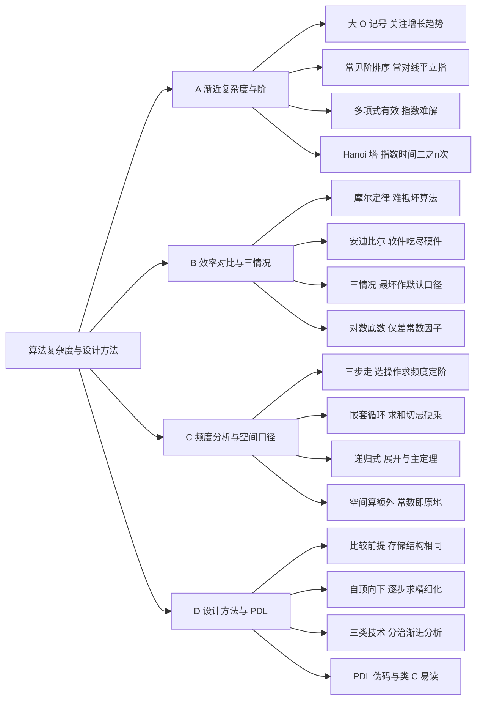

# 数据结构 · 第三周第一节 · 算法复杂度与设计方法 · 详细版讲义

> **来源说明**：本讲义依据两段课堂录音的本地转写整理，并与教材（严蔚敏、吴伟民《数据结构（C 语言版）》）逐节对照校订而成，属**讲授稿性质的整理稿**。全篇以**第一人称**写成——讲授中的开篇引题、比喻、例题推演与延伸提醒都以「我」的口吻呈现；凡属教材原文或补充对照的内容均以「📖 教材对照」标出；转写中个别存在疑义或口径差异之处，已在正文指出并汇总于文末「待核实内容」。
>
> - **音频 1**：`算法复杂度相关教学内容.m4a`（时长 49:46）
> - **音频 2**：`算法复杂度与设计方法讲解.m4a`（时长 41:47）
> - **转写工具**：faster-whisper-large-v3（GPU，float16，beam_size=5，VAD 静音过滤；批处理推理 $\approx 9.5\times$ 实时）
> - **教材对照范围**：第 1 章 1.3（抽象数据类型的表示与实现 · 类 C 语言）、1.4（算法和算法分析：1.4.1 算法 / 1.4.2 算法设计的要求 / 1.4.3 算法效率的度量 / 1.4.4 算法的存储空间需求），以及第 3 章 3.3（栈与递归的实现 · **例 3-2 Hanoi 塔**）。
> - **标注体例**：全文的「定义」一律单独成块、连续编号，并注明出处——`（课堂讲授）` 表示该内容来自课堂口头讲授、教材未直接收录；`（教材 X.X）` 表示教材对应章节口径。**全部例题按序号（例 1 ~ 例 12）摘录**，并注明来源（课堂原题 / 教材原例）与答案。

---

## 开场导读

上节课我们讨论了算法评价的基本视角，这一节我顺着这条主线继续往下推进，集中解决两个核心问题：第一，**怎么定量度量一个算法的好坏**——也就是时间复杂度、空间复杂度以及它们的常用分析方法；第二，**拿到一个复杂问题后怎么把算法设计出来**——也就是「自顶向下、逐步求精」的结构化设计方法，以及用来书写算法的 PDL 伪码和类 C 语言。

整节课的逻辑可以拆成两段来看。前半段聚焦「复杂度」：为什么评价算法不看具体执行次数而看「阶」；指数时间与多项式时间的鸿沟到底有多大；硬件跑得越来越快，为什么依然离不开好算法；面对不同输入，怎么区分最好、最坏与平均情况；拿到循环或递归代码，怎样按「选标准操作 $\to$ 求频度 $\to$ 确定阶」三步算清时间复杂度，又怎样按「额外空间」口径算清空间复杂度。后半段聚焦「设计方法与描述工具」：先明确算法比较的前提是存储结构相同，再讲清楚如何用分而治之、做出有限进展、情况分析三类求精技术拆解问题，最后落实到易读、规范的 PDL 与类 C 描述上。

开始正文之前，我先把本节**最容易踩坑的三处**拎出来提醒大家：

1. **只背「单层倍增是 $O(\log n)$」，遇到多层循环就想当然相乘**：外层每次倍增（$O(\log n)$）、内层循环次数随外层变量线性增长（$O(i)$）时，总次数是等比级数求和 $1+2+4+\cdots+2^k = 2^{k+1}-1$，结果是 **$O(n)$** 而不是 $O(n\log n)$。
2. **把函数的「返回值表达式」当成「时间复杂度递推式」**：例如代码 `return 2 * f(n / 2) + n;` 里只递归调用了 **1 次** `f(n / 2)`，乘 2 和加 `n` 都是 $O(1)$ 操作，时间递推式其实是 $T(n)=T(n/2)+O(1)=O(\log n)$，而不是 $T(n)=2T(n/2)+n$；同样，阶乘递归的时间递推式是 $T(n)=T(n-1)+O(1)=O(n)$，而不是 $T(n)=n\cdot T(n-1)$。
3. **弄反「空间复杂度」与「原地工作」的口径**：空间复杂度统计的是除输入本身和程序指令之外的**额外（辅助）空间**，既包括临时变量、辅助数组，也包括**递归调用栈空间**；只要额外空间是常数级 $S(n)=O(1)$（不论用了 0 个还是 1 个临时变量），都属于**原地工作**。

---

## 总览知识地图



> **图注（全课思维导图）**：这张图从左到右按「概念基准 $\to$ 现实意义 $\to$ 计算方法 $\to$ 设计落地」四个分支展开。**A 分支**建立「阶」的概念，明确常见复杂度排序以及多项式时间（有效）与指数时间（难解）的界线，并以 Hanoi 塔为例；**B 分支**通过摩尔定律、提速倍数、安迪-比尔定律和三种输入情况，说明为什么必须追求好算法且默认以最坏情况为准；**C 分支**给出「三步分析法」、循环求和、递归式展开与主定理简化用法，以及包含递归栈在内的额外空间口径；**D 分支**明确存储结构相同的比较前提，串联自顶向下逐步求精的三类技术，并收束到 PDL 与类 C 描述工具。

---

# 第一部分　第一次课：算法复杂度相关教学内容

## 1. 评价算法的落脚点：从「具体次数」到「阶」

承接上一节课关于算法评价的话题，我先说明一个核心原则：评价算法时，**我们并不关心算法具体执行了多少次**，更关心的是这个算法执行时间随问题规模变化的**增长趋势**——为此我们引入「算法复杂度」，在口头上也常叫作「**阶**」。

### 1.1 定义：阶与渐近时间复杂度

> **定义 1（阶 / 渐近上界 ｜ 课堂讲授）**：如果我们总能找到一个正常数 $k$（以及充分大的规模门槛 $n_0$），使得当 $n \ge n_0$ 时算法的执行时间**小于等于** $k$ 倍的 $f(n)$（前面只差一些常数系数），就认为算法执行时间的量级不超过 $f(n)$（在入门课程中也常直白地说成与 $f(n)$「同阶」），记作 $O(f(n))$。
>
> 我用个生活里的比方帮助大家理解什么叫「阶」：阶就是**档次、等级**——好比高校教师的职称（教授 / 副教授 / 讲师）、学校的层次（985 / 211 / 一般本科）、军衔的高低（少校 / 上校 / 将军），「你处于哪一个档次很重要」。在评价算法效率时，**先看它属于哪个量级**才是关键。
>
> *(注：严格数学上，仅满足 $T(n) \le k \cdot f(n)$ 定义的是渐近上界 $O(f(n))$；只有同时满足上下界时才是严格「同阶」$\Theta(f(n))$。教材和课堂入门阶段通常在「不高于该量级 / 取主项」的统一意义下使用 $O(f(n))$。)*

> **定义 2（渐近时间复杂度 ｜ 教材 1.4.3，式 1-5）**：算法中基本操作重复执行的次数是问题规模 $n$ 的某个函数 $f(n)$，算法的时间量度记作
> $$T(n) = O(f(n)) \tag{1-5}$$
> 它表示随问题规模 $n$ 的增大，**算法执行时间的增长率和 $f(n)$ 的增长率相同**，称做算法的**渐近时间复杂度**（asymptotic time complexity），简称**时间复杂度**。

> 📖 教材对照（1.4.3）：教材指出，为了便于比较同一问题的不同算法，通常的做法是：**从算法中选取一种对于所研究的问题来说是基本操作的原操作，以该基本操作重复执行的次数作为算法的时间量度**。例如在 $n \times n$ 矩阵相乘的算法中，「乘法」是基本操作，其重复执行次数为 $n^3$，故 $T(n)=O(n^3)$。

### 1.2 常见的阶与增长率排序

| 阶 | 名称 | 典型情形 |
|---|---|---|
| $O(1)$ | 常量阶 | 无循环的顺序语句 |
| $O(\log n)$ | 对数阶 | 规模成倍缩小 / 变量成倍增大 |
| $O(\sqrt{n})$ | 平方根阶 | 试除法判素数（遍历到 $\sqrt{n}$） |
| $O(n)$ | 线性阶 | 单层遍历循环 |
| $O(n\log n)$ | 线性对数阶 | 归并排序、快速排序（平均） |
| $O(n^2)$ | 平方阶 | 双层嵌套循环、起泡排序 |
| $O(n^3)$ | 立方阶 | 三层嵌套循环、$n \times n$ 矩阵相乘 |
| $O(2^n)$ | 指数阶 | Hanoi 塔、穷举子集 |
| $O(n!)$ | 阶乘阶 | 全排列穷举 |

常见复杂度阶按增长率从小到大的**标准排序**如下（$n$ 充分大时）：

$$O(1) < O(\log n) < O(\sqrt{n}) < O(n) < O(n\log n) < O(n^2) < O(n^3) < O(2^n) < O(n!) < O(n^n)$$

其中多项式阶（如 $O(n^k)$，$k$ 为非负常数）与指数阶（如 $O(2^n)$）之间存在质的数量级鸿沟。

> 📖 教材对照（1.4.3）：教材给出的三段程序段中，含基本操作「$x$ 增 1」的语句频度分别为 **$1$、$n$、$n^2$**，对应时间复杂度分别为 $O(1)$、$O(n)$、$O(n^2)$，分别称为**常量阶、线性阶、平方阶**；教材图 1.7「常见函数的增长率」给出的基本函数增长顺序为 $c < \log_2 n < n < n\log_2 n < n^2 < n^3 < 2^n$。教材的明确结论是：**应尽可能选用多项式阶 $O(n^k)$ 的算法，而不希望用指数阶的算法**。

### 1.3 定义：指数时间、多项式时间、有效算法、难解问题

> **定义 3（指数时间 ｜ 课堂讲授）**：若一个算法的时间复杂度是 $2^n$（指数）级别的（一般指 $O(c^n)$，常数 $c>1$），称该算法需要**指数时间**。大家记住：**如果你编出一个指数级运行时间的算法，在实际应用中一般就认为你「还没有解决这个问题」**——因为指数时间随问题规模 $n$ 的增大呈爆发式增长，人们往往等不到结果。
>
> **课堂上我强调的唯一例外**：**加密算法**。设计加密与破译对抗时，恰恰希望破解算法是指数级的——指数时间意味着**极难在有限时间内被穷举攻破**，这正是密码学追求的安全性；反之，如果破解只需多项式时间，密码就失去了防护意义。

> **定义 4（多项式时间 ｜ 课堂讲授）**：若时间复杂度可上界为 $O(n^k)$（$k$ 为非负常数，工程和课程中多为非负整数或非负有理数），称该算法需要**多项式时间**。它是实际应用中追求的目标——「多项式级别的话，通常你还能等得起」。

> **定义 5（有效算法 ｜ 课堂讲授，教材未收录）**：如果一个算法能找到**以多项式时间为上界的时间界限**，则称这个算法是**有效算法**。这实际上衡量的是该算法从实际应用角度**有没有现实意义、有没有应用价值**。

> **定义 6（难解算法 / 难解问题 ｜ 课堂讲授，教材未收录）**：如果一个问题**不存在以多项式时间为界限的算法**，则称这类问题是**难解性问题**（对应的指数级等非多项式解法称为**难解算法**）。
>
> 通俗地说，从计算机求解的角度看，这类问题「**在可接受时间内就认为它解不出来**」——哪怕找到了一个理论上可行的解法，但它是指数级别的，人们照样等不到结果，缺乏实际应用价值；我在前面绪论中把它类比过「**科学问题**」。

> ⚠️ **注意**：定义 3 ~ 定义 6（指数/多项式时间、有效算法、难解问题）是我为了说明「复杂度评价的现实意义」而作的补充，属于**理论计算机科学（计算复杂性）**范畴，**严蔚敏教材第一章并未收录**；大家到后续的《算法设计与分析》以及更深的计算复杂性课程里会系统学习。

**本节要点**

- **评价看「阶」不看精确次数**：大 $O$ 记号刻画规模 $n$ 增大时时间增长率的量级（上界）。
- **熟记常见阶排序**：$O(1) < O(\log n) < O(\sqrt{n}) < O(n) < O(n\log n) < O(n^2) < O(n^3) < O(2^n) < O(n!)$。
- **多项式 vs 指数**：实际求解追求多项式时间（有效算法），尽量避开指数时间（加密除外）。

---

## 例题 1：Hanoi 塔问题（$2^n$ 级复杂度的典型）【课堂讲授 + 教材例 3-2】

> **例 1（Hanoi 塔 ｜ 课堂讲授 + 教材例 3-2 原文摘抄）**
>
> 假设有 3 个分别命名为 X、Y 和 Z 的塔座，在塔座 X 上插有 $n$ 个直径大小各不相同、依小到大编号为 $1,2,\cdots,n$ 的圆盘（教材图 3.5 为 3 阶 Hanoi 塔问题的初始状态）。现要求将 X 轴上的 $n$ 个圆盘移至塔座 Z 上并仍按同样顺序叠排，圆盘移动时必须遵循下列规则：
> (1) 每次只能移动一个圆盘；
> (2) 圆盘可以插在 X、Y 和 Z 中的任一塔座上；
> (3) 任何时刻都不能将一个较大的圆盘压在较小的圆盘之上。

### 1.1 我在课堂上的思路分解

把「从 A 塔把 $n$ 个盘子挪到 B 塔」分解为**两部分**：下面最大的 1 个盘子 + 上面 $n-1$ 个盘子。做法分为三步：

1. 先设法把上面 $n-1$ 个盘子**从 A 借助 B 挪到 C**——设移动 $n$ 个盘子所需步数（时间代价）为 $T(n)$，这一步代价为 $T(n-1)$；
2. 把最底下那个盘子从 A 直接挪到 B——这一步是 $O(1)$（移动 1 次）；
3. 再把 C 上的 $n-1$ 个盘子**借助 A 挪到 B**——这一步代价又是 $T(n-1)$。

于是得到递推式：

$$T(n) = 2T(n-1) + 1 \quad (T(1)=1,\ T(0)=0)$$

逐层展开（代入法）：

$$T(n) = 2T(n-1)+1 = 2\big(2T(n-2)+1\big)+1 = 2^2 T(n-2) + 2 + 1 = \cdots = 2^n - 1 = O(2^n)$$

> **定义 7（Hanoi 递推 ｜ 课堂讲授）**：$T(n)=2T(n-1)+O(1) \Rightarrow T(n)=O(2^n)$——这是一个**指数级（$2^n$）**的算法，增长非常快。此外，由于递归深度最多为 $n$ 层（每次规模减 1 直到 $n=1$），该递归算法占用系统调用栈的**空间复杂度为 $S(n)=O(n)$**。

### 1.2 教材对照：例 3-2 与算法 3.5 原文

> 📖 教材对照（3.3 栈与递归的实现 · 例 3-2）：当 $n=1$ 时，只需将编号为 1 的圆盘从塔座 X 直接移至塔座 Z；当 $n>1$ 时，需利用塔座 Y 作辅助塔座，若能设法将压在编号为 $n$ 的圆盘之上的 $n-1$ 个圆盘从塔座 X（依照上述法则）移至塔座 Y 上，则可先将编号为 $n$ 的圆盘从塔座 X 移至塔座 Z 上，然后再将塔座 Y 上的 $n-1$ 个圆盘（依照上述法则）移至塔座 Z 上。而「如何将 $n-1$ 个圆盘从一个塔座移至另一个塔座」是**与原问题具有相同特征属性、只是规模小 1** 的问题，因此可以用同样的方法求解。
>
> ```c
> /* 算法 3.5（教材 3.3 节）：Hanoi 塔递归求解 */
> /* 将塔座 x 上自上而下编号为 1 至 n 的 n 个圆盘按规则搬到塔座 z 上，y 为辅助塔座 */
> /* 搬动操作 move(x, n, z) 中 c 为全局计数器：printf("%i. Move disk %i from %c to %c\n", ++c, n, x, z); */
> void hanoi(int n, char x, char y, char z) {
>     if (n == 1)
>         move(x, 1, z);          /* 基线条件：仅剩 1 号盘时，直接从 x 移到 z */
>     else {
>         hanoi(n - 1, x, z, y);  /* 先将 x 上 1 至 n-1 号盘借助 z 移到辅助塔 y */
>         move(x, n, z);          /* 再将最底下第 n 号盘从 x 直接移到目标塔 z */
>         hanoi(n - 1, y, x, z);  /* 最后将 y 上 1 至 n-1 号盘借助 x 移到目标塔 z */
>     }
> }
> ```
>
> 教材指出：Hanoi 塔问题「虽然问题本身没有明显的递归结构，但**用递归求解比迭代求解更简单**」（教材 3.3 节列举的第三类递归问题，同类的还有八皇后问题）。

### 1.3 64 个盘子到底要多久

课堂上我带大家算了一笔账：主流 CPU 主频在 GHz 级，这里按每秒执行 $10^9$ 次基本操作来估算。如果把 $n=64$ 代入 $2^n - 1$：

$$2^{64}-1 \approx 1.84 \times 10^{19}\ \text{次移动} \quad \Rightarrow \quad \frac{1.84\times10^{19}}{10^9\ \text{次/秒}} \approx 1.84\times10^{10}\ \text{秒} \approx 585\ \text{年}$$

> ⚠️ **转写存疑**：录音转写中此处曾出现「也要搬成 **1840 多年**」的字样，与按 $10^9$ 次/秒算出的约 **585 年**不吻合（疑将「$1.84\times 10^{10}$ 秒」中的前三位数字误听/误记）。若按传说中「每秒移动 1 次」的经典口径，则为 $1.84\times10^{19}$ 秒 $\approx 5.85\times10^{11}$ 年（**约 5849 亿年**）。**此处以公式推导为准**。
>
> **结论**：哪怕用现在的计算机，64 个盘子的指数级移动次数也远远超出人类可等待的时间——这就是指数时间的威力。

---

## 2. 计算机越来越快，还需要好算法吗？

我先抛给大家一个常有的疑问：「计算机速度发展这么快，我们编程序是不是就不需要考虑算法效率了？」——答案是**远远不能掉以轻心**。

### 2.1 摩尔定律

> **定义 8（摩尔定律 ｜ 课堂讲授）**：计算机芯片**每隔约 18 个月性能（或集成度）翻一番**。后来在很长一段时期内，芯片和算力实际发展的速度**甚至比摩尔定律预测的还要快**。

### 2.2 两个侧面的定量对比（课堂推演 + 教材图 1.7）

**侧面一：当问题规模 $n$ 增大时（按每秒 $10^9$ 次基本操作估算）**

| 问题规模 $n$ | $n^2$ | $2^n$ |
|---|---|---|
| $20$ | $400\ \text{ns} = 0.4\ \mu\text{s}$ | $2^{20} \approx 1.05\times 10^6\ \text{ns} \approx 1.05\ \text{ms}$ |
| $1000$ | $10^6\ \text{ns} = 1\ \text{ms}$ | $2^{1000}/10^9 \approx 1.07\times 10^{292}\ \text{秒} \approx 3.4\times 10^{284}\ \text{年}$ |

你们看：规模小时（$n=20$）两者都在微秒到毫秒级，差距还不算刺眼；可一旦规模拉大到 $n=1000$，$n^2$ 依然只要 $1\text{ms}$，而 $2^n$ 已经膨胀到 $10^{284}$ 年级别——**硬件那一点点速度提升，如果摊上糟糕的指数级算法，起不到实质作用**，好比「蚍蜉撼大树」。这正对应教材**图 1.7 常见函数的增长率**中那条急剧上升的 $2^n$ 曲线。

**侧面二：机器提速 100 倍或 1000 倍，对「单位时间可解规模」的影响**

| 复杂度 | 机器提速 100 倍后可解规模 | 机器提速 1000 倍后可解规模 |
|---|---|---|
| $O(n^2)$ | 规模扩大到 $\sqrt{100}=10$ 倍 | 规模扩大到 $\sqrt{1000}\approx 31.6$ 倍 |
| $O(2^n)$ | 规模仅增加常数 $\log_2 100 \approx 6.64$ | 规模仅增加常数 $\log_2 1000 \approx 9.97$ |

对于 $O(2^n)$ 算法，即使把机器换成 100 倍甚至 1000 倍算力，可解规模也只多出不到 7 个或 10 个元素，**几乎没有实质帮助**。

> **结论**：硬件发展再快，也**不会削弱我们对好算法的迫切需求**——因为机器算力的增长速度**远远赶不上**一个坏算法随规模增长带来的性能拖累。

> 📖 教材对照（1.4.3）：教材以两个 $10\times10$ 矩阵相乘与 $31\times31$ 矩阵相乘为例，说明**事前估算和事后统计两种办法可以结合**：若 $10\times10$ 矩阵相乘实测 $12\text{ms}$，由 $T(n)=O(n^3)$ 可估算 $31\times31$ 需
> $$\left(\frac{31}{10}\right)^3 \cdot 12\text{ms} \approx 358\text{ms}$$

---

## 3. 最好情况、最坏情况与平均情况

### 3.1 定义

> **定义 9（平均时间复杂度 ｜ 教材 1.4.3）**：对依赖输入数据的算法，一种评价方式是**计算它的平均值**，即考虑它对**所有可能输入数据集的期望值**，此时相应的时间复杂度称为算法的**平均时间复杂度**。
>
> **口头补充**：平均情况复杂度本质上是**加权平均**——也就是要把各种输入出现的概率和对应代价都考量进来。但在实际问题中，各种输入出现的概率分布往往难以确定（就像评估一名球员，要同时考虑上场时间、站位、对手强弱、队友状态等太多因素），加权平均在数学上常常很难写出解析解。因此工程和教材分析中，往往进一步假设**各种输入等概率出现**，此时加权平均就退化为**算术平均**（例如「打十场球，把每场得分加起来除以十」）。不过仍有不少算法连平均性能也难以求得。

> **定义 10（最坏时间复杂度 ｜ 教材 1.4.3）**：分析**最坏情况**以估算算法执行时间的一个**上界**，即为算法的最坏情况时间复杂度。**本课程与教材以后各章讨论的时间复杂度，除特别指明外，均指最坏情况下的时间复杂度。**

### 3.2 为什么重点看最坏情况和平均情况

- **最好情况通常没有现实意义**：好比篮球历史上科比单场砍过 **81 分**，但那是生涯高光特例，不能指望场场都拿 81 分——拿最好情况当日常评估标准没有实际指导价值。
- **最坏情况必须兜底考虑**：如果你是教练，某个球员有可能受伤、有可能上不了场、有可能状态低迷——**这个最坏后果你能不能承受**？买 CPU 要买正品而不能图便宜买降级品，差别就在**满负荷峰值运转**时：正品能稳定扛住，降级品可能过热出错。因此**最坏情况在工程上很有现实意义**，也是默认评价口径。
- **平均情况是综合考量**：平时评价一名球员实力，不能只看他受伤不能上场的那天，而是**综合考察他的平均表现**。

> 📖 教材对照（1.4.3，起泡排序）：以「**交换**序列中相邻两个整数」为基本操作——
> - 初始序列**自小至大有序**：基本操作执行 **0 次**（最好情况）；
> - 初始序列**自大至小有序**：基本操作执行 **$n(n-1)/2$ 次**（最坏情况）；
> - 假设 $n!$ 种排列概率相等，则**平均**时间复杂度 $T_{\text{avg}}(n)=O(n^2)$；
> - 由于**各种输入数据集出现的概率往往难以确定**，教材统一采用**最坏情况**作为默认口径。

---

## 4. 课堂延伸：安迪-比尔定律与「不要过度超前」

> **定义 11（安迪-比尔定律 ｜ 课堂讲授，教材未收录）**：安迪（Andy Grove，原英特尔 CEO）不断推出更快的芯片，比尔（Bill Gates，原微软 CEO）的软件随即升级换代、**把硬件新增的性能几乎全部吃掉**——结果普通用户在实际使用中「感受不到」多少硬件提升的红利。

**我在课上举的几个例子**：

- 隔四五年换一台新电脑，CPU、内存、硬盘全更新了，可打开 Office 办公软件时觉得「速度跟几年前差不多」——因为新版软件把新增硬件性能吃掉了；
- 手机晚上没上网、没主动开应用，过一晚后台流量和电量却往下掉——后台定位、推送等常驻服务在跑；
- **Vista 案例**：当年 Vista 作为一代新系统发布时，装到当时主流机器上运行反而显慢，原因就是塞进了过多花哨却非必需的图形界面特效；后来的 **Windows 7 很大程度上就是在做精简和优化**。

> **我的提醒**：大家以后做软件设计，**不要盲目追求「超前堆功能」**，要适可而止、站在用户真实需求的角度规划。很多项目在招投标竞争时容易把各种用不上的功能全堆上去，最后既拖慢系统、又增加用户学习成本，反而不友好。

**本节要点（第 2 ~ 4 节）**

- **硬件救不了坏算法**：算力提升对 $O(2^n)$ 可解规模的改善只是常数增量，算法复杂度才是决定性瓶颈。
- **三种情况分工**：最好情况一般不作依据；**平均情况**看期望（常退化为等概率算术平均）；**最坏情况**给出时间上界，是教材默认口径。
- **软件节制原则**：受安迪-比尔定律警示，功能与资源消耗应避免无节制膨胀。

---

## 5. 复杂性分析的三个步骤

> **定义 12（三步骤 ｜ 课堂讲授）**：分析时间复杂度「只需要知道它处于哪一个级别就可以」，实操上分三步走：
> ① **根据问题的特点，合理选择一种（或几种）标准操作**；
> ② **确定算法在给定输入下该操作总共执行了多少次**（即求出时间频度 $f(n)$）；
> ③ **确定它的阶**（有了频度函数之后，略去常数系数和低阶项，保留增长最快的项）。

> **定义 13（标准操作 / 基本操作 ｜ 教材 1.4.3）**：从算法中选取一种**对于所研究的问题（或算法类型）来说是基本操作的原操作**，以该基本操作重复执行的次数作为算法的时间量度。
>
> 用通俗的话说，标准操作就是**有代表性的、执行最频繁、耗时具有决定性的那个操作**——比如**最深层循环体内的核心语句**。

> **定义 14（频度 ｜ 教材 1.4.3）**：**语句的频度（frequency count）指的是该语句重复执行的次数。**
>
> **补充一点**：当遇到特别复杂的算法，连频度函数在数学上都**推算不出来**时怎么办？工程和科研中常用**标准数据集（Benchmark）实测对比**：好比两台架构迥异的超级计算机（比如一台 1 万核配 6 TB 内存，另一台 4 万核配 1 TB 内存），光看硬件参数没法直接分高下，那就拿同一个权威标准测试集跑一遍，谁耗时更短谁就占优；图像处理等领域也是同样道理，用公认的标准测试图像跑出实测耗时，直接与前人工作对比。

**分析流程总结**（对应上述三步与实测兜底路径）：

1. **选标准操作**：通常锁定最深层循环内的核心语句；
2. **求时间频度**：统计该操作在规模 $n$ 下的执行次数 $f(n)$；
   - **例外分支**：若算法分支过于复杂导致 $f(n)$ 在数学上难以解析求得，则退回**标准数据集实测**（如超级计算机或标准测试集耗时对比）；
3. **确定阶**：从 $f(n)$ 中提取增长最快的最高阶项，记作 $O(\cdot)$。

---

## 例题 2：教材 1.4.3 三段程序段的频度【教材原例】

> **例 2（教材 1.4.3 原文摘抄）**　分析下列 3 个程序段的时间复杂度：
> ```c
> /* (a) 顺序语句 */
> { ++x; s = 0; }                         /* 基本操作 ++x 执行 1 次 */
>
> /* (b) 单层循环 */
> for (i = 1; i <= n; ++i) {
>     ++x;                                /* 基本操作 ++x 执行 n 次 */
>     s += x;
> }
>
> /* (c) 双层独立循环 */
> for (j = 1; j <= n; ++j)
>     for (k = 1; k <= n; ++k) {
>         ++x;                            /* 基本操作 ++x 执行 n*n 次 */
>         s += x;
>     }
> ```
> **答**：含基本操作「$x$ 增 1」的语句频度分别为 **$1$、$n$ 和 $n^2$**，因此这 3 个程序段的时间复杂度分别为 $O(1)$、$O(n)$ 和 $O(n^2)$，分别称为**常量阶、线性阶和平方阶**；三者只使用有限个简单变量，空间复杂度均为 $S(n)=O(1)$。

---

## 例题 3：教材 1.4.3「只需求增长率」的嵌套循环【教材原例】

> **例 3（教材 1.4.3 原文摘抄）**　分析下列程序段的时间复杂度：
> ```c
> for (i = 2; i <= n; ++i)                /* 外层从 2 到 n */
>     for (j = 2; j <= i - 1; ++j) {      /* 内层执行 i - 2 次 */
>         ++x;                            /* 基本操作 */
>         a[i][j] = x;
>     }
> ```

**对应分析**（三步骤 ②③ 示范）：当 $i=2$ 时内层执行 $0$ 次，$i=3$ 时执行 $1$ 次，……，$i=n$ 时执行 $n-2$ 次（假设 $n \ge 2$），求和得：

$$0+1+\cdots+(n-2) = \frac{(n-1)(n-2)}{2} \;\Rightarrow\; \text{增长最快项为 } n^2 \;\Rightarrow\; T(n)=O(n^2)$$

（注意这里数组 `a` 若作为输出/输入载体已由外部给定，算法本身只用了循环变量与 `x`，额外空间为 $S(n)=O(1)$。）

---

## 例题 4：三层嵌套循环的频度【课堂例题】

> **例 4（课堂例题 ｜ 原题转写）**　分析下列三层循环中循环体语句的执行次数，并给出时间复杂度：
> ```c
> for (i = 1; i <= n; ++i)                /* 外层：i 从 1 到 n */
>     for (j = 1; j <= i; ++j)            /* 中层：j 从 1 到 i */
>         for (k = 1; k <= j; ++k)        /* 内层：k 从 1 到 j */
>             x = x + 1;                  /* 标准操作 */
> ```

**解法（逐层求和法）**：外层 $i$ 每固定一个值，内两层对 $j=1,2,\dots,i$ 分别执行 $j$ 次，合起来共执行

$$1+2+3+\cdots+i = \frac{i(i+1)}{2}\ \text{次}$$

再对外层 $i$ 从 $1$ 到 $n$ 求和：

$$\sum_{i=1}^{n}\frac{i(i+1)}{2} = \frac{1}{2}\left(\sum_{i=1}^n i^2 + \sum_{i=1}^n i\right) = \frac{1}{2}\left[\frac{n(n+1)(2n+1)}{6} + \frac{n(n+1)}{2}\right] = \frac{n(n+1)(n+2)}{6}$$

> **答**：频度为 $\dfrac{n(n+1)(n+2)}{6}$，取增长最快的最高阶项 $n^3$，故 **$T(n)=O(n^3)$**；额外空间为 $S(n)=O(1)$。

**本节要点（第 5 节 + 例 2 ~ 例 4）**

- **三步骤**：定标准操作 $\to$ 列频度求和式 $\to$ 提取最高阶项。
- **三角形循环求和公式**：$\sum_{i=1}^n i = \frac{n(n+1)}{2} = O(n^2)$；三层嵌套求和 $\sum_{i=1}^n \frac{i(i+1)}{2} = \frac{n(n+1)(n+2)}{6} = O(n^3)$。
- **求不出来怎么办**：当复杂算法难以用公式求频度时，用权威标准数据集实测对比运行时间。

---

## 例题 5：变量成倍增大的单层循环【课堂例题（选择题）】

> **例 5（课堂例题 ｜ 原题转写，选项转写存疑）**　下列算法的时间复杂度是多少？
> ```c
> i = 1;                                  /* 步长变量初值为 1 */
> while (i <= n)
>     i = i * 2;                          /* 标准操作：每次翻倍 */
> ```
> A. $O(n)$　　B. $O(n^2)$　　C. ……（转写不清）　　D. ……（转写不清）

**解法**：标准操作是 `i = i * 2`。跟踪每一轮循环执行前 $i$ 的取值（设 $n \ge 1$）：

| 轮次 | 执行前 $i$ 的取值 | 条件 $i \le n$ 判断与执行结果 |
|---|---|---|
| 第 1 轮 | $1 = 2^0$ | 满足 $\to$ 执行，$i$ 变为 $2^1$ |
| 第 2 轮 | $2 = 2^1$ | 满足 $\to$ 执行，$i$ 变为 $2^2$ |
| 第 3 轮 | $2^2$ | 满足 $\to$ 执行，$i$ 变为 $2^3$ |
| … | … | … |
| 第 $m$ 轮 | $2^{m-1}$ | 若 $2^{m-1} \le n$ 仍执行，$i$ 变为 $2^m$ |

设循环共执行了 $m$ 次后因 $2^m > n$ 而跳出，则最后一次执行时满足 $2^{m-1} \le n < 2^m$，两边取以 $2$ 为底的对数得：

$$m - 1 \le \log_2 n < m \quad \Longrightarrow \quad m = \lfloor \log_2 n \rfloor + 1$$

> **答**：标准操作执行 $\lfloor \log_2 n \rfloor + 1$ 次，故 **$T(n)=O(\log n)$**（对数阶）；额外空间为 $S(n)=O(1)$。
>
> ⚠️ **转写存疑**：录音转写中前文曾误记为「选 A」、后文又说「正确答案是 B」，且 C、D 选项文本缺失，应属语音转写失真。**按上述严格推导，正确复杂度一定是 $O(\log n)$**。

> **规律提炼**：判断这类单层循环不能只看 `while`，要看「**控制变量如何变化**」——变量**成倍增大**（如 `i *= 2`）或**成倍缩小**（如 `n /= 2`）时，循环次数都是 **$O(\log n)$**。

---

## 例题 6：递归函数的时间复杂度与递归式求解【课堂例题】

> **例 6（课堂例题 ｜ 原题转写）**　分析下列函数代码的时间复杂度（原题干转写如下）：
> ```c
> int f(int n) {
>     if (n == 1) return 1;               /* 递归出口 */
>     else return 2 * f(n / 2) + n;       /* 注意：此处仅调用了 1 次 f(n / 2) */
> }
> ```
> A. $O(n)$　　B. $O(n\log n)$　　C. $O(\log n)$　　D. $O(n^2)$

**把容易混淆的两种口径逐一讲清**：

我在课上先提醒过大家：分析递归算法不能只看加减乘除，核心要看**递归调用展开后的总工作量**（因为每次递归调用都涉及压栈、退栈开销）。但这里**必须把「代码本身的调用次数」和「题目可能想考的递归式 $T(n)=2T(n/2)+n$」严格区分开**，千万不能张冠李戴：

1. **按上面这段 C 代码本身严格执行**：
   语句 `return 2 * f(n / 2) + n;` 里，`f(n / 2)` **只被调用了 1 次**，外面的 `2 * (...)` 和 `+ n` 都只是 $O(1)$ 的一次乘法和一次加法（不是循环！）。它的递归调用链为：
   $$n \to \frac{n}{2} \to \frac{n}{4} \to \cdots \to \frac{n}{2^k} = 1 \quad\Rightarrow\quad k = \log_2 n$$
   因此这段代码实际的时间递推式是 $T(n) = T(n/2) + O(1)$，复杂度为 **$O(\log n)$**（对应选项 **C**），递归栈空间为 $S(n)=O(\log n)$。
2. **按课堂讲解对应的递推式 $T(n)=2T(n/2)+n$（原题若意在考该递推式）**：
   如果一个分治算法在每层**把问题一分为二**（调用 **2 次**规模为 $n/2$ 的子问题，比如 `f(n/2) + f(n/2)`），并且每层还要花 $O(n)$ 的代价做合并或扫描，那么时间递推式才是：
   $$T(n) = 2T\!\left(\frac{n}{2}\right) + n$$
   此时光说「递归深度是 $\log_2 n$」还不够，因为**每层分支数翻倍**，总共 $n$ 个叶子、$\log_2 n$ 层每层总代价都是 $n$，最终 **$T(n) = O(n\log n)$**（对应选项 **B**）。

### 附：递归式求解的两种常用方法（代入展开法与主定理简化版）

为了防止大家再把递推式算错，我把本课程常用的两种求解工具列在下面：

**方法一：代入展开法（迭代展开）**——适合直接把递推式一层层代开找规律。
- 以 $T(n) = 2T(n/2) + n$（$T(1)=1$，设 $n=2^k$）为例：
  $$T(n) = 2\Big[2T\!\left(\frac{n}{4}\right)+\frac{n}{2}\Big] + n = 2^2 T\!\left(\frac{n}{4}\right) + 2n = \cdots = 2^k T\!\left(\frac{n}{2^k}\right) + kn$$
  令 $\frac{n}{2^k}=1$，即 $k=\log_2 n$、$2^k=n$，代入得 $T(n) = n\cdot 1 + n\log_2 n = O(n\log n)$。
- 若把系数 $2$ 去掉，变成 $T(n) = T(n/2) + n$：
  $$T(n) = n + \frac{n}{2} + \frac{n}{4} + \cdots + 1 = n\left(1 + \frac{1}{2} + \frac{1}{4} + \cdots\right) < 2n \quad\Rightarrow\quad T(n)=O(n)$$
  可见有没有系数 $2$，量级直接差了一个 $\log n$ 因子！

**方法二：主定理（Master Theorem）简化用法**——专门解分治型递推式
$$T(n) = aT\!\left(\frac{n}{b}\right) + c\cdot n^d \qquad (a \ge 1,\ b > 1,\ d \ge 0)$$
只需比较「子问题分叉指数」$\log_b a$ 与「本层非递归工作量指数」$d$ 的大小：

| 比较结果 | 主导开销来源 | 复杂度结论 | 典型例子 |
|---|---|---|---|
| $\log_b a > d$ | 底层叶子调用占主导 | $T(n) = O\!\left(n^{\log_b a}\right)$ | $T(n)=4T(n/2)+n$（$\log_2 4 = 2 > 1 \Rightarrow O(n^2)$） |
| $\log_b a = d$ | 每一层总工作量均衡 | $T(n) = O\!\left(n^d \log n\right)$ | $T(n)=2T(n/2)+n$（$\log_2 2 = 1 = d \Rightarrow O(n\log n)$）；$T(n)=T(n/2)+1$（$\log_2 1 = 0 = d \Rightarrow O(\log n)$） |
| $\log_b a < d$ | 顶层合并工作占主导 | $T(n) = O\!\left(n^d\right)$ | $T(n)=T(n/2)+n$（$\log_2 1 = 0 < 1 \Rightarrow O(n)$） |

> **顺带澄清「阶乘递归」的递推式写法**（修正转写中的混淆）：计算 $n!$ 的函数 `return n * fact(n - 1);` 中，**函数返回值**满足 $f(n)=n\cdot f(n-1)$；但它的**时间递推式**每层只调用 1 次 `fact(n-1)` 并做 1 次 $O(1)$ 乘法，因此时间递推式是 $T(n) = T(n-1) + O(1)$，展开得 **$T(n)=O(n)$**（而递归栈空间也是 $S(n)=O(n)$）。切勿把时间递推式写成 $T(n) = n\cdot T(n-1)$（若时间真是乘 $n$ 展开就是 $O(n!)$）。

---

## 6. 关于 $\log_2 n$ 常被写成 $\log n$

为什么很多教材和考题把 $\log_2 n$ 直接省去底数写成 $\log n$？因为分析渐近复杂度时只抓主要增长率，由对数换底公式：

$$\log_a n = \frac{\log_2 n}{\log_2 a} \qquad (a > 1\text{ 为常数})$$

可见 $\log_2 n$、$\log_{10} n$、$\ln n$ 之间**只相差一个非零常数因子** $\frac{1}{\log_2 a}$，而常数系数在 $O$ 记号下可以忽略，所以它们全部属于同一阶：

$$O(\log_2 n) = O(\log_{10} n) = O(\ln n) = O(\log n)$$

**本节要点（例 5 ~ 第 6 节）**

- **对数阶识别**：变量成倍增大或成倍缩小的单层循环（如 `i *= 2`）执行 $\lfloor\log_2 n\rfloor + 1$ 次，时间复杂度为 $O(\log n)$。
- **对数底数无关紧要**：换底公式只差常数因子，在 $O$ 记号下统记为 $O(\log n)$。
- **区分返回值公式与时间递推式**：`2*f(n/2)+n` 只调用 1 次子问题（$O(\log n)$）；分治 2 路再花 $O(n)$ 合并才是 $T(n)=2T(n/2)+n = O(n\log n)$。
- **递归式两招**：能展开就用代入展开法，标准 $aT(n/b)+cn^d$ 形式可直接套用主定理简化版比 $\log_b a$ 与 $d$。

---

# 第二部分　第二次课：复杂度（续）与算法设计方法

## 7. 例题 7：外层成倍、内层线性的双层循环【课堂例题】

> **例 7（课堂例题 ｜ 原题转写）**　分析下列算法的时间复杂度：
> ```c
> for (i = 1; i <= n; i *= 2)            /* 外层：i 按 1, 2, 4, ..., 2^k 倍增 */
>     for (j = 0; j < i; ++j)             /* 内层：j 执行 i 次 */
>         sum = sum + i * j;              /* 标准操作 */
> ```

**解法（对每个外层 $i$ 求内层次数，再求和）**：设 $n \ge 1$，记 $k = \lfloor \log_2 n \rfloor$，则 $i$ 依次取 $1, 2, 4, \dots, 2^k$（满足 $2^k \le n < 2^{k+1}$）：

| 外层 $i$ | 内层 $j$ 的执行次数 |
|---|---|
| $1$ | $1$ 次（$j=0$） |
| $2$ | $2$ 次（$j=0,1$） |
| $4$ | $4$ 次（$j=0,1,2,3$） |
| … | … |
| $2^k$（$2^k\le n$） | $2^k$ 次 |

总次数为等比数列求和（首项 $a_1=1$，公比 $q=2$）：

$$\sum_{m=0}^{k} 2^m = \frac{1\cdot(2^{k+1}-1)}{2-1} = 2^{k+1}-1$$

因为 $2^k \le n < 2^{k+1}$，所以 $n \le 2^{k+1}-1 \le 2n - 1$（例如 $n=2^k$ 时恰取等号 $2n-1$）。

> **答**：标准操作频度为 $2^{k+1}-1$（介于 $n$ 与 $2n-1$ 之间），取增长最快项，故 **$T(n)=O(n)$**（线性阶）；额外空间为 $S(n)=O(1)$。
>
> ⚠️ **易错提醒**：**外层是对数级、内层是线性级，乘起来并不一定是 $O(n\log n)$**——因为这里内层的上限 $i$ 本身在按几何级数变化，求和结果收敛到 $O(n)$。这与「外层 $n$ 次、内层固定 $n$ 次」的 $O(n^2)$ 不同，**涉及依赖外层变量的内循环时，必须老老实实写出求和式再算，不能想当然直接相乘**。

这种方法其实和前面例 4 的三层循环一脉相承：先对每一个外层取值 $i$ 算出内层执行次数 $s_i$，再把所有 $s_i$ 加起来。

---

## 8. 算法比较的前提与空间复杂度

### 8.1 算法依赖于逻辑结构与存储结构

先回顾第一章的结论：**算法定义在逻辑结构上，但算法的具体实现必须依赖于存储结构**。

我用「去图书馆找同一本书」打个比方：书放在**一楼**还是放在**五楼**，你实际走的路线、爬的楼梯、耗的时间精力大不相同。所以：**一旦一个问题具体给出了某套算法，就意味着它的逻辑结构确定了，底层的存储结构也随之确定下来了。**

### 8.2 比较算法的前提：存储结构相同

如果拿一个基于**顺序（数组）存储**计算 $n$ 个人工资的算法 A，去跟一个基于**链表存储**计算 $n$ 个人工资的算法 B 硬比步骤细节，这没法直接横向评判——存储结构本身不同，好比拿动物和植物比跑得快不快，不在同一把尺子上。

> **定义 15（比较前提 ｜ 课堂讲授）**：**算法优劣比较的前提条件是存储结构相同**（且针对相同规模 $n$）。

### 8.3 空间复杂度只算「额外空间」

> **定义 16（空间复杂度 ｜ 教材 1.4.4，式 1-6）**：以**空间复杂度**（space complexity）作为算法所需存储空间的量度，记作
> $$S(n) = O(f(n)) \tag{1-6}$$
> 其中 $n$ 为问题的规模（或大小）。

> 📖 教材对照（1.4.4）：一个上机执行的程序除了需要存储空间来寄存本身所用指令、常数、变量和输入数据外，也需要一些对数据进行操作的**工作单元**和存储一些为实现计算所需信息的**辅助空间**。**若输入数据所占空间只取决于问题本身、和算法无关，则只需要分析除输入和程序之外的额外空间**，否则应同时考虑输入本身所需空间。
>
> **若额外空间相对于输入数据量来说是常数，则称此算法为原地工作**（教材第 10 章讨论的有些排序算法就属于这类）。

> **定义 17（原地工作 ｜ 教材 1.4.4）**：额外空间相对于输入数据量来说是**常数**（即 $S(n)=O(1)$）的算法，称做**原地工作**。

为什么一般只比「额外空间」？道理很简单：不管用算法 A 还是算法 B 处理 $n$ 个人的工资，这 $n$ 条数据都得占 $n$ 个数据单元，「这一部分输入空间大家都要占，放进比较里没有区分度」。所以空间复杂度重点考察**为完成计算而额外申请的辅助存储空间**——这里特别要提醒大家：**辅助空间不仅包括自己开的临时变量和辅助数组，还包括递归函数调用时占用的系统工作栈空间**（例如例 1 的 Hanoi 塔虽然没开大数组，但递归深度为 $n$，栈空间开销就是 $S(n)=O(n)$）。

### 8.4 例题 8：交换两个数需要多少「额外空间」

> **例 8（课堂例题 ｜ 空间复杂度类比题）**　要把左右两只手里的两支粉笔互相交换，需要多少额外的存储空间？

**解法**：

- **常规做法（借助临时单元）**：好比小朋友换粉笔，先把左手粉笔放到桌角（第三个位置），把右手粉笔拿到左手，再把桌角的粉笔拿到右手——这**需要 1 个额外的存储单元**（即编程里的临时变量 `t`：`t = a; a = b; b = t;`）。
- **无临时变量做法（原位倒腾）**：好比杂耍演员两手一抛一接直接换过来（编程里也有不设临时变量的加减或异或交换技巧），**不需要额外的第 3 个存储单元**（0 个辅助变量）。

> **答**：两种做法的额外空间量（1 个临时单元与 0 个临时单元）都不随问题规模变化，**时间与空间复杂度都是常数级 $S(n)=O(1)$，因此二者按教材定义都属于「原地工作」**。这个小例子只是用 1 个单元与 0 个单元的差别，直观说明什么叫不计输入本身、只算「额外工作空间」。
>
> 再举一例：循环打印输出 $n$ 个数时，用来控制循环的下标变量 `i` 和长度变量 `n` 属于**额外的辅助存储量**，总共仍是常数个，所以也是 $S(n)=O(1)$。

**本节要点（第 7 ~ 8 节）**

- **依赖外层变量的内循环要写求和式**：外层倍增、内层线性时用等比求和，结果是 $O(n)$ 而非 $O(n\log n)$。
- **算法比较前提**：脱离存储结构谈算法没有可比性，比较的前提是存储结构相同。
- **空间复杂度口径**：一般只算除输入和指令之外的**额外（辅助）空间**，**含临时变量、辅助数组以及递归调用栈**；额外空间为 $O(1)$ 时称为**原地工作**。

---

## 9. 算法设计方法：自顶向下，逐步求精

> **定义 18（自顶向下、逐步求精 ｜ 课堂讲授，教材未收录）**：设计一个好算法，要**从系统化、工程化的角度**综合分析问题：先在顶层把复杂问题**拆分成若干职责相对明确的子问题**，再把每个子问题**层层细化**，直到拆解到「**用一个简单函数就能实现**」为止。这八个字就是——**自顶向下，逐步求精**。
>
> 这其实就是**结构化程序设计**的核心思想。有人会问：现在流行**面向对象**了，还需要结构化吗？其实面向对象并非抛弃结构化，而是**封装的粒度更大**——结构化程序设计（如 C 语言）的基本复用单位是**函数**；面向对象的复用单位是**类**，类把**数据**和**操作数据的函数**封装到一起，但每个类内部、每个方法体内部的算法设计理念，**依然遵循「逐步求精」**。

### 9.1 顶层是对问题全貌的抽象

以大家在「学习通」上看到的作业题为例，审题和拆解的过程就是一个逐步求精的链条：

1. **第 1 层（顶层）**：先判断归属——这是一道「数据结构」课程的题目；
2. **第 2 层**：进一步定位——这是一道关于「算法」而非单纯概念背诵的题目；
3. **第 3 层**：再细化到具体考点——这是一道考察「求时间复杂度 / 分析运行效率」的题目；
4. **第 4 层（底层）**：继续拆解循环结构、标准操作与求和式……直到落实为「一个具体函数或几行可编码的逻辑」。

### 9.2 求精的三类技术

> **定义 19（求精技术 ｜ 课堂讲授）**：求解问题的常用求精技术有三类——
> ① **分而治之**：把问题拆分成若干**相对独立（不相交）**的子部分，逐一解决后再合起来；
> ② **做出有限进展**：解决方向和迭代规则明确，但**具体多少步到达终点还不确定**，每执行一步就更接近目标；
> ③ **情况分析**：面对**多种可能分支或方案**，逐一分析每种情形的代价与结果，再择优确定方案。

**① 分而治之**

- 就像《孙子兵法》里讲的「**各个击破**」——把大问题拆开，一段一段解决。
- 例如给一家企业做信息管理系统，可以把**财务、人事、生产、销售**拆成四个独立模块分别开发；但拆完之后**必须把各模块之间的接口联系、数据交换关系梳理清楚**。
- 做行业应用软件（比如银行管理系统）还有个常见难点：光懂写代码不够，你对业务的理解有时**要达到接近甚至胜过业务人员的专业深度**，而且要充分沟通用户需求——很多时候技术实现并不难，**跟人沟通对齐需求才是最花工夫的事**。

**② 做出有限进展**

- 用数学里的经典例子来说明——**求圆的面积**：我们一开始不知道怎么直接算出曲边图形的面积，就先算圆内接正三角形的面积（误差很大），再算内接正四边形（更接近了），再算正五边形……随着**内接正 $N$ 边形**的边数 $N$ 不断增大，每多加一条边，误差就缩小一点，逐步逼近圆的真实面积。这种「方向明确、步步逼近」就是做出有限进展。
- 课堂上我也打过社会发展目标的比方：只要大方向和指导方法是对的，虽然具体哪一天完全达标还不能预先写死，但每往前推进一步，离目标就更近一步。

**③ 情况分析**

- 比如大四临近毕业时面临「**直接就业还是考研**」的选择——把两条路线逐一摊开对比就是情况分析。普通本科就业起薪比如月薪 5000 元（年薪约 6 万元），读研两三年不仅暂时没有工资收入，还要承担学费和生活费；但把时间轴拉长，研究生毕业工作到第五年左右，往往在岗位上限和发展空间上拉开差距。
- 正所谓「**知识就是力量**」，积累够了专业深度，后续的个人成长与职业回报自然不一样。

### 9.3 「细节决定成败」要辩证看

市面上有本很火的书叫《细节决定成败》，对这句话我们要**辩证看待**：

- **不在同一个量级上，谈细节意义不大**：打个比方，业余校队就算请 NBA 教练带队反复抠战术细节，上场面对职业顶尖强队还是打不过；摔跤比赛里，**50 公斤级**的选手碰上**80 公斤级**选手，招式细节练得再好也很难弥补体重和力量量级上的差距。
- **只有处于同一个数量级（同一档次）时，细节才决定胜负**。

> **核心结论**：一切优化和细节打磨，都要建立在「**选对了同一个数量级（阶）的方案**」这个前提之上——这与前面强调复杂度的「阶」是彼此相通的道理。

> 📖 教材对照（1.4.2 算法设计的要求）：教材把「好算法」的四个要求列为：**① 正确性（共 4 个层次，通常以第 c 层「对于精心选择的典型、苛刻而带有刁难性的几组输入数据能得出满足要求的结果」作为合格线）；② 可读性；③ 健壮性；④ 效率与低存储量需求**。课堂所讲的「逐步求精」正是把这四点落到实处的方法论；其中「算法主要是为了人的阅读与交流」与教材对可读性的论述相契合。
>
> 教材同时强调：**效率与低存储量需求都与问题的规模有关**——「求 100 个人的平均分与求 1000 个人的平均分，所花的执行时间或运行空间显然有一定的差别」。

### 9.4 算法设计的基本技术（简介）

具体的算法设计策略还有**贪心法、分支限界法、回溯法**等，它们都是从不同角度解决复杂问题的经典技巧。本课程以**基本数据结构和基本数据模型**为主，这类高阶策略暂不展开；如果大家对**算法设计技巧**感兴趣，可以在后续的**《算法设计与分析》**课程中深入学习。

**本节要点**

- **设计核心**：自顶向下、逐步求精——先全局分解、再逐层细化到单个函数可实现。
- **三类求精技术**：分而治之（拆分独立子问题并理清接口）、做出有限进展（逐步逼近）、情况分析（穷举并比较分支）。
- **量级优先于细节**：如同时间复杂度的「阶」，只有量级处于同一档次时，局部细节优化才能发挥决定作用。
- **好算法四标准**：正确性、可读性、健壮性、高效率与低存储量需求。

---

## 10. PDL 语言与类 C 语言

### 10.1 PDL 的定义

> **定义 20（PDL ｜ 课堂讲授）**：PDL（Program Design Language，程序设计语言，也称过程设计语言 / **伪码**）——**保留计算机程序设计语言的控制框架（骨架）及其描述形式，去掉具体语言的语法细节与特异性要求，再结合自然语言，用来描述算法处理逻辑的工具**。它**介于自然语言与具体的程序设计语言之间**。
>
> 去掉「特异性」，意思就是把某门语言独有的繁琐语法细节（比如特定分号、头文件声明、内存指针细节）剥离掉，只保留大家都看得懂的结构骨架，再融合自然语言表达逻辑。

> **定义 21（类 C 语言 ｜ 教材 1.3）**：抽象数据类型可通过固有数据类型来表示和实现。由于教材在高级程序设计语言的**虚拟层次**上讨论抽象数据类型的表示和实现，故采用**介于伪码和 C 语言之间的类 C 语言**作为描述工具，有时也用伪码描述一些只含抽象操作的抽象算法——「既简明清晰、不拘泥于 C 语言的细节，又容易转换成 C 或 C++ 程序」。

> 📖 教材对照（1.3 类 C 语言要点）：
> (1) **预定义常量和类型**：`TRUE 1 / FALSE 0 / OK 1 / ERROR 0 / INFEASIBLE -1 / OVERFLOW -2`，`typedef int Status;`
> (2) **存储结构用 `typedef` 描述**；数据元素类型约定为 `ElemType`；
> (3) 基本操作用函数描述；**以 `&` 打头的参数为引用参数**（除输入外还回传结果，借用 C++ 语法），返回状态码时函数定义为 `Status` 类型；
> (4) 赋值语句含**简单赋值、交换赋值（`↔`）、条件赋值**；
> (5)–(6) 选择语句、循环语句的书写规范；
> (7)–(11) 其他约定（数组、输入输出、注释等）。
>
> 教材中类 C 语言的完整实现范例见 **例 1-7 抽象数据类型 Triplet 的表示和实现**（1.3 节）。

> **定义 22（PDL 的由来与「类 XX 语言」 ｜ 课堂讲授，转写存疑）**：早期教材和算法文献习惯用介于自然语言与编程语言之间的混搭风格来描述算法（转写中此处曾误记为「自然语言与汇编语言之间」，按语义更接近「高级程序设计语言」；提出者姓名转写不清，未作臆断）。当这种伪码与某种具体语言的语法接近程度较高时，就称之为「**类 XX 语言**」——例如 **类 C**（像 C 但不是可直接编译的严格 C）、**类 C++**（像 C++ 但省去了繁琐细节）。

### 10.2 PDL 的优势

> **定义 23（PDL 的优势 ｜ 课堂讲授）**：
> ① **表达能力强**：具备类似关键字的清晰框架，同时支持**结构化控制结构、数据说明及模块化**；
> ② **结构化**：遵循「三类基本控制结构」——**顺序、分支（选择）、循环**；
> ③ **书写符合自然语言的表达习惯**：结构清晰、简洁、易于口头或书面说明；
> ④ **易读性好**：写出来的算法逻辑，不仅程序员能看懂，非编程背景的协作者（如业务人员甚至做艺术、文科的人）也能读明白；
> ⑤ **易于转化为具体程序设计语言代码**：把设计思想用 PDL 写清楚后，很容易人工改写或借助工具生成 C、C++、Java、Python 等具体代码。

**关于编程语言，大家还要树立两个观念**：

- **「拿着问题选语言」**（与第一章呼应）：面对什么问题，就选最擅长解决该问题的语言，**不要指望一门语言打天下**；
- **「语言好学，难在设计」**：一门编程语言的语法通常几天就能上手，就像我不到两节课就能把 PDL 的规范讲完——**真正难的是算法思路和系统设计**。好比大家都会说中文，但能写出好散文、好诗歌的人却不多，**设计与创作考验的是背后的思路**。

**为什么写算法描述不直接贴具体编程语言代码？**

1. **面向用户与协作沟通**：和行业客户对接需求时，用户看不懂密密麻麻的 C 语言指针代码，你总不能要求用户先学一遍 C 语言再来和你对流程；
2. **工具与使用者分离（开汽车类比）**：普通人只需要学会怎么开车，不必先弄懂发动机和变速箱是怎么造的；同样，业务人员只需要看懂算法逻辑在干什么，不必陷入具体语法细节。
3. 所以算法描述重在**易读、无歧义**——这正是教材选用 **类 C 语言**、工程设计选用 **PDL 伪码**的主要原因。

**本节要点**

- **PDL 定位**：保留结构化骨架、去掉特定语言琐碎细节、结合自然语言，是介于自然语言与编程语言之间的描述工具。
- **类 C 语言边界**：像 C 但不是严格可编译的 C（如使用了 `&` 引用参数、`Status`、`ElemType`、`↔` 等约定），阅读重在逻辑而非编译。
- **核心价值**：语言只是表达工具，设计思想和易读性才是核心。

---

## 结课：把这一节课串起来

把上下两半程合在一起看，这节课其实只围绕着一件事展开：**怎么用工程与数学的尺子去「衡量」一个算法，再按科学的方法去「设计」和「描述」一个算法。**

在**评价算法**这一半程，我们先把目光从「具体跑了多少次」抬升到「**阶**」的高度。一旦按 $O(1) < O(\log n) < O(n) < O(n\log n) < O(n^2) < O(n^3) < O(2^n) < O(n!)$ 排好档次，就能一眼看出**多项式时间（有效算法）**与**指数时间（难解问题，除加密外应极力避免）**之间不可逾越的鸿沟——Hanoi 塔 64 个盘子的天文数字、$n=1000$ 时 $2^n$ 与 $n^2$ 的对比、机器提速 100 倍对 $O(2^n)$ 几乎帮不上忙的算账，加上安迪-比尔定律的警示，全都在说明同一件事：**硬件红利救不了一个糟糕的算法，在工程上我们必须守住「最坏情况」作为评价底线**。

落到**具体计算**上，时间复杂度遵循「选标准操作 $\to$ 求频度 $\to$ 确定阶」三步走：简单顺序看 $O(1)$，三角形与嵌套循环用求和公式（例 3、例 4），变量倍增的单层循环看对数（例 5），遇到外层倍增、内层线性这种变上限循环（例 7）千万不能想当然相乘，而要写等比求和收敛回 $O(n)$；遇到递归（例 1、例 6），既要分清代码实际调用次数（`2*f(n/2)+n` 只调用 1 次子问题，是 $O(\log n)$）与经典分治递推式 $T(n)=2T(n/2)+n$（$O(n\log n)$）的差别，也要会用代入展开法和主定理简化版快速定阶。而在空间复杂度上，务必先锁定「**存储结构相同**」这个比较前提，只统计除输入与程序之外的**额外空间**（别漏了**递归栈空间**），并记住额外空间为常数 $O(1)$ 就是**原地工作**。

最后在**设计与描述**这一半程，方法论与复杂度思想再次汇合：用「**自顶向下、逐步求精**」配合分而治之、做出有限进展、情况分析三类技术把复杂问题拆细到函数粒度，同时牢记「先选对数量级，再抠细节」；在落笔写算法时，用易读的 **PDL 伪码**或教材的**类 C 语言**隔离具体语言细节，让设计思路清晰地服务于人的阅读与交流。

---

## 待核实内容

以下 5 条是在整理与校订本讲义过程中，仅靠本地转写文本无法 100% 确证或存在口径冲突的内容，列出备核，请以课堂原声、课件或纸质教材为准：

1. **例 1 中 64 盘 Hanoi 塔的估算年数口述误差**：转写中出现「也要搬成 1840 多年」，与按 $10^9$ 次/秒算出的 $\approx 585$ 年及按 1 次/秒算出的 $\approx 5849$ 亿年均不一致（疑将 $1.84\times 10^{10}$ 秒前三位数字误听）。正文已以公式推导结果为准，原课堂口述原意待核实。
2. **例 5 选择题的完整选项与 ASR 矛盾**：转写中先后出现「选 A」与「正确答案是 B」两处冲突表述，且 C、D 选项内容缺失。正文已按程序逻辑推导出正确答案 $O(\log n)$，原题四个选项顺序待对照原课件截图核实。
3. **例 6 代码形式与递推式口述的对应关系**：转写原题代码 `return 2 * f(n / 2) + n;` 仅包含 1 次递归调用，按 C 语义时间为 $O(\log n)$，而课堂讲解与答案却对应 $T(n)=2T(n/2)+n = O(n\log n)$，且后文提及「阶乘型递推 $T(n)=T(n-1)\times n$」。正文已将两种口径与代码/递推式区别逐一澄清，原题目是否为手误或板书原意待核对原课件。
4. **第 10.1 节 PDL 由来的人名与「汇编语言」表述**：定义 22 中转写提及「写数据结构那个鼻祖」人名缺失，且将 PDL 介于「自然语言与高级程序设计语言之间」记为「自然语言与汇编语言之间」（疑为口误或转写误识）。正文已作提示性说明，具体人名与原话待核对原声。
5. **教材对照章节的纸质页码**：本次校订未对照纸质教材核对具体页码，附录中标注的严蔚敏《数据结构（C 语言版）》1.3、1.4 及 3.3 节对应小节号准确，具体页码请以手头教材版本为准。

---

# 附录一：课堂内容与教材章节对照表

| 课堂内容 | 对应教材 | 备注 |
|---|---|---|
| 阶 / 同阶的直观解释 | 1.4.3（式 1-5 渐近时间复杂度） | 课堂用「职称/学校档次」打比方；补充 $O$ 与 $\Theta$ 区分 |
| 常见阶与增长率排序 | 1.4.3 + 图 1.7 | 教材列举常见阶，本讲义补齐完整不等式排序 |
| 指数时间 / 多项式时间 | —— | **课堂补充**（计算复杂性概念） |
| 有效算法 / 难解问题 | —— | **课堂补充**，教材未收录 |
| 例 1 Hanoi 塔 + $T(n)=2T(n-1)+1$ | **例 3-2、算法 3.5（3.3 节）** | 教材按「递归求解比迭代简单」归类；补空间复杂度 $S(n)=O(n)$ |
| 64 盘估算（约 585 年 / 5849 亿年） | —— | 课堂估算，转写数字存疑，以公式为准 |
| 摩尔定律 / 安迪-比尔定律 | —— | 课堂延伸话题 |
| $n=20$ / $n=1000$ 的增长对比 | 图 1.7 | 课堂据图 1.7 推演（$2^{1000}/10^9 \approx 3.4\times 10^{284}$ 年） |
| 提速 100 倍/1000 倍对可解规模的影响 | 1.4.3（事前分析思路） | 定量推演 |
| 最好 / 最坏 / 平均时间复杂度 | 1.4.3（起泡排序例） | 教材默认**最坏情况**口径 |
| 标准操作（基本操作）/ 频度 | 1.4.3 | 教材原文定义 |
| 复杂性分析三步骤 | 1.4.3 | 课堂归纳的实操步骤 |
| 例 2、例 3（三段程序、嵌套循环） | 1.4.3 | **教材原例**，原文摘抄 |
| 例 4 三层循环、例 5 `i*=2`、例 6 递归、例 7 双层 | —— | **课堂例题**；例 6 已澄清代码与递推式差异并补主定理 |
| 空间复杂度 $S(n)=O(f(n))$、原地工作 | 1.4.4（式 1-6） | 强调「只算额外空间」，含递归栈空间 |
| 算法比较前提：存储结构相同 | 1.2 / 1.4.3（算法实现依赖存储结构） | 课堂「图书馆一楼/五楼」「动物 vs 植物」类比 |
| 自顶向下、逐步求精 / 三类求精技术 | —— | **课堂补充**；目标呼应教材 1.4.2 |
| 正确性 / 可读性 / 健壮性 / 效率 | 1.4.2 | 课堂讲可读性、健壮性与之一致 |
| PDL / 类 C 语言 | 1.3（含 **例 1-7 Triplet**） | 课堂用「伪码、类 C」对应 |
| 「拿着问题选语言」、算法描述重易读 | 1.3（类 C 作为描述工具） | 与第一章讲授内容一致 |

---

# 附录二：例题总清单（按序号，含来源与答案）

| 序号 | 题目 | 来源 | 核心考点 | 答案 / 复杂度 |
|---|---|---|---|---|
| 例 1 | Hanoi 塔问题（$n$ 个圆盘三步规则） | 课堂 + **教材例 3-2、算法 3.5** | 递归递推式 | $T(n)=2T(n-1)+1 \Rightarrow O(2^n)$；$S(n)=O(n)$ |
| 例 2 | 三段程序段（`{++x;s=0;}`、单层、双层） | **教材 1.4.3** | 频度 | $O(1)$、$O(n)$、$O(n^2)$ |
| 例 3 | `for(i=2..n) for(j=2..i-1) ++x;` | **教材 1.4.3** | 只需求增长率 | $(n-1)(n-2)/2 \Rightarrow O(n^2)$ |
| 例 4 | 三层嵌套循环（$i\to j\to k$） | 课堂 | 求和法 | $n(n+1)(n+2)/6 \Rightarrow O(n^3)$ |
| 例 5 | `i=1; while(i<=n) i*=2;` | 课堂（选择题） | 变量倍增 | $\lfloor\log_2 n\rfloor+1 \Rightarrow O(\log n)$ |
| 例 6 | `f(n)=1 (n==1) else 2*f(n/2)+n` | 课堂（选择题） | 递归调用/主定理 | 按代码仅 1 次递归为 $O(\log n)$；若为 $T(n)=2T(n/2)+n$ 则为 $O(n\log n)$ |
| 例 7 | `for(i=1..n;i*=2) for(j=0..i-1)` | 课堂 | 等比求和 | $2^{k+1}-1 \Rightarrow O(n)$ |
| 例 8 | 交换两只手里的粉笔 | 课堂 | 额外空间与原地工作 | 1 个临时单元或 0 个额外单元均属 $S(n)=O(1)$（原地工作） |
| 例 9 | $n\times n$ 矩阵相乘 | **教材 1.4.3** | 基本操作（乘法） | $n^3 \Rightarrow O(n^3)$ |
| 例 10 | 起泡排序（最好 / 最坏 / 平均） | **教材 1.4.3** | 输入相关（计交换次数） | $0$ 次 / $n(n-1)/2$ 次 / $O(n^2)$ |
| 例 11 | $10\times10$ 矩阵 $12\text{ms}$ $\to$ $31\times31$ | **教材 1.4.3** | 事前估算+事后统计 | $(31/10)^3\times12\text{ms}\approx358\text{ms}$ |
| 例 12 | 抽象数据类型 Triplet 的表示和实现 | **教材例 1-7（1.3）** | 类 C 语言实现范例 | 见教材 1.3 节 |

---

# 附录三：概念易混点清单（复习用）

1. **阶 $\neq$ 具体时间**：复杂度只关心增长率/量级；$\log_2 n$ 与 $\log_{10} n$ 同阶（差常数因子），故常写作 $\log n$；
2. **指数 vs 多项式**：一般算法追求多项式时间（有效算法）；**但加密算法恰恰要指数时间**（难以被穷举攻破）；
3. **难解问题不是「代码写错了」**：指的是**不存在多项式时间算法**的问题，属于计算复杂性难题；
4. **三个情况口径**：最好情况**一般不作依据**（无普遍现实意义）；**最坏情况**是教材默认口径，用来给出性能上界；平均情况是**加权平均**，等概率假设下退化为**算术平均**；
5. **标准操作（基本操作）**：应是重复执行次数与算法主要时间成正比的操作，多数是**最深层循环内的语句**；
6. **频度**：语句**重复执行的次数**；数学上难以推算时，可借助**标准数据集实测**对比；
7. **比较算法的前提是存储结构相同**；比较的是**同一问题规模 $n$ 的增长函数**；
8. **空间复杂度口径**：只算除输入和程序本身之外的**额外（辅助）空间**（**包含递归调用栈空间**）；额外空间为常数 $O(1)$（含 0 个或 1 个临时变量）即**原地工作**；
9. **成倍循环的陷阱**：`i*=2` 单层循环是 $O(\log n)$（例 5）；但「外层倍增 + 内层线性」（例 7）求和后是 $O(n)$，**不能想当然写成 $O(n\log n)$**；
10. **递归式看「调用次数」与「每层工作量」**：`2*f(n/2)+n` 只调用 1 次子问题，时间是 $O(\log n)$；只有分出 2 个子问题再加 $O(n)$ 合并才是 $T(n)=2T(n/2)+n=O(n\log n)$；同理阶乘递归返回值是 $n\cdot f(n-1)$，但时间递推式是 $T(n)=T(n-1)+O(1)=O(n)$；
11. **「细节决定成败」有前提**：**同一数量级/等级**下细节才有意义（摔跤 50kg vs 80kg 不在同一量级）；
12. **PDL / 类 C 不是具体可编译语言**：类 C「像 C 但不是严格 C」（如含 `&` 引用参数、`↔` 交换符号），重在思路清晰、易于阅读和转化。

---

# 附录四：复杂度速查表（按分析场景）

| 算法形态 | 判别方法 | 时间复杂度 | 空间复杂度（额外空间） |
|---|---|---|---|
| 无循环的若干语句 | 顺序执行 | $O(1)$ | $O(1)$ |
| 单层循环 $1\dots n$ | 线性次数 | $O(n)$ | $O(1)$ |
| 单层循环，变量倍增/倍减 | 次数 = 倍增到 $n$ 的步数 | $O(\log n)$ | $O(1)$ |
| 双层循环，外 $n$ 内 $n$ | 乘积 | $O(n^2)$ | $O(1)$ |
| 双层循环，外倍增、内线性 | **等比求和** | $O(n)$ | $O(1)$ |
| 三层循环 $i\to j\to k$ | $\sum\sum\sum = n(n+1)(n+2)/6$ | $O(n^3)$ | $O(1)$ |
| $n\times n$ 矩阵相乘 | 乘法为基本操作 | $O(n^3)$ | $O(1)$（不计结果矩阵） |
| 递归 $T(n)=T(n/2)+O(1)$ | 二分减半（1 路调用） | $O(\log n)$ | $O(\log n)$（递归栈） |
| 递归 $T(n)=2T(n/2)+n$ | 主定理（$\log_2 2 = 1 = d$） | $O(n\log n)$ | $O(\log n)$（递归栈） |
| 递归 $T(n)=T(n/2)+n$ | 主定理 / 等比求和 | $O(n)$ | $O(\log n)$（递归栈） |
| 阶乘型单路减一递归 $T(n)=T(n-1)+O(1)$ | 递推 / 递归深度 $n$ | $O(n)$ | $O(n)$（递归栈） |
| Hanoi 塔 $T(n)=2T(n-1)+1$ | 递推展开 | $O(2^n)$ | $O(n)$（递归栈） |
| 归并排序 / 快速排序（平均） | —— | $O(n\log n)$ | 归并 $O(n)$ / 快排平均 $O(\log n)$ |

---

# 附录五：课堂语录摘录

- 「阶就是档次——职称有档次，学校有档次，评价算法先看它处于哪一个量级。」
- 「你编出一个指数级的算法，实际应用中一般就认为还没解决这个问题——除非是加密算法，那反倒是我追求的。」
- 「蚍蜉撼大树——再好的计算机，摊上一个坏算法也很难救回来。」
- 「最好情况就好比单场砍下 81 分，没有普遍意义；最坏情况好比主力受伤，当教练的必须先考虑能不能承受。」
- 「买 CPU 要买正品，不要买降级品——差别就在满负荷峰值运转时稳不稳定。」
- 「安迪出芯片，比尔就用软件把性能几乎全吃掉。」
- 「标准操作，就是它最频繁做、决定整体耗时的那个操作。」
- 「细节决定成败，要辩证看——不在同一个数量级，谈什么细节。」
- 「这八个字就是：自顶向下，逐步求精。」
- 「语言好学，难在设计和思路——会说中文的人很多，能写出好诗的有几个？」
- 「算法要让非计算机专业的人也看得懂——所以设计阶段用 PDL，而不是直接贴具体代码。」

---

*整理时间：2026-09-14（校订更新：2026-11-19）。转写引擎：faster-whisper-large-v3（GPU，float16，beam_size=5，VAD 静音过滤，批处理推理）。教材对照：严蔚敏、吴伟民《数据结构（C 语言版）》第 1 章（1.3、1.4）与第 3 章（3.3，例 3-2/算法 3.5）。如发现讲义与课堂原声或教材有出入，以课堂原声与教材为准。*
