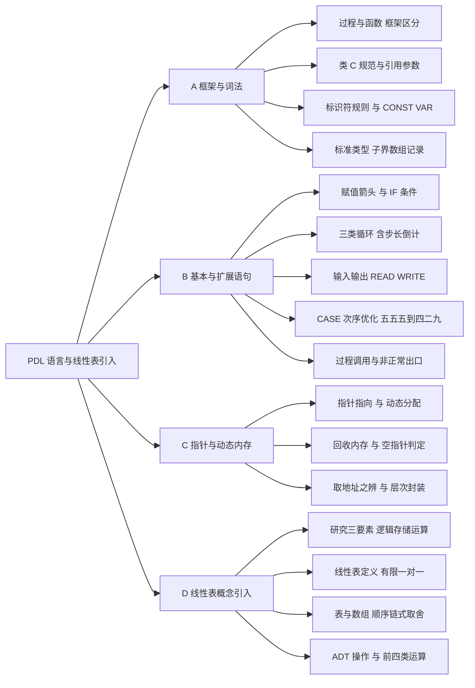

# 数据结构 · 第三周第二节 · PDL 语言与线性表引入 · 详细版讲义

> **来源说明**：本讲义由两段课堂录音转写整理而成，并与本文件夹内教材（严蔚敏、吴伟民《数据结构（C 语言版）》，MinerU 解析版）逐节对照校订，关键史实与术语另经网络检索核实（以 🌐 标出）。它是**讲授笔记性质的整理稿**，全篇以**第一人称**呈现；凡属教材原文或补充对照的内容以「📖 教材对照」标出，网络核实的资料以「🌐 网络核实」标出；转写模糊或口径存疑之处在正文给出说明，并汇总于文末「待核实内容」。
>
> - **转写 1**：`算法描述语言课程讲解_导出原文.txt`（PDL 语言的框架、词、数据类型、基本语句）
> - **转写 2**：`程序设计与数据结构授课内容_导出原文.txt`（扩展语句、过程调用、终结语句、复合语句、指针，以及线性表引入）
> - **教材对照范围**：第 1 章 1.3（抽象数据类型的表示与实现 · 类 C 语言）、第 2 章引言与 2.1（线性表的类型定义，含式 (2-1)、图 2.1、ADT List）、2.2/2.3 中与指针操作及存储结构取舍对照的内容（含算法 2.3/2.4/2.9/2.10）。
> - **课堂定位**：**第三周第二节**。承接上一节（[[数据结构第三周第一节]]：算法复杂度扩展分析 + PDL 概述，定义 20~23）。本节课（约 90 分钟，中间休息 5 分钟）**先把课程第二章的 PDL 语言讲完**，随后**开启第三章线性表**（对应严蔚敏教材第 2 章）；两段转写对应本节课的上半场与下半场。
> - **标注体例**：全文「定义」一律单独成块、连续编号并注明出处——`（课堂）` 表示课堂讲授、教材未直接收录；`（教材 X.X）` 表示教材对应章节原文。全部例题按序号（例 1 ~ 例 4）摘录并注明来源与答案。
> - **相关笔记**：[[数据结构第三周第一节]]（上一节：复杂度与设计方法）｜[[数据结构 第二章 线性表 详细版讲义]]（本章教材全解）｜[[数据结构 第一章 绪论 课堂讲义]]

---

## 开场导读

上节课我们讲完了算法复杂度的度量方法和「自顶向下、逐步求精」的设计思路，并在最后引入了 PDL（算法描述语言）的基本概念。这节课约 90 分钟，我要带大家完成两件承上启下的大事：上半场先把 **PDL 语言**的语法全貌讲透，为课程前期的「算法设计与描述」部分收尾；下半场正式跨入具体的**数据结构模型**——开启**线性表**这一章。

整节课的逻辑可以按「从描述工具到数据模型」来把握。在 PDL 这一半程，我完全类比自然语言的「框架 $\to$ 词 $\to$ 句子」三层结构来展开：先看一般过程（`PROCEDURE`）与函数过程（`FUNCTION`）怎么搭架子，并对照教材的**类 C 伪码**与**引用参数写法**；再看作为「词」的**标识符**与**数据类型**（标准类型、子界、数组、记录与最关键的指针）；然后把五类**基本语句**和五类**扩展语句**（特别是 `CASE` 判断次序优化、过程调用与非正常出口）串起来；最后专门拆解动态指针 `NEW` / `DISPOSE` 与计算机层次结构中的取地址之辨。到了线性表这一半程，我们先立住「逻辑结构—存储结构—运算」三方面研究模型的框架，讲清楚线性表的**有限性**与**一对一关系**、完整对照教材的 **ADT List**，并把**线性表与数组的区别**以及**顺序存储与链式存储的取舍**理顺。

开始正文前，我先把本节最容易混淆的四个要点拎出来：

1. **变量与常量、赋值与等价别混**：PDL 中 `CONST` 里的 `=` 表示数学上的等价替换，赋值用的是箭头 `←`（流程图箭头方向相反）；而 C 语言用 `=` 表达赋值，并且区分大小写（Wirth/Pascal 风格 PDL 不区分大小写）。
2. **类 C 的 `&` 引用参数不是标准 C 语法**：严蔚敏教材在形参表中用 `&L`、`&e` 表示 C++ 风格的引用参数，目的是直接修改实参；若用纯标准 C 实现，必须改写为指针形参（如 `SqList *L`）并在调用处传地址 `&L`。
3. **`NEW(P)` 不是给指针变量 `P` 分配空间**：`P` 自己在定义时已经占有了存放地址的单元，`NEW(P)` 是在堆内存中分配一个新的数据单元，再让 `P` 指向它；若分配失败则得到空指针。
4. **线性表不等于数组**：线性表是长度可动态变化的逻辑模型，支持按位序插入和删除；数组是程序设计语言中的构造数据类型，长度通常固定，它可以用来实现线性表的顺序存储，但线性表也可以用链式存储实现。

---

## 总览知识地图



> **图注（总览知识地图）**：全图按课程讲授主线从左到右分为四个分支。**A 分支**解决语言的骨架与单词层，对比 PDL 两种过程与类 C 语法及引用参数，并梳理标识符与静态数据类型；**B 分支**展开语句层，覆盖五类基本语句与 `CASE`、调用、非正常出口等扩展语句；**C 分支**专门剖析动态数据类型——指针的指向语义、`NEW`/`DISPOSE` 内存管理与系统层次封装；**D 分支**过渡到线性表，建立三要素方法论，明确线性表有限性与一对一关系，并理清表与数组的区别、顺序与链式取舍及 ADT 操作体系。

---

## 正文

### 一、承接与本节的路线图

上一节我主要把**算法分析（复杂度）**这一块做了扩展，并给出了 **PDL 的定义**（上节定义 20：PDL 保留程序设计语言的框架与描述形式，去掉具体语言的细节要求，结合自然语言，用于描述算法处理逻辑）。这节课的任务很明确：用不到 90 分钟把 **PDL 语言**讲完——讲完就意味着课程里算法描述这部分收尾，然后马上进入**线性表**一章。

> **语言观提醒**：PDL 并不复杂，作为计算机专业的学生，给大家两三天时间就要掌握并吃透。**语言本身好学，难在设计**——就像上一节我们说过的，会说中文的人很多，但能写出好散文、好诗歌的却很少，真正考验功夫的是背后的算法思路。

#### 1.1 学习路线：类比自然语言

任何语言——无论是自然语言还是程序设计语言——都有共同的组织层次。我把它总结为下面这张路线图：

| 自然语言 | PDL（算法描述语言） | 说明 |
|---|---|---|
| 先看「这门语言长什么样」（Hello World） | **算法的框架**（如何书写算法） | 学 C/C++/Java 之前，第一章通常会先给一个 Hello World，看的正是语言的**整体框架** |
| **词**（汉字 / 英文单词），语义的最小单位 | **标识符**（identifier，课上亦称标志符） | 单个词本身不具有完整的句子级语义 |
| 词的归类（名词、动词……） | **数据类型**（变量或常量所属的类别） | 每个变量或常量在强类型框架下都有明确的数据类型 |
| 句子（陈述句、疑问句、感叹句……） | **基本语句**（赋值、条件、循环、输入、输出） | 表达完整操作语义要靠句子 |
| 复杂思想的表达 | **扩展语句**（CASE、过程调用、复合语句……） | 用来表达多分支、复用、提前退出等更复杂的语义 |

> **定义 1（语言的三层结构 ｜ 课堂）**：学习任何语言都可以沿「**框架 $\to$ 词 $\to$ 句子**」三层展开：① 框架解决「写出来长什么样」；② **词是语义的最小单位**，但不具有完整的语句级语义；③ 表达完整操作信息需要**句子**，基本语句表达基本语义，扩展语句表达更复杂的语义。

**本节要点**

- PDL 的学习沿「框架 $\to$ 词（标识符与数据类型） $\to$ 句子（基本语句与扩展语句）」三层推进。
- 语法规则本身容易掌握，核心难点在于利用这一工具把算法设计思想表达清楚。
- 标识符只是语义的最小单位，必须组合成语句或表达式才能完整表达处理逻辑。

---

### 二、算法的框架：两类过程与类 C 规范

#### 2.1 回顾：为什么算法体现在「过程」上

算法是「解决某个特定问题的**指令的有限序列**」（教材 1.4.1；课上我也常把它通俗地说成「指定的有限指令集合/步骤」）。它的执行含义主要落在**过程**二字上。按算法的目的性和对结果的要求不同，我把过程分成两类：

- **一般过程**：只要求「这件事**做了就行**」，不专门要求返回一个值，比如在屏幕上打印一行提示、修改某个全局状态；
- **函数过程**：不但要做这件事，还**特别需要得到那个返回值**——就像数学里的函数，给一个自变量 $x$，要还给调用者一个 $y$。

#### 2.2 Wirth 风格 PDL 的书写形式（课堂板书体系）

```c
// 一般过程书写框架（PDL 伪码）
PROCEDURE 过程名 (参数表);
BEGIN
    语句组
END;

// 函数过程书写框架（PDL 伪码）
FUNCTION 函数名 (参数表) : 返回值类型;
BEGIN
    语句组
END;
```

我把上面的要素逐个拆解一下：

- **PROCEDURE**（简写 **PROC**）就是英文「过程」一词，直接充当一般过程的标识因子，一眼就能看懂；
- **FUNCTION**（简写 **FUNC**）就是英文「函数」一词；
- **参数表**：算法都是用来解决某个问题的，而问题是通过参数来刻画的——任何问题都有自己的**论域范围**，论域范围就通过参数表传进来；
- **BEGIN … END**：分别表示过程开始与过程结束，非常直白；
- **冒号（`:`）的含义 = 解释说明**：函数过程执行完要有返回值，而任何数据都有类型，所以用冒号在函数名后面**解释说明返回值的类型**（整型、实型等等）。

#### 2.3 类 C 伪码语法约定与引用参数写法（重点对照）

> 📖 **教材对照（1.3 类 C 语言核心约定）**：严蔚敏《数据结构（C 语言版）》选用介于伪码和 C 语言之间的**类 C 语言**作为算法描述工具。为了把课堂上的 Wirth 风格 PDL 和教材上的类 C 衔接起来，我把教材 1.3 节最重要的几条语法约定列在下面：
>
> 1. **统一采用函数形式**（1.3 (3)）：类 C 把一般过程和函数过程统一写成「`函数类型 函数名(函数参数表) { // 算法说明; 语句序列 }`」；当函数返回值为操作状态代码时，返回类型写为 `Status`。
> 2. **辅助变量可不事先声明**（1.3 (3)）：除了函数形参必须说明类型外，算法内部使用的辅助变量可以不写变量说明，必要时用注释说明其作用。一般约定 `a~e` 作数据元素名、`i~n` 作整型变量名、`p~r` 作指针变量名。
> 3. **参数传递与引用参数写法（`&`）**：这是读教材算法最容易卡住的地方。为了既能通过参数把结果带回调用处，又不至于在算法里写满指针解引用符号，类 C 语言除值传递外，**借用了 C++ 的引用调用方式**——在形参表中以 `&` 打头的参数就是**引用参数**。

为了让大家在阅读 PDL、教材类 C 与动手写纯 C 程序时不出错，我把三者的**引用参数写法**专门列成对照表：

| 语言体系 | 值参数写法（不修改实参） | 引用/传出参数写法（修改实参） | 实操注意 |
|---|---|---|---|
| **PDL（Wirth/Pascal 风格）** | `PROC Foo(x : integer);` | `PROC Foo(VAR x : integer);` | 形参前加 `VAR` 表示传址/变量参数，过程内修改会影响实参 |
| **类 C（严蔚敏教材）** | `Status GetElem(SqList L, int i, ...)` | `Status GetElem(SqList L, int i, ElemType &e)` | 形参带 `&` 属于 C++ 语法；教材在 `ADT List` 签名中也用 `&` 标出传出或被改动的参数（如 `InitList(&L)`） |
| **纯标准 C 语言（C89/C99/C11）** | `int GetElem(SqList L, int i, ...)` | `int GetElem(SqList L, int i, ElemType *e)` | **纯 C 没有 `&` 引用形参**！必须改写为指针形参 `*e`，函数体内用 `*e = ...`（或 `L->...`），调用时传实参地址 `&e` |

```c
// 对照示例：在顺序表中获取第 i 个元素并返回给调用者
// 1. 教材类 C 写法（使用 C++ 引用参数 &e，不可直接用纯 C 编译器按 .c 编译）
Status GetElem_PseudoC(SqList L, int i, ElemType &e) {
    if (i < 1 || i > L.length) return ERROR; // 位序越界则返回错误状态
    e = L.elem[i - 1];                       // 直接修改引用参数 e
    return OK;                               // 返回成功状态
}

// 2. 纯标准 C 改写（使用指针形参 *e，调用时传 GetElem_C(L, i, &e)）
Status GetElem_C(SqList L, int i, ElemType *e) {
    if (i < 1 || i > L.length) return ERROR; // 位序越界则返回错误状态
    *e = L.elem[i - 1];                      // 通过指针解引用写入调用者的变量
    return OK;                               // 返回成功状态
}
```

#### 2.4 与 C 语言的框架对照及 `void` 可读性辨析

| PDL（Wirth 风格） | C 语言 | 差异 |
|---|---|---|
| `PROCEDURE 过程名(参数); BEGIN … END` | `void 函数名(参数) { … }` | C 没有「过程」一词，无返回值函数用 `void` 表达 |
| `FUNCTION 函数名(参数) : 类型; BEGIN … END` | `类型名 函数名(参数) { … }` | C 把返回类型放在函数名**前面**；C 中没有 `function` 关键字 |
| `BEGIN … END` | `{ … }`（花括号） | C 用花括号代替 `BEGIN` 与 `END` |

我专门拿 C 语言的 `void` 做过一次**词义分析**，这也是理解「为什么还需要 PDL」的一个好例子：

> `void` 在英语里身兼三职：作**形容词**是「空的、无效的」；作**名词**是「空虚、空白」；作**动词**是「宣布作废、取消」。
>
> 试想一下：把「无效的」或者「取消」放在一个函数名前面，一个没学过 C 语言的人，很难把 `void` 和「我要执行一个一般过程」联系起来。从自然阅读的角度看，C 的这种写法可读性确实差了一些。

而我们用 PDL 写算法设计稿的目标，正是让**非计算机专业的人——比如学艺术、学考古、学中文的人——也能大致看懂处理逻辑**。如果拿一段满是细节符号的 C 代码给外行看，对方总不能先学一遍 C 语言语法再来读你的设计。

#### 2.5 为什么用英文、为什么要缩写

- **程序字符与英文习惯**：现代程序设计语言主流以英语关键词为基础（计算机早期核心理论与工程体系主要在欧美发展起来，早期字符集以英文 ASCII 为主），因此传统算法语言里的关键字和标识符通常采用英文单词或缩写，不在关键字中使用多种杂乱符号。
- **关键字缩写规则**：有些英文单词太长（比如 `PROCEDURE` 有 9 个字母），为了书写简洁，常取前面几个字母作缩写——例如 `PROCEDURE` $\to$ `PROC`、`FUNCTION` $\to$ `FUNC`、`constant` $\to$ `const`、`variable` $\to$ `var`、`character` $\to$ `char`。

> 🌐 **网络核实（出处）**：
> ① 本课 PDL 的关键字（`PROCEDURE`、`FUNCTION`、`BEGIN`、`END`、`CONST`、`VAR`、`IF/THEN/ELSE`、`WHILE/DO`、`REPEAT/UNTIL`、`FOR/TO/DOWNTO`、`CASE/OF`、`ARRAY`、`RECORD`、`READ`、`WRITE`、`NEW`、`DISPOSE`）均源自 **Pascal** 语言的保留字或标准过程；这套用类 Pascal 记号描述算法的传统源自 Niklaus Wirth（尼克劳斯·维尔特，通译「沃思」，Pascal 之父）1976 年的名著《Algorithms + Data Structures = Programs》（注：他 1986 年的修订版《Algorithms and Data Structures》改用了 Modula-2 记号，而非继续使用 Pascal）。
> ② 1968 年 Donald Knuth《计算机程序设计艺术（TAOCP）》第一卷系统梳理了基本数据结构与算法；国内教学文献中亦常提及 C. A. R. Hoare 与 N. Wirth 在 1966 年左右推动了记录处理与数据结构概念的形成。
> ③ 录音转写中出现的「维马语言 / 维纳语言 / 维马理论」，结合上下文应指 **Wirth（维尔特/沃思）** 的类 Pascal 算法描述体系，本讲义统一记作「PDL（Wirth/Pascal 风格）」。

**本节要点**

- 算法落地在过程上分为「做了就行」的一般过程（`PROCEDURE`）和「需要返回值」的函数过程（`FUNCTION`）。
- 严蔚敏类 C 语言统一采用函数形式描述操作，辅助变量可不预先声明，并用 `Status` 表示结果状态代码。
- 类 C 形参中的 `&` 是 C++ 风格的引用参数；改写为纯标准 C 程序时必须替换为指针形参 `*` 并在调用处取地址 `&`。
- PDL 用 `PROCEDURE`/`BEGIN`/`END` 替代 C 的 `void`/`{`/`}`，正是为了提升算法思路对非专业读者的可读性。

---

### 三、词：标识符（identifier）

#### 3.1 从自然语言到计算机语言的「词」

自然语言里表达思想的最小单位是**词**：学中文要认汉字、组词，学英文要背单词——「词是语义的最小单位」。那么计算机语言里的「词」叫什么？

> **定义 2（标识符 ｜ 课堂）**：标识符（课上有时口述作「标志符」，教材与标准术语通译「标识符」）就是**语言中由字符按照一定规则构成的、具有特定指代含义的词**。
>
> 在 C 语言、多数现代语言以及本课 PDL 的通行约定中，标识符由**52 个英文大小写字母、10 个数字（`0~9`）和下划线 `_`** 这三类字符组成，且**必须以字母或下划线开头**，不能以数字开头。（补充说明：早期标准 ISO Pascal 仅允许字母与数字且必须以字母开头，不含下划线；现代语言和本课课堂约定普遍放宽到允许 `_`。）

#### 3.2 标识符的两大类：系统保留的 vs 自己定义的

> **定义 3（保留字 / 关键字 ｜ 课堂）**：按来源和用途，标识符分两大类：
> ① **保留字（关键字）**：由系统预先规定好用途的标识符，例如 `if`、`then`、`else`、`while`、`do`、`for`，以及前面提到的 `PROC`、`FUNC`、`CONST`、`VAR` 等；保留字**不能被拿来当成普通变量名或过程名**；
> ② **自定义标识符**：程序员自己给变量、常量、类型、过程起的名字。

#### 3.3 命名原则：词文达意（附：匈牙利命名法）

我一向要求大家给自定义标识符取名时做到**词文达意**。比如要写一个「查询」操作，过程名就老老实实叫 `Search`，而不要像一些入门教材里的习惯那样：不管什么变量全用 `i`、`j`、`k`、`x`、`y`、`z`（注意：教材 1.3 约定 `i~n` 用作循环整型计数变量、`p~r` 用作指针名是在简短伪码里的局部习惯，工程和业务变量依然应当见名知义）。

> 🌐 **网络核实（匈牙利命名法）**：我课上提到命名可以参考「匈牙利方法」。匈牙利命名法（Hungarian notation）由匈牙利裔程序员 **Charles Simonyi（查尔斯·西蒙尼）** 发明（他在 Xerox PARC 期间提出，1981 年加入微软后推广于 Windows 开发），核心做法是在变量名前加小写前缀编码变量的类型或语义用途（如 `szName` 表示以零结尾的字符串）。大家理解它的精神即可：**让名字做到「望文生义」**，不必死记硬背前缀表。

#### 3.4 标识符的两个层次：过程名与变量/常量名

> **定义 4（标识符的两个层次 ｜ 课堂）**：按标识符指代的层次不同，可以分为两层：
> **第一层（集合/论域层面）**：给**过程**（一般过程或函数过程）取名字——过程名标识的是针对某类问题的一整段处理逻辑；
> **第二层（个体层面）**：给过程内部一个个的**变量、常量**取名字——它们是参与运算的具体个体。
>
> **命名纪律**：**过程必须「先定义，后调用」**（或先声明原型再调用）；**变量、常量必须「先说明，后使用」**。
>
> 打个比方：孩子一出生父母就得给取个名字（张三、李四），名字本身也许只是个代号，但从此别人叫你时才有了明确的指代性——先定义取名，后面才能调用和称呼。

#### 3.5 常量说明（`CONST`）

常量的英文是 **constant**，取前 5 个字母简写为 **const**（注：语音转写曾误记为「取前四个字母」，`c-o-n-s-t` 实为 5 个字母）。写法和语义如下：

```c
// PDL 常量说明格式与示例
CONST 常量名 = 值;

// 定义常量 pi
CONST pi = 3.14159;
```

- **这里的等号 `=` 语义是「等价」**（不是赋值）：在数学里，两个量用 `=` 连在一起表示左右等价——**凡是在后续语句里看到 `pi` 的地方，都可以直接用这个实数替换**。我特别强调：**等号在数学里代表左右等价，并没有「把右边装进左边」的赋值含义**——赋值在 PDL 里要专门用箭头（见 5.1 节）。
- **大小写之辨**：一位同学问过，常量名到底该大写还是小写？这里要分清语言规则：**Wirth/Pascal 风格的 PDL 本身不区分大小写**（`pi` 和 `PI` 等价），**但 C 语言与类 C 严格区分大小写**（`pi` 和 `PI` 是两个不同的标识符）。无论用哪种语言，编程**惯例**都是：**常量名全部大写**（如 `PI`、`MAXSIZE`，一眼就能与普通变量区分），**变量名用小写**，保留字则按标准写法书写。

#### 3.6 变量说明（`VAR`）

变量的英文是 **variable**（「可变化的」），取前 3 个字母简写为 **var**。写法如下：

```c
// PDL 变量说明格式与示例
VAR 变量名表 : 类型;

// 说明 3 个整型变量 i, j, k
VAR i, j, k : integer;

// 说明 3 个实型变量 x, y, z
VAR x, y, z : real;
```

- 冒号在这里同样起**解释说明**的作用：说明这些变量在什么取值集合与表示形态下变化——`i, j, k` 是 3 个整数，`x, y, z` 是 3 个实数。
- `i, j, k` 叫作**变量名表**，可以一次声明多个同类型的变量。

> 📖 **教材对照（类 C 语言的预定义常量与类型，1.3 (1)(2)）**：类 C 中没有 `VAR`、`CONST` 关键字，变量直接写成「类型 + 变量名表」；常量则用 C 预处理指令 `#define` 定义（注意在 C 语法中**每条 `#define` 必须单独占一行**），并预先约定 `Status` 状态码类型与通用元素类型 `ElemType`：
>
> ```c
> // 类 C 预定义函数结果状态代码与通用类型（教材 1.3 (1)(2)）
> #define TRUE 1
> #define FALSE 0
> #define OK 1
> #define ERROR 0
> #define INFEASIBLE -1
> #define OVERFLOW -2
>
> typedef int Status; // Status 是函数类型，其值是函数结果状态代码
> // 数据元素类型一律约定为 ElemType，由用户使用时通过 typedef 自行定义
> ```

**本节要点**

- 标识符由英文字母、数字和下划线组成，且不能以数字开头；系统保留字不可用作自定义变量名或过程名。
- 命名讲究「词文达意」，过程须「先定义后调用」，变量和常量须「先说明后使用」。
- `CONST` 中的 `=` 表示等价替换而非赋值；Pascal/PDL 不区分大小写，而 C 与类 C 严格区分大小写，惯例上常量全大写。
- 类 C 用 `#define`（每条独占一行）定义常量，用 `Status` 规范返回状态，并用 `ElemType` 抽象数据元素类型。

---

### 四、数据类型：词的「类别」与「形态」

#### 4.1 定义

> **定义 5（数据类型 ｜ 课堂）**：在强类型算法描述框架下，每个变量或常量都有自己所属的数据类型。数据类型 = **类别**（这个数据属于哪一类、支持什么运算）+ **形态**（它在内存与书写上长什么样）。

#### 4.2 标准类型（四个基本类型）

| 类型 | 英文 / 来源 | 说明 |
|---|---|---|
| **整型** | `integer` | 数学里的整数，直接采用英文单词 |
| **实型** | `real` | 小数与实数统一用 `real` 表示；PDL 中不细分 `float` / `double` 的单双精度差别 |
| **布尔型** | `boolean` | **逻辑类型**，取值只有 `true`（真）和 `false`（假）。布尔代数是现代计算机进行逻辑运算的理论基础（🌐 George Boole，1815–1864，英国数学家） |
| **字符型** | `char` | `character`（字符）的缩写，表示单个字母、数字字符或标点符号 |

#### 4.3 子界类型（子域类型）

> **定义 6（子界类型 ｜ 课堂）**：由一个**下界**、两个点 `..` 和一个**上界**构成——`下界..上界`，它表示某一个已知有序类型中的**一段连续区间**，常用于限定整数或字符的取值范围。
>
> 例如：`40..90` 表示 40 到 90 之间的整数（含 40 和 90）；`20..30` 表示 20 到 30 之间的整数；`'A'..'G'` 表示从字符 `'A'` 到字符 `'G'` 的有序字符范围。

#### 4.4 构造类型：用基本类型「搭积木」

有了标准类型这些「小方块」，我们就可以像搭积木一样，**构造**出更复杂的数据类型。

**（1）数组类型（`ARRAY`）**

> **定义 7（数组类型 ｜ 课堂）**：格式为 `数组名 : ARRAY [下标范围] OF 元素类型;` ——冒号起说明作用，`ARRAY … OF` 说明这是一个数组以及里面存放什么类型的数据。

```c
// 一维数组示例：下标范围 1..20，最多存 20 个整数
VAR A : ARRAY [1..20] OF integer;

// 二维数组示例：第一维下标 1..20，第二维下标 -10..20，元素为实数
VAR B : ARRAY [1..20, -10..20] OF real;
```

可以看到，PDL 的数组下标范围非常灵活，不一定从 `0` 开始，甚至可以是负数区间（如 `-10..20`）；而翻译成 C 语言时，数组下标固定从 `0` 开始，需要做下标平移或映射。

**（2）记录类型（`RECORD`）**

> **定义 8（记录类型 ｜ 课堂）**：现实世界中的一个客观事物往往由两个或两个以上的属性共同描述，在计算机里把这些属性打包到一起就叫**记录**（`RECORD`）。数据库里叫记录，操作系统里也叫记录，C 语言则管它叫**结构体**（`struct`）。

```c
// 人员档案记录示例（PDL 伪码）
VAR A : RECORD
    name : ARRAY [1..8] OF char; // 姓名：最多 8 个单字节字符的数组
    sex  : 0..1;                 // 性别：用子界 0..1 编码（如 0 代表男，1 代表女）
    // 其余成分，如年龄、工号等
END;
```

- `name` 是一个最多放 8 个字符的字符数组；
- `sex` 用子界类型 `0..1` 来编码——性别只有两种取值，用 `0` 和 `1` 编码既省空间，也避免了早期单字节 `char` 无法直接存放多字节中文字符及关键字/标识体系不用汉字的问题。

> 📖 **教材对照（2.1，定义 3 与图 2.1）**：教材原话指出：「在稍复杂的线性表中，一个数据元素可由若干个**数据项（item）**组成。在这种情况下，常把数据元素称为**记录（record）**，含有大量记录的线性表又称**文件（file）**。」教材图 2.1 的学生健康情况登记表中，每个学生的记录由**姓名、学号、性别、年龄、班级、健康状况** 6 个数据项组成，正与这里的人员档案记录对应。

**（3）指针类型（相对复杂的一类）**

指针（`pointer`）表达的是**指向性信息**。打个比方：你去外地开会不认识路，主办方就在地上画一个箭头给你指明方向——指针的作用就像那个指向目标位置的箭头。

> **定义 9（指针类型 ｜ 课堂）**：PDL 里指针用**向上的箭头 `↑`**（键盘上通常记作 `^`）表示，指针类型写作 **`↑类型名`**。

```c
// 1. 定义「一类」：定义指向整型的指针类型（一个类型集合）
TYPE IntPtr = ↑integer;

// 2. 说明「一个个体」：定义一个具体指针变量 B，它只能指向一个整型变量
VAR B : ↑integer; // 等价于 VAR B : IntPtr;
```

- **方向辨析**：C 语言的指针声明习惯**从左到右**（`int *p`，星号写在类型和变量名之间）；PDL 里采用 **`↑integer`**（指向整型），读起来「B 指向一个 integer」，跟自然语言的「指向」表述更贴近。
- 📖 **教材对照**：严蔚敏教材采用 C 的指针记号（如 `ElemType *elem;`、`struct LNode *next;`、`p->next` 等），到后面讲线性表的顺序实现和单链表实现时会大量用到。

**本节要点**

- 数据类型规定了数据的「类别」与「形态」，标准类型包括 `integer`、`real`、`boolean`、`char` 四种。
- 子界类型（`下界..上界`）用来限定有序类型的一段连续取值区间。
- 数组、记录（对应 C 的 `struct`）与指针（`↑`）属于构造类型，可以用基础类型「搭积木」组合而成。
- 指针表达指向性信息，具体内存操作语义将在第 7 节专门展开。

---

### 五、基本语句：用「句子」表达完整语义

单个标识符（词）不能表达完整语义，完整语义要靠**句子**。自然语言有陈述句、疑问句、感叹句等句型；PDL 的**基本语句**也有五类：**赋值、条件、循环、输入、输出**。

#### 5.1 赋值语句

做数学题时我们定义一个变量 $x$，要给它赋予具体数值或含义。计算机模拟人处理数据，把计算结果放进变量里的动作就是赋值。

> **定义 10（赋值语句 ｜ 课堂）**：
>
> ```c
> // PDL 赋值语句：把右边表达式的值赋给左边的变量
> 变量 ← 表达式;
> ```
>
> 用一个**从右向左的箭头 `←`** 表示：箭尾是已经算好的值，箭头指向的「位置」是被赋值的变量。

- **注意流程图中的箭头方向**：画传统流程图时，赋值常写成「表达式 $\to$ 变量」（箭尾仍旧是已有值，箭头仍然指向被赋值者，只是书写的左右位置对调了）。
- **C 语言用 `=` 表示赋值**：有的教材在讲 C 语言时专门强调过这一点——数学里的 `=` 表示「左右两边相等/等价」，并不是赋值；而 C 语言的 `=` 是赋值运算符，所以才有 `x = x + 1;` 这样「把 `x + 1` 的结果重新存入 `x`」的合法语句。PDL 故意用 `←` 来避免与数学等价混淆。
- 📖 **教材对照（1.3 (4)）**：类 C 的赋值语句除了简单赋值 `=` 外，还扩充了**数组片段赋值**（`a[起始下标..终止下标] = b[起始下标..终止下标];`）、**交换赋值**（`变量1 ↔ 变量2;`）以及 C 的**条件赋值**（`变量 = 条件表达式 ? 表达式T : 表达式F;`）。

#### 5.2 条件语句

人做事不能一条道走到黑，遇到不同情况要学会「拐弯」，这种在程序里的分岔选择就是**条件语句**。

> **定义 11（条件语句 ｜ 课堂）**：
>
> ```c
> // 单分支条件语句：条件为真时执行语句组
> IF 条件 THEN 语句组;
>
> // 双分支条件语句：条件为真执行语句组1，否则执行语句组2
> IF 条件 THEN 语句组1 ELSE 语句组2;
> ```
>
> 好比出门前看天色：如果下雨（条件成立），就带把伞（执行语句组）；如果没下雨，单分支就什么都不做，双分支就改做另一件事。

**关键辨析（C 语言的条件表达式）**：PDL 要求 `IF` 后面必须是一个**逻辑条件**，结果明确是 `true` 或 `false`。而 C 语言的 `if (表达式)` 允许放入任意算术或指针表达式，用**「非 0 即真、0 为假」**来替代独立的逻辑类型判断：

```c
// C 语言「非 0 即真」示例
int x = 1, a = 0;
if (x) a = a + 1; // 只要 x 不是 0（哪怕是 -1），条件就判定为真
```

把数值是否为 0 当成真假来用，虽然写起来省事，但初学者读代码时容易产生歧义。（📖 **教材对照 1.3 (11)**：类 C 明确规定了逻辑运算的**短路求值**——对于 `A && B`，当 `A` 为 0 时不再对 `B` 求值；对于 `A || B`，当 `A` 非 0 时不再对 `B` 求值。）

#### 5.3 循环语句

生活中很多事情都是重复进行的——每天起床、洗漱、上课、吃饭、休息。在算法里，表达这种重复执行动作的就是**循环语句**。

**（1）当型循环（`WHILE`）**

> **定义 12（当型循环 ｜ 课堂）**：
>
> ```c
> // 当条件成立时重复执行语句组（先判断，后执行）
> WHILE 条件 DO 语句组;
> ```
>
> - **语义**：先判断条件，满足才执行语句组；不满足就直接跳出。
> - **C 对照**：`while (条件) 语句组;` ——两者语义相同，只是 C 省去了 `DO` 关键字，改用圆括号括住条件。
> - **要点**：因为**先判断后执行**，若一开始条件就不成立，循环体**一次都不会执行**。

**（2）直到型循环（`REPEAT-UNTIL`）**

> **定义 13（直到型循环 ｜ 课堂）**：
>
> ```c
> // 先执行语句组，再判断条件；直到条件成立才停止循环
> REPEAT
>     语句组
> UNTIL 条件;
> ```
>
> 语义：**先做一遍语句组，然后判断条件；只要条件还不成立就继续循环，直到「条件成立」为止**。好比 9 月开学后大家持续上课学习，直到「放寒假」这个条件成立才停下来。

⚠️ **与 C 的 `do-while` 条件方向正好相反**：

| 比较项 | PDL：`REPEAT … UNTIL 条件` | C：`do { … } while (条件);` |
|---|---|---|
| 循环继续的条件 | 条件**不成立**（为假）时继续 | 条件**成立**（为真）时继续 |
| 停止循环的条件 | 条件**成立**（为真）时停止 | 条件**不成立**（为假）时停止 |
| 最少执行次数 | **至少执行一次**（先做再判） | **至少执行一次**（先做再判） |

**（3）计数型循环（`FOR`）与步长 `STEP`**

`WHILE` 和 `REPEAT` 往往用在事先不知道要循环多少次的场合；如果**循环次数或起止范围已经明确**，用 `FOR` 语句最清晰：

> **定义 14（计数型循环 ｜ 课堂）**：
>
> ```c
> // 递增计数循环：变量从初值依次递增到终值（包含终值）
> FOR 变量 := 初值 TO 终值 DO 语句组;
>
> // 带步长扩展的计数循环（通用 PDL 伪码写法，每次增加步长 K）
> FOR 变量 := 初值 TO 终值 STEP K DO 语句组;
> ```
>
> - **语义**：把初值赋给变量，只要**变量不超过终值（`变量 <= 终值`）**就执行语句组；每执行完一遍，变量**默认自动加 1**（步长为 1），**循环体内不需要也不应该再去手动修改循环变量加 1**。
> - **`TO` 好比「爬山」**（从小到大数）；若需要一次跨多步（等差跳跃增长），在通用 PDL 伪码中用 **`STEP K`** 标明步长（注：标准 ISO Pascal 本身没有 `STEP` 关键字，但通用算法伪码常用 `STEP` 表示非 1 步长；翻译成 C 时对应 `for` 的第三表达式 `i += K`）。
> - **非等差增长怎么办**：如果变量是倍增关系（如每次 `i ← i * 2`），无法用加减步长 `STEP` 表达，就改用 `WHILE` 循环，把 `i ← i * 2` 明确写进循环体中。

**（4）倒计数（`DOWNTO`）**

自然界也有倒着数数的场景，比如火箭发射前倒计时：10、9、8、……、1，点火！

> **定义 15（`DOWNTO` 倒计数循环 ｜ 课堂）**：
>
> ```c
> // 递减计数循环：变量从初值依次递减到终值（包含终值）
> FOR 变量 := 初值 DOWNTO 终值 DO 语句组;
> ```
>
> - **语义**：`DOWNTO` 好比「下山」，每次执行完变量**自动减 1**（配 `STEP K` 时每次减 `K`），只要满足 `变量 >= 终值` 就继续执行。
> - **边界规则**：因为是向下数，正常使用时**初值应大于或等于终值**；如果初值比终值还小，条件一开始就不成立，循环**自动跳过，一次都不执行**。

#### 5.4 输入语句与输出语句

计算机是模拟人类解决问题的工具，要先拿到数据才能计算，算完还要把结果展示给人看，这就靠输入与输出语句。

> **定义 16（输入 / 输出语句 ｜ 课堂）**：
>
> ```c
> // 输入：从外部把数据读入内存变量中
> READ (变量名表);
>
> // 输出：把表达式的计算结果输出到屏幕或输出设备
> WRITE (表达式表);
> ```
>
> - **`READ`（读）**就像考试时先「读题」——把题目信息读进大脑（输入到内存）；
> - **`WRITE`（写）**就像想好思路后「答题」——把答案写到纸上（输出给用户）。

⚠️ **C 语言对照（重要辨析）**：严格来说，**C 语言语法本身并没有内置的输入/输出语句**！大家常用的 `scanf` 和 `printf` 实际上是 **C 标准库提供的接口函数**，通过函数调用来完成输入输出。（📖 **教材对照 1.3 (8)**：类 C 沿用 `scanf([格式串], 变量1, …, 变量n);` 和 `printf([格式串], 表达式1, …, 表达式n);`，书写伪码时通常省略格式串。）

#### 5.5 五类基本语句速查（PDL $\leftrightarrow$ 类 C $\leftrightarrow$ C）

| 语句 | PDL（Wirth/Pascal 风格） | 类 C（严蔚敏） | C 语言 | 备注 |
|---|---|---|---|---|
| 赋值 | `变量 ← 表达式` | `变量 = 表达式`（另有 `↔`、`?:`、片段赋值） | `=` | 流程图箭头方向相反；C 的 `=` 不是数学等价 |
| 单分支 | `IF 条件 THEN 语句组` | `if (表达式) 语句` | `if (表达式) …` | PDL 要求条件明确返回布尔值 |
| 双分支 | `IF … THEN … ELSE …` | `if … else …` | `if … else …` | C 中「非 0 即真」，易引发误读 |
| 当型循环 | `WHILE 条件 DO 语句组` | `while (条件) 语句` | `while (…)` | 先判后做，可能一次都不执行 |
| 直到型循环 | `REPEAT … UNTIL 条件` | `do {…} while (条件);` | `do…while` | 条件方向相反；均至少执行一次 |
| 计数型循环 | `FOR i := 初值 TO 终值 DO`（/`DOWNTO`/`STEP`） | `for (赋初值; 条件; 修改)` | `for (init; cond; step)` | PDL 默认步长 $\pm 1$ 自动更新；C 需显式写出 |
| 输入 | `READ(变量名表)` | `scanf(…)` | `scanf(…)` | C 的 `scanf`/`printf` 是库函数而非语言关键字语句 |
| 输出 | `WRITE(表达式表)` | `printf(…)` | `printf(…)` | 同上 |

> 📖 **教材对照（1.3 补充函数与逻辑约定）**：除表内语句外，严蔚敏类 C 还约定了常用基本函数：`max(...)`、`min(...)`、`abs(...)`、`floor(...)`（向下取整）、`ceil(...)`（向上取整）、`eof(...)`（判文件结束）、`eoln(...)`（判行结束），以及单行注释 `// 文字序列`。

**本节要点**

- 五类基本语句为赋值、条件、循环、输入与输出，是构成算法处理流程的基础。
- PDL 赋值箭头 `←` 与流程图箭头指向被赋值者一致；`REPEAT-UNTIL` 与 C 的 `do-while` 停止/继续条件方向相反。
- `FOR ... TO / DOWNTO` 默认包含终值且自动步进 $\pm 1$；非等差变化（如倍增 `i * 2`）应改用 `WHILE` 并写在循环体内。
- C 语言没有关键字级输入输出语句，`scanf` 和 `printf` 属于标准库函数调用。

---

### 六、扩展语句：表达更复杂语义

基本语句能写清楚基础逻辑，但碰到多情况分派、模块复用、出错中止或大段逻辑打包时，就需要**扩展语句**。

#### 6.1 情况语句（`CASE`）——「情况分析」求精技术的落地

上一节我讲了「自顶向下、逐步求精」的三类求精技术（上节定义 19），其中第三类叫作**情况分析**——遇到多种互斥可能性时，如果全写成一层层嵌套的 `IF-THEN-ELSE`，代码会又长又啰嗦。用 **`CASE` 语句**就会清爽很多：

> **定义 17（情况语句 ｜ 课堂）**：
>
> ```c
> // PDL 条件式多分支情况语句
> CASE 表达式 OF
>     条件1 : 语句组1;
>     条件2 : 语句组2;
>     ...
>     条件n : 语句组n;
>     ELSE    语句组n+1 // 都不满足时执行
> END;
> ```
>
> **语义**：自上而下依次判断各个条件，哪个条件先满足，就执行对应的语句组，**执行完这一支就自动结束整个 `CASE` 语句**；如果全都不满足，就执行 `ELSE` 后的语句组 $n+1$。

⚠️ **C 语言 `switch` 的语法特点（重要辨析）**：标准 C 的 `switch` 只能对**整型或字符型常量值**做分支（不能直接写 `90..100` 这样的范围条件），而且 C 的 `case` 只是一个**跳转入口**——如果分支末尾不加 `break;`，程序从命中的 `case` 进去后会**一直穿透执行后面的所有分支**。因此写 C 时必须配合 `break;`（对于范围判断则直接用 `if ... else if ... else` 链）。

> 📖 **教材对照（1.3 (5)）**：严蔚敏类 C 规定了两种开关语句——「开关语句 1」按**常量值**分派（`switch(表达式) { case 值1: ... break; ... default: ... }`），「开关语句 2」按**条件**分派（`switch { case 条件1: ... break; ... default: ... }`），后者与课堂的广义 `CASE` 直接对应，只是类 C 仍要求显式写 `break;`。

#### 例题 1：成绩分段统计（`CASE` 语句）【课堂例题 ｜ 伪码与 C 对照】

> **例 1（课堂例题 ｜ 伪码整理）**　统计 200 名学生的成绩分布：90~100 分、80~89 分、70~79 分、60~69 分、60 分以下各有多少人。设 5 个计数变量 `x1`~`x5` 分别统计这 5 个分数段的人数，循环读入成绩 `x` 并归类计数（各计数变量初值必须先清零）。

```c
// PDL 伪码版：子界条件 CASE 统计成绩分段
CONST n = 200;
VAR i, x : integer;
    x1, x2, x3, x4, x5 : integer;
BEGIN
    x1 := 0; x2 := 0; x3 := 0; x4 := 0; x5 := 0; // 五个计数器必须先清零
    FOR i := 1 TO n DO
    BEGIN
        READ(x);                                 // 读入第 i 个学生的成绩
        CASE x OF
            90..100 : x1 := x1 + 1;              // 90~100 分段人数加 1
            80..89  : x2 := x2 + 1;              // 80~89 分段人数加 1
            70..79  : x3 := x3 + 1;              // 70~79 分段人数加 1
            60..69  : x4 := x4 + 1;              // 60~69 分段人数加 1
            ELSE      x5 := x5 + 1               // 60 分以下人数加 1
        END
    END;
    WRITE(x1, x2, x3, x4, x5)                    // 输出各分段人数
END.
```

好比选班委唱票：唱票人按候选人名字在黑板上画「正」字，念到谁的名字就在谁那一栏加一笔。要注意的是，**翻译成标准 C 语言时不能直接写 `case 90..100:`**，而应当写成逻辑区间判断：

```c
// 标准 C 对应写法：使用 if-else if 实现区间分支
if (x >= 90 && x <= 100)      x1++; // 90~100 分
else if (x >= 80 && x <= 89)  x2++; // 80~89 分
else if (x >= 70 && x <= 79)  x3++; // 70~79 分
else if (x >= 60 && x <= 69)  x4++; // 60~69 分
else                          x5++; // 60 分以下
```

#### 例题 2：同一 `CASE` 语句，判断次序不同导致效率差异【课堂例题 ｜ 555 $\to$ 429 与 414 核算】

接着上面的例子，我问大家一个问题：**「代码逻辑完全不变，怎么排列这几个分支的顺序，才能让计算机做的判断总次数尽量少？」**

**背景（正态分布）**：合理的考试成绩分布通常近似服从**正态分布**（🌐 normal / Gaussian distribution，钟形曲线——像一顶倒扣的帽子，**中间大、两头小**）：高分段（90 以上）和不及格段（60 以下）人数较少（常各自在 10% 以下），大多数学生集中在 60~90 分之间。

假设共 200 名学生，课堂给出的分布如下（其中 60~69 段人数由总数 200 及总判断次数 555 反推核算为 31 人：$16+64+79+31+10=200$）：

| 分数段 | 90~100 | 80~89 | 70~79 | 60~69 | <60 |
|---|---|---|---|---|---|
| 人数 | 16 | 64 | 79（最多） | 31 | 10 |

**方案（1）：按「从高分到低分」依次判断（90 段排最前）**——第 $k$ 个分支命中前要经过前面 $k-1$ 次失败判断加本次 1 次判断，共 $k$ 次（若落入 `ELSE` 分支，需做完前 4 个条件判断才进入 `ELSE`；课上按 5 个显式条件依次判断口径，60 分以下每人计 5 次）：

| 分数段 | 每人判断次数 | 人数 | 小计 |
|---|---|---|---|
| 90~100 | 1 | 16 | 16 |
| 80~89 | 2 | 64 | 128 |
| 70~79 | 3 | 79 | 237 |
| 60~69 | 4 | 31 | 124 |
| <60 | 5 | 10 | 50 |
| **总计** | | **200** | **555 次** |

**方案（2）：把人数最多的 70~79 与 80~89 提前到最前面**（课堂演示次序：70~79 $\to$ 80~89 $\to$ 90~100 $\to$ 60~69 $\to$ <60）：

| 次序 | 分数段 | 每人判断次数 | 人数 | 小计 |
|---|---|---|---|---|
| 1 | 70~79 | 1 | 79 | 79 |
| 2 | 80~89 | 2 | 64 | 128 |
| 3 | 90~100 | 3 | 16 | 48 |
| 4 | 60~69 | 4 | 31 | 124 |
| 5 | <60 | 5 | 10 | 50 |
| **总计** | | | **200** | **429 次** |

**核算与延伸结论**：

1. **课堂对比结论**：把核心峰段（70~79 和 80~89）提前后，总判断次数从 **555 次降为 429 次**，减少了 **126 次（约 $22.7\%$）**——我课上概括为「同一份代码，仅仅换了判断次序，效率就差了约 20%」。
2. **严格降序的进一步核算**：注意到 60~69 段人数（31 人）其实多于 90~100 段（16 人）。如果严格按人数从大到小排列所有 5 个分支（70~79 $\to$ 80~89 $\to$ 60~69 $\to$ 90~100 $\to$ <60），总判断次数还可进一步降到 $79\times 1 + 64\times 2 + 31\times 3 + 16\times 4 + 10\times 5 = \mathbf{414}$ 次（减少 141 次，约 $25.4\%$）。（注：若按 C 语言 `else` 兜底不另做第 5 次比较，最后两段次数均减 10，差值与规律完全相同。）
3. **工程与算法类比**：好比大家用数据库查询数据时，同样的 SQL 查询语句，底层查询优化器选用的索引和执行计划不同，耗时就会相差很大。
4. **理论依据**：把**出现概率高（人数多）的情况放到最前面、给它最短的判断路径**，这背后的思想与信息论中的**最小编码长度原则——哈夫曼（Huffman）编码**一脉相承（在严蔚敏教材中对应 **6.6 节「赫夫曼树及其应用」**；线性 `CASE` 链是按概率降序排列单向判定，而哈夫曼树则对应可按区间二分构造的最优判定树）。

#### 6.2 一般过程的调用（`CALL`）——继承机制与复用

> **定义 18（一般过程调用 ｜ 课堂）**：
>
> ```c
> // 调用已定义的一般过程
> CALL 过程名 (实参表);
> ```

手机普及之前大家用过**寻呼机（BP 机）**，有人找你时 BP 机嘀嘀响，人们道别常说「有事 call 我」——`CALL` 在程序里就是「呼叫、调用」的意思。

往深一层看，过程调用体现的是人类非常普遍的**继承与复用机制**：说话时引用前人的经典论述，做几何题直接引用勾股定理，做物理题直接用牛顿第一定律——我们不需要每回都重新发明或证明一遍，而是直接继承前人验证过的成果。程序里的过程调用，继承的正是别人或自己先前写好的「数据处理过程」。

#### 6.3 函数过程的调用：必须出现在表达式当中（重要辨析）

> **定义 19（函数过程调用规则 ｜ 课堂）**：一般过程只要求「做了就行」，所以 `CALL 过程名(参数)` 可以独立成为一条完整的语句。而**函数过程有返回值**——执行结束后，**函数调用所占的那个位置会被返回值替换掉**；这个返回值本质上是一个数据值（相当于自然语言里的「词」），而**词本身不能独立成句**。
>
> 因此，**在标准 PDL 体系中，函数调用不能像一般过程那样单独写成一条孤立的句子**，必须写进**表达式**里（例如 `y ← f(x) + 1;` 或 `WRITE(f(x));`），让表达式去表达完整的操作语义。（补充：C 语言允许把有返回值的函数当作普通语句调用并丢弃其返回值，如 `printf(...)`，但从语义清晰度来看，丢弃自定义数学函数的结果通常没有意义。）

#### 6.4 出错提示语句（`ERROR`）

```c
// 参数或状态不合法时给出错误提示
ERROR ('错误信息');
```

当调用者传入的参数不符合前条件时，应当通过错误提示明确报告问题。（📖 类 C 中通常结合状态代码 `ERROR / INFEASIBLE / OVERFLOW` 返回，或在内存溢出等严重异常时调用 `exit(OVERFLOW);`，见教材 1.3 (1)(7)。）

#### 6.5 算法终结语句：`EXIT`、`RETURN`、`ABORT`（非正常出口）

有的同学问：不是已经有 `END` 表示结束了吗，为什么还要另外定义终结语句？因为它们解决的是**「还没走到末尾就要提前结束」**的问题。

> **定义 20（正常结束 vs 提前结束 ｜ 课堂）**：`END` 是流程一路执行到底的**正常结束**；而下面三条语句用于中途提前结束（好比在超市逛到一半突然接到急事电话，不等逛完就提前离开）：
>
> ```c
> EXIT;                 // 1. 直接跳出当前过程，转向正常结束（不带返回值）
> RETURN (表达式);      // 2. 提前结束并带回表达式的值作为返回值
> ABORT;                // 3. 异常作废，前面已做的处理全部撤销或视为失败
> ```

| 语句 | 语义 | 课堂类比 |
|---|---|---|
| **`EXIT`** | 遇到该语句后，后面未执行的语句不再执行，直接跳出当前过程 | **「安全出口」**——接到急事电话直接空手出门走人 |
| **`RETURN`** | 同样提前结束当前过程，但可以**带着一个返回值**离开 | 去朋友家做客提前要走，临走时**拿上主人招待的一个苹果**再出门（带回返回值） |
| **`ABORT`** | 英文原意是「中止、取消」——当前过程执行失败，**前面的操作视为作废** | 刚做了一半的事情因为条件严重出错，**一笔勾销** |

- 📖 **教材对照（1.3 (7)）**：类 C 的结束语句包括 `return 表达式;`、`return;`、`break;`（用于跳出 `switch` 或循环）以及 `exit(异常代码);`（异常终止程序）。🌐 在标准 C 库 `<stdlib.h>` 中也有 `abort()` 函数，但 C 的 `abort()` 会直接异常终止整个进程，比课堂讲的「作废本次过程调用」作用域更大（会直接终止整个进程）；在类 C 算法里，局部操作失败一般通过返回 `ERROR` 或 `INFEASIBLE` 状态码来表达。

#### 6.6 复合语句

> **定义 21（复合语句 ｜ 课堂）**：当需要把多条简单语句捆绑在一起、作为整体出现在单个语句的位置（例如 `THEN` 后面或循环体里）时，PDL 用一对方括号 **`[ ]`**（或成对的 `BEGIN ... END`）把它们括起来，称为**复合语句**——**它在语法上整体相当于一条简单语句**。
>
> 好比评价一个人不能只用一句「好」或「坏」，而要把几句辩证的话拼在一起作为一个完整评价；在 **C 语言**中，复合语句就是用花括号 **`{ }`** 括起来的一组语句，语法上同样等价于一条简单语句。

**本节要点**

- `CASE` 是「情况分析」求精技术的落地形式，默认命中一条后即跳出；C 语言 `switch` 的 `case` 只是入口，必须配 `break;` 防止穿透。
- 把高频（高概率）分支放在 `CASE` 最前面可以显著减少平均和总判断次数（如例 2 从 555 次降到 429 次，严格降序可至 414 次），背后体现哈夫曼最小编码思想。
- `CALL` 用于调用一般过程，体现继承与复用；函数过程因有返回值，通常必须嵌入表达式中使用。
- `END` 表示执行到末尾的正常结束，而 `EXIT`、`RETURN`、`ABORT` 用于提前结束；复合语句 `[ ]`（C 为 `{ }`）把多条语句包装成等价的单条语句。

---

### 七、指针专题（相对复杂的一类类型）

#### 7.1 定义回顾

> **定义 22（指针变量 ｜ 课堂，承接前期定义）**：指针变量的全称是「指向某类变量的变量」，本质上就是**用来存放另一个变量内存地址的变量**。说白了：**指针里存的就是地址**。

#### 7.2 指针的引用：`P↑` vs `*P`（方向辨析）

> **定义 23（指针引用 / 解引用 ｜ 课堂）**：通过指针变量去读取或修改「它所指向的那块内存单元里的内容」：
>
> | PDL（Wirth/Pascal 风格） | C / 类 C 语言 |
> |---|---|
> | `P↑`（箭头写在变量右上角，由指针指回目标单元） | `*P`（星号写在指针变量前面；若指向结构体/记录则常用 `p->域`） |

📖 **教材对照**：严蔚敏类 C 全部采用 C 的指针符号，如算法 2.4 中 `q = &(L.elem[i-1])` 取得某元素地址、`*(p+1) = *p` 通过指针移动内容；第 2.3 节链表操作中大量使用 `p->next` 访问指针所指结点的后继指针域。

#### 7.3 动态分配空间：`NEW(P)`（语义辨析：不是「给 `P` 分配单元」）

> **定义 24（动态分配 ｜ 课堂）**：
>
> ```c
> // PDL 动态分配：在可用内存中新分配一个数据单元，并让指针 P 指向它
> NEW(P);
>
> // C / 类 C 对应写法（以单链表结点 LNode 为例，教材算法 2.9）
> s = (LinkList)malloc(sizeof(LNode)); // 申请一个 LNode 大小的存储块并令 s 指向它
> if (!s) exit(OVERFLOW);              // 若返回 NULL（分配失败），按存储溢出处理
> ```

⚠️ **关键辨析**：很多初学者容易把 `NEW(P)` 误解成「给变量 `P` 分配存储空间」。这是不对的！**指针变量 `P` 自己在定义（`VAR P : ↑integer`）的时候就已经有自己的存储位置了**；`NEW(P)` 做的事情是：**向系统申请一块新的数据存储单元，然后把这块新单元的地址填进 `P` 里，让 `P` 指向它**。

> 📖 **教材对照（2.3.1 与算法 2.9）**：单链表是**动态结构**——所需存储空间不需要预先全部划定，而是运行过程中按需用 `malloc` 即时生成结点。

#### 7.4 回收空间：`DISPOSE(P)` 与空指针

> **定义 25（动态回收 ｜ 课堂）**：
>
> ```c
> // PDL 动态回收：释放 P 当前指向的那块动态分配单元
> DISPOSE(P);
>
> // C / 类 C 对应写法（教材算法 2.10）
> free(q);    // 释放 q 所指结点的存储空间
> q = NULL;   // 良好习惯：释放后将指针置空，防止产生悬空指针
> ```

**开房 / 退房类比**：`NEW(P)` 好比去宾馆开一间房，系统把房间号（地址）交给 `P`；用完之后不再需要了，就得用 `DISPOSE(P)`（或 `free(q)`）去「退房」，把空间还给系统，否则会造成内存泄漏。那如果你去宾馆开房，前台告诉你「客满，没有空房间了」呢？没房间就是「空」——对应内存分配失败，指针就会得到一个**空指针**。

> **定义 26（空指针 ｜ 课堂）**：当动态分配失败，或者指针当前不指向任何有效数据单元时，指针取**空值**——PDL（Pascal 风格）记作 `nil`（或「空」），C 与类 C 记作 `NULL`（其值通常定义为 `0`）。
>
> 📖 **教材对照**：顺序表初始化算法 2.3 中用 `if (!L.elem) exit(OVERFLOW);` 判定动态分配失败；单链表中空表或尾结点的指针域均用 `NULL` 表示。

#### 7.5 静态数据类型 vs 动态数据类型

> **定义 27（静态/动态数据类型 ｜ 课堂归纳）**：借用物理里「相对静止与运动」的视角，可以把所有数据类型划分为两大类：
> ① **静态数据类型**：前面讲的基本类型（`integer`、`real`、`boolean`、`char`）以及数组、记录等构造类型——它们的形态和占用空间大小在**程序编译阶段**就已经确定好了；
> ② **动态数据类型**：**指针**——它所指向的目标数据单元是在**程序运行过程中**通过 `NEW` / `malloc` 临时申请、用完再通过 `DISPOSE` / `free` 释放的。

#### 7.6 高级语言为什么通常不让直接取地址？（系统层次结构）

从使用者的视角来看，计算机软硬件是由下到上层层封装起来的：

| 层次（由上至下） | 名称 | 角色与封装说明 |
|---|---|---|
| 第 5 层（最外层） | **你的程序（高级语言）** | 面向问题逻辑编写代码，通过语言抽象操作数据 |
| 第 4 层 | **编译器 / 运行环境** | 负责把高级语言翻译为底层指令并管理类型与内存规范 |
| 第 3 层 | **操作系统（OS）** | 统筹调度 CPU、内存分配与进程隔离保护 |
| 第 2 层 | **基本输入输出系统（BIOS/固件）** | 连接操作系统与底层硬件的基础引导与接口层 |
| 第 1 层（最核心） | **裸机（硬件）** | 物理内存单元、寄存器与处理器硬件电路 |

- **高级语言的封装优势**：大多数现代高级语言（如 Java、Python 等）**不提供让程序员直接取物理或底层内存地址的操作**，底层细节全部由编译器和运行时封装起来。这样做最大的好处是**安全**和**可移植性好**。
- **C 语言的特殊性**：**C 语言允许用 `&` 直接取变量地址**，还允许对指针做偏移运算——相当于允许程序穿透上面好几层封装，直接触碰底层内存布局。正因为如此，业界常把 C 称作**「中级语言」**（我课上也管它叫**「半高级语言」**，注：转写误作「半导体」）。
- **风险所在**：指针直接操作内存非常灵活高效，但一旦指针越界或指向错误地址，轻则数据被改写、程序崩溃，重则在缺乏现代操作系统内存保护机制的环境下危及系统稳定。这就是大家学 C 时最容易在指针上栽跟头的原因。

#### 7.7 指针操作速查总表

| 操作 | PDL（Wirth/Pascal 风格） | 类 C / C | 语义与易错点 |
|---|---|---|---|
| 类型定义（一类） | `TYPE IntPtr = ↑integer;` | `typedef int *IntPtr;` | 定义「指向整型的指针」这一类型集合 |
| 变量说明（个体） | `VAR B : ↑integer;` | `int *b;` | `b` 是具体指针变量，只能指向一个整型变量 |
| 引用（取所指内容） | `P↑` | `*p`（结构体用 `p->域`） | 读作 `P` 所指向的存储单元 |
| 动态分配 | `NEW(P);` | `p = (T *)malloc(sizeof(T));` | **分配新单元并让 `P` 指向它**，不是给 `P` 分配空间 |
| 回收 | `DISPOSE(P);` | `free(p); p = NULL;` | 相当于「退房」，不回收会导致内存泄漏 |
| 空指针 | `nil` | `NULL`（或检查 `!p`） | 分配失败或无指向时的空值（「宾馆客满」） |
| 取地址 | 一般不提供 | `&x` | C 允许取地址，因此兼具底层能力与指针风险 |

**本节要点**

- 指针变量存放的是另一个数据单元的地址；`P↑`（C 中为 `*P`）表示访问所指单元的值。
- `NEW(P)` / `malloc` 是向系统申请一块新的数据单元并把地址交给 `P`，失败则返回空指针 `nil` / `NULL`。
- 按存储空间确定的时机，基本类型与数组/记录属于编译期确定的**静态数据类型**，指针属于运行期动态申请释放的**动态数据类型**。
- 大多数高级语言通过编译器和操作系统层层封装屏蔽直接地址操作以保证安全；C 允许 `&` 取地址，兼具中级语言的高效与高风险。

---

### 八、线性表引入：逻辑模型与基本特性

讲到这里，PDL 语言的内容就全部结束了（课程的第二章到此收尾）。前面我们在复杂度分析上多花了一些时间，进度稍微紧凑些，现在正式进入下一个大板块——**线性表**（教材第 2 章）。从这一节开始，我们就不再只是讨论通用的「工具与度量」，而是开始**研究一个一个具体的数据结构模型**。**线性表就是我们遇到的第一个数据结构模型**。

#### 8.1 研究模型的方法论：三方面「三位一体」

> **定义 28（模型研究三方面 ｜ 课堂）**：既然是研究通用**模型**，任何一个数据结构都要从三个互相关联的方面来研究：
> ① **逻辑结构**——人对这类数据之间关系的抽象认识（元素之间固有的逻辑联系）；
> ② **存储结构**——计算机在物理存储器里怎么安排和存放这些数据；
> ③ **运算**——用户对这类数据有哪些操作需求，以及这些操作在特定存储结构上如何实现。
>
> 🌐 **网络核实**：这一「逻辑结构—存储结构—运算」三位一体的框架正是国内数据结构教材的经典组织主线。

#### 8.2 线性表的定义

> **定义 29（线性表 ｜ 教材 2.1 + 课堂强调）**：**线性表（linear_list）是最常用且最简单的一种数据结构**。一个线性表是 **$n$（$n \ge 0$）个数据元素 $a_1, a_2, \dots, a_n$ 的有限序列**。

这里有两个关键词我必须专门画线强调：

1. **$n \ge 0$**：允许 $n = 0$，即元素个数为零的表（空表）；
2. **「有限」二字至关重要**：**计算机只能处理有限问题，无法直接存储和处理无限序列**。

> **常见考题辨析**：「坐标轴上的**所有整数**序列」是不是线性表？——**不是**！因为坐标轴上的整数有无穷多个，不满足线性表定义的**有限性**。

> 📖 **教材对照（第 2 章引言与 2.1，式 2-1）**：在数据元素的**非空有限集**中：① 存在唯一的「第一个」元素；② 存在唯一的「最后一个」元素；③ 除第一个之外每个元素均**只有一个直接前驱**；④ 除最后一个之外每个元素均**只有一个直接后继**。若线性表记为：
>
> $$
> (a_1, \dots, a_{i-1}, a_i, a_{i+1}, \dots, a_n) \tag{2-1}
> $$
>
> 则当 $i = 2, 3, \dots, n$ 时，$a_{i-1}$ 是 $a_i$ 的**直接前驱元素**；当 $i = 1, 2, \dots, n-1$ 时，$a_{i+1}$ 是 $a_i$ 的**直接后继元素**。正因为除两端外每个元素往前看前驱唯一、往后看后继唯一，所以线性结构也称为**「一对一模型」**。

#### 8.3 线性表的记法与空表

线性表通常简称为**表**。在计算机里，「表」是最基础、运用最广泛的模型之一。它的数学记法为：

$$
A = (a_1, a_2, \dots, a_n), \qquad A = () \text{ 或 } \varnothing \quad (\text{当 } n = 0 \text{ 时为空表})
$$

打个比方：我今天发给大家每人一张空白履历表，表刚发到你手上、里面一行信息都还没填，这就叫**空表**。

#### 8.4 元素 $a_i$ 的抽象性：`ElemType`

> **定义 30（数据元素类型的约定 ｜ 课堂 + 教材 1.3/2.1）**：线性表作为一个通用模型，不能把 $a_i$ 死死限定成某一种具体类型（比如只能存整数），否则模型就失去了普适性；但如果不说清楚元素属于同一类型，算法又没法形式化描述。解决办法是：约定同一线性表中的所有元素 $a_i$ 都属于**同一个已知的数据类型**（我课上简记为 `DatumType`，**严蔚敏教材统一记为 `ElemType`**，即 `ElemSet` 中的元素，由使用者在具体问题中自行用 `typedef` 定义）。

具体到不同应用场景，$a_i$ 可以表示完全不同的对象：
- **财务软件**：$a_i$ 是一张**财务凭证**；
- **学生信息管理**：$a_i$ 是**一名学生的档案记录**；
- **文本处理**：$a_i$ 是**一个字符**。

> 📖 **教材对照（2.1 的三个原例，含例 4）**：① 26 个英文字母表 $(A, B, C, \dots, Z)$（元素为单个字母字符）；② 某校 1978~1983 年计算机拥有量 $(6, 17, 28, 50, 92, 188)$（元素为整数）；③ 学生健康情况登记表（教材图 2.1，元素是由姓名、学号、性别、年龄、班级、健康状况 6 个数据项组成的**记录**）。三个例子元素形态各异，但**同一张表内的元素必定具有相同特性（属同一数据对象）**。

#### 8.5 线性表的两大特性

**特性一：有限性 $\to$ 长度**

> **定义 31（长度与空表长度 ｜ 课堂 + 教材 2.1）**：线性表中**数据元素的个数 $n$** 定义为**线性表的长度**；当 $n = 0$ 时称为**空表**（空表长度为 $0$）。（曾有一位同学问「空表长度能不能规定成 $-1$？」——如果某个特定工程约定用特殊标记值也可以，但国际与教材通行标准一律定义空表长度为 **$0$**，这样 $n \ge 0$ 在数学计数上最自然统一。）

**特性二：线性关系（注意与「顺序」区分）**

> **定义 32（线性关系 ｜ 课堂）**：数据元素之间呈现**一对一的线性关系**——如果当前考察的是第 $i$ 个元素 $a_i$，那么当 $i > 1$ 时它的**直接前驱是第 $i-1$ 个元素 $a_{i-1}$**，当 $i < n$ 时它的**直接后继是第 $i+1$ 个元素 $a_{i+1}$**；元素的前驱后继只取决于它在表中的**逻辑位序** $i$。
>
> **用词辨析**：在**逻辑结构**层面，我们说元素之间是**「线性关系」**；只有到了**物理存储**层面，用连续相邻的内存单元存放时才叫**「顺序」**（顺序存储）。这两个词分别对应逻辑层和物理层，平时切忌混用。

线性表是整个**线性结构**大类（教材第 2~4 章）中最典型、最基础的代表——把线性表研究透彻了，后面的栈、队列、串等受限线性结构就很容易上手。

#### 8.6 重点辨析：线性表与数组的区别

很多同学刚学这一章时，总觉得「线性表 $(a_1, a_2, \dots, a_n)$ 不就是一维数组 `a[n]` 吗？」——**千万不能把两者画等号**。它们的本质区别如下表所示：

| 比较维度 | 线性表（Linear List） | 数组（Array，指语言内置数组类型） |
|---|---|---|
| **所属层次** | **逻辑结构 / 抽象数据类型（ADT）**，只定义一对一逻辑关系与抽象操作 | **构造数据类型 / 物理存储机制**，在内存里是一段固定连续的存储区 |
| **长度特性** | 长度 $n$ **可动态增长或缩短**（$n \ge 0$），支持空表 | 定义时容量通常**固定不变**（静态数组不可自行伸缩） |
| **基本操作** | 内涵丰富的**表级操作**：按位序插入（后续元素顺延、表长 $+1$）、删除（后续元素前移、表长 $-1$）、求前驱/后继等 | 语言层通常只提供**按固定下标读/写元素**与地址偏移访问，不内置「中间插入自动挪位」操作 |
| **存储要求** | 逻辑概念，**不强制物理连续**——既可以顺序存，也可以链式存 | 占用**一组地址连续**的存储单元，必须连续分配 |
| **二者关系** | 一维数组常用来充当线性表**顺序存储**（顺序表）的底层载体；而在后续第 5 章中，多维数组也可在逻辑上视为线性表的推广 | 数组是实现顺序表的工具之一，但不能反过来认为所有线性表都是数组 |

**本节要点**

- 任何数据结构都按「逻辑结构—存储结构—运算」三方面来研究；线性表是第一个典型的线性逻辑模型。
- 线性表是 $n$（$n \ge 0$）个同类型数据元素的**有限序列**；坐标轴上所有整数因不满足有限性而**不是**线性表。
- 「线性关系」描述逻辑上的前驱后继，「顺序」描述物理存储单元相邻，二者属于不同层次的概念。
- 线性表是长度可变、支持插删的逻辑模型，而语言里的数组是定长连续的存储载体，两者不可混淆。

---

### 九、线性表的基本运算、ADT 定义与存储取舍

#### 9.1 方法论：分门别类，不逐个死讲

面对用户对线性表的各种操作需求，有经验的程序员不会每来一个具体需求就重写一个程序，而是**分门别类地抽象成通用运算**。比如：

- **报表类需求**：只需要写**一个**通用报表程序——时间参数传「日」就是日报，传「周」就是周报，传「月」就是月报，加个年度范围就是年报；
- **统计类需求**：「统计女学生人数」（条件：性别 = 女）、「统计在职人员人数」（条件：年龄 $\le 60$）——本质上都是「按条件计数」，求表长就是最基础的计数统计。

我把线性表的操作需求总体归纳为**八大类运算**。受本节课时间所限，这节课先讲清楚前四类，后四类留待后续课程展开；同时我把教材 2.1 节的完整 **`ADT List`** 定义一并放在下面对照，方便大家建立全局视野。

#### 9.2 第一类：确定线性表的长度 $n$

最直观的做法就是**计数**：从头到尾数一遍，有几个元素就记为几；空表长度为 $0$。（📖 对应教材 `ListLength(L)`。）

#### 9.3 第二类：存取第 $i$ 个数据元素——检验或修改其值

我用人事科的**档案柜**来打比方：

- **存（写入）**：把新整理好的一份档案放到第 6 个格子里；
- **取（检验）**：把第 3 份档案拿出来，看看里面的「职称」是不是讲师；
- **改（更新）**：把第 10 份档案拿出来，把职称从「讲师」改成「副教授」，再放回去。

（📖 对应教材 `GetElem(L, i, &e)` 用 `e` 返回第 $i$ 个元素的值；若配合修改操作，即实现对指定位序元素的更新。）

#### 9.4 第三类：插入——在第 $i-1$ 个和第 $i$ 个元素之间插入新元素

⚠️ **两种教材口径的细微差别**：

- **教材口径**（📖 严蔚敏 2.1 `ListInsert(&L, i, e)`）：定义为「在 $L$ 中**第 $i$ 个位置之前**插入新的数据元素 $e$」，合法范围为 $1 \le i \le \text{ListLength}(L) + 1$。其中 $i = 1$ 插在表头之前，$i = n + 1$ 插在表尾之后，表长加 $1$。
- **课堂口径**：「在第 $i-1$ 个和第 $i$ 个元素之间插入」——针对中间位置（$2 \le i \le n$）把插入的**间隙**指得非常具体直观；在边界上，$i = 1$ 对应插在第一个元素之前，$i = n + 1$ 对应接在最后一个元素之后，两者在实际操作语义上是完全相通的。

#### 9.5 第四类：删除第 $i$ 个数据元素

例如某位员工离职或退休，需要把他的档案从在职档案表里撤掉——把第 $i$ 个元素从表中移除，之后表中原有元素个数减 $1$。（📖 对应教材 `ListDelete(&L, i, &e)`：删除 $L$ 的第 $i$ 个数据元素并用 `e` 返回其值，$L$ 的长度减 $1$。）

#### 9.6 教材完整 `ADT List` 定义与「八大类运算」对照

> 📖 **教材对照（2.1，抽象数据类型线性表 `ADT List` 的完整定义）**：教材形式化定义了线性表的数据对象、数据关系以及 **12 个基本操作**（同时在 2.1 末指出还可在其上构造合并、拆分、复制等更复杂操作）：
>
> ```c
> // 严蔚敏教材 2.1：抽象数据类型线性表 ADT List 的形式化描述（伪码）
> ADT List {
>     数据对象: D = { a_i | a_i ∈ ElemSet, i = 1, 2, ..., n, n >= 0 }
>     数据关系: R1 = { <a_{i-1}, a_i> | a_{i-1}, a_i ∈ D, i = 2, ..., n }
>     基本操作:
>         InitList(&L)                // 构造一个空的线性表 L
>         DestroyList(&L)             // 初始条件: L 已存在。结果: 销毁线性表 L
>         ClearList(&L)               // 初始条件: L 已存在。结果: 将 L 重置为空表
>         ListEmpty(L)                // 初始条件: L 已存在。结果: 空表返回 TRUE，否则 FALSE
>         ListLength(L)               // 初始条件: L 已存在。结果: 返回 L 中数据元素个数
>         GetElem(L, i, &e)           // 初始条件: L 已存在且 1 <= i <= ListLength(L)。结果: 用 e 返回第 i 个元素
>         LocateElem(L, e, compare()) // 初始条件: L 已存在，compare() 为判定函数。结果: 返回第 1 个满足关系元素的位序，否则 0
>         PriorElem(L, cur_e, &pre_e) // 初始条件: L 已存在。结果: 若 cur_e 不是首元素则返回其前驱，否则操作失败
>         NextElem(L, cur_e, &next_e) // 初始条件: L 已存在。结果: 若 cur_e 不是尾元素则返回其后继，否则操作失败
>         ListInsert(&L, i, e)        // 初始条件: L 已存在且 1 <= i <= ListLength(L) + 1。结果: 在第 i 位前插入 e，表长 +1
>         ListDelete(&L, i, &e)       // 初始条件: L 已存在且非空，1 <= i <= ListLength(L)。结果: 删除第 i 个元素并用 e 返回，表长 -1
>         ListTraverse(L, visit())    // 初始条件: L 已存在。结果: 依次对每个元素调用 visit()，一旦失败则操作失败
> } ADT List
> ```

可以看出，本节课先讲的**前四类运算**分别对应长度（`ListLength`）、按位序存取与修改（`GetElem` 等）、插入（`ListInsert`）、删除（`ListDelete`）；后续课程还会继续展开另外四类（包括按值查找、前驱/后继、遍历，以及表的合并、拆分、复制、排序等复合运算）。

#### 9.7 延伸预览：顺序存储与链式存储的取舍

结合上半场第 4、7 节讲过的**静态类型（数组）**和**动态类型（指针 + `NEW`/`malloc`）**，现在我们已经具备理解「线性表怎么存进计算机」的全部铺垫。线性表这一种逻辑结构，在存储结构上主要有**顺序存储**（顺序表，📖 教材 2.2）和**链式存储**（链表，📖 教材 2.3）两条路线，工程选型时的核心取舍如下：

| 比较维度 | 顺序存储（基于数组连续存放） | 链式存储（基于指针动态链接结点） |
|---|---|---|
| **空间分配方式** | 需预先分配**一段连续内存**（静态数组容量固定，易满或浪费；动态扩充需 `realloc` 复制搬迁） | 用 `NEW`/`malloc` **按需动态申请**单个结点，无需整块连续空间，可灵活伸缩 |
| **存储密度** | **高**（只存数据元素本身，无额外指针域开销） | **较低**（每个结点除数据域外还需额外存储指针域） |
| **按位序存取（查第 $i$ 个）** | 支持**随机存取**，通过基地址加偏移量直接定位，时间复杂度 **$O(1)$** | 必须从头指针顺链逐个向后找，时间复杂度 **$O(n)$** |
| **插入与删除** | 除表尾外需成片移动后续元素，平均移动约 $\frac{n}{2}$ 个元素，时间复杂度 **$O(n)$** | 若已知待操作位置的前驱指针，只需改指针（$O(1)$），**无需移动元素**；若只知位序 $i$，寻址仍需 $O(n)$ |
| **典型取舍建议** | 表长较稳定、极少在中间插删、**频繁按位序随机读取**时优先选用 | 数据规模难以预估、表长变化剧烈、或**频繁在已知位置做插入和删除**时优先选用 |

**本节要点**

- 线性表运算讲究抽象归纳与分门别类，避免为每个具体业务场景重复编写专用代码。
- 本节课重点覆盖了前四类基本运算：求长度、存取（检验与改写）、插入与删除，并与教材 `ADT List` 的 12 个基本操作完整对接。
- 教材 `ListInsert` 采用「第 $i$ 个元素之前（$1 \le i \le n+1$）」表述，与课堂「第 $i-1$ 和第 $i$ 个之间」在具体位置和边界上语义一致。
- 线性表的顺序存储胜在 $O(1)$ 随机存取与高存储密度，链式存储胜在动态伸缩与免元素搬移的指针插删，工程上需按读写与规模特征取舍。

---

## 结课

回过头把这 90 分钟的上下半场串在一起，其实核心只沿着一条线索推进：**先打磨好描述算法思路的「语言工具」，再正式走进数据结构第一个核心模型——「线性表」**。

上半场我们沿着「框架 $\to$ 词 $\to$ 句子」的路线把 Wirth 风格的 PDL 伪码梳理了一遍。从过程与函数的划分、标识符与常量变量的约定，到基本语句与 `CASE`、`CALL`、`EXIT/RETURN/ABORT` 等扩展语句，大家不仅要知道「怎么写」，更要明白背后的**可读性考量**和与 C/类 C 的**边界差异**——比如 `CONST` 里的 `=` 是等价替换、PDL 赋值用箭头 `←`、类 C 的 `&` 引用形参在纯 C 中要改写成指针 `*`、以及 `REPEAT-UNTIL` 与 `do-while` 的条件方向恰好相反。而在 `CASE` 统计成绩那个例子里，同一份代码仅仅调整了分支判断次序，就把 200 人的总判断次数从 555 次压到 429 次（严格按人数降序更可降到 414 次），这提醒我们：好的算法思维不仅在于语法正确，更在于对执行代价的敏感度。

下半场的「指针专题」则是连接静态描述与动态结构的关键桥梁。一定要牢记：`NEW(P)`（或 `malloc`）不是给指针变量本身分地盘，而是向系统申请新的数据单元再让 `P` 指向它；用完要 `DISPOSE`（`free`）退房，申请失败就会得到空指针 `nil` / `NULL`。同时理解计算机系统的层次封装，也就明白了为什么多数高级语言限制直接取地址，而 C 语言允许 `&` 既赋予了极高的底层控制力，也带来了指针越界的风险。

最后我们正式敲开了第三章「线性表」的大门。带着「逻辑结构—存储结构—运算」三方面的研究框架，大家先把线性表的**有限性**和**一对一线性关系**牢牢记住，分清逻辑上的「线性关系」与物理上的「顺序」、分清可动态伸缩的「线性表」与定长连续的「数组」，并且对照教材建立起 `ADT List` 的完整印象。接下来几周，我们就将顺着今天画出的「顺序存储 vs 链式存储」两条路径，把顺序表和单链表的具体存储表示与插入删除算法一步步写实。

---

## 待核实内容

以下 4 条是在整理与校订本讲义过程中，依据本地转写文本与教材对照时发现的需要进一步对照原课件或课堂原声确认的事项：

1. **例题 2 成绩分布各段人数与 `CASE` 排序细节**：转写文本中仅明确给出了 90~100 段（16 人）、80~89 段（64 人）、70~79 段（79 人）、60 分以下（10 人）以及初始次序总判断次数 555 次；60~69 段人数（31 人）系按总人数 200 及总次数 555 反推核算得出，优化后总次数在转写中残缺为「四（个）数字」，按课堂演示次序（70~79、80~89 提前，90~100 仍居第 3）核算为 429 次（严格降序排列为 414 次）。原板书各段确切数值待核对原课件。
2. **「维马/维纳语言」与参考教材章节号**：转写中出现「维马语言 / 维纳语言 / 维马理论」，结合语法特征判定为 Niklaus Wirth 的类 Pascal 描述体系；此外例 2 末尾提及「第 8 章第 5 节讲哈夫曼编码」，与严蔚敏教材（第 6 章 6.6 节「赫夫曼树及其应用」）章节编号不同，疑指其他版本参考教材，具体出处待核。
3. **局部转写同音/残缺词的语义校订**：正文中多处明显语音识别误差已按上下文与技术常识还原——如「`const` 取前四个字母（实为 5 字母）」「井号一半（校订为 `#define`）」「初值不要设成零（校订为计数器初值置 0）」「防腐剂 / BB 机（寻呼机 / BP 机）」「半导体语言（按系统层次上下文校订为半高级/中级语言）」，原话字面措辞待核实原声。
4. **第 8.4 节符号与第 9 节「八大类运算」后四类清单**：课堂口头将抽象元素类型记作 `DatumType`（教材统一约定为 `ElemType`），且本节仅讲完前四类线性表运算，课堂体系下「八大类运算」后四类的确切命名与划分边界待结合下节（第四周第一节）课件核对确认。

---

## 附录

### 附录 A：课堂内容与教材对照及概念易混点

#### A.1 课堂内容与教材 / 资料对照表

| 课堂内容 | 对应教材 / 资料 | 备注 |
|---|---|---|
| 两类过程及 `PROC`/`FUNC` 框架 | 🌐 Pascal 保留字体系；Wirth (1976)；📖 教材 1.3 (3) | 课堂统一函数化写法为类 C 形式，含 `&` 引用参数对照 |
| `void` 一词多义与可读性辨析 | —— | 课堂语义分析，说明 PDL 存在的必要性 |
| 标识符定义、保留字与命名纪律 | 课堂；📖 类 C 1.3 (1)(2)(3) | 教材中 `identifier` 通译「标识符」；辅助变量可不声明 |
| 匈牙利命名法 | 🌐 Charles Simonyi（Xerox PARC $\to$ 微软，1981） | 课堂取「词文达意、望文生义」之意 |
| `CONST` / `VAR` 说明 | 课堂（Wirth/Pascal 风格）；📖 类 C `#define` / `typedef` / `ElemType` | `CONST` 等号为等价替换；每条 `#define` 须独立成行 |
| 标准类型 `integer`/`real`/`boolean`/`char` | 🌐 Pascal 标准类型；George Boole 布尔代数 | PDL 实数不细分单双精度 |
| 子界 / 数组 / 记录 / 指针 `↑` | 🌐 Pascal 类型体系；📖 教材 2.1 记录与文件（图 2.1） | 「记录」在 C 语言中称为结构体 `struct` |
| 赋值 `←` 与条件 `IF-THEN-ELSE` | 📖 类 C 1.3 (4)(5)(11) | 含交换 `↔`、片段赋值、C「非 0 即真」与短路求值 |
| `WHILE` / `REPEAT-UNTIL` / `FOR` | 📖 类 C 1.3 (6) | `REPEAT-UNTIL` 与 `do-while` 判定条件方向相反 |
| `READ` / `WRITE` | 📖 类 C 1.3 (8) `scanf`/`printf` | C 无关键字级输入输出语句 |
| `CASE` 情况语句与 555 $\to$ 429 例 | 📖 类 C 1.3 (5) 开关语句 1/2；🌐 哈夫曼编码（教材 6.6）；正态分布 | 补充了严格降序 414 次核算及与哈夫曼树区别 |
| `CALL` / 函数调用 / `ERROR` / `EXIT`/`RETURN`/`ABORT` / 复合语句 | 📖 类 C 1.3 (1)(7)；🌐 C `<stdlib.h>` `abort()` | 区分 `END` 正常结束与三类提前结束 |
| 指针 `P↑`、`NEW`/`DISPOSE`、空指针与系统层次 | 🌐 Pascal `new`/`dispose`；📖 教材算法 2.3/2.4/2.9/2.10 | `NEW(P)` 是「分配数据单元并令 `P` 指向它」 |
| 模型研究三方面（逻辑/存储/运算） | 🌐 国内数据结构教材传统框架 | 逻辑结构—存储结构—运算三位一体 |
| 线性表定义、特性、与数组的区别 | 📖 教材第 2 章引言与 2.1（式 2-1） | 强调有限性、一对一模型及线性表 vs 数组差异 |
| 线性表基本运算、ADT 与存储取舍 | 📖 教材 2.1 `ADT List`（12 操作）；2.2/2.3 取舍预览 | 课堂先讲八大类中前四类，补齐完整 ADT 与顺序/链式取舍 |

#### A.2 概念易混点清单（复习用）

1. **词 vs 句子**：标识符（词）是语义最小单位，不具完整操作语义；完整语义靠语句（句子），因此函数调用得到的值必须写进表达式或输出语句中。
2. **`CONST` 的 `=` 不等于赋值**：`CONST pi = 3.14159;` 是等价替换；赋值在 PDL 中用 `←`；C 的 `=` 是赋值而非数学等价。
3. **大小写敏感性**：Pascal/PDL 不区分大小写，而 C 与类 C 严格区分大小写；惯例上常量名全大写、变量名小写。
4. **赋值箭头方向**：PDL 语句中自右向左（`变量 ← 表达式`），传统流程图中常画成自左向右，但共同原则都是「箭尾为已有值，箭头指向被赋值者」。
5. **引用参数 `&` 的归属**：`Status GetElem(SqList L, int i, ElemType &e)` 中的 `&` 是教材类 C 借用的 C++ 引用语法；纯 C 不支持 `&` 形参，必须改用指针形参 `*e` 并在调用处传 `&e`。
6. **`WHILE` vs `REPEAT-UNTIL` vs `do-while`**：`WHILE` 先判后做（可能一次不做）；`REPEAT-UNTIL` 先做后判、**条件成立就停**；C 的 `do-while` 是**条件成立继续**，与 `REPEAT-UNTIL` 方向相反，但都至少执行一次。
7. **`FOR` 的默认值与边界**：`TO` 默认步长 `+1`、`DOWNTO` 默认步长 `-1`，均包含终值；非等差变化（如 `i * 2`）不能用 `STEP`，应改用 `WHILE` 写在循环体内；`DOWNTO` 若初值小于终值则一次不执行。
8. **`CASE` vs `switch`**：PDL `CASE` 支持子界条件且命中一支持自动退出；C 的 `switch` 仅支持离散整型/字符常量入口且必须配 `break;` 防止穿透。
9. **`NEW(P)` 的语义**：是在堆内存新分配一个数据单元并让 `P` 指向它，**不是给 `P` 自己分配空间**；分配失败得到空指针 `nil` / `NULL`。
10. **线性表的「有限」与「一对一」**：坐标轴所有整数因无限性不是线性表；除首元素无直接前驱、尾元素无直接后继外，其余元素均有且仅有一个直接前驱与直接后继。
11. **「线性关系」vs「顺序」，「线性表」vs「数组」**：线性关系是逻辑层面，顺序是物理连续层面；线性表是长度可变的逻辑模型，数组是语言层通常定长连续的存储载体。
12. **插入位置两套表述**：「第 $i$ 个位置之前（$1 \le i \le n+1$）」与「第 $i-1$ 个与第 $i$ 个元素之间」核心位置相同，前者天然统一了表头（$i=1$）与表尾（$i=n+1$）两个边界。

---

### 附录 B：PDL、类 C 与 C 语言要素速查总表

| 语法要素 | PDL（Wirth/Pascal 风格） | 类 C（严蔚敏） | 纯标准 C | 易错点 |
|---|---|---|---|---|
| 一般过程 | `PROC 名(参数); BEGIN…END` | `void/Status 名(参数){…}` | `void 名(参数){…}` | C 无 `PROCEDURE` 关键字 |
| 函数过程 | `FUNC 名(参数): 类型; BEGIN…END` | `类型 名(参数){…}` | `类型 名(参数){…}` | C 返回类型写在函数名前 |
| 引用参数 | 形参前加 `VAR` | 形参前加 `&`（如 `SqList &L`） | 指针形参 `SqList *L` | 纯 C 不支持 `&` 引用形参 |
| 常量 | `CONST 名 = 值;` | `#define OK 1`（每条一行） | `#define` / `const` | `CONST` 等号是等价而非赋值 |
| 变量与元素 | `VAR 名表 : 类型;` | 直接写 `类型 变量表;`（用 `ElemType`） | `类型 变量表;` | 类 C 函数内辅助变量可省略声明 |
| 整型 / 实型 | `integer` / `real` | `int` / `float`、`double` | `int` / `float`、`double` | PDL 实数不区分单双精度 |
| 布尔 / 字符 | `boolean` / `char` | `Status(int)` / `char` | `int`(C99有`_Bool`) / `char` | C89 无独立布尔关键字 |
| 子界 | `40..90`、`'A'..'G'` | 展开为逻辑比较式 | 展开为逻辑比较式 | C 中不能写 `case 90..100` |
| 数组 | `A: ARRAY[1..20] OF integer` | `ElemType elem[20]` / 动态数组 | `int a[20];` | PDL 下标可任意整型区间；C 从 0 起 |
| 记录 | `RECORD … END` | `typedef struct{…}` | `struct` | 数据库与 OS 中通称为记录 |
| 指针类型与引用 | `↑integer` / `P↑` | `int *` / `*p`、`p->` | `int *` / `*p`、`p->` | 读法方向不同 |
| 动态分配 / 回收 | `NEW(P)` / `DISPOSE(P)` | `malloc()` / `free()` | `malloc()` / `free()` | `NEW` 分配的是目标数据单元 |
| 空指针与取地址 | `nil` / 一般不允许取址 | `NULL` / 较少显式取址 | `NULL` / `&x` | C 允许 `&` 兼具灵活与风险 |
| 赋值 | `←` | `=`（含 `↔`、`?:`、片段赋值） | `=`（含 `?:`） | 流程图箭头方向相反 |
| 分支与循环 | `IF` / `WHILE` / `REPEAT-UNTIL` / `FOR` | `if` / `while` / `do-while` / `for` | 同左 | `REPEAT-UNTIL` 与 `do-while` 条件相反 |
| 输入 / 输出 | `READ(...)` / `WRITE(...)` | `scanf(...)` / `printf(...)` | `scanf(...)` / `printf(...)` | C 中属于库函数而非语言语句 |
| 多情况 | `CASE…OF 条件:… ELSE … END` | `switch{case…break;…default}` | `switch`（仅常量入口） | C 的 `case` 必须配 `break;` |
| 提前结束 | `EXIT` / `RETURN(...)` / `ABORT` | `return` / `break` / `exit()` | `return` / `break` / `exit()` | `END` 为正常结束，`ABORT` 表作废 |
| 复合语句 | `[ 语句; … ]` | `{ … }` | `{ … }` | 整体等价于一条简单语句 |

---

### 附录 C：例题总清单与课堂要点语录

#### C.1 例题总清单（按序号，含来源与答案）

| 序号 | 题目 | 来源 | 核心考点 | 答案 / 结论 |
|---|---|---|---|---|
| 例 1 | 成绩五段分类统计（90~100 / 80~89 / 70~79 / 60~69 / <60），循环读入并归类计数 | 课堂（伪码与 C 整理） | `CASE` 语句、子界条件、计数器清零 | 见第 6.1 节例 1 代码；`x1`~`x5` 先清零，C 须改用 `if-else if` |
| 例 2 | 200 人近似正态分布下 `CASE` 判断总次数（90$\to$60 次序 vs 高频段优先） | 课堂 + 数学核算 | 情况概率与判断次序、哈夫曼最小编码思想 | 555 次 $\to$ 429 次（少 126 次，约 22.7%）；严格降序可至 414 次 |
| 例 3 | `NEW(P)` / `DISPOSE(P)` 的内存语义辨析（开房/退房/客满） | 课堂 | 动态分配指向语义、回收与空指针 | `NEW(P)` 分配数据单元并令 `P` 指向它；失败返回空指针 `nil`/`NULL` |
| 例 4 | 线性表三例：字母表 $(A \dots Z)$、1978~1983 计算机拥有量、学生健康登记表 | 📖 教材 2.1 原例 | 同表元素同类型、记录/数据项/文件 | 见教材 2.1 及图 2.1 |

#### C.2 课堂要点语录摘录

- 「语言本身并不复杂，两天三天就要掌握吃透；真正难的是背后的思路和设计。」
- 「任何语言都一样：词是语义的最小单位，但不具有完整语义；完整意思要靠句子来表达。」
- 「`BEGIN`，过程开始了；`END`，过程结束了——读起来一目了然。」
- 「`void` 作形容词是无效的、作名词是空虚、作动词是取消——没学过 C 的人，很难把它和『做一件事』联系起来。」
- 「过程名就像人的名字：出生时先取名，以后别人指你才有明确的指代性——所以调用之前要先定义。」
- 「常量的等号表示『等价』——凡是看到 `pi` 的地方，都可以用这个实数直接替换。」
- 「指针表达的是指向性信息——好比开会时主办方在地上画一个大箭头给你指方向。」
- 「`REPEAT` 好比 9 月开学不断学习，直到『放寒假』这个条件成立才停下来。」
- 「火箭发射倒计时 10、9、8、……、1，点火——`DOWNTO` 是下山，初值应该大于或等于终值，否则一次都不执行。」
- 「读题就是 `READ`——把题目信息读进大脑；答题就是 `WRITE`——把求解结果写到纸上。」
- 「在 `CASE` 里，把出现人数最多、概率最大的情况放最前面判断：555 次能降到 429 次，同一份代码效率能差出两成多。」
- 「勾股定理、牛顿第一定律为什么拿来就能用？因为前人已经证明过——过程调用体现的正是这种继承与复用机制。」
- 「函数名在调用处会被返回值替换，返回值就像一个词，词不能独立成句——所以函数调用通常要写进表达式里。」
- 「`EXIT` 好比从安全出口直接走人；`RETURN` 是临走前带个苹果（返回值）出来；`ABORT` 则是取消作废。」
- 「`NEW` 就像去宾馆开房，`DISPOSE` 就像退房；宾馆客满没房间了，得到的就是空指针。」
- 「绝大多数高级语言把底层细节层层封装起来，不让直接取地址；C 允许 `&` 取地址，既带来底层能力，也埋下了指针出错的风险。」
- 「计算机只能处理有限问题——坐标轴上所有整数的序列不满足有限性，因此不是线性表。」

---

*校订整理时间：2026-11-19。教材对照：严蔚敏、吴伟民《数据结构（C 语言版）》（MinerU 解析版）第 1 章 1.3（类 C 语言）、第 2 章引言与 2.1（线性表类型定义与 ADT List）、2.2/2.3（顺序与链式存储及算法 2.3/2.4/2.9/2.10）、第 6 章 6.6（赫夫曼树及其应用）。网络核实：Wirth《Algorithms + Data Structures = Programs》(1976) 与《Algorithms and Data Structures》(1986)、Knuth《TAOCP》第一卷 (1968)、Charles Simonyi 匈牙利命名法、George Boole 布尔代数、Pascal 保留字表、C 标准库 `abort()`、正态分布概念。*
