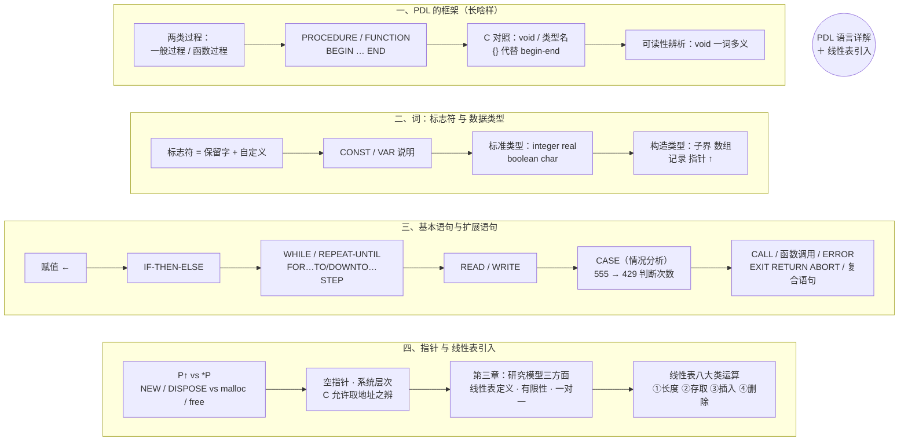
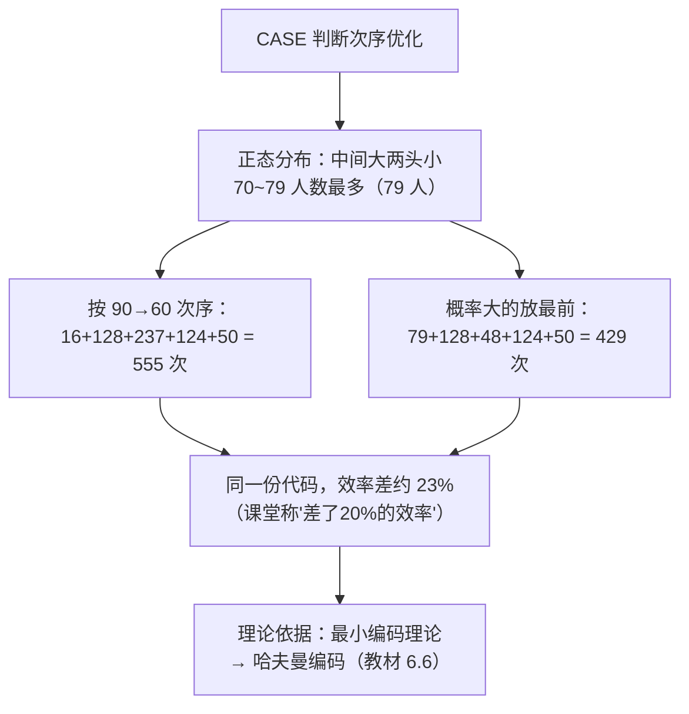
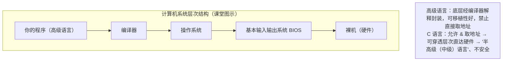

# 数据结构 · 算法描述语言（PDL）详解 与 线性表引入 · 详细版讲义

> **来源说明**：本讲义由两段课堂录音转写整理而成，并与本文件夹内教材（严蔚敏、吴伟民《数据结构（C 语言版）》，MinerU 解析版）逐节对照校订，关键史实与术语另经网络检索核实（以 🌐 标出）。它是**学习笔记性质的整理稿，不是老师的官方逐字稿**：以课堂讲授顺序和口语化讲解为主体，凡属教材补充的内容以「📖 教材对照」标出，网络核实的资料以「🌐 网络核实」标出；录音转写模糊处标注「⚠️（转写存疑）」并给出核算结论。
>
> - **转写 1**：`算法描述语言课程讲解_导出原文.txt`（PDL 语言的框架、词、数据类型、基本语句）
> - **转写 2**：`程序设计与数据结构授课内容_导出原文.txt`（扩展语句、过程调用、终结语句、复合语句、指针，以及第三章线性表引入）
> - **教材对照范围**：第 1 章 1.3（抽象数据类型的表示与实现 · 类 C 语言）、第 2 章引言与 2.1（线性表的类型定义，含式 (2-1)、图 2.1）、2.2/2.3 中与指针操作对照的算法 2.9/2.10。
> - **课堂定位**：**第三周第二节**。承接上一节第三周第一节（《数据结构第三周第一节.md》：算法复杂度扩展分析 + PDL 概述，定义 20~23）。本节课（约 90 分钟，中间休息 5 分钟）**把 PDL 语言讲完（第二章收尾）**，随后**开启第三章线性表**；两段转写即本节课的上半场与下半场。
>
> **标注体例**：全文"定义"一律单独成块、连续编号并注明出处——`（课堂）` 表示课堂讲授、教材未直接收录；`（教材 X.X）` 表示教材对应章节原文。全部例题按序号（例 1 ~ 例 4）摘抄并注明来源与答案。
>
> **相关笔记**：[数据结构第三周第一节](数据结构第三周第一节.md)（上一节：复杂度与设计方法）｜[数据结构 第二章 线性表 详细版讲义](数据结构%20第二章%20线性表%20详细版讲义.md)（本章教材全解）｜[数据结构 第一章 绪论 课堂讲义](数据结构%20第一章%20绪论%20课堂讲义.md)

---

## 总览：本讲知识地图



---

# 第一部分　PDL 语言详解（上半场）

## 1. 承接与本节的路线图

老师开篇承接上一节：上一节主要把**算法分析（复杂度）**这一块做了扩展，并给出了 **PDL 的定义**（上一节定义 20：PDL 保留程序设计语言的框架与描述形式，去掉其特异性和细节要求，结合自然语言，用于描述算法处理逻辑）。本节的任务：**花不到 90 分钟把 PDL 语言讲完**——讲完即意味着**第二章结束**，然后**进入第三章**。

> **课堂强调的语言观**：PDL "非常简单——作为计算机专业的学生，这个语言给你三天时间就要掌握、要吃透"。**语言简单，难在设计**（上一节已反复强调：会中文的人很多，能写出好散文好诗歌的有几个？）。

### 1.1 学习路线：完全类比自然语言

任何语言（自然语言也好、程序设计语言也好）都有共同的组织层次，老师把它总结为一张路线图：

| 自然语言 | PDL（算法描述语言） | 说明 |
|---|---|---|
| 先看"这门语言长啥样"（Hello World） | **算法的框架**（如何书写算法） | 学 C/C++/Java 之前，第一章必然先给一个 Hello World——先看这门语言写出来是什么样子，看的是**框架** |
| **词**（汉字 / 英文单词），语义的最小单位 | **标志符**（identifier） | 词不具有完整语义信息 |
| 词的归类（名词、动词……） | **数据类型**（词必然属于某一种类型） | 每个变量/常量一定属于某种数据类型 |
| 句子（陈述句、疑问句、感叹句……句型构成基本语句） | **基本语句**（赋值、条件、循环、输入、输出） | 表达完整语义靠句子 |
| 复杂思想的表达 | **扩展语句**（CASE、过程调用、复合语句……） | 表达更复杂的语义 |

> **定义 1（语言的三层结构 ｜ 课堂）**：学任何语言都沿"**框架 → 词 → 句子**"三层展开：①框架解决"写出来长什么样"；②**词是语义的最小单位**，但不具有完整的语义信息；③表达完整的信息需要**句子**，基本语句表达基本语义，扩展语句表达更复杂的语义。

---

## 2. 算法的框架：两类过程的书写形式

### 2.1 回顾：为什么算法体现在"过程"上

算法是"解决某个问题的**指定的有限指令集合**"（第一章定义），其含义主要落在**过程**二字上——按算法的**目的性和要求性**，过程分两类（上一节已讲，本节落实到书写）：

- **一般过程**：只要求"这件事**做了就行**"，不特别在乎结果——做完了就行；
- **函数过程**：不但要做，还**特别在乎那个结果（返回值）**——像数学里的函数，给自变量 x，要还给一个 y。

### 2.2 Wirth 风格 PDL 的书写形式（课堂板书体系）


( **一般过程**)
PROCEDURE 过程名 (参数表);
BEGIN
    语句组
END;

(**函数过程**)
FUNCTION 函数名 (参数表) : 返回值类型;
BEGIN
    语句组
END;


逐个要素拆解（课堂原话整理）：

- **PROCEDURE**（简写 **PROC**）就是英文"过程"一词，是**过程因子**——"很直白"；
- **FUNCTION**（F 打头，简写 **FUNC**，讲义补注）就是"函数"因子；
- **参数**：算法都是**解决某个问题**的，而问题是**通过参数来刻画的**——任何问题都有**论域范围**，论域范围通过参数刻画，所以过程名后要跟参数表；
- **BEGIN … END**：过程开始 / 过程结束，"很直白"；
- **冒号（:）的含义 = 解释说明**：函数过程执行完**要有返回值**，而任何数据都有类型（它属于哪一类、长什么样），所以用冒号在函数名后**解释说明返回值的类型**——整型、实型等等。

> 📖 **教材对照（1.3 (3)）**：严蔚敏类 C 语言中，基本操作一律用"**函数类型 函数名(函数参数表){ 语句序列 }**"的函数形式描述；当函数返回值为函数结果状态代码时，函数定义为 `Status` 类型；以 `&` 打头的参数为**引用参数**。可见类 C 把"一般过程/函数过程"统一进了"函数"这一种形式（对应 PDL 的两种过程），而 PDL 用两个不同的关键字把"不在乎结果"与"在乎返回值"区分得更清楚。

### 2.3 与 C 语言的对照（课堂重点辨析）

| PDL（Wirth 风格） | C 语言 | 差异 |
|---|---|---|
| `PROCEDURE 过程名(参数); BEGIN … END` | `void 函数名(参数) { … }` | C 没有"过程"一词，一般过程用 **void** 表示"无返回值" |
| `FUNCTION 函数名(参数) : 类型; BEGIN … END` | `类型名 函数名(参数) { … }` | C 把返回类型放在函数名**前面**；C 中**根本没有 function 这个词** |
| `BEGIN … END` | `{ … }`（花括号） | C 用花括号代替 begin/end |

### 2.4 可读性辨析：为什么说 C 的 `void` "可读性稍差"

老师专门用 `void` 做了一个**词义分析**（这是理解"PDL 为什么存在"的关键例子）：

> `void` 在英语中身兼三职：作**形容词**是"空的、无效的"；作**名词**是"空虚、寂寞"；作**动词**是"宣布作废、取消"。
>
> 于是：形容词"**无效的**"后面跟着一个函数？名词"**空虚**"后面跟着一个函数？动词"**取消**"后面跟着一个函数？——**一个没学过 C 的人，无论如何不会把 void 和"我要做这件事"联系起来**。所以 C 的可读性"稍微有一点差"。

而 PDL 的目标是（呼应上一节）：一个**不学计算机的人——学艺术的、学考古的、学中文的——也要能看得懂**。"如果你用 C 写了一个软件给用户看，用户都要先学一遍 C 才能看明白，可能吗？不可能。"

### 2.5 为什么用英文、为什么要缩写

- 课堂史观（多次出现）：计算机的**思想萌芽与最终诞生都在欧洲**，早期主流用的是英语，所以**程序里的字符必须是英文**，"程序里不能出现多种符号"；
- 单词太长（如 PROCEDURE 有 9 个字母）→ 用**缩写形式**：取前面几个字母——`PROCEDURE → PROC`、`FUNCTION → FUNC`、`constant → const`、`variable → var`、`character → char`（后面各节照此办理）。

> 🌐 **网络核实（出处）**：
> ① 本课 PDL 的关键字（PROCEDURE、FUNCTION、BEGIN、END、CONST、VAR、IF/THEN/ELSE、WHILE/DO、REPEAT/UNTIL、FOR/TO/DOWNTO、CASE/OF、ARRAY、RECORD、READ、WRITE、NEW、DISPOSE）**全部是 Pascal 语言的保留字或标准过程**；这套"用类 Pascal 记号描述算法"的体系源自 Niklaus Wirth（尼克劳斯·维尔特，通译"沃思"，Pascal 之父）1976 年的名著《Algorithms + Data Structures = Programs》，其后继版本《Algorithms and Data Structures》也延续 Pascal 记号（PROCEDURE … ; BEGIN … END）。
> ② "数据结构"这一概念最早由 **C. A. R. Hoare 与 N. Wirth 在 1966 年提出**（南开大学《"数据结构"教学与教材研究》），1968 年 Knuth《计算机程序设计技巧》第一卷首次系统整理了主要数据结构与算法。
> ③ 课堂转写中的"维马语言 / 维纳语言 / 维马理论"，按上下文即指 **Wirth（维尔特/沃思）**的这套算法描述体系——转写误差，本讲义统一记作"PDL（Wirth/Pascal 风格）"。

---

## 3. 词：标志符（identifier）

### 3.1 从自然语言到计算机语言的"词"

自然语言中表达思想的最小单位是**词**：学中文先学**汉字**，学英文要**背单词**，学法语也一样要背单词——"词是语义的最小单位"。那计算机语言中的"词"叫什么？

> **定义 2（标志符 ｜ 课堂）**：标志符就是**语言当中由字符按照一定规则形成的、具有特定含义的词**。
>
> 简单地说：标志符就是一个个"单词"。命名规则在各语言间倒是**统一**的：标志符中**只能含有**——52 个英文大小写字母、下划线 `_`、10 个数字（0~9）这三类字符，并且**必须以字母或下划线开头**（从本质上讲，标志符就是"以字母（或下划线）开头的串"）。

### 3.2 标志符的两大类：系统给的 vs 自己定的

> **定义 3（保留字 / 关键字 ｜ 课堂）**：按用途，标志符总体分两类：
> ① **系统提供的**标志符，称为**保留字**或**关键字**——例如 `if`、`then`、`else`、`while`、`do`、`for`，以及前面的 `PROC`、`FUNC`、`CONST`、`VAR` 等；保留字**不能用于定义变量**；
> ② **自定义标志符**——自己给变量、常量、过程起的名字。

### 3.3 命名原则：词文达意（附：匈牙利命名法）

- 课堂要求：命名要**词文达意**——比如定义一个"查询操作"，函数名就叫 `Search`（查询），而**不要学**"老谭"（谭浩强教材）那种命名习惯："凡是变量就 i、j、k，凡是整型计数就 i、j、k，自变量就 x、y、z"——一眼看不出含义。
- 🌐 **网络核实（匈牙利命名法）**：课堂提到命名方法要"遵循匈牙利方法"。匈牙利命名法（Hungarian notation）由**匈牙利裔程序员查尔斯·西蒙尼（Charles Simonyi，1948 年生于布达佩斯）**发明——他在 Xerox PARC 时期形成该方法，1981 年加入微软后用于 Windows 开发；其核心思想是**在变量名前用小写字母前缀编码变量的类型/用途**（如 `szName` 表示零结尾字符串）。课堂取其精神：**名字要能"望文生义"**；但注意课堂并未真的要求背"前缀表"，核心要求就是**词文达意**。

### 3.4 标志符的两个层次：过程名 与 变量/常量名

> **定义 4（标志符的两个层次 ｜ 课堂）**：按标志符表达的含义不同，分两层：
> **第一层（集合的层面）**：给**过程**（无论一般过程还是函数过程）取名字——过程名反映的是**论域（这个集合）的名字**；
> **第二层（个体的层面）**：给过程中一个个的**变量、常量**取名字——它们是集合中的个体。
>
> **命名纪律**：**过程必须"调用之前先定义"**；**变量、常量必须"使用之前先说明"**。
>
> 课堂类比：人一出生父母就要给取名（张三、李四），名字未必有什么含义，但**从此别人指你时才有指代性**——先定义（取名），后调用（称呼）。

### 3.5 常量说明（CONST）

常量英文 **constant**，取前 5 个字母得 **const**（⚠️转写作"取前四个字母""const."，按 const 实为 5 字母整理）。书写形式与语义：

```txt
CONST 常量名 = 值;

(* 例：定义常量 π *)
CONST pi = 3.14159...;
```

- **等号在这里的语义 = "等价"**（不是赋值！）：数学中两个量写在一起表示"**两个是一样（等价）**"的意思——**凡是看到 π 的地方，都可以用这个实数直接替换**。课堂特意强调：**等号在自然界（数学）里是"左右两边等价"，并没有"赋值"的含义**——赋值我们要用箭头（见 5.1 节）。
- **大小写之辨**：有同学问常量名到底大写还是小写？——**都行**（语言上大小写等价），但**惯例**是：**常量名用大写字母**（为了与一般变量区分），**变量名用小写**，而 `if`、`then`、`else`、`while`、`do`、`for` 等保留字**约定俗成**照标准写法。

### 3.6 变量说明（VAR）

变量英文 **variable**（"变化的"），取前 3 个字母得 **var**。书写形式：

```txt
VAR 变量名表 : 类型;

(* 例 1：说明 3 个整型变量 *)
VAR i, j, k : integer;

(* 例 2：说明 3 个实型变量 *)
VAR x, y, z : real;
```

- 冒号在这里同样是**解释说明**的作用：说明这些变量**在什么范围内变化**——`i, j, k` 在**整数**范围内变化，即它们是 3 个整数；`x, y, z` 是 3 个实数。
- 变量名表（i, j, k）就是**变量名表**——一次说明多个同名标志符。

> 📖 **教材对照（类 C 语言的预定义常量与类型，1.3 (1)(2)）**：类 C 中**没有** `VAR`/`CONST` 这类"说明是变化的量还是不变的量"的关键字——它**直接写数据类型 + 变量名表**；常量用预处理定义：
> ```c
> #define TRUE 1      #define FALSE 0
> #define OK 1        #define ERROR 0
> #define INFEASIBLE -1
> #define OVERFLOW -2
> typedef int Status;             // Status 是函数结果状态代码的类型
> ```
> 数据元素类型一律约定为 **ElemType**，由用户使用时自行定义（教材：存储结构用 typedef 描述）。课堂提到 PPT（课件 08）已放学习通供写程序参考，其中常量定义"用井号"即指类 C 的 `#define`（⚠️转写作"井号一半"，按 `#define` 整理）。

---

## 4. 数据类型：词的"类别"与"形态"

### 4.1 定义

> **定义 5（数据类型 ｜ 课堂）**：任何变量或常量都**一定属于某一种数据类型**。数据类型 = **类别**（这个数据**属于哪一类**）+ **形态**（它**长什么样**）。

### 4.2 标准类型（四个基本类型）

| 类型 | 英文/来源 | 说明 |
|---|---|---|
| **整型** | `integer` | 自然界中的整数，直接用英文单词 |
| **实型** | `real` | 小数用 real 表示；⚠️ PDL 中**不搞** float/double 的单精度、双精度之分，实数只有 `real` |
| **布尔型** | `boolean` | **逻辑类型**，取值只有 **true（真）/ false（假）**。课堂强调：**布尔代数是现代计算机进行逻辑运算的基础**；布尔（Boole）是人名，用他的名字命名（🌐George Boole，1815–1864，英国数学家，布尔代数/布尔逻辑以其命名，是现代数字逻辑与计算机运算的理论基础） |
| **字符型** | `char` | **character（字符）的缩写**——单个字母、数字、逗号、分号、引号等单个字符 |

### 4.3 子界类型（子域类型）

> **定义 6（子界类型 ｜ 课堂）**：由一个**下界**和两个点连着的**上界**构成——`下界..上界`，它**暗含**的是某一已知数据类型中的**一段范围**。主要用于表示**整型（或其他有序类型）的某个范围**。
>
> 例：`40..90` 表示 40~90 之间的整数（含 40、41、42、…、90）；`20..30` 表示 20~30 之间的整数；`'A'..'G'` 表示从字符 A 到字符 G 的变化（A、B、C、D、…、G）。

### 4.4 构造类型：用基本类型"搭积木"

有了基本类型这个"搭积木的小方块"，就可以**构造**出更复杂的类型——"积木可以搭建成一座城堡"。

**（1）数组类型**

> **定义 7（数组类型 ｜ 课堂）**：数组名 `:` **ARRAY `[下标范围]`** OF 基本类型——冒号起说明作用，`ARRAY … OF` 说明"这是数组、装的是什么类型的数据"。
>
> ```txt
> (* 例 1：一维——最多可存 20 个整数的数组 *)
> A : ARRAY [1..20] OF integer;
>
> (* 例 2：二维数组：第一维下标 1..20，第二维下标 -10..20，装实数 *)
> B : ARRAY [1..20, -10..20] OF real;
> ```
>
> 语义：例 1 声明了一个**下标取值范围 1~20**、**元素类型为 integer** 的数组——即"最多放 20 个数的一个整型数组"；二维数组 B 的两个维度下标分别从 1..20 与 -10..20 变化，`OF real` 说明里面装的是**实型数**（again：不分单/双精度）。

**（2）记录类型（record）**

> **定义 8（记录类型 ｜ 课堂）**：自然界中一个**客观事物由两个或两个以上的要素组成**时，体现在计算机中就叫**记录**（record）。——数据库里叫记录，操作系统里也叫记录，**只有 C 语言管它叫"结构体"**（struct）。
>
> 课堂示例（人员档案 / 通讯录记录，图示形式）：
>
> ```txt
> A : RECORD
>         name : ARRAY [1..8] OF char;   (* 姓名：最多 8 个字符的数组 *)
>         sex  : 0..1;                   (* 性别：取 0 或 1（0=男 / 1=女） *)
>         ...                            (* 其余成分，如年龄、工资等 *)
>     END;
> ```
>
> - `name` 是一个**最多放 8 个数据（字符）**的字符数组；
> - `sex` 用**子界类型 0..1** 表示——性别只有男/女两种可能，用 0 或 1 编码即可，**不可能出现中文汉字**——因为前面说过：计算机的思想萌芽与诞生都在欧洲，**程序里不写中文**，所以"男/女"用编码 0/1 表示。

> 📖 **教材对照（2.1，定义 3 与图 2.1）**：教材原话——"在稍复杂的线性表中，一个数据元素可由若干个**数据项（item）**组成。在这种情况下，常把数据元素称为**记录（record）**，含有大量记录的线性表又称**文件（file）**。"教材图 2.1 学生健康情况登记表中，每个学生的情况为一个记录，由**姓名、学号、性别、年龄、班级、健康状况** 6 个数据项组成——正与课堂"通讯录/人员档案记录"的例子对应。

**（3）指针类型（最复杂的一类）**

指针（pointer）表达的是**指向性信息**。课堂类比："你去外地开会，不认识路，会议举办方就在**地下画一个大大的箭头**给你指明方向。"

> **定义 9（指针类型 ｜ 课堂）**：指针用**箭头 ↑** 表达，书写为 **`↑类型名`**——"指针嘛，就是指向性的信息"。
>
> ```txt
> (* ① 定义"一类"：定义了一个指向整型的指针类型（一个集合） *)
> TYPE A = ↑integer;
>
> (* 定义"一个个体"：具体的一个指针变量 B，它只能指向一个整型变量 *)
> VAR B : ↑integer;    (* 等价于 VAR B : A; *)
> ```
>
> - 定义 `A = ↑integer` 是定义了**整型指针这一大类**（一个集合）；
> - 说明 `VAR B : ↑integer` 是定义了一个**个体**——具体变量 B，只能指向**一个**整数。
>
> **方向辨析**：C 语言里指针书写是**从左到右**的（`int *p`，星号在类型与变量之间）；PDL 里是**从下到上**的（`↑integer`，箭头从变量名下方向上指向类型）——"跟我们自然语言的表述形式更贴切"（自然语言中"指向"就是箭头）。

> 📖 **教材对照**：严蔚敏教材采用 C 的指针记号（`ElemType *elem;`、`struct LNode *next;`、`p->next` 等，见 2.2/2.3 节），类 C 与 PDL 在指针记号上的差异到第三章（单链表）会大量使用，届时对照。

---

## 5. 基本语句：用"句子"表达完整语义

词（标志符）不能表达完整语义；完整语义靠**句子**。自然语言有陈述句、疑问句、感叹句等句型；PDL 的**基本语句**也有五类：**赋值、条件、循环、输入、输出**。

### 5.1 赋值语句

"我们做数学题，定义了一个变量 X，这个 X 代表啥含义？——**赋予它含义、赋予它值**。'赋予'就是给它值。计算机是模拟人类做事情，你得给它数据，数据怎么给变量？就这么做："

> **定义 10（赋值语句 ｜ 课堂）**：
>
> ```txt
> 变量 ← 表达式
> ```
>
> 用一个**从右到左的箭头**表示：把**右边表达式的值**赋给**左边的变量**。**箭尾是已有的值，箭头指向的位置是"被赋值者"**——给它含义。

- ⚠️ **注意：流程图中的写法正好反过来**——流程图里画成"左边（已有值）→ 右边（变量）"。不管怎么画，含义一致：**箭尾是已有值，箭头指向被赋值者**。
- **C 语言用 `=` 表示赋值**：这里老师重申了学 C 时老师专门强调的点——数学里的 `=` 表示"左右两边等价"，**并没有赋值的含义**；而 C 的 `=` 是赋值，所以才有 `x = x + 1` 这种"把 x+1 赋给 x"的写法，需要专门解释。**PDL 用箭头 ← 表示赋值，正是为了避免与"等价"混淆**。
- 类 C 教材的赋值语句还包括**交换赋值**（`变量 ↔ 变量`）和**条件赋值**（`变量 = 条件表达式 ? 表达式T : 表达式F`）📖（教材 1.3 (4)）。

### 5.2 条件语句

"人类做事不能像在地球上走路那样**一条道走到黑**（一个方向一直走不拐弯）——人做事到某一步**要拐弯**，这个'拐弯'在计算机里就是**条件语句**。"

> **定义 11（条件语句 ｜ 课堂）**：
>
> ```txt
> (* 单分支 *)
> IF 条件 THEN 语句组;
>
> (* 双分支 *)
> IF 条件 THEN 语句组1 ELSE 语句组2;
> ```
>
> 课堂类比："出门前看天气，**如果下雨**（条件满足），**就带把伞**。" 流程图：条件满足→做语句组；条件不满足→什么都不干（单分支）/做另外一件事（双分支）。

⚠️ **关键辨析（C 语言的问题）**：PDL 的 IF 后面必须是**明确的"条件"**——它要**得到一个逻辑值**（true/false）。而 C 的 if 里放的是**表达式**，用"**非 0 即真**"来代替逻辑判断：

```c
x = 1;
if (x)  a = a + 1;    /* x 只要不是 0——哪怕是 -1——都算"真" */
```

"它没有明确的逻辑变量，就把**表达式（的值是否为 0）来替换逻辑判断**：x 非 0（哪怕 −1）为真，x = 0 为假。这种写法**可读性实际上有些差**。"（📖 教材 1.3 (11)：类 C 对 `A && B`、`A || B` 规定了短路求值——当 A 值为 0 时不再对 B 求值等，这是类 C 对 C 逻辑语义的规范化。）

### 5.3 循环语句

"人类做事情，统计下来百分之八九十都是**重复**：学生每天起床—刷牙洗脸—吃饭—上课—吃饭—上课—睡觉，第二天照样……计算机表现'重复'的动作就是**循环语句**。"

**（1）当型循环（WHILE）**

> **定义 12（当型循环 ｜ 课堂）**：
>
> ```txt
> WHILE 条件 DO 语句组;
> ```
>
> 语义：**条件满足才做**语句组；条件不满足**啥都不做、跳出来**。流程图：菱形判断——满足→执行语句组→回头再判断；不满足→出口。
> **C 对照**：`while (条件) 语句组;`——**同义**，仅写法上 C 没有 `DO` 这个词（直接括号）。
> **要点**：因为**先判断后执行**，若一开始条件就不成立，循环体**可能一次都不执行**。

**（2）直到型循环（REPEAT-UNTIL）**

> **定义 13（直到型循环 ｜ 课堂）**：
>
> ```txt
> REPEAT
>     语句组
> UNTIL 条件;
> ```
>
> 语义：**反复做某件事情，直到"条件成立"就停止（不做了）**；条件不成立就不断做。
>
> 课堂类比："大家 9 月开学之后**不断学习**，**直到'放寒假'这个条件成立，我们才不做**——只要没放寒假（条件不成立），就反复地做。"
>
> ⚠️ **与 C 的 do-while 语义正好相反**：
>
> | | PDL：`REPEAT … UNTIL 条件` | C：`do { … } while (条件);` |
> |---|---|---|
> | 循环继续的条件 | 条件**不成立**时继续 | 条件**成立**时继续 |
> | 停止条件 | 条件成立 | 条件不成立 |
> | 最少执行次数 | **至少执行一次**（"不管三七二十一先做一遍"） | 至少执行一次（同为先做后判） |
>
> 对照记忆：当型 `WHILE`（先判断，可能一次不做）≈ C 的 `while`；直到型 `REPEAT…UNTIL`（先做一遍再说，**判定条件方向相反**）≈ C 的 `do…while`（但条件取反）。

**（3）计数型循环（FOR）**

"WHILE 和 REPEAT 这种循环，往往用在**不知道要做多少次**的场合——反正这个条件（不）满足就（不）做，到底做了多少次**谁也说不准**。如果**次数明确规定**，就用 FOR："

> **定义 14（计数型循环 ｜ 课堂）**：
>
> ```txt
> FOR 变量 := 初值 TO 终值 DO 语句组;
> ```
>
> 语义：变量从**初值**开始，只要**没到终值**就执行语句组；**每执行完一遍，变量自动加 1**（默认步长为 1）——**循环体内不需要（也不应该）写"变量加 1"这个动作**，它是**默认隐含**的。
>
> - **TO 相当于"爬山"**（正着数）：FOR … TO，变量从小到大；
> - **步长 STEP**：若想"跳跃式增长，一次跨两步、三步"，用 **STEP** 说明一次跨多少步：`FOR i := 1 TO n STEP 2 DO …` 等价于每次 `i := i + 2`（STEP 默认为 1）；DOWNTO 情形同理（每次减 K）；
> - **非等差增长怎么办**：若要 `i := i * 2` 这种"乘着长"的变量变化，**没法用 STEP 表达（STEP 只管加减步长），只能明确写进循环体的语句组里**；
> - 流程图口径：变量取初值 → 判断是否满足（未过终值）→ 执行语句组 → 变量加步长 K 赋回变量 → 循环。

**（4）倒计数（DOWNTO）**

"自然界也有**倒着数**的情况：卫星发射前 10 秒——**10、9、8、7、6、5、4、3、2、1，点火**！"

> **定义 15（DOWNTO ｜ 课堂）**：
>
> ```txt
> FOR 变量 := 初值 DOWNTO 终值 DO 语句组;
> ```
>
> 语义：初值赋给变量，只要**变量还没到终值**就不断执行，每次**自动减 1**（下山——DOWNTO 的"当土下山"）。
>
> ⚠️ **重要规则**：因为是"下山"，**初值必须大于（或等于）终值**；如果给的初值比终值还小，条件一开始就不成立（判断"变量 ≥ 终值"不满足），**它会自动跳过——一次都不执行**。同理，DOWNTO 配 STEP K 时每步减 K。

### 5.4 输入语句与输出语句

"计算机是一个**模拟学科**：模拟人类做事情，你要做事情就得**给它数据**。数据咋给它？——输入语句。"

> **定义 16（输入 / 输出语句 ｜ 课堂）**：
>
> ```txt
> READ (变量名表);        (* 从现实世界把数据读进计算机内存，如 READ(x, y, z) *)
> WRITE (表达式表);       (* 把运行结果写到屏幕/纸上给你看——打印输出 *)
> ```
>
> - **READ（读）**的类比：每次考试前老师再三提醒"**认真读题**"——读题干啥？就是把题目**读进你的大脑**（输入）。READ 就是从自然界把数据**融入**计算机的内存单元。
> - **WRITE（写）**的类比：题目读清楚了要**解题**——把你的思想**写到纸上**（write）。计算机把运行结果展现给你：写到屏幕上、打印输出。
>
> ⚠️ **C 语言对照（重要辨析）**：**C 语言没有明确的输入/输出语句**！`scanf`/`printf` 是 **C 编译系统提供给用户的接口函数**，通过函数来实现输入输出操作——"它不是明确的语句"。（📖 教材类 C 沿用：`scanf([格式串], 变量1, …, 变量n);` 与 `printf([格式串], 表达式1, …, 表达式n);`，通常省略格式串——教材 1.3 (8)。）

### 5.5 五类基本语句速查（PDL ↔ 类C ↔ C）

| 语句 | PDL（Wirth/Pascal 风格） | 类 C（严蔚敏） | C 语言 | 备注 |
|---|---|---|---|---|
| 赋值 | `变量 ← 表达式` | `变量 = 表达式`（另有 `↔`、`? :`） | `=` | ⚠️流程图箭头方向相反；C 的 `=` 不是数学等价 |
| 单分支 | `IF 条件 THEN 语句组` | `if (表达式) 语句` | `if (表达式) …` | PDL 的条件必须得到**逻辑值** |
| 双分支 | `IF … THEN … ELSE …` | `if … else …` | `if … else …` | C 中"非 0 即真"，可读性差 |
| 当型 | `WHILE 条件 DO 语句组` | `while (条件) 语句` | `while (…)` | 可能**一次都不做** |
| 直到型 | `REPEAT … UNTIL 条件` | `do {…} while (条件)` | `do…while` | ⚠️**条件方向相反**；至少做一次 |
| 计数型 | `FOR 变量:=初值 TO 终值 DO`（/DOWNTO/STEP K） | `for (赋初值; 条件; 修改)` | `for(init;cond;step)` | PDL **默认步长 1、自动加 1**；C 必须**显式写**增量 |
| 输入 | `READ(变量名表)` | `scanf(…)` | `scanf(…)` | C 的 scanf/printf 是**函数不是语句** |
| 输出 | `WRITE(表达式表)` | `printf(…)` | `printf(…)` | 同上 |

> 📖 **教材对照（类 C 语言的语句体系，教材 1.3）**：类 C 相对 PDL 的主要改造——①预定义常量与类型（TRUE/FALSE/OK/ERROR/INFEASIBLE/OVERFLOW、Status）；②存储结构用 typedef 描述、数据元素类型约定为 ElemType；③基本操作用函数描述、增加**引用参数（&）**；④赋值含简单/交换（↔）/条件（? :）赋值；⑤选择语句含 if/if-else/switch（case…break…default，含"**case 条件**"形式的开关语句 2）；⑥循环 for/while/do-while；⑦结束语句 return/return 表达式/break/**exit（异常代码）**；⑧输入输出 scanf/printf；⑨注释 `//`；⑩基本函数 max/min/abs/floor/ceil/eof/eoln；⑪逻辑运算短路约定。

---

# 第二部分　扩展语句、指针与第三章引入（下半场）

## 6. 扩展语句：表达更复杂语义

有了基本语句只能表达**基本语义**；更复杂的语义要靠**扩展语句**。

### 6.1 情况语句（CASE）——"情况分析"求精技术的落地

先看反面教材：用 if-else 链表达多分支"一看一眼就非常啰嗦，可读性差"。回忆上一节的**自顶向下、逐步求精**中三类求精技术，其中**最后一种就是"情况分析"**——所谓"情况"就是**各种各样的可能性**；多情况、多条件，就用 **CASE 语句**：

> **定义 17（情况语句 ｜ 课堂）**：
>
> ```txt
> CASE 表达式 OF
>     条件1 : 语句组1;
>     条件2 : 语句组2;
>     ...
>     条件n : 语句组n;
>     ELSE  语句组n+1          (* 都不满足时执行 *)
> END;
> ```
>
> 语义：满足条件 i 就执行语句组 i；**否则（else）——都不满足——执行语句组 n+1**。流程图更明确：先判断条件 1，满足→执行语句组 1；不满足→判断条件 2；……全不满足→执行语句组 n+1。
>
> 注意：多情况分析对应逐步求精的第三类技术（上一节定义 19 的③），**CASE 语句就是"情况分析"这一求精方法在语言层面的落点**。

**⚠️ C 语言的遗憾（课堂重点辨析）**：C **没有**这种"条件式 case"语句——它要用 `switch` 来**组合**才能达到效果，而且 **`case` 只是一个"入口/判断入口"**：如果**不配 `break`**，从第 i 个路口进去后会**依次穿透执行**（执行完 i 再执行 i+1，一直执行到结尾）。所以必须**搭配 `break`（跳出）**才等价于我们的语义。而 PDL 的 CASE **默认是"只挑一个路口进去，执行完就跳出来"**——别的不再判断。

> 📖 **教材对照（1.3 (5)）**：类 C 提供两种开关语句——"开关语句 1"按**值**分派（`switch(表达式){ case 值1: 语句序列1; break; … default: 语句序列n+1 }`）；"**开关语句 2**"按**条件**分派（`switch { case 条件1: 语句序列1; break; … default: 语句序列n+1 }`）——后者与课堂 PDL 的"条件式 CASE"**直接对应**（类 C 显式要求写 break）。

### 例题 1：成绩分段统计（CASE 语句）【课堂例题 ｜ 伪码整理】

> **例 1（课堂例题 ｜ 原题转写 + 伪码整理）**　统计每个分数段的人数：90~100 分、80~89 分、70~79 分、60~69 分、60 分以下各有多少人。设 5 个计数变量：`x1` 记录 90~100 分人数、`x2` 记录 80~89、`x3` 记录 70~79、`x4` 记录 60~69、`x5` 记录 <60；循环读入一个一个的具体成绩 `x`，按 x 的值归类计数（⚠️转写作"初值不要设成零"，按语义应为：**各计数变量初值要设成 0**）。
>
> ```txt
> CONST n = 200;
> VAR i, x : integer;
>     x1, x2, x3, x4, x5 : integer;
> BEGIN
>     x1 := 0; x2 := 0; x3 := 0; x4 := 0; x5 := 0;   (* 计数器清零 *)
>     FOR i := 1 TO n DO
>     BEGIN
>         READ(x);
>         CASE x OF
>             90..100 : x1 := x1 + 1;      (* 属于 90~100 → x1 加 1 *)
>             80..89  : x2 := x2 + 1;
>             70..79  : x3 := x3 + 1;
>             60..69  : x4 := x4 + 1;
>             ELSE      x5 := x5 + 1       (* 60 分以下 *)
>         END
>     END;
>     WRITE(x1, x2, x3, x4, x5)
> END.
> ```
>
> - 课堂类比"**选班委唱票**"：三个人竞选同一职位，大家投票，唱票人拿粉笔"张三画一横、李四画一笔"，**逐个记录**——CASE 语句就是程序里的"唱票"。
> - ⚠️ **提醒**：Wirth/PDL 中可以**直接写"属于 90..100"**（子界表示法），但**翻译成具体语言不能这么写**——C 要写成 `x >= 90 && x <= 100`。
> - 📖 教材对照：该例正对应教材 2.2 末对算法 2.7 的分析——"以**开关语句**代替**条件语句**，分出元素比较的**第三种情况**"（当 \*pa = \*pb 时只将两者之一插入 Lc），说明同一逻辑用 CASE 表达更清晰。

### 例题 2：同一 CASE 语句，判断次数差 20%——执行顺序的学问【课堂例题 ｜ 555 → 429 核算】

老师接着提出一个深刻的问题：**"这个语句怎么写，才能使判断的（总）次数最少？"**——代码一模一样，只是**判断的先后次序**不同，效率却差很多。

**背景（正态分布）**：老师出题必须保证学生成绩满足**正态分布**——"有点像**倒扣着的帽子**"，**两头小、中间大**：90 分以上和 60 分以下的人各占 10% 以下，大部分人的成绩集中在 60~90 之间。正态分布是现实中最最广泛的情况（🌐：正态分布 normal/Gaussian distribution，钟形曲线；身高、考试成绩、测量误差等大量自然与社会数据近似服从正态分布——"与现实最最吻合"）。🌐

**假设 200 人的分布**（课堂给的数字）：

| 分数段 | 90~100 | 80~89 | 70~79 | 60~69 | <60 |
|---|---|---|---|---|---|
| 人数 | 16 | 64 | 79 | 31 | 10 |
| 特征 | 两头（≈10% 以下） | | **最多**（峰段） | | 两头 |

> ⚠️ **转写存疑 + 核算**：转写只明确给出 16 / 64 / 79 三段与"60 分以下 10 个人做 5 次判断"、总计 555 次；60~69 段人数由"共 200 人 + 总判断次数 555"**反推核算**得 31 人（16+64+79+31+10=200 ✓），与"正态分布中间大两头小"一致。

**（1）按"从高分到低分"的次序写 CASE（90 段在最前）**：第 i 段的人要**先经过前面所有段的判断**才能归位——

| 分数段 | 每人判断次数 | 人数 | 小计 |
|---|---|---|---|
| 90~100 | 1（一进来就命中） | 16 | 16 |
| 80~89 | 2 | 64 | 128 |
| 70~79 | 3 | 79 | 237 |
| 60~69 | 4 | 31 | 124 |
| <60 | 5 | 10 | 50 |
| **总计** | | 200 | **555 次** |

**（2）把"人数最多"的 70~79 段放到最前面判断，其次 80~89（64 人）……**——

| 顺序 | 分数段 | 每人判断次数 | 人数 | 小计 |
|---|---|---|---|---|
| 1 | 70~79 | 1 | 79 | 79 |
| 2 | 80~89 | 2 | 64 | 128 |
| 3 | 90~100 | 3 | 16 | 48 |
| 4 | 60~69 | 4 | 31 | 124 |
| 5 | <60 | 5 | 10 | 50 |
| **总计** | | | 200 | **429 次** |

**结论**：

- 语句（代码量）**一模一样**，只把判断次序按"**人数多（出现概率高）的放最前**"调整，总判断次数从 **555 → 429**，少判断 **126 次 ≈ 23%**——课堂总结"**差了 20% 的效率**"。⚠️转写中"总的判断次数只有四（个）数字"即 429 次（转写残缺）。
- **推广的类比**：大家都用数据库，**为什么大型数据库从来不用 SQL Server**？"同样的（结构化查询）语句，底层的执行机制不一样，效率就不一样"——与这里"同一份代码、不同排列次序、效率差 20%"是同一道理。
- **理论依据**：这一做法的理论依据是**最小编码理论**——**哈夫曼（Huffman）编码**（概率高的编码短/先判断）。课堂说"这涉及到我们后面会讲的编码理论（最小编码理论，哈夫曼）"；⚠️转写"第8章第5"系课堂所指某版本教材章节，**在严蔚敏教材中对应 6.6 节"赫夫曼树及其应用"**，届时详讲。



### 6.2 一般过程的调用（CALL）——继承机制 / 拿来主义

> **定义 18（过程调用 ｜ 课堂）**：
>
> ```txt
> CALL 过程名 (参数);
> ```
>
> 课堂的"梗"：手机出现之前有个过渡产品——**寻呼机（BP 机，转写作"防腐剂/BB机"）**，方方正正别在腰上，有人找你就"滴滴"响，你找固定电话回电。那时人们分手时说"**有事 call 我**"——call 就是"调用"的日常来源。

**深层含义：继承机制**。课堂的哲学展开：

- 人类在自然界**普遍存在一种机制——继承机制，也叫拿来主义、引用机制**；
- 说话时**引经据典**："毛泽东怎么说、列宁怎么说"——引用名人的话；
- **数学**证明题："到某一步，依据**勾股定理**如何如何"——凭啥？那是人家牛顿……不对，是人家**证明过的**，属于**已有经验**，拿来直接继承；
- **物理**做题："依据**牛顿第一定律**怎么怎么样"——你凭啥这么说？那是牛顿总结的**人类已有经验和思想结晶**，**拿来主义、直接继承**；
- 甚至"**钻木取火**"——在座没人会自己跑去钻木头取火试一试，但你**认为它是正确的**，因为**前人的经验证明了它**，直接拿来用。
- **计算机中**，这种继承机制就体现在**过程的调用**上：自然界继承的是"人类的已有经验和思想结晶"；程序中**过程调用继承的是"数据处理的思想/过程"**。

### 6.3 函数过程的调用：必须出现在表达式当中（重要辨析）

> **定义 19（函数调用规则 ｜ 课堂）**：一般过程"做了就行"，调用它是**一句话，有完整的意义**——`CALL 过程名(参数)` 即可。而**函数过程在乎结果**：调用完成后，**函数名这个位置会被一个返回值替换**；这个值"有点类似于一个变量、一个**词**"，而**词是不能独立存在、不能表达完整语义的**（词是语义最小单位但无完整语义）。
>
> 所以**函数调用不能像一般过程那样独立成句**，而必须把**函数名写进表达式**（配合 + − × ÷ 等运算）——**表达式才能表达完整的语义**；函数名出现在表达式当中，就**自动实现了调用**。
>
> 例：求数学函数 `f(x)`——传一个自变量 x，返回一个值 y；返回值是啥类型？在函数过程首部用冒号解释说明（见 2.2）。

### 6.4 出错提示语句（ERROR）

```txt
ERROR ('错误信息');
```

"如果你**参数给的不合适**怎么办？——给用户一个**错误提示语**。"（📖 类 C 中对应函数结果状态代码体系：`OK / ERROR / INFEASIBLE / OVERFLOW` + `exit(OVERFLOW)` 等，教材 1.3 (1)(7)。）

### 6.5 算法终结语句：EXIT、RETURN、ABORT（非正常出口）

有同学会问：不是已经有 `END` 表示结束了吗，怎么又来"终结语句"？——**不一样**：

> **定义 20（正常结束 vs 提前结束 ｜ 课堂）**：`END` 是**执行到它这个位置的正常结束**（"事情做完了，正常结束"）。而下面三条语句表达的是"**还没执行完，就要提前结束**"——好比逛超市逛到中途，接到单位急事电话，**匆匆忙忙不等结完这趟就出去了**。共三种出口：
>
> ```txt
> EXIT;                    (* ① *)
> RETURN (表达式);          (* ② *)
> ABORT;                   (* ③ *)
> ```

**三种出口的语义辨析**（课堂三个类比，全都要记住）：

| 语句 | 语义 | 课堂类比 |
|---|---|---|
| **EXIT** | 碰到该语句，**后面还有一系列语句也不执行了**，直接**转向正常结束**（跳出算法） | "**安全出口**"——逛超市接到急事电话，直接出门走人，啥都不拿 |
| **RETURN** | 同为提前结束、转向正常结束，但与 exit 的区别是：**可以"带着东西走"**——可带回一个值 | 去朋友家做客，聊到一半你要走——**走之前把人家招待的苹果拿一个**再走（"带着东西出来"）→ 对应带回返回值 |
| **ABORT** | 英文含义是"**取消、作废**"——前面做的一系列动作**全部作废**、全都作数不了，整个失败退出（"对不起，白干了"） | 前面做的事**一笔勾销**（废弃） |

- 课堂强调 EXIT 与 RETURN 的区别就是那个**苹果**：exit 空手走，return **带着东西**（返回值）走；abort 是**全盘作废**。
- 📖 **教材对照（1.3 (7) 结束语句）**：类 C 有 `return 表达式;` / `return;` / `case 结束语句 break;` / `异常结束语句 exit(异常代码);`——`return 表达式` 对应 RETURN（带值），`exit` 对应 EXIT（提前结束）；C 标准库中亦有 `abort()` 函数（强制异常终止，🌐）——但注意 C 的 `abort()` 是**终止整个程序**，与课堂"作废本次过程调用"的语义有差别，类 C 中"作废"语义通常用返回 `ERROR`/`INFEASIBLE` 状态码表达。

### 6.6 复合语句

> **定义 21（复合语句 ｜ 课堂）**：要表达**比较复杂的思想**，就把**各种简单语句拼凑起来，用中括号 `[ ]` 括起来**，整体**相当于一个简单语句**（"相当于一个简单语句"是它最重要的性质——它可以出现在任何简单语句能出现的位置）。
>
> 课堂类比："有人问，张三这个人怎么样？回答：张三**不错，然而……不行**——人往往是复杂的，要**辩证地看待**：有优点也有缺点。表达这种复杂含义，就用复合语句把各句拼起来。"
>
> C 语言也有：用花括号 `{ }` 把很多句子括起来，**相当于一个句子**。

---

## 7. 指针专题（"最最复杂"的一类类型）

### 7.1 定义回顾

> **定义 22（指针变量 ｜ 课堂，承接第一章/上一节）**：指针变量的全称是"**指向（某）变量的变量**"——或者说，**存储另一个变量的地址的变量**。说白了：**指针就是地址**。

### 7.2 指针的引用：P↑ vs *P（方向辨析）

> **定义 23（指针引用 ｜ 课堂）**：取"指针变量所指向的那部分内存单元（那个变量）"的值：
>
> | PDL（Wirth/Pascal 风格） | C |
> |---|---|
> | `P↑`（↑ 写在变量**右上角**，**从下到上**读） | `*P`（星号写在前，**从左到右**读） |
>
> 课堂说：PDL 的写法"跟我们自然语言更贴近"——自然语言的"指向"就是箭头，`P↑` 读作"**P 所指向的**（那个单元）"。

📖 教材对照：严蔚敏类 C 用 `*` 记号——如算法 2.4 中 `q = &(L.elem[i-1])` 为取位置，`*(p+1) = *p` 为通过指针存取内容；2.3.1 中 `p->next` 指向下一结点。

### 7.3 动态分配空间：NEW(P)（语义辨析：⚠️不是"给 P 分配单元"）

> **定义 24（动态分配 ｜ 课堂）**：
>
> ```txt
> NEW(P);        (* PDL：在内存中分配一个单元，并让 P 指向它 *)
> P := malloc……  (* C 对应：p = (LinkList)malloc(sizeof(LNode));  malloc = memory allocation *)
> ```
>
> ⚠️ **关键辨析**：`NEW(P)` **不是说"给 P 分配单元"**——而是**在内存空间里分配了一个（数据）单元，之后让 P 指向它**（P 是指针变量，它自己早就有位置了；被分配的是**它将指向的那块空间**）。
>
> 课堂图示：内存里有一片区域，执行 NEW(P) 后，系统划出一块存储单元，**让 P 的箭头指向它**。
>
> 📖 教材对照（算法 2.9，单链表插入）：`s = (LinkList)malloc(sizeof(LNode));`——"生成一个数据域为 x 的结点"，即由**系统生成一个 LNode 型结点**并将该结点的起始位置赋给指针 s（教材 2.3.1 的 malloc/free 说明）；教材还指出：**单链表是动态结构**——空间**不需预先分配划定**，由系统**应需求即时生成**（定义 16，教材 2.3.1）。

### 7.4 回收空间：DISPOSE(P)

> **定义 25（动态回收 ｜ 课堂）**：
>
> ```txt
> DISPOSE(P);    (* PDL：动态回收 P 所指向的那个空间 *)
> free(q);       (* C 对应（教材算法 2.10）：free(q) 释放 q 所指结点 *)
> ```

**开房/退房类比**（课堂原话）：`NEW` 相当于**去宾馆开房**；`DISPOSE` 相当于**退房**。如果你去宾馆，服务员说"**客满**、没房间了"——**没房间就是'空'**：分配内存单元**不成功**，就得到一个**空指针**。

> **定义 26（空指针 ｜ 课堂）**：分配内存单元失败（没地方了）时，指针取**空值**（PDL 记"空/nil"，C/类 C 记 `NULL`，亦可用 0 表示）。📖 教材实战：算法 2.3 中 `if (!L.elem) exit(OVERFLOW);`——存储分配失败即"客满"；单链表里空表/表尾以 `NULL` 表示（图 2.5 中 WANG 结点的指针域为 NULL）。

### 7.5 静态数据类型 vs 动态数据类型（两大类）

> **定义 27（静态/动态数据类型 ｜ 课堂归纳）**：借爱因斯坦"**运动是永恒的、静止是相对的**"引出高屋建瓴的分类——数据类型分两大类：
> ① **静态数据类型**：其他一切基本/构造类型（integer、real、boolean、char、子界、数组、记录……）——**编译时**就确定其形态与存储；
> ② **动态数据类型**：**指针**——所指向的空间**程序运行时才分配**（运行中才知道具体地址、NEW 才给它分配）。

### 7.6 高级语言为什么"严令禁止"取地址？（课堂讨论）

- **计算机系统的层次结构**（课堂图示）：从用户角度看，计算机是个**层次结构**——**裸机 → 基本输入输出系统（BIOS）→ 操作系统 → 编译器 →（你的）程序**。
- **高级语言要封装**：高级语言编的程序，底层操作**通过编译器来解释**，不允许**穿过多层直接跑到最核心的硬件去取东西**——所以**任何高级语言都严令禁止直接取地址**；由此高级语言**可移植性好**。
- **C 语言允许取地址（`&`）**——相当于"穿过好几层，直接跑到最核心硬件去取东西"，所以严格说 **C 不能算是"纯"高级语言**——课堂称其为"**半高级语言**"（⚠️转写作"半导体"，按上下文语义整理为"半高级/中级语言"；业界也常称 C 为"中级语言"）。
- **为什么禁止？因为不安全**：指针一出错，**整个程序就崩了**，甚至**操作系统都动不了**（当然，现代操作系统有**保护机制/保护模式**兜底，以前可不行）。这就是"学 C 的人都知道指针经常出错"的原因。



### 7.7 指针操作速查总表

| 操作 | PDL（Wirth/Pascal 风格） | 类 C / C | 语义与易错点 |
|---|---|---|---|
| 类型定义（一类） | `TYPE A = ↑integer` | `typedef int *IntPtr;` | 定义"指向整型的指针"这一**大类（集合）** |
| 变量说明（个体） | `VAR B : ↑integer` | `int *b;` | B 是**只能指向一个**整型变量的个体 |
| 引用（取所指单元内容） | `P↑` | `*P`（/ `p->data`） | 从下到上 vs 从左到右；PDL 贴近自然语言 |
| 动态分配 | `NEW(P)` | `p = malloc(…)` | ⚠️**是"分配单元并让 P 指向它"，不是给 P 分配** |
| 回收 | `DISPOSE(P)` | `free(q)` | "退房"；不回收会泄漏 |
| 分配失败 | 得到**空指针**（nil） | `NULL` / 检查 `!p` 后 `exit(OVERFLOW)` | "宾馆客满 = 空" |
| 取地址 | **不允许**（高级语言封装） | `&x`（C 允许） | C 因此被称为"半高级（中级）语言"，不安全 |

---

## 8. 第三章 线性表（本节引入）

> 老师过渡（原话整理）："至此为止，这一节讲完，这一章（第二章）也讲完了。前面把分析算法复杂度给大家讲得比较多，进度有点慢，**我们先看第 3 章线性表**……接下来我们就**研究一个一个模型**了。**线性表就是我们碰到的数据结构当中的第一个模型**。"

### 8.1 研究模型的方法论：三方面"三位一体"

> **定义 28（模型研究三方面 ｜ 课堂）**：既然是研究**模型**问题，就具有**通用性/普适性**。任何一个模型（数据结构）都从**数据结构的三个方面**来研究：
> ① **逻辑结构**——人类对这一类事情的**认识**（元素间固有的逻辑关系）；
> ② **存储结构**——计算机怎么**安排**这些数据、在存储器里怎么放；
> ③ **运算**——用户对这类数据有哪些**需求**（体现在运算上）。
>
> 🌐 网络核实：这一"逻辑结构—存储结构—运算"三位一体的框架正是国内数据结构教材的传统定义方式（"将这三方面分别简称为数据的逻辑结构、存储结构和运算"——南开大学《"数据结构"教学与教材研究》）。

### 8.2 线性表的定义

> **定义 29（线性表 ｜ 教材 2.1 + 课堂强调）**：**线性表（linear_list）是最常用且最简单的一种数据结构**。一个线性表是 **n（n ≥ 0）个数据元素 a₁, a₂, …, aₙ 的有限序列**。
>
> 课堂特别强调两点：
> ① **n ≥ 0**——元素个数可以为零（空表）；
> ② **"有限"二字很重要**：**计算机只能处理有限问题，不能处理无限问题**。
>
> **考试考点（选择题）**："坐标轴上的**所有整数**序列"是不是线性表？——**不是**！因为坐标轴上的整数序列是**无穷的**，不满足**有限性**。

> 📖 **教材对照（第 2 章引言，线性结构的特点）**：在数据元素的**非空有限集**中：存在惟一的"第一个"元素；存在惟一的"最后一个"元素；除第一个之外每个元素均**只有一个前驱**；除最后一个之外每个元素均**只有一个后继**。
>
> 📖 **教材对照（2.1，式 2-1 与前驱后继）**：若线性表记为 $(a_1,\cdots,a_{i-1},a_i,a_{i+1},\cdots,a_n)$，则 $a_{i-1}$ 是 $a_i$ 的**直接前驱元素**，$a_{i+1}$ 是 $a_i$ 的**直接后继元素**；当 $i=1,2,\cdots,n-1$ 时 $a_i$ **有且仅有一个**直接后继，当 $i=2,3,\cdots,n$ 时 $a_i$ **有且仅有一个**直接前驱。
>
> 课堂解释"为什么把第一个和最后一个除外"：**第一个没有直接前驱，最后一个没有直接后继**；中间的任何元素**往前看直接前驱唯一、往后看直接后继唯一**——所以线性结构也叫"**一对一模型**"（一个前驱对一个后继，一对一）。

### 8.3 线性表的记法与空表

线性表一般也简称为**表**——前面讲的 `READ(变量名表)`、表达式表……中"表"这个词，在计算机中是**最简单、也运用得最频繁**的模型。数学形式化表示：

$$A = (a_1, a_2, \cdots, a_n), \qquad A = \varnothing \ (\text{空表})$$

> **空表的类比（课堂）**：老师今天发一张**履历表**，让大家填履历——表刚发到你手上，**啥都没填**，这就叫**空表**。

### 8.4 元素 aᵢ 的抽象性：ElemType / 已知的数据类型

> **定义 30（数据元素类型的约定 ｜ 课堂 + 教材）**：研究模型问题具有普适性，**aᵢ 具体是什么不指定**；但不指定类型又**没法描述**这个事情。解决办法：形式化地约定 **aᵢ 的每一个元素都是"一个已知的数据类型"**（课堂记 DatumType；**严蔚敏教材约定记为 ElemType**，由用户在使用时自行定义 📖 教材 1.3 (2)：数据元素类型约定为 ElemType）。
>
> 具体到不同问题，aᵢ 可以是：
> - **财务软件**：aᵢ 是一张**财务票据**；
> - **学生信息管理**：aᵢ 是**一个学生的信息**（一条记录）；
> - **字符串处理**：aᵢ 就是**一个字符**。
>
> 所以研究模型时，aᵢ 是**抽象的**，但必须**指明它属于一个已知的数据类型**。

> 📖 **教材对照（2.1 的三个例子）**：①26 个英文字母表 $(A,B,C,\cdots,Z)$——元素是单个字母字符；②某校 1978~1983 年计算机拥有量 $(6,17,28,50,92,188)$——元素是整数；③学生健康情况登记表（图 2.1）——元素是**记录**（6 个数据项），含大量记录的线性表又称**文件**。

### 8.5 线性表的两大特性

**特性一：有限性 → 长度**

> **定义 31（长度 / 空表长度 ｜ 课堂 + 教材 2.1）**：线性表中**数据元素的个数 n** 定义为**线性表的长度**；**空表的长度为 0**。
>
> （课堂：有同学问"能不能定义成 −1？"——**也行**，总之看哪方面用着方便；但**空表一般定义成 0**。）

**特性二：线性关系**

> **定义 32（线性关系 ｜ 课堂）**：数据元素之间呈**线性关系**：如果当前处理的是**第 i 个元素**，那么它的**直接前驱必然是第 i−1 个元素**，**直接后继必然是第 i+1 个元素**——即 $a_i$ 的直接前驱是 $a_{i-1}$、直接后继是 $a_{i+1}$；**元素的位置只取决于它的逻辑顺序编号**。
>
> **用词辨析（课堂）**：逻辑上叫"**线性关系**"（国际上通称），**物理（存储）上的相邻才叫"顺序"**——这两个词有细微区别，注意使用场合。

**收束**：线性表是**线性结构**这一大类中的**典型代表**——"把线性表研究清楚了，线性结构就都清楚了"（第 2~4 章都在讨论线性结构 📖）。

---

## 9. 线性表的基本运算：八大类（本节讲前四类）

### 9.1 方法论：分门别类，不逐个死讲

> **课堂方法论（原话整理）**：对线性表的运算，"**我不会固定化、特殊化地给大家讲，我会分门别类地讲**"——总体有**八大类操作需求**。有经验的程序员编程序时**分门别类地编**，**绝不针对每一个需求都编一个程序**（否则程序就像"**下小崽**"一样泛滥）。
>
> 两个例子：
> - **报表程序**：只需要编**一个**报表程序——时间限定为"日"就是日报、为"周"就是周报、为"月"就是月报、为"年"加个条件就是年报；
> - **统计类**：求长度这个操作实际上是"统计"这一大类操作的典型代表——"统计女学生的人数"（条件：性别=女）、"统计在职人员"（条件：年龄 ≤ 60 在职）——**换条件就是另一张报表，程序是一个**。

### 9.2 第一类：确定线性表的长度 n

"咋做？非常简单——**数数**，做一个**统计运算**：来一个记 1、再来一个记 2、再来一个记 3……"（对应 📖 严蔚敏 `ListLength(L)`：返回 L 中数据元素个数。）

### 9.3 第二类：存取第 i 个数据元素——检验或改变某个数据元素的值

课堂用**档案柜**类比（人事档案表）：

- **存（放）**："把这份档案放进去，放到第 6 个位置"；
- **取（检验）**："把第 3 份档案拿出来，看看它的**职称**是不是讲师"——检验；
- **改**："把第 10 份档案取出来，把它的职称从'讲师'**改成'副教授**'"——改变。

（对应 📖 严蔚敏 `GetElem(L, i, &e)`——用 e 返回第 i 个数据元素的值；配合 `Put` 类操作改变值。）

### 9.4 第三类：插入——在第 i−1 个和第 i 个数据元素之间插入一个新元素

⚠️ **重要辨析（课堂专门强调）**：很多教科书把这一操作写成"**在第 i 个数据元素之前插入一个新元素**"。这两种说法一样吗？**不一样，含义有差别**：

- "在第 i 个元素**之前**插入"是以第 i 个元素为参照（且该口径允许 i = n+1，即插到表尾之后——📖 严蔚敏 `ListInsert` 定义为"在 L 中**第 i 个位置之前**插入新的数据元素 e"，且允许 $1 \le i \le \text{ListLength}(L)+1$）；
- 课堂口径"**在第 i−1 个和第 i 个之间插入**"给出的是**明确的间隙位置**，目标更具体明确——"我来就有用，给 i 一个明确位置"。

（两种口径的详细对照，等下一节讲到顺序表插入、以及 [数据结构 第二章 线性表 详细版讲义](数据结构%20第二章%20线性表%20详细版讲义.md) 的算法 2.4 时再深化。）

### 9.5 第四类：删除第 i 个数据元素

"比如某个员工**去世了**，把他的**档案删除**"——把第 i 个元素从表中抹去。（对应 📖 严蔚敏 `ListDelete(&L, i, &e)`：删除第 i 个数据元素并用 e 返回其值，长度减 1。）

### 9.6 后四类（下一节讲）

课堂明确："**还有 4 个操作我们下一节讲**"。📖 参考（严蔚敏 ADT List 及 2.1 末）：除上述四类外，还有**按值查找**（LocateElem）、**求前驱/后继**（PriorElem/NextElem）、**遍历**（ListTraverse），以及更复杂的**两个表合并、一个表拆开、复制一个表**等——课堂归纳的"八大类"与之对应，下一节给全。

---

# 附录一：课堂内容与教材 / 网络资料对照表

| 课堂内容 | 对应教材 / 资料 | 备注 |
|---|---|---|
| 两类过程（一般/函数）及 PROC/FUNC 框架 | 🌐 Pascal 保留字体系；Wirth《Algorithms + Data Structures = Programs》(1976)；📖 类 C 1.3 (3) 函数形式 | 课堂转写"维马/维纳语言"即 Wirth |
| void 一词多义 → 可读性辨析 | —— | 课堂词汇分析 |
| 标志符定义 / 保留字 | 课堂；📖 类 C 1.3 (1)(2) | identifier 亦译"标识符" |
| 匈牙利命名法 | 🌐 Charles Simonyi（Xerox PARC → 微软，1981），前缀编码类型/用途 | 课堂取"词文达意"之义 |
| CONST π / VAR i,j,k:integer | 课堂（Wirth/Pascal 风格）；📖 类 C #define / typedef / ElemType | 等号=等价替换，非赋值 |
| 标准类型 integer/real/boolean/char | 🌐 Pascal 标准类型；George Boole 与布尔代数 | PDL 实数不分单双精度 |
| 子界 / 数组 / 记录 / 指针 ↑ | 🌐 Pascal TYPE/RECORD/ARRAY/子界/指针 ↑；📖 教材 2.1 记录/文件（图 2.1） | "记录"只有 C 叫结构体 |
| 赋值 ←（流程图反向） | 📖 类 C 1.3 (4)（含 ↔ 交换赋值、? : 条件赋值） | C 的 = ≠ 数学等价 |
| IF-THEN(-ELSE) | 📖 类 C 1.3 (5) 条件语句 | C "非 0 即真"辨析 |
| WHILE / REPEAT-UNTIL / FOR-TO(-DOWNTO/-STEP) | 📖 类 C 1.3 (6) for/while/do-while | ⚠️REPEAT-UNTIL 与 do-while 条件方向相反 |
| READ / WRITE | 📖 类 C 1.3 (8) scanf/printf | C 无明确输入输出语句 |
| CASE 情况语句 + 555→429 例 | 📖 类 C 1.3 (5) 开关语句 1/2（需 break）；🌐 哈夫曼编码（严蔚敏 6.6 赫夫曼树）；🌐 正态分布 | 判断次数 555/429 为课堂核算 |
| CALL 过程调用（继承机制） | —— | 拿来主义/引经据典类比 |
| 函数调用须在表达式中 | —— | 函数名位置被返回值替换 |
| ERROR 出错提示 | 📖 类 C 状态码 OK/ERROR/INFEASIBLE/OVERFLOW | —— |
| EXIT / RETURN / ABORT | 📖 类 C 1.3 (7) return / exit(异常代码)；🌐 C stdlib abort() | "苹果"类比：return 带值走 |
| 复合语句 [ ] | C 的 { } | 相当于一个简单语句 |
| 指针 P↑、NEW/DISPOSE、空指针 | 🌐 标准 Pascal new/dispose；📖 算法 2.9 malloc / 算法 2.10 free、算法 2.3 exit(OVERFLOW)、2.3.1"动态结构"定义 | ⚠️NEW(P)="分配单元并让 P 指向它" |
| C 允许取地址 & 之辨 | —— | 系统层次结构；"半高级（中级）语言"（转写"半导体"存疑） |
| 模型研究三方面（逻辑/存储/运算） | 🌐 南开《"数据结构"教学与教材研究》"三位一体" | —— |
| 线性表定义（n≥0、有限序列） | 📖 教材 2.1 原文 + 式 (2-1) | ⚠️"坐标轴所有整数"不是线性表 |
| 一对一模型 / 线性结构特点 | 📖 教材第 2 章引言 4 条特点 | 第一个无前驱、最后一个无后继 |
| 线性表八大类运算（前四类） | 📖 教材 ADT List 12 操作（ListLength/GetElem/ListInsert/ListDelete…） | 后四类下一节讲 |

---

# 附录二：PDL ↔ 类C ↔ C 语言要素速查总表

| 语法要素 | PDL（Wirth/Pascal 风格） | 类 C（严蔚敏） | C | 易错点 |
|---|---|---|---|---|
| 一般过程 | `PROC 名(参数); BEGIN…END` | `void/Status 名(参数){…}` | `void 名(参数){…}` | C 无 PROCEDURE 一词 |
| 函数过程 | `FUNC 名(参数): 类型; BEGIN…END` | `类型 名(参数){…}` | `类型 名(参数){…}` | C 无 function 关键字；返回类型在前 |
| 常量 | `CONST 名 = 值;` | `#define OK 1` 等 | `#define` / `const` | CONST 的等号是**等价**不是赋值 |
| 变量 | `VAR 名表 : 类型;` | 直接 `类型 变量表`（ElemType 约定） | `类型 变量表;` | —— |
| 整型/实型 | `integer` / `real` | `int` / `float、double` | `int` / `float、double` | PDL 实数不分单双精度 |
| 布尔/字符 | `boolean`(true/false) / `char` | `Status(int)` / `char` | `int`+逻辑 / `char` | 布尔型只有真假 |
| 子界 | `40..90`、`'A'..'G'` | 无（需条件判断） | 无 | 翻译成具体语言要展开成比较式 |
| 数组 | `A: ARRAY[1..20] OF integer` | `ElemType elem[20]` / 动态分配 | `int a[20];` | PDL 下标范围可任意整型区间 |
| 记录 | `RECORD … END`（C 叫结构体） | `typedef struct{…}` | `struct` | 数据库/OS 术语是"记录" |
| 指针类型 | `↑integer`（从下到上） | `int *` | `int *` | 方向读法不同 |
| 引用 | `P↑` | `*P` / `p->` | `*P` / `p->` | —— |
| 动态分配 / 回收 | `NEW(P)` / `DISPOSE(P)` | `malloc()` / `free()` | `malloc()` / `free()` | NEW 是"分配并让 P 指向" |
| 空指针 | 空（nil） | `NULL`（0） | `NULL` | 宾馆客满=空 |
| 取地址 | 不允许 | —— | `&x` | 高级语言封装；C 例外 |
| 赋值 | `←` | `=`（↔ 交换、?: 条件） | `=` | 流程图箭头方向相反 |
| 单/双分支 | `IF…THEN(…ELSE…)` | `if(…)…(else…)` | 同类 | THEN 后须为逻辑条件 |
| 当型 | `WHILE 条件 DO…` | `while(…)` | 同类 | 可能一次不做 |
| 直到型 | `REPEAT…UNTIL 条件` | `do{…}while(条件)` | 同类 | ⚠️条件方向相反；至少一次 |
| 计数型 | `FOR 变量:=初值 TO 终值 DO` | `for(;;)` | 同类 | PDL 默认步长 1、自动加 1 |
| 步长/倒计 | `STEP K` / `DOWNTO` | for 第三表达式 | 同类 | DOWNTO 初值必须 ≥ 终值；`i*2` 只能写循环体内 |
| 输入/输出 | `READ(变量名表)` / `WRITE(表达式表)` | `scanf` / `printf` | 同类 | scanf/printf 是函数 |
| 多情况 | `CASE…OF 条件:语句组 … ELSE … END` | `switch{case…break;…default}` | 同类 | C 的 case 是入口，须配 break |
| 过程调用 | `CALL 名(参数)` | 直接写函数调用 | 同类 | 函数调用须出现在**表达式**中 |
| 出错提示 | `ERROR('信息')` | 状态码 / `exit(异常代码)` | `exit()` / `abort()` | —— |
| 提前结束 | `EXIT` / `RETURN(表达式)` / `ABORT` | `return` / `exit()` / `break` | 同类 | END=正常结束；return 带值走 |
| 复合语句 | `[ 语句; 语句; … ]` | `{ … }` | `{ … }` | 整体相当于一个简单语句 |

---

# 附录三：概念易混点清单（复习用）

1. **词 vs 句子**：标志符（词）是语义最小单位，**不具完整语义**；完整语义靠语句（句子）——所以函数调用（得到一个"值/词"）**必须写进表达式**；
2. **CONST 的等号 ≠ 赋值**：`CONST pi = 3.14159…` 是**等价替换**（凡见 π 皆可替换）；赋值在 PDL 中用箭头 `←`；C 的 `=` 是赋值，也不是数学等价；
3. **赋值箭头方向**：PDL 语句中**右 → 左**（表达式赋给变量）；**流程图中反过来**（左 → 右）；共同点：**箭尾=已有值，箭头=被赋值者**；
4. **WHILE vs REPEAT-UNTIL vs do-while**：WHILE 先判断（可能一次不做）；REPEAT…UNTIL 先做、**条件成立就停**；C 的 do…while 是"条件成立继续"——**与 REPEAT-UNTIL 条件方向相反**，但都是**至少执行一次**；
5. **FOR 的默认动作**：TO 形式**默认步长 1**，循环体内**不写也不必写**变量加 1；STEP K 表等差跨步；**`i := i*2` 这类倍增无法用 STEP 表达，只能写进循环体**；
6. **DOWNTO 的前提**：初值必须 **大于（≥）终值**（下山）；初值 < 终值时**一次都不执行**（自动跳过）；
7. **READ/WRITE 不是 C 的语句**：C 无明确输入输出语句，scanf/printf 是编译系统提供的**接口函数**；
8. **CASE vs switch**：PDL/类 C 的 CASE 语义 = "只挑一个路口、执行完跳出"；C 的 `case` 只是**入口**，**必须配 break**，否则从入口**穿透**执行到底；
9. **END vs EXIT/RETURN/ABORT**：END 是**正常结束**；EXIT/RETURN/ABORT 是**提前结束**——EXIT 直接跳出到正常结束、**啥都不带**；RETURN 同样跳到正常结束但**可带回一个值**（"拿苹果"）；ABORT 把前面所做的**全部作废**；
10. **NEW(P) 的语义**：是"**在内存分配一个单元并让 P 指向它**"，**不是给 P 分配空间**；分配失败 → **空指针**（宾馆客满）；
11. **静态 vs 动态数据类型**：前者编译期确定（基本/构造类型），后者运行期分配（指针）；
12. **C 与"纯高级语言"**：绝大多数高级语言禁止程序员直接**取地址**（封装、可移植、安全）；C 允许 `&`，因此严格说是"半高级（中级）语言"——强大但不安全，指针错误可致程序/系统崩溃（现代有保护机制兜底）；
13. **线性表的两个"必须"**：**有限**（计算机只处理有限问题；坐标轴上所有整数序列不是线性表）；除第一个（无前驱）与最后一个（无后继）外，每个元素**有且仅有一个**直接前驱与直接后继（一对一模型）；
14. **"线性关系" vs "顺序"**：逻辑上叫线性关系（前驱后继按**逻辑顺序编号**决定），物理存储上相邻才叫顺序——用词有区别；
15. **"第 i 个之前插入" vs "第 i−1 与第 i 之间插入"**：两种教材口径含义有差别（前者允许 i = n+1 插到表尾之后），课堂采用更明确的"第 i−1 与第 i 之间"表述；
16. **CASE 次序的效率**：同一份 CASE 代码，**概率大的情况放最前判断**，判断总次数显著下降（555 → 429）——理论依据是**最小编码理论（哈夫曼编码）**。

---

# 附录四：例题总清单（按序号，含来源与答案）

| 序号 | 题目 | 来源 | 核心考点 | 答案 / 结论 |
|---|---|---|---|---|
| 例 1 | 成绩五段分类统计（90~100/80~89/70~79/60~69/<60），循环读入 + CASE | 课堂（伪码整理） | CASE 语句、子界条件、计数器清零 | 见例题 1 伪码；x1..x5 初值置 0，逐段归位 |
| 例 2 | 200 人正态分布下 CASE 判断总次数（次序 90→60 vs 70 段优先） | 课堂 + 转写核算 | 情况概率与判断次序、最小编码理论引子 | 555 次 → 429 次（差 126 ≈ 23%）；"概率大的放最前" |
| 例 3 | NEW(P) / DISPOSE(P) 的内存语义（开房/退房/客满） | 课堂 | 动态分配"分配并指向"、回收、空指针 | NEW(P)：分配单元并令 P 指向之；失败 → 空指针 |
| 例 4（📖教材原例） | 线性表三例：字母表 (A..Z)、1978~1983 计算机拥有量 (6,17,28,50,92,188)、学生健康登记表（记录=6 数据项） | 教材 2.1 | 元素可多样但**同表同类型**；记录/数据项/文件 | 见教材 2.1 及图 2.1 |

---

# 附录五：课堂金句摘录

- "这个语言非常简单——给你三天时间就要掌握、要吃透；难的是思路，是设计。"
- "任何语言都是：词是语义的最小单位，但词不具有完整的语义——完整的意思要用句子表达。"
- "BEGIN，过程开始了；END，过程结束了——很直白。"
- "void：形容词是空的、无效的，名词是空虚，动词是宣布作废——一个没学过 C 的人，怎么也不会把它和'做一件事'联系起来。"
- "写程序里不能出现多种符号——计算机的思想萌芽和诞生都在欧洲，程序字符必须是英文；单词太长就取前几个字母。"
- "过程名就像人的名字：生下来父母给你取名，以后别人指你才有指代性——所以调用之前一定要先定义。"
- "常量的等号是'等价'——凡是看到 π 的地方，都可以用这个实数替换。"
- "指针嘛，就是指向性的信息——开会的主办方在地下画一个大大的箭头给你指方向。"
- "REPEAT：9 月开学不断学习，直到'放寒假'这个条件成立才不做。"
- "卫星发射：10、9、8、……、1，点火——DOWNTO 是下山，初值一定要比终值大，否则一次都不做。"
- "读题就是 READ——把题目读进你的大脑；解题就是 WRITE——把思想写到纸上。"
- "CASE 里，人数最多（概率最大）的放最前面判断：555 次变成 429 次，同一份代码，效率差 20%。"
- "同样的 SQL 语句，底层执行机制不一样，效率就不一样——所以大型数据库从来不用 SQL Server。"
- "勾股定理、牛顿第一定律，凭啥用？那是人家证明过的——继承机制、拿来主义，过程的调用继承的就是数据处理的思想。"
- "函数名那个位置，执行完会被一个值替换；值相当于一个词，词不能独立成句——所以函数调用必须写进表达式。"
- "EXIT 是安全出口：逛超市接到急事电话直接走人；RETURN 是走之前拿个苹果；ABORT 是取消作废——前面白干了。"
- "NEW 是去宾馆开房，DISPOSE 是退房；宾馆客满——没房间就是空，空指针。"
- "高级语言要封装，禁止穿过多层直接到硬件取东西；C 允许取地址，所以它严格说不是纯高级语言——指针一出错，整个程序就崩了。"
- "计算机只能处理有限问题——坐标轴上所有整数的序列，不满足有限性，不是线性表。"
- "报表程序编一个就够了：时间限定为日就是日报，为周是周报，为月是月报，加个条件就是年报。"

---

*整理时间：2026-09-16。教材对照：本文件夹内 MinerU 解析版《数据结构（C 语言版）》第 1 章 1.3（类 C 语言）、第 2 章引言与 2.1（线性表类型定义）、2.3.1（malloc/free 与动态结构，算法 2.9/2.10）。网络核实：Wirth《Algorithms + Data Structures = Programs》(1976) 与《Algorithms and Data Structures》(ETH Zurich)、Hoare & Wirth (1966) 提出"数据结构"概念、Charles Simonyi 匈牙利命名法、George Boole 布尔代数、Pascal 保留字表、C 标准库 abort()、正态分布常识。如发现讲义与录音/教材不符之处，以课堂录音和教材为准；转写存疑处均已标注并给出核算。*
