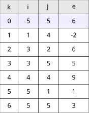
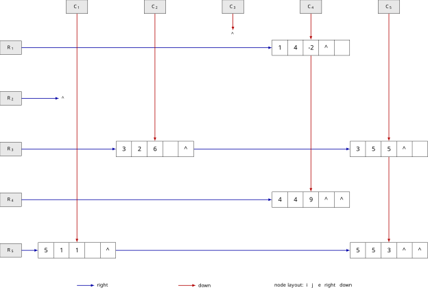

# 稀疏矩阵的三元组与十字链表存储

矩阵：

$$
\begin{pmatrix}
0&0&0&-2&0\\
0&0&0&0&0\\
0&6&0&0&5\\
0&0&0&9&0\\
1&0&0&0&3
\end{pmatrix}
$$

非零元素：$(1,4,-2),(3,2,6),(3,5,5),(4,4,9),(5,1,1),(5,5,3)$。

## 三元组表



```tikz
\begin{document}
\begin{tikzpicture}[
    scale=1.4,
    transform shape,
    cell/.style={draw, minimum height=7mm, inner sep=2pt, font=\small},
    head/.style={cell, fill=gray!18}
]
% Column headings
\node[head, minimum width=9mm] at (0,0.7) {$k$};
\node[head, minimum width=10mm] at (0.95,0.7) {$i$};
\node[head, minimum width=10mm] at (1.95,0.7) {$j$};
\node[head, minimum width=15mm] at (3.2,0.7) {$e$};

% Matrix metadata
\node[cell, fill=blue!7, minimum width=9mm] at (0,0) {0};
\node[cell, fill=blue!7, minimum width=10mm] at (0.95,0) {5};
\node[cell, fill=blue!7, minimum width=10mm] at (1.95,0) {5};
\node[cell, fill=blue!7, minimum width=15mm] at (3.2,0) {6};

% Nonzero elements in row-major order
\foreach \r/\k/\i/\j/\e in {%
    1/1/1/4/-2,
    2/2/3/2/6,
    3/3/3/5/5,
    4/4/4/4/9,
    5/5/5/1/1,
    6/6/5/5/3%
} {
    \node[cell, minimum width=9mm] at (0,{-0.7*\r}) {\k};
    \node[cell, minimum width=10mm] at (0.95,{-0.7*\r}) {\i};
    \node[cell, minimum width=10mm] at (1.95,{-0.7*\r}) {\j};
    \node[cell, minimum width=15mm] at (3.2,{-0.7*\r}) {\e};
}
\end{tikzpicture}
\end{document}
```

## 十字链表

其中 `R_i` 为行头指针，`C_j` 为列头指针。蓝色箭头为 `right` 指针，红色箭头为 `down` 指针，`∧` 表示空指针。



```tikz
\usetikzlibrary{shapes.multipart}
\begin{document}
\begin{tikzpicture}[
    data/.style={
        draw,
        rectangle split,
        rectangle split horizontal,
        rectangle split parts=5,
        rectangle split part align=center,
        minimum height=8mm,
        minimum width=3.5cm,
        inner sep=1.2pt,
        font=\small
    },
    head/.style={
        draw,
        fill=gray!18,
        minimum width=11mm,
        minimum height=7mm,
        font=\scriptsize
    },
    rlink/.style={->,>=latex,thick,blue!65!black},
    dlink/.style={->,>=latex,thick,red!70!black}
]

% Column head pointers
\node[head] (C1) at (0,2.1) {$C_1$};
\node[head] (C2) at (4,2.1) {$C_2$};
\node[head] (C3) at (8,2.1) {$C_3$};
\node[head] (C4) at (12,2.1) {$C_4$};
\node[head] (C5) at (16,2.1) {$C_5$};

% Row head pointers
\node[head] (R1) at (-3.4,0) {$R_1$};
\node[head] (R2) at (-3.4,-2.6) {$R_2$};
\node[head] (R3) at (-3.4,-5.2) {$R_3$};
\node[head] (R4) at (-3.4,-7.8) {$R_4$};
\node[head] (R5) at (-3.4,-10.4) {$R_5$};

% Nonzero nodes: i | j | e | right | down
\node[data] (A) at (12,0) {
    {\makebox[7mm][c]{1}}\nodepart{two}{\makebox[7mm][c]{4}}\nodepart{three}{\makebox[7mm][c]{-2}}\nodepart{four}{\makebox[7mm][c]{$\wedge$}}\nodepart{five}{\makebox[7mm][c]{}}
};
\node[data] (B) at (4,-5.2) {
    {\makebox[7mm][c]{3}}\nodepart{two}{\makebox[7mm][c]{2}}\nodepart{three}{\makebox[7mm][c]{6}}\nodepart{four}{\makebox[7mm][c]{}}\nodepart{five}{\makebox[7mm][c]{$\wedge$}}
};
\node[data] (C) at (16,-5.2) {
    {\makebox[7mm][c]{3}}\nodepart{two}{\makebox[7mm][c]{5}}\nodepart{three}{\makebox[7mm][c]{5}}\nodepart{four}{\makebox[7mm][c]{$\wedge$}}\nodepart{five}{\makebox[7mm][c]{}}
};
\node[data] (D) at (12,-7.8) {
    {\makebox[7mm][c]{4}}\nodepart{two}{\makebox[7mm][c]{4}}\nodepart{three}{\makebox[7mm][c]{9}}\nodepart{four}{\makebox[7mm][c]{$\wedge$}}\nodepart{five}{\makebox[7mm][c]{$\wedge$}}
};
\node[data] (E) at (0,-10.4) {
    {\makebox[7mm][c]{5}}\nodepart{two}{\makebox[7mm][c]{1}}\nodepart{three}{\makebox[7mm][c]{1}}\nodepart{four}{\makebox[7mm][c]{}}\nodepart{five}{\makebox[7mm][c]{$\wedge$}}
};
\node[data] (F) at (16,-10.4) {
    {\makebox[7mm][c]{5}}\nodepart{two}{\makebox[7mm][c]{5}}\nodepart{three}{\makebox[7mm][c]{3}}\nodepart{four}{\makebox[7mm][c]{$\wedge$}}\nodepart{five}{\makebox[7mm][c]{$\wedge$}}
};

% Row chains
\draw[rlink] (R1.east) -- (A.west);
\node[font=\scriptsize] (RN2) at (-0.7,-2.6) {$\wedge$};
\draw[rlink] (R2.east) -- (RN2.west);
\draw[rlink] (R3.east) -- (B.west);
\draw[rlink] (R4.east) -- (D.west);
\draw[rlink] (R5.east) -- (E.west);

\draw[rlink] (B.east) -- (C.west);
\draw[rlink] (E.east) -- (F.west);

% Column chains
\draw[dlink] (C1.south) -- (E.north);
\draw[dlink] (C2.south) -- (B.north);
\node[font=\scriptsize] (CN3) at (8,0.7) {$\wedge$};
\draw[dlink] (C3.south) -- (CN3.north);
\draw[dlink] (C4.south) -- (A.north);
\draw[dlink] (C5.south) -- (C.north);

\draw[dlink] (A.south) -- (D.north);
\draw[dlink] (C.south) -- (F.north);

% Legend
\draw[rlink] (0,-12.2) -- (0.9,-12.2);
\node[font=\scriptsize, anchor=west] at (0.9,-12.2) {right};
\draw[dlink] (5.2,-12.2) -- (6.1,-12.2);
\node[font=\scriptsize, anchor=west] at (6.1,-12.2) {down};
\node[font=\scriptsize, anchor=west] at (10.0,-12.2)
    {node layout: $i$ \ $j$ \ $e$ \ right \ down};

\end{tikzpicture}
\end{document}
```
