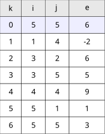
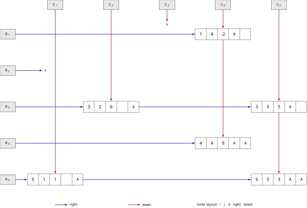

# 稀疏矩阵的三元组与十字链表存储

这里我用下面这个 $5\times 5$ 的矩阵 $M$ 为例，对照两种常用压缩存储结构——三元组表与十字链表，并把两者的空间开销算清楚：

$$
M = \begin{pmatrix}
0&0&0&-2&0\\
0&0&0&0&0\\
0&6&0&0&5\\
0&0&0&9&0\\
1&0&0&0&3
\end{pmatrix}
$$

矩阵规模为 $m=5$ 行、$n=5$ 列，非零元素共有 $t=6$ 个，按行优先（下标从 $1$ 开始）依次为：

$$(1,4,-2),\ (3,2,6),\ (3,5,5),\ (4,4,9),\ (5,1,1),\ (5,5,3)$$

## 三元组表

三元组表采用**顺序存储**，只把非零元的 `(行号 i, 列号 j, 元素值 e)` 按行优先顺序存进线性表里。因为全零的行或列在三元组中不会出现，所以除了这 $t$ 个非零元之外，还必须保存矩阵的**行数 $m$、列数 $n$ 和非零元个数 $t$**，否则无法还原矩阵的完整规模。

![[稀疏矩阵-三元组.svg]]



> **图注（稀疏矩阵的三元组表表示）**：表格四列依次为序号 `k`、行号 `i`、列号 `j` 和元素值 `e`；第 `0` 行（浅蓝底色）存放矩阵规模 `(5, 5, 6)`（$5$ 行 $5$ 列、$6$ 个非零元），第 `1`～`6` 行按行优先顺序依次存放 $6$ 个非零元的三元组。

在代码实现上，既可以像图中那样用第 `0` 行的三个位置来存 $(m, n, t)$，也可以在结构体里单独设 `mu`、`nu`、`tu` 三个整型成员：

```c
#define MAXSIZE 12500

typedef struct {
    int i, j;                   // 非零元的行下标与列下标（1 起始）
    ElemType e;                 // 非零元的值
} Triple;

typedef struct {
    Triple data[MAXSIZE + 1];   // data[0] 可留空或存规模，data[1..tu] 存非零元
    int mu, nu, tu;             // 矩阵的行数、列数与非零元个数
} TSMatrix;
```

三元组表紧凑、易于顺序扫描和转置；但因为底层是顺序表，一旦在运算中需要频繁插入或删除非零元（例如矩阵加减时出现 $0$ 变非零或非零变 $0$），就需要成片移动元素，维护代价比较高。

## 十字链表

当矩阵的非零元个数和位置会在操作过程中经常变化时，用**链式存储**的十字链表更合适。每个非零元对应一个包含 $5$ 个域的结点：`i`（行号）、`j`（列号）、`e`（元素值），以及两个指针域 `right` 和 `down`。同一行的非零元按列号递增通过 `right` 链在一起，同一列的非零元按行号递增通过 `down` 链在一起；再设置行头指针数组 $R_1 \sim R_m$ 与列头指针数组 $C_1 \sim C_n$ 分别指向各行、各列的首个非零元结点。

其中 $R_i$ 为行头指针，$C_j$ 为列头指针。蓝色箭头为 `right` 指针，红色箭头为 `down` 指针，`∧` 表示空指针。

![[稀疏矩阵-十字链表.svg]]



> **图注（稀疏矩阵的十字链表表示）**：上方 $C_1$～$C_5$ 为列头指针，左侧 $R_1$～$R_5$ 为行头指针；每个非零元结点依次包含 `i | j | e | right | down` 五个域，蓝色 `right` 箭头按列号递增串起同行结点，红色 `down` 箭头按行号递增串起同列结点，空行 $R_2$、空列 $C_3$ 及各链尾均以 `∧` 表示空指针。

对应的 C 语言结构定义如下：

```c
typedef struct OLNode {
    int i, j;                   // 非零元的行下标与列下标
    ElemType e;                 // 非零元的值
    struct OLNode *right, *down;// 同行右链指针与同列下链指针
} OLNode, *OLink;

typedef struct {
    OLink *rhead, *chead;       // 行、列链表头指针数组
    int mu, nu, tu;             // 矩阵的行数、列数与非零元个数
} CrossList;
```

在这张图里，第 $2$ 行全为 $0$，所以 $R_2$ 直接为 `∧`；第 $3$ 列全为 $0$，所以 $C_3$ 也直接为 `∧`。借助十字链表，我们可以同时按行、按列双向遍历，插入或删除结点时只需调整所在行和所在列的相邻指针。

## 存储结构与空间对比

设稀疏矩阵规模为 $m\times n$、非零元个数为 $t$，记一个整型下标占 $s_{\text{int}}$ 字节、元素值占 $s_{\text{val}}$ 字节、指针占 $s_{\text{ptr}}$ 字节，我们按实际有效存储来对比三种方式：

| 存储方式 | 存储组成 | 通用空间量级 | 本例（$m=5,n=5,t=6$）对比 | 适用特点 |
| --- | --- | --- | --- | --- |
| 常规二维数组 | $m \cdot n$ 个元素值 | $m \cdot n \cdot s_{\text{val}}$ | 占 $25$ 个单元；若元素为 `int`（4 B），共 $100\text{ B}$ | 随机存取 $O(1)$，但大量零元造成空间浪费 |
| 三元组表 | $t$ 个三元组 + $(m,n,t)$ 规模信息 | $t(2s_{\text{int}}+s_{\text{val}})+3s_{\text{int}}$，$O(t)$ | 含第 `0` 行共 $7\times 3=21$ 个单元；若均占 4 B，共 $84\text{ B}$ | 空间最省，适合静态稀疏矩阵与只读、转置运算 |
| 十字链表 | $t$ 个 5 域结点 + $(m+n)$ 个头指针 + $(m,n,t)$ | $t(2s_{\text{int}}+s_{\text{val}}+2s_{\text{ptr}})+(m+n)s_{\text{ptr}}+3s_{\text{int}}$，$O(m+n+t)$ | 单位数计 $5\times 6+10+3=43$ 单元；64 位下（指针 8 B、无对齐填充）约 $260\text{ B}$ | 支持动态插删非零元，可按行或按列高效遍历 |

关于空间对比有两个容易误判的地方，这里专门点一下：
1. **为什么本例三元组表只从 $25$ 单元降到 $21$ 单元？** 当 `ElemType` 只是单个整型且矩阵很小（$5\times 5$）时，每个非零元额外多存 $2$ 个下标，只有满足 $3t+3 < mn$（粗略地说非零元密度小于 $1/3$）时三元组表的单元数才比二维数组少。但压缩模型面向的是**大规模矩阵**（$t \ll mn$）或**单个元素占很大空间**（例如元素是一个包含多个字段的记录）的场景——元素本身越大，省掉 $mn-t$ 个零元素的收益就越明显。
2. **十字链表多出来的空间换了什么？** 相比三元组表，十字链表每个非零元多出 $2$ 个指针域，还多出 $m+n$ 个头指针。它用这部分 $O(m+n+t)$ 的额外空间，换来了矩阵加法、减法等会改变非零元分布的运算中不用成片移动数据的灵活性。

## 小结

三元组表和十字链表都是针对稀疏矩阵"非零元少且分布无规律"的压缩存储方案：三元组表按顺序存储，空间开销为 $O(t)$，适合矩阵结构稳定、以扫描和转置为主的场景；十字链表通过 `right` 和 `down` 两个链域把行链与列链正交起来，空间开销为 $O(m+n+t)$，适合需要动态增删非零元以及同时按行、按列遍历的运算场景。

## 待核实内容

1. 我在课堂上也讲过"带表头结点的行列双向循环十字链表"以及把 $2N$ 个表头合并为 $N$ 个表头的优化画法，而本笔记及 `wt2_02.svg` 采用的是不带表头结点的 `rhead[]`、`chead[]` 单链表口径（与教材图 5.6 一致），做题时需先看清题目采用哪一种链表约定。
2. 上表字节估算假设 `int` 与 `ElemType` 为 4 字节、64 位指针为 8 字节，且未计入编译器对 `OLNode` 的结构体内存对齐填充（按 8 字节对齐时单个结点通常占 32 字节，6 个结点合计会再多出 24 字节），也未计入 `TSMatrix` 静态数组按 `MAXSIZE` 预分配的空闲容量。
3. 本笔记未展开同样在稀疏矩阵存储中常用的二元组（行逻辑链接表）和伪地址表示法，后续若补充矩阵快速转置或矩阵乘法，需同步补全 `rpos[]` 行定位表说明。
